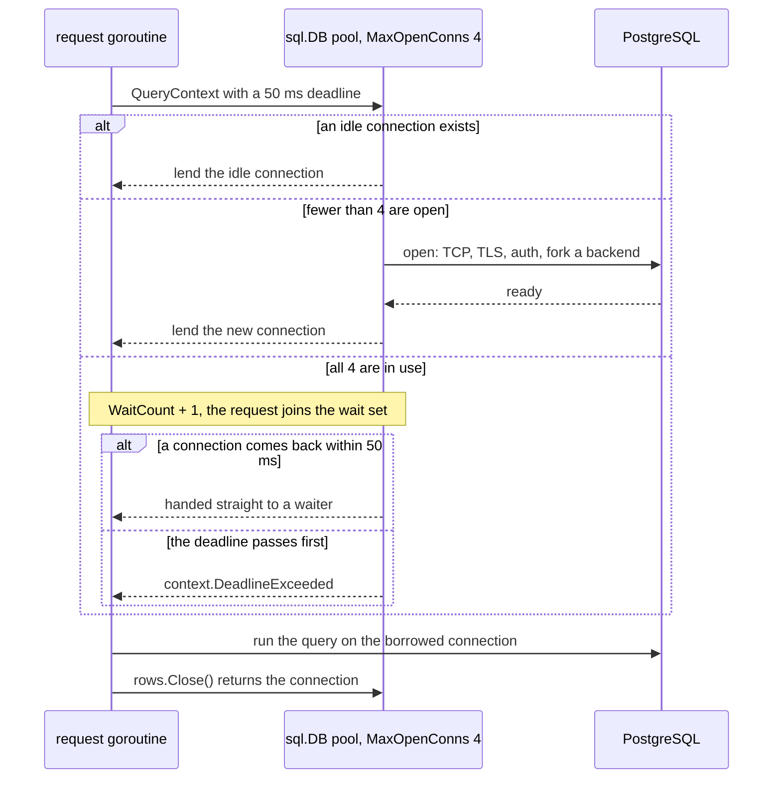
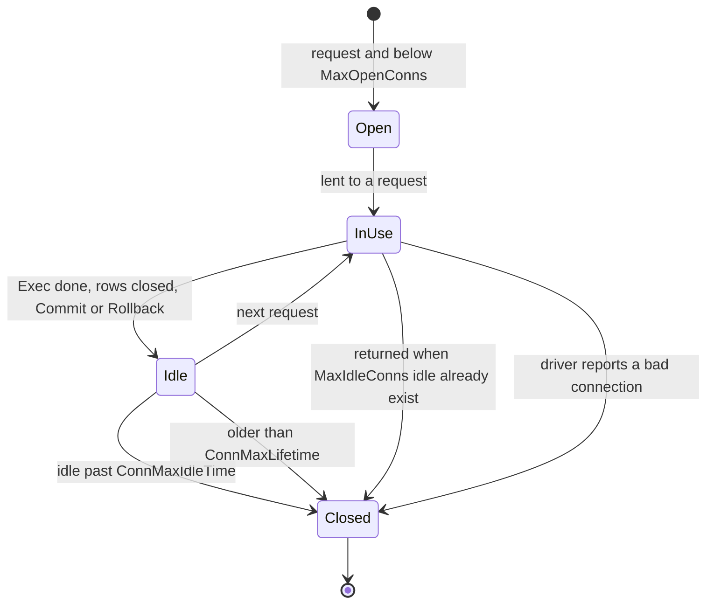
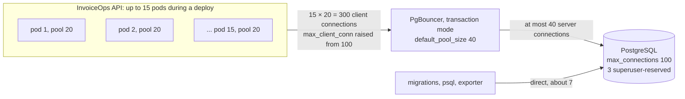

# Connection Pooling

> [!summary] TL;DR
> A connection pool keeps a few database connections open and lends them to requests, because opening a PostgreSQL connection is slow and every connection costs the server a whole process. In Go, `*sql.DB` and `pgxpool.Pool` are pools. Size each pool so that **all instances together** stay under the database's connection limit, and so that requests queue in the app instead of piling onto the database.

## 1. Why it exists

Opening a PostgreSQL connection is expensive on both sides:

- **Network:** around half a dozen round trips, for the TCP handshake, the TLS handshake, the startup message and SCRAM authentication. Since PostgreSQL 17, `sslnegotiation=direct` saves one of them.
- **Server:** the postmaster **forks a new backend process** for every connection. Each backend builds its own catalog caches and has private memory, plus `work_mem` for each sort or hash while a query runs.

Borrowing an idle pooled connection costs microseconds; opening one costs milliseconds (an estimate for the same region). Opening one per request would multiply latency and burn database CPU on process churn.

The limit matters as much as the cost. `max_connections` is typically 100, and changing it needs a restart. A classic outage: 10 containers each set their pool to 50. That allows 500 connections against a limit of 100, so new connections fail with `FATAL: sorry, too many clients already` (SQLSTATE 53300). Even below the limit, hundreds of *active* backends on 8 cores spend their time on context switches and lock contention instead of queries.

## 2. Mental model

A pool is a **taxi rank**: a fixed fleet of cars (connections) and a queue of passengers (requests). Passengers who arrive when every car is out wait in line, and a passenger who waits too long gives up (context deadline). Buying more cars than the roads can carry (database cores) only creates traffic jams.

So a pool does two jobs:
1. **Reuse:** pay the connection setup cost once.
2. **Limit:** cap concurrent work on the database. The pool is a bulkhead, see [[Bulkheads and Concurrency Limits]].

## 3. How it works

Every `QueryContext`, `ExecContext` or `BeginTx` borrows a connection and gives it back when the work ends:

| Call | Connection is held until |
| --- | --- |
| `ExecContext` | the statement finishes |
| `QueryRowContext(...).Scan` | `Scan` returns |
| `QueryContext` | `rows.Close()`, or `rows.Next()` returns false |
| `BeginTx` | `Commit` or `Rollback`. It is the same connection for the whole transaction. |
| `db.Conn(ctx)` | `conn.Close()` |

When a request asks for a connection and none is idle, the pool either opens one (below the cap) or parks the request until a connection comes back:



A pooled connection's life, with the `database/sql` knobs that end it:



**The knobs** (Go 1.24 `database/sql` and pgx v5.8 `pgxpool`):

| Setting | Default | What it does |
| --- | --- | --- |
| `SetMaxOpenConns(n)` | 0 = unlimited | Hard cap on open connections; beyond it requests wait |
| `SetMaxIdleConns(n)` | 2 | Idle connections kept; extras are closed when returned. Lowered to MaxOpen if larger |
| `SetConnMaxLifetime(d)` | 0 = forever | Close connections older than `d` (lazily, before reuse) |
| `SetConnMaxIdleTime(d)` | 0 = forever | Close connections idle longer than `d` |
| `pgxpool` `MaxConns` | max(4, `runtime.NumCPU()`) | Cap, like MaxOpenConns |
| `MaxConnLifetime` / `MaxConnLifetimeJitter` | 1 h / 0 | Age limit, with random extra time so connections do not all expire together |
| `MaxConnIdleTime` | 30 min | Idle limit |
| `HealthCheckPeriod` | 1 min | Background check that closes expired or broken connections |

`db.Stats()` returns `sql.DBStats`: `OpenConnections`, `InUse`, `Idle`, and the counters `WaitCount`, `WaitDuration`, `MaxIdleClosed`, `MaxIdleTimeClosed` and `MaxLifetimeClosed`. `pool.Stat()` in pgx has the equivalents, for example `EmptyAcquireCount` (acquires that had to wait) and `AcquireDuration`.

## 4. Worked example

**Sizing InvoiceOps with Little's Law.** Little's Law says the average number of busy connections is `L = λ × W`: arrival rate times how long each request holds a connection.

- Peak load: 1,200 requests/s across the fleet (an estimate for this example).
- Each request holds a connection for about 5 ms in total: 3 queries plus the gaps between them inside its transaction (an estimate; measure yours with `AcquireDuration` and query timings).
- So `L = 1,200 × 0.005 = 6` connections busy on average across the **whole fleet**.
- Bursts and p99 need headroom. With 3× headroom you need about 18 for the fleet, or 3 per pod at 6 pods. Round up to `MaxOpenConns = 5`.

Now check both limits:

| Check | Numbers | Result |
| --- | --- | --- |
| Connection budget | `max_connections` 100 − 3 superuser-reserved − 7 for migrations, `psql` and the metrics exporter = 90 | 90 for app pools |
| Worst-case fleet | autoscaler max 12 pods × 1.25 rolling-deploy surge = 15 pods × 5 | 75 ≤ 90, so it fits |
| Database CPU | 8 physical cores, hot data cached: `(8 × 2) + 0 = 16` active connections is the PostgreSQL wiki's starting point | 6 busy on average, so there is room |

The old mistake fails both checks: 10 pods × 50 = 500 possible connections against a limit of 100.

**Measured: the pool turns excess concurrency into queueing.** A fake `database/sql` driver whose every query sleeps 20 ms drives the real Go pool. 40 queries arrive at once (Go 1.24.4; three runs agreed within 2 ms):

| MaxOpenConns | Time for 40 queries | WaitCount | Average wait |
| ------------ | ------------------- | --------- | ------------ |
| 2            | 419 ms              | 38        | 209 ms       |
| 4            | 209 ms              | 36        | 104 ms       |
| 10           | 84 ms               | 30        | 42 ms        |
| 20           | 42 ms               | 20        | 21 ms        |
| 40           | 21 ms               | 0         | 0            |

Throughput is capped at `MaxOpenConns / query time`: 4 connections ÷ 20 ms = 200 queries/s, so 40 queries take at least 200 ms. The fake database has unlimited capacity, so a bigger pool always wins here. A real PostgreSQL saturates its cores and disks, and past that point more connections only add contention.

The test that pins this down:

```go
func newDB(delay time.Duration, maxOpen int) *sql.DB {
	db := sql.OpenDB(&connector{delay: delay})
	db.SetMaxOpenConns(maxOpen)
	db.SetMaxIdleConns(maxOpen) // the default of 2 would close and reopen the rest
	return db
}

func TestPoolCapsThroughput(t *testing.T) {
	db := newDB(20*time.Millisecond, 4)
	defer db.Close()

	start := time.Now()
	var wg sync.WaitGroup
	for range 40 {
		wg.Add(1)
		go func() {
			defer wg.Done()
			if _, err := FirstOverdue(context.Background(), db); err != nil {
				t.Error(err)
			}
		}()
	}
	wg.Wait()
	elapsed, st := time.Since(start), db.Stats()

	// 4 connections x 20 ms per query = at most 200 queries/s,
	// so 40 queries cannot finish in under 200 ms.
	if elapsed < 200*time.Millisecond {
		t.Errorf("elapsed %v, want >= 200ms", elapsed)
	}
	if st.OpenConnections > 4 || st.WaitCount == 0 {
		t.Errorf("stats %+v: want <= 4 open connections and some waits", st)
	}
	t.Logf("elapsed=%v WaitCount=%d WaitDuration=%v",
		elapsed.Round(time.Millisecond), st.WaitCount, st.WaitDuration.Round(time.Millisecond))
}
```

**A leak, caught by a test.** This function returns while `rows` is still open, so its connection never goes back to the pool:

```go
// FirstOverdueLeaky returns the first overdue invoice ID. It never closes
// rows, so the connection stays checked out of the pool until ctx ends.
func FirstOverdueLeaky(ctx context.Context, db *sql.DB) (int64, error) {
	rows, err := db.QueryContext(ctx, `SELECT id FROM invoices WHERE status = 'overdue' ORDER BY due_at`)
	if err != nil {
		return 0, err
	}
	if !rows.Next() { // Next returning false closes rows by itself
		if err := rows.Err(); err != nil {
			return 0, err
		}
		return 0, sql.ErrNoRows
	}
	var id int64
	err = rows.Scan(&id)
	return id, err // BUG: rows is still open and holds its connection
}
```

The fixed `FirstOverdue` is identical except for `defer rows.Close()` right after the error check. Two leaked calls empty a pool of 2, and the next caller times out:

```go
func TestLeakedRowsExhaustThePool(t *testing.T) {
	db := newDB(time.Millisecond, 2)
	defer db.Close()
	for range 2 {
		if _, err := FirstOverdueLeaky(context.Background(), db); err != nil {
			t.Fatal(err)
		}
	}
	if st := db.Stats(); st.InUse != 2 {
		t.Fatalf("InUse = %d, want 2 leaked connections", st.InUse)
	}

	// The pool is empty, so the next caller waits until its deadline.
	ctx, cancel := context.WithTimeout(context.Background(), 50*time.Millisecond)
	defer cancel()
	if _, err := FirstOverdue(ctx, db); !errors.Is(err, context.DeadlineExceeded) {
		t.Fatalf("err = %v, want context.DeadlineExceeded", err)
	}
}
```

All four tests in the module (throughput cap, leak, fix returns every connection, cancelled context reclaims a leak) pass `go vet` and `go test -race` on Go 1.24.4. Asserting `db.Stats().InUse == 0` after each handler test is a cheap leak detector for your own suite.

Production configuration for the budget above. The app calls `ConfigureDB(db, 5)` or `NewPool(ctx, dsn, 5)`:

```go
// ConfigureDB sizes a database/sql pool. maxOpen comes from the connection
// budget: (max_connections - reserved) / (pods at full scale, plus deploy surge).
func ConfigureDB(db *sql.DB, maxOpen int) {
	db.SetMaxOpenConns(maxOpen)             // default 0 = unlimited
	db.SetMaxIdleConns(maxOpen)             // default 2: bursts would reconnect
	db.SetConnMaxLifetime(30 * time.Minute) // default 0 = forever
	db.SetConnMaxIdleTime(5 * time.Minute)  // default 0 = forever
}

// NewPool opens a pgx pool with the same budget.
func NewPool(ctx context.Context, dsn string, maxConns int32) (*pgxpool.Pool, error) {
	cfg, err := pgxpool.ParseConfig(dsn)
	if err != nil {
		return nil, err
	}
	cfg.MaxConns = maxConns                     // default max(4, runtime.NumCPU())
	cfg.MaxConnLifetime = 30 * time.Minute      // default 1 h
	cfg.MaxConnLifetimeJitter = 5 * time.Minute // spread reconnects; default 0
	cfg.MaxConnIdleTime = 5 * time.Minute       // default 30 min
	pool, err := pgxpool.NewWithConfig(ctx, cfg)
	if err != nil {
		return nil, err
	}
	if err := pool.Ping(ctx); err != nil { // the pool does not connect on creation
		pool.Close()
		return nil, err
	}
	return pool, nil
}
```

## 5. Variants and comparison

| Option | How it works | Use when | Cost |
| --- | --- | --- | --- |
| In-app pool (`database/sql`, `pgxpool`) | Each process keeps its own connections | Always; it is the first layer | Fleet total grows with pod count |
| PgBouncer, session mode | A server connection is tied to a client until it disconnects | Many short-lived clients that need session features | Little multiplexing: one server connection per connected client |
| PgBouncer, transaction mode | A server connection is lent per transaction | Many pods or serverless functions; the usual choice | Session state breaks (next section); one more hop |
| PgBouncer, statement mode | Lent per statement; multi-statement transactions are refused | Autocommit-only workloads | No transactions at all |
| RDS Proxy | Managed transaction-level multiplexing; IAM auth; smoother failovers | AWS, especially Lambda | Sessions get **pinned** on `SET`, SQL `PREPARE`, temp tables, session advisory locks, `LISTEN`; extra latency and cost |
| PgCat, Supavisor, Odyssey | Newer poolers; multi-threaded, some add sharding or load balancing | Very high client counts | Younger tools, fewer operators know them |

PostgreSQL 17 has no built-in pooler, so external poolers fill that gap.

**What breaks in transaction mode** (from PgBouncer's feature table). Each item depends on session state, and the next transaction may run on a different server connection:

| Feature | Fix |
| --- | --- |
| `SET` / `RESET` (e.g. `SET statement_timeout`) | `SET LOCAL` inside the transaction, or set it per role or database |
| `LISTEN` | A direct or session-mode connection for listeners |
| Session advisory locks (`pg_advisory_lock`) | `pg_advisory_xact_lock` inside a transaction |
| `WITH HOLD` cursors; temp tables with `PRESERVE`/`DELETE ROWS` | Keep them inside one transaction; temp tables with `ON COMMIT DROP` |
| SQL-level `PREPARE` / `DEALLOCATE` | Protocol-level prepared statements instead |
| Protocol-level prepared statements | Supported since PgBouncer 1.21.0 when `max_prepared_statements` > 0; default 200 since 1.24.0 |

pgx prepares and caches every statement by default (`QueryExecModeCacheStatement`). Behind an older PgBouncer in transaction mode, that fails with "prepared statement does not exist" errors. pgx's docs suggest `default_query_exec_mode=exec` or `simple_protocol` there. Migrations need care too: golang-migrate holds a **session** advisory lock while it runs, so point it at the database directly, not at a transaction-mode pooler.

## 6. Trade-offs and when not to use

- **Too big a pool** does not make the database faster. Past roughly `cores × 2` active queries, throughput falls from context switching, lock and cache-line contention, and `work_mem` pressure (PostgreSQL wiki). It also uses up `max_connections`.
- **Too small a pool** queues requests in the app: `WaitDuration` grows while the database idles.
- **`MaxIdleConns` left at 2** with `MaxOpenConns` 20 closes and reopens connections on every burst. `MaxIdleClosed` climbing fast is the sign.
- **Idle connections still cost.** Each holds a backend process on the server. 500 idle connections are cheaper since PostgreSQL 14 sped up snapshots with many sessions, but they are not free.
- **Lifetime limits cause reconnect waves.** Every connection opened at deploy time expires at the same moment, so use jitter.
- **An external pooler is one more hop** and one more thing to fail over. PgBouncer is single-threaded and uses one CPU core per process; run several with `so_reuseport`.
- **Skip PgBouncer** when the fleet is small and fixed and in-app pools fit the budget comfortably. The pooler adds failure modes for no gain.

## 7. In production

- **Real systems:**
	- PgBouncer is the common choice in front of self-managed Postgres; GitLab's reference architectures include it.
	- Supabase built Supavisor for very many client connections.
	- AWS offers RDS Proxy and documents its pinning rules, for example "for PostgreSQL setting a variable leads to session pinning".
- **Exhaustion symptoms:**
	- p99 latency spikes while database CPU stays low.
	- `WaitCount` and `WaitDuration` rise, and errors say `context deadline exceeded` before any query ran.
	- Goroutine dumps show many goroutines blocked in `database/sql.(*DB).conn`.
- **Find who holds connections:**

```sql
SELECT state, count(*) AS conns, max(now() - state_change) AS longest_in_state
FROM pg_stat_activity
WHERE backend_type = 'client backend'
GROUP BY state
ORDER BY conns DESC;
```

Representative output (PostgreSQL 17):

```text
        state        | conns | longest_in_state
---------------------+-------+------------------
 idle                |    61 | 00:04:58.213114
 active              |     9 | 00:00:00.831502
 idle in transaction |     6 | 00:12:41.070226
```

Six sessions have sat inside an open transaction for up to 12 minutes. That is a missing `Rollback` on an error path, or an HTTP call made while a transaction was open. They hold their connections and any locks they took, and an open transaction can keep VACUUM from removing dead rows.

- **Failure modes → fixes:**
	- Leaked `rows` or `tx` → `defer rows.Close()`; `defer tx.Rollback()` right after `BeginTx` (it is a no-op after `Commit`); an `InUse == 0` assertion in tests.
	- Leaked transactions → `idle_in_transaction_session_timeout` (for example 60 s); since PostgreSQL 17 also `transaction_timeout`.
	- Network calls inside transactions → move them out, or use an outbox row; see [[Transactions and the Repository Pattern]].
	- An autoscaler multiplies pools past `max_connections` → size pools for the maximum pod count plus surge, or put PgBouncer in transaction mode in front.
	- A serverless storm (1,000 concurrent functions, each with its own pool) → `MaxOpenConns = 1` per instance, created outside the handler, behind RDS Proxy or PgBouncer.
	- Pooled connections still point at the old primary after a failover → bounded `ConnMaxLifetime`, plus discarding connections on read-only errors.
- **What to monitor and alert on:**
	- App: `InUse / MaxOpenConnections`, the rate of `WaitCount`, average wait `ΔWaitDuration / ΔWaitCount`, and the rate of `MaxIdleClosed`.
	- Postgres: total connections against `max_connections` (alert at about 80%), and the `idle in transaction` count and age.
	- PgBouncer `SHOW POOLS`: `cl_waiting` (clients waiting for a server connection) and `maxwait` (how long the oldest has waited).

## 8. Deep dive

- **Fleet math with a pooler.** PgBouncer's per-pair `default_pool_size` (20 by default) caps the **server** connections. Client connections are cheap for it, but `max_client_conn` defaults to 100, so raise it:



- **Who gets a returned connection?** In Go 1.24's `database/sql`, a connection coming back is handed to a **random** waiting request (`connRequests.TakeRandom`), not to the longest-waiting one. Under sustained saturation some requests wait far longer than the average. That is one more reason every query needs a context deadline.
- **Leaks are bounded by the context.** If the query's context is cancelled, `database/sql` closes the `Rows` in the background and rolls back a `Tx` whose context ends. `net/http` cancels `r.Context()` when the handler returns, so a request-scoped leak lasts as long as the request. With `context.Background()` (cron jobs, workers) it lasts forever. The module's fourth test proves the background close.
- **Bad connections** are retried. When the driver returns `driver.ErrBadConn`, `database/sql` makes up to two attempts with pooled connections, then one with a freshly opened connection.
- **Why lifetime limits matter after failover.** A connection's target is resolved once, at connect time. After a DNS-based failover, or when replicas are added behind a reader endpoint, only **new** connections see the change. Keep `ConnMaxLifetime` in minutes, with jitter where the pool supports it (pgxpool's `MaxConnLifetimeJitter`; `database/sql` has none). Keep `ConnMaxIdleTime` shorter than any load balancer or NAT idle timeout on the path.
- **Server-side timeouts interact with pools.** `idle_session_timeout` (PostgreSQL 14+) kills idle pooled connections from the server side. Set the pool's `ConnMaxIdleTime` lower so the pool closes them first. `statement_timeout` and `lock_timeout` are better set per role than with a session `SET`, which transaction pooling would lose.
- **Prepared statements in transaction mode, internally.** PgBouncer 1.21+ tracks each client's protocol-level named statements. When the client's next transaction lands on another server connection, PgBouncer prepares the statement there under its own name, so pgx's statement cache keeps working.

## 9. Interview questions

> [!question]- Why not open a fresh connection per request?
> Each one costs about half a dozen network round trips (TCP, TLS, startup, SCRAM) plus a forked backend process on the server: milliseconds instead of microseconds. And nothing would cap how many connections hit the database at once. A pool pays the setup cost once and doubles as a concurrency limit.

> [!question]- How do you size a pool?
> Start from Little's Law: busy connections = request rate × connection hold time, plus headroom for bursts. Then check two ceilings. Pods at full scale (plus deploy surge) × pool size must fit in `max_connections` minus reserved slots. Active queries should stay near the database's sweet spot (about `cores × 2`). Then watch `WaitCount`/`WaitDuration` and adjust.

> [!question]- Trap: the API is slow, so let's raise MaxOpenConns from 10 to 100 per pod. Good idea?
> Usually not. If the database is saturated, more concurrent queries only add contention and the slowdown grows. If it is idle, connections are being held by something that is not a query: leaks, long transactions, network calls inside a transaction. Find out which with `pg_stat_activity` and pool stats before touching the size.

> [!question]- The pool is exhausted but database CPU is at 10%. What is going on?
> Connections are checked out but not running queries. Typical causes: unclosed `rows`, a missing `Rollback` on an error path, HTTP calls inside a transaction, or a handler waiting on something slow while holding a connection. `pg_stat_activity` shows them as `idle` or `idle in transaction` sessions with old `state_change` times.

> [!question]- What breaks behind PgBouncer in transaction mode?
> Anything that relies on session state surviving between transactions: `SET`, `LISTEN`, session advisory locks, `WITH HOLD` cursors, session temp tables and SQL `PREPARE`. Protocol-level prepared statements work from PgBouncer 1.21 with `max_prepared_statements` set (default 200 since 1.24). Use `SET LOCAL` and `pg_advisory_xact_lock`, and run migrations and listeners over direct connections.

> [!question]- Why set a maximum connection lifetime?
> Connections resolve their target once. After a failover, a DNS change, or new replicas behind a reader endpoint, old connections keep their old target until they are closed. A lifetime in minutes, with jitter, bounds that window. It also recycles backends whose private caches have grown. Idle timeouts in NATs and load balancers are handled by `ConnMaxIdleTime`, not by the lifetime.

> [!question]- Trap: does a leaked `rows` leak its connection forever?
> Only if its context never ends. `database/sql` closes rows when the query's context is cancelled, and `net/http` cancels the request context when the handler returns. So in a handler, the leak lasts as long as the request. In a worker using `context.Background()` it is permanent, and the pool drains one connection at a time.

## 10. Cheat sheet

- Postgres = one process per connection; `max_connections` is typically 100 and needs a restart to change.
- `database/sql` defaults: MaxOpen unlimited, MaxIdle 2, no lifetime limits. Set all four knobs.
- Size: `L = λ × W`, plus headroom; fleet total ≤ `max_connections` − reserved; active ≈ `cores × 2` (a starting point).
- Exhaustion = rising `WaitCount`/`WaitDuration`, timeouts before the query, idle database CPU.
- Leaks: `defer rows.Close()`, `defer tx.Rollback()`, no network calls inside transactions, `idle_in_transaction_session_timeout`.
- PgBouncer transaction mode: no session `SET`, `LISTEN`, session advisory locks or SQL `PREPARE`; protocol prepared statements OK on 1.21+.
- Lifetime with jitter handles failover and DNS changes.

## Links

- **Before this:** [[Transactions and ACID]], [[Processes, Threads and Context Switching]]
- **Next:** [[Database Access (database-sql, pgx, sqlc)]], [[Replication]], [[Debugging Database Performance]]
- **Compare with:** [[Bulkheads and Concurrency Limits]] (the pool as a bulkhead), [[N+1 Query Problem]] (the other way to waste connections), [[AWS 08 - RDS and Aurora]] (RDS Proxy)
