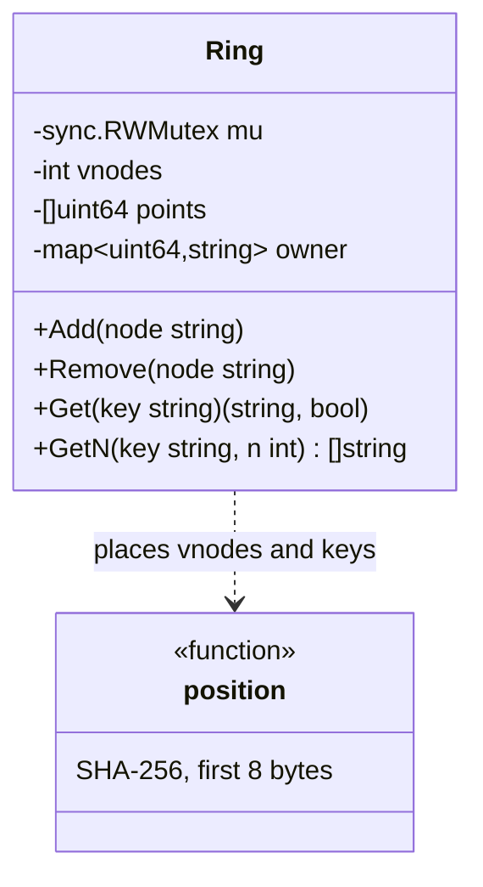
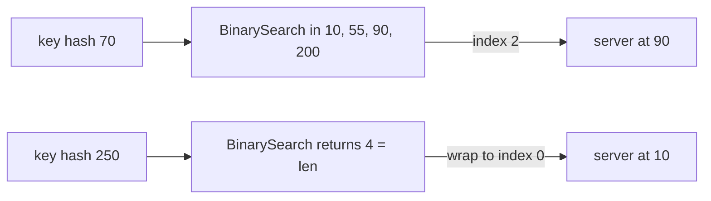
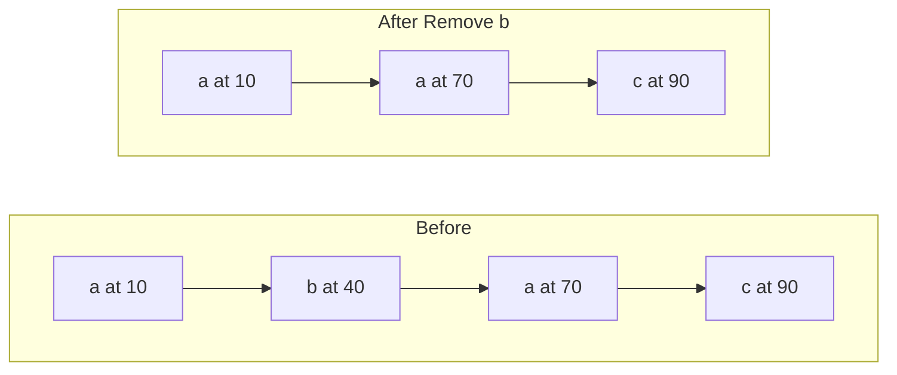
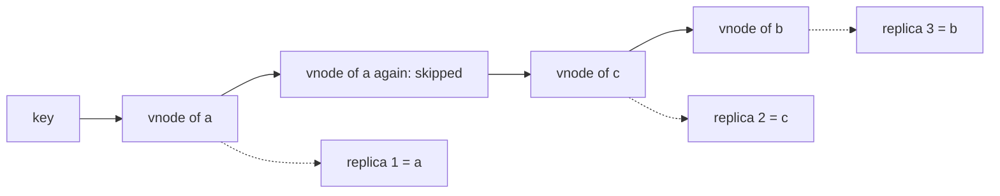

# Consistent Hashing - Go

> [!summary] TL;DR
> A hash ring with virtual nodes in about 80 lines of Go: `Add`, `Remove`, `Get` and `GetN`, plus tests that prove the two promises of [[Consistent Hashing]]: keys only move to a joining node, and only about `1/N` of them.

> [!info] How to read this note (pick your level)
> - 🟢 **New to this?** Read "From zero" below, "Before the code", the whiteboard version, then "Running it". Stop there.
> - 🟡 **Know the basics?** Add the full "Code" walkthrough, "Design decisions" and "Tests".
> - 🔴 **Interview / SDE-3 prep?** Add "Pitfalls in the code" and do the "Exercises". Headings are tagged 🟢🟡🔴.

**From zero, in 60 seconds** 🟢

This file is the hands-on twin of [[Consistent Hashing]]. It builds a working hash ring in about 80 lines of Go: you can add servers, remove servers, and ask "which server owns this key?". Read the theory note first if the ring idea is new. Here, start with the tiny whiteboard version, then read the full version step by step; each code block is followed by a plain "How it works" list. The tests at the end are the proof: they show that adding a server moves only about one fifth of the keys, while the naive `%` rule moves 80%.

## Before the code 🟢

- **Sorted slices plus `slices.BinarySearch`**: the ring is a sorted `[]uint64` and lookup is a binary search for the first point at or after the key.
- **Maps** (`map[uint64]string`): from a point on the ring back to the physical node that owns it.
- **`sync.RWMutex`**: many readers (lookups) can run together; writers (`Add`, `Remove`) get exclusive access.
- **`crypto/sha256`**: a well-mixing hash so similar names like `a#1` and `a#2` land far apart.
- **Multiple return values** (`(string, bool)`): `Get` reports "no node" with `false` instead of panicking.
- **What to run:** `go vet ./... && go test -race -v ./...` inside the module (includes the `wb/` sub-package).

## What this code shows 🟢

| Code | Concept in [[Consistent Hashing]] |
| --- | --- |
| `wb.Ring` (whiteboard) | The ring as a sorted array plus binary search, [[Consistent Hashing#3.1 The ring is a sorted array]] and [[Consistent Hashing#3.2 Lookup is a binary search]] |
| `position` | Placing servers and keys on the same circle; hash quality, [[Consistent Hashing#8. Deep dive]] |
| `Ring.Add` with `vnodes` | Virtual nodes, [[Consistent Hashing#3.5 Virtual nodes]] |
| `Ring.Get` | Lookup with wrap-around, §3.2 |
| `Ring.Remove` | Removing a node gives its arcs to its successors, [[Consistent Hashing#3.4 Removing a node]] and [[Consistent Hashing#3.6 When a node dies, vnodes spread its load]] |
| `Ring.GetN` | Replication to the next distinct physical nodes, [[Consistent Hashing#3.7 Replication uses the next distinct nodes]] |
| `TestAddingNodeOnlyMovesKeysToIt` | The `1/N` movement promise, [[Consistent Hashing#3.3 Adding a node]] |
| `TestModuloVersusRing` | The modulo trap, [[Consistent Hashing#1.1 The modulo trap, with numbers]] |



The code is small because the idea is small: two data structures (a sorted slice of positions and a map from position to node) and one function that turns a string into a position. Everything else is bookkeeping for locks, duplicates and replicas.

## Setup 🟢

- Module `ring` with `ring.go`, `ring_test.go`, and a sub-package `wb/` for the whiteboard version.
- Go 1.24, standard library only.
- Run: `go vet ./... && go test -race -v ./...`

## Code 🟡

### Whiteboard version

**In plain words: the smallest ring that works — one sorted list, one map, one binary search.**

**Concept.** The ring in [[Consistent Hashing#3.1 The ring is a sorted array]] is just a sorted array of numbers that is treated as a circle.

A server is placed by hashing its name; a key is placed by hashing the key; the owner is the first server at or after the key's position, wrapping to the start after the last one.

The alternative, `hash(key) % N`, is simpler but remaps about 80% of keys when N goes from 4 to 5. The ring costs a sort on every change and a binary search per lookup, which is cheap.

The whiteboard version assumes at least one server was added, and `NewRing` initialises the map so `Add` does not write to a nil map.

```go
package wb

import (
	"hash/crc32"
	"slices"
)

type Ring struct {
	points []uint32          // sorted positions on the circle
	node   map[uint32]string // position -> server
}

func NewRing() *Ring { return &Ring{node: map[uint32]string{}} }
```

```go
func (r *Ring) Add(server string) {
	p := crc32.ChecksumIEEE([]byte(server))
	r.node[p] = server
	r.points = append(r.points, p)
	slices.Sort(r.points)
}

// Get returns the first server clockwise from the key's position.
func (r *Ring) Get(key string) string {
	h := crc32.ChecksumIEEE([]byte(key))
	i, _ := slices.BinarySearch(r.points, h)
	if i == len(r.points) {
		i = 0 // wrap around the circle
	}
	return r.node[r.points[i]]
}
```

**How it works.**

1. `points` is the circle laid out as a sorted slice; `node` says which server sits at each position.
2. `Add` hashes the server name with CRC32, stores the mapping, appends the position and re-sorts so binary search stays valid.
3. `slices.BinarySearch` returns the index of the first point that is greater than or equal to the key's hash. That point is the next server clockwise.
4. `i == len(r.points)` means the key is past the last server, so the circle wraps to index 0.



The full version adds virtual nodes, removal, collision handling, replica lookup, locking, and tests.

### Step 1: the ring type and the hash function

**In plain words: the struct holds the circle (a sorted list of numbers), a map saying who sits where, and a lock so readers and writers do not trip over each other.**

**Concept.** Virtual nodes ([[Consistent Hashing#3.5 Virtual nodes]]) fix the uneven spread of one point per server: each physical node gets many points, so its share of the circle is the sum of many small random arcs and approaches `1/N`.

The struct therefore keeps three things: how many vnodes per node, the sorted positions, and a map from position back to the physical node. A `sync.RWMutex` protects them because lookups are frequent and changes are rare.

SHA-256 is slow but mixes its output well, so similar names such as `a#1` and `a#2` land far apart; cheaper hashes like CRC32 or FNV can clump them ([[Consistent Hashing#8. Deep dive]]).

```go
package ring

import (
	"crypto/sha256"
	"encoding/binary"
	"slices"
	"strconv"
	"sync"
)

// Ring maps keys to nodes using consistent hashing with virtual nodes.
type Ring struct {
	mu     sync.RWMutex
	vnodes int               // virtual nodes per physical node
	points []uint64          // sorted vnode positions on the ring
	owner  map[uint64]string // vnode position -> physical node
}
```

```go
func New(vnodes int) *Ring {
	return &Ring{vnodes: vnodes, owner: make(map[uint64]string)}
}

// position places a string on the ring (0 .. 2^64-1).
// SHA-256 is slow but spreads similar strings evenly; see "Deep dive".
func position(s string) uint64 {
	sum := sha256.Sum256([]byte(s))
	return binary.BigEndian.Uint64(sum[:8])
}
```

**How it works.**

1. `vnodes` is fixed at construction, so every node gets the same number of points.
2. `points` is kept sorted by `Add` and `Remove`; `Get` relies on that.
3. `owner` maps a vnode position to the physical node name, so the ring can return real servers.
4. `New` creates the map with `make`, avoiding a nil-map write in `Add`.
5. `position` hashes with SHA-256 and keeps the first 8 bytes as a `uint64`. The same function places both vnodes and keys, which is what lets them share one circle.

### Step 2: adding and removing nodes

**In plain words: adding a server just drops its 200 points onto the circle; removing one just picks its points back up — nobody else's keys are touched.**

**Concept.** Adding and removing nodes is where the minimal-movement promise comes from ([[Consistent Hashing#3.3 Adding a node]], [[Consistent Hashing#3.4 Removing a node]]).

A new node only inserts points; each new point takes over part of the arc of the point that was next clockwise, so keys only move to the new node.

Removing a node deletes its points; the keys on its arcs automatically fall to the next point clockwise, with no explicit hand-off code. Because each node has many vnodes, those arcs go to many different survivors, which spreads the load of a failure.

The alternative is rebuilding the whole ring on each change, which is simpler but loses the property that unaffected keys stay put.

```go
func (r *Ring) Add(node string) {
	r.mu.Lock()
	defer r.mu.Unlock()
	for i := 0; i < r.vnodes; i++ {
		p := position(node + "#" + strconv.Itoa(i))
		if _, taken := r.owner[p]; taken {
			continue // 64-bit collision: practically never happens
		}
		r.owner[p] = node
		r.points = append(r.points, p)
	}
	slices.Sort(r.points)
}
```

**How it works.**

1. `Lock` is the write lock, so no `Get` sees a half-updated ring.
2. Each vnode is named `node#i`, for example `a#0` to `a#199`, and hashed to its position.
3. If a position is already owned, that vnode is skipped. With 64-bit positions this essentially never happens.
4. `slices.Sort` runs once after all points are appended, which is cheaper than sorting per vnode.

```go
func (r *Ring) Remove(node string) {
	r.mu.Lock()
	defer r.mu.Unlock()
	r.points = slices.DeleteFunc(r.points, func(p uint64) bool {
		if r.owner[p] != node {
			return false
		}
		delete(r.owner, p)
		return true
	})
}
```

**How it works.**

1. `slices.DeleteFunc` removes every element for which the function returns true and keeps the order, so `points` stays sorted without a re-sort.
2. The predicate also deletes the position from `owner`, so the slice and the map stay in step.
3. No hand-off code exists: after the points are gone, `Get` naturally returns the next point clockwise, which belongs to a surviving node.



Keys that used to land on `b` at 40 (positions 11 to 40) now continue clockwise to the point at 70. Keys on the other arcs do not change owner.

### Step 3: lookup and replica lookup

**In plain words: `Get` finds the next point clockwise from the key; `GetN` keeps walking to collect a few *different* servers for spare copies.**

**Concept.** Lookup is the binary search in [[Consistent Hashing#3.2 Lookup is a binary search]]: find the first point at or after the key, wrapping at the end.

Replication ([[Consistent Hashing#3.7 Replication uses the next distinct nodes]]) extends this by continuing clockwise and collecting nodes until it has `n` distinct physical ones. It must skip further vnodes of a node it already chose, otherwise all replicas could be on one machine.

Dynamo-style stores call the result the preference list. The design returns an `ok` flag or a shorter slice rather than panicking, so callers can handle an empty ring.

```go
// Get returns the owner of key: the first vnode clockwise from position(key).
func (r *Ring) Get(key string) (string, bool) {
	r.mu.RLock()
	defer r.mu.RUnlock()
	if len(r.points) == 0 {
		return "", false
	}
	i, _ := slices.BinarySearch(r.points, position(key)) // first point >= hash
	if i == len(r.points) {
		i = 0 // past the last point: wrap around
	}
	return r.owner[r.points[i]], true
}
```

**How it works.**

1. `RLock` lets many goroutines look up at once.
2. An empty ring returns `("", false)`, unlike the whiteboard version, which would panic on `r.points[0]`.
3. The binary search takes `O(log P)` time for `P` points. With 4 nodes and 200 vnodes that is about 10 comparisons.
4. The wrap-around turns the sorted slice into a circle.

```go
// GetN returns up to n distinct physical nodes clockwise from key.
// Dynamo-style stores call this the "preference list" and replicate to it.
func (r *Ring) GetN(key string, n int) []string {
	r.mu.RLock()
	defer r.mu.RUnlock()
	var out []string
	seen := make(map[string]bool)
	start, _ := slices.BinarySearch(r.points, position(key))
	for i := 0; i < len(r.points) && len(out) < n; i++ {
		node := r.owner[r.points[(start+i)%len(r.points)]]
		if !seen[node] {
			seen[node] = true
			out = append(out, node)
		}
	}
	return out
}
```

**How it works.**

1. `start` is the same index `Get` would use.
2. The loop walks at most one full lap (`i < len(r.points)`), so it ends even if there are fewer than `n` distinct nodes.
3. `(start+i)%len(r.points)` wraps the index around the circle.
4. `seen` skips vnodes of nodes already chosen, so the result has distinct physical nodes. The first entry is always the same as `Get`'s answer.



## Design decisions 🟡

| Decision | Alternative | Trade-off |
| --- | --- | --- |
| Sorted `[]uint64` plus binary search | A balanced tree or skip list | Lookups are fast and the code is tiny. Each `Add` re-sorts, which costs `O(P log P)`. |
| 200 vnodes per node in tests | 1 vnode, or thousands | More vnodes smooth the load (about `1/√V` variation) but cost memory and slower changes. |
| SHA-256, first 8 bytes | CRC32, FNV, xxHash, Murmur3 | Excellent mixing and stable output. It is slower than non-cryptographic hashes. |
| Skip vnode collisions | Re-hash with a salt | Simple. A node ends up with one vnode fewer in the rare case it happens. |
| `RWMutex` | Immutable snapshot swapped atomically | Easy to follow. Snapshots would give lock-free reads. |
| `Get` returns `ok` | Panic on empty ring | The caller handles "no servers" explicitly. |
| `GetN` may return fewer than `n` | Return an error | Callers decide whether a short list is acceptable. |

## Tests 🟡

**In plain words: each test checks one promise of the ring, and the table before each test says what goes in and what must come out.**

The tests prove the two promises of the ring (keys move only to a joining node, and only `1/N` of them) and the supporting behaviour of removal, replica lookup and the comparison against `hash % N`.

### TestAddingNodeOnlyMovesKeysToIt

**Property.** When a node joins, every key that changes owner must move to the new node (never between two old nodes), and about `1/5` of the keys must move. This is the core promise of [[Consistent Hashing#3.3 Adding a node]]. If keys also shuffled between old nodes, a cache fleet would lose hits for no reason.

| Step | Input | Expected |
| --- | --- | --- |
| Setup | Ring with 200 vnodes and nodes a, b, c, d | Owners of 10,000 keys recorded |
| Add | `Add("e")` | Any key whose owner changed has the new owner `e` |
| Count | Number of moved keys | Between 1,500 and 2,500 (ideal 2,000) |

```go
func TestAddingNodeOnlyMovesKeysToIt(t *testing.T) {
	r := New(200)
	for _, n := range []string{"a", "b", "c", "d"} {
		r.Add(n)
	}
	before := map[string]string{}
	for i := 0; i < 10_000; i++ {
		k := "user:" + strconv.Itoa(i)
		before[k], _ = r.Get(k)
	}
```

```go
	r.Add("e")

	moved := 0
	for k, old := range before {
		now, _ := r.Get(k)
		if now == old {
			continue
		}
		if now != "e" {
			t.Fatalf("%s moved %s -> %s; only the new node may gain keys", k, old, now)
		}
		moved++
	}
	if moved < 1_500 || moved > 2_500 { // ideal is 1/5 = 2000
		t.Fatalf("moved %d of 10000 keys, want about 2000", moved)
	}
}
```

**How it works.**

1. The first block builds the ring and records every key's owner before the change.
2. After `Add("e")` the loop compares each key's new owner with the old one.
3. `now != "e"` is the strict check: a move to any node other than `e` fails the test immediately.
4. The range check proves the amount of movement is near the ideal `1/N`; with `hash % N` it would be near 80%.

**If it fails.** A `moved ... only the new node may gain keys` failure means positions of existing nodes changed, so the ring is not stable and every join would cause a reshuffle. A count outside the range means the load is badly unbalanced (too few vnodes or a weak hash).

### TestRemoveGivesKeysToSuccessors

**Property.** Removing node `b` must move only the keys that `b` owned, and afterwards no key may still be owned by `b`.

| Input | Expected |
| --- | --- |
| Ring with a, b, c, d; remove `b` | A key not owned by `b` before keeps the same owner |
| Same | No key is owned by `b` after |

```go
func TestRemoveGivesKeysToSuccessors(t *testing.T) {
	r := New(100)
	for _, n := range []string{"a", "b", "c", "d"} {
		r.Add(n)
	}
	before := map[string]string{}
	for i := 0; i < 5_000; i++ {
		k := "k:" + strconv.Itoa(i)
		before[k], _ = r.Get(k)
	}
	r.Remove("b")
	for k, old := range before {
		now, _ := r.Get(k)
		if old != "b" && now != old {
			t.Fatalf("%s moved %s -> %s although %s did not leave", k, old, now, old)
		}
		if now == "b" {
			t.Fatalf("%s still owned by removed node", k)
		}
	}
}
```

**How it works.**

1. The test records owners for 5,000 keys before the removal.
2. The first check protects bystanders: a key owned by a surviving node must stay where it is.
3. The second check proves `Remove` deleted all of `b`'s points from both `points` and `owner`.

**If it fails.** The first message means removal disturbed unrelated keys, so a failure of one node would invalidate healthy caches. The second means a stale point remained, so keys would still be sent to a dead server.

### TestGetNDistinctAndEmpty

**Property.** An empty ring must say "not found", and `GetN` must return distinct physical nodes with the primary owner first.

| Input | Expected |
| --- | --- |
| `Get("x")` on an empty ring | `ok == false` |
| `GetN("user:1", 3)` with nodes a, b, c | 3 distinct nodes |
| Same | `got[0]` equals `Get("user:1")` |

```go
func TestGetNDistinctAndEmpty(t *testing.T) {
	r := New(50)
	if _, ok := r.Get("x"); ok {
		t.Fatal("empty ring must report not found")
	}
	for _, n := range []string{"a", "b", "c"} {
		r.Add(n)
	}
	got := r.GetN("user:1", 3)
	seen := map[string]bool{}
	for _, n := range got {
		seen[n] = true
	}
	if len(got) != 3 || len(seen) != 3 {
		t.Fatalf("GetN = %v, want 3 distinct nodes", got)
	}
	if first, _ := r.Get("user:1"); got[0] != first {
		t.Fatalf("GetN[0] = %s, want owner %s", got[0], first)
	}
}
```

**How it works.**

1. The empty-ring check runs before any `Add`.
2. The `seen` set counts distinct entries; with 50 vnodes per node, the walk will pass many vnodes of the same node, so the test proves the skip logic.
3. The last check ties `GetN` to `Get`, so the first replica is the owner.

**If it fails.** Fewer than 3 distinct nodes means replicas could land on one machine, so one failure could destroy every copy. A wrong first element means the replica list and the owner disagree.

### TestModuloVersusRing

**Property.** Measure how many keys move when growing from 4 to 5 servers with `hash % N` versus the ring ([[Consistent Hashing#1.1 The modulo trap, with numbers]]). Modulo should move about 80%; the ring about 20% with a busiest node near the average.

| Strategy | Expected moved keys of 100,000 |
| --- | --- |
| `hash % 4` to `hash % 5` (FNV-1a) | Between 75,000 and 85,000 |
| Ring, 200 vnodes, add `e` | About 20,000 (logged, not asserted) |

```go
// Measures how many keys change server when going from 4 to 5 servers.
func TestModuloVersusRing(t *testing.T) {
	const keys = 100_000
	moved := 0
	for i := 0; i < keys; i++ {
		h := fnv.New32a()
		h.Write([]byte("user:" + strconv.Itoa(i)))
		if h.Sum32()%4 != h.Sum32()%5 {
			moved++
		}
	}
	t.Logf("hash %% N: %.1f%% of keys moved", 100*float64(moved)/keys)
	if moved < 75_000 || moved > 85_000 {
		t.Fatalf("modulo moved %d, want about 80%%", moved)
	}
```

```go
	r := New(200)
	for _, n := range []string{"a", "b", "c", "d"} {
		r.Add(n)
	}
	before := make([]string, keys)
	for i := range before {
		before[i], _ = r.Get("user:" + strconv.Itoa(i))
	}
	r.Add("e")
	ringMoved, load := 0, map[string]int{}
	for i := range before {
		now, _ := r.Get("user:" + strconv.Itoa(i))
		load[now]++
		if now != before[i] {
			ringMoved++
		}
	}
	busiest := 0
	for _, n := range load {
		busiest = max(busiest, n)
	}
	t.Logf("ring SHA-256, 200 vnodes: %.1f%% moved, busiest node %.2fx average",
		100*float64(ringMoved)/keys, float64(busiest)/(keys/5))
}
```

**How it works.**

1. A key keeps its server under modulo only when `h%4 == h%5`, which happens for about 1 in 5 hashes, so about 80% move.
2. `t.Logf("hash %% N ...")` uses `%%` to print a literal percent sign.
3. The ring half repeats the add experiment on 100,000 keys and also counts how many keys each node holds, using the builtin `max` from Go 1.21.
4. The ring numbers are logged, not asserted, because they depend on key names and hash details. The strict ring assertions are in `TestAddingNodeOnlyMovesKeysToIt`.

**If it fails.** If modulo moves much less than 75,000 keys, the key set or hash is not uniform and the comparison is meaningless.

The imports for the test file are `hash/fnv`, `strconv` and `testing`. A one-test file in `wb/` checks that `Get` wraps and returns a known server.

## Running it 🟢

```text
go vet ./... && go test -race -v ./...
```

Measured with `go test -race -v ./...` on Go 1.24:

```text
=== RUN   TestAddingNodeOnlyMovesKeysToIt
--- PASS: TestAddingNodeOnlyMovesKeysToIt (0.04s)
=== RUN   TestRemoveGivesKeysToSuccessors
--- PASS: TestRemoveGivesKeysToSuccessors (0.01s)
=== RUN   TestGetNDistinctAndEmpty
--- PASS: TestGetNDistinctAndEmpty (0.00s)
=== RUN   TestModuloVersusRing
    ring_test.go:92: hash % N: 80.0% of keys moved
    ring_test.go:118: ring SHA-256, 200 vnodes: 18.7% moved, busiest node 1.11x average
--- PASS: TestModuloVersusRing (0.47s)
PASS
ok  	ring	2.035s
```

**Reading the output.**

| Line | Meaning |
| --- | --- |
| `hash % N: 80.0% of keys moved` | Growing from 4 to 5 servers with modulo remapped four keys in five, so nearly every cache entry would miss. |
| `ring SHA-256, 200 vnodes: 18.7% moved` | The ring moved 18.7% of keys, close to the ideal `1/5 = 20%`, and all of them went to the new node. |
| `busiest node 1.11x average` | The most loaded node holds 11% more than an even split, which is the cost of random vnode placement. |
| `--- PASS ... (0.47s)` | The comparison test is the slowest because it hashes 100,000 keys with SHA-256 twice. |
| `ok ring 2.035s` | The package passed under the race detector. |

The measured table in [[Consistent Hashing#4. Worked example]] compares several hash functions and vnode counts. The exact percentages depend on the key names and the vnode naming scheme, so expect numbers near 20% moved rather than identical ones.

## Pitfalls in the code 🔴

- **Sort on every `Add`.** `Add` re-sorts all points, which is `O(P log P)` while holding the write lock. Fine for a few hundred vnodes; for large rings, merge the new sorted points instead.
- **`Remove` leaves no tombstones.** After removal, any cached `GetN` result may still name the node. Callers must refresh.
- **Collisions are skipped silently.** A vnode whose position is already taken is dropped, so that node gets one vnode fewer. With 64-bit positions this is astronomically rare, but a 32-bit hash would hit it.
- **`GetN` can return fewer than `n` nodes** when the ring has fewer distinct physical nodes. Check `len(out)`.
- **The whiteboard `Get` panics on an empty ring**, because `r.points[0]` does not exist. The full `Get` returns `false` instead.
- **The whiteboard uses CRC32 with one point per node**, which the measurements show can give one server 97,950 of 100,000 keys. It is for the idea only.

## Exercises 🔴

1. Change `New(200)` to `New(1)` in `TestAddingNodeOnlyMovesKeysToIt`. Predict whether the `moved` bound still passes and how the busiest node's share changes. Then run it.
2. Replace `position` with `crc32.ChecksumIEEE` widened to `uint64`. Predict what happens to the balance with 200 vnodes, then measure it with the logging test.
3. Write a test that removes node `b` and counts how many different nodes received its keys. Predict the answer for 200 vnodes (hint: nearly every survivor).

## Links 🟢

- **Theory:** [[Consistent Hashing]]
- **Related:** [[Partitioning and Sharding - Go]] (fixed logical shards instead of a ring), [[Replication - Go]]
