# Consistent Hashing

> [!summary] TL;DR
> A way to spread keys across servers so that adding or removing one server moves only about `1/N` of the keys, instead of almost all of them. Servers and keys are hashed onto the same circle; each key belongs to the first server clockwise from it.

> [!abstract] Core idea
> - Servers and keys are hashed onto the same circle; a key belongs to the first server clockwise from it.
> - Adding or removing a server moves only the keys on one arc, about `1/N` of them.
> - Virtual nodes (many points per server) even out the load and spread a failed server's keys across all the others.
> - Classic mistake: thinking it fixes hot keys. One very popular key still lands on one server.

## 1. Why it exists

You have 4 cache servers and pick one per key with `server = hash(key) % 4`. Traffic grows, you add a 5th server, and the formula becomes `hash(key) % 5`.

A key stays on its server only if `hash % 4 == hash % 5`, which holds for about 1 key in 5. **Measured on 100,000 keys: 80.0% of keys changed server.** For a cache, that means 80% misses at once and a stampede on the database. For a database, it means moving 80% of your data to add one machine.

Consistent hashing makes the same change move only the new server's fair share: about 20%.

### 1.1 The modulo trap, with numbers

Take the hash values 0 to 19 and see where each lands before and after the fifth server arrives.

| Hash value | `% 4` (before) | `% 5` (after) | Stays? |
| --- | --- | --- | --- |
| 0, 1, 2, 3 | 0, 1, 2, 3 | 0, 1, 2, 3 | yes |
| 4, 5, 6, 7 | 0, 1, 2, 3 | 4, 0, 1, 2 | no |
| 8, 9, 10, 11 | 0, 1, 2, 3 | 3, 4, 0, 1 | no |
| 12, 13, 14, 15 | 0, 1, 2, 3 | 2, 3, 4, 0 | no |
| 16, 17, 18, 19 | 0, 1, 2, 3 | 1, 2, 3, 4 | no |

Only 4 of 20 values keep their server, so 16 of 20 (80%) move. The new server also takes keys from every old server, so every old server must send data.

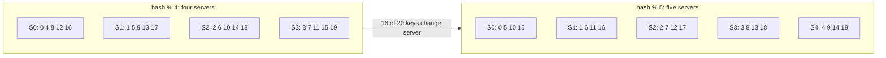

## 2. Mental model

Picture a clock face numbered from `0` to `2^64 − 1`.

- Hash each **server** name to a position on the clock.
- Hash each **key** to a position on the same clock.
- Walk **clockwise** from the key. The first server you meet owns the key.

Adding a server only steals keys from the arc just behind it. Every other key keeps its owner.

Analogy: a circular road with petrol stations. Each house (key) drives clockwise to the first station. A new station only takes customers from the stretch of road just before it; nobody else changes stations.

## 3. How it works

### 3.1 The ring is a sorted array

A ring is just a **sorted array of positions** that wraps around at the end:

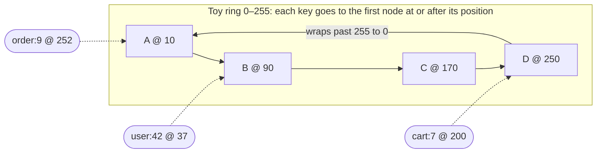

`order:9` sits at 252. No node exists at or after 252, so the lookup wraps to the start and lands on A.

### 3.2 Lookup is a binary search

| Step | What happens | Toy example: `order:9` |
| --- | --- | --- |
| 1 | Hash the key | position 252 |
| 2 | Binary search the sorted points for the first point `>= h` | points are 10, 90, 170, 250: no point is `>= 252` |
| 3 | If the search ran past the end, use `points[0]` | wraps to 10 |
| 4 | Look up the node that owns that point | A |

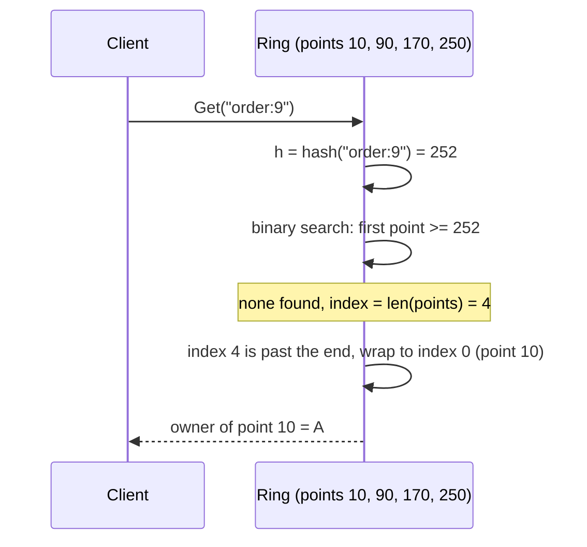

Cost: `O(log P)` per lookup, where `P` is the number of points on the ring. The core of it fits in a few lines (full code: [[Consistent Hashing - Go]]):

```go
i, _ := slices.BinarySearch(r.points, h) // first point >= h
if i == len(r.points) {
	i = 0 // wrap around the circle
}
return r.node[r.points[i]]
```

### 3.3 Adding a node

Put E at position 130. Only keys between B (90) and E (130) change owner, and they all move from C to E:

| Key (toy position) | Owner with A, B, C, D | Owner after adding E @ 130 |
| ------------------ | --------------------- | -------------------------- |
| user:42 (37)       | B                     | B                          |
| item:3 (100)       | C                     | **E** (moved)              |
| sku:5 (150)        | C                     | C                          |
| cart:7 (200)       | D                     | D                          |
| order:9 (252)      | A                     | A                          |

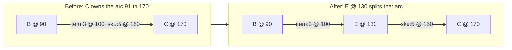

Only the arc `(90, 130]` changed hands. A, B and D never send or receive anything.

### 3.4 Removing a node

Removal is the reverse: the node's arc goes to its clockwise successor. If E leaves, `item:3` goes back to C. All other keys stay where they are.

### 3.5 Virtual nodes

With one point per server, arcs come out uneven (one server can own half the ring by luck), and when a server dies its whole arc lands on a single neighbour. The fix is to give each server many points, called **virtual nodes** (vnodes): `A#0, A#1, …, A#199`.

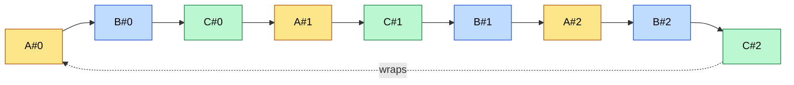

A server with twice the capacity simply gets twice as many vnodes.

### 3.6 When a node dies, vnodes spread its load

If B dies, each of its three arcs passes to the vnode that follows it clockwise.

| B's vnode (dying) | Next vnode clockwise | Receiving server |
| --- | --- | --- |
| B#0 | C#0 | C |
| B#1 | A#2 | A |
| B#2 | C#2 | C |

B's load is shared by A and C instead of dumped on one server. With 200 vnodes per server, a dead server's load is spread over nearly every survivor.

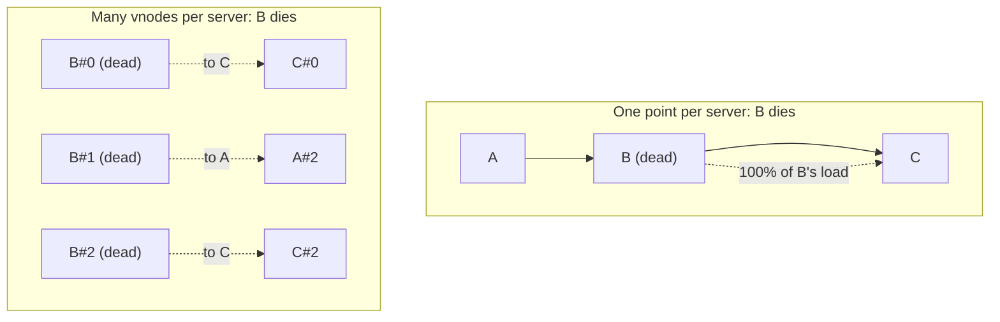

### 3.7 Replication uses the next distinct nodes

Dynamo-style stores keep each key on the first `R` **distinct physical** nodes clockwise (the "preference list"). Extra vnodes of a node that was already chosen are skipped.

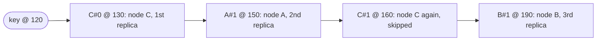

## 4. Worked example

### Whiteboard version

The bare idea: a sorted slice of positions and a binary search (the `Get` snippet in §3.2). Adding a server hashes its name, stores the position in a map from position to server, and re-sorts the slice. The whiteboard code assumes at least one server was added.

### Growing from 4 to 5 nodes, traced

1. Four nodes A, B, C, D each own 200 vnodes. 10,000 keys `user:0 … user:9999` are placed by hashing; each node holds about 2,500.
2. Add E. Its 200 vnodes land at random positions between other vnodes. Each new vnode takes over the arc between its predecessor and itself.
3. Each of those arcs used to belong to some old vnode of A, B, C or D, so keys leave all four old nodes, a little from each.
4. About `1/5` of keys, roughly 2,000, now belong to E. Every key that moved went **to E**; no key moved between two old nodes.
5. The other 8,000 keys keep their owner, so for a cache they keep hitting.

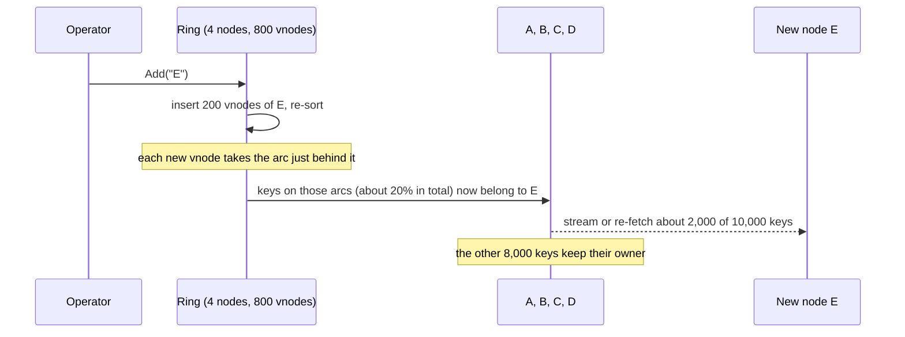

### Measured

100,000 keys `user:0 … user:99999`, growing from 4 nodes to 5 (Go 1.24, 2026-11-01).

| Scheme                | Vnodes per node | Keys moved (ideal 20%) | Busiest node vs average |
| --------------------- | --------------- | ---------------------- | ----------------------- |
| `hash % N`            | n/a             | 80.0%                  | n/a                     |
| Ring, CRC32           | 1               | 0.4%                   | 4.90×                   |
| Ring, CRC32           | 200             | 20.3%                  | 1.17×                   |
| Ring, FNV-1a 64       | 200             | 11.6%                  | 1.40×                   |
| Ring, SHA-256         | 1               | 20.6%                  | 1.36×                   |
| Ring, SHA-256         | 100             | 18.7%                  | 1.11×                   |
| Ring, SHA-256         | 200             | 19.2%                  | 1.03×                   |

Two lessons: vnodes even out the load, and the **hash function matters**. CRC32 with one point per node handed one server 97,950 of the 100,000 keys.

Runnable Go version: [[Consistent Hashing - Go]]

## 5. Variants and comparison

| Scheme                          | How it works                                                                     | Use when                                                                                   | Cost                                                                    |
| ------------------------------- | -------------------------------------------------------------------------------- | ------------------------------------------------------------------------------------------ | ----------------------------------------------------------------------- |
| Ring + vnodes                   | Sorted points, first point clockwise                                             | General default: caches, Dynamo-style stores, sticky load balancing                        | `O(log P)` lookup, memory for `P` points                                |
| Rendezvous (HRW) hashing        | Score every node with `hash(node, key)`, pick the highest                        | Small node counts; you want no ring and perfect minimal movement                           | `O(N)` per lookup                                                       |
| Jump consistent hash            | A short loop maps a key to a bucket number `0..N-1`                              | Numbered shards that only grow or shrink at the end                                         | Cannot remove an arbitrary node from the middle                          |
| Maglev hashing                  | Precomputed lookup table built from per-node preference orders                   | Network load balancers needing `O(1)` lookups and very even spread                          | Table rebuild on change; a few extra keys move                           |
| Bounded loads                   | Ring, but a node above `(1 + ε) ×` average load passes the key clockwise         | Load balancing where key popularity is skewed                                              | More keys move as load shifts                                            |
| Fixed hash slots (Redis Cluster) | `CRC16(key) mod 16384` picks a slot; slots are assigned to nodes and moved explicitly | You want operators to control exactly which data moves                                      | A slot-to-node map that every client must keep current                   |

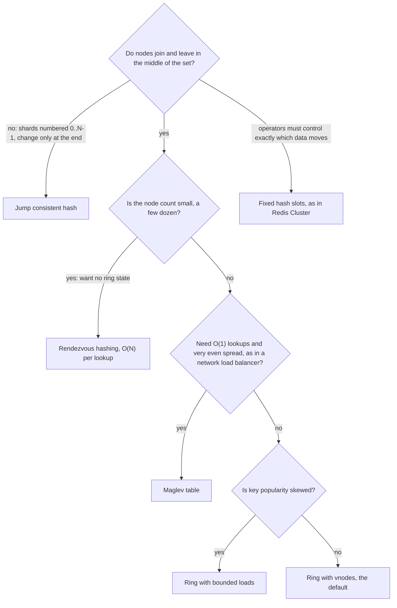

### 5.1 Bounded loads

Plain ring hashing balances keys but not traffic. Bounded loads give every node a cap of `⌈(1 + ε) × average⌉`; a key whose node is full continues clockwise to the next node with room.

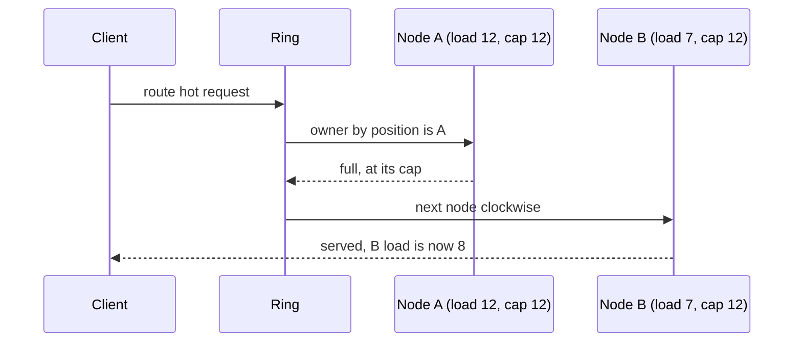

> [!warning] Interview trap
> Redis Cluster does **not** use consistent hashing. It uses 16,384 fixed hash slots. Use hash tags such as `{user:42}:cart` to keep related keys in one slot.

## 6. Trade-offs and when not to use

- It balances **keys, not traffic**. One viral key still lands on one node.
- Membership must be agreed on. Two clients with different views of the ring send the same key to different nodes.
- Range queries suffer: hashing scatters neighbouring keys, so `WHERE id BETWEEN …` hits every node. Use range partitioning when range scans dominate.
- With a fixed, rarely changing set of shards, plain `hash % N` or jump hash is simpler and just as good.

## 7. In production

- **Real systems:**
	- Akamai's CDN (the 1997 paper's original use case).
	- The Dynamo paper, and Cassandra and Riak after it. Cassandra's `num_tokens` is its vnode count: 256 by default before 4.0, 16 since.
	- Memcached client libraries using ketama.
	- Nginx `hash $request_uri consistent;`, HAProxy `hash-type consistent`, Envoy's `RING_HASH` and `MAGLEV` load-balancing policies.
- **Failure modes → fixes:**
	- Hot key overloads one node → split the key (`counter:{0..9}`), cache it locally, or serve reads from replicas.
	- Cascading failure when a node dies and one neighbour takes all its load → use vnodes so the load spreads.
	- Clients disagree about the ring → keep membership in gossip (Cassandra) or a coordinator (ZooKeeper or etcd), and version the ring.
	- Rebalancing saturates the network → throttle data streaming and add nodes one at a time.
- **What to monitor:**
	- Keys and requests per node, and the max/average ratio.
	- p99 latency per node.
	- Bytes streamed during rebalancing.
	- Cache hit rate before and after membership changes.

### 7.1 A membership change in a cache fleet

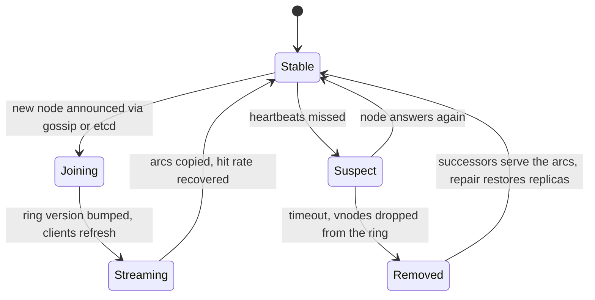

## 8. Deep dive

- **How many vnodes?** Each node's share is a sum of `V` random arcs, so its load varies by roughly `1/√V`: 100 vnodes gives about ±10%. More vnodes means smoother load, but more metadata and more overlap between nodes' replicas. With 256 vnodes, almost any two failed nodes share some ranges. That is part of why Cassandra 4.0 lowered its default to 16 and added a token-allocation algorithm that keeps load even with few tokens.
- **Hash quality.** Ring position is decided mostly by the high bits of the hash. CRC32 is a linear checksum, and FNV-1a mixes the last bytes of its input poorly into its high bits. So similar inputs (`cache-a#1`, `cache-a#2`, `user:41`, `user:42`) can land in clumps. Use a well-mixed hash: SHA-256 or MD5 (ketama uses MD5) for simplicity, xxHash or Murmur3 for speed. Then measure with your own keys.
- **Replication.** Store each key on the first `R` distinct physical nodes clockwise (`GetN` in [[Consistent Hashing - Go]]), skipping extra vnodes of a node already chosen. Combine with quorum reads and writes (`R + W > N`, see [[Quorums and Leaderless Replication]]) for tunable consistency.
- **Bounded loads.** Give every node a capacity of `⌈(1 + ε) × average⌉`. A key whose node is full walks clockwise to the next node with room. Vimeo shipped this in HAProxy and cut cache bandwidth sharply.
- **Weighted nodes.** Give a node vnodes in proportion to its capacity. For rendezvous hashing, use the weighted form: pick the node with the highest `-w / ln(hash01(node, key))`.

## 9. Interview questions

> [!question]- Why not just use `hash(key) % N`?
> Changing N remaps about `N/(N+1)` of all keys (80% when going from 4 to 5 nodes). For a cache that means a miss storm. For a database it means moving almost all the data. A ring moves about `1/(N+1)`.

> [!question]- What do virtual nodes solve, and what do they cost?
> They even out arc sizes, spread a dead node's load across many survivors, and let you weight servers by capacity. The costs are more memory and metadata, slower ring rebuilds, and more small ranges to stream during rebalancing.

> [!question]- Does consistent hashing fix hot keys?
> No. It balances the number of keys, not the traffic per key. Fix hot keys separately: split the key, cache it on the client or an L1 cache, read from replicas, or use bounded-load hashing.

> [!question]- A node dies. Where does its data go, and how do clients find out?
> Its arcs belong to their clockwise successors. With replication those successors already hold copies, so reads keep working and repair restores the replica count. Clients learn the new membership through gossip or a coordinator (etcd or ZooKeeper) and refresh their ring.

> [!question]- How does Redis Cluster decide which node holds a key?
> `CRC16(key) mod 16384` gives a hash slot, and each node owns a set of slots. Resharding moves whole slots, and clients follow `MOVED` and `ASK` redirects. It is not a hash ring.

> [!question]- Ring, rendezvous, or jump hash: which would you pick?
> Pick the ring with vnodes as the general default. Pick rendezvous when there are few nodes and you want simple code without a ring. Pick jump hash for numbered shards that only grow or shrink at the end, with no memory overhead.

## 10. Cheat sheet

- `hash % N` remaps ~`N/(N+1)` of keys on resize; a ring remaps ~`1/(N+1)`.
- Ring = sorted array of points, binary search, wrap to index 0.
- Vnodes (100–256 per node) smooth the load and spread failover; more vnodes means more weight.
- Use a well-mixed hash (SHA, MD5, xxHash, Murmur3) and measure. FNV and CRC32 clump on similar keys.
- Replicate to the next `R` distinct physical nodes clockwise.
- It balances keys, not traffic: hot keys need their own fix.
- Redis Cluster uses 16,384 hash slots, not a ring.

## Links

- **Go implementation:** [[Consistent Hashing - Go]]
- **Before this:** [[Hash Tables and Go Maps]], [[Partitioning and Sharding]]
- **Next:** [[Replication]], [[Quorums and Leaderless Replication]], [[Hot Keys and Hot Partitions]]
- **Compare with:** [[Load Balancing]] (consistent hashing as a sticky load-balancing policy), [[Redis Replication, Sentinel and Cluster]] (hash slots instead of a ring)
- **Code to read:** `github.com/golang/groupcache/consistenthash` (about 80 lines), `github.com/buraksezer/consistent` (bounded loads)
