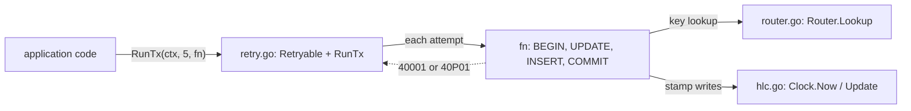
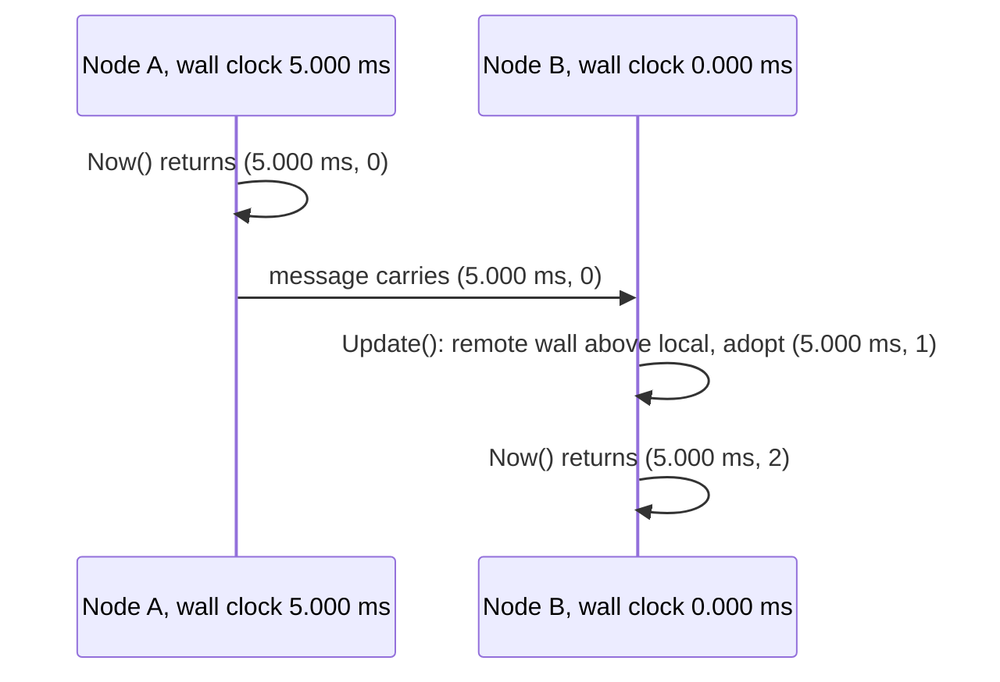
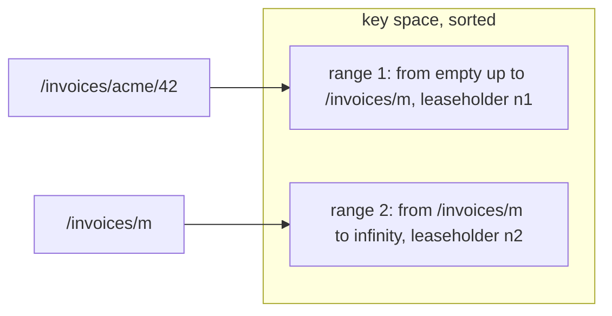
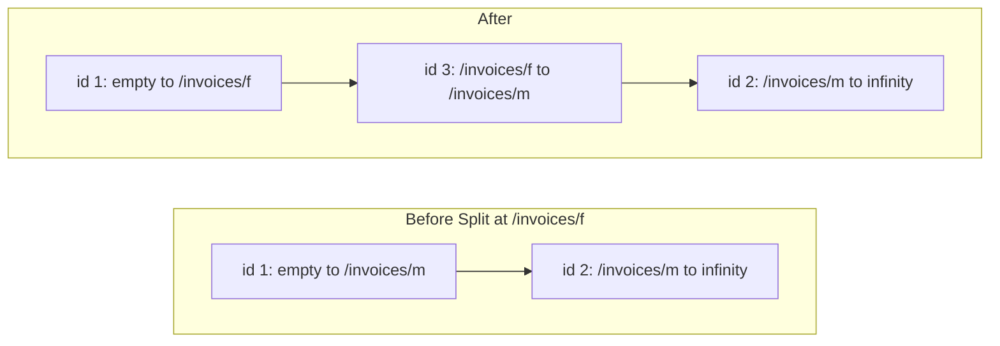
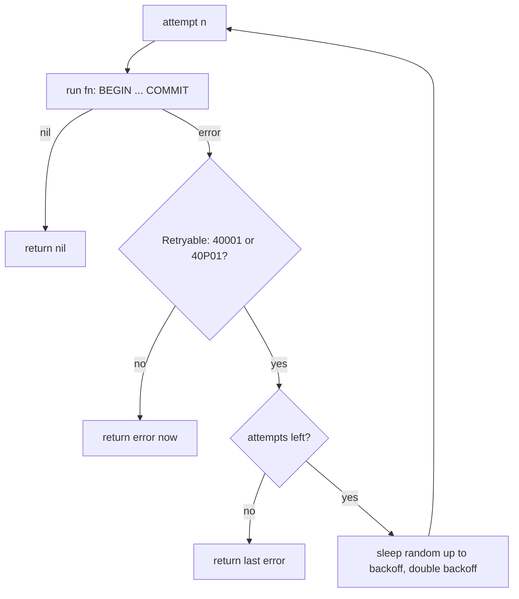
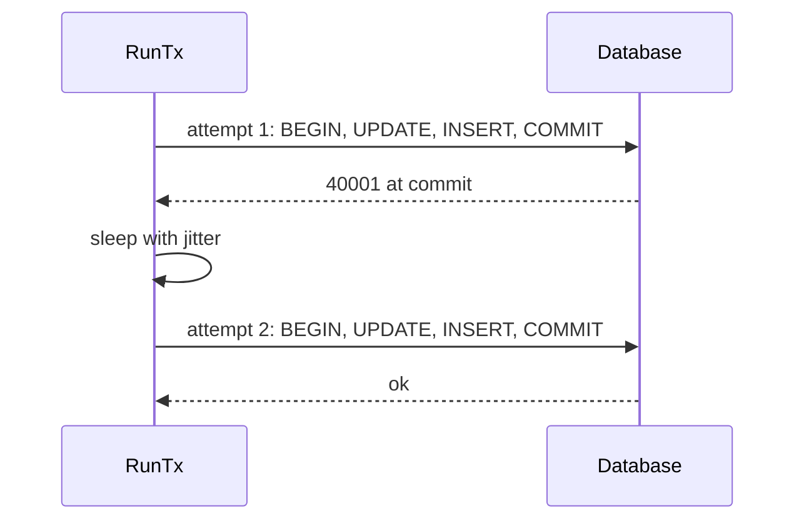

# Distributed SQL - Go

> [!summary] TL;DR
> Three small Go building blocks that a distributed SQL client or gateway relies on: a hybrid logical clock, a range router that finds and splits ranges, and a retry loop for `40001` errors. Each one is tested with `go test -race`. The concepts are explained in [[Distributed SQL]].

## What this code shows

| Code | Concept in [[Distributed SQL]] |
| --- | --- |
| `Clock`, `Timestamp` in `hlc.go` | Hybrid logical clocks: [[Distributed SQL#An HLC keeps cause before effect]] and [[Distributed SQL#Timestamps: TrueTime vs HLC vs a timestamp oracle]] |
| `Router`, `Range` in `router.go` | [[Distributed SQL#Range sharding with Raft per range]], [[Distributed SQL#Range splits]], and the gateway's range cache |
| `Retryable`, `RunTx` in `retry.go` | [[Distributed SQL#Isolation and retries]]: the `40001` loop |
| `TestHLCCausality` | Node B's clock is 5 ms behind node A, yet the payment is ordered after the invoice |
| pgx usage snippet | How the retry loop wraps a real two-table transaction |



The three pieces are independent. A real database wires the router and the clock inside its own nodes; the retry loop is the part that your application owns. They are shown together because each solves one of the three problems that a distributed SQL database creates: where does a key live, what time is it across machines, and what do I do when the database asks me to try again.

## Setup

- Go 1.24, standard library only. The pgx snippet in step 4 needs `github.com/jackc/pgx/v5` and a running CockroachDB, YugabyteDB or PostgreSQL, so it is shown but not compiled in the tests.
- Module layout: one package `distsql` with `hlc.go`, `router.go`, `retry.go` and `distsql_test.go`.
- Run it:

```text
go mod init example.com/distsql
go vet ./...
go test -race ./...
```

## Code

### Step 1: hybrid logical clock

**Concept.** Ordering events across machines needs timestamps that respect cause and effect. Physical clocks drift apart, and a message can arrive "before" it was sent according to the receiver's clock. A hybrid logical clock (HLC, [[Distributed SQL#An HLC keeps cause before effect]]) fixes this with no special hardware: a timestamp is wall-clock nanoseconds plus a small logical counter. The clock never goes backwards, and when it receives a remote timestamp it jumps ahead of it. The alternative is Spanner's TrueTime, which needs atomic clocks and commit wait ([[Distributed SQL#Commit wait in Spanner]]), or a central timestamp oracle that adds a network hop to every transaction ([[Distributed SQL#Timestamps: TrueTime vs HLC vs a timestamp oracle]]). HLC was chosen because it needs only the standard library and ordinary NTP-synced clocks.

First, the timestamp type and its ordering:

```go
// Package distsql shows three building blocks of a distributed SQL database:
// a hybrid logical clock, a range router, and a client retry loop.
package distsql

import (
	"sync"
	"time"
)

// Timestamp is a hybrid logical clock (HLC) value: wall-clock nanoseconds
// plus a logical counter that breaks ties and absorbs clock skew.
type Timestamp struct {
	Wall    int64
	Logical int32
}

// Less orders timestamps by wall time, then by logical counter.
func (t Timestamp) Less(o Timestamp) bool {
	return t.Wall < o.Wall || (t.Wall == o.Wall && t.Logical < o.Logical)
}
```

**How it works.**

1. `Wall` is physical nanoseconds since the Unix epoch, so timestamps stay close to real time and humans can read them.
2. `Logical` is a counter that only matters when two events share the same `Wall` value, or when the wall clock lags behind a timestamp received from another node.
3. `Less` compares `Wall` first, then `Logical`. This is a total order on timestamps.
4. The struct is a plain comparable value, so tests can compare timestamps with `==` and use them as map keys.

Next, the clock and the local-event method `Now`:

```go
// Clock is an HLC. It never goes backwards and is always >= any timestamp
// it has seen from another node, which gives causal ordering without
// atomic clocks.
type Clock struct {
	mu      sync.Mutex
	physNow func() int64
	last    Timestamp
}

// NewClock builds a clock over a physical time source (nanoseconds).
func NewClock(physNow func() int64) *Clock {
	if physNow == nil {
		physNow = func() int64 { return time.Now().UnixNano() }
	}
	return &Clock{physNow: physNow}
}

// Now returns a timestamp for a local event or an outgoing message.
func (c *Clock) Now() Timestamp {
	c.mu.Lock()
	defer c.mu.Unlock()
	if pt := c.physNow(); pt > c.last.Wall {
		c.last = Timestamp{Wall: pt}
	} else {
		c.last.Logical++
	}
	return c.last
}
```

**How it works.**

1. `physNow` is injected, so tests can drive time by hand with a fake clock. Passing `nil` selects the real `time.Now`.
2. `last` remembers the newest timestamp handed out. Every result is based on it, which is what prevents going backwards.
3. In `Now`, if the physical clock moved ahead of `last.Wall`, the clock adopts it and resets the counter to 0.
4. Otherwise (the physical clock stalled or stepped back), the wall part stays and the counter increments, so the new timestamp is still strictly larger.
5. The `Mutex` guards `last`; without it, two goroutines could return the same timestamp.

Finally, `Update`, which merges a timestamp received from another node:

```go
// Update merges a timestamp received from another node and returns the
// new local time, which is strictly greater than both.
func (c *Clock) Update(remote Timestamp) Timestamp {
	c.mu.Lock()
	defer c.mu.Unlock()
	pt := c.physNow()
	switch {
	case pt > c.last.Wall && pt > remote.Wall:
		c.last = Timestamp{Wall: pt}
	case remote.Wall > c.last.Wall:
		c.last = Timestamp{Wall: remote.Wall, Logical: remote.Logical + 1}
	case c.last.Wall > remote.Wall:
		c.last.Logical++
	default: // equal wall times
		c.last.Logical = max(c.last.Logical, remote.Logical) + 1
	}
	return c.last
}
```

**How it works.**

1. The `switch` has four cases, one per situation. Each result is larger than both the old local time and the remote time.
2. If the physical clock is ahead of everything, use it and reset the counter.
3. If the remote wall time is ahead of the local one, adopt the remote wall time and set the counter just above the remote counter. This is how a clock that is 5 ms slow catches up.
4. If the local timestamp is already ahead of the remote one, only the counter increments.
5. If both wall times are equal, take the larger counter and add 1. `max` is the Go 1.21 builtin.

| Case | Local `last` | Remote | Physical now | Result |
| --- | --- | --- | --- | --- |
| Physical clock ahead | (100, 3) | (90, 5) | 200 | (200, 0) |
| Remote ahead | (100, 3) | (150, 5) | 120 | (150, 6) |
| Local ahead | (150, 3) | (100, 5) | 120 | (150, 4) |
| Equal wall times | (150, 3) | (150, 5) | 120 | (150, 6) |



### Step 2: range router

**Concept.** A distributed SQL table is a sorted key space cut into contiguous ranges, each replicated by its own Raft group ([[Distributed SQL#Range sharding with Raft per range]]). A gateway node must find the range that owns a key before it can send the request to that range's leaseholder. The router in this step is that range cache in miniature: a sorted slice of ranges plus a binary search. Ranges also split when they grow too big or too hot ([[Distributed SQL#Range splits]]). Hash sharding is the alternative; it spreads load evenly but makes range scans impossible, whereas sorted ranges keep neighbouring keys together and make scans cheap.



First, the types and the layout validation:

```go
package distsql

import (
	"errors"
	"sort"
)

// Range is a contiguous slice of the sorted key space [Start, End),
// replicated by its own Raft group. End == "" means +infinity.
type Range struct {
	ID          int
	Start, End  string
	Leaseholder string // the replica that serves reads and proposes writes
}

// Router maps a key to its range, like the range cache in a SQL gateway.
type Router struct {
	ranges []Range // sorted by Start, no gaps, first Start == ""
}

var ErrBadLayout = errors.New("distsql: ranges must be sorted and contiguous from \"\"")
```

```go
// NewRouter validates that the ranges tile the whole key space.
func NewRouter(ranges []Range) (*Router, error) {
	if len(ranges) == 0 || ranges[0].Start != "" {
		return nil, ErrBadLayout
	}
	for i := 1; i < len(ranges); i++ {
		if ranges[i-1].End != ranges[i].Start {
			return nil, ErrBadLayout
		}
	}
	if ranges[len(ranges)-1].End != "" {
		return nil, ErrBadLayout
	}
	return &Router{ranges: ranges}, nil
}
```

**How it works.**

1. A `Range` is half-open: `Start` is included and `End` is excluded. An empty `End` means "up to infinity".
2. `Leaseholder` is the one replica that serves reads and proposes writes for that range; the router returns it so the caller can send the request there.
3. `NewRouter` enforces the invariant that every later function depends on: the first range starts at `""`, each range ends exactly where the next one starts, and the last range is open-ended. That means every possible key has exactly one range.
4. The sentinel `ErrBadLayout` lets callers test the failure with `errors.Is`.

Then the lookup and the split:

```go
// Lookup finds the range holding key with a binary search: the last range
// whose Start <= key.
func (r *Router) Lookup(key string) Range {
	i := sort.Search(len(r.ranges), func(i int) bool { return r.ranges[i].Start > key })
	return r.ranges[i-1]
}

// Split cuts the range containing at into [Start, at) and [at, End),
// which is what the database does when a range grows too big or too hot.
func (r *Router) Split(at string, newID int) {
	i := sort.Search(len(r.ranges), func(i int) bool { return r.ranges[i].Start > at }) - 1
	old := r.ranges[i]
	if old.Start == at {
		return // already a boundary
	}
	left := Range{ID: old.ID, Start: old.Start, End: at, Leaseholder: old.Leaseholder}
	right := Range{ID: newID, Start: at, End: old.End, Leaseholder: old.Leaseholder}
	r.ranges = append(r.ranges[:i], append([]Range{left, right}, r.ranges[i+1:]...)...)
}
```

**How it works.**

1. `sort.Search` returns the first index whose `Start` is greater than the key. The range just before it is the last one whose `Start` is at or below the key, so `i-1` is the answer.
2. A key equal to a boundary, such as `/invoices/m`, belongs to the range that starts there (the right one), because `Start > key` is false for it.
3. `Split` finds the containing range the same way. If `at` is already a boundary, it returns without changing anything.
4. The left half keeps the old ID, so existing references stay valid; the right half gets `newID`. Both start on the same leaseholder, as in a real database, which moves the lease later.
5. The final `append` splices the two new ranges in place of the old one, keeping the slice sorted and contiguous.



### Step 3: retry loop

**Concept.** Distributed SQL databases run at SERIALIZABLE and detect conflicts optimistically, so a transaction can be told to restart with SQLSTATE `40001` ([[Distributed SQL#Isolation and retries]]). The database cannot retry for you because it does not know what your application code did between statements, so the client wraps the whole transaction in a retry loop. The loop must retry only errors that retrying can fix, wait with capped exponential backoff and full jitter so that many clients do not collide again at the same instant, and stop when the context is cancelled. An alternative is a driver-level retry of single statements, which is wrong for a multi-statement transaction because earlier statements would be lost.



First, how errors are classified:

```go
package distsql

import (
	"context"
	"errors"
	"math/rand/v2"
	"time"
)

// sqlStater matches *pgconn.PgError from pgx without importing it.
type sqlStater interface{ SQLState() string }

// Retryable reports whether the database asked the client to retry the
// whole transaction: 40001 serialization_failure (CockroachDB, YugabyteDB,
// Spanner's PostgreSQL interface, Postgres SERIALIZABLE) or 40P01 deadlock.
func Retryable(err error) bool {
	var s sqlStater
	if !errors.As(err, &s) {
		return false
	}
	return s.SQLState() == "40001" || s.SQLState() == "40P01"
}
```

**How it works.**

1. `sqlStater` is a one-method interface. `*pgconn.PgError` from pgx already has `SQLState()`, so this package does not need to import pgx, and tests can use a tiny fake.
2. `errors.As` walks the error chain, so an error wrapped with `fmt.Errorf("commit: %w", err)` is still recognised.
3. Only `40001` (serialization failure) and `40P01` (deadlock detected) count as retryable.
4. Any other error, including a `nil` target, is treated as permanent.

Then the loop itself:

```go
// RunTx runs fn (one whole transaction: BEGIN ... COMMIT) and retries it on
// retryable errors with capped exponential backoff and full jitter.
// fn must be safe to re-run: no side effects outside the transaction.
func RunTx(ctx context.Context, maxAttempts int, fn func(ctx context.Context) error) error {
	backoff := 10 * time.Millisecond
	var err error
	for attempt := 1; attempt <= maxAttempts; attempt++ {
		if err = fn(ctx); err == nil || !Retryable(err) {
			return err
		}
		if attempt == maxAttempts {
			break
		}
		sleep := time.Duration(rand.Int64N(int64(backoff)) + 1)
		select {
		case <-time.After(sleep):
		case <-ctx.Done():
			return errors.Join(err, ctx.Err())
		}
		backoff = min(backoff*2, time.Second)
	}
	return err
}
```

**How it works.**

1. `fn` is the whole transaction. It runs again from `BEGIN` on every attempt.
2. Success or a non-retryable error returns immediately, so a unique-key violation is never repeated.
3. After the last attempt the loop breaks without sleeping and returns the last error, which is still a retryable error, so callers can see why it gave up.
4. `rand.Int64N(backoff) + 1` picks a random delay between 1 ns and `backoff`. This is full jitter: delays are spread out so concurrent clients do not retry in lockstep.
5. `select` waits for either the timer or the context. If the context ends first, `errors.Join` returns both the database error and the context error.
6. The backoff doubles each round (10, 20, 40 ms and so on) and is capped at 1 second by the builtin `min`.

### Step 4: using `RunTx` with pgx

**Concept.** The loop above is useful only if the closure begins and commits its own transaction. If the closure reused an outer transaction, a retry would resume inside an aborted transaction and fail again. `pgx.BeginTxFunc` fits this shape: it begins, runs the function, and commits or rolls back. The business outcome "invoice was already paid" is returned as a plain error that `Retryable` does not recognise, so it stops the loop at once. This block needs pgx and a running database, so it is shown but not compiled in the tested module.

```go
err := distsql.RunTx(ctx, 5, func(ctx context.Context) error {
	return pgx.BeginTxFunc(ctx, pool, pgx.TxOptions{}, func(tx pgx.Tx) error {
		tag, err := tx.Exec(ctx, `UPDATE invoices SET status = 'paid', paid_minor = total_minor
			WHERE workspace_id = $1 AND id = $2 AND status = 'open'`, wsID, invoiceID)
		if err != nil {
			return err
		}
		if tag.RowsAffected() == 0 {
			return ErrNotOpen // not retryable: the invoice was already paid
		}
		_, err = tx.Exec(ctx, `INSERT INTO payments (workspace_id, id, invoice_id, amount_minor)
			VALUES ($1, $2, $3, $4)`, wsID, paymentID, invoiceID, amountMinor)
		return err
	})
})
```

**How it works.**

1. The outer closure is what `RunTx` repeats. Each call starts a new transaction with `BeginTxFunc`.
2. The first statement updates the invoice only if it is still open. The `status = 'open'` condition makes the update safe to repeat.
3. `RowsAffected() == 0` means another request already paid the invoice. That is a business result, so `ErrNotOpen` is returned and the loop does not retry.
4. The second statement inserts the payment in the same transaction, so both rows commit together or neither does.
5. If the commit fails with `40001`, `BeginTxFunc` returns the error, `Retryable` recognises it and `RunTx` runs both statements again.



## Design decisions

| Decision | Alternative | Trade-off |
| --- | --- | --- |
| HLC (wall time plus counter) | TrueTime or a timestamp oracle | Works on ordinary clocks and needs no extra hop. It gives causal order but not external consistency without waiting out clock skew. |
| Injected `physNow` function | Call `time.Now` directly | Tests control time exactly. One extra function call per timestamp. |
| `sync.Mutex` in `Clock` | Atomic compare-and-swap on a packed 64-bit value | Simple and obviously correct. Packed atomics are faster but harder to read. |
| Sorted slice plus `sort.Search` | A B-tree or interval tree | Tiny and fast for thousands of ranges. `Split` copies the slice, so it is `O(ranges)`. |
| Validate layout in `NewRouter` | Trust the caller | `Lookup` can never index out of range for a validated router. Costs a pass at start-up. |
| Split keeps the old ID on the left | Assign two new IDs | Existing references stay valid. |
| `sqlStater` interface | Import `pgconn` | No dependency, easy fakes. Only drivers that expose `SQLState()` work. |
| Full jitter, capped at 1 s | Fixed or pure exponential delay | Concurrent clients spread out. A single caller may wait slightly longer or shorter than expected. |
| Retry only `40001` and `40P01` | Retry every error | Never repeats permanent errors such as `23505` or business results. |

## Tests

The tests use a fake physical clock, a two-range router, and a fake error type with a `SQLState()` method, so no database is needed. The file starts with the imports and the fake clock:

```go
package distsql

import (
	"context"
	"errors"
	"fmt"
	"sync"
	"testing"
)

type fakeTime struct {
	mu sync.Mutex
	ns int64
}

func (f *fakeTime) now() int64   { f.mu.Lock(); defer f.mu.Unlock(); return f.ns }
func (f *fakeTime) set(ns int64) { f.mu.Lock(); f.ns = ns; f.mu.Unlock() }
```

`fakeTime` is a hand-driven clock. Its own mutex keeps it safe under `-race` when a test reads it from several goroutines.

### TestHLCMonotonicWhenWallClockStalls

**Property.** The clock must never go backwards, even if the physical clock stalls or steps back (for example when NTP corrects it). Everything that uses timestamps for ordering depends on this.

| Step | Physical time | Expected result |
| --- | --- | --- |
| `a := Now()` | 1000 | (1000, 0) |
| `b := Now()` | 1000 (stalled) | (1000, 1), so `a < b` |
| `d := Now()` after `set(900)` | 900 (stepped back) | Larger than `b` (the counter increments) |

```go
func TestHLCMonotonicWhenWallClockStalls(t *testing.T) {
	ft := &fakeTime{ns: 1000}
	c := NewClock(ft.now)
	a, b := c.Now(), c.Now()
	if !a.Less(b) || b != (Timestamp{1000, 1}) {
		t.Fatalf("a=%v b=%v", a, b)
	}
	ft.set(900) // NTP steps the clock back 100 ns
	if d := c.Now(); !b.Less(d) {
		t.Fatalf("clock went backwards: %v then %v", b, d)
	}
}
```

**How it works.**

1. The first `Now` sees physical 1000 above the initial 0 and returns (1000, 0).
2. The second `Now` sees physical 1000 equal to `last.Wall`, so the counter increments to (1000, 1).
3. `b != (Timestamp{1000, 1})` checks the exact value, which proves the counter path.
4. After the physical clock drops to 900, the third call still returns a larger timestamp.

**If it fails.** Timestamps could repeat or go backwards, so two transactions could get the same commit time, or a later write could appear to happen before an earlier one.

### TestHLCCausality

**Property.** If node A tells node B about an event, B's next timestamp must be larger than A's, even when B's physical clock is behind. This is the property in [[Distributed SQL#An HLC keeps cause before effect]]: the payment must be ordered after the invoice it depends on.

| Step | Node A clock | Node B clock | Result |
| --- | --- | --- | --- |
| `sent := a.Now()` | 5 ms | | (5 ms, 0) |
| `recv := b.Update(sent)` | | 0 ms | (5 ms, 1) |
| `later := b.Now()` | | 0 ms | (5 ms, 2) |

```go
func TestHLCCausality(t *testing.T) {
	// Node A's clock runs 5 ms ahead of node B's.
	ta, tb := &fakeTime{ns: 5_000_000}, &fakeTime{ns: 0}
	a, b := NewClock(ta.now), NewClock(tb.now)

	sent := a.Now()        // A commits invoice 42 and tells B
	recv := b.Update(sent) // B receives it
	later := b.Now()       // B then writes payment for invoice 42
	if !sent.Less(recv) || !recv.Less(later) {
		t.Fatalf("causality broken: sent=%v recv=%v later=%v", sent, recv, later)
	}
	if later.Wall != 5_000_000 {
		t.Fatalf("B should adopt A's wall time, got %v", later)
	}
}
```

**How it works.**

1. The two fake clocks are 5 ms apart, the situation that breaks plain wall-clock ordering.
2. `Update` takes the "remote ahead" branch and adopts A's wall time.
3. `Less` checks the chain `sent < recv < later`.
4. The final check shows B's timestamp now carries A's wall time, not its own near-zero clock.

**If it fails.** Causality is broken: a payment could receive a timestamp earlier than the invoice it refers to, so a snapshot read could see the payment without the invoice.

### TestHLCConcurrent

**Property.** Many goroutines calling `Now` at once must never receive the same timestamp. Under `-race` it also proves the clock is properly locked.

| Input | Expected |
| --- | --- |
| 8 goroutines x 1,000 calls with the real clock | 8,000 timestamps, all different |

```go
func TestHLCConcurrent(t *testing.T) {
	c := NewClock(nil)
	var wg sync.WaitGroup
	seen := make(chan Timestamp, 8000)
	for range 8 {
		wg.Add(1)
		go func() {
			defer wg.Done()
			for range 1000 {
				seen <- c.Now()
			}
		}()
	}
	wg.Wait()
	close(seen)
	uniq := map[Timestamp]bool{}
	for ts := range seen {
		if uniq[ts] {
			t.Fatalf("duplicate timestamp %v", ts)
		}
		uniq[ts] = true
	}
}
```

**How it works.**

1. `NewClock(nil)` uses the real `time.Now`, so many calls land in the same nanosecond and the logical counter is exercised.
2. The channel has capacity 8000, so workers never block.
3. After `wg.Wait()` the channel is closed so the final loop terminates.
4. `Timestamp` is comparable, so it can be a map key for the duplicate check.

**If it fails.** Two operations received the same timestamp, so the clock is missing its lock and cannot order events.

### TestRouter

**Property.** Lookups respect range boundaries, a split keeps routing consistent, and a layout that does not start at `""` is rejected.

| Input | Expected |
| --- | --- |
| `Lookup("/invoices/acme/42")` | Range 1 |
| `Lookup("/invoices/m")` (boundary) | Range 2 |
| After `Split("/invoices/f", 3)`: `Lookup("/invoices/globex/7")` | Range 3 |
| Same: `Lookup("/invoices/acme/42")` | Range 1 (left keeps its ID) |
| `NewRouter` with first `Start` equal to `"a"` | `ErrBadLayout` |

```go
func TestRouter(t *testing.T) {
	r, err := NewRouter([]Range{
		{ID: 1, Start: "", End: "/invoices/m", Leaseholder: "n1"},
		{ID: 2, Start: "/invoices/m", End: "", Leaseholder: "n2"},
	})
	if err != nil {
		t.Fatal(err)
	}
	if got := r.Lookup("/invoices/acme/42").ID; got != 1 {
		t.Fatalf("got range %d", got)
	}
	if got := r.Lookup("/invoices/m").ID; got != 2 {
		t.Fatalf("boundary key belongs to the right range, got %d", got)
	}
	r.Split("/invoices/f", 3)
	if got := r.Lookup("/invoices/globex/7").ID; got != 3 {
		t.Fatalf("after split got %d", got)
	}
	if got := r.Lookup("/invoices/acme/42").ID; got != 1 {
		t.Fatalf("left side keeps id 1, got %d", got)
	}
	if _, err := NewRouter([]Range{{ID: 1, Start: "a"}}); !errors.Is(err, ErrBadLayout) {
		t.Fatal("expected layout error")
	}
}
```

**How it works.**

1. The two ranges tile the key space, so `NewRouter` accepts them.
2. The boundary test proves the half-open rule: `Start` is inclusive.
3. `/invoices/globex/7` sorts between `/invoices/f` and `/invoices/m`, so after the split it falls in the new range 3.
4. `/invoices/acme/42` sorts before `/invoices/f`, so it stays in range 1.
5. The last case checks the validation, using `errors.Is` against the sentinel.

**If it fails.** A wrong range ID means requests would go to the wrong Raft group, which would either reject them or, worse, serve stale data.

The next two tests use a fake error type that carries a SQLSTATE code, so no database driver is needed.

```go
type pgErr struct{ code string }

func (e *pgErr) Error() string    { return "pg error " + e.code }
func (e *pgErr) SQLState() string { return e.code }
```

### TestRunTxRetriesSerializationFailures

**Property.** A transaction that fails twice with `40001` and then succeeds must be run three times and return `nil`, even when the error is wrapped.

| Call | Fake behaviour | Expected |
| --- | --- | --- |
| 1 | Returns wrapped `40001` | Retry |
| 2 | Returns wrapped `40001` | Retry |
| 3 | Returns `nil` | `RunTx` returns `nil`, `calls == 3` |

```go
func TestRunTxRetriesSerializationFailures(t *testing.T) {
	calls := 0
	err := RunTx(context.Background(), 5, func(context.Context) error {
		calls++
		if calls < 3 {
			return fmt.Errorf("commit: %w", &pgErr{"40001"})
		}
		return nil
	})
	if err != nil || calls != 3 {
		t.Fatalf("err=%v calls=%d", err, calls)
	}
}
```

**How it works.**

1. `fmt.Errorf` with `%w` wraps the error, as a real driver or a `commit:` prefix would.
2. `errors.As` inside `Retryable` still finds the SQL state through the wrapper.
3. The counter proves the closure was run exactly three times.

**If it fails.** Either wrapped retryable errors are not recognised (the application would fail on the first conflict) or the loop does not stop on success.

### TestRunTxStopsOnOtherErrorsAndGivesUp

**Property.** A permanent error (`23505`, unique violation) must stop the loop at once, and a retryable error that never goes away must stop after `maxAttempts`.

| Case | Fake behaviour | `maxAttempts` | Expected |
| --- | --- | --- | --- |
| Permanent | Always `23505` | 5 | `calls == 1`, error not retryable |
| Exhausted | Always `40001` | 3 | `calls == 3`, error still retryable |

```go
func TestRunTxStopsOnOtherErrorsAndGivesUp(t *testing.T) {
	calls := 0
	err := RunTx(context.Background(), 5, func(context.Context) error {
		calls++
		return &pgErr{"23505"} // unique_violation: retrying will not help
	})
	if calls != 1 || Retryable(err) {
		t.Fatalf("calls=%d err=%v", calls, err)
	}
	calls = 0
	err = RunTx(context.Background(), 3, func(context.Context) error {
		calls++
		return &pgErr{"40001"}
	})
	if calls != 3 || !Retryable(err) {
		t.Fatalf("calls=%d err=%v", calls, err)
	}
}
```

**How it works.**

1. The first call proves no retry happens for an error that cannot be fixed by running again.
2. `calls` is reset to 0 before the second scenario.
3. The second scenario proves the attempt cap: three runs, then the last error is returned unchanged, so the caller can still inspect it.

**If it fails.** `calls != 1` in the first case means the loop retries permanent errors, which can repeat an unsafe operation. `calls != 3` in the second means the cap is wrong and a failing database could be hammered forever or abandoned too early.

## Running it

```text
go vet ./...
go test -race -v ./...
```

Measured: `go vet` is clean and all six tests pass under `go test -race` (Go 1.24.4, darwin/arm64). `TestHLCCausality` shows the key HLC property: node B's physical clock is 5 ms behind node A's, yet after receiving A's message, B's next timestamp is larger than A's, so "payment written after invoice" is ordered correctly.

```text
--- PASS: TestHLCMonotonicWhenWallClockStalls (0.00s)
--- PASS: TestHLCCausality (0.00s)
--- PASS: TestHLCConcurrent (0.01s)
--- PASS: TestRouter (0.00s)
--- PASS: TestRunTxRetriesSerializationFailures (0.02s)
--- PASS: TestRunTxStopsOnOtherErrorsAndGivesUp (0.02s)
PASS
ok  	example.com/distsql	1.255s
```

**Reading the output.**

| Line | Meaning |
| --- | --- |
| `TestHLCMonotonicWhenWallClockStalls (0.00s)` | Pure arithmetic on a fake clock, so it takes no measurable time. |
| `TestHLCCausality (0.00s)` | The causal chain `sent < recv < later` holds with a 5 ms skew. |
| `TestHLCConcurrent (0.01s)` | 8,000 timestamps from 8 goroutines were all unique, and the race detector saw no unsynchronised access. |
| `TestRouter (0.00s)` | Binary search over a handful of ranges. |
| `TestRunTxRetries... (0.02s)` | About 20 ms is the real backoff sleep: two retries, each waiting a random time up to 10 ms and then 20 ms. |
| `TestRunTxStops... (0.02s)` | The give-up case sleeps twice before the third attempt. |
| `ok example.com/distsql 1.255s` | The whole package passed. The total is higher than the sum because `-race` instruments the binary. |

## Pitfalls in the code

- `Clock.Update` must hold the same mutex as `Now`. Without it, two goroutines can hand out the same timestamp. `TestHLCConcurrent` checks 8,000 timestamps for duplicates.
- `Router.Split` mutates the slice in place and is not safe for concurrent use. A real range cache needs a lock or copy-on-write.
- `Router.Lookup` assumes the layout was validated by `NewRouter`. A first range that does not start at `""` would make `i-1` negative.
- `RunTx` retries only when the error is retryable. Wrapping the error with `%w` keeps it recognisable; formatting with `%v` hides the SQL state and turns a retry into a failure.
- Anything with side effects (an HTTP call, a Kafka publish) inside `fn` runs once per attempt. Keep those outside the closure.
- A `RowsAffected() == 0` result is a business outcome, not a retry case, so return a non-retryable error.

## Exercises

1. In `TestHLCCausality`, set node B's clock ahead of A's instead (`tb.ns = 9_000_000`). Predict `recv.Wall` and `later.Wall` before running it.
2. Call `r.Split("/invoices/m", 9)` on the router from `TestRouter`. Predict whether the router changes and which range `Lookup("/invoices/m")` returns.
3. Change the `maxAttempts` in the give-up test from 3 to 1. Predict `calls` and whether `Retryable(err)` is still true.

## Links

- Theory: [[Distributed SQL]]
- **Before this:** [[Transactions and ACID]], [[Consensus - Raft and Paxos]]
- **Next:** [[Multi-Region Architecture]], [[Clocks and Ordering]]
