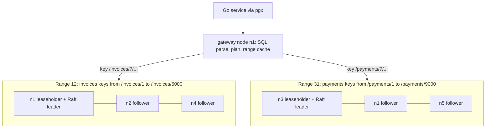
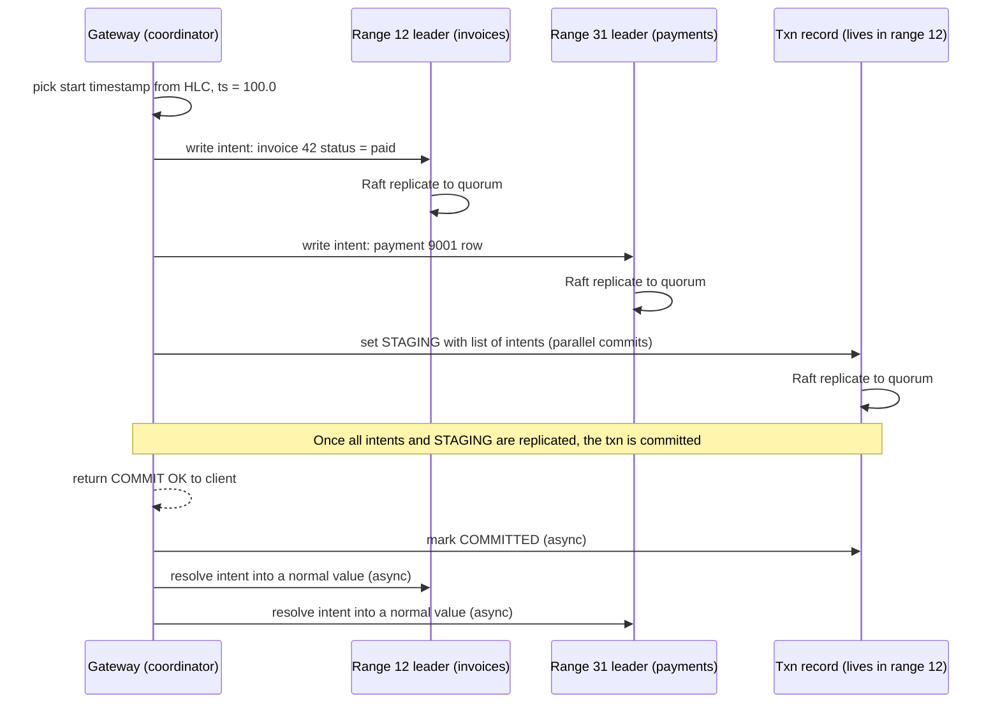
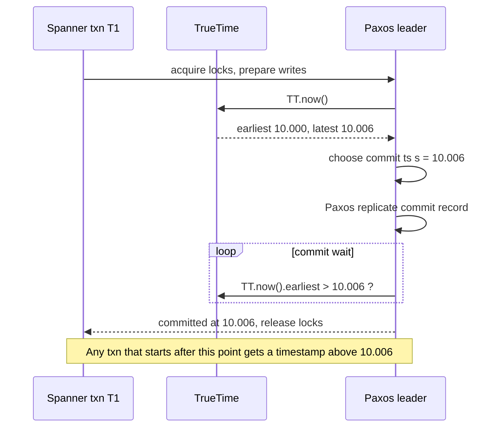

# Distributed SQL

> [!summary] TL;DR
> A distributed SQL database looks like PostgreSQL or MySQL to your code, but splits its tables into small key ranges, keeps each range on 3 or more machines with its own consensus group (usually Raft), and runs ACID transactions across ranges. You get horizontal scale and automatic failover with strong consistency, and you pay for it in extra network round trips on every write and retry errors your code must handle.

> [!abstract] Core idea
> - Tables are cut into **ranges** of sorted keys; each range is a small replicated log with its own Raft leader.
> - A transaction that touches several ranges uses two-phase commit, but every participant is itself a Raft group, so a crashed machine does not block the commit.
> - Transactions are ordered by timestamps: Spanner uses atomic-clock **TrueTime**, CockroachDB and YugabyteDB use **hybrid logical clocks**, TiDB uses a central timestamp server.
> - Serializable is the default in CockroachDB and Spanner, so conflicts surface as `40001` "retry the transaction" errors that the client must handle.
> - Global consistency costs cross-region latency on every write. If one PostgreSQL primary with replicas fits your load, it is simpler, cheaper and faster.

## 1. Why it exists

InvoiceOps runs on one PostgreSQL 17 primary with two replicas. It now has 40,000 workspaces in the US, EU and India. Three problems appear:

- **Write ceiling.** All writes go to one machine. At peak month-end billing the primary runs at 85% CPU and the WAL volume saturates its disk; reads can go to replicas, writes cannot.
- **Failover.** When the primary dies, a replica is promoted. With asynchronous replication, the last few hundred milliseconds of commits can be lost, and the switch takes tens of seconds (estimates that depend on the setup).
- **Geography.** EU customers' data must live in the EU, and an EU user's write to a US primary pays roughly 80–100 ms of round trip (an estimate for a transatlantic link).

The classic fix is manual sharding by `workspace_id` ([[Partitioning and Sharding]]): many PostgreSQL clusters plus routing code. It works, but transactions across shards, global unique constraints, resharding and cross-shard queries become the application's problem.

Distributed SQL moves that work into the database: one logical SQL database, data split and rebalanced automatically, transactions that span machines, and failover without data loss because every write is committed by a quorum.

## 2. Mental model

Picture a library that outgrew one building.

- The catalogue is sorted by key and cut into **ranges** (shelves): "invoices from workspace 1 to 999", "1,000 to 1,999", and so on.
- Each shelf is copied to three branches. The three copies vote on every change, and a change counts once two of the three agree (a **quorum**). One branch is the **leader** for that shelf and orders its changes.
- A transaction that touches two shelves writes **provisional** entries on both, then flips one master switch that says "committed". Readers who meet a provisional entry check the switch.
- Every change carries a **timestamp**, so all branches agree which change came first, even though their wall clocks differ slightly.

Terms used below:

- **Range** (CockroachDB), **tablet** (YugabyteDB, Spanner calls them splits), **region** (TiDB): a contiguous slice of the sorted key space, the unit of replication and rebalancing.
- **Raft group**: the replicas of one range, running the Raft consensus protocol ([[Consensus - Raft and Paxos]]). A write is durable once a majority has it in its log.
- **Leaseholder**: the replica allowed to serve consistent reads for a range without asking the others; usually also the Raft leader.
- **Write intent**: a provisional MVCC (multi-version concurrency control) value written by an uncommitted transaction.
- **Gateway node**: whichever node the client connected to; it parses SQL and coordinates the transaction.

## 3. How it works

### Range sharding with Raft per range



1. Every row becomes a key-value pair. The key is the table id plus the primary key, so rows are sorted by primary key, and a secondary index is just another set of keys.
2. The sorted key space is cut into ranges. CockroachDB splits a range when it passes 512 MiB (the default `range_max_bytes`) or when it gets too much load.
3. Each range has 3 replicas by default (configurable to 5 or more) on different nodes, ideally in different zones or regions.
4. The gateway looks up which range holds a key (a cached range directory, like the `Router` in the code below) and sends the request to that range's leaseholder.
5. A write is proposed to the range's Raft leader, appended to a majority of logs, and then applied. A read at the leaseholder needs no consensus round, because the lease guarantees no other replica can be accepting writes.

Range sharding keeps nearby keys together, so range scans are efficient, but a monotonically increasing key (a timestamp or a sequence) sends all inserts to the last range: a hot spot. The fixes are UUID keys, hash-sharded indexes, or a leading `workspace_id`. YugabyteDB hash-shards the first primary-key column by default for this reason, and lets you choose range sharding with `ASC`/`DESC`.

### Transactions across ranges: two-phase commit over Raft



This is two-phase commit ([[Two-Phase Commit]]): phase one writes intents, phase two flips the transaction record. Classic 2PC blocks if the coordinator dies between the phases, because participants hold locks and do not know the outcome. Here the transaction record and every intent are **replicated by Raft**, so any node can read the record and finish or abort the transaction. A reader that meets an intent looks up the record: committed means use the value, aborted means ignore it, pending means wait or push the other transaction's timestamp.

CockroachDB's **parallel commits** (since v19.2) write the `STAGING` record at the same time as the last intents, which turns two sequential consensus rounds at commit into one. Spanner uses classic 2PC across Paxos groups, with one group's leader as coordinator. TiDB uses the Percolator protocol: a primary lock and secondary locks in TiKV, with commit decided by the primary key's lock.

### Timestamps: TrueTime vs HLC vs a timestamp oracle

All of these databases use MVCC ([[Isolation Levels and MVCC]]): every value is stored with a commit timestamp, and a transaction reads the newest version at or below its read timestamp. The question is where the timestamps come from, given that server clocks drift ([[Clocks and Ordering]]).

- **Spanner: TrueTime.** Google's datacentres have GPS receivers and atomic clocks. `TT.now()` returns an interval `[earliest, latest]` guaranteed to contain true time; the uncertainty ε was typically 1–7 ms in the 2012 paper. At commit, Spanner picks timestamp `s = TT.now().latest` and then **waits until `TT.now().earliest > s`** before releasing locks (commit wait, about 2ε). After that wait, any transaction that starts later in real time is guaranteed to get a larger timestamp. That property is **external consistency** (also called strict serializability).
- **CockroachDB and YugabyteDB: hybrid logical clocks (HLC).** Each timestamp is wall time plus a logical counter. A node that receives a message with a larger timestamp moves its clock forward to it, so causally related events are ordered correctly without special hardware. Clocks must stay within a maximum offset (500 ms by default in CockroachDB); a node whose clock drifts past that shuts itself down. Because clocks are not exact, a reader that sees a value with a timestamp slightly above its own, inside its **uncertainty interval**, cannot tell whether it happened before or after it; it must restart at a higher timestamp.
- **TiDB: timestamp oracle (TSO).** The Placement Driver (PD) cluster hands out strictly increasing timestamps from one leader. Ordering is trivial; the cost is a round trip to PD for each transaction (batched) and a dependency on PD's availability and location.



### Isolation and retries

CockroachDB and Spanner default to **SERIALIZABLE**. CockroachDB does it optimistically: transactions do not take read locks, and conflicts found at write or commit time cause one transaction to restart. The client sees SQLSTATE `40001` with a message such as `restart transaction: TransactionRetryWithProtoRefreshError: ... RETRY_SERIALIZABLE`. CockroachDB added `READ COMMITTED` (generally available in v24.1) for workloads that cannot handle retries. YugabyteDB's YSQL behaves as snapshot isolation by default (what PostgreSQL calls `REPEATABLE READ`; `READ COMMITTED` maps to snapshot unless the `yb_enable_read_committed_isolation` flag is set) and also supports serializable. TiDB defaults to snapshot isolation under the name `REPEATABLE READ`, with pessimistic locking the default for new clusters since v3.0.8. Aurora DSQL uses optimistic concurrency control with snapshot isolation and reports conflicts at commit.

The practical rule for every one of them: **wrap each transaction in a retry loop**, and keep anything non-transactional (HTTP calls, emails, Kafka publishes) outside it.

## 4. Worked example

### Whiteboard version

Paying an invoice touches two tables that live in different ranges. The SQL is plain PostgreSQL; the difference is that the database may answer `40001` and the client must re-run the whole block.

```sql
BEGIN;  -- SERIALIZABLE by default in CockroachDB
UPDATE invoices
   SET status = 'paid', paid_minor = total_minor
 WHERE workspace_id = 7 AND id = 42 AND status = 'open';   -- range 12
INSERT INTO payments (workspace_id, id, invoice_id, amount_minor)
VALUES (7, 9001, 42, 129900);                               -- range 31
COMMIT;
-- On ERROR 40001: ROLLBACK and run the whole block again.
```

### Tracing the latency in three layouts

Assume 3 replicas, about 1 ms round trip inside a region, about 70 ms US-east to EU and about 200 ms US-east to India (round numbers, **estimates**). Each write needs one Raft quorum round from the range leader; commit with parallel commits needs one more round, overlapped with the last write.

| Layout | Where replicas live | One write | This 2-write transaction | Survives |
| --- | --- | --- | --- | --- |
| Single region, 3 zones | us-east-1a, 1b, 1c | about 1–2 ms | about 3–5 ms | loss of one zone |
| Three regions, leaders in US | US, EU, India | quorum = US + EU, about 70 ms | about 140–150 ms from a US client | loss of one region |
| Regional by row (workspace pinned to its home region) | 3 zones inside the workspace's region, plus non-voting replicas elsewhere | about 1–2 ms in the home region | about 3–5 ms | loss of one zone, not the region |

The middle row is the price of surviving a whole region with consistent writes: every commit waits for a majority that lies in another region. The usual answer is the third row: pin each workspace's rows to its home region (CockroachDB `REGIONAL BY ROW`, YugabyteDB tablespaces, Spanner placement configurations), and replicate only small, read-mostly tables everywhere (CockroachDB `GLOBAL` tables, which make reads local and writes slower).

```sql
-- CockroachDB multi-region syntax (v21.1 and later)
ALTER DATABASE invoiceops SET PRIMARY REGION "us-east1";
ALTER DATABASE invoiceops ADD REGION "europe-west1";
ALTER DATABASE invoiceops ADD REGION "asia-south1";

ALTER TABLE invoices SET LOCALITY REGIONAL BY ROW;   -- hidden crdb_region column per row
ALTER TABLE currencies SET LOCALITY GLOBAL;          -- fast reads everywhere, slow writes

-- Follower read: may be a few seconds stale, served by the nearest replica.
SELECT count(*) FROM invoices AS OF SYSTEM TIME follower_read_timestamp()
WHERE workspace_id = 7 AND status = 'open';
```

Representative output (CockroachDB, not PostgreSQL 17) of inspecting the ranges after a split:

```sql
SHOW RANGES FROM TABLE invoices WITH DETAILS;  -- v23.1+: lease and replica columns need WITH DETAILS
--   start_key        | end_key          | range_id | lease_holder | replicas
-- -------------------+------------------+----------+--------------+---------
--   …/1              | …/7/42           |       12 |            1 | {1,2,4}
--   …/7/42           | …/5000           |       58 |            2 | {1,2,4}
--   …/5000           | <after:/Max>     |       59 |            4 | {2,3,4}
```

### Building blocks in Go

The code below models the three client-visible pieces: an HLC that never runs backwards and absorbs remote timestamps, a range router that finds and splits ranges, and the retry loop every application needs. `RunTx` accepts any error with a `SQLState()` method, which is what `*pgconn.PgError` from `github.com/jackc/pgx/v5` provides, so it works unchanged against CockroachDB, YugabyteDB or PostgreSQL.

```go
// Package distsql shows three building blocks of a distributed SQL database:
// a hybrid logical clock, a range router, and a client retry loop.
package distsql

import (
	"sync"
	"time"
)

// Timestamp is a hybrid logical clock (HLC) value: wall-clock nanoseconds
// plus a logical counter that breaks ties and absorbs clock skew.
type Timestamp struct {
	Wall    int64
	Logical int32
}

// Less orders timestamps by wall time, then by logical counter.
func (t Timestamp) Less(o Timestamp) bool {
	return t.Wall < o.Wall || (t.Wall == o.Wall && t.Logical < o.Logical)
}

// Clock is an HLC. It never goes backwards and is always >= any timestamp
// it has seen from another node, which gives causal ordering without
// atomic clocks.
type Clock struct {
	mu      sync.Mutex
	physNow func() int64
	last    Timestamp
}

// NewClock builds a clock over a physical time source (nanoseconds).
func NewClock(physNow func() int64) *Clock {
	if physNow == nil {
		physNow = func() int64 { return time.Now().UnixNano() }
	}
	return &Clock{physNow: physNow}
}

// Now returns a timestamp for a local event or an outgoing message.
func (c *Clock) Now() Timestamp {
	c.mu.Lock()
	defer c.mu.Unlock()
	if pt := c.physNow(); pt > c.last.Wall {
		c.last = Timestamp{Wall: pt}
	} else {
		c.last.Logical++
	}
	return c.last
}

// Update merges a timestamp received from another node and returns the
// new local time, which is strictly greater than both.
func (c *Clock) Update(remote Timestamp) Timestamp {
	c.mu.Lock()
	defer c.mu.Unlock()
	pt := c.physNow()
	switch {
	case pt > c.last.Wall && pt > remote.Wall:
		c.last = Timestamp{Wall: pt}
	case remote.Wall > c.last.Wall:
		c.last = Timestamp{Wall: remote.Wall, Logical: remote.Logical + 1}
	case c.last.Wall > remote.Wall:
		c.last.Logical++
	default: // equal wall times
		c.last.Logical = max(c.last.Logical, remote.Logical) + 1
	}
	return c.last
}
```

```go
package distsql

import (
	"errors"
	"sort"
)

// Range is a contiguous slice of the sorted key space [Start, End),
// replicated by its own Raft group. End == "" means +infinity.
type Range struct {
	ID          int
	Start, End  string
	Leaseholder string // the replica that serves reads and proposes writes
}

// Router maps a key to its range, like the range cache in a SQL gateway.
type Router struct {
	ranges []Range // sorted by Start, no gaps, first Start == ""
}

var ErrBadLayout = errors.New("distsql: ranges must be sorted and contiguous from \"\"")

// NewRouter validates that the ranges tile the whole key space.
func NewRouter(ranges []Range) (*Router, error) {
	if len(ranges) == 0 || ranges[0].Start != "" {
		return nil, ErrBadLayout
	}
	for i := 1; i < len(ranges); i++ {
		if ranges[i-1].End != ranges[i].Start {
			return nil, ErrBadLayout
		}
	}
	if ranges[len(ranges)-1].End != "" {
		return nil, ErrBadLayout
	}
	return &Router{ranges: ranges}, nil
}

// Lookup finds the range holding key with a binary search: the last range
// whose Start <= key.
func (r *Router) Lookup(key string) Range {
	i := sort.Search(len(r.ranges), func(i int) bool { return r.ranges[i].Start > key })
	return r.ranges[i-1]
}

// Split cuts the range containing at into [Start, at) and [at, End),
// which is what the database does when a range grows too big or too hot.
func (r *Router) Split(at string, newID int) {
	i := sort.Search(len(r.ranges), func(i int) bool { return r.ranges[i].Start > at }) - 1
	old := r.ranges[i]
	if old.Start == at {
		return // already a boundary
	}
	left := Range{ID: old.ID, Start: old.Start, End: at, Leaseholder: old.Leaseholder}
	right := Range{ID: newID, Start: at, End: old.End, Leaseholder: old.Leaseholder}
	r.ranges = append(r.ranges[:i], append([]Range{left, right}, r.ranges[i+1:]...)...)
}
```

```go
package distsql

import (
	"context"
	"errors"
	"math/rand/v2"
	"time"
)

// sqlStater matches *pgconn.PgError from pgx without importing it.
type sqlStater interface{ SQLState() string }

// Retryable reports whether the database asked the client to retry the
// whole transaction: 40001 serialization_failure (CockroachDB, YugabyteDB,
// Spanner's PostgreSQL interface, Postgres SERIALIZABLE) or 40P01 deadlock.
func Retryable(err error) bool {
	var s sqlStater
	if !errors.As(err, &s) {
		return false
	}
	return s.SQLState() == "40001" || s.SQLState() == "40P01"
}

// RunTx runs fn (one whole transaction: BEGIN ... COMMIT) and retries it on
// retryable errors with capped exponential backoff and full jitter.
// fn must be safe to re-run: no side effects outside the transaction.
func RunTx(ctx context.Context, maxAttempts int, fn func(ctx context.Context) error) error {
	backoff := 10 * time.Millisecond
	var err error
	for attempt := 1; attempt <= maxAttempts; attempt++ {
		if err = fn(ctx); err == nil || !Retryable(err) {
			return err
		}
		if attempt == maxAttempts {
			break
		}
		sleep := time.Duration(rand.Int64N(int64(backoff)) + 1)
		select {
		case <-time.After(sleep):
		case <-ctx.Done():
			return errors.Join(err, ctx.Err())
		}
		backoff = min(backoff*2, time.Second)
	}
	return err
}
```

```go
package distsql

import (
	"context"
	"errors"
	"fmt"
	"sync"
	"testing"
)

type fakeTime struct {
	mu sync.Mutex
	ns int64
}

func (f *fakeTime) now() int64   { f.mu.Lock(); defer f.mu.Unlock(); return f.ns }
func (f *fakeTime) set(ns int64) { f.mu.Lock(); f.ns = ns; f.mu.Unlock() }

func TestHLCMonotonicWhenWallClockStalls(t *testing.T) {
	ft := &fakeTime{ns: 1000}
	c := NewClock(ft.now)
	a, b := c.Now(), c.Now()
	if !a.Less(b) || b != (Timestamp{1000, 1}) {
		t.Fatalf("a=%v b=%v", a, b)
	}
	ft.set(900) // NTP steps the clock back 100 ns
	if d := c.Now(); !b.Less(d) {
		t.Fatalf("clock went backwards: %v then %v", b, d)
	}
}

func TestHLCCausality(t *testing.T) {
	// Node A's clock runs 5 ms ahead of node B's.
	ta, tb := &fakeTime{ns: 5_000_000}, &fakeTime{ns: 0}
	a, b := NewClock(ta.now), NewClock(tb.now)

	sent := a.Now()        // A commits invoice 42 and tells B
	recv := b.Update(sent) // B receives it
	later := b.Now()       // B then writes payment for invoice 42
	if !sent.Less(recv) || !recv.Less(later) {
		t.Fatalf("causality broken: sent=%v recv=%v later=%v", sent, recv, later)
	}
	if later.Wall != 5_000_000 {
		t.Fatalf("B should adopt A's wall time, got %v", later)
	}
}

func TestHLCConcurrent(t *testing.T) {
	c := NewClock(nil)
	var wg sync.WaitGroup
	seen := make(chan Timestamp, 8000)
	for range 8 {
		wg.Add(1)
		go func() {
			defer wg.Done()
			for range 1000 {
				seen <- c.Now()
			}
		}()
	}
	wg.Wait()
	close(seen)
	uniq := map[Timestamp]bool{}
	for ts := range seen {
		if uniq[ts] {
			t.Fatalf("duplicate timestamp %v", ts)
		}
		uniq[ts] = true
	}
}

func TestRouter(t *testing.T) {
	r, err := NewRouter([]Range{
		{ID: 1, Start: "", End: "/invoices/m", Leaseholder: "n1"},
		{ID: 2, Start: "/invoices/m", End: "", Leaseholder: "n2"},
	})
	if err != nil {
		t.Fatal(err)
	}
	if got := r.Lookup("/invoices/acme/42").ID; got != 1 {
		t.Fatalf("got range %d", got)
	}
	if got := r.Lookup("/invoices/m").ID; got != 2 {
		t.Fatalf("boundary key belongs to the right range, got %d", got)
	}
	r.Split("/invoices/f", 3)
	if got := r.Lookup("/invoices/globex/7").ID; got != 3 {
		t.Fatalf("after split got %d", got)
	}
	if got := r.Lookup("/invoices/acme/42").ID; got != 1 {
		t.Fatalf("left side keeps id 1, got %d", got)
	}
	if _, err := NewRouter([]Range{{ID: 1, Start: "a"}}); !errors.Is(err, ErrBadLayout) {
		t.Fatal("expected layout error")
	}
}

type pgErr struct{ code string }

func (e *pgErr) Error() string    { return "pg error " + e.code }
func (e *pgErr) SQLState() string { return e.code }

func TestRunTxRetriesSerializationFailures(t *testing.T) {
	calls := 0
	err := RunTx(context.Background(), 5, func(context.Context) error {
		calls++
		if calls < 3 {
			return fmt.Errorf("commit: %w", &pgErr{"40001"})
		}
		return nil
	})
	if err != nil || calls != 3 {
		t.Fatalf("err=%v calls=%d", err, calls)
	}
}

func TestRunTxStopsOnOtherErrorsAndGivesUp(t *testing.T) {
	calls := 0
	err := RunTx(context.Background(), 5, func(context.Context) error {
		calls++
		return &pgErr{"23505"} // unique_violation: retrying will not help
	})
	if calls != 1 || Retryable(err) {
		t.Fatalf("calls=%d err=%v", calls, err)
	}
	calls = 0
	err = RunTx(context.Background(), 3, func(context.Context) error {
		calls++
		return &pgErr{"40001"}
	})
	if calls != 3 || !Retryable(err) {
		t.Fatalf("calls=%d err=%v", calls, err)
	}
}
```

Measured: all six tests pass under `go test -race` (Go 1.24.4, darwin/arm64). `TestHLCCausality` shows the key HLC property: node B's physical clock is 5 ms behind node A's, yet after receiving A's message, B's next timestamp is larger than A's, so "payment written after invoice" is ordered correctly.

Using `RunTx` with pgx looks like this; the closure must start and commit its own transaction so that a retry re-runs every statement:

```go
err := distsql.RunTx(ctx, 5, func(ctx context.Context) error {
	return pgx.BeginTxFunc(ctx, pool, pgx.TxOptions{}, func(tx pgx.Tx) error {
		tag, err := tx.Exec(ctx, `UPDATE invoices SET status = 'paid', paid_minor = total_minor
			WHERE workspace_id = $1 AND id = $2 AND status = 'open'`, wsID, invoiceID)
		if err != nil {
			return err
		}
		if tag.RowsAffected() == 0 {
			return ErrNotOpen // not retryable: the invoice was already paid
		}
		_, err = tx.Exec(ctx, `INSERT INTO payments (workspace_id, id, invoice_id, amount_minor)
			VALUES ($1, $2, $3, $4)`, wsID, paymentID, invoiceID, amountMinor)
		return err
	})
})
```

## 5. Variants and comparison

| System | Sharding and replication | Timestamps | Default isolation | Wire protocol | Notes |
| --- | --- | --- | --- | --- | --- |
| Google Spanner | Splits, Paxos per split | TrueTime + commit wait | Serializable, externally consistent | Native APIs, GoogleSQL and a PostgreSQL dialect | Managed only; strongest guarantees |
| CockroachDB | Ranges (512 MiB default), Raft per range | HLC, 500 ms max offset | Serializable | PostgreSQL wire | Multi-region SQL syntax; self-hosted or managed |
| YugabyteDB | Tablets, Raft per tablet; hash or range | HLC | Snapshot (YSQL), serializable available | PostgreSQL (reuses Postgres's query layer) and a Cassandra-like API | Good Postgres feature coverage |
| TiDB | Regions in TiKV, Raft per region | Central TSO in PD | Snapshot (`REPEATABLE READ`) | MySQL wire | TiFlash columnar replicas for analytics |
| Amazon Aurora DSQL | Serverless, multi-region active-active | Managed | Snapshot, optimistic | PostgreSQL wire (subset) | Conflicts reported at commit; check feature limits |
| PostgreSQL + replicas | One primary, streaming replicas | Local clock, no distributed txns | Read committed | PostgreSQL | Fastest single-region writes; manual sharding to scale writes |

## 6. Trade-offs and when not to use

- **Latency floor.** Every write waits for a quorum. In one region that is a millisecond or two; across regions it is the round trip to the second-closest replica. A single PostgreSQL primary commits with one local fsync.
- **Retries are part of the API.** Serializable plus optimistic concurrency means hot rows (one counter, one invoice sequence per workspace) cause restart storms. Code must be idempotent and wrapped in `RunTx`; hot counters need redesign.
- **Not every PostgreSQL feature exists.** Extensions, some index types, triggers, `LISTEN/NOTIFY`, and exact planner behaviour vary by product and version. Test your schema and ORM before committing.
- **Sequences and time-ordered keys hot-spot.** `SERIAL` keys and `ORDER BY created_at` primary keys send all inserts to one range. Use UUIDs or hash-sharded indexes.
- **Cost and operations.** Three or more replicas of everything, more CPU per query (key-value encoding, consensus), and a new system to learn.
- **When a single PostgreSQL wins.** If the write load fits on one large machine (often thousands to tens of thousands of writes per second, an estimate that depends on the workload), reads scale with replicas, and failover of a few seconds with synchronous replication is acceptable, then PostgreSQL with replicas is simpler, cheaper and faster. Consider distributed SQL when writes outgrow one primary, when you need zero-data-loss failover across zones or regions, or when data residency forces rows into specific regions within one logical database.

## 7. In production

**Real systems.** Google built Spanner for its ads backend (F1) and offers it as Cloud Spanner. CockroachDB, YugabyteDB and TiDB are open-source or source-available and run self-hosted or as managed services. Aurora DSQL is AWS's serverless option.

**Failure modes and fixes:**

- *Retry storms on a hot row.* Many transactions update the same row and keep restarting each other. Fix: remove the hot row (per-shard counters, an append-only ledger summed later), use `SELECT … FOR UPDATE` to queue instead of abort, or shorten transactions.
- *Uncertainty restarts.* Reads of recently written keys restart with `ReadWithinUncertaintyIntervalError`. Fix: good clock sync (chrony or a cloud time service), and follower reads or `AS OF SYSTEM TIME` for queries that tolerate staleness.
- *Clock skew past the maximum offset.* A CockroachDB node whose clock drifts beyond the configured offset terminates to protect consistency. Fix: monitor clock offset and alert well before the limit.
- *Hot range.* A sequential key sends all writes to one leaseholder. Fix: hash-sharded index or UUID primary key; the database can split on load but cannot split a single hot key.
- *Leaseholder far from users.* Reads cross an ocean. Fix: regional-by-row tables, lease preferences, follower reads.
- *Long-running transactions.* They hold intents that block or restart others. Fix: batch large updates into small transactions.

**What to monitor:** p99 commit latency per region, transaction restarts per second by reason, clock offset between nodes, ranges per node and range rebalancing activity, under-replicated or unavailable ranges, leaseholder distribution, and CPU per node (the hot-range signal).

## 8. Deep dive

**Why Raft per range and not one Raft for the cluster.** One log would serialise every write in the cluster through one leader. Thousands of small groups spread leadership across all nodes and let each range move, split and recover independently. The cost is per-group heartbeats; CockroachDB quiesces idle ranges and coalesces heartbeats per node pair.

**Follower reads and closed timestamps.** A follower can serve a consistent read at time `t` only if it knows no write at or below `t` can still arrive. The leaseholder periodically **closes** a timestamp (promises not to accept writes below it) and sends it with the Raft log. Followers serve reads at or below the closed timestamp, so a follower read is consistent but a few seconds old. Spanner's equivalent is the safe time each replica tracks.

**Read-only transactions and snapshots.** Because every value is versioned, a read-only transaction at timestamp `t` needs no locks: it reads the version at `t` from any replica that is caught up to `t`. Spanner and CockroachDB both use this to run large reads without blocking writers.

**Why external consistency needs commit wait or a central clock.** With HLC alone, two transactions on unrelated keys with no message between them can be timestamped in the opposite order of their real-time order if clocks differ (within the max offset). CockroachDB guarantees serializability and orders causally related transactions, and uses uncertainty restarts to give single-key linearizability; Spanner's commit wait makes the order match real time for all transactions. TiDB's central oracle gets the same effect with a network hop instead of a wait.

**CAP placement.** These systems choose consistency over availability during a partition: a range that loses its majority stops accepting writes ([[CAP and PACELC]]). In PACELC terms they are PC/EC: even without a partition they pay latency for consistency.

**Schema changes.** Online schema changes run as multi-step state machines across nodes (an F1-paper technique), so `ALTER TABLE` is non-blocking but can take long on big tables; compare with [[Zero-Downtime Schema Migrations]].

## 9. Interview questions

> [!question]- How does a distributed SQL database commit a transaction that touches two machines without the blocking problem of classic 2PC?
> It still runs two-phase commit, but every participant and the transaction record are Raft groups. If the coordinator crashes, the record and intents survive on a quorum, and any node can read the record and finish or abort the transaction. Blocking requires losing a majority of a range, not one machine.

> [!question]- What is commit wait in Spanner and why does it exist?
> TrueTime returns an uncertainty interval. Spanner picks the commit timestamp at the interval's upper bound and waits until the lower bound has passed it before releasing locks, about 2ε. After that, any later transaction in real time gets a larger timestamp, which gives external consistency.

> [!question]- How does a hybrid logical clock differ from TrueTime?
> An HLC is wall time plus a logical counter and is pushed forward by timestamps in incoming messages, so causally related events are ordered without special hardware. It does not bound real-time uncertainty, so the database needs a maximum clock offset and uncertainty restarts instead of commit wait.

> [!question]- Your service gets `40001` errors from CockroachDB. What do you do?
> They are expected under serializable isolation: retry the whole transaction with backoff, from `BEGIN`, and keep side effects outside it. If retries are frequent, look for a hot row or long transaction and redesign it; consider `SELECT … FOR UPDATE` to queue rather than abort.

> [!question]- Trap: "Distributed SQL scales writes linearly, so a global counter row is fine." True?
> No. Each row lives in one range with one leader, so a single hot row is limited by one Raft group and causes contention retries. Scale comes from spreading writes over many ranges; a counter must be sharded or replaced by an append-only log.

> [!question]- When would you choose PostgreSQL with replicas over distributed SQL?
> When writes fit on one primary, reads scale with replicas, users are in one region, and a few seconds of failover is acceptable. It has lower latency, full Postgres features and simpler operations. Choose distributed SQL for write scale beyond one node, zero-data-loss multi-zone or multi-region failover, or data residency within one database.

> [!question]- What is a follower read and what does it cost?
> A read served by a non-leaseholder replica at a timestamp at or below the range's closed timestamp. It avoids a trip to a distant leaseholder and spreads load, but the data is a few seconds stale, so it suits dashboards and lists, not read-modify-write paths.

> [!question]- Why are sequential primary keys a problem in range-sharded databases?
> New keys always sort to the end of the key space, so every insert goes to the last range and its single leaseholder. Use UUIDs, a hash-sharded index, or a leading high-cardinality column such as `workspace_id`.

## 10. Cheat sheet

- Tables → sorted keys → ranges (CockroachDB, 512 MiB default), tablets (YugabyteDB), regions (TiDB); 3+ replicas, Raft per range.
- Leaseholder serves consistent reads without consensus; writes need a quorum round.
- Cross-range transactions = 2PC with write intents and a Raft-replicated transaction record; parallel commits cut one round.
- Timestamps: TrueTime + commit wait (Spanner), HLC + max offset + uncertainty restarts (CockroachDB, YugabyteDB), central TSO (TiDB).
- Serializable by default in CockroachDB and Spanner → handle `40001` with a retry loop; no side effects inside.
- Multi-region writes pay a cross-region quorum; pin rows to home regions and use follower reads for stale-tolerant queries.
- Avoid sequential keys and hot rows.
- One PostgreSQL primary with replicas wins whenever it fits.

## Links

- **Before this:** [[Transactions and ACID]], [[Isolation Levels and MVCC]], [[Replication]], [[Partitioning and Sharding]], [[Consensus - Raft and Paxos]]
- **Next:** [[Multi-Region Architecture]], [[Clocks and Ordering]], [[Two-Phase Commit]]
- **Compare with:** [[Consistent Hashing]] (hash placement vs ordered ranges), [[Wide-Column Stores and Cassandra]] (leaderless, tunable consistency), [[CAP and PACELC]], [[Time-Series and Columnar Storage]] (TiFlash-style columnar replicas)
