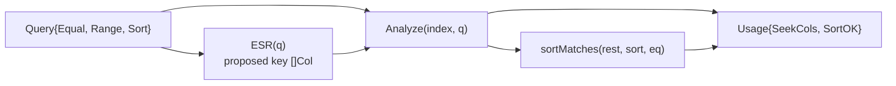
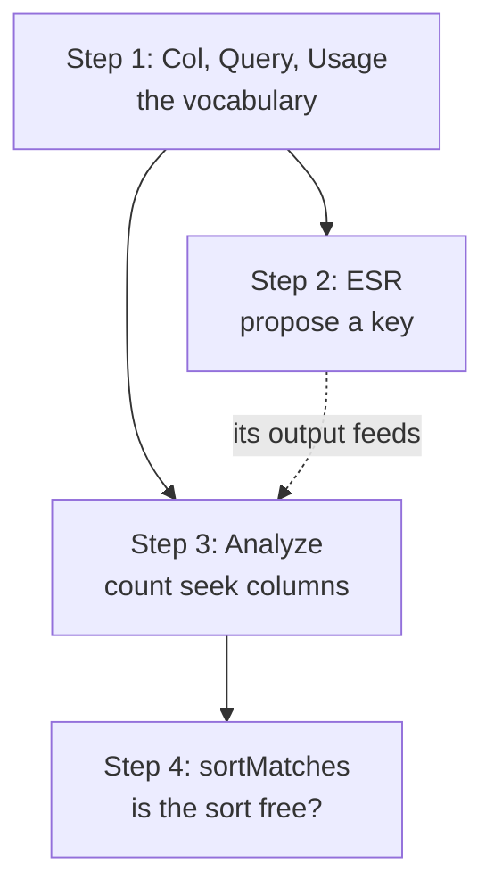
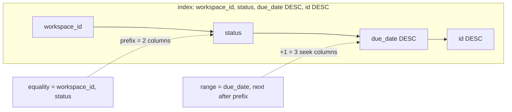

# Index Types and Index Design - Go

> [!summary] TL;DR
> This note implements a small checker for B-tree index design: given an index key and a query shape, `Analyze` reports how many leading columns the query can seek on and whether the index already returns rows in `ORDER BY` order, and `ESR` proposes a key using the equality–sort–range rule. The concepts are explained in [[Index Types and Index Design]].

## Before the code

- **Structs and slices** (`Col`, `Query`, `[]Col`): an index is just an ordered list of columns with a sort direction.
- **Maps as sets** (`map[string]bool`): track which columns are fixed by equality filters.
- **Pure functions** (`ESR`, `Analyze`): no I/O and no state, so each one is easy to test in isolation.
- **Table-driven tests**: a slice of cases, each with an index, a query and the expected result.
- **`reflect.DeepEqual`**: compares whole slices and structs in the tests.
- **What to run:** `go vet ./... && go test -race -v ./...` inside the `idx` module.

## What this code shows

| Code | Theory concept | Where explained |
| --- | --- | --- |
| `Col`, `Query`, `Usage` | The shape of a query (equality set, one range column, `ORDER BY`) and the result of matching it to an index | [[Index Types and Index Design]], "Checking an index design against a query" |
| `ESR` | Equality columns first, then sort columns, then the range column | [[Index Types and Index Design]], "Multicolumn B-tree: the ESR rule" |
| `Analyze` | The leftmost-prefix rule without skip scan | [[Index Types and Index Design]], "Column order against three queries" |
| `sortMatches` | A forward or fully backward index scan serves `ORDER BY`; mixed directions do not | [[Index Types and Index Design]], "Multicolumn B-tree: the ESR rule" |



## Setup

- Go 1.24, standard library only (`reflect` and `testing` in the tests).
- Module layout: one package `idx` with two files.

```text
idx/
  go.mod          // module idx, go 1.24
  idx.go          // Col, Query, Usage, ESR, Analyze, sortMatches
  idx_test.go     // TestAnalyze, TestESR
```

- Run: `go vet ./... && go test -race -v ./...`

## Code

The code is one package of three small ideas: a vocabulary for describing a query, a function that proposes a key, and a function that judges a key. Each is shown in its own piece below. The pieces are one file, `idx.go`, in the order shown.



### Step 1: describe the query and the index

**Concept.** The theory note reduces any hot query to three facts: which columns are compared with `=`, which one column carries a range, and what `ORDER BY` asks for ([[Index Types and Index Design#3.2 Multicolumn B-tree: the ESR rule]]).

The code mirrors exactly those three facts in a `Query` struct, so a query is data, not SQL text. An alternative would be to parse real SQL or call `EXPLAIN`, but that needs a database and hides the rule being taught.

An index is just an ordered `[]Col`, because a multicolumn B-tree is defined by its column order and directions and nothing else matters for this check.

```go
package idx

// Col is one index key column or one ORDER BY column.
type Col struct {
	Name string
	Desc bool
}

// Query is the shape of one query against a single table.
type Query struct {
	Equal []string // columns compared with = (or IN with one value)
	Range string   // at most one column compared with <, >, BETWEEN; "" if none
	Sort  []Col    // ORDER BY columns, in order
}

// Usage says how much of a B-tree index a query can use.
type Usage struct {
	SeekCols int  // leading index columns that narrow the scan
	SortOK   bool // the index returns rows already in ORDER BY order
}
```

**How it works.**

1. `Col` pairs a name with a direction. The zero value of `Desc` is `false`, so a column is ascending unless stated otherwise.
2. `Query.Equal` is a slice because order among equality columns does not matter for matching, only for index design.
3. `Query.Range` is a single string, not a slice, because a B-tree can seek through at most one range: after it, entries are no longer contiguous.
4. `Usage` has two answers, and they are independent. A key can seek well and still need a Sort, or the reverse.

Before and after for the running example, the invoice list API `WHERE workspace_id = ? AND status = ? ORDER BY due_date DESC, id DESC`:

| SQL piece | Field | Value |
| --- | --- | --- |
| `workspace_id = ? AND status = ?` | `Equal` | `["workspace_id", "status"]` |
| no range | `Range` | `""` |
| `ORDER BY due_date DESC, id DESC` | `Sort` | `[{due_date, true}, {id, true}]` |

### Step 2: propose a key with ESR

**Concept.** This implements the equality, sort, range ordering from [[Index Types and Index Design#3.2 Multicolumn B-tree: the ESR rule]]. Equality columns go first so the matching entries form one contiguous run. Sort columns go next so that run is already in `ORDER BY` order.

The range column goes last because a range run is not ordered by anything after it.

The function is a pure transformation with no search, which is why it is short; a cost-based advisor would try many orders, but ESR gives a good answer in one pass.

```go
// ESR proposes a B-tree key for q: equality columns, then sort columns,
// then the range column (unless it is already the first sort column).
func ESR(q Query) []Col {
	key := make([]Col, 0, len(q.Equal)+len(q.Sort)+1)
	seen := map[string]bool{}
	for _, c := range q.Equal {
		if !seen[c] {
			key = append(key, Col{Name: c})
			seen[c] = true
		}
	}
	for _, c := range q.Sort {
		if !seen[c.Name] {
			key = append(key, c)
			seen[c.Name] = true
		}
	}
	if q.Range != "" && !seen[q.Range] {
		key = append(key, Col{Name: q.Range})
	}
	return key
}
```

**How it works.**

1. `make(..., 0, cap)` allocates the key once with the largest possible length, so `append` never reallocates.
2. The `seen` map removes duplicates. A column that is both an equality column and an `ORDER BY` column appears once, in its equality position.
3. Sort columns are copied whole, `append(key, c)`, so their `Desc` flags survive. Equality columns are built as `Col{Name: c}`, ascending, because direction is irrelevant for a pinned value.
4. The range column is added last, and only if the sort did not already include it. That is the subtlety from the theory note: when the range column is also the first sort column, it serves both jobs.

Trace for equality `workspace_id, status`, range `amount_minor`, sort `due_date DESC`:

| Phase | Key after the phase |
| --- | --- |
| equality loop | `workspace_id, status` |
| sort loop | `workspace_id, status, due_date DESC` |
| range | `workspace_id, status, due_date DESC, amount_minor` |

### Step 3: count the seek columns

**Concept.** `Analyze` implements the leftmost-prefix rule ([[Index Types and Index Design#4.1 Column order against three queries]]): a B-tree can only seek on a prefix of its key.

The walk stops at the first index column that is not in the equality set, and one more column counts if it is the range column.

The code deliberately has no skip scan, which PostgreSQL 18 and MySQL 8.0.13 added for some cases, because the rule without it is the one every engine guarantees.

The alternative of modelling skip scan would need cardinality estimates, which a pure shape check does not have.

```go
// Analyze applies the leftmost-prefix rule (no skip scan).
func Analyze(index []Col, q Query) Usage {
	eq := map[string]bool{}
	for _, c := range q.Equal {
		eq[c] = true
	}
	var u Usage
	i := 0
	for i < len(index) && eq[index[i].Name] {
		i++
	}
	u.SeekCols = i
	if i < len(index) && q.Range != "" && index[i].Name == q.Range {
		u.SeekCols++
	}
	u.SortOK = sortMatches(index[i:], q.Sort, eq)
	return u
}
```

**How it works.**

1. The equality slice becomes a set `eq` so each index column is tested in constant time.
2. The `for` loop advances `i` while the index column is an equality column. It stops at the first column that is not, which is the "gap" in the prefix rule.
3. `SeekCols = i` records the equality prefix. Only if the very next column is the range column does it add one, so a range separated from the prefix by a gap earns nothing.
4. `index[i:]` is the part of the key after the equality prefix. Only that part can deliver ordering, so only that slice is passed to `sortMatches`.



### Step 4: decide whether the sort is free

**Concept.** The theory note says a forward or a fully backward scan of the index serves `ORDER BY`, but mixed directions do not ([[Index Types and Index Design#3.2 Multicolumn B-tree: the ESR rule]]). `sortMatches` encodes that.

It first removes `ORDER BY` columns that equality has pinned, since every row in the run has the same value for them.

Then it checks that the remaining sort columns are a prefix of what is left of the index and that the directions are all the same or all flipped. A simpler check, comparing names only, would wrongly approve mixed directions.

```go
// sortMatches reports whether rest (the index after its equality prefix)
// yields the ORDER BY. Sort columns pinned by equality can be ignored.
// Directions must all match or all be flipped (a backward index scan).
func sortMatches(rest, sort []Col, eq map[string]bool) bool {
	var want []Col
	for _, c := range sort {
		if !eq[c.Name] {
			want = append(want, c)
		}
	}
	if len(want) > len(rest) {
		return false
	}
	same, flipped := true, true
	for k, c := range want {
		if rest[k].Name != c.Name {
			return false
		}
		if rest[k].Desc == c.Desc {
			flipped = false
		} else {
			same = false
		}
	}
	return same || flipped
}
```

**How it works.**

1. The first loop builds `want`, the sort columns that equality did not pin. An empty `want` means no sort is needed, and the function returns true.
2. If `want` is longer than `rest`, the index cannot possibly supply the order, so it returns false early.
3. For each position `k` the names must match exactly. A single different name returns false at once.
4. `same` and `flipped` start true. A column with the same direction proves the scan cannot be fully flipped, and a column with the opposite direction proves it cannot be fully forward. Both can end false, which is the mixed case.
5. `same || flipped` is true for a forward scan or a backward scan, and false only for mixed directions.

State of the two flags for three sorts against the index tail `due_date DESC, id DESC`:

| `ORDER BY` | after `due_date` | after `id` | result |
| --- | --- | --- | --- |
| `due_date DESC, id DESC` | same=true, flipped=false | same=true, flipped=false | true (forward scan) |
| `due_date, id` | same=false, flipped=true | same=false, flipped=true | true (backward scan) |
| `due_date, id DESC` | same=false, flipped=true | same=false, flipped=false | false (mixed) |

## Design decisions

| Decision | Alternative | Trade-off |
| --- | --- | --- |
| A query is a small struct of equality set, one range, sort list | Parse SQL or call `EXPLAIN` | The struct needs no database and isolates the rule, but it cannot express `OR`, several `IN` values or expressions |
| `Usage` is a comparable struct of an int and a bool | A struct with a slice of used columns | Tests compare with `!=` in one line, but the result carries no per-column detail |
| No skip scan | Model PostgreSQL 18 and MySQL 8.0.13 skip scan | Matches the guaranteed behaviour on every engine, but reports 0 seek columns where a newer engine may still skip |
| `ESR` removes duplicates with a `seen` map | Allow repeated columns | A column in both equality and sort stays in its equality position, which is correct, at the cost of a map |
| Direction check uses two booleans | Compare against a computed scan direction | Two flags are simple and show the mixed case clearly, but need a short explanation |
| Early `return false` on a name mismatch | Keep scanning and report all mismatches | Fast and simple, but the caller gets no reason |

## Tests

Two tests cover the two exported functions. `listIdx` is the index `(workspace_id, status, due_date DESC, id DESC)` from the invoice list API.

### TestAnalyze: the leftmost-prefix and sort rules

**Property.** `Analyze` returns the right `SeekCols` and `SortOK` for seven query shapes that each isolate one rule. This matters because a wrong answer here would approve a migration that leaves a hot query doing a full scan or an extra Sort.

| Case | Query | Expected `Usage` | Rule it proves |
| --- | --- | --- | --- |
| list API | equal `workspace_id, status`; sort `due_date DESC, id DESC` | `{2, true}` | ideal ESR match |
| backward scan | same equality; sort `due_date, id` | `{2, true}` | fully flipped directions are free |
| mixed directions | same equality; sort `due_date, id DESC` | `{2, false}` | mixed directions need a Sort |
| range on due_date | same equality; range `due_date` | `{3, true}` | range right after the prefix adds one |
| skips leading column | equal `status` only | `{0, true}` | no leading column, no seek |
| gap in prefix | equal `workspace_id`; range `due_date` | `{1, true}` | a gap blocks the range |
| sort column pinned | same equality; sort `status, due_date DESC` | `{2, true}` | pinned sort columns are ignored |

```go
package idx

import (
	"reflect"
	"testing"
)

// invoices(workspace_id, status, due_date DESC, id DESC)
var listIdx = []Col{{Name: "workspace_id"}, {Name: "status"}, {Name: "due_date", Desc: true}, {Name: "id", Desc: true}}

func TestAnalyze(t *testing.T) {
	cases := []struct {
		name string
		q    Query
		want Usage
	}{
		{"list API", Query{Equal: []string{"workspace_id", "status"},
			Sort: []Col{{Name: "due_date", Desc: true}, {Name: "id", Desc: true}}}, Usage{2, true}},
		{"backward scan", Query{Equal: []string{"workspace_id", "status"},
			Sort: []Col{{Name: "due_date"}, {Name: "id"}}}, Usage{2, true}},
		{"mixed directions", Query{Equal: []string{"workspace_id", "status"},
			Sort: []Col{{Name: "due_date"}, {Name: "id", Desc: true}}}, Usage{2, false}},
```

The remaining four cases and the loop that runs them:

```go
		{"range on due_date", Query{Equal: []string{"workspace_id", "status"},
			Range: "due_date"}, Usage{3, true}},
		{"skips leading column", Query{Equal: []string{"status"}}, Usage{0, true}},
		{"gap in prefix", Query{Equal: []string{"workspace_id"}, Range: "due_date"}, Usage{1, true}},
		{"sort column pinned", Query{Equal: []string{"workspace_id", "status"},
			Sort: []Col{{Name: "status"}, {Name: "due_date", Desc: true}}}, Usage{2, true}},
	}
	for _, c := range cases {
		if got := Analyze(listIdx, c.q); got != c.want {
			t.Errorf("%s: got %+v, want %+v", c.name, got, c.want)
		}
	}
}
```

**What a failure means.** A failing row names the case and prints the actual `Usage`. A wrong `SeekCols` points at the prefix loop in `Analyze`. A wrong `SortOK` points at `sortMatches`, usually the direction flags or the pinned-column filter.

### TestESR: the proposal round-trips

**Property.** The key proposed by `ESR` for a query is accepted by `Analyze` for that same query. The two functions are written separately, so this test proves they agree.

| Input query | Expected key | Expected `Analyze` result |
| --- | --- | --- |
| equal `workspace_id, status`; range `amount_minor`; sort `due_date DESC` | `workspace_id, status, due_date DESC, amount_minor` | `SeekCols` 2, `SortOK` true |

```go
func TestESR(t *testing.T) {
	q := Query{Equal: []string{"workspace_id", "status"}, Range: "amount_minor",
		Sort: []Col{{Name: "due_date", Desc: true}}}
	want := []Col{{Name: "workspace_id"}, {Name: "status"}, {Name: "due_date", Desc: true}, {Name: "amount_minor"}}
	got := ESR(q)
	if !reflect.DeepEqual(got, want) {
		t.Fatalf("got %+v", got)
	}
	u := Analyze(got, q)
	if u.SeekCols != 2 || !u.SortOK {
		t.Fatalf("ESR key should seek on 2 columns and serve the sort, got %+v", u)
	}
}
```

**What a failure means.** A `DeepEqual` failure means the order of equality, sort and range in `ESR` is wrong. A failure on the second check, with a correct key, means `Analyze` and `ESR` disagree about what counts as a seek column.

Note that `SeekCols` is 2, not 3: the range column sits after `due_date`, so the sort column breaks the prefix, which is the intended price of serving the sort.

## Running it

```bash
go vet ./... && go test -race -v ./...
```

Measured with Go 1.24.4:

```text
=== RUN   TestAnalyze
--- PASS: TestAnalyze (0.00s)
=== RUN   TestESR
--- PASS: TestESR (0.00s)
PASS
ok  	idx	1.481s
```

Reading the output line by line:

1. `=== RUN TestAnalyze` and its `--- PASS` line mean all seven table rows passed. Subtests are not used, so one failing row would show as a single `--- FAIL` with the `t.Errorf` message.
2. `=== RUN TestESR` and `--- PASS` mean the proposed key matched and was accepted by `Analyze`.
3. `(0.00s)` is normal: the code does a handful of map and slice operations.
4. `PASS` is the package summary, and `ok idx 1.481s` includes compile and `-race` start-up, which is why it is far larger than the test times. `go vet` printed nothing, which means it found no problems.

## Pitfalls in the code

- The "gap in prefix" case is the classic mistake: `Equal: workspace_id` with `Range: due_date` on `(workspace_id, status, due_date)` seeks on one column only, because `status` sits between them.
- `Analyze` models the leftmost-prefix rule without skip scan, so it reports `SeekCols: 0` for a query that PostgreSQL 18 or MySQL 8.0.13+ could skip scan.
- `Usage` is compared with `!=`, which works because it has only comparable fields. Adding a slice field would make that comparison a compile error.
- `IN` lists with several values and `OR` conditions are not modelled; only one equality value per column.
- `sortMatches` returns true for an empty `ORDER BY`, so "no sort needed" and "sort served by the index" look the same.
- `ESR` returns an empty key when the query has no columns, and the code does not check column names against a real schema.

## Exercises

1. Add the case `Query{Equal: workspace_id, status; Range: amount_minor}` with no sort and run `Analyze` against the ESR key for it. Predict `SeekCols` before running.
2. Change `listIdx` to `(status, workspace_id, due_date DESC, id DESC)` and rerun `TestAnalyze`. Predict which cases change and explain why from the leftmost-prefix rule.
3. Add `Query{Equal: workspace_id; Sort: status, due_date DESC}` and then `Query{Equal: workspace_id; Sort: due_date DESC}`. Predict `SortOK` for each against `listIdx`, and explain why the second one needs a Sort even though `due_date` is in the index.

## Links

- Theory: [[Index Types and Index Design]]
- Before this: [[Indexing Fundamentals - Go]]
- Next: [[Query Plans and EXPLAIN - Go]]
