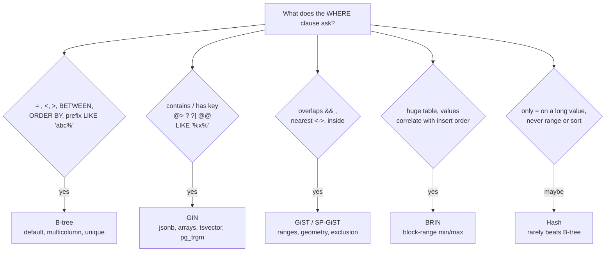
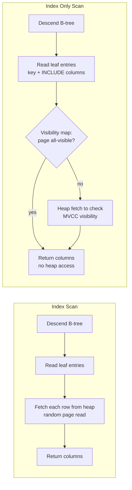

# Index Types and Index Design

> [!summary] TL;DR
> A plain B-tree index (the sorted lookup structure from [[Indexing Fundamentals]]) handles equality, ranges and sorting. Other questions need other shapes: **GIN** for "does this JSON/array/text contain X", **GiST** for "do these ranges or shapes overlap", **BRIN** for huge tables written in time order. Index *design* is choosing the type, the column order, and which rows and columns go in, so the database reads as few pages as possible for the queries you actually run.

> [!abstract] Core idea
> - Start from the query shape (what is in `WHERE`, `ORDER BY`, `LIMIT`), never from the column list.
> - In a multicolumn B-tree put **E**quality columns first, then **S**ort columns, then the **R**ange column (the ESR rule).
> - Shrink indexes to what matters: a **partial** index stores only some rows, `INCLUDE` adds columns only to answer the query from the index.
> - Pick a non-B-tree type only for a query a B-tree cannot answer: containment (GIN), overlap or nearest (GiST), huge time-ordered tables (BRIN).
> - Every index costs writes, disk and RAM; find and drop the ones nobody uses.

## 1. Why it exists

InvoiceOps keeps 10 million rows in `invoices` across 2,000 workspaces (a workspace is one customer company, the tenant). The most called endpoint lists one workspace's overdue invoices:

```sql
SELECT id, number, due_date, amount_minor
FROM invoices
WHERE workspace_id = 42 AND status = 'overdue'
ORDER BY due_date DESC, id DESC
LIMIT 20;
```

With only a single-column index on `workspace_id`, PostgreSQL finds workspace 42's 5,000 invoices, fetches each from the table, throws away the 4,700 that are not overdue, sorts the remaining 300 and returns 20. That is about 5,000 random page reads to show 20 rows. With the right composite index (one index over several columns) it reads about 4 index pages and 20 table rows.

Three other InvoiceOps questions cannot be helped by any B-tree, however the columns are ordered:

| Query | Why a B-tree fails | Index type that fits |
| --- | --- | --- |
| `WHERE metadata @> '{"channel":"stripe"}'` (JSON contains) | A B-tree compares whole values; it cannot look inside a document | GIN |
| `WHERE number ILIKE '%2026-07%'` (substring) | A leading `%` means there is no sorted prefix to seek to | GIN with `pg_trgm` |
| "No two bookings of meeting room 7 may overlap" | Overlap is not an ordering relation | GiST exclusion constraint |
| 2 billion rows of `audit_logs` queried by day | A B-tree on `created_at` would be tens of GB | BRIN, a few MB |

## 2. Mental model

A B-tree is a phone book: sorted by surname, then first name. It is perfect for "Sharma, Priya", fine for "all Sharmas", useless for "everyone called Priya" (that is the *leftmost-prefix rule*: you can only seek using a leading run of the sort columns).

The other index types are other kinds of reference books:
- **GIN** (Generalized Inverted Index) is the index at the back of a textbook: each *word* (a JSON key, an array element, a trigram) points to every page that contains it.
- **GiST** (Generalized Search Tree) is a map with nested boxes: each box says "everything inside me lies within this area", so you skip boxes that cannot overlap your search area.
- **BRIN** (Block Range INdex) is the spine labels of a shelf of diaries: "volume 1 covers January–March". It is tiny, and it works only if the diaries were filed in date order.

## 3. How it works

### 3.1 Choosing the type from the query shape



### 3.2 Multicolumn B-tree: the ESR rule

A multicolumn B-tree sorts entries by the first column, then by the second within equal firsts, and so on. Three consequences:

1. **Equality columns first.** After `workspace_id = 42 AND status = 'overdue'` the matching entries are one contiguous run, so the scan starts and stops precisely.
2. **Sort columns next.** Inside that run the entries are already ordered by `due_date DESC, id DESC`, so `ORDER BY … LIMIT 20` reads the first 20 and stops. No Sort node.
3. **Range column last.** A range (`amount_minor > 100000`) produces a run that is *not* ordered by anything after it. Put a range before the sort column and the database must sort again.

This is the **ESR rule** (Equality, Sort, Range), named in the MongoDB docs and equally true for PostgreSQL and MySQL. One subtlety: if the range column *is* the sort column (`WHERE due_date < now() ORDER BY due_date`), it sits in the sort position and serves both.

Direction matters only for mixed sorts. An index on `(due_date DESC, id DESC)` can be read backwards to give `due_date ASC, id ASC`, but neither direction gives `due_date DESC, id ASC`.

### 3.3 Index scan vs index-only scan



An **index-only scan** answers the query from the index alone. In PostgreSQL the index does not store whether a row version is visible to your transaction (see [[Isolation Levels and MVCC]]), so it checks the **visibility map**, one bit per heap page that `VACUUM` sets when every row on the page is visible to everyone. Pages that are not all-visible still need a heap visit, shown as `Heap Fetches` in `EXPLAIN ANALYZE`. A table with heavy updates and lagging autovacuum gets few true index-only scans.

### 3.4 What each special type stores

| Type | One index entry is | Lookup |
| --- | --- | --- |
| B-tree | `(key columns, row pointer)` in sorted leaf pages | Descend 3–4 levels, walk leaves |
| Hash | 32-bit hash of the key → row pointer, in buckets | Hash the value, read one bucket |
| GIN | One element (JSON path/key, array item, lexeme, trigram) → sorted list of row pointers (*posting list*) | Look up each element, intersect posting lists, recheck rows |
| GiST | A bounding predicate (range, box) per subtree; leaves hold values | Descend every subtree whose bound matches; may visit several branches |
| BRIN | For each range of 128 table pages (default `pages_per_range`): min and max value | Scan the whole small BRIN, read only page ranges whose min/max could match, recheck rows |

## 4. Worked example

### Whiteboard version

```sql
-- Query: one tenant, one status, newest due first, page of 20
-- E = workspace_id, status   S = due_date DESC, id DESC   R = none
CREATE INDEX CONCURRENTLY invoices_ws_status_due_idx
    ON invoices (workspace_id, status, due_date DESC, id DESC);

-- Shrink it: under 10% of invoices are open or overdue, and the list never shows the rest
CREATE INDEX CONCURRENTLY invoices_open_due_idx
    ON invoices (workspace_id, due_date DESC, id DESC)
    INCLUDE (number, amount_minor)
    WHERE status IN ('open', 'overdue');

-- Soft delete: email unique only among live users, case-insensitive
CREATE UNIQUE INDEX users_ws_email_live_uidx
    ON users (workspace_id, lower(email))
    WHERE deleted_at IS NULL;
```

`CONCURRENTLY` builds without blocking writes; it cannot run inside a transaction block, and a failed build leaves an `INVALID` index to drop (see [[Zero-Downtime Schema Migrations]]).

### 4.1 Column order against three queries

All plans below are **representative output (PostgreSQL 17)** for `invoices` with 10 M rows, 2,000 workspaces, about 5,000 invoices per workspace and 6% `overdue`. The table starts with only `invoices_ws_idx (workspace_id)`.

**Query A, the list endpoint** (from section 1), before:

```text
Limit  (cost=4381.20..4381.25 rows=20 width=40) (actual time=38.912..38.917 rows=20 loops=1)
  ->  Sort  (cost=4381.20..4382.00 rows=318 width=40) (actual time=38.910..38.913 rows=20 loops=1)
        Sort Key: due_date DESC, id DESC
        Sort Method: top-N heapsort  Memory: 27kB
        ->  Bitmap Heap Scan on invoices  (cost=58.40..4372.70 rows=318 width=40) (actual time=1.402..38.611 rows=301 loops=1)
              Recheck Cond: (workspace_id = 42)
              Filter: (status = 'overdue'::text)
              Rows Removed by Filter: 4712
              Heap Blocks: exact=4890
              ->  Bitmap Index Scan on invoices_ws_idx  (cost=0.00..58.32 rows=5050 width=0) (actual time=0.701..0.701 rows=5013 loops=1)
                    Index Cond: (workspace_id = 42)
Planning Time: 0.190 ms
Execution Time: 38.990 ms
```

After `(workspace_id, status, due_date DESC, id DESC)`:

```text
Limit  (cost=0.56..21.40 rows=20 width=40) (actual time=0.031..0.074 rows=20 loops=1)
  ->  Index Scan using invoices_ws_status_due_idx on invoices  (cost=0.56..331.90 rows=318 width=40) (actual time=0.030..0.071 rows=20 loops=1)
        Index Cond: ((workspace_id = 42) AND (status = 'overdue'::text))
Planning Time: 0.160 ms
Execution Time: 0.093 ms
```

The Sort node and the 4,712 discarded rows are gone; 20 rows are fetched.

**Query B, a range plus a sort**: overdue invoices above ₹1,000 (`amount_minor > 100000`, in paise), newest due first.

```sql
SELECT id, due_date, amount_minor FROM invoices
WHERE workspace_id = 42 AND status = 'overdue' AND amount_minor > 100000
ORDER BY due_date DESC, id DESC LIMIT 20;
```

With an index ordered E-R-S, `(workspace_id, status, amount_minor, due_date)`, the range on `amount_minor` returns entries ordered by amount, so a Sort is back on top. With the E-S-R order `(workspace_id, status, due_date DESC, id DESC, amount_minor)` the scan walks in due-date order and checks `amount_minor` inside the index (`Index Cond` on the last column, no heap visit for the rejected rows), stopping after 20 matches. Representative output (PostgreSQL 17), E-R-S first, then E-S-R:

```text
Limit  (actual time=2.814..2.819 rows=20 loops=1)
  ->  Sort  (actual time=2.812..2.815 rows=20 loops=1)
        Sort Key: due_date DESC, id DESC
        Sort Method: top-N heapsort  Memory: 26kB
        ->  Index Scan using invoices_ws_status_amt_idx on invoices  (actual time=0.041..2.690 rows=212 loops=1)
              Index Cond: ((workspace_id = 42) AND (status = 'overdue'::text) AND (amount_minor > 100000))
Execution Time: 2.851 ms

Limit  (actual time=0.036..0.102 rows=20 loops=1)
  ->  Index Scan using invoices_ws_status_due_amt_idx on invoices  (actual time=0.035..0.099 rows=20 loops=1)
        Index Cond: ((workspace_id = 42) AND (status = 'overdue'::text) AND (amount_minor > 100000))
Execution Time: 0.118 ms
```

ESR trades a few extra index entries read for never sorting, which wins whenever `LIMIT` is small.

**Query C, status only, across all tenants** (a nightly job):

```sql
SELECT count(*) FROM invoices WHERE status = 'overdue';
```

The leading column `workspace_id` is not constrained. Before PostgreSQL 18 the planner either reads the whole index or does a Seq Scan. PostgreSQL 18 added **B-tree skip scan**: when the skipped leading column has few distinct values, it performs one small descent per distinct `workspace_id` (2,000 descents here) instead of reading everything. MySQL has had the same idea since 8.0.13 (`Using index for skip scan` in `EXPLAIN`), with restrictions: one table, and the query must be answerable from the index. So "an index is useless if the query skips its first column" is no longer an absolute rule; it is still the right default, because skip scan is only cheap when the skipped column has few distinct values.

### 4.2 Covering index and Heap Fetches

```sql
CREATE INDEX CONCURRENTLY invoices_open_due_idx
    ON invoices (workspace_id, due_date DESC, id DESC)
    INCLUDE (number, amount_minor)
    WHERE status IN ('open', 'overdue');
```

`INCLUDE` (B-tree since PostgreSQL 11) stores `number` and `amount_minor` in leaf pages only. They are not part of the sort order and cannot be searched, but they let `SELECT id, number, due_date, amount_minor … WHERE workspace_id = 42 AND status IN ('open','overdue')` skip the heap. The index does not store `status`, so a query for `status = 'overdue'` alone still uses this index but must visit the heap to check the status; add `status` to `INCLUDE` if that query must be index-only. Representative output (PostgreSQL 17), right after `VACUUM`, then after a burst of updates:

```text
Index Only Scan using invoices_open_due_idx on invoices  (actual time=0.028..0.041 rows=20 loops=1)
  Index Cond: (workspace_id = 42)
  Heap Fetches: 0

Index Only Scan using invoices_open_due_idx on invoices  (actual time=0.029..0.188 rows=20 loops=1)
  Index Cond: (workspace_id = 42)
  Heap Fetches: 17
```

The partial predicate (`WHERE status IN (...)`) makes this index roughly a tenth of the size of a full one (open plus overdue rows are under 10% of the table). The planner uses it only when it can prove the query's `WHERE` implies the index's `WHERE`, so the query must say `status IN ('open','overdue')` or `status = 'overdue'`; a query parameter `status = $1` with a generic plan cannot be proven and will not use it.

### 4.3 The other types, in InvoiceOps

```sql
-- GIN on jsonb: containment on payment metadata
CREATE INDEX invoices_meta_gin ON invoices USING gin (metadata jsonb_path_ops);
SELECT id FROM invoices WHERE metadata @> '{"channel": "stripe", "retry": true}';

-- GIN + trigrams: substring search on invoice numbers
CREATE EXTENSION IF NOT EXISTS pg_trgm;
CREATE INDEX invoices_number_trgm ON invoices USING gin (number gin_trgm_ops);
SELECT id FROM invoices WHERE number ILIKE '%2026-07%';

-- Expression index: the query must use the same expression
CREATE INDEX users_lower_email_idx ON users (lower(email));
SELECT id FROM users WHERE lower(email) = lower('Priya@Acme.in');  -- uses it
SELECT id FROM users WHERE email = 'priya@acme.in';                 -- does not

-- GiST exclusion: no overlapping bookings of the same room
CREATE EXTENSION IF NOT EXISTS btree_gist;  -- lets GiST handle "room_id WITH ="
CREATE TABLE room_bookings (
    id       bigint GENERATED ALWAYS AS IDENTITY PRIMARY KEY,
    room_id  bigint NOT NULL,
    during   tstzrange NOT NULL,
    EXCLUDE USING gist (room_id WITH =, during WITH &&)
);

-- BRIN: append-only audit log, queried by time window
CREATE INDEX audit_logs_created_brin ON audit_logs USING brin (created_at);

-- Unique index as a business rule: process each webhook once
CREATE UNIQUE INDEX webhook_events_provider_event_uidx
    ON webhook_events (provider, event_id);
```

Notes on each:
- `jsonb_path_ops` is smaller and faster than the default `jsonb_ops`, but supports only `@>`, `@?` and `@@`, not the key-exists operators `?`, `?|`, `?&`.
- Trigram search splits text into 3-character pieces, so a search string shorter than 3 characters cannot use the index well.
- An expression index needs an `IMMUTABLE` function (same input, same output, forever). `lower()` qualifies; `now()` does not.
- A second booking of room 7 for an overlapping time fails with SQLSTATE `23P01` (`exclusion_violation`), enforced by the database even under concurrent inserts, which an application-side "check then insert" cannot guarantee (see [[Locking - Optimistic vs Pessimistic]]).
- For 2 billion audit rows (about 90 rows per 8 kB page, so about 22 M pages), BRIN keeps one min/max pair per 128 pages: roughly 175,000 summaries, a few MB at most. A B-tree on the same column would be roughly 40–50 GB. Both figures are estimates from page arithmetic, not measurements.

### 4.4 Checking an index design in Go

Before shipping a migration, a code review can check each hot query against the proposed key. This helper encodes the leftmost-prefix rule (without skip scan) and the ESR order.

```go
package idx

// Col is one index key column or one ORDER BY column.
type Col struct {
	Name string
	Desc bool
}

// Query is the shape of one query against a single table.
type Query struct {
	Equal []string // columns compared with = (or IN with one value)
	Range string   // at most one column compared with <, >, BETWEEN; "" if none
	Sort  []Col    // ORDER BY columns, in order
}

// Usage says how much of a B-tree index a query can use.
type Usage struct {
	SeekCols int  // leading index columns that narrow the scan
	SortOK   bool // the index returns rows already in ORDER BY order
}

// ESR proposes a B-tree key for q: equality columns, then sort columns,
// then the range column (unless it is already the first sort column).
func ESR(q Query) []Col {
	key := make([]Col, 0, len(q.Equal)+len(q.Sort)+1)
	seen := map[string]bool{}
	for _, c := range q.Equal {
		if !seen[c] {
			key = append(key, Col{Name: c})
			seen[c] = true
		}
	}
	for _, c := range q.Sort {
		if !seen[c.Name] {
			key = append(key, c)
			seen[c.Name] = true
		}
	}
	if q.Range != "" && !seen[q.Range] {
		key = append(key, Col{Name: q.Range})
	}
	return key
}

// Analyze applies the leftmost-prefix rule (no skip scan).
func Analyze(index []Col, q Query) Usage {
	eq := map[string]bool{}
	for _, c := range q.Equal {
		eq[c] = true
	}
	var u Usage
	i := 0
	for i < len(index) && eq[index[i].Name] {
		i++
	}
	u.SeekCols = i
	if i < len(index) && q.Range != "" && index[i].Name == q.Range {
		u.SeekCols++
	}
	u.SortOK = sortMatches(index[i:], q.Sort, eq)
	return u
}

// sortMatches reports whether rest (the index after its equality prefix)
// yields the ORDER BY. Sort columns pinned by equality can be ignored.
// Directions must all match or all be flipped (a backward index scan).
func sortMatches(rest, sort []Col, eq map[string]bool) bool {
	var want []Col
	for _, c := range sort {
		if !eq[c.Name] {
			want = append(want, c)
		}
	}
	if len(want) > len(rest) {
		return false
	}
	same, flipped := true, true
	for k, c := range want {
		if rest[k].Name != c.Name {
			return false
		}
		if rest[k].Desc == c.Desc {
			flipped = false
		} else {
			same = false
		}
	}
	return same || flipped
}
```

```go
package idx

import (
	"reflect"
	"testing"
)

// invoices(workspace_id, status, due_date DESC, id DESC)
var listIdx = []Col{{Name: "workspace_id"}, {Name: "status"}, {Name: "due_date", Desc: true}, {Name: "id", Desc: true}}

func TestAnalyze(t *testing.T) {
	cases := []struct {
		name string
		q    Query
		want Usage
	}{
		{"list API", Query{Equal: []string{"workspace_id", "status"},
			Sort: []Col{{Name: "due_date", Desc: true}, {Name: "id", Desc: true}}}, Usage{2, true}},
		{"backward scan", Query{Equal: []string{"workspace_id", "status"},
			Sort: []Col{{Name: "due_date"}, {Name: "id"}}}, Usage{2, true}},
		{"mixed directions", Query{Equal: []string{"workspace_id", "status"},
			Sort: []Col{{Name: "due_date"}, {Name: "id", Desc: true}}}, Usage{2, false}},
		{"range on due_date", Query{Equal: []string{"workspace_id", "status"},
			Range: "due_date"}, Usage{3, true}},
		{"skips leading column", Query{Equal: []string{"status"}}, Usage{0, true}},
		{"gap in prefix", Query{Equal: []string{"workspace_id"}, Range: "due_date"}, Usage{1, true}},
		{"sort column pinned", Query{Equal: []string{"workspace_id", "status"},
			Sort: []Col{{Name: "status"}, {Name: "due_date", Desc: true}}}, Usage{2, true}},
	}
	for _, c := range cases {
		if got := Analyze(listIdx, c.q); got != c.want {
			t.Errorf("%s: got %+v, want %+v", c.name, got, c.want)
		}
	}
}

func TestESR(t *testing.T) {
	q := Query{Equal: []string{"workspace_id", "status"}, Range: "amount_minor",
		Sort: []Col{{Name: "due_date", Desc: true}}}
	want := []Col{{Name: "workspace_id"}, {Name: "status"}, {Name: "due_date", Desc: true}, {Name: "amount_minor"}}
	got := ESR(q)
	if !reflect.DeepEqual(got, want) {
		t.Fatalf("got %+v", got)
	}
	u := Analyze(got, q)
	if u.SeekCols != 2 || !u.SortOK {
		t.Fatalf("ESR key should seek on 2 columns and serve the sort, got %+v", u)
	}
}
```

Measured: `go vet` is clean and `go test -race` passes with Go 1.24.4. The "gap in prefix" case is the classic mistake: `WHERE workspace_id = ? AND due_date > ?` on `(workspace_id, status, due_date)` seeks on one column only, and `due_date` becomes a filter over the whole workspace.

## 5. Variants and comparison

| Index | Answers | Use when | Cost / limits |
| --- | --- | --- | --- |
| B-tree | `=`, `<`, `>`, `BETWEEN`, `IN`, `IS NULL`, `ORDER BY`, `LIKE 'abc%'` (with `text_pattern_ops` or C collation) | Default for nearly everything | Write cost per index; leftmost prefix |
| Hash | `=` only | Very long keys (URLs, tokens) where a 4-byte hash is smaller than the key | No range, no sort, no uniqueness, no multicolumn; crash-safe only since PostgreSQL 10 |
| GIN | Contains / has-key on `jsonb`, arrays, `tsvector`; `LIKE '%x%'` with `pg_trgm` | Many values per row, searched by element | Slow, heavy writes (one row → many entries); pending list (`fastupdate`, 4 MB default) makes inserts cheap but reads must scan it |
| GiST | Overlap `&&`, containment, nearest neighbour `<->`, exclusion constraints | Ranges, geometry (PostGIS), "no double booking" | Lossy pages mean rechecks; slower than B-tree for plain equality |
| SP-GiST | Same family, for space-partitioning trees (quad-trees, tries) | Points, IP ranges, non-overlapping data | Narrower operator support |
| BRIN | Range on a column correlated with physical order | Append-only time series, logs | Useless if rows are not stored in value order; returns page ranges, then rechecks every row in them |
| Partial | Any of the above, over a subset of rows | Hot subset (open invoices), soft deletes | Planner must prove the query implies the predicate |
| Expression | An index on `f(column)` | Case-insensitive lookups, JSON field extraction | Query must use the identical expression; function must be `IMMUTABLE` |
| Covering (`INCLUDE`) | Index-only scans | Hot read path with a few extra columns | Bigger index; needs a recently vacuumed table |
| Unique / partial unique | Constraint, plus lookups | Idempotency keys, emails among live rows | NULLs are distinct by default; `NULLS NOT DISTINCT` since PostgreSQL 15 |

**MySQL InnoDB differences.** Tables are clustered by primary key, so every secondary index already "includes" the primary key columns (there is no `INCLUDE` clause). No partial indexes. Expression indexes arrived as functional key parts in 8.0.13. Full-text uses `FULLTEXT` indexes; spatial uses R-tree `SPATIAL` indexes. Indexes can be made **invisible** (MySQL 8.0) to test a drop safely.

**MongoDB.** Compound indexes follow the same ESR rule. A **multikey** index indexes each array element (at most one array field per compound index entry). **Wildcard** indexes (`{"metadata.$**": 1}`) cover unknown sub-fields. **TTL** indexes on a date field delete expired documents through a background task that runs every 60 seconds, so expiry is not instant.

**Vector indexes** (HNSW, IVFFlat in `pgvector`) answer "nearest by embedding" approximately; they are covered in [[Vector Databases and ANN Indexes]]. Full search engines are in [[Search Engines and Inverted Indexes]], and geo-specific structures in [[Geospatial Indexing]].

## 6. Trade-offs and when not to use

- **Write amplification.** Every `INSERT` writes one entry (plus its WAL record) into every index on the table; a GIN on a document with 40 keys writes about 40. A table with 9 indexes does about 10 page modifications per inserted row.
- **HOT updates lost.** PostgreSQL can update a row without touching any index (a *heap-only tuple* update) only if no indexed column changes and the page has free space. Indexing a frequently updated column like `last_seen_at` turns every update into index writes.
- **RAM.** Indexes compete with table pages for `shared_buffers` and the OS cache. An index that does not fit in memory turns lookups into disk reads.
- **Low selectivity alone.** An index on `status` alone (5 values) is rarely used: a query that matches 20% of the rows is cheaper as a Seq Scan. It is useful as a partial index predicate or after an equality column instead.
- **Don't add GIN for rare queries.** A substring search run by an admin once a day is fine as a Seq Scan; a GIN index costs every insert, all day.
- **Don't use BRIN on updated or randomly loaded data.** If `created_at` values are scattered across pages, every range's min/max covers everything and BRIN reads the whole table.
- **Hash rarely wins.** A B-tree does equality almost as fast and also does ranges, sorting and uniqueness.

## 7. In production

**Design steps** (for each table):
1. List the top queries by total time from `pg_stat_statements`.
2. Write each one's `WHERE`, `JOIN`, `ORDER BY` and `LIMIT`.
3. Put the tenant key first on multi-tenant tables; then equality, sort, range.
4. Add unique indexes for business rules (one webhook per `(provider, event_id)`, one payment per `(workspace_id, idempotency_key)`; see [[Idempotency and Idempotency Keys]]).
5. Check whether a partial or covering variant serves the hot path with a smaller index.
6. Confirm with `EXPLAIN (ANALYZE, BUFFERS)` on production-sized data ([[Query Plans and EXPLAIN]]).
7. Build with `CREATE INDEX CONCURRENTLY`; check `pg_index.indisvalid` afterwards.
8. Revisit monthly: drop unused and duplicate indexes.

**Indexes for reliability**, not only speed:

| Problem | Index |
| --- | --- |
| Duplicate webhook processing | `UNIQUE (provider, event_id)` |
| Duplicate user emails, case-insensitive, soft deletes allowed | `UNIQUE (workspace_id, lower(email)) WHERE deleted_at IS NULL` |
| Duplicate payment on client retry | `UNIQUE (workspace_id, idempotency_key)` |
| Double-booked room | `EXCLUDE USING gist (room_id WITH =, during WITH &&)` |
| Slow audit lookup per tenant | `(workspace_id, created_at DESC)` |

**Finding unused indexes:**

```sql
SELECT s.relname AS table_name, s.indexrelname AS index_name,
       s.idx_scan, s.last_idx_scan,
       pg_size_pretty(pg_relation_size(s.indexrelid)) AS size
FROM pg_stat_user_indexes s
JOIN pg_index i ON i.indexrelid = s.indexrelid
WHERE s.idx_scan = 0
  AND NOT i.indisunique          -- unique indexes enforce rules even if never scanned
ORDER BY pg_relation_size(s.indexrelid) DESC;
```

`last_idx_scan` exists since PostgreSQL 16. Counters are per server: an index unused on the primary may serve all the reads on a replica, so check every node before dropping, and check after a full business cycle (month-end reports).

**Bloat.** Deleted and updated rows leave dead entries; B-tree pages split and are rarely merged. `pgstatindex()` from the `pgstattuple` extension reports `avg_leaf_density`; a freshly built B-tree is about 90% full (the default `fillfactor`), and a density far below that indicates bloat. Fix with `REINDEX INDEX CONCURRENTLY` (PostgreSQL 12+), which builds a new copy and swaps it without blocking writes. B-tree deduplication (PostgreSQL 13) stores repeated keys once and reduces bloat for low-cardinality columns.

**Failure modes → fixes:**
- Index exists but is not used → the query wraps the column in a function, casts the type, uses a non-matching collation, or the estimate says a Seq Scan is cheaper; read the plan.
- `CREATE INDEX` without `CONCURRENTLY` on a big table → writes blocked for minutes; always use `CONCURRENTLY` in migrations.
- Failed concurrent build → an `INVALID` index that still slows writes; find with `WHERE NOT indisvalid` and drop.
- Insert latency creeping up → too many indexes or a GIN pending-list flush; count indexes per table, consider `fastupdate = off` or a lower `gin_pending_list_limit`.

**What to monitor:** index size vs table size, `idx_scan` per index, `Heap Fetches` on hot index-only scans, `n_tup_hot_upd / n_tup_upd` (HOT ratio) in `pg_stat_user_tables`, and insert p99 latency after each new index.

## 8. Deep dive

- **Why skip scan needs few distinct values.** Skip scan turns `WHERE status = 'overdue'` on `(workspace_id, status, …)` into "for each distinct `workspace_id`: seek to `(ws, 'overdue')`". With 2,000 workspaces that is 2,000 descents of about 4 pages, around 8,000 page reads (estimate), far less than the full index. With 5 M distinct leading values it is worse than a full index scan, and the planner picks something else.
- **GIN fast update.** Inserting one document into a GIN means updating many posting lists. With `fastupdate` on (the default), new entries go to an unsorted *pending list* that is merged in bulk by `VACUUM` or when it exceeds `gin_pending_list_limit` (4 MB). Inserts are cheap, but every search also scans the pending list, and the insert that triggers the merge is slow.
- **Lossy results and rechecks.** GIN with trigrams, GiST and BRIN can return candidate rows that do not actually match; the executor rechecks the original condition (`Recheck Cond`, `Rows Removed by Index Recheck` in the plan). BRIN's precision depends on physical correlation, which `pg_stats.correlation` reports (close to 1.0 or -1.0 is good for BRIN).
- **Partial unique and NULLs.** `UNIQUE (workspace_id, external_ref)` allows many rows with `external_ref IS NULL`, because NULLs are distinct by default. Use `NULLS NOT DISTINCT` (PostgreSQL 15) or a partial index `WHERE external_ref IS NOT NULL`, depending on the rule you mean.
- **Partial indexes and prepared statements.** With `plan_cache_mode = auto`, a prepared statement may switch to a generic plan after five executions; a generic plan cannot prove `status = $1` implies `status IN ('open','overdue')`, so the partial index silently stops being used. Write the constant in the SQL for queries meant for a partial index.
- **Index-only scans and MVCC.** The visibility map exists because a PostgreSQL index entry points to a row version without knowing whether it is visible. InnoDB secondary indexes have a similar problem and solve it by checking the page's max transaction ID, falling back to the clustered index.
- **Too many columns in one index.** Each extra key column makes every entry larger, reducing fan-out and adding levels. Keep keys to what the queries seek or sort on, and move "just return it" columns into `INCLUDE`.

## 9. Interview questions

> [!question]- What is the ESR rule and why does range go last?
> In a multicolumn B-tree put equality columns first, then sort columns, then range columns. Equality columns leave one contiguous run already ordered by the next column, so a sort column there means no Sort step. A range column breaks that order for everything after it, so placing it before the sort column forces a sort.

> [!question]- Trap: "An index on (workspace_id, status) is useless for WHERE status = 'overdue'." True?
> Mostly, but not absolutely. PostgreSQL 18 (B-tree skip scan) and MySQL 8.0.13+ (skip scan range access) can use it by doing one seek per distinct `workspace_id`. That is cheap only when the leading column has few distinct values. Design for the leftmost prefix; treat skip scan as a bonus.

> [!question]- Why is my index-only scan still reading the table?
> PostgreSQL must confirm each row version is visible to your snapshot. It skips the heap only for pages marked all-visible in the visibility map, which `VACUUM` sets. `Heap Fetches` in `EXPLAIN ANALYZE` counts the pages it had to visit. Tune autovacuum on that table or accept a plain index scan.

> [!question]- How do you make email unique per workspace while allowing soft-deleted duplicates?
> A partial unique expression index: `CREATE UNIQUE INDEX … ON users (workspace_id, lower(email)) WHERE deleted_at IS NULL`. Deleted rows are outside the index, so they never conflict. Lookups must use `lower(email)` and include `deleted_at IS NULL` to use it.

> [!question]- When do you pick GIN, GiST or BRIN over a B-tree?
> GIN when a row holds many searchable elements and you ask "contains" (jsonb `@>`, arrays, full-text, trigram `LIKE '%x%'`). GiST for overlap and nearest queries on ranges or geometry, and for exclusion constraints. BRIN for very large tables whose column values follow physical insert order, where a tiny lossy index beats a huge exact one.

> [!question]- Why can an index still not be used?
> The query skips leading columns, wraps the column in a function or cast that the index does not have, uses a parameter that defeats a partial index predicate, matches so many rows that a Seq Scan is cheaper, or the statistics are stale. Check `EXPLAIN ANALYZE`, run `ANALYZE`, and compare estimated with actual rows.

> [!question]- How do you prevent double-booking without application locks?
> An exclusion constraint: `EXCLUDE USING gist (room_id WITH =, during WITH &&)` with the `btree_gist` extension. The index rejects any new row that has the same room and an overlapping time range, atomically and under concurrency, with SQLSTATE `23P01`.

> [!question]- How do you safely remove indexes?
> Find candidates with `pg_stat_user_indexes.idx_scan = 0` over a full business cycle on every node, excluding unique and constraint indexes. In MySQL make it invisible first; in PostgreSQL drop with `DROP INDEX CONCURRENTLY` and keep the `CREATE` statement ready to rebuild.

## 10. Cheat sheet

- Design from the query: `WHERE` + `ORDER BY` + `LIMIT`. Order key columns Equality → Sort → Range; tenant key first.
- `INCLUDE` adds return-only columns (index-only scan); `WHERE` makes a partial index; both shrink work for the hot path.
- Expression index = query must use the identical expression (`lower(email)`).
- GIN: contains (jsonb, arrays, full-text, `pg_trgm`). GiST: overlap, nearest, exclusion. BRIN: huge, time-ordered. Hash: equality only, rarely worth it.
- Skip scan exists (PostgreSQL 18, MySQL 8.0.13+) but only helps when the skipped column has few distinct values.
- Every index costs writes, WAL, RAM and HOT updates; drop unused ones (`idx_scan = 0`, all nodes, full cycle).
- Build and rebuild with `CONCURRENTLY`; check for `INVALID` indexes afterwards.

## Links

- **Before this:** [[Indexing Fundamentals]], [[Query Plans and EXPLAIN]]
- **Next:** [[N+1 Query Problem]], [[Zero-Downtime Schema Migrations]], [[Debugging Database Performance]]
- **Compare with:** [[Search Engines and Inverted Indexes]], [[Geospatial Indexing]], [[Vector Databases and ANN Indexes]], [[Storage Engines - B-tree vs LSM and WAL]]
