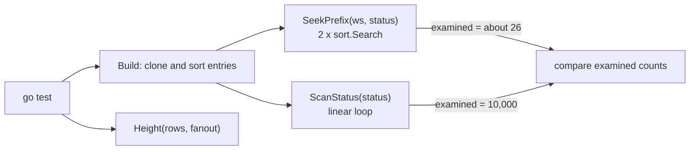
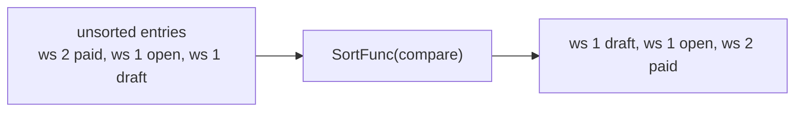
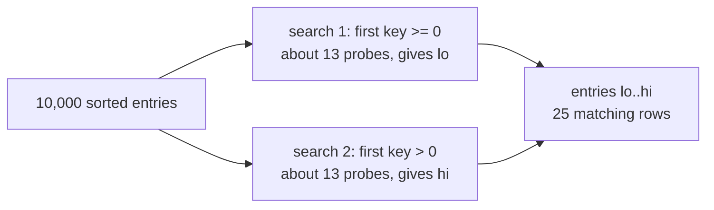
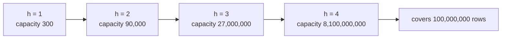

# Indexing Fundamentals - Go

> [!summary] TL;DR
> This note models the leaf level of a composite B-tree index `(workspace_id, status, due_date)` as a sorted Go slice, and shows with counted comparisons why the leftmost-prefix rule works. It also computes B+tree height from fan-out. The concepts are explained in [[Indexing Fundamentals]]; here each function is explained piece by piece.

> [!info] How to read this note (pick your level)
> - 🟢 **New to this?** Read [[Indexing Fundamentals]] first. Then read "From zero" below, "Before the code" and "What this code shows". Stop there.
> - 🟡 **Know the basics?** Walk through Code steps 1-4; each has an "In plain words" line and a step-by-step explanation.
> - 🔴 **Interview / SDE-3 prep?** Add Design decisions, Tests, Pitfalls and the Exercises. Headings are tagged 🟢🟡🔴.

**From zero, in 60 seconds** 🟢

This file teaches one idea with runnable Go code: a database index is just a sorted list, and sorted order is why some lookups are fast and others are not. It builds a fake index of 10,000 entries as a sorted Go slice, then runs two searches. The one that matches the sort order (workspace then status) touches 26 entries; the one that does not (status alone) must touch all 10,000. It also has a tiny function that computes how tall a real B-tree is. Read the theory note first, then follow the code top to bottom; every block is explained right after it.

## Before the code 🟢

- **Structs with several fields** (`Entry`): one index entry holding `workspace_id`, `status`, `due_date` and the row id.
- **A three-way compare function** (`compare(a, b) int`): returns negative, zero or positive, the same contract `slices.SortFunc` uses.
- **Sorted slices plus binary search** (`sort.Search`): the slice plays the leaf level of a B+tree.
- **Multiple return values** (`ids, examined`): each search also reports how many entries it looked at, to make the cost visible.
- **Integer loops** (`Height`): repeated division by the fan-out gives the tree height.
- **What to run:** `go vet ./... && go test -race -v ./...` inside the module.

## What this code shows 🟢

| Code | Theory concept | Where explained |
| --- | --- | --- |
| `Entry`, `compare`, `Build` | A composite index is one list sorted by the first column, then the second, then the third | [[Indexing Fundamentals#Why column order matters: the leftmost-prefix rule]] |
| `SeekPrefix` | A leftmost prefix is one contiguous run, found with two binary searches | [[Indexing Fundamentals#Why column order matters: the leftmost-prefix rule]] |
| `ScanStatus` | A column that is not a leftmost prefix forces a scan of every entry | [[Indexing Fundamentals#When the planner ignores your index]] |
| `Height` | Tree height grows with the logarithm of the row count, with the fan-out as the base | [[Indexing Fundamentals#Fan-out and tree height, step by step]] |



The test builds one sorted slice and asks it two questions: the same data answered through a prefix (26 comparisons) and through a non-prefix column (10,000). That gap is the whole lesson. `Height` is a separate small calculation.

## Setup 🟢

- Go 1.24, standard library only (`cmp`, `slices`, `sort`, `fmt`, `testing`).
- Module layout: one package `idx` with two files.

```text
idx/
  go.mod          // module idx, go 1.24
  idx.go          // Entry, Composite, SeekPrefix, ScanStatus, Height
  idx_test.go     // the three tests
```

- Run: `go vet ./... && go test -race -v ./...`

## Code 🟡

### Step 1: the index entry and the sorted slice

**In plain words:** we build the "index": a struct for one entry, a rule for how entries sort, and a constructor that sorts a slice of them. Sorting is the entire trick.

**Concept.** A B+tree index keeps its leaf level in sorted order, and a composite index sorts by the first column, then the second, then the third ([[Indexing Fundamentals#Why column order matters: the leftmost-prefix rule]]).

A real leaf is a chain of 8 kB pages; for teaching, a flat sorted slice has the same order and the same search behaviour, minus page splits and locking.

The row id is the last sort key so that two entries with equal columns still have one fixed order, as a real index does by adding the heap pointer. The alternative of a real B-tree implementation would hide the lesson under pointer code.

```go
package idx

import (
	"cmp"
	"slices"
	"sort"
)

// Entry is one index entry for (workspace_id, status, due_date) plus the row id.
type Entry struct {
	WorkspaceID int64
	Status      string
	DueDate     string // YYYY-MM-DD sorts correctly as text
	RowID       int64
}

func compare(a, b Entry) int {
	return cmp.Or(
		cmp.Compare(a.WorkspaceID, b.WorkspaceID),
		cmp.Compare(a.Status, b.Status),
		cmp.Compare(a.DueDate, b.DueDate),
		cmp.Compare(a.RowID, b.RowID),
	)
}
```

Then the container type and its constructor:

```go
// Composite is a sorted slice: the leaf level of a B-tree, flattened.
type Composite struct{ entries []Entry }

func Build(es []Entry) *Composite {
	s := slices.Clone(es)
	slices.SortFunc(s, compare)
	return &Composite{entries: s}
}
```

**How it works.**

1. `Entry` has one field per indexed column plus `RowID`, which plays the role of the pointer to the table row.
2. `DueDate` is a string in `YYYY-MM-DD` form, which sorts the same as a date; this avoids `time.Time` for a teaching model.
3. `cmp.Or` returns the first non-zero comparison. If the workspaces are equal (0) it moves on to status, then due date, then row id. This is exactly "sort by the first column, then the second".
4. `Build` clones the input with `slices.Clone` so sorting does not reorder the caller's slice, then sorts in place with `slices.SortFunc(s, compare)`.
5. `Composite` hides its slice in an unexported field, so callers can only read through `SeekPrefix` and `ScanStatus`.



The effect on the layout, for a few entries (workspace, status):

| Position | Before `Build` | After `Build` |
| --- | --- | --- |
| 0 | (2, paid) | (1, draft) |
| 1 | (1, open) | (1, open) |
| 2 | (1, draft) | (2, paid) |

Notice that after sorting, all entries of workspace 1 are adjacent, and within them all entries of one status are adjacent. That adjacency is what the next step exploits.

### Step 2: seek by prefix

**In plain words:** because matching entries sit next to each other in the sorted list, we find the start and end of that run with two binary searches, about 13 probes each, instead of reading everything.

**Concept.** Because the data is sorted by `(workspace, status, ...)`, all entries with one `(workspace, status)` pair form a single contiguous run. Finding a run needs only two binary searches: the first position at or after the key, and the first position after it.

This is how a B-tree answers `WHERE workspace_id = ? AND status = ?` in logarithmic time ([[Indexing Fundamentals#Why column order matters: the leftmost-prefix rule]]). The code counts how many entries the comparison function touched, so the test can prove the claim with a number.

The alternative, a linear loop, is the next step and is the baseline to beat.

```go
// SeekPrefix finds rows with WorkspaceID = ws AND Status = st using two binary
// searches, because both columns form a LEFTMOST prefix of the sort order.
// It returns the matching row ids and how many entries it examined.
func (c *Composite) SeekPrefix(ws int64, st string) (ids []int64, examined int) {
	key := func(e Entry) int {
		examined++
		return cmp.Or(cmp.Compare(e.WorkspaceID, ws), cmp.Compare(e.Status, st))
	}
	lo := sort.Search(len(c.entries), func(i int) bool { return key(c.entries[i]) >= 0 })
	hi := sort.Search(len(c.entries), func(i int) bool { return key(c.entries[i]) > 0 })
	for _, e := range c.entries[lo:hi] {
		ids = append(ids, e.RowID)
	}
	return ids, examined
}
```

**How it works.**

1. The named results `ids` and `examined` let the closure `key` increment `examined` directly; each call to `key` is one comparison, so the final value is the total work of both searches.
2. `key` compares an entry to the target on the first two columns only. It returns negative, zero or positive: the entry sorts before, within, or after the prefix.
3. `lo` is the first index where `key >= 0`, the start of the run.
4. `hi` is the first index where `key > 0`, one past the end of the run.
5. `sort.Search` does a binary search and needs a monotonic predicate (false, false, ..., true, true). Here it is monotonic because the slice is sorted by those same leading columns.
6. `c.entries[lo:hi]` is the run, taken as a slice with no copying; the loop collects the row ids.



The arithmetic: log2(10,000) is about 13.3, so each search needs about 13 comparisons and the two together about 26. The measured value matches.

### Step 3: scan by non-prefix

**In plain words:** searching on a column that is not first in the sort order is like looking for a first name in a phone book: the matches are scattered, so you must read every entry.

**Concept.** Status alone is not a leftmost prefix. In the sorted order, entries with `status = 'overdue'` are scattered across every workspace, one small run per workspace.

There is no single contiguous run to binary-search, so the only correct method is to look at every entry. This is the code version of "an index on `(workspace_id, status)` does not help a query on `status` alone" ([[Indexing Fundamentals#When the planner ignores your index]]).

Real databases may use skip scan for this shape, but only when the leading column has few distinct values; this model shows the general case.

```go
// ScanStatus finds rows with Status = st alone. Status is NOT a leftmost
// prefix, so matching entries are scattered and every entry must be examined.
func (c *Composite) ScanStatus(st string) (ids []int64, examined int) {
	for _, e := range c.entries {
		examined++
		if e.Status == st {
			ids = append(ids, e.RowID)
		}
	}
	return ids, examined
}
```

**How it works.**

1. The loop visits every entry in order, with no early exit; there is nothing in the sort order that says where to stop.
2. `examined++` runs for every entry, so for 10,000 entries it ends at exactly 10,000.
3. Matching row ids are appended as they are found; their positions are scattered, not adjacent.
4. The signature mirrors `SeekPrefix`, so the test can compare the two by the same counter.

| Query | Method | Entries examined for 10,000 entries |
| --- | --- | --- |
| `workspace = 42 AND status = 'overdue'` | two binary searches | about 26 |
| `status = 'overdue'` | linear scan | 10,000 |

### Step 4: tree height from fan-out

**In plain words:** a tiny loop that answers "how many levels tall is the tree?" by multiplying the fan-out until it covers the row count.

**Concept.** A B+tree page holds hundreds of entries, so each level multiplies capacity by the fan-out. The height is the number of levels, which is the number of page reads to find one entry ([[Indexing Fundamentals#Fan-out and tree height, step by step]]).

The smallest height `h` with `fanout^h >= rows` is the answer; the loop multiplies until capacity covers the rows. A closed form with logarithms exists, but floating-point `math.Log` can be off by one at exact powers, so an integer loop is safer.

```go
// Height returns the number of B+tree levels needed to hold rows entries
// when each page holds fanout entries: the smallest h with fanout^h >= rows.
func Height(rows, fanout int64) int {
	h, capacity := 1, fanout
	for capacity < rows {
		capacity *= fanout
		h++
	}
	return h
}
```

**How it works.**

1. One level (the root alone, which is also a leaf) holds `fanout` entries, so the start is `h = 1`, `capacity = fanout`.
2. While capacity is below `rows`, add a level: capacity multiplies by the fan-out and `h` goes up by one.
3. The loop ends at the first `h` whose capacity covers `rows`.
4. For 100,000,000 rows at fan-out 300: 300, 90,000, 27,000,000, 8.1 billion, so 4 levels.



## Design decisions 🔴

| Decision | Alternative | Trade-off |
| --- | --- | --- |
| Flat sorted slice | Real B+tree with pages | Same order and the same search cost in comparisons; no splits, fan-out or locking, so it cannot teach those |
| `cmp.Or` chain with row id last | Hand-written `if` cascade | Short and obviously lexicographic; the row id gives a total order like a real index |
| Two `sort.Search` calls | One search then a linear walk | Both ends are found in logarithmic time; the linear walk would cost the run length |
| Counter captured by a closure | Instrumenting with a wrapper type | Smallest code that counts work; the counter is tied to the function, not reusable |
| `DueDate` as `YYYY-MM-DD` string | `time.Time` | Sorts correctly as text and keeps the model small; loses date arithmetic |
| Integer loop in `Height` | `math.Ceil(math.Log(...))` | Exact at powers of the fan-out; slower for huge heights, which are never more than about 10 |
| `Clone` before sorting | Sort the caller's slice in place | The caller's data is untouched; one extra allocation |

## Tests 🔴

The test data has 10,000 entries (100 workspaces times 100 invoices, 4 statuses), so each `(workspace, status)` pair has 25 entries and each status has 2,500 entries overall.

### Test data: `sample`

**In plain words:** the test data is generated by a fixed formula, so the test can assert exact counts like "25 rows" and "10,000 examined".

**Concept.** The data generator is deterministic so that counts are exact: for each workspace, invoice `i` gets status `i % 4`, so every workspace has 25 of each status, and due dates cycle through months and days.

```go
package idx

import (
	"fmt"
	"testing"
)

func sample() []Entry {
	statuses := []string{"draft", "open", "overdue", "paid"}
	var es []Entry
	id := int64(1)
	for ws := int64(1); ws <= 100; ws++ {
		for i := 0; i < 100; i++ {
			es = append(es, Entry{ws, statuses[i%4], fmt.Sprintf("2026-%02d-%02d", i%12+1, i%28+1), id})
			id++
		}
	}
	return es // 10,000 entries, 25 per (workspace, status)
}
```

### Test 1: prefix seek uses binary search

**Property.** A leftmost-prefix lookup finds the right rows by examining only a handful of entries, not the whole index. This is the reason composite indexes are fast.

| Input | Expected |
| --- | --- |
| `SeekPrefix(42, "overdue")` on 10,000 entries | 25 row ids; entries examined at most 30 (measured 26) |

```go
func TestSeekPrefixUsesBinarySearch(t *testing.T) {
	c := Build(sample())
	ids, examined := c.SeekPrefix(42, "overdue")
	if len(ids) != 25 {
		t.Fatalf("got %d rows, want 25", len(ids))
	}
	t.Logf("examined %d of %d entries", examined, len(c.entries))
	if examined > 30 { // two binary searches over 10,000 entries: about 2 * log2(10000) = 28
		t.Fatalf("examined %d entries, want <= 30", examined)
	}
}
```

If the row count is wrong, the sort order and the prefix predicate disagree (the seek returns the wrong run). If the examined count is too high, the code has degraded into a scan, which is the bug an unusable index looks like in production.

### Test 2: status alone must scan

**Property.** A non-prefix column cannot use the sort order: all 10,000 entries are examined to find the 2,500 matches.

| Input | Expected |
| --- | --- |
| `ScanStatus("overdue")` | 2,500 row ids; 10,000 examined |

```go
func TestStatusAloneMustScan(t *testing.T) {
	c := Build(sample())
	ids, examined := c.ScanStatus("overdue")
	if len(ids) != 2500 || examined != 10000 {
		t.Fatalf("rows=%d examined=%d", len(ids), examined)
	}
}
```

A failure would mean `ScanStatus` stopped early and missed rows. The test pins the baseline against which Test 1's 26 looks small.

### Test 3: height

**Property.** Tree height is the smallest `h` with `fanout^h >= rows`, including at the exact boundaries where it is easiest to be off by one.

| rows | fanout | Expected height | Why |
| --- | --- | --- | --- |
| 1 | 300 | 1 | A single page |
| 300 | 300 | 1 | Exactly full root |
| 301 | 300 | 2 | One row over a full page needs a second level |
| 90,000 | 300 | 2 | 300^2 = 90,000 exactly |
| 100,000,000 | 300 | 4 | 300^3 = 27M is too small, 300^4 covers it |
| 100,000,000 | 500 | 3 | 500^3 = 125M covers it |

```go
func TestHeight(t *testing.T) {
	cases := []struct {
		rows, fanout int64
		want         int
	}{
		{1, 300, 1},
		{300, 300, 1},
		{301, 300, 2},
		{90_000, 300, 2},
		{100_000_000, 300, 4}, // 300^3 = 27M < 100M <= 300^4
		{100_000_000, 500, 3}, // 500^3 = 125M
	}
	for _, c := range cases {
		if got := Height(c.rows, c.fanout); got != c.want {
			t.Errorf("Height(%d,%d)=%d want %d", c.rows, c.fanout, got, c.want)
		}
	}
}
```

This is a table-driven test: one loop, one failure message per bad case (`t.Errorf` keeps going, so all failing rows are reported). A failure at 300 or 90,000 means the comparison is `<=` where it should be `<`, an off-by-one at the boundary. The last two rows show that a wider page saves a whole level on 100 million rows.

## Running it 🟡

```bash
go vet ./... && go test -race -v ./...
```

Measured with `go test -race -v` (Go 1.24.4):

```text
=== RUN   TestSeekPrefixUsesBinarySearch
    idx_test.go:27: examined 26 of 10000 entries
--- PASS: TestSeekPrefixUsesBinarySearch (0.03s)
=== RUN   TestStatusAloneMustScan
--- PASS: TestStatusAloneMustScan (0.03s)
=== RUN   TestHeight
--- PASS: TestHeight (0.00s)
PASS
ok  	idx	1.613s
```

| Line | Meaning |
| --- | --- |
| `examined 26 of 10000 entries` | The prefix lookup touched 0.26% of the index, two binary searches of about 13 probes each |
| `--- PASS: TestSeekPrefixUsesBinarySearch (0.03s)` | Includes building and sorting the 10,000 entries, which is where the 0.03s goes |
| `--- PASS: TestStatusAloneMustScan` | The scan examined exactly 10,000 entries and found 2,500 |
| `--- PASS: TestHeight (0.00s)` | Pure arithmetic |
| `ok  idx  1.613s` | Whole package, dominated by compiling with `-race` |

The leftmost-prefix lookup examined **26 of 10,000** entries; the status-only query examined **all 10,000**. `go vet` is clean.

> [!example]- Full file: idx.go
> ```go
> package idx
>
> import (
> 	"cmp"
> 	"slices"
> 	"sort"
> )
>
> // Entry is one index entry for (workspace_id, status, due_date) plus the row id.
> type Entry struct {
> 	WorkspaceID int64
> 	Status      string
> 	DueDate     string // YYYY-MM-DD sorts correctly as text
> 	RowID       int64
> }
>
> func compare(a, b Entry) int {
> 	return cmp.Or(
> 		cmp.Compare(a.WorkspaceID, b.WorkspaceID),
> 		cmp.Compare(a.Status, b.Status),
> 		cmp.Compare(a.DueDate, b.DueDate),
> 		cmp.Compare(a.RowID, b.RowID),
> 	)
> }
>
> // Composite is a sorted slice: the leaf level of a B-tree, flattened.
> type Composite struct{ entries []Entry }
>
> func Build(es []Entry) *Composite {
> 	s := slices.Clone(es)
> 	slices.SortFunc(s, compare)
> 	return &Composite{entries: s}
> }
>
> // SeekPrefix finds rows with WorkspaceID = ws AND Status = st using two binary
> // searches, because both columns form a LEFTMOST prefix of the sort order.
> // It returns the matching row ids and how many entries it examined.
> func (c *Composite) SeekPrefix(ws int64, st string) (ids []int64, examined int) {
> 	key := func(e Entry) int {
> 		examined++
> 		return cmp.Or(cmp.Compare(e.WorkspaceID, ws), cmp.Compare(e.Status, st))
> 	}
> 	lo := sort.Search(len(c.entries), func(i int) bool { return key(c.entries[i]) >= 0 })
> 	hi := sort.Search(len(c.entries), func(i int) bool { return key(c.entries[i]) > 0 })
> 	for _, e := range c.entries[lo:hi] {
> 		ids = append(ids, e.RowID)
> 	}
> 	return ids, examined
> }
>
> // ScanStatus finds rows with Status = st alone. Status is NOT a leftmost
> // prefix, so matching entries are scattered and every entry must be examined.
> func (c *Composite) ScanStatus(st string) (ids []int64, examined int) {
> 	for _, e := range c.entries {
> 		examined++
> 		if e.Status == st {
> 			ids = append(ids, e.RowID)
> 		}
> 	}
> 	return ids, examined
> }
>
> // Height returns the number of B+tree levels needed to hold rows entries
> // when each page holds fanout entries: the smallest h with fanout^h >= rows.
> func Height(rows, fanout int64) int {
> 	h, capacity := 1, fanout
> 	for capacity < rows {
> 		capacity *= fanout
> 		h++
> 	}
> 	return h
> }
> ```

> [!example]- Full file: idx_test.go
> ```go
> package idx
>
> import (
> 	"fmt"
> 	"testing"
> )
>
> func sample() []Entry {
> 	statuses := []string{"draft", "open", "overdue", "paid"}
> 	var es []Entry
> 	id := int64(1)
> 	for ws := int64(1); ws <= 100; ws++ {
> 		for i := 0; i < 100; i++ {
> 			es = append(es, Entry{ws, statuses[i%4], fmt.Sprintf("2026-%02d-%02d", i%12+1, i%28+1), id})
> 			id++
> 		}
> 	}
> 	return es // 10,000 entries, 25 per (workspace, status)
> }
>
> func TestSeekPrefixUsesBinarySearch(t *testing.T) {
> 	c := Build(sample())
> 	ids, examined := c.SeekPrefix(42, "overdue")
> 	if len(ids) != 25 {
> 		t.Fatalf("got %d rows, want 25", len(ids))
> 	}
> 	t.Logf("examined %d of %d entries", examined, len(c.entries))
> 	if examined > 30 { // two binary searches over 10,000 entries: about 2 * log2(10000) = 28
> 		t.Fatalf("examined %d entries, want <= 30", examined)
> 	}
> }
>
> func TestStatusAloneMustScan(t *testing.T) {
> 	c := Build(sample())
> 	ids, examined := c.ScanStatus("overdue")
> 	if len(ids) != 2500 || examined != 10000 {
> 		t.Fatalf("rows=%d examined=%d", len(ids), examined)
> 	}
> }
>
> func TestHeight(t *testing.T) {
> 	cases := []struct {
> 		rows, fanout int64
> 		want         int
> 	}{
> 		{1, 300, 1},
> 		{300, 300, 1},
> 		{301, 300, 2},
> 		{90_000, 300, 2},
> 		{100_000_000, 300, 4}, // 300^3 = 27M < 100M <= 300^4
> 		{100_000_000, 500, 3}, // 500^3 = 125M
> 	}
> 	for _, c := range cases {
> 		if got := Height(c.rows, c.fanout); got != c.want {
> 			t.Errorf("Height(%d,%d)=%d want %d", c.rows, c.fanout, got, c.want)
> 		}
> 	}
> }
> ```

## Pitfalls in the code 🔴

- `examined` is captured by the closure `key`, so it counts comparisons made by both `sort.Search` calls. Calling `SeekPrefix` twice on the same `Composite` starts a fresh count because the variable is a named result.
- `DueDate` is a string. `YYYY-MM-DD` sorts correctly as text, but a format such as `D/M/YYYY` would not.
- `sort.Search` requires a monotonic predicate. `key(e) >= 0` and `key(e) > 0` are monotonic only because the slice is sorted by the same leading columns; searching an unsorted slice gives wrong answers without an error.
- The slice models the order of a B-tree leaf level, not its page structure. It has no fan-out, no page splits and no concurrency.
- `Height` assumes every page is full. Real pages are about 70-90% full, so real trees can be one level taller near a boundary.

## Exercises 🔴

1. Change `SeekPrefix` so it also takes a due-date lower bound and seeks on all three columns. Predict how many entries it examines compared with the two-column version, then run it.
2. Change `compare` to sort by `(status, workspace_id, due_date, row_id)` but leave `SeekPrefix` unchanged. Predict whether `SeekPrefix(42, "overdue")` still returns 25 rows, and why `sort.Search` needs its predicate to be monotonic.
3. Call `Height(100_000_000, 100)` and `Height(100_000_000, 50)`. Predict both before running, then explain why a wide key (low fan-out) costs extra levels.

## Links

- Theory: [[Indexing Fundamentals]]
- Next: [[Index Types and Index Design - Go]], [[Query Plans and EXPLAIN - Go]]
