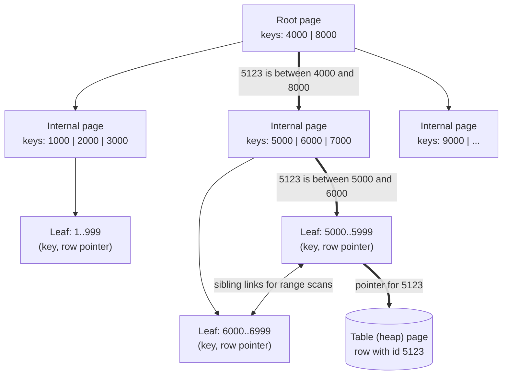
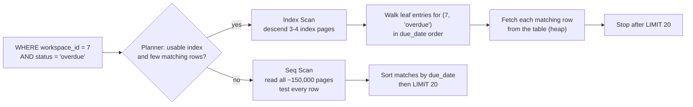
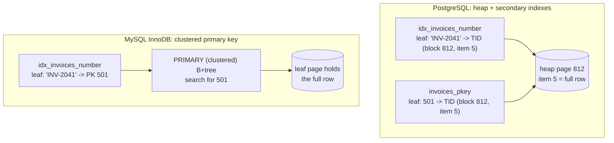

# Indexing Fundamentals

> [!summary] TL;DR
> An **index** is a separate, sorted data structure that maps column values to the rows that hold them, so the database can jump to matching rows instead of reading the whole table. Most indexes are **B-trees**: a few levels of sorted pages where finding one key among 100 million rows touches only 3–4 pages. Indexes make reads fast and every write slower, so you add one for each important query shape, not for every column.

> [!abstract] Core idea
> - Without an index, `WHERE` reads every page of the table (a sequential scan); with one, the database walks a short tree to the matching rows.
> - A composite index on `(a, b, c)` is sorted by `a`, then `b`, then `c`; it helps queries that filter on a **leftmost prefix** (`a`, or `a` and `b`).
> - If a query matches a large fraction of the table, a full scan is cheaper than an index, and the planner rightly ignores the index.
> - Every `INSERT` updates every index on the table, so each extra index costs write speed, disk and memory.
> - PostgreSQL indexes point to a row's physical location; InnoDB secondary indexes store the primary key, so a lookup walks two trees.

## 1. Why it exists

InvoiceOps (the running example in these notes: a multi-tenant invoicing SaaS) has an `invoices` table with 10 million rows across 20,000 workspaces. The invoice list page runs:

```sql
SELECT id, number, total_minor, due_date
FROM invoices
WHERE workspace_id = 7 AND status = 'overdue'
ORDER BY due_date
LIMIT 20;
```

Without an index, PostgreSQL must read every row to find the few hundred that belong to workspace 7. At roughly 120 bytes per row, 10 million rows fill about 150,000 pages of 8 kB, around 1.2 GB (an estimate from row width). Even fully cached, that scan takes hundreds of milliseconds and pushes useful data out of memory; from disk it takes seconds. And it repeats on every page view.

With an index on `(workspace_id, status, due_date)`, PostgreSQL walks 3 or 4 index pages to the first matching entry, reads 20 entries in order, and fetches 20 rows. That is a few dozen page reads instead of 150,000, typically well under a millisecond when cached.

The same applies to lookups everywhere: login by email, an invoice by its number, a webhook by its provider event ID.

## 2. Mental model

An index is the **index at the back of a textbook**. Topics are listed alphabetically with page numbers. To find "B-tree", you do not read the whole book; you jump to "B" in the sorted list and follow the page number.

Three consequences follow directly from the analogy:

- **Sorted order is the whole point.** A sorted list lets you find a value by halving the search space at each step (binary search), and makes "everything between X and Y" a contiguous stretch.
- **Pointers cost a second hop.** The index tells you the page; you still have to turn to it. If the index entry already contains everything you need, you can skip that hop (a **covering** index).
- **Every new page in the book means updating the index.** Write-heavy tables pay for every index they carry.

Two terms used throughout:

- **Selectivity**: the fraction of rows a condition matches. `id = 42` matches one row in 10 million (highly selective). `status = 'paid'` may match 70% of rows (not selective).
- **Cardinality**: the number of distinct values in a column. `id` has high cardinality; `status` with 4 values has low cardinality.

## 3. How it works

### The B+tree

Databases store data in fixed-size **pages** (8 kB in PostgreSQL, 16 kB by default in InnoDB). A B-tree index is a tree of such pages. Strictly, PostgreSQL and InnoDB use the **B+tree** variant: all keys live in the leaf level, and the upper levels hold only separator keys that route the search.



- **Root and internal pages** hold separator keys and child page numbers. Because a page is 8 kB and an entry for a `bigint` key is a few tens of bytes, one page holds a few hundred entries. This **fan-out** (children per page) is what keeps the tree short.
- **Leaf pages** hold every key in sorted order with a pointer to the row, and each leaf links to its neighbours. A range query (`BETWEEN`, `>`, `ORDER BY … LIMIT`) finds the first leaf and then walks sideways.
- **Lookup cost** is the tree height: `O(log n)` page reads with a very large base, versus `O(n)` pages for a full scan.

Tree height for a given fan-out (computed by the tested `Height` function in section 4):

| Rows | Fan-out 300 | Fan-out 500 |
| --- | --- | --- |
| 300 | 1 level | 1 level |
| 90,000 | 2 levels | 2 levels |
| 100,000,000 | 4 levels | 3 levels |

The root and internal pages of a busy index are almost always cached in memory, so a point lookup usually costs one or two actual reads from disk at most.

### Seq scan versus index scan



A **sequential scan** (`Seq Scan` in a plan) reads the table front to back. An **index scan** walks the tree, then fetches each matching row. A **bitmap scan** sits in between: it collects all matching row locations from the index, sorts them by page, and reads each needed table page once; PostgreSQL picks it when "some but not most" rows match. Reading these plans is covered in [[Query Plans and EXPLAIN]].

### Where the pointer goes: PostgreSQL heap versus InnoDB clustered index



- **PostgreSQL** stores rows in an unordered **heap** (the table file). Every index, including the primary key, maps keys to a **TID** (tuple identifier: block number and item number inside the block). One index lookup plus one heap page read finds the row.
- **MySQL InnoDB** stores the table itself **inside the primary-key B+tree**: the leaf pages of the primary key *are* the rows. This is a **clustered index**. A secondary index stores the primary-key value, not a location, so a lookup by `number` walks the secondary tree, then walks the primary-key tree a second time.

Consequences: in InnoDB, range scans by primary key are very fast (the rows are physically in key order), a long primary key makes every secondary index larger, and random primary keys scatter inserts. In PostgreSQL, all indexes are equal, but an update that moves a row to a new location must update every index, unless it qualifies as a HOT update (section 8).

## 4. Worked example

The InvoiceOps table:

```sql
CREATE TABLE invoices (
    id           bigint GENERATED ALWAYS AS IDENTITY PRIMARY KEY,  -- gets a unique B-tree automatically
    workspace_id bigint NOT NULL,
    number       text   NOT NULL,
    customer_id  bigint NOT NULL,
    status       text   NOT NULL CHECK (status IN ('draft', 'open', 'overdue', 'paid')),
    total_minor  bigint NOT NULL CHECK (total_minor >= 0),   -- amounts in paise
    due_date     date   NOT NULL,
    created_at   timestamptz NOT NULL DEFAULT now(),
    UNIQUE (workspace_id, number)                             -- also creates a unique B-tree
);
```

### Whiteboard version

```sql
-- 1. Find what is slow
EXPLAIN ANALYZE SELECT id FROM invoices WHERE workspace_id = 7 AND status = 'overdue' ORDER BY due_date LIMIT 20;
--    -> Seq Scan, ~10M rows read

-- 2. Index the query shape: equality columns first, then the sort column
CREATE INDEX CONCURRENTLY idx_invoices_ws_status_due
    ON invoices (workspace_id, status, due_date);

-- 3. Check again
EXPLAIN ANALYZE SELECT id FROM invoices WHERE workspace_id = 7 AND status = 'overdue' ORDER BY due_date LIMIT 20;
--    -> Index Scan using idx_invoices_ws_status_due, 20 rows, no Sort node

-- What this index can and cannot serve:
--   WHERE workspace_id = 7                                 yes (leftmost prefix)
--   WHERE workspace_id = 7 AND status = 'overdue'          yes
--   WHERE workspace_id = 7 AND status = 'overdue'
--         AND due_date < '2026-11-01'                      yes (range on the last column)
--   WHERE status = 'overdue'                               no: not a leftmost prefix
--   WHERE workspace_id = 7 ORDER BY due_date               partly: finds ws 7, but must sort
```

### Before the index

Representative output (PostgreSQL 17), 10 million rows:

```text
Limit  (cost=209123.40..209125.73 rows=20 width=8) (actual time=612.401..618.950 rows=20 loops=1)
  ->  Gather Merge  (cost=209123.40..209151.97 rows=245 width=8) (actual time=612.399..618.941 rows=20 loops=1)
        Workers Planned: 2
        Workers Launched: 2
        ->  Sort  (cost=208123.38..208123.63 rows=102 width=8) (actual time=598.112..598.117 rows=41 loops=3)
              Sort Key: due_date
              Sort Method: quicksort  Memory: 27kB
              ->  Parallel Seq Scan on invoices  (cost=0.00..208120.00 rows=102 width=8) (actual time=3.551..597.820 rows=82 loops=3)
                    Filter: ((workspace_id = 7) AND (status = 'overdue'::text))
                    Rows Removed by Filter: 3333251
Planning Time: 0.140 ms
Execution Time: 619.020 ms
```

Read it from the innermost line out: three processes each scanned a third of the table, threw away about 3.3 million rows each, and kept 82 each (246 in total), which were then sorted to return 20.

### After the index

```sql
CREATE INDEX CONCURRENTLY idx_invoices_ws_status_due ON invoices (workspace_id, status, due_date);
```

Representative output (PostgreSQL 17):

```text
Limit  (cost=0.56..80.12 rows=20 width=8) (actual time=0.031..0.074 rows=20 loops=1)
  ->  Index Scan using idx_invoices_ws_status_due on invoices  (cost=0.56..975.12 rows=245 width=8) (actual time=0.030..0.070 rows=20 loops=1)
        Index Cond: ((workspace_id = 7) AND (status = 'overdue'::text))
Planning Time: 0.210 ms
Execution Time: 0.092 ms
```

There is no `Sort` node: the index already returns entries for `(7, 'overdue')` in `due_date` order, so the scan stops after 20 rows. From about 620 ms to under 0.1 ms on this representative plan.

`CREATE INDEX CONCURRENTLY` builds the index without blocking writes. It scans the table twice, takes longer than a plain `CREATE INDEX`, cannot run inside a transaction block, and leaves an `INVALID` index behind if it fails (drop it and retry). Rollout rules are in [[Zero-Downtime Schema Migrations]].

### Why column order matters: the leftmost-prefix rule in Go

A composite index is one sorted list ordered by the first column, then the second within ties, and so on, like a phone book sorted by surname and then first name. You can binary-search for a surname, or a surname plus first name. You cannot binary-search for a first name alone, because people called "Asha" are scattered across every surname.

The code below models the leaf level of `(workspace_id, status, due_date)` as a sorted slice and counts how many entries each query must examine:

```go
package idx

import (
	"cmp"
	"slices"
	"sort"
)

// Entry is one index entry for (workspace_id, status, due_date) plus the row id.
type Entry struct {
	WorkspaceID int64
	Status      string
	DueDate     string // YYYY-MM-DD sorts correctly as text
	RowID       int64
}

func compare(a, b Entry) int {
	return cmp.Or(
		cmp.Compare(a.WorkspaceID, b.WorkspaceID),
		cmp.Compare(a.Status, b.Status),
		cmp.Compare(a.DueDate, b.DueDate),
		cmp.Compare(a.RowID, b.RowID),
	)
}

// Composite is a sorted slice: the leaf level of a B-tree, flattened.
type Composite struct{ entries []Entry }

func Build(es []Entry) *Composite {
	s := slices.Clone(es)
	slices.SortFunc(s, compare)
	return &Composite{entries: s}
}

// SeekPrefix finds rows with WorkspaceID = ws AND Status = st using two binary
// searches, because both columns form a LEFTMOST prefix of the sort order.
// It returns the matching row ids and how many entries it examined.
func (c *Composite) SeekPrefix(ws int64, st string) (ids []int64, examined int) {
	key := func(e Entry) int {
		examined++
		return cmp.Or(cmp.Compare(e.WorkspaceID, ws), cmp.Compare(e.Status, st))
	}
	lo := sort.Search(len(c.entries), func(i int) bool { return key(c.entries[i]) >= 0 })
	hi := sort.Search(len(c.entries), func(i int) bool { return key(c.entries[i]) > 0 })
	for _, e := range c.entries[lo:hi] {
		ids = append(ids, e.RowID)
	}
	return ids, examined
}

// ScanStatus finds rows with Status = st alone. Status is NOT a leftmost
// prefix, so matching entries are scattered and every entry must be examined.
func (c *Composite) ScanStatus(st string) (ids []int64, examined int) {
	for _, e := range c.entries {
		examined++
		if e.Status == st {
			ids = append(ids, e.RowID)
		}
	}
	return ids, examined
}

// Height returns the number of B+tree levels needed to hold rows entries
// when each page holds fanout entries: the smallest h with fanout^h >= rows.
func Height(rows, fanout int64) int {
	h, capacity := 1, fanout
	for capacity < rows {
		capacity *= fanout
		h++
	}
	return h
}
```

The test builds 10,000 entries (100 workspaces × 100 invoices, 4 statuses):

```go
package idx

import (
	"fmt"
	"testing"
)

func sample() []Entry {
	statuses := []string{"draft", "open", "overdue", "paid"}
	var es []Entry
	id := int64(1)
	for ws := int64(1); ws <= 100; ws++ {
		for i := 0; i < 100; i++ {
			es = append(es, Entry{ws, statuses[i%4], fmt.Sprintf("2026-%02d-%02d", i%12+1, i%28+1), id})
			id++
		}
	}
	return es // 10,000 entries, 25 per (workspace, status)
}

func TestSeekPrefixUsesBinarySearch(t *testing.T) {
	c := Build(sample())
	ids, examined := c.SeekPrefix(42, "overdue")
	if len(ids) != 25 {
		t.Fatalf("got %d rows, want 25", len(ids))
	}
	t.Logf("examined %d of %d entries", examined, len(c.entries))
	if examined > 30 { // two binary searches over 10,000 entries: about 2 * log2(10000) = 28
		t.Fatalf("examined %d entries, want <= 30", examined)
	}
}

func TestStatusAloneMustScan(t *testing.T) {
	c := Build(sample())
	ids, examined := c.ScanStatus("overdue")
	if len(ids) != 2500 || examined != 10000 {
		t.Fatalf("rows=%d examined=%d", len(ids), examined)
	}
}

func TestHeight(t *testing.T) {
	cases := []struct {
		rows, fanout int64
		want         int
	}{
		{1, 300, 1},
		{300, 300, 1},
		{301, 300, 2},
		{90_000, 300, 2},
		{100_000_000, 300, 4}, // 300^3 = 27M < 100M <= 300^4
		{100_000_000, 500, 3}, // 500^3 = 125M
	}
	for _, c := range cases {
		if got := Height(c.rows, c.fanout); got != c.want {
			t.Errorf("Height(%d,%d)=%d want %d", c.rows, c.fanout, got, c.want)
		}
	}
}
```

Measured with `go test -race -v` (Go 1.24.4): the leftmost-prefix lookup examined **26 of 10,000** entries; the status-only query examined **all 10,000**. All three tests pass.

**Choosing the column order.** Put columns compared with `=` first, then the column you sort by, then a column compared with a range (`<`, `BETWEEN`). For a multi-tenant app, `workspace_id` is almost always first, because every query filters on it. The full design method (the equality–sort–range rule and its exceptions) is in [[Index Types and Index Design]].

### Covering the query: index-only scans

The list page actually needs `number` and `total_minor` too. If those columns are in the index, PostgreSQL can answer from the index alone, an **index-only scan**, skipping the heap:

```sql
CREATE INDEX CONCURRENTLY idx_invoices_list
    ON invoices (workspace_id, status, due_date) INCLUDE (number, total_minor);
```

`INCLUDE` adds payload columns to the leaf entries without making them part of the sort key. There is one PostgreSQL caveat: the index does not know whether a row version is visible to your transaction (see [[Isolation Levels and MVCC]]), so for each entry it checks the **visibility map**, a small per-table bitmap of pages whose rows are all visible to everyone. If the page is not marked all-visible, it must visit the heap anyway; `EXPLAIN ANALYZE` reports these visits as `Heap Fetches`. Recently vacuumed tables get close to zero heap fetches. In InnoDB, a secondary index that includes all needed columns is "covering" and skips the second (primary-key) tree walk.

### Unique indexes are constraints

`PRIMARY KEY` and `UNIQUE` are enforced with a unique B-tree: before inserting, the database descends the tree to check that the key is absent. That is why `UNIQUE (workspace_id, number)` both prevents duplicate invoice numbers per workspace and speeds up lookups by number. PostgreSQL does **not** create an index for a foreign key automatically; add one on `invoices.customer_id` yourself if you join or delete by it, or every `DELETE FROM customers` scans `invoices`.

## 5. Variants and comparison

| Access path | How it works | Planner picks it when | Cost |
| --- | --- | --- | --- |
| Seq Scan | Read every table page in order | Small table, or a large fraction of rows match, or no usable index | All pages; sequential I/O is cheap per page |
| Index Scan | Walk the tree, then fetch each row from the heap | Few rows match, or rows are needed in index order (`ORDER BY … LIMIT`) | 3–4 index pages plus one random heap page per row |
| Bitmap Index + Bitmap Heap Scan | Collect row locations from one or more indexes, sort by page, read each page once | A moderate fraction matches; combining two indexes with `AND`/`OR` | Builds a bitmap; loses index order |
| Index Only Scan | Answer from index entries; check the visibility map | All needed columns are in the index | Heap visits for pages not all-visible |
| InnoDB secondary lookup | Secondary B+tree, then primary-key B+tree | Same as index scan | Two tree walks unless covering |

Index *types* beyond the B-tree (hash, GIN, GiST, BRIN) and special forms (partial, expression, covering design) are covered in [[Index Types and Index Design]].

## 6. Trade-offs and when not to use

- **Writes pay for every index.** An `INSERT` into a table with 6 indexes writes the row plus 6 index entries, each with its own WAL record. An `UPDATE` that changes an indexed column (or, in PostgreSQL, any update that cannot be HOT) also inserts new index entries. Write-heavy tables such as event logs should carry only the indexes their queries need.
- **Indexes take disk and memory.** A B-tree on a `bigint` column of 10 million rows is roughly 200–300 MB (estimate; check with `pg_relation_size`). Indexes compete with table data for the buffer cache, and an index that no longer fits in RAM makes every lookup a disk read.
- **Low-selectivity columns alone are poor indexes.** An index on `status` with 4 values rarely helps on its own, because a quarter or more of the table matches. It is useful as a later column in a composite index, or as a partial index on a rare value.
- **Small tables do not need them.** A table of a few hundred rows fits in a handful of pages; a seq scan is as fast as an index lookup.
- **Duplicates waste writes.** An index on `(workspace_id)` is redundant when `(workspace_id, status, due_date)` exists, because the composite already serves `workspace_id` lookups through its leftmost prefix.

### When the planner ignores your index

| Cause | Example | Fix |
| --- | --- | --- |
| Too many rows match | `WHERE status = 'paid'` (70% of rows) | Expected behaviour; a seq scan is faster |
| Function or expression on the column | `WHERE lower(email) = $1` with an index on `email` | Expression index on `lower(email)` |
| Not a leftmost prefix | `WHERE status = 'overdue'` on `(workspace_id, status, …)` | Different index, or reorder columns; PostgreSQL 18 and MySQL 8.0.13+ can sometimes **skip scan** when the leading column has few distinct values |
| Leading wildcard | `WHERE number LIKE '%2041'` | Trigram (`pg_trgm`) GIN index |
| Type mismatch | Comparing a `bigint` column to a `numeric` parameter | Pass the same type as the column |
| Stale statistics | Estimates say 10 rows, actual is 1 million | `ANALYZE invoices` |
| Tiny table | 200 rows | Nothing to fix |

## 7. In production

- **Real systems:** PostgreSQL's default index type is a B-tree with sibling-linked leaves (Lehman and Yao), with deduplication of repeated keys since PostgreSQL 13. MySQL InnoDB clusters every table on its primary key. SQL Server offers both clustered and heap tables. MongoDB uses B-tree indexes in WiredTiger with the same leftmost-prefix rule for compound indexes.
- **Failure modes and fixes:**
	- *Missing index on a new query:* a feature ships, one query does a seq scan on a large table, and CPU climbs. Fix: run `EXPLAIN ANALYZE` on new queries against production-sized data before release.
	- *Blocking index build:* plain `CREATE INDEX` blocks writes to the table for the whole build. Fix: `CREATE INDEX CONCURRENTLY`.
	- *Random primary keys:* UUIDv4 keys insert into random leaf pages, causing page splits, a working set as large as the whole index, and in InnoDB a fragmented clustered table. Fix: `bigint` identity or time-ordered UUIDv7 (generated in Go with `github.com/google/uuid` `NewV7`, or with `uuidv7()` built into PostgreSQL 18).
	- *Too many indexes:* write latency and WAL volume grow with every index nobody uses. Fix: find unused ones and drop them.
- **What to monitor:**
	- `pg_stat_user_indexes.idx_scan`: indexes with zero scans since the last stats reset are candidates to drop (check replicas too; usage is per server).
	- `pg_stat_user_tables.seq_scan` and `seq_tup_read` on large tables.
	- Index size (`pg_relation_size`) against available memory, and the buffer cache hit ratio.
	- Slow-query logs or `pg_stat_statements` for queries whose plans changed.

## 8. Deep dive

- **Why B-trees and not binary trees or hash tables.** A binary tree has fan-out 2, so 100 million keys need about 27 levels, each a separate page read. A B+tree packs hundreds of keys per page to cut that to 3–4. Hash indexes give `O(1)` equality lookups but no order, so they cannot serve ranges or `ORDER BY`.
- **Page splits.** When a leaf page is full, it splits into two half-full pages and a new separator goes into the parent. Sequential keys (identity, UUIDv7) always append to the rightmost leaf, which PostgreSQL optimizes; random keys split pages all over the tree and leave them about half to three-quarters full.
- **HOT updates in PostgreSQL.** An update writes a new row version. If no indexed column changed and the new version fits on the same heap page, PostgreSQL makes it a **heap-only tuple** (HOT): the indexes keep pointing at the old item, which links to the new version, so no index is touched. Indexing a frequently updated column such as `updated_at` disables HOT for those updates; leaving free space per page with `fillfactor` (for example `90`) makes HOT more likely.
- **Descending and NULL order.** A B-tree can be scanned in both directions, so `(workspace_id, created_at)` also serves `ORDER BY created_at DESC` for one workspace. Mixed directions (`ORDER BY a ASC, b DESC`) need an index declared that way.
- **Index size versus working set.** Only the part of an index that queries actually touch needs to be in memory. With time-ordered keys, that is the recent right-hand edge; with random keys, it is the whole index, which is the real cost of UUIDv4 at scale.
- **Correlation.** PostgreSQL's statistics record how well a column's order matches the physical row order. A highly correlated column (such as `created_at` on an append-only table) makes index range scans read mostly sequential heap pages, so the planner keeps using the index for larger fractions of the table than it would for an uncorrelated column.

## 9. Interview questions

> [!question]- How does a B-tree index make a lookup fast, and how many page reads does it take?
> Keys are kept sorted in a tree of fixed-size pages with a fan-out of a few hundred, so each level narrows the search by that factor. 100 million keys fit in 3–4 levels. A lookup reads one page per level, then the row; the upper levels are usually cached, so it is often one or two disk reads at most.

> [!question]- You have an index on `(workspace_id, status, due_date)`. Which of these use it: `workspace_id = 7`; `status = 'overdue'`; `workspace_id = 7 AND due_date > '2026-11-01'`?
> The first, fully (leftmost prefix). The second, not normally, because `status` is not a leftmost prefix; PostgreSQL 18 and MySQL 8.0.13+ may skip scan it when `workspace_id` has few values. The third uses the index for `workspace_id = 7` and filters `due_date` on each entry within that range, since `status` sits between them.

> [!question]- Trap: you added an index and the planner still runs a sequential scan. Is the planner wrong?
> Often not. If the condition matches a large fraction of rows, random heap reads through the index cost more than one sequential pass. Otherwise check for a function or cast on the column, a non-leftmost column, a leading-wildcard `LIKE`, or stale statistics (`ANALYZE`). Confirm with `EXPLAIN ANALYZE`.

> [!question]- What is the difference between PostgreSQL and InnoDB secondary index lookups?
> PostgreSQL indexes store a TID (heap block and item), so a lookup is one tree walk plus one heap read. InnoDB stores rows inside the clustered primary-key B+tree; secondary indexes store the primary key, so a lookup walks the secondary tree, then the primary tree. Hence InnoDB favours short, sequential primary keys.

> [!question]- What is a covering index, and why might an index-only scan in PostgreSQL still read the heap?
> An index that contains every column the query needs, so the table is not read. PostgreSQL index entries carry no visibility information, so for pages not marked all-visible in the visibility map it must check the heap; `Heap Fetches` in `EXPLAIN ANALYZE` counts these. Regular VACUUM keeps the count low.

> [!question]- Why not index every column?
> Each index adds work and WAL to every insert and to many updates, consumes disk and cache, can prevent HOT updates in PostgreSQL, and gives the planner more options to weigh. Single-column indexes on low-cardinality columns rarely help. Index the query shapes you actually run, and drop indexes with `idx_scan = 0`.

> [!question]- Why are random UUIDv4 primary keys bad for B-tree indexes?
> New keys land on random leaf pages, so inserts cause page splits across the whole tree, leave pages partly empty, and need the entire index in memory to stay fast. In InnoDB the table itself is the primary-key tree, so the rows fragment too. Time-ordered UUIDv7 or `bigint` identity keys append at the right edge instead.

## 10. Cheat sheet

- Index = sorted structure from key to row; B+tree with fan-out in the hundreds, 3–4 levels for ~100M rows.
- Seq scan reads every page; index scan reads ~4 index pages plus the matching rows.
- Composite `(a, b, c)` serves `a`, `a,b`, `a,b,c`; put equality columns first, then sort, then range.
- Planner ignores an index when many rows match, a function wraps the column, the column is not leftmost, or stats are stale.
- Covering (`INCLUDE`) enables index-only scans; watch `Heap Fetches`.
- PostgreSQL: heap + TID. InnoDB: clustered PK, secondary → PK → row.
- Every index costs writes, WAL, disk and cache; build with `CREATE INDEX CONCURRENTLY`; drop unused ones.
- Prefer sequential keys (identity, UUIDv7) over UUIDv4.

## Links

- **Before this:** [[SQL Essentials]], [[Relational Schema Design]]
- **Next:** [[Query Plans and EXPLAIN]], [[Index Types and Index Design]], [[Storage Engines - B-tree vs LSM and WAL]]
- **Compare with:** [[Search Engines and Inverted Indexes]] (inverted index for text instead of a sorted tree), [[Hash Tables and Go Maps]] (O(1) equality lookup without order)
