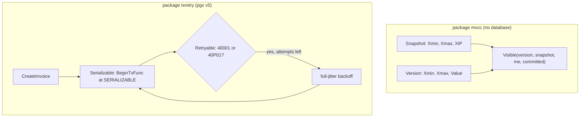
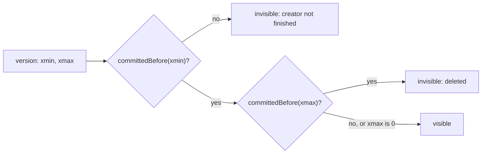
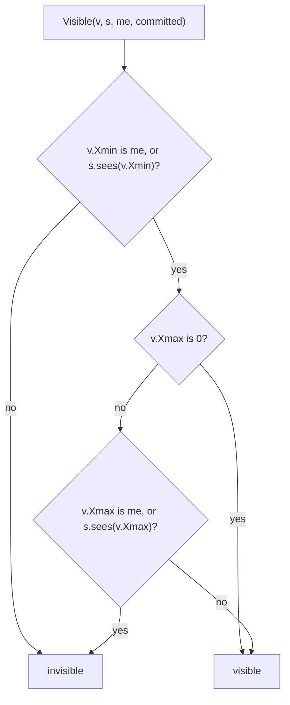
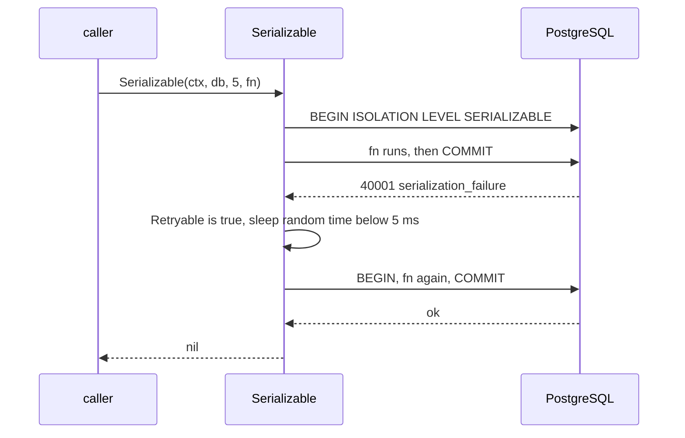
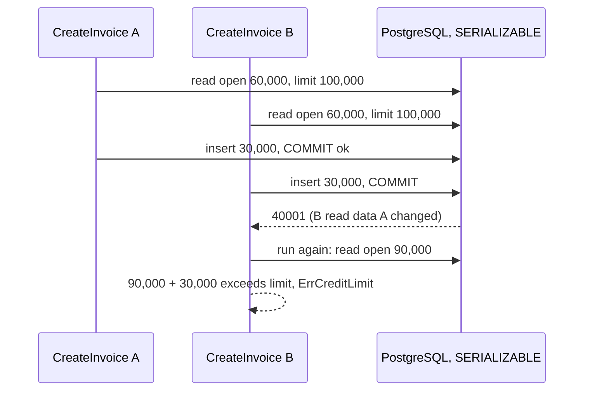
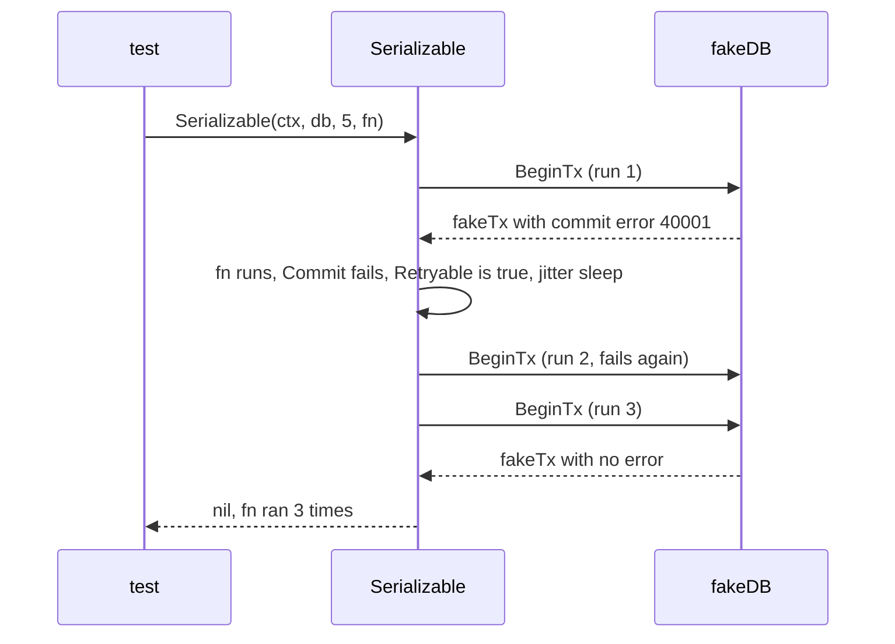

# Isolation Levels and MVCC - Go

> [!summary] TL;DR
> Runnable Go for [[Isolation Levels and MVCC]]: a small model of PostgreSQL's row-version visibility rule (`xmin`, `xmax`, snapshot) with a test that replays one invoice through five situations, and a `Serializable` helper that runs a whole transaction at SERIALIZABLE and runs it again on `40001` or `40P01`, with the credit-limit check built on top of it.

## What this code shows

| Code | Theory concept | Where it is explained |
| --- | --- | --- |
| `mvccmini.Visible` | The visibility rule in 15 lines: created by a finished transaction, not deleted by one | [[Isolation Levels and MVCC#MVCC in PostgreSQL: versions in the heap]] |
| `mvcc.Snapshot`, `Version`, `Visible` | The full rule: own writes, aborted transactions, `xmin:xmax:xip_list` snapshot | [[Isolation Levels and MVCC#MVCC in PostgreSQL: versions in the heap]] |
| `TestEachSnapshotSeesExactlyOneVersion` | READ COMMITTED takes a fresh snapshot, REPEATABLE READ keeps one | [[Isolation Levels and MVCC#READ COMMITTED vs REPEATABLE READ in PostgreSQL]] |
| `txretry.Serializable` | SERIALIZABLE only works if the application retries the whole transaction on `40001` | [[Isolation Levels and MVCC#SERIALIZABLE in PostgreSQL: SSI]] |
| `txretry.CreateInvoice` | The write-skew credit-limit story made safe | [[Isolation Levels and MVCC#Write skew]] |



The two packages are independent. `mvcc` is pure logic that explains what the database does internally; `txretry` is what an application does about the consequences, namely that SERIALIZABLE can abort a transaction that did nothing wrong.

## Setup

- Module `example.com/mvcc` with three packages: `mvcc` (the visibility model), `mvcc/mvccmini` (the 15-line version) and `mvcc/txretry` (the retry helper and `CreateInvoice`).
- Go 1.24. Only `txretry` has a dependency: `github.com/jackc/pgx/v5` (v5.7.2 was used for the measured run).
- The tests need no database. They use a fake `Beginner` whose transactions return scripted commit errors.
- Run it:

```bash
go mod tidy
go vet ./...
go test -race ./...
```

## Code

### Step 1: the visibility rule in 15 lines

**Concept.** PostgreSQL never overwrites a row in place: an `UPDATE` stamps the old version with the updater's transaction id in `xmax` and writes a new version with that id in `xmin` ([[Isolation Levels and MVCC#MVCC in PostgreSQL: versions in the heap]]). Readers then need a rule for which version to show. The rule is "created by a transaction my snapshot considers finished, and not deleted by one". A snapshot is just a cut-off: everything below `Xmax` that is not in the running set is finished. The alternative to this design is locking readers out of rows being written, which is what MVCC exists to avoid. This minimal version leaves out aborts and own writes so the core idea fits in a few lines.

```go
package mvcc

type Snap struct {
	Xmin, Xmax uint32
	Running    map[uint32]bool
}

// committedBefore: did xid finish before the snapshot was taken?
// (Real PostgreSQL also checks the commit log for aborts.)
func (s Snap) committedBefore(xid uint32) bool {
	return xid != 0 && xid < s.Xmax && !s.Running[xid]
}

// Visible: created by a transaction my snapshot sees as done,
// and not deleted by one it sees as done.
func Visible(s Snap, xmin, xmax uint32) bool {
	return s.committedBefore(xmin) && !s.committedBefore(xmax)
}
```

**How it works.**

1. `Snap` holds the snapshot: `Xmax` is the first transaction id that had not started, and `Running` lists ids below `Xmax` that were still in progress.
2. `committedBefore` is true only if the id is non-zero (`0` means "no deleter"), started before the snapshot (`xid < s.Xmax`), and was not running then.
3. `Visible` combines two questions: was the creator finished (`xmin`), and has no finished transaction deleted it (`xmax`)?
4. Because the snapshot is fixed, a later commit by transaction 105 cannot change the answer for a reader whose snapshot listed 105 as running. That is repeatable reads.



### Step 2: the full visibility model

**Concept.** The mini rule is wrong in two cases that matter. A transaction must see its own uncommitted changes, and an aborted transaction's versions must stay invisible even though its id is below `Xmax`. PostgreSQL answers the second with the commit log (`pg_xact`), which the model represents as a `Committed` function. The snapshot has the same shape `pg_current_snapshot()` prints, `xmin:xmax:xip_list`. A function type for `Committed` was chosen over a map so tests can express "105 aborted" or "105 committed" in one line. The model still ignores wraparound, command ids and lock-only `xmax`; it is a teaching model, not a clone.

The types come first. A `Snapshot` has the shape `pg_current_snapshot()` prints, a `Version` is one heap tuple, and `Committed` stands in for the commit log:

```go
// Package mvcc models how PostgreSQL decides which row version a snapshot sees.
// It ignores xid wraparound, command ids and row-lock-only xmax values.
package mvcc

// Snapshot has the shape pg_current_snapshot() prints: xmin:xmax:xip_list.
type Snapshot struct {
	Xmin uint32          // every xid below Xmin had finished
	Xmax uint32          // no xid at or above Xmax had started
	XIP  map[uint32]bool // xids in [Xmin, Xmax) that were still running
}

// Version is one physical row version (a heap tuple).
type Version struct {
	Xmin  uint32 // transaction that created this version
	Xmax  uint32 // transaction that deleted or replaced it; 0 if none
	Value string
}

// Committed answers "did this xid commit?" (PostgreSQL keeps that in pg_xact).
type Committed func(xid uint32) bool
```

**How it works.**

1. `Snapshot.Xmin` is an optimisation boundary in PostgreSQL; the model keeps it so the struct matches what `pg_current_snapshot()` prints, but the rule only needs `Xmax` and `XIP`.
2. `Version` is one physical tuple. An update produces two versions of the same logical row: the old one gets `Xmax` set, the new one has `Xmin` set to the same id.
3. `Committed` is a function type: any `func(uint32) bool` can be passed where a commit log is expected, including a closure in a test.

`sees` answers whether one transaction's work is part of the snapshot, and `Visible` combines it for `xmin` and `xmax`, with the reader's own transaction treated as visible to itself:

```go
// sees reports whether xid's work is part of the snapshot: the transaction
// finished before the snapshot was taken, and it committed.
func (s Snapshot) sees(xid uint32, committed Committed) bool {
	if xid >= s.Xmax || s.XIP[xid] {
		return false // started later, or still running at snapshot time
	}
	return committed(xid)
}

// Visible reports whether v is visible to transaction me reading with s.
func Visible(v Version, s Snapshot, me uint32, committed Committed) bool {
	created := v.Xmin == me || s.sees(v.Xmin, committed)
	if !created {
		return false
	}
	if v.Xmax == 0 {
		return true
	}
	deleted := v.Xmax == me || s.sees(v.Xmax, committed)
	return !deleted
}
```

**How it works.**

1. `sees` first rejects ids that started after the snapshot (`>= Xmax`) or were running at that moment (`XIP`). Only then does it ask the commit log, so an aborted transaction is treated as not seen.
2. `created` is true for the reader's own writes (`v.Xmin == me`) or for versions whose creator the snapshot sees as committed.
3. A version with `Xmax == 0` has no deleter, so after the creation check it is visible.
4. `deleted` mirrors `created`: the reader's own delete hides the version immediately, a committed visible delete hides it, and an aborted or invisible delete does not.
5. The rule is evaluated per version, so a chain of versions of one row yields at most one visible version for any snapshot.



### Step 3: retry serialization failures

**Concept.** SERIALIZABLE in PostgreSQL is implemented as serializable snapshot isolation: it lets transactions run concurrently on snapshots and aborts one with `40001` when it detects a dangerous pattern ([[Isolation Levels and MVCC#SERIALIZABLE in PostgreSQL: SSI]]). The guarantee is only useful if the application re-runs the aborted transaction. The alternative designs are locking everything (pessimistic, see [[Locking - Optimistic vs Pessimistic - Go]]) or accepting anomalies at lower levels. The helper retries with capped exponential backoff and full jitter ([[Timeouts, Retries and Backoff]]) so that two losers do not collide again in lock-step. It uses `github.com/jackc/pgx/v5`.

The package starts with the `Beginner` interface (satisfied by `*pgxpool.Pool` and `*pgx.Conn`, and by a fake in tests) and the error classifier:

```go
// Package txretry runs a function in a SERIALIZABLE transaction and runs the
// whole transaction again when PostgreSQL reports a serialization failure.
package txretry

import (
	"context"
	"errors"
	"math/rand/v2"
	"time"

	"github.com/jackc/pgx/v5"
	"github.com/jackc/pgx/v5/pgconn"
)

// Beginner is satisfied by *pgxpool.Pool and *pgx.Conn.
type Beginner interface {
	BeginTx(ctx context.Context, opts pgx.TxOptions) (pgx.Tx, error)
}

// Retryable reports whether running the whole transaction again can succeed.
func Retryable(err error) bool {
	var pgErr *pgconn.PgError
	if !errors.As(err, &pgErr) {
		return false
	}
	return pgErr.Code == "40001" || // serialization_failure
		pgErr.Code == "40P01" // deadlock_detected
}
```

**How it works.**

1. `Beginner` is declared at the consumer, so the helper accepts a pool, a single connection or a test fake.
2. `errors.As(err, &pgErr)` finds a `*pgconn.PgError` anywhere in the chain. This is why callbacks must wrap errors with `%w`.
3. Only two codes qualify: `40001` (a serialization failure) and `40P01` (a deadlock). Both mean the database already rolled the transaction back.

`Serializable` runs the callback with `pgx.BeginTxFunc` at SERIALIZABLE, which commits on success and rolls back on error. On a retryable error it sleeps a random time below a doubling, capped backoff and starts the whole transaction again:

```go
// Serializable runs fn in a SERIALIZABLE transaction, at most maxAttempts
// times. fn may run more than once, so it must not have side effects outside
// the transaction (no HTTP calls, no emails), and must wrap errors with %w.
func Serializable(ctx context.Context, db Beginner, maxAttempts int, fn func(pgx.Tx) error) error {
	backoff := 5 * time.Millisecond
	for attempt := 1; ; attempt++ {
		err := pgx.BeginTxFunc(ctx, db, pgx.TxOptions{IsoLevel: pgx.Serializable}, fn)
		if err == nil || !Retryable(err) || attempt == maxAttempts {
			return err
		}
		select { // full jitter: sleep a random time in [0, backoff)
		case <-time.After(rand.N(backoff)):
		case <-ctx.Done():
			return ctx.Err()
		}
		backoff = min(2*backoff, time.Second)
	}
}
```

**How it works.**

1. `pgx.BeginTxFunc` begins at `IsoLevel: pgx.Serializable`, calls `fn`, then commits; on an error from `fn` or from `Commit` it rolls back and returns the error. A serialization failure often surfaces at `Commit`, which is why the retry is around the whole call and not around `fn`.
2. The single `if` ends the loop on success, on a permanent error, or when the attempt budget is spent. In the last case the original `40001` is returned, not hidden.
3. `rand.N(backoff)` is a random duration in `[0, backoff)` (generic `rand.N` from `math/rand/v2`). Randomness spreads out competing retries.
4. The `select` lets cancellation interrupt the sleep and returns `ctx.Err()`.
5. `min(2*backoff, time.Second)` uses Go's builtin `min`: 5 ms, 10 ms, 20 ms, and so on up to a one-second cap.



### Step 4: the credit-limit check, made safe

**Concept.** The write-skew story ([[Isolation Levels and MVCC#Write skew]]) has two transactions that each read the customer's open balance, each see room under the limit, and each insert an invoice. Neither writes a row the other wrote, so snapshot isolation lets both commit and the limit is exceeded. At SERIALIZABLE the database sees that each transaction read data the other changed and aborts one with `40001`. `CreateInvoice` is the application code that needs no explicit lock: it just reads, decides, writes, and relies on `Serializable` to run it again. Alternatives are a row lock on the customer (`FOR UPDATE`) or a stored running balance with a `CHECK` constraint.

The imports and the sentinel error:

```go
package txretry

import (
	"context"
	"errors"
	"fmt"

	"github.com/jackc/pgx/v5"
)

var ErrCreditLimit = errors.New("invoice would exceed the customer's credit limit")
```

The function itself reads the limit and the open balance in one query, rejects the invoice if it would exceed the limit, and otherwise inserts it. Everything runs inside `Serializable`:

```go
// CreateInvoice inserts an invoice only if the customer's open balance stays
// within the credit limit. Two concurrent calls cannot both pass the check:
// SERIALIZABLE aborts one with 40001, and Serializable runs it again.
func CreateInvoice(ctx context.Context, db Beginner, customerID, totalMinor int64) error {
	return Serializable(ctx, db, 5, func(tx pgx.Tx) error {
		var limit, open int64
		err := tx.QueryRow(ctx, `
			SELECT c.credit_limit_minor,
			       coalesce(sum(i.total_minor - i.paid_minor), 0)
			FROM customers c
			LEFT JOIN invoices i ON i.customer_id = c.id
			     AND i.status IN ('sent', 'partially_paid', 'overdue')
			WHERE c.id = $1
			GROUP BY c.id`, customerID).Scan(&limit, &open)
		if err != nil {
			return fmt.Errorf("read open balance: %w", err)
		}
```

```go
		if open+totalMinor > limit {
			return ErrCreditLimit
		}
		_, err = tx.Exec(ctx, `
			INSERT INTO invoices (customer_id, total_minor, status, due_date)
			VALUES ($1, $2, 'sent', current_date + 30)`, customerID, totalMinor)
		if err != nil {
			return fmt.Errorf("insert invoice: %w", err)
		}
		return nil
	})
}
```

**How it works.**

1. The query uses a `LEFT JOIN` so a customer with no open invoices still returns one row, and `coalesce(..., 0)` turns the empty sum into zero.
2. `Scan(&limit, &open)` reads both numbers in the same snapshot, which is what the serializable conflict detection tracks.
3. `open+totalMinor > limit` is the business rule. `ErrCreditLimit` is not a `PgError`, so `Retryable` is false and the caller gets it unchanged.
4. Both database errors are wrapped with `%w`, so a `40001` raised by the query or the insert still reaches `Retryable`.
5. If a concurrent `CreateInvoice` commits first, PostgreSQL fails this transaction with `40001` and `Serializable` runs the whole closure again. The second run reads the new balance and may now return `ErrCreditLimit`.

The function compiles and passes `go vet`; it was not run against a database here.



## Design decisions

| Decision | Alternative | Trade-off |
| --- | --- | --- |
| Model visibility as a pure function over `Snapshot` and `Version` | Test against a real PostgreSQL | Runs anywhere in microseconds and makes each rule explicit; it ignores wraparound, command ids and lock-only `xmax` |
| `Committed` is a function type | A `map[uint32]bool` or a real commit log | One-line scripting of "committed" or "aborted" in tests; callers must write a closure |
| A 15-line mini model next to the full one | Only the full model | The first teaches the core idea, the second covers own writes and aborts; two files to keep consistent |
| Retry the whole transaction at SERIALIZABLE | Lock rows pessimistically | No lock waits and no deadlock risk from the check itself; costs wasted work and a need for idempotent callbacks |
| Retry only `40001` and `40P01` | Retry every error | Business and constraint errors fail fast; a new retryable code must be added deliberately |
| Full-jitter backoff capped at 1 s | Fixed or non-jittered doubling | Spreads competing retries; wait times are random, so tests assert counts, not durations |
| `Beginner` interface defined by the helper | Take `*pgxpool.Pool` directly | Works with a pool, a connection or a fake; one more indirection |
| `Serializable` takes the attempt budget as a parameter | A package constant | The caller decides how long a request may spend retrying |

## Tests

The tests have two groups: a deterministic check of the visibility rule, and retry tests that need no database. Together they prove the rule gives each snapshot exactly one version and that the retry loop retries only what it should.

### TestEachSnapshotSeesExactlyOneVersion

**Property.** For every snapshot there is exactly one visible version of the invoice. If two were visible a query would return a duplicate; if none, the row would vanish. The two middle cases are the whole difference between REPEATABLE READ (one snapshot for the transaction) and READ COMMITTED (a fresh snapshot per statement).

The test replays invoice 42: xid 100 inserted it as `sent`, and xid 105 updated it to `paid`, which stamped `xmax=105` on the old version and created a new one. It builds the two-version chain, three snapshots and two commit-log views:

```go
package mvcc

import "testing"

// Invoice 42: xid 100 inserted it as "sent"; xid 105 updated it to "paid",
// which stamped xmax=105 on the old version and inserted a new one.
var chain = []Version{
	{Xmin: 100, Xmax: 105, Value: "sent"},
	{Xmin: 105, Xmax: 0, Value: "paid"},
}

func TestEachSnapshotSeesExactlyOneVersion(t *testing.T) {
	// Taken by xid 104 while 103 and 105 were running.
	during := Snapshot{Xmin: 103, Xmax: 106, XIP: map[uint32]bool{103: true, 105: true}}
	// Taken by xid 105 itself: a snapshot never lists its own xid.
	own := Snapshot{Xmin: 103, Xmax: 106, XIP: map[uint32]bool{103: true}}
	// Taken by xid 107 after 105 had finished.
	after := Snapshot{Xmin: 106, Xmax: 107}

	only100 := func(xid uint32) bool { return xid == 100 } // 105 running or aborted
	both := func(xid uint32) bool { return xid == 100 || xid == 105 }
```

| Case | Snapshot | Reader | Commit log | Expected |
| --- | --- | --- | --- | --- |
| read while 105 runs | `during` (105 in `XIP`) | 104 | only 100 committed | `sent` |
| same snapshot after 105 commits (REPEATABLE READ) | `during` | 104 | 100 and 105 committed | `sent`, the old photograph is kept |
| fresh snapshot after 105 commits (READ COMMITTED) | `after` | 107 | 100 and 105 committed | `paid` |
| 105 reads its own update | `own` | 105 | only 100 committed | `paid` |
| 105 aborted: the old version stays visible | `after` | 107 | only 100 committed | `sent` |

Then the table of cases and the loop that counts visible versions and expects exactly one:

```go
	cases := []struct {
		name      string
		snap      Snapshot
		me        uint32
		committed Committed
		want      string
	}{
		{"read while 105 runs", during, 104, only100, "sent"},
		{"same snapshot after 105 commits (REPEATABLE READ)", during, 104, both, "sent"},
		{"fresh snapshot after 105 commits (READ COMMITTED)", after, 107, both, "paid"},
		{"105 reads its own update", own, 105, only100, "paid"},
		{"105 aborted: the old version stays visible", after, 107, only100, "sent"},
	}
	for _, c := range cases {
		var seen []string
		for _, v := range chain {
			if Visible(v, c.snap, c.me, c.committed) {
				seen = append(seen, v.Value)
			}
		}
		if len(seen) != 1 || seen[0] != c.want {
			t.Errorf("%s: saw %v, want [%s]", c.name, seen, c.want)
		}
	}
}
```

Take the second case: `during` lists 105 in `XIP`, so `sees(105)` is false no matter what the commit log says; the old version is not deleted and the new one is not created, from this snapshot's point of view. A failure message such as `saw [sent paid]` means a version was double-counted (for example the `XIP` check was dropped); `saw []` means both were hidden, which is how a row would disappear mid-transaction.

### TestMiniVisible

**Property.** The 15-line rule gives the right answer for the three basic situations: a version whose deleter is still running stays visible, a version whose creator is running is invisible, and a version whose deleter finished before the snapshot is gone.

| Call | Why | Expected |
| --- | --- | --- |
| `Visible(s, 100, 105)` | created by 100 (done), deleter 105 still running | true |
| `Visible(s, 105, 0)` | created by running 105 | false |
| `Visible(s, 100, 104)` | deleter 104 finished before the snapshot | false |

```go
package mvcc

import "testing"

func TestMiniVisible(t *testing.T) {
	s := Snap{Xmin: 103, Xmax: 106, Running: map[uint32]bool{105: true}}
	if !Visible(s, 100, 105) { // 105 still running: old version stays visible
		t.Fatal("old version should be visible")
	}
	if Visible(s, 105, 0) { // created by a running transaction
		t.Fatal("running writer's version must be invisible")
	}
	if Visible(s, 100, 104) { // deleter finished before the snapshot
		t.Fatal("deleted version must be invisible")
	}
}
```

A failure of the first assertion means the rule hides rows that another transaction is still deleting, which would make reads block-like or wrong. A failure of the second means dirty reads: uncommitted rows leak into other snapshots. A failure of the third means deleted rows are resurrected.

### The retry tests

The retry logic is tested without a database. A fake `BeginTx` hands out transactions whose `Commit` returns scripted errors; `pgx.BeginTxFunc` only ever calls `Commit` and `Rollback` on them.

`fakeTx` embeds a nil `pgx.Tx` and implements only `Commit` (returning a scripted error) and `Rollback`. Any other method call would panic on the nil embedded interface, which exposes a wrong assumption about what `BeginTxFunc` uses:

```go
package txretry

import (
	"context"
	"errors"
	"testing"

	"github.com/jackc/pgx/v5"
	"github.com/jackc/pgx/v5/pgconn"
)

// fakeTx embeds a nil pgx.Tx: BeginTxFunc only calls Commit and Rollback.
type fakeTx struct {
	pgx.Tx
	commitErr error
}

func (f *fakeTx) Commit(context.Context) error   { return f.commitErr }
func (f *fakeTx) Rollback(context.Context) error { return pgx.ErrTxClosed }
```

`fakeDB` fails the first N commits with the given errors and counts begins. Like a real pool it refuses to start a transaction on a cancelled context. `serializationFailure` is a realistic `40001` error:

```go
// fakeDB fails the first len(commitErrs) commits with the given errors.
type fakeDB struct {
	commitErrs []error
	begins     int
}

func (d *fakeDB) BeginTx(ctx context.Context, _ pgx.TxOptions) (pgx.Tx, error) {
	if err := ctx.Err(); err != nil {
		return nil, err // like a real pool: no new transaction on a dead context
	}
	var err error
	if d.begins < len(d.commitErrs) {
		err = d.commitErrs[d.begins]
	}
	d.begins++
	return &fakeTx{commitErr: err}, nil
}

var serializationFailure = &pgconn.PgError{Code: "40001",
	Message: "could not serialize access due to read/write dependencies among transactions"}
```



#### TestRetriesSerializationFailuresUntilCommit

**Property.** Two `40001` commit failures cause three runs of the callback, then success. This is the reason the helper exists.

| Scripted commit results | Expected |
| --- | --- |
| `40001`, `40001`, then ok | `err == nil`, `runs == 3` |

```go
func TestRetriesSerializationFailuresUntilCommit(t *testing.T) {
	db := &fakeDB{commitErrs: []error{serializationFailure, serializationFailure}}
	runs := 0
	err := Serializable(context.Background(), db, 5, func(pgx.Tx) error { runs++; return nil })
	if err != nil || runs != 3 {
		t.Fatalf("err=%v runs=%d; want success on the 3rd run", err, runs)
	}
}
```

If `runs` is 1 the error was returned without a retry, so `Retryable` or the loop condition is wrong. If it is above 3 the loop ignores the success.

#### TestGivesUpAfterMaxAttempts

**Property.** When every attempt fails, the helper stops after `maxAttempts` and returns the real `40001`, not a made-up error or `nil`. A bounded loop protects the connection pool from a transaction that can never win.

| `maxAttempts` | Scripted commit results | Expected |
| --- | --- | --- |
| 3 | `40001` three times | error is a `PgError` with code `40001`, `runs == 3` |

```go
func TestGivesUpAfterMaxAttempts(t *testing.T) {
	db := &fakeDB{commitErrs: []error{serializationFailure, serializationFailure, serializationFailure}}
	runs := 0
	err := Serializable(context.Background(), db, 3, func(pgx.Tx) error { runs++; return nil })
	var pgErr *pgconn.PgError
	if !errors.As(err, &pgErr) || pgErr.Code != "40001" || runs != 3 {
		t.Fatalf("err=%v runs=%d; want 40001 after 3 runs", err, runs)
	}
}
```

A failure with `runs > 3` means the budget is ignored. A failure on the error means the helper masked the cause, which would make production incidents hard to diagnose.

#### TestUniqueViolationIsNotRetried

**Property.** A permanent error (`23505`, unique violation) is returned after exactly one run. Retrying it would only repeat the same failure and delay the response.

| Callback result | Expected |
| --- | --- |
| `PgError{Code: "23505"}` | error code `23505`, `runs == 1` |

```go
func TestUniqueViolationIsNotRetried(t *testing.T) {
	db := &fakeDB{}
	runs := 0
	err := Serializable(context.Background(), db, 5, func(pgx.Tx) error {
		runs++
		return &pgconn.PgError{Code: "23505"}
	})
	var pgErr *pgconn.PgError
	if !errors.As(err, &pgErr) || pgErr.Code != "23505" || runs != 1 {
		t.Fatalf("err=%v runs=%d; want 23505 after 1 run", err, runs)
	}
}
```

A failure with `runs > 1` means the classifier is too broad (for example it retries every `PgError`).

#### TestStopsWhenContextIsCancelled

**Property.** A cancelled context ends the retry loop with `context.Canceled`. A service shutting down or a request whose client left must not keep retrying.

| Step | Effect |
| --- | --- |
| callback calls `cancel()` and returns nil | context is now cancelled |
| first `Commit` returns `40001` | helper wants to retry |
| sleep or next `BeginTx` | sees the dead context |

Expected: `errors.Is(err, context.Canceled)`.

```go
func TestStopsWhenContextIsCancelled(t *testing.T) {
	ctx, cancel := context.WithCancel(context.Background())
	db := &fakeDB{commitErrs: []error{serializationFailure, serializationFailure}}
	err := Serializable(ctx, db, 5, func(pgx.Tx) error { cancel(); return nil })
	if !errors.Is(err, context.Canceled) {
		t.Fatalf("err=%v; want context.Canceled", err)
	}
}
```

Both exits give the same result: if `select` picks `ctx.Done()` it returns `ctx.Err()`, and if the timer wins, the fake's `BeginTx` refuses the dead context and returns the same error. A failure means the loop would keep going after cancellation, holding connections during shutdown.

### Running it

`go vet ./...` is clean and `go test -race ./...` passes with Go 1.24.4 and pgx v5.7.2 (measured in a scratch module):

```text
=== RUN   TestEachSnapshotSeesExactlyOneVersion
--- PASS: TestEachSnapshotSeesExactlyOneVersion (0.00s)
ok  	example.com/mvcc
=== RUN   TestMiniVisible
--- PASS: TestMiniVisible (0.00s)
ok  	example.com/mvcc/mvccmini
=== RUN   TestRetriesSerializationFailuresUntilCommit
--- PASS: TestRetriesSerializationFailuresUntilCommit (0.01s)
=== RUN   TestGivesUpAfterMaxAttempts
--- PASS: TestGivesUpAfterMaxAttempts (0.01s)
=== RUN   TestUniqueViolationIsNotRetried
--- PASS: TestUniqueViolationIsNotRetried (0.00s)
=== RUN   TestStopsWhenContextIsCancelled
--- PASS: TestStopsWhenContextIsCancelled (0.00s)
ok  	example.com/mvcc/txretry
```

**Reading the output.**

1. Each package prints its own `ok <module path>` line, so there are three: `mvcc` (the full model), `mvccmini` (the short rule) and `mvcc/txretry` (the helper).
2. The visibility tests take `0.00s` because they are pure functions over small structs.
3. The two retry tests that sleep show `0.01s`. The jitter draws a random wait under 5 ms and then under 10 ms, so the total is a few milliseconds and varies from run to run.
4. `TestUniqueViolationIsNotRetried` and `TestStopsWhenContextIsCancelled` show `0.00s`: the first never sleeps, the second exits as soon as it sees the cancelled context.
5. No `WARNING: DATA RACE` lines appear, so the race detector found nothing.

## Pitfalls in the code

- **The model ignores wraparound, command ids and lock-only `xmax`.** It is a teaching model of the rule, not a PostgreSQL clone. `xmax` set by `SELECT … FOR UPDATE` does not mean the row was deleted.
- **`Committed` stands in for `pg_xact`.** In the model a transaction that is neither committed nor running counts as aborted, which is how the "105 aborted" case keeps the old version visible.
- **`fn` may run more than once.** Anything inside `Serializable`'s callback that is not a database write (an HTTP call, an email, appending to a slice that outlives the call) repeats on every retry.
- **Wrap errors with `%w`.** `Retryable` uses `errors.As` to find the `*pgconn.PgError`; `fmt.Errorf("... %v", err)` hides it and the transaction is never retried.
- **`CreateInvoice` only helps if every writer uses SERIALIZABLE.** One writer at READ COMMITTED can still create the anomaly.
- **The retry loop has no per-attempt timeout.** The only limits are `maxAttempts` and the context; a slow transaction that keeps failing can hold its connection for a long time.

## Exercises

1. In `TestEachSnapshotSeesExactlyOneVersion`, change the case "105 aborted" so that `committed` is `both`. Predict which version is seen and which case in the table it now equals, then run it.
2. Change the `fakeDB` in `TestRetriesSerializationFailuresUntilCommit` to fail three times and keep `maxAttempts` at 3. Predict the error type and the value of `runs`.
3. Remove the `s.Running[xid]` check in `mvccmini.committedBefore`. Predict which of the three assertions in `TestMiniVisible` fails.

## Links

- Theory: [[Isolation Levels and MVCC]]
- **Before this:** [[Transactions and ACID - Go]]
- **Next:** [[Locking - Optimistic vs Pessimistic - Go]]
