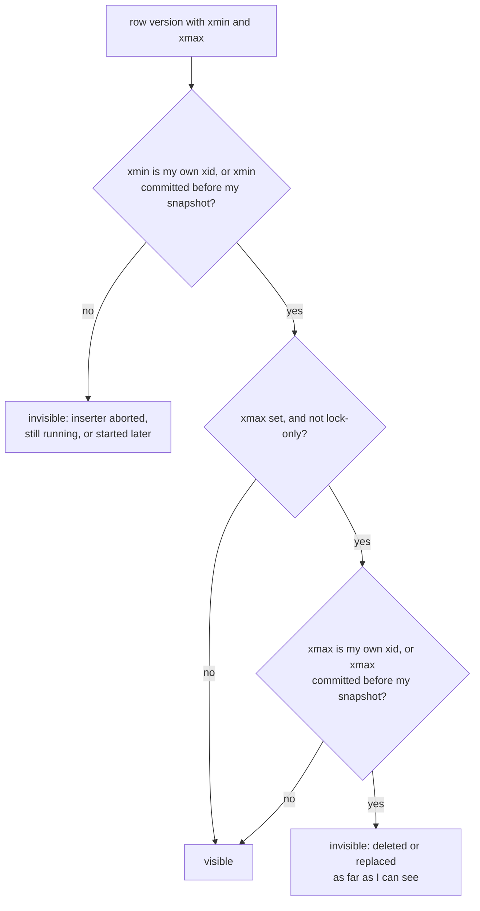
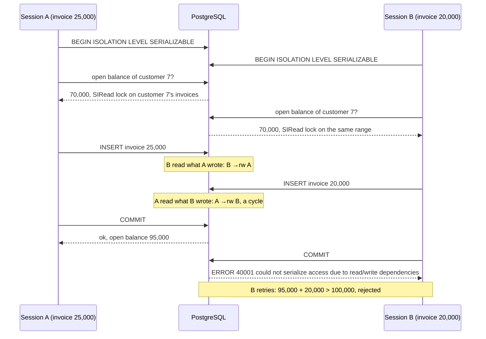
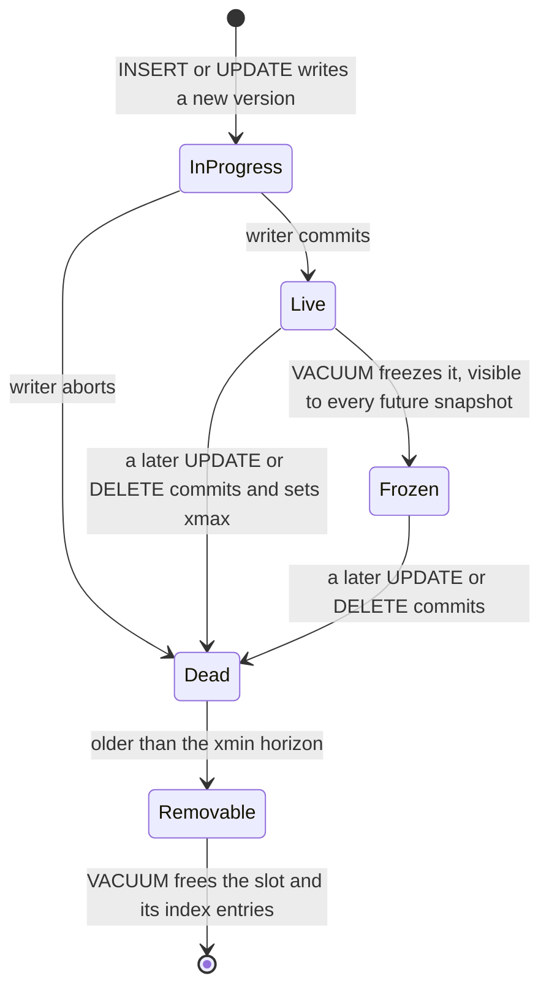

# Isolation Levels and MVCC

> [!summary] TL;DR
> An **isolation level** is the promise a database makes about what one transaction can see of others running at the same time; weaker levels allow known bugs called **anomalies**. Most databases implement isolation with **MVCC** (multi-version concurrency control): a write creates a new version of the row, and each transaction reads from a consistent **snapshot**, so readers never block writers. PostgreSQL defaults to READ COMMITTED, MySQL InnoDB to REPEATABLE READ, and neither default stops every anomaly.

## 1. Why it exists

InvoiceOps lets a customer run up an open balance only up to a credit limit. Customer 7 has `credit_limit_cents = 100000` and 70,000 open. Two staff members create invoices for customer 7 at the same moment:

| Step | Session A (invoice of 25,000) | Session B (invoice of 20,000) |
| --- | --- | --- |
| 1 | reads open balance → 70,000; 95,000 ≤ 100,000, OK | |
| 2 | | reads open balance → 70,000; 90,000 ≤ 100,000, OK |
| 3 | `INSERT` invoice, `COMMIT` | |
| 4 | | `INSERT` invoice, `COMMIT` |

The open balance is now 115,000. Neither session did anything wrong on its own, and no row was written twice. At PostgreSQL's default level, and even at REPEATABLE READ, both commit. Running transactions one at a time would have rejected B. Isolation levels define how close to "one at a time" the database gets for you, and what you must add yourself.

## 2. Mental model

- **Snapshots.** Each transaction reads from a photograph of the committed data. Other sessions keep changing the real rows, but your photograph does not change. The isolation level decides how often you take a new photograph: per statement (READ COMMITTED) or once per transaction (REPEATABLE READ).
- **Versions, not overwrites.** An `UPDATE` does not erase the old row. It writes a new version and marks the old one as replaced, so older photographs can still find the version they need. Cleaning up versions nobody can see any more is a separate job (VACUUM in PostgreSQL, purge in InnoDB).
- **What snapshots cannot see.** A snapshot shows you a consistent past, but your decision is applied to the present. When your write depends on something another transaction changed after your photograph, you get lost updates and write skew. Only SERIALIZABLE, or a lock you take yourself, catches that.

Analogy: everyone works from their own printout of a shared spreadsheet. Printouts never change under you, but two people can each check "total < limit" on their printout and each add a row.

## 3. How it works

### The six anomalies

Each timeline runs top to bottom; statements outside `BEGIN … COMMIT` autocommit.

**Dirty read:** you see another transaction's uncommitted change.

| Step | Session A | Session B |
| --- | --- | --- |
| 1 | `BEGIN; UPDATE invoices SET status = 'paid' WHERE id = 42;` | |
| 2 | | `SELECT status FROM invoices WHERE id = 42;` → `paid` |
| 3 | `ROLLBACK;` | B emailed a receipt for a payment that never happened |

**Non-repeatable read:** the same row read twice gives different values.

| Step | Session A | Session B |
| --- | --- | --- |
| 1 | `BEGIN; SELECT total_cents FROM invoices WHERE id = 42;` → 50000 | |
| 2 | | `UPDATE invoices SET total_cents = 45000 WHERE id = 42;` |
| 3 | same `SELECT` → 45000 | |

**Phantom read:** the same query returns a different set of rows.

| Step | Session A | Session B |
| --- | --- | --- |
| 1 | `BEGIN; SELECT count(*) FROM invoices WHERE customer_id = 7 AND status = 'overdue';` → 3 | |
| 2 | | inserts a fourth overdue invoice for customer 7 |
| 3 | same `count(*)` → 4 | |

**Read skew:** you see part of another transaction's effects.

| Step | Session A (monthly statement) | Session B (payment webhook) |
| --- | --- | --- |
| 1 | `BEGIN; SELECT amount_paid_cents FROM invoices WHERE id = 42;` → 0 | |
| 2 | | `BEGIN; INSERT INTO payments (invoice_id, amount_cents) VALUES (42, 50000); UPDATE invoices SET amount_paid_cents = 50000 WHERE id = 42; COMMIT;` |
| 3 | `SELECT sum(amount_cents) FROM payments WHERE invoice_id = 42;` → 50000 | |

A's statement says "paid 0" next to "payments 50,000".

**Lost update:** two read-modify-write cycles; one write silently overwrites the other.

| Step | Session A (payment of 10,000) | Session B (payment of 20,000) |
| --- | --- | --- |
| 1 | `BEGIN; SELECT amount_paid_cents FROM invoices WHERE id = 42;` → 0 | |
| 2 | | `BEGIN; SELECT amount_paid_cents FROM invoices WHERE id = 42;` → 0 |
| 3 | `UPDATE invoices SET amount_paid_cents = 10000 WHERE id = 42; COMMIT;` | |
| 4 | | `UPDATE invoices SET amount_paid_cents = 20000 WHERE id = 42; COMMIT;` |

The invoice shows 20,000 paid instead of 30,000. The fixes (atomic updates, row locks, version columns) are in [[Locking - Optimistic vs Pessimistic]].

**Write skew:** the credit-limit story in section 1. Each transaction reads the same data, checks a rule, and writes a *different* row. No row is written twice, so no write-write conflict is ever detected.

### What each level prevents

| Anomaly | PG READ COMMITTED (default) | PG REPEATABLE READ | PG SERIALIZABLE | MySQL InnoDB REPEATABLE READ (default) |
| --- | --- | --- | --- | --- |
| Dirty read | prevented | prevented | prevented | prevented |
| Non-repeatable read | **possible** | prevented | prevented | prevented for plain `SELECT` |
| Phantom read | **possible** | prevented | prevented | prevented for plain `SELECT` |
| Read skew | **possible** | prevented | prevented | prevented for plain `SELECT` |
| Lost update (read in app, then write) | **possible** | prevented: second writer gets 40001 | prevented | **possible** |
| Write skew | **possible** | **possible** | prevented: one transaction gets 40001 | **possible** |

The SQL standard defines four levels by which phenomena they rule out. What engines actually do differs:

| Level | SQL standard rules out | PostgreSQL 17 | MySQL 8.0 / 8.4 InnoDB |
| --- | --- | --- | --- |
| READ UNCOMMITTED | nothing | Same as READ COMMITTED | Dirty reads really happen |
| READ COMMITTED | dirty reads | Default. New snapshot per statement. An `UPDATE` that meets a row changed by a concurrent transaction waits for it, then re-checks its `WHERE` on the newest version | New snapshot per consistent read; no gap locks except for foreign-key and duplicate-key checks |
| REPEATABLE READ | + non-repeatable reads | **Snapshot isolation**: one snapshot, taken at the first statement (not at `BEGIN`). Updating a row that changed after your snapshot fails with SQLSTATE 40001 | Default. Plain `SELECT` reads one snapshot. `UPDATE`, `DELETE` and locking reads use the *latest* committed rows and take next-key locks |
| SERIALIZABLE | + phantoms, and the result must equal some serial order | **Serializable snapshot isolation (SSI)**: snapshot isolation plus dependency tracking; aborts a transaction with 40001 instead of blocking | Like REPEATABLE READ, but plain `SELECT` becomes `SELECT … FOR SHARE` when autocommit is off: it blocks on locks instead of aborting |

> [!warning] Interview trap
> The standard's phenomena were defined so loosely that snapshot isolation satisfies them and still allows write skew (Berenson et al., 1995). That is why Oracle's level called SERIALIZABLE, and PostgreSQL's before 9.1, are really snapshot isolation.

### MVCC in PostgreSQL: versions in the heap

Every row version (tuple) carries hidden system columns:

- `xmin`: the transaction ID (xid) that created this version.
- `xmax`: the xid that deleted or replaced it, or 0. It is also set by row locks, with a flag that marks it as "lock only".
- `ctid`: the physical location `(page, slot)`. For a replaced version, it points to the next version in the chain.

An `UPDATE` therefore writes a new tuple and stamps `xmax` on the old one. With the `pageinspect` extension you can see both versions on the page. A demo table, after transaction 731 inserted invoice 42 and transaction 734 set it to `paid`:

```sql
SELECT lp, t_xmin, t_xmax, t_ctid
FROM heap_page_items(get_raw_page('invoices_demo', 0));
```

Representative output (PostgreSQL 17):

```text
 lp | t_xmin | t_xmax | t_ctid
----+--------+--------+--------
  1 |    731 |    734 | (0,2)
  2 |    734 |      0 | (0,2)
```

A **snapshot** records which transactions count as finished. `SELECT pg_current_snapshot();` prints it as `xmin:xmax:xip_list`, for example `735:738:736`: every xid below 735 had finished, none at or above 738 had started, and 736 was still running. Whether a finished xid committed or aborted is kept in `pg_xact`, two bits per transaction. The first reader to look a status up caches it in the tuple as **hint bits**, which is why a plain `SELECT` can dirty pages (and, with data checksums or `wal_log_hints` on, write WAL).



"Committed before my snapshot" means: the xid is below the snapshot's `xmax`, not in its in-progress list, and marked committed in `pg_xact`.

**READ COMMITTED vs REPEATABLE READ in PostgreSQL** is only a question of when the snapshot is taken, plus one rule for writes:

- READ COMMITTED takes a new snapshot for every statement. If an `UPDATE`, `DELETE` or `SELECT … FOR UPDATE` finds its target row changed by a concurrent transaction, it waits for that transaction to finish (if it is still running) and, if it committed, re-evaluates its `WHERE` clause on the newest version. That is why `UPDATE invoices SET amount_paid_cents = amount_paid_cents + 10000 WHERE id = 42` never loses an update, while reading the value into Go and writing it back does.
- REPEATABLE READ keeps one snapshot. If the row you update, delete or lock was changed by a transaction that committed after your snapshot, you get `ERROR: could not serialize access due to concurrent update` (SQLSTATE 40001). The second writer loses, and your code must retry the whole transaction.

### SERIALIZABLE in PostgreSQL: SSI

Since 9.1, PostgreSQL's SERIALIZABLE runs transactions exactly like REPEATABLE READ and additionally tracks **read-write dependencies**. "T1 →rw T2" means T1 read something that the concurrent T2 then wrote: a row version, or a gap T2 inserted into. Readers record what they read as **SIRead locks** (shown as `SIReadLock` in `pg_locks`). These never block anyone; they only let the database notice conflicts.

Every anomaly under snapshot isolation needs a "dangerous structure": two rw-dependencies in a row, T1 →rw T2 →rw T3, where T3 commits first (T1 and T3 may be the same transaction). PostgreSQL watches for that pattern and aborts one participant with 40001. That is cheap, but it also catches some harmless patterns (false positives), so retries are part of using SERIALIZABLE.



At REPEATABLE READ the same two sessions both commit and the balance ends at 115,000.

### VACUUM, bloat and transaction ID wraparound

Old versions stay in the table until VACUUM removes them, and VACUUM may only remove a version once no running snapshot could still need it. The oldest snapshot still in use (the **xmin horizon**) decides that.



- **Bloat.** Dead tuples, and the index entries pointing at them, take space and slow scans until VACUUM runs. Autovacuum starts when dead tuples exceed `autovacuum_vacuum_threshold` (50) + `autovacuum_vacuum_scale_factor` (0.2) × rows, and since PostgreSQL 13 also after many inserts. Plain VACUUM makes space reusable inside the table but rarely shrinks the file; `VACUUM FULL` rewrites the table under an ACCESS EXCLUSIVE lock.
- **The xmin horizon.** One transaction left open for hours ("idle in transaction"), a stale replication slot, or a replica with `hot_standby_feedback = on` running a long query holds the horizon back. Then no table in the database can be cleaned, however often VACUUM runs.
- **XID wraparound.** Transaction IDs are 32 bits and compared in a circle: about 2 billion xids are "in the past" and 2 billion "in the future". VACUUM **freezes** old tuples so they count as older than every xid. When a table's oldest unfrozen xid gets older than `autovacuum_freeze_max_age` (200 million), an anti-wraparound autovacuum is forced, even with autovacuum disabled. If that cannot keep up, PostgreSQL warns once only 40 million xids remain, and finally refuses to start transactions that need a new xid until a VACUUM fixes it. That is an outage.

### MVCC in InnoDB: undo logs and two kinds of read

InnoDB updates the row in place in the clustered index and copies the old version into the **undo log**. Each row has hidden `DB_TRX_ID` (last writer) and `DB_ROLL_PTR` (pointer into undo) columns.

- A **consistent read** (plain `SELECT`) builds the version its read view should see by following `DB_ROLL_PTR` back through undo records. At REPEATABLE READ the read view is created by the first consistent read of the transaction, or by `START TRANSACTION WITH CONSISTENT SNAPSHOT`.
- A **locking read** (`SELECT … FOR UPDATE` / `FOR SHARE`), `UPDATE` and `DELETE` read the *latest committed* version. They lock the index records they scan, plus the gaps before them (**next-key locks**) at REPEATABLE READ, which blocks phantom inserts for locking reads.
- The surprise this creates, from the MySQL manual: a REPEATABLE READ transaction can `UPDATE` or `DELETE` rows that its own `SELECT` cannot see, because another session committed them after the snapshot.
- There is no "first updater wins" check, so the lost-update timeline above silently succeeds at InnoDB's default level.
- **Purge** threads discard undo records once no read view needs them. A long transaction makes the **history list length** grow, the InnoDB version of bloat.

## 4. Worked example

**The visibility rule in Go.** A model of the decision PostgreSQL makes for every tuple. It compiles and passes `go vet` and `go test -race` on Go 1.24.

```go
// Package mvcc models how PostgreSQL decides which row version a snapshot sees.
// It ignores xid wraparound, command ids and row-lock-only xmax values.
package mvcc

// Snapshot has the shape pg_current_snapshot() prints: xmin:xmax:xip_list.
type Snapshot struct {
	Xmin uint32          // every xid below Xmin had finished
	Xmax uint32          // no xid at or above Xmax had started
	XIP  map[uint32]bool // xids in [Xmin, Xmax) that were still running
}

// Version is one physical row version (a heap tuple).
type Version struct {
	Xmin  uint32 // transaction that created this version
	Xmax  uint32 // transaction that deleted or replaced it; 0 if none
	Value string
}

// Committed answers "did this xid commit?" (PostgreSQL keeps that in pg_xact).
type Committed func(xid uint32) bool

// sees reports whether xid's work is part of the snapshot: the transaction
// finished before the snapshot was taken, and it committed.
func (s Snapshot) sees(xid uint32, committed Committed) bool {
	if xid >= s.Xmax || s.XIP[xid] {
		return false // started later, or still running at snapshot time
	}
	return committed(xid)
}

// Visible reports whether v is visible to transaction me reading with s.
func Visible(v Version, s Snapshot, me uint32, committed Committed) bool {
	created := v.Xmin == me || s.sees(v.Xmin, committed)
	if !created {
		return false
	}
	if v.Xmax == 0 {
		return true
	}
	deleted := v.Xmax == me || s.sees(v.Xmax, committed)
	return !deleted
}
```

The test replays invoice 42's two versions under five situations. Every snapshot sees exactly one version, and the two middle cases are the whole difference between REPEATABLE READ and READ COMMITTED:

```go
// Invoice 42: xid 100 inserted it as "sent"; xid 105 updated it to "paid",
// which stamped xmax=105 on the old version and inserted a new one.
var chain = []Version{
	{Xmin: 100, Xmax: 105, Value: "sent"},
	{Xmin: 105, Xmax: 0, Value: "paid"},
}

func TestEachSnapshotSeesExactlyOneVersion(t *testing.T) {
	// Taken by xid 104 while 103 and 105 were running.
	during := Snapshot{Xmin: 103, Xmax: 106, XIP: map[uint32]bool{103: true, 105: true}}
	// Taken by xid 105 itself: a snapshot never lists its own xid.
	own := Snapshot{Xmin: 103, Xmax: 106, XIP: map[uint32]bool{103: true}}
	// Taken by xid 107 after 105 had finished.
	after := Snapshot{Xmin: 106, Xmax: 107}

	only100 := func(xid uint32) bool { return xid == 100 } // 105 running or aborted
	both := func(xid uint32) bool { return xid == 100 || xid == 105 }

	cases := []struct {
		name      string
		snap      Snapshot
		me        uint32
		committed Committed
		want      string
	}{
		{"read while 105 runs", during, 104, only100, "sent"},
		{"same snapshot after 105 commits (REPEATABLE READ)", during, 104, both, "sent"},
		{"fresh snapshot after 105 commits (READ COMMITTED)", after, 107, both, "paid"},
		{"105 reads its own update", own, 105, only100, "paid"},
		{"105 aborted: the old version stays visible", after, 107, only100, "sent"},
	}
	for _, c := range cases {
		var seen []string
		for _, v := range chain {
			if Visible(v, c.snap, c.me, c.committed) {
				seen = append(seen, v.Value)
			}
		}
		if len(seen) != 1 || seen[0] != c.want {
			t.Errorf("%s: saw %v, want [%s]", c.name, seen, c.want)
		}
	}
}
```

**Retrying serialization failures.** SERIALIZABLE is only correct if the application retries. The helper below runs the *whole* transaction again on 40001 (serialization failure) or 40P01 (deadlock), with capped exponential backoff and full jitter ([[Timeouts, Retries and Backoff]]). It uses `github.com/jackc/pgx/v5`:

```go
// Package txretry runs a function in a SERIALIZABLE transaction and runs the
// whole transaction again when PostgreSQL reports a serialization failure.
package txretry

import (
	"context"
	"errors"
	"math/rand/v2"
	"time"

	"github.com/jackc/pgx/v5"
	"github.com/jackc/pgx/v5/pgconn"
)

// Beginner is satisfied by *pgxpool.Pool and *pgx.Conn.
type Beginner interface {
	BeginTx(ctx context.Context, opts pgx.TxOptions) (pgx.Tx, error)
}

// Retryable reports whether running the whole transaction again can succeed.
func Retryable(err error) bool {
	var pgErr *pgconn.PgError
	if !errors.As(err, &pgErr) {
		return false
	}
	return pgErr.Code == "40001" || // serialization_failure
		pgErr.Code == "40P01" // deadlock_detected
}

// Serializable runs fn in a SERIALIZABLE transaction, at most maxAttempts
// times. fn may run more than once, so it must not have side effects outside
// the transaction (no HTTP calls, no emails), and must wrap errors with %w.
func Serializable(ctx context.Context, db Beginner, maxAttempts int, fn func(pgx.Tx) error) error {
	backoff := 5 * time.Millisecond
	for attempt := 1; ; attempt++ {
		err := pgx.BeginTxFunc(ctx, db, pgx.TxOptions{IsoLevel: pgx.Serializable}, fn)
		if err == nil || !Retryable(err) || attempt == maxAttempts {
			return err
		}
		select { // full jitter: sleep a random time in [0, backoff)
		case <-time.After(rand.N(backoff)):
		case <-ctx.Done():
			return ctx.Err()
		}
		backoff = min(2*backoff, time.Second)
	}
}
```

The credit-limit check from section 1, made safe. It compiles and passes `go vet`; it was not run against a database here:

```go
var ErrCreditLimit = errors.New("invoice would exceed the customer's credit limit")

// CreateInvoice inserts an invoice only if the customer's open balance stays
// within the credit limit. Two concurrent calls cannot both pass the check:
// SERIALIZABLE aborts one with 40001, and Serializable runs it again.
func CreateInvoice(ctx context.Context, db Beginner, customerID, totalCents int64) error {
	return Serializable(ctx, db, 5, func(tx pgx.Tx) error {
		var limit, open int64
		err := tx.QueryRow(ctx, `
			SELECT c.credit_limit_cents,
			       coalesce(sum(i.total_cents - i.amount_paid_cents), 0)
			FROM customers c
			LEFT JOIN invoices i ON i.customer_id = c.id
			     AND i.status IN ('sent', 'partially_paid', 'overdue')
			WHERE c.id = $1
			GROUP BY c.id`, customerID).Scan(&limit, &open)
		if err != nil {
			return fmt.Errorf("read open balance: %w", err)
		}
		if open+totalCents > limit {
			return ErrCreditLimit
		}
		_, err = tx.Exec(ctx, `
			INSERT INTO invoices (customer_id, total_cents, status, due_date)
			VALUES ($1, $2, 'sent', current_date + 30)`, customerID, totalCents)
		if err != nil {
			return fmt.Errorf("insert invoice: %w", err)
		}
		return nil
	})
}
```

The retry logic is tested without a database. A fake `BeginTx` hands out transactions whose `Commit` returns scripted errors; `pgx.BeginTxFunc` only ever calls `Commit` and `Rollback` on them:

```go
// fakeTx embeds a nil pgx.Tx: BeginTxFunc only calls Commit and Rollback.
type fakeTx struct {
	pgx.Tx
	commitErr error
}

func (f *fakeTx) Commit(context.Context) error   { return f.commitErr }
func (f *fakeTx) Rollback(context.Context) error { return pgx.ErrTxClosed }

// fakeDB fails the first len(commitErrs) commits with the given errors.
type fakeDB struct {
	commitErrs []error
	begins     int
}

func (d *fakeDB) BeginTx(ctx context.Context, _ pgx.TxOptions) (pgx.Tx, error) {
	if err := ctx.Err(); err != nil {
		return nil, err // like a real pool: no new transaction on a dead context
	}
	var err error
	if d.begins < len(d.commitErrs) {
		err = d.commitErrs[d.begins]
	}
	d.begins++
	return &fakeTx{commitErr: err}, nil
}

var serializationFailure = &pgconn.PgError{Code: "40001",
	Message: "could not serialize access due to read/write dependencies among transactions"}

func TestRetriesSerializationFailuresUntilCommit(t *testing.T) {
	db := &fakeDB{commitErrs: []error{serializationFailure, serializationFailure}}
	runs := 0
	err := Serializable(context.Background(), db, 5, func(pgx.Tx) error { runs++; return nil })
	if err != nil || runs != 3 {
		t.Fatalf("err=%v runs=%d; want success on the 3rd run", err, runs)
	}
}
```

Three more tests in the package check that it gives up after `maxAttempts` with the 40001 error, returns a `23505` unique violation after one run, and stops when the context is cancelled.

## 5. Variants and comparison

Ways to stop the anomalies that the default level allows:

| Option | How it works | Use when | Cost |
| --- | --- | --- | --- |
| Atomic single statement | `UPDATE … SET x = x + $1 WHERE … AND x + $1 <= limit`, check rows affected | The rule fits in one row | Only works for one-row rules |
| Lock the parent row | `SELECT … FROM customers WHERE id = $1 FOR UPDATE` before the check: every writer for that customer queues | A rule over many rows that share a parent ("materialise the conflict") | Serialises writers per parent; deadlock risk if you lock in different orders |
| REPEATABLE READ | One snapshot; the second writer of a row gets 40001 | Consistent reports, lost-update protection on single rows | Retries; still allows write skew |
| SERIALIZABLE (SSI) | Snapshot + dependency tracking, 40001 on danger | Invariants across rows or tables; many code paths you cannot audit | Retries, false positives, SIRead-lock memory |
| Constraint | `UNIQUE`, `CHECK`, `EXCLUDE USING gist` | The rule can be declared | Only for rules the schema can express |

Defaults elsewhere, for interviews:

| Database | Default level | Notes |
| --- | --- | --- |
| PostgreSQL | READ COMMITTED | REPEATABLE READ = snapshot isolation; SERIALIZABLE = SSI |
| MySQL InnoDB | REPEATABLE READ | Snapshot for plain reads, next-key locks for locking reads |
| Oracle | READ COMMITTED | Its SERIALIZABLE is snapshot isolation |
| SQL Server | READ COMMITTED (locking) | `READ_COMMITTED_SNAPSHOT` switches it to row versioning; `SNAPSHOT` is snapshot isolation |
| CockroachDB | SERIALIZABLE | READ COMMITTED is available since v23.2; see [[Distributed SQL]] |

## 6. Trade-offs and when not to use

- **READ COMMITTED is fine for most single-statement work**, provided you write conditional updates instead of read-then-write in application code.
- **REPEATABLE READ** gives a stable view for reports and exports and turns lost updates into errors. A long-running REPEATABLE READ report also holds the xmin horizon for its whole duration.
- **SERIALIZABLE** costs retries and some throughput: predicate-lock bookkeeping, false-positive aborts, and wasted work on every retry. It is only guaranteed for transactions that *all* run SERIALIZABLE; one READ COMMITTED writer in the mix can still create an anomaly.
- **Do not reach for SERIALIZABLE** when a single atomic `UPDATE`, a unique constraint or one row lock expresses the rule more cheaply and more visibly.
- **Never put non-repeatable side effects inside a retried transaction**: charging a card, sending an email. Record the intent in the transaction and act after commit (see [[Transactional Outbox and CDC]]).

## 7. In production

- **Real systems:** InvoiceOps-style services typically run READ COMMITTED with conditional updates and row locks, and use SERIALIZABLE for the few invariants that span rows (credit limits, ledger balances), wrapped in the retry helper above.
- **Failure modes → fixes:**
	- *An "idle in transaction" session holds the xmin horizon for hours* → set `idle_in_transaction_session_timeout` (for example 60 s) and `statement_timeout`; never hold a transaction open across an HTTP call.
	- *A forgotten replication slot or `hot_standby_feedback` pins old versions* → monitor slot `xmin` and lag, drop dead slots.
	- *Wraparound warnings* → find what blocks freezing (old transactions, slots, prepared transactions), then run VACUUM on the oldest tables first.
	- *Retry storms under SERIALIZABLE* → cap attempts, add jitter, keep transactions short, prefer index scans (a sequential scan takes a relation-wide SIRead lock and conflicts with every write), and mark reports `READ ONLY DEFERRABLE`.
	- *SERIALIZABLE on a hot standby* is refused; replicas offer at most REPEATABLE READ.
	- *InnoDB history list length climbing* → find the oldest open transaction in `information_schema.innodb_trx` and end it.
- **What to monitor:**
	- Oldest snapshot: `SELECT pid, age(backend_xmin), xact_start, state FROM pg_stat_activity WHERE backend_xmin IS NOT NULL ORDER BY 2 DESC;`
	- `pg_replication_slots.xmin` and `catalog_xmin`.
	- Wraparound headroom: `SELECT datname, age(datfrozenxid) FROM pg_database;` (alert far below 2 billion; 500 million to 1 billion is a common choice).
	- `n_dead_tup` and `last_autovacuum` in `pg_stat_user_tables`.
	- Your own counter of 40001 and 40P01 retries per endpoint.
	- InnoDB: history list length (`SHOW ENGINE INNODB STATUS`).

## 8. Deep dive

- **Snapshot timing.** In PostgreSQL the REPEATABLE READ snapshot is taken by the first statement after `BEGIN`, not by `BEGIN` itself. `pg_export_snapshot()` plus `SET TRANSACTION SNAPSHOT` lets several sessions share one snapshot; `pg_dump -j` uses it for consistent parallel dumps.
- **Why SSI has false positives.** SIRead locks start on tuples. When a transaction holds too many, they are promoted to page and then relation locks (`max_pred_locks_per_transaction`, default 64, sizes the shared lock table). A coarser lock conflicts with writes that never touched the rows actually read.
- **Read-only transactions are cheaper.** A `SERIALIZABLE READ ONLY DEFERRABLE` transaction waits for a "safe" snapshot, then runs with no SIRead locks and can never fail with 40001. It suits long reports.
- **Even a read-only transaction can see a non-serializable state under snapshot isolation** (Fekete, O'Neil and O'Neil, 2004): a report can observe the effect of a later transaction but not of an earlier one it depends on. SSI accounts for read-only transactions too.
- **MultiXacts.** When several transactions lock one row (for example `FOR SHARE`, or foreign-key checks), `xmax` holds a MultiXact ID that lists them. MultiXact IDs wrap around too and are frozen by VACUUM on their own schedule (`autovacuum_multixact_freeze_max_age`).
- **HOT pruning.** Any backend reading a heap page can remove dead heap-only tuples on that page without waiting for VACUUM, if they are behind the xmin horizon. That keeps hot, frequently updated rows from bloating as fast.
- **VACUUM in PostgreSQL 17** stores dead-tuple IDs in a new, compact structure, which uses much less memory and is no longer silently capped at 1 GB.
- **InnoDB secondary indexes** carry no version columns. When a secondary-index page was changed by a newer transaction, a consistent read must look the row up in the clustered index and walk undo to decide visibility, so long transactions make secondary-index reads slower too.

## 9. Interview questions

> [!question]- What exactly does PostgreSQL's REPEATABLE READ give you?
> Snapshot isolation: every statement sees one snapshot taken at the first statement, so no non-repeatable reads, phantoms or read skew. If you update a row someone else changed after your snapshot, you get 40001 and must retry. It still allows write skew.

> [!question]- Trap: SERIALIZABLE means transactions run one at a time, so no retries are needed?
> No. PostgreSQL runs them concurrently on snapshots and aborts one with 40001 when the dependency graph could form a cycle, sometimes as a false positive. The application must retry the whole transaction, and every participating transaction must use SERIALIZABLE.

> [!question]- Trap: does MySQL's default REPEATABLE READ prevent lost updates?
> No. A plain `SELECT` reads the snapshot, but `UPDATE` writes over the latest committed version without checking that it changed, so a read-modify-write cycle silently loses the other update. Use an atomic `UPDATE x = x + ?`, `SELECT … FOR UPDATE`, or a version column.

> [!question]- Explain write skew and three ways to prevent it.
> Two transactions read the same data, each checks a rule, and each writes a different row, so no write-write conflict fires; for example two invoices that together exceed a credit limit. Fixes: run SERIALIZABLE and retry; lock a shared parent row (`customers … FOR UPDATE`) before checking; or turn the rule into a constraint, or into one conditional update on one row.

> [!question]- How does PostgreSQL decide which row version a query sees?
> Each version has `xmin` (creator) and `xmax` (deleter). It is visible if the creator committed before the snapshot (or is you) and the deleter did not. "Before the snapshot" means below the snapshot's `xmax`, not in its in-progress list, and committed in `pg_xact`.

> [!question]- Why can one idle transaction hurt a busy PostgreSQL database?
> Its snapshot pins the xmin horizon, so VACUUM cannot remove any dead version newer than it in any table. Tables and indexes bloat, queries slow down, and in the extreme freezing stalls and the database approaches xid wraparound. Set `idle_in_transaction_session_timeout` and alert on the oldest `backend_xmin`.

> [!question]- Which isolation level would you run InvoiceOps at?
> READ COMMITTED by default, with atomic conditional updates or row locks for single-invoice changes. SERIALIZABLE with a retry wrapper for multi-row invariants such as credit limits. `REPEATABLE READ READ ONLY` for monthly statements, so totals and line items come from one snapshot.

## 10. Cheat sheet

- Anomalies: dirty read, non-repeatable read, phantom, read skew, lost update, write skew.
- PostgreSQL: RU = RC (default, snapshot per statement); RR = snapshot isolation (40001 on concurrent update); SERIALIZABLE = SSI (40001 on dangerous structures). Retry the whole transaction.
- InnoDB: RR default; plain reads use a snapshot, writes and locking reads use the latest rows with next-key locks; no lost-update protection.
- Write skew survives snapshot isolation: use SERIALIZABLE, lock a parent row, or a constraint.
- PostgreSQL MVCC: `xmin`/`xmax` per version, snapshot `xmin:xmax:xip`, status in `pg_xact`.
- VACUUM removes versions behind the xmin horizon and freezes old xids; long transactions and stale slots block both.
- Wraparound: 32-bit xids; forced autovacuum at 200 million; monitor `age(datfrozenxid)`.

## Links

- **Before this:** [[Transactions and ACID]], [[Storage Engines - B-tree vs LSM and WAL]]
- **Next:** [[Locking - Optimistic vs Pessimistic]], [[Replication]], [[Transactions and the Repository Pattern]]
- **Compare with:** [[Consistency Models]] (linearizability is about single objects in distributed systems; serializability is about transactions), [[Distributed SQL]] (serializable transactions across nodes)
