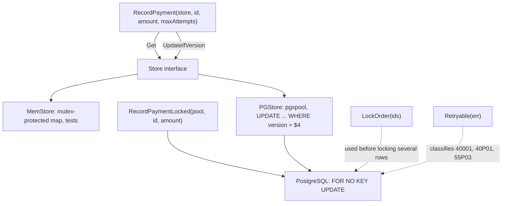
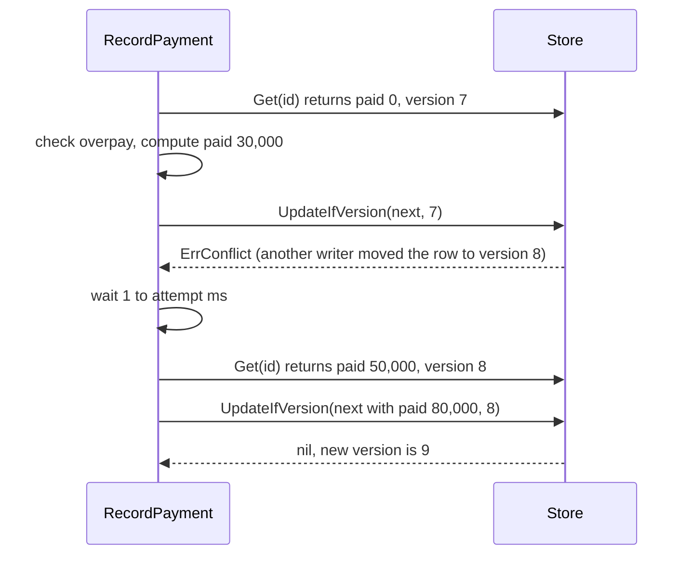
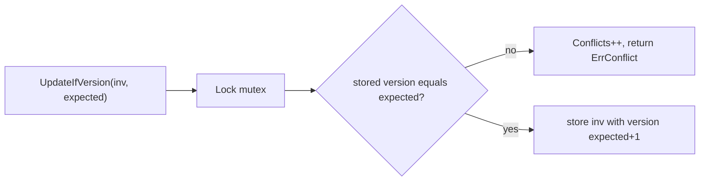
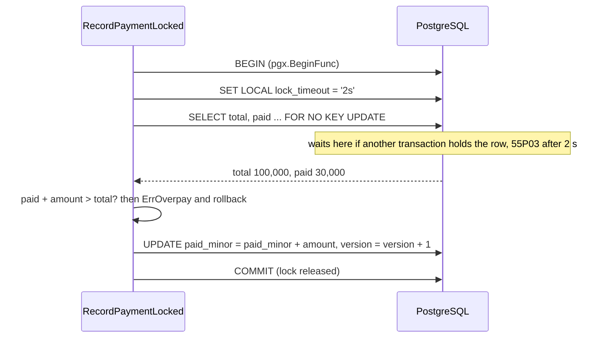
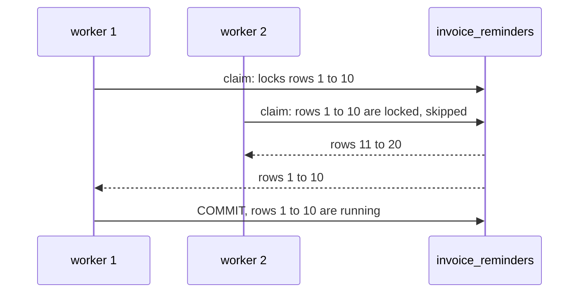

# Locking - Optimistic vs Pessimistic - Go

> [!summary] TL;DR
> Runnable Go for [[Locking - Optimistic vs Pessimistic]]: an optimistic `RecordPayment` loop that re-reads and retries when the version check fails, an in-memory store that behaves like the SQL `UPDATE … WHERE id = $1 AND version = $2`, a PostgreSQL store, the pessimistic alternative with `FOR NO KEY UPDATE` and `lock_timeout`, a lock-ordering helper, an error classifier, and the `SKIP LOCKED` job-queue SQL. The optimistic logic and its 50-goroutine race test run without a database.

## Before the code 🟢

> [!info] How to read this note (pick your level)
> - 🟢 **New to this?** Read "From zero" below, then "Before the code", "What this code shows" and Step 1 only.
> - 🟡 **Know the basics?** Add Steps 2-4 and the Tests.
> - 🔴 **Interview / SDE-3 prep?** Add Design decisions, Pitfalls and the Exercises. Headings are tagged 🟢🟡🔴.

**From zero** 🟢 This file is the hands-on half of [[Locking - Optimistic vs Pessimistic]]: working Go code for both cures to the lost-update bug. The heart of it is one small loop, `RecordPayment`, that reads an invoice, does the maths, and writes back only if the row's version number has not moved; if it has, the loop re-reads and tries again. The same loop runs against a tiny in-memory store (for tests, no database needed) and against real PostgreSQL, and the file ends with the pessimistic lock-first version and the job-queue SQL. Read the theory note first, then follow the steps in order; the tests show the 50-writers race actually coming out right.

- **Interfaces**: `Store` has only `Get` and `UpdateIfVersion`, so the same `RecordPayment` works with memory or PostgreSQL.
- **Sentinel errors**: `ErrConflict` and `ErrOverpay` are compared with `errors.Is` to decide "retry" or "stop".
- **`sync.Mutex`**: the in-memory store guards its map so the version check and write are one atomic step.
- **Goroutines and `sync.WaitGroup`**: the race test fires 50 payments at once and waits for all.
- **`context.Context`**: every database call can be cancelled; `pgx` transactions use it too.
- **Run**: `go mod tidy && go vet ./... && go test -race -v ./...` (no database needed).

## What this code shows 🟢

| Code | Theory concept | Where it is explained |
| --- | --- | --- |
| `RecordPayment` | The optimistic loop: read, compute, `UPDATE … WHERE version = $n`, retry on 0 rows | [[Locking - Optimistic vs Pessimistic#3.2 Optimistic: the version column]] |
| `MemStore` | A store whose `UpdateIfVersion` has the same semantics as the SQL, so the logic is testable without a database | [[Locking - Optimistic vs Pessimistic#3.2 Optimistic: the version column]] |
| `PGStore.UpdateIfVersion` | `RowsAffected() == 0` means "someone beat you" | [[Locking - Optimistic vs Pessimistic#3.2 Optimistic: the version column]] |
| `RecordPaymentLocked` | Pessimistic: `FOR NO KEY UPDATE`, `SET LOCAL lock_timeout`, decide, update | [[Locking - Optimistic vs Pessimistic#3.1 Pessimistic: row locks in PostgreSQL]] |
| `LockOrder` | Lock several rows in one global order to avoid deadlocks | [[Locking - Optimistic vs Pessimistic#3.3 Deadlocks and lock ordering]] |
| `Retryable` | `40001`, `40P01` and `55P03` mean "retry the whole transaction" | [[Locking - Optimistic vs Pessimistic#3.3 Deadlocks and lock ordering]] |
| SKIP LOCKED SQL | Many workers claim jobs without blocking each other | [[Locking - Optimistic vs Pessimistic#The SKIP LOCKED job queue]] |



The `Store` interface is the seam. The optimistic loop depends only on it, so the same business logic runs against an in-memory map in tests and against PostgreSQL in production. The pessimistic function is separate because it needs a real transaction with a held lock, which no in-memory fake can imitate faithfully.

## Setup 🟢

- Module `example.com/locking`, one package `locking` with five files: `optimistic.go` (types, `Store`, `RecordPayment`), `memstore.go`, `pgstore.go` (PostgreSQL store, pessimistic variant, `LockOrder`, `Retryable`), `locking_test.go`.
- Go 1.24. The only dependency is `github.com/jackc/pgx/v5` (v5.7.2 for the measured run), used by `pgstore.go` and the classifier test.
- The tests need no database; `PGStore` and `RecordPaymentLocked` were compiled and vetted but not run against PostgreSQL here.
- Run it:

```bash
go mod tidy
go vet ./...
go test -race -v ./...
```

## Code 🟡

### Step 1: the optimistic loop

**In plain words:** the whole optimistic idea as one small function: read, check the business rule, write only if the version is unchanged, and on a clash wait a moment and start over.

**Concept.** Optimistic locking assumes conflicts are rare: read the row with its `version`, compute the change, and write only if the version is unchanged ([[Locking - Optimistic vs Pessimistic#3.2 Optimistic: the version column]]).

If another writer got there first the write matches zero rows, and the caller re-reads and tries again.

The pessimistic alternative holds a lock from the read to the commit and is covered in step 3. The optimistic form was chosen for the main loop because no lock is held while the application thinks, and it works across several requests (a form that was open for minutes).

The loop depends only on a two-method `Store`, so it can be tested with an in-memory store. Business-rule failures (`ErrOverpay`) are returned at once; only `ErrConflict` is retried.

The sentinel errors and the row type:

```go
package locking

import (
	"context"
	"errors"
	"math/rand/v2"
	"time"
)

var (
	ErrConflict = errors.New("version conflict: row changed since it was read")
	ErrNotFound = errors.New("invoice not found")
	ErrOverpay  = errors.New("payment exceeds amount due")
	ErrGaveUp   = errors.New("too many version conflicts")
)

type Invoice struct {
	ID         int64
	TotalMinor int64
	PaidMinor  int64
	Status     string
	Version    int64
}
```

**How it works.**

1. Four sentinel errors give callers distinct outcomes to test with `errors.Is`: retryable (`ErrConflict`), missing row, business rejection, and exhausted retries.
2. Amounts are `int64` minor units (paise, cents), never floats, so addition is exact.
3. `Version` is an ordinary integer that every successful write increments by one.

The `Store` interface is the only thing the loop knows about storage:

```go
// Store is the small slice of the repository that optimistic locking needs.
type Store interface {
	Get(ctx context.Context, id int64) (Invoice, error)
	// UpdateIfVersion writes inv only if the stored version still equals
	// expected, and bumps the version. It returns ErrConflict otherwise.
	UpdateIfVersion(ctx context.Context, inv Invoice, expected int64) error
}
```



The first half of `RecordPayment` reads the invoice, rejects an overpayment as a business error, and computes the new values:

```go
// RecordPayment is a read-modify-write protected by a version check.
// On a conflict it re-reads and retries with jittered backoff.
func RecordPayment(ctx context.Context, s Store, id, amountMinor int64, maxAttempts int) (Invoice, error) {
	for attempt := 1; attempt <= maxAttempts; attempt++ {
		cur, err := s.Get(ctx, id)
		if err != nil {
			return Invoice{}, err
		}
		if cur.PaidMinor+amountMinor > cur.TotalMinor {
			return Invoice{}, ErrOverpay // a business rule, never retried
		}
		next := cur
		next.PaidMinor += amountMinor
		next.Status = "partially_paid"
		if next.PaidMinor == next.TotalMinor {
			next.Status = "paid"
		}
```

**How it works.**

1. Each loop iteration starts with a fresh `Get`, so after a conflict the new attempt sees the latest paid amount and version.
2. The overpay check sits inside the loop: another writer's payment may have used up the balance since the last attempt.
3. `next := cur` copies the struct (a value, not a pointer), so `cur.Version` is still available as the expected version.
4. The status is derived from the amounts, never supplied by the caller, so it cannot contradict them.

The second half writes with the version check. Success returns the new invoice, a conflict waits a jittered few milliseconds and loops, and any other error is returned:

```go
		err = s.UpdateIfVersion(ctx, next, cur.Version)
		if err == nil {
			next.Version = cur.Version + 1
			return next, nil
		}
		if !errors.Is(err, ErrConflict) {
			return Invoice{}, err
		}
		// Someone else won the race: wait 0..attempt ms, then re-read.
		wait := time.Duration(rand.IntN(attempt*1000)+1) * time.Microsecond
		select {
		case <-ctx.Done():
			return Invoice{}, ctx.Err()
		case <-time.After(wait):
		}
	}
	return Invoice{}, ErrGaveUp
}
```

**How it works.**

1. `UpdateIfVersion(ctx, next, cur.Version)` passes the version that was read, which is the whole optimistic check.
2. On success the returned invoice carries `Version: cur.Version + 1`, matching what the store wrote.
3. `errors.Is(err, ErrConflict)` separates "lost the race" from real failures (connection errors, `ErrNotFound`), which are returned immediately.
4. The wait is between 1 and `attempt*1000` microseconds, so it grows with the attempt number; jitter keeps 50 competing goroutines from retrying in lock-step.
5. The `select` honours cancellation. After `maxAttempts` conflicts the loop ends with `ErrGaveUp`.

### Step 2: an in-memory store with the same semantics as the SQL

**In plain words:** a toy database made of a Go map and a mutex, built to reject stale versions exactly the way the real SQL does, so the loop can be tested with no database at all.

**Concept.** The version check is simple enough to reproduce exactly in memory: compare under a mutex, then write.

This gives a test double with the same contract as `UPDATE … WHERE id = $1 AND version = $2` evaluated under a row lock ([[Locking - Optimistic vs Pessimistic#3.2 Optimistic: the version column]]).

A mock library that returns scripted answers would be an alternative, but it cannot produce real interleavings; a store with real semantics lets 50 goroutines race and still be checked by the final state. The mutex plays the role of the row lock.

The constructor and the type, with a `Conflicts` counter for the tests:

```go
package locking

import (
	"context"
	"sync"
)

// MemStore behaves like the SQL
// UPDATE ... WHERE id = $1 AND version = $2 used by PGStore.
type MemStore struct {
	mu        sync.Mutex
	rows      map[int64]Invoice
	Conflicts int
}

func NewMemStore(rows ...Invoice) *MemStore {
	m := &MemStore{rows: make(map[int64]Invoice)}
	for _, r := range rows {
		m.rows[r.ID] = r
	}
	return m
}
```

`Get` copies a row under the mutex, and `UpdateIfVersion` is the in-memory twin of the SQL: it compares versions, counts a conflict, or stores the row with the next version:

```go
func (m *MemStore) Get(_ context.Context, id int64) (Invoice, error) {
	m.mu.Lock()
	defer m.mu.Unlock()
	inv, ok := m.rows[id]
	if !ok {
		return Invoice{}, ErrNotFound
	}
	return inv, nil
}

func (m *MemStore) UpdateIfVersion(_ context.Context, inv Invoice, expected int64) error {
	m.mu.Lock()
	defer m.mu.Unlock()
	cur, ok := m.rows[inv.ID]
	if !ok {
		return ErrNotFound
	}
	if cur.Version != expected { // "0 rows affected"
		m.Conflicts++
		return ErrConflict
	}
	inv.Version = expected + 1
	m.rows[inv.ID] = inv
	return nil
}
```

**How it works.**

1. The variadic constructor `NewMemStore(rows ...Invoice)` makes test setup one line.
2. `Get` returns the `Invoice` by value, so the caller holds a private copy and cannot mutate the stored row without going through `UpdateIfVersion`.
3. `defer m.mu.Unlock()` releases the lock on every path. Compare-and-write happen in one critical section, which is what makes the check atomic.
4. A version mismatch plays the part of "0 rows affected": it increments `Conflicts` (so tests can see how many races happened) and returns `ErrConflict` without writing.
5. On a match the store sets the next version itself, like `version = version + 1` in the SQL.



### Step 3: the PostgreSQL side

**In plain words:** the same two store methods done with real SQL, plus the lock-first alternative, the lock-several-rows-in-order helper, and the "is this error worth retrying?" classifier.

**Concept.** The same two-method contract is implemented over PostgreSQL, plus the pessimistic alternative, lock ordering and an error classifier. The version column is added once:

```sql
ALTER TABLE invoices ADD COLUMN version bigint NOT NULL DEFAULT 0;
```

`PGStore` is the production twin of `MemStore`: the `WHERE version = $4` clause makes the database do the compare-and-write atomically, and `RowsAffected() == 0` is the signal for a lost race ([[Locking - Optimistic vs Pessimistic#3.2 Optimistic: the version column]]). A pool (`pgxpool.Pool`) is enough because each call is a single statement; no explicit transaction is needed.

The imports and the PostgreSQL store type:

```go
package locking

import (
	"context"
	"errors"
	"slices"

	"github.com/jackc/pgx/v5"
	"github.com/jackc/pgx/v5/pgconn"
	"github.com/jackc/pgx/v5/pgxpool"
)

type PGStore struct{ Pool *pgxpool.Pool }
```

`Get` maps `pgx.ErrNoRows` to `ErrNotFound`:

```go
func (p PGStore) Get(ctx context.Context, id int64) (Invoice, error) {
	var inv Invoice
	err := p.Pool.QueryRow(ctx,
		`SELECT id, total_minor, paid_minor, status, version
		   FROM invoices WHERE id = $1`, id).
		Scan(&inv.ID, &inv.TotalMinor, &inv.PaidMinor, &inv.Status, &inv.Version)
	if errors.Is(err, pgx.ErrNoRows) {
		return Invoice{}, ErrNotFound
	}
	return inv, err
}
```

`UpdateIfVersion` turns zero affected rows into `ErrConflict`:

```go
func (p PGStore) UpdateIfVersion(ctx context.Context, inv Invoice, expected int64) error {
	tag, err := p.Pool.Exec(ctx,
		`UPDATE invoices
		    SET paid_minor = $2, status = $3, version = version + 1, updated_at = now()
		  WHERE id = $1 AND version = $4`,
		inv.ID, inv.PaidMinor, inv.Status, expected)
	if err != nil {
		return err
	}
	if tag.RowsAffected() == 0 {
		return ErrConflict // the row moved on (or was deleted) since we read it
	}
	return nil
}
```

**How it works.**

1. `QueryRow(...).Scan(...)` reads the five columns, including `version`, into the struct. The `$1` placeholder is bound by the driver, so there is no string concatenation.
2. `pgx.ErrNoRows` is translated into the domain error `ErrNotFound`, so callers never import pgx to interpret it.
3. In `UpdateIfVersion` the `WHERE id = $1 AND version = $4` clause is the optimistic check, evaluated by PostgreSQL on the latest committed row.
4. `version = version + 1` is computed in SQL, so the new version cannot drift from the stored one.
5. `tag.RowsAffected()` is the command tag's row count; zero means either the version moved on or the row was deleted. The function maps both to `ErrConflict`.

The pessimistic alternative locks the row first and then decides. The diagram shows the single transaction:



**Concept.** `SELECT ... FOR NO KEY UPDATE` takes a row lock that blocks other writers but still lets foreign-key checks on the row proceed ([[Locking - Optimistic vs Pessimistic#3.1 Pessimistic: row locks in PostgreSQL]]), which makes it the right default over `FOR UPDATE`.

Whoever holds the lock decides on data nobody else can change, so no retry loop is needed. The price is that the lock is held until commit, so `lock_timeout` bounds how long a request waits.

Pessimistic locking is chosen when conflicts are frequent or when the work cannot be repeated; optimistic when they are rare.

The first half runs in one transaction: set a lock timeout, lock the row with `FOR NO KEY UPDATE` and read the amounts:

```go
// RecordPaymentLocked is the pessimistic version: lock the row, then decide.
func RecordPaymentLocked(ctx context.Context, pool *pgxpool.Pool, id, amountMinor int64) error {
	return pgx.BeginFunc(ctx, pool, func(tx pgx.Tx) error {
		if _, err := tx.Exec(ctx, `SET LOCAL lock_timeout = '2s'`); err != nil {
			return err
		}
		var total, paid int64
		err := tx.QueryRow(ctx,
			`SELECT total_minor, paid_minor FROM invoices
			  WHERE id = $1 FOR NO KEY UPDATE`, id).Scan(&total, &paid)
		if errors.Is(err, pgx.ErrNoRows) {
			return ErrNotFound
		}
		if err != nil {
			return err
		}
```

The second half applies the business rule and updates with arithmetic in SQL and a version bump:

```go
		if paid+amountMinor > total {
			return ErrOverpay
		}
		status := "partially_paid"
		if paid+amountMinor == total {
			status = "paid"
		}
		_, err = tx.Exec(ctx,
			`UPDATE invoices SET paid_minor = paid_minor + $2, status = $3,
			        version = version + 1, updated_at = now()
			  WHERE id = $1`, id, amountMinor, status)
		return err
	})
}
```

**How it works.**

1. `pgx.BeginFunc` begins, runs the closure, commits on `nil` and rolls back on any error, so there is no manual `Rollback`.
2. `SET LOCAL lock_timeout = '2s'` lasts only for this transaction. If another transaction holds the row for longer, the `SELECT` fails with `55P03`, which `Retryable` recognises.
3. `FOR NO KEY UPDATE` blocks until the row is free, then returns the latest committed values. From here until commit nobody else can change the row.
4. The overpay check uses `total` and `paid` that are now guaranteed current, so a payment cannot slip past the limit.
5. The update still bumps `version`, so optimistic writers elsewhere notice that this writer changed the row.

Finally the lock-ordering helper and the error classifier:

```go
// LockOrder returns ids sorted and de-duplicated, so every transaction that
// locks several rows takes them in the same order and cannot deadlock.
func LockOrder(ids []int64) []int64 {
	out := slices.Clone(ids)
	slices.Sort(out)
	return slices.Compact(out)
}

// Retryable reports PostgreSQL errors worth retrying the whole transaction:
// 40001 serialization_failure, 40P01 deadlock_detected, 55P03 lock_not_available.
func Retryable(err error) bool {
	var pgErr *pgconn.PgError
	if !errors.As(err, &pgErr) {
		return false
	}
	switch pgErr.Code {
	case "40001", "40P01", "55P03":
		return true
	}
	return false
}
```

**Concept.** A deadlock needs two transactions that lock the same rows in opposite orders ([[Locking - Optimistic vs Pessimistic#3.3 Deadlocks and lock ordering]]). If every transaction takes its locks in ascending id order, a cycle cannot form. Detecting deadlocks and retrying is the fallback; ordering prevents most of them.

**How it works.**

1. `slices.Clone` copies the input, so the caller's slice is not reordered behind its back.
2. `slices.Sort` puts ids in ascending order, the global order all transactions share.
3. `slices.Compact` removes adjacent duplicates, which after sorting means all duplicates.
4. `Retryable` uses `errors.As` for the `*pgconn.PgError` and an allow-list: `40001`, `40P01` and `55P03` (lock timeout) mean the transaction can be re-run.

Note that the pessimistic version still bumps `version`. Mixing styles is fine as long as every writer bumps it; a writer that forgets would let an optimistic writer overwrite its change.

### Step 4: the SKIP LOCKED job queue in SQL

**In plain words:** the one statement that lets many workers share a to-do table: each claims the next few unclaimed rows and skips, rather than waits on, rows another worker holds.

**Concept.** A job table with many workers is a contention hot spot if every worker waits for the same first row.

`FOR UPDATE SKIP LOCKED` makes each worker skip rows another worker has locked, so workers take disjoint batches without waiting ([[Locking - Optimistic vs Pessimistic#The SKIP LOCKED job queue]]).

Worker 1 locks the first 10 due rows; worker 2, running the same query a millisecond later, skips those 10 and gets the next 10. If a worker crashes while this statement's transaction is still open, the transaction rolls back and the rows become claimable again.

Once the claim has committed, the rows stay `running`, so a reaper must reset rows whose `locked_at` is too old. Retries, visibility timeouts and dead-letter handling belong to [[Background Workers and Job Queues]].

```sql
WITH next AS (
  SELECT id FROM invoice_reminders
   WHERE status = 'pending' AND run_at <= now()
   ORDER BY run_at
   LIMIT 10
   FOR UPDATE SKIP LOCKED
)
UPDATE invoice_reminders r
   SET status = 'running', locked_at = now()
  FROM next
 WHERE r.id = next.id
RETURNING r.id, r.invoice_id;
```

**How it works.**

1. The CTE `next` selects up to 10 due pending rows in `run_at` order and row-locks them. `SKIP LOCKED` silently omits rows that are already locked by someone else.
2. The outer `UPDATE ... FROM next` flips exactly those rows to `running` and stamps `locked_at`, so a reaper can find stale claims later.
3. `RETURNING` hands the claimed ids back to the worker in the same round trip, so claim and fetch cannot disagree.
4. Two workers running concurrently get disjoint sets. Nobody waits and no job is claimed twice.



## Design decisions 🔴

| Decision | Alternative | Trade-off |
| --- | --- | --- |
| Optimistic version check as the main strategy | Hold row locks for the whole read-modify-write | No lock held while the application works and it spans requests; costs retries under contention |
| `Store` interface with two methods | Call pgx directly in `RecordPayment` | Logic is testable in memory; one more layer to maintain |
| `MemStore` with real compare-and-write under a mutex | Scripted mock returning canned errors | Real interleavings in tests; does not model isolation levels or lock waits |
| Retry only `ErrConflict` | Retry every error | Business errors (`ErrOverpay`) and connection failures surface at once |
| Business rule re-checked inside the retry loop | Check once before the loop | The fresh read after a conflict may change the answer; the loop is correct at the cost of one extra comparison |
| Jitter that grows with the attempt number (`attempt*1000` microseconds) | Fixed or exponential backoff | Spreads in-process races cheaply; too short for a loaded database |
| `FOR NO KEY UPDATE` | `FOR UPDATE` | Does not block foreign-key checks from child inserts; use `FOR UPDATE` only if the key may change |
| `SET LOCAL lock_timeout = '2s'` | Wait indefinitely | A request fails fast with `55P03` instead of piling up; needs a retry or an error response |
| `LockOrder` sorts and de-duplicates ids | Rely on deadlock detection (`40P01`) | Prevents most deadlocks outright; detection after `deadlock_timeout` is still the fallback |
| `SKIP LOCKED` job claim | `ORDER BY ... LIMIT 1 FOR UPDATE` per worker | Workers do not wait on each other; strict global order is lost |

## Tests 🟡

The tests: a deterministic replay of the lost-update interleaving, 50 goroutines paying at once, the no-retry rule for business errors, lock ordering and the error classifier. All of them use `MemStore` or pure functions, so no database is needed.

The test file starts with its package clause and imports. `sync` is for the goroutine test, `slices` for the lock-order test, and `pgconn` to build fake PostgreSQL errors without a server:

```go
package locking

import (
	"context"
	"errors"
	"fmt"
	"slices"
	"sync"
	"testing"

	"github.com/jackc/pgx/v5/pgconn"
)
```

| Test | Style | Why it can run without PostgreSQL |
| --- | --- | --- |
| `TestStaleVersionIsRejected` | deterministic replay | `MemStore` has the same compare-and-write contract as the SQL |
| `TestConcurrentPaymentsAllLand` | real goroutines, `-race` | the mutex stands in for the row lock |
| `TestOverpayNotRetried` | single call | the business rule lives in `RecordPayment`, not in the store |
| `TestLockOrder`, `TestRetryable` | pure functions | no I/O at all |

### TestStaleVersionIsRejected

**In plain words:** write with yesterday's version number and check the store says no.

**Property.** An update based on a stale version is rejected, and the first writer's change survives. This is the lost-update scenario replayed without any concurrency, so it is fully deterministic and shows exactly what the version check prevents.

| Step | Action | Result |
| --- | --- | --- |
| 1 | A and B both `Get` the invoice | both hold version 7, paid 0 |
| 2 | A adds 30,000 and calls `UpdateIfVersion(a, 7)` | success, stored version 8 |
| 3 | B adds 50,000 and calls `UpdateIfVersion(b, 7)` | `ErrConflict` |
| 4 | `Get` | paid 30,000, version 8 |

```go
func TestStaleVersionIsRejected(t *testing.T) {
	ctx := context.Background()
	s := NewMemStore(Invoice{ID: 1, TotalMinor: 100_000, Status: "sent", Version: 7})

	a, _ := s.Get(ctx, 1) // request A reads version 7
	b, _ := s.Get(ctx, 1) // request B reads version 7

	a.PaidMinor += 30_000
	if err := s.UpdateIfVersion(ctx, a, a.Version); err != nil {
		t.Fatalf("A: %v", err)
	}
	b.PaidMinor += 50_000
	if err := s.UpdateIfVersion(ctx, b, b.Version); !errors.Is(err, ErrConflict) {
		t.Fatalf("B: want ErrConflict, got %v", err) // without the check, A's 30,000 is lost
	}
	got, _ := s.Get(ctx, 1)
	if got.PaidMinor != 30_000 || got.Version != 8 {
		t.Fatalf("got paid=%d version=%d", got.PaidMinor, got.Version)
	}
}
```

If B's write is accepted, A's 30,000 is overwritten (the paid amount would read 50,000), which is exactly the lost update the version column exists to stop. If the final version is not 8, the store bumps the version wrongly, so later writers would be mis-detected.

### TestConcurrentPaymentsAllLand

**In plain words:** fire 50 payments at one invoice at the same time and check that every single one lands: the total is exact and the version moved exactly 50 times.

**Property.** Under real concurrency with `-race`, no payment is lost and none is applied twice: 50 goroutines each pay 2,000 against an invoice of 100,000, and the loop's retries make every one of them land. It also checks that `RecordPayment` is free of data races.

| Input | Expected final state |
| --- | --- |
| 50 goroutines, each `RecordPayment(+2,000, maxAttempts 1000)` | `PaidMinor == 100_000`, `Status == "paid"`, `Version == 50`, no errors |

```go
func TestConcurrentPaymentsAllLand(t *testing.T) {
	ctx := context.Background()
	const n, each = 50, 2_000
	s := NewMemStore(Invoice{ID: 1, TotalMinor: n * each, Status: "sent"})

	var wg sync.WaitGroup
	errs := make(chan error, n)
	for range n {
		wg.Add(1)
		go func() {
			defer wg.Done()
			if _, err := RecordPayment(ctx, s, 1, each, 1000); err != nil {
				errs <- err
			}
		}()
	}
	wg.Wait()
	close(errs)
```

After `wg.Wait()` every goroutine has finished, so the channel can be closed and drained, and the final state can be read without further synchronisation:

```go
	for err := range errs {
		t.Fatal(err)
	}
	got, _ := s.Get(ctx, 1)
	if got.PaidMinor != n*each || got.Status != "paid" || got.Version != n {
		t.Fatalf("got %+v", got)
	}
	t.Logf("%d conflicts retried", s.Conflicts)
}
```

The version must equal 50 because each of the 50 successful writes bumps it exactly once, however many conflicts happened on the way.

A `PaidMinor` below 100,000 means a lost update; an error from a goroutine means the attempt budget or the retry path is broken; a race report means the shared state is not protected.

The conflict count is only logged, because it varies from run to run.

### TestOverpayNotRetried

**Property.** A payment that would exceed the amount due fails at once with `ErrOverpay`. Business rejections must not be retried: retrying cannot change the answer.

| Invoice | Payment | `maxAttempts` | Expected |
| --- | --- | --- | --- |
| total 1,000, paid 900 | 200 | 5 | `ErrOverpay` on the first attempt |

```go
func TestOverpayNotRetried(t *testing.T) {
	s := NewMemStore(Invoice{ID: 1, TotalMinor: 1_000, PaidMinor: 900})
	if _, err := RecordPayment(context.Background(), s, 1, 200, 5); !errors.Is(err, ErrOverpay) {
		t.Fatalf("want ErrOverpay, got %v", err)
	}
}
```

A failure that returns `ErrGaveUp` instead would mean the loop treated a business error as a conflict. A failure that returns `nil` would mean an overpayment was recorded.

### TestLockOrder

**Property.** Ids come back sorted ascending and without duplicates, which is what makes lock acquisition order identical across transactions.

| Input | Expected |
| --- | --- |
| `[42, 7, 42, 13]` | `[7, 13, 42]` |

```go
func TestLockOrder(t *testing.T) {
	if got := LockOrder([]int64{42, 7, 42, 13}); !slices.Equal(got, []int64{7, 13, 42}) {
		t.Fatalf("got %v", got)
	}
}
```

An unsorted result would reintroduce the lock-order deadlock between a transaction that locks 7 then 42 and one that locks 42 then 7. A result that still contains 42 twice means duplicates survive.

### TestRetryable

**In plain words:** feed the classifier the three retryable database errors plus some that are not, and check it sorts them correctly.

**Property.** The classifier accepts `40001`, `40P01` and `55P03`, rejects other codes such as `23505`, and works when the error is wrapped. A plain non-database error is never retryable.

| Error | Expected `Retryable` |
| --- | --- |
| `commit: %w` wrapping `40001` | true |
| wrapping `40P01` | true |
| wrapping `55P03` | true |
| wrapping `23505` | false |
| `errors.New("plain")` | false |

```go
func TestRetryable(t *testing.T) {
	cases := map[string]bool{"40001": true, "40P01": true, "55P03": true, "23505": false}
	for code, want := range cases {
		err := fmt.Errorf("commit: %w", &pgconn.PgError{Code: code})
		if Retryable(err) != want {
			t.Errorf("%s: want %v", code, want)
		}
	}
	if Retryable(errors.New("plain")) {
		t.Error("plain error must not be retryable")
	}
}
```

A failure on a true case means a transient error would surface to users instead of being retried; a failure on `23505` means a permanent error would be retried until the budget is spent.

### Running it

Measured: `go vet` is clean and `go test -race` passes with Go 1.24.4 and pgx v5.7.2 (scratch module). The 50-goroutine test logged 8 retried conflicts in this run (3 in an earlier run); the number varies run to run, which is why the test asserts only the final state (`paid_minor = 100000`, `version = 50`).

```text
=== RUN   TestStaleVersionIsRejected
--- PASS: TestStaleVersionIsRejected (0.00s)
=== RUN   TestConcurrentPaymentsAllLand
    locking_test.go:58: 8 conflicts retried
--- PASS: TestConcurrentPaymentsAllLand (0.00s)
=== RUN   TestOverpayNotRetried
--- PASS: TestOverpayNotRetried (0.00s)
=== RUN   TestLockOrder
--- PASS: TestLockOrder (0.00s)
=== RUN   TestRetryable
--- PASS: TestRetryable (0.00s)
PASS
ok  	example.com/locking
```

**Reading the output.**

1. Each test prints `=== RUN` and then `--- PASS` with its wall time. All finish in well under 10 ms.
2. The indented line `locking_test.go:58: 8 conflicts retried` comes from `t.Logf` inside `TestConcurrentPaymentsAllLand`. It shows that 8 of the 50 first attempts lost a race and were retried. The number is not deterministic (it was 3 in an earlier run); only the final state is asserted.
3. `TestStaleVersionIsRejected` has no log line because it is deterministic: exactly one conflict, by construction.
4. `PASS` followed by `ok example.com/locking` means all five tests passed with the race detector enabled and no data race was found, which confirms that the mutex in `MemStore` protects the shared map.

## Pitfalls in the code 🔴

- **`MemStore` is not a database.** It reproduces the version-check semantics, not isolation levels, lock waits or deadlocks. `PGStore` and `RecordPaymentLocked` need a real PostgreSQL to test lock timeouts.
- **`UpdateIfVersion` returns the same `ErrConflict` for "row changed" and "row deleted".** The Postgres store cannot tell them apart from `RowsAffected() == 0`; the retry's `Get` then returns `ErrNotFound`.
- **`RecordPayment` re-checks the business rule on every attempt.** After a conflict the fresh read may now make the payment an overpayment; that is why the check sits inside the loop.
- **The jitter is a few milliseconds.** The wait grows only with the attempt number (`attempt*1000` microseconds), which suits an in-process race but is too short for a loaded database; use a larger base there.
- **`SET LOCAL` must run inside the transaction.** On a pooled connection outside `BeginFunc` it would be a no-op for the next statement's connection.
- **Every writer must bump `version`.** One code path that updates `paid_minor` without `version = version + 1` silently disables the optimistic check for everyone else.
- **At REPEATABLE READ the conflict arrives as `40001`, not as 0 rows.** `PGStore.UpdateIfVersion` would return that error unchanged; `Retryable` is the place to treat it as a conflict.

## Exercises 🔴

1. Change `maxAttempts` in `TestConcurrentPaymentsAllLand` from 1000 to 2. Predict whether the test still passes and what error some goroutines return, then run it several times with `-race`.
2. Remove `slices.Compact` from `LockOrder`. Predict the result for `LockOrder([]int64{42, 7, 42, 13})` and why a duplicate id in a `FOR UPDATE` list is a problem even though PostgreSQL tolerates it.
3. In `MemStore.UpdateIfVersion`, delete the `m.Conflicts++` line and the `expected` comparison so every write succeeds. Predict which test fails first.

## Links 🟢

- Theory: [[Locking - Optimistic vs Pessimistic]]
- **Before this:** [[Isolation Levels and MVCC - Go]], [[Transactions and ACID - Go]]
- **Next:** [[Background Workers and Job Queues]], [[Distributed Locks and Fencing Tokens]]
