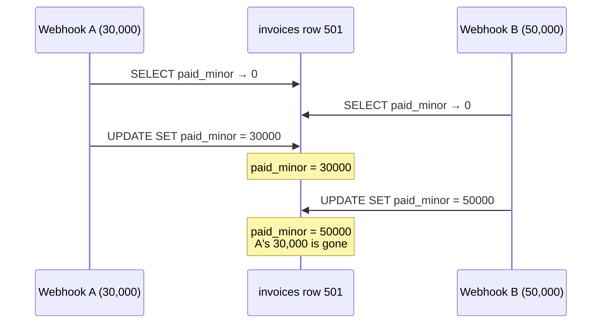
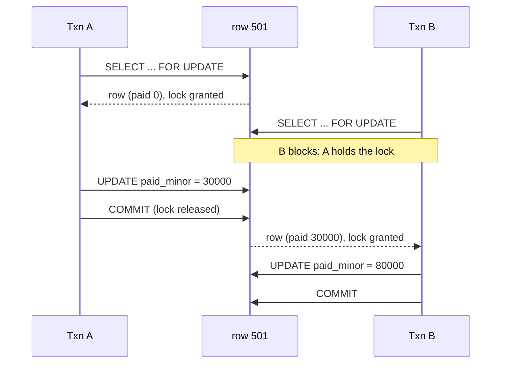
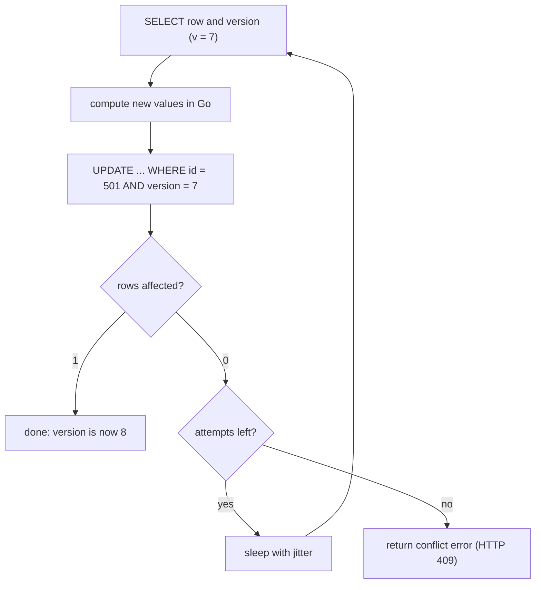
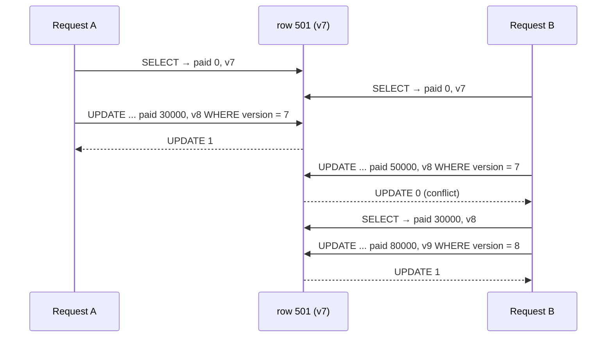
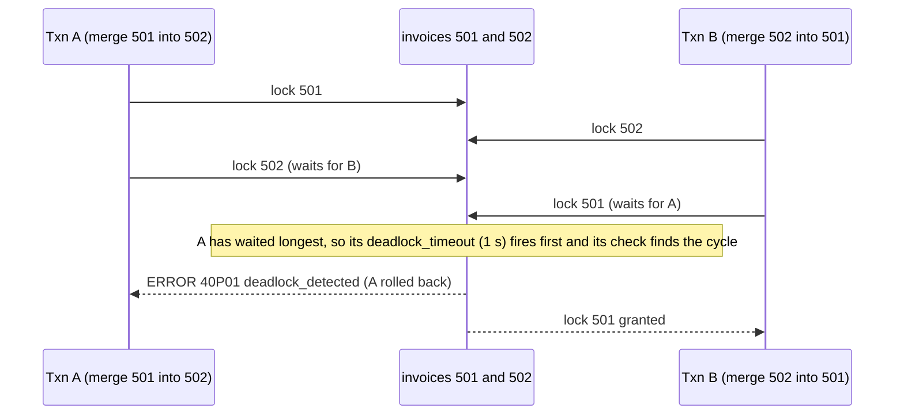

# Locking - Optimistic vs Pessimistic

> [!summary] TL;DR
> When two requests read a row, change it in application code and write it back at the same time, one change can silently overwrite the other. **Pessimistic locking** stops this by locking the row before reading it (`SELECT … FOR UPDATE`), so the second request waits. **Optimistic locking** lets both proceed and adds a `version` column: the write succeeds only if the version is unchanged, and the loser re-reads and retries.

> [!abstract] Core idea
> - The bug being prevented is the **lost update**: read, compute in the app, write back, while someone else does the same.
> - Pessimistic: take a row lock first (`FOR UPDATE`, `FOR NO KEY UPDATE`); others wait, give up (`NOWAIT`, `lock_timeout`) or skip the row (`SKIP LOCKED`).
> - Optimistic: `UPDATE … WHERE id = $1 AND version = $2`; zero rows affected means "someone beat you, re-read and retry".
> - Pick by contention: rare conflicts favour optimistic, hot rows and expensive retries favour pessimistic.
> - Whenever a transaction locks more than one row, lock in a fixed order (for example by id) to avoid deadlocks.

## 1. Why it exists

InvoiceOps records payments against invoices. Invoice 501 has `total_minor = 100000` (₹1,000.00 in paise, the minor unit) and nothing paid yet. Two payment webhooks arrive within the same 5 ms, one for 30,000 and one for 50,000. The handler does what most first versions do:

1. `SELECT paid_minor FROM invoices WHERE id = 501` → 0
2. compute `0 + amount` in Go
3. `UPDATE invoices SET paid_minor = <computed> WHERE id = 501`



The customer paid 80,000 and the invoice says 50,000. No error was raised, no constraint failed, and the default isolation level (READ COMMITTED in PostgreSQL, see [[Isolation Levels and MVCC]]) allows it. This is the **lost update** anomaly. A **read-modify-write** cycle (read a value, change it in the application, write it back) is exposed to it whenever two copies of the cycle overlap.

Before reaching for locks, note the cheapest fix: if the change can be expressed in SQL, let the database do the arithmetic.

```sql
UPDATE invoices SET paid_minor = paid_minor + 30000 WHERE id = 501;
```

A single `UPDATE` reads the latest committed row under a row lock, so two of these never lose each other's increment, even at READ COMMITTED. Locking is needed when the decision cannot be written in one statement: the code must check rules ("is the invoice cancelled?", "would this overpay?"), call another system, or update several rows consistently.

## 2. Mental model

- **Pessimistic locking** assumes a conflict will happen, so it prevents one. You take a lock on the row before you read it; anyone else who wants to change that row waits until you commit or roll back.
- **Optimistic locking** assumes a conflict is rare, so it detects one. Nothing waits. Every row carries a version number; you remember the version you read, and your write says "only if the version is still N". If someone got there first, your write matches zero rows and you start again.

Analogy: a pessimistic writer checks a library book out, so nobody else can edit it until it comes back. An optimistic writer edits a photocopy and, when handing it in, the librarian checks the edition number; if a newer edition appeared meanwhile, the writer must redo the edit on the new edition.

Both are correct. They differ in who pays: pessimistic makes the second request wait (and holds a database connection while it waits); optimistic makes the second request redo its work.

## 3. How it works

### 3.1 Pessimistic: row locks in PostgreSQL

A **row lock** is a lock on one row version, taken by a locking read or by `UPDATE`/`DELETE`, and held until the transaction ends. There is no way to release a row lock early, so the lock lives exactly as long as the transaction ([[Transactions and ACID]] covers where transactions begin and end).

```sql
BEGIN;
SELECT total_minor, paid_minor, status
  FROM invoices
 WHERE id = 501
   FOR UPDATE;                       -- waits here if another txn holds a conflicting lock
-- application checks: not cancelled, would not overpay
UPDATE invoices SET paid_minor = paid_minor + 30000, status = 'partially_paid'
 WHERE id = 501;
COMMIT;                              -- lock released
```



At READ COMMITTED, when B's wait ends, PostgreSQL re-reads the newest committed version of the row and re-checks B's `WHERE` clause against it, so B sees 30,000, not the stale 0. At REPEATABLE READ or SERIALIZABLE, B instead fails with SQLSTATE `40001` (`serialization_failure`) if A changed the row, and the application must retry the whole transaction.

PostgreSQL has four row-lock strengths. **FOR KEY SHARE** is what foreign-key checks take on the parent row; "key" here means the columns of a unique index that a foreign key could reference.

| Lock clause | Taken by | Blocks | Does not block |
| --- | --- | --- | --- |
| `FOR UPDATE` | `DELETE`, `UPDATE` of a key column, explicit request | all four | plain `SELECT` (MVCC readers never block) |
| `FOR NO KEY UPDATE` | `UPDATE` that changes no key column, explicit request | `FOR SHARE`, `FOR NO KEY UPDATE`, `FOR UPDATE` | `FOR KEY SHARE`, plain `SELECT` |
| `FOR SHARE` | explicit request | `FOR NO KEY UPDATE`, `FOR UPDATE` | other `FOR SHARE`, `FOR KEY SHARE` |
| `FOR KEY SHARE` | foreign-key checks on the parent row | `FOR UPDATE` | the other three weaker or equal locks |

Practical reading of the table:

- Use **`FOR NO KEY UPDATE`** when you will update non-key columns (the common case, such as `paid_minor`). It is the lock your later `UPDATE` would take anyway, and unlike `FOR UPDATE` it does not block other sessions inserting `payments` rows that reference this invoice through a foreign key.
- Use **`FOR UPDATE`** when you will delete the row or change its key.
- Use **`FOR SHARE`** when you only need the row to stay unchanged while you work, for example to stop a client being deleted while you create an invoice for it. Several transactions can hold it together.

Three modifiers decide what happens when the row is already locked:

| Modifier | Behaviour | Error | Typical use |
| --- | --- | --- | --- |
| (none) | wait until the holder ends | none, or `40P01` on deadlock | short critical sections |
| `NOWAIT` | fail immediately | `55P03` `lock_not_available` | interactive "someone else is editing" |
| `SKIP LOCKED` | silently leave locked rows out of the result | none | job queues with many workers |
| `SET LOCAL lock_timeout = '2s'` | wait at most 2 s per lock | `55P03` | everything else; bounds tail latency |

`lock_timeout` is off (0) by default in PostgreSQL 17, which means a blocked request waits forever, holding a pooled connection. Set it per transaction with `SET LOCAL`, which resets at commit or rollback.

### 3.2 Optimistic: the version column

Add a counter to every row that is edited by read-modify-write:

```sql
ALTER TABLE invoices ADD COLUMN version bigint NOT NULL DEFAULT 0;
```

Every write checks the version it read and bumps it:

```sql
UPDATE invoices
   SET paid_minor = $2, status = $3, version = version + 1, updated_at = now()
 WHERE id = $1 AND version = $4;   -- $4 = the version this request read
```

The database returns the number of rows affected (`UPDATE 1` or `UPDATE 0`). One means you won; zero means the row changed (or was deleted) since you read it.





Why this is safe: the `UPDATE` itself takes a row lock and evaluates `version = 7` against the latest committed row, so two writers can never both match the same version. No lock is held between the `SELECT` and the `UPDATE`, which is why the read can even happen in a separate transaction or a separate HTTP request.

An `updated_at` timestamp is a weaker substitute for a version: two writes in the same clock tick, or clock changes, make it ambiguous. A counter cannot be ambiguous.

### 3.3 Deadlocks and lock ordering

A **deadlock** is a cycle of waits: transaction A holds row 1 and wants row 2, while B holds row 2 and wants row 1. Neither can proceed.



PostgreSQL does not check for deadlocks on every wait. A waiting backend checks only after `deadlock_timeout` (default 1 s), then aborts one transaction in the cycle with SQLSTATE `40P01`. In practice the victim is usually the backend that ran the check, which is the one that started waiting first; do not rely on which side loses. So a deadlock costs about a second of latency and one failed transaction.

The prevention is **lock ordering**: every code path that locks several rows locks them in the same global order, usually ascending primary key. If A and B both lock 501 before 502, B simply waits behind A and no cycle can form.

```sql
SELECT id FROM invoices WHERE id = ANY($1) ORDER BY id FOR NO KEY UPDATE;
```

The `ORDER BY` matters: without it the rows are locked in whatever order the plan returns them.

### 3.4 Advisory locks

An **advisory lock** is a lock on a number that you choose rather than on a row. PostgreSQL enforces nothing about what it protects; your code agrees on what the number means. It is useful as an application mutex when there is no row to lock, for example "only one job may regenerate the monthly statement for workspace 42".

```sql
BEGIN;
SELECT pg_advisory_xact_lock(hashtextextended('statement:42', 0));  -- waits
-- regenerate the statement
COMMIT;                                                             -- released
```

| Function | Scope | Released |
| --- | --- | --- |
| `pg_advisory_xact_lock(key)` | transaction | at commit or rollback, automatically |
| `pg_try_advisory_xact_lock(key)` | transaction | same; returns false instead of waiting |
| `pg_advisory_lock(key)` / `pg_advisory_unlock(key)` | session | only by explicit unlock or disconnect |

Prefer the transaction-scoped form. A session-scoped lock taken through a transaction-pooling proxy such as PgBouncer can stay attached to a server connection that another client then reuses (see [[Connection Pooling]]). Advisory locks protect only work inside one PostgreSQL cluster; for coordination across services, see [[Distributed Locks and Fencing Tokens]].

## 4. Worked example

### Whiteboard version

The bare idea in SQL, both styles:

```sql
-- Pessimistic: lock, check, write, commit.
BEGIN;
SET LOCAL lock_timeout = '2s';
SELECT total_minor, paid_minor FROM invoices WHERE id = 501 FOR NO KEY UPDATE;
-- app: if paid + 30000 > total then ROLLBACK
UPDATE invoices SET paid_minor = paid_minor + 30000 WHERE id = 501;
COMMIT;

-- Optimistic: read, write only if unchanged, retry on 0 rows.
SELECT total_minor, paid_minor, version FROM invoices WHERE id = 501;   -- v = 7
UPDATE invoices SET paid_minor = 30000, version = 8
 WHERE id = 501 AND version = 7;                                       -- UPDATE 0 → re-read
```

### The Go version, tested

The optimistic loop depends only on a two-method `Store`, so it can be tested with an in-memory store that behaves like the SQL above. The PostgreSQL store and the pessimistic variant use pgx v5. The repository shape itself belongs to [[Transactions and the Repository Pattern]]; this note owns the locking logic.

```go
package locking

import (
	"context"
	"errors"
	"math/rand/v2"
	"time"
)

var (
	ErrConflict = errors.New("version conflict: row changed since it was read")
	ErrNotFound = errors.New("invoice not found")
	ErrOverpay  = errors.New("payment exceeds amount due")
	ErrGaveUp   = errors.New("too many version conflicts")
)

type Invoice struct {
	ID         int64
	TotalMinor int64
	PaidMinor  int64
	Status     string
	Version    int64
}

// Store is the small slice of the repository that optimistic locking needs.
type Store interface {
	Get(ctx context.Context, id int64) (Invoice, error)
	// UpdateIfVersion writes inv only if the stored version still equals
	// expected, and bumps the version. It returns ErrConflict otherwise.
	UpdateIfVersion(ctx context.Context, inv Invoice, expected int64) error
}

// RecordPayment is a read-modify-write protected by a version check.
// On a conflict it re-reads and retries with jittered backoff.
func RecordPayment(ctx context.Context, s Store, id, amountMinor int64, maxAttempts int) (Invoice, error) {
	for attempt := 1; attempt <= maxAttempts; attempt++ {
		cur, err := s.Get(ctx, id)
		if err != nil {
			return Invoice{}, err
		}
		if cur.PaidMinor+amountMinor > cur.TotalMinor {
			return Invoice{}, ErrOverpay // a business rule, never retried
		}
		next := cur
		next.PaidMinor += amountMinor
		next.Status = "partially_paid"
		if next.PaidMinor == next.TotalMinor {
			next.Status = "paid"
		}
		err = s.UpdateIfVersion(ctx, next, cur.Version)
		if err == nil {
			next.Version = cur.Version + 1
			return next, nil
		}
		if !errors.Is(err, ErrConflict) {
			return Invoice{}, err
		}
		// Someone else won the race: wait 0..attempt ms, then re-read.
		wait := time.Duration(rand.IntN(attempt*1000)+1) * time.Microsecond
		select {
		case <-ctx.Done():
			return Invoice{}, ctx.Err()
		case <-time.After(wait):
		}
	}
	return Invoice{}, ErrGaveUp
}
```

The in-memory store mirrors `UPDATE … WHERE id = $1 AND version = $2`:

```go
package locking

import (
	"context"
	"sync"
)

// MemStore behaves like the SQL
// UPDATE ... WHERE id = $1 AND version = $2 used by PGStore.
type MemStore struct {
	mu        sync.Mutex
	rows      map[int64]Invoice
	Conflicts int
}

func NewMemStore(rows ...Invoice) *MemStore {
	m := &MemStore{rows: make(map[int64]Invoice)}
	for _, r := range rows {
		m.rows[r.ID] = r
	}
	return m
}

func (m *MemStore) Get(_ context.Context, id int64) (Invoice, error) {
	m.mu.Lock()
	defer m.mu.Unlock()
	inv, ok := m.rows[id]
	if !ok {
		return Invoice{}, ErrNotFound
	}
	return inv, nil
}

func (m *MemStore) UpdateIfVersion(_ context.Context, inv Invoice, expected int64) error {
	m.mu.Lock()
	defer m.mu.Unlock()
	cur, ok := m.rows[inv.ID]
	if !ok {
		return ErrNotFound
	}
	if cur.Version != expected { // "0 rows affected"
		m.Conflicts++
		return ErrConflict
	}
	inv.Version = expected + 1
	m.rows[inv.ID] = inv
	return nil
}
```

The PostgreSQL side: the optimistic store, the pessimistic alternative, lock ordering, and a classifier for errors that mean "retry the whole transaction".

```go
package locking

import (
	"context"
	"errors"
	"slices"

	"github.com/jackc/pgx/v5"
	"github.com/jackc/pgx/v5/pgconn"
	"github.com/jackc/pgx/v5/pgxpool"
)

type PGStore struct{ Pool *pgxpool.Pool }

func (p PGStore) Get(ctx context.Context, id int64) (Invoice, error) {
	var inv Invoice
	err := p.Pool.QueryRow(ctx,
		`SELECT id, total_minor, paid_minor, status, version
		   FROM invoices WHERE id = $1`, id).
		Scan(&inv.ID, &inv.TotalMinor, &inv.PaidMinor, &inv.Status, &inv.Version)
	if errors.Is(err, pgx.ErrNoRows) {
		return Invoice{}, ErrNotFound
	}
	return inv, err
}

func (p PGStore) UpdateIfVersion(ctx context.Context, inv Invoice, expected int64) error {
	tag, err := p.Pool.Exec(ctx,
		`UPDATE invoices
		    SET paid_minor = $2, status = $3, version = version + 1, updated_at = now()
		  WHERE id = $1 AND version = $4`,
		inv.ID, inv.PaidMinor, inv.Status, expected)
	if err != nil {
		return err
	}
	if tag.RowsAffected() == 0 {
		return ErrConflict // the row moved on (or was deleted) since we read it
	}
	return nil
}

// RecordPaymentLocked is the pessimistic version: lock the row, then decide.
func RecordPaymentLocked(ctx context.Context, pool *pgxpool.Pool, id, amountMinor int64) error {
	return pgx.BeginFunc(ctx, pool, func(tx pgx.Tx) error {
		if _, err := tx.Exec(ctx, `SET LOCAL lock_timeout = '2s'`); err != nil {
			return err
		}
		var total, paid int64
		err := tx.QueryRow(ctx,
			`SELECT total_minor, paid_minor FROM invoices
			  WHERE id = $1 FOR NO KEY UPDATE`, id).Scan(&total, &paid)
		if errors.Is(err, pgx.ErrNoRows) {
			return ErrNotFound
		}
		if err != nil {
			return err
		}
		if paid+amountMinor > total {
			return ErrOverpay
		}
		status := "partially_paid"
		if paid+amountMinor == total {
			status = "paid"
		}
		_, err = tx.Exec(ctx,
			`UPDATE invoices SET paid_minor = paid_minor + $2, status = $3,
			        version = version + 1, updated_at = now()
			  WHERE id = $1`, id, amountMinor, status)
		return err
	})
}

// LockOrder returns ids sorted and de-duplicated, so every transaction that
// locks several rows takes them in the same order and cannot deadlock.
func LockOrder(ids []int64) []int64 {
	out := slices.Clone(ids)
	slices.Sort(out)
	return slices.Compact(out)
}

// Retryable reports PostgreSQL errors worth retrying the whole transaction:
// 40001 serialization_failure, 40P01 deadlock_detected, 55P03 lock_not_available.
func Retryable(err error) bool {
	var pgErr *pgconn.PgError
	if !errors.As(err, &pgErr) {
		return false
	}
	switch pgErr.Code {
	case "40001", "40P01", "55P03":
		return true
	}
	return false
}
```

Note that the pessimistic version still bumps `version`. Mixing styles is fine as long as every writer bumps it; a writer that forgets would let an optimistic writer overwrite its change.

The tests: a deterministic replay of the lost-update interleaving, 50 goroutines paying at once, the no-retry rule for business errors, lock ordering and the error classifier.

```go
package locking

import (
	"context"
	"errors"
	"fmt"
	"slices"
	"sync"
	"testing"

	"github.com/jackc/pgx/v5/pgconn"
)

func TestStaleVersionIsRejected(t *testing.T) {
	ctx := context.Background()
	s := NewMemStore(Invoice{ID: 1, TotalMinor: 100_000, Status: "sent", Version: 7})

	a, _ := s.Get(ctx, 1) // request A reads version 7
	b, _ := s.Get(ctx, 1) // request B reads version 7

	a.PaidMinor += 30_000
	if err := s.UpdateIfVersion(ctx, a, a.Version); err != nil {
		t.Fatalf("A: %v", err)
	}
	b.PaidMinor += 50_000
	if err := s.UpdateIfVersion(ctx, b, b.Version); !errors.Is(err, ErrConflict) {
		t.Fatalf("B: want ErrConflict, got %v", err) // without the check, A's 30,000 is lost
	}
	got, _ := s.Get(ctx, 1)
	if got.PaidMinor != 30_000 || got.Version != 8 {
		t.Fatalf("got paid=%d version=%d", got.PaidMinor, got.Version)
	}
}

func TestConcurrentPaymentsAllLand(t *testing.T) {
	ctx := context.Background()
	const n, each = 50, 2_000
	s := NewMemStore(Invoice{ID: 1, TotalMinor: n * each, Status: "sent"})

	var wg sync.WaitGroup
	errs := make(chan error, n)
	for range n {
		wg.Add(1)
		go func() {
			defer wg.Done()
			if _, err := RecordPayment(ctx, s, 1, each, 1000); err != nil {
				errs <- err
			}
		}()
	}
	wg.Wait()
	close(errs)
	for err := range errs {
		t.Fatal(err)
	}
	got, _ := s.Get(ctx, 1)
	if got.PaidMinor != n*each || got.Status != "paid" || got.Version != n {
		t.Fatalf("got %+v", got)
	}
	t.Logf("%d conflicts retried", s.Conflicts)
}

func TestOverpayNotRetried(t *testing.T) {
	s := NewMemStore(Invoice{ID: 1, TotalMinor: 1_000, PaidMinor: 900})
	if _, err := RecordPayment(context.Background(), s, 1, 200, 5); !errors.Is(err, ErrOverpay) {
		t.Fatalf("want ErrOverpay, got %v", err)
	}
}

func TestLockOrder(t *testing.T) {
	if got := LockOrder([]int64{42, 7, 42, 13}); !slices.Equal(got, []int64{7, 13, 42}) {
		t.Fatalf("got %v", got)
	}
}

func TestRetryable(t *testing.T) {
	cases := map[string]bool{"40001": true, "40P01": true, "55P03": true, "23505": false}
	for code, want := range cases {
		err := fmt.Errorf("commit: %w", &pgconn.PgError{Code: code})
		if Retryable(err) != want {
			t.Errorf("%s: want %v", code, want)
		}
	}
	if Retryable(errors.New("plain")) {
		t.Error("plain error must not be retryable")
	}
}
```

Measured: `go vet` is clean and `go test -race` passes with Go 1.24.4 and pgx v5.7.2. In one run the 50-goroutine test logged 3 retried conflicts; the number varies run to run, which is why the test asserts only the final state (`paid_minor = 100000`, `version = 50`).

### Seats and stock: the same two shapes

- **Seat booking:** "hold seat 14F" is a conditional write, `UPDATE seats SET held_by = $1 WHERE id = $2 AND held_by IS NULL`, and zero rows means the seat is gone. No retry: the user picks another seat.
- **Inventory decrement:** `UPDATE stock SET qty = qty - 1 WHERE sku = $1 AND qty > 0`. The condition is the version check. On a flash-sale SKU with thousands of buyers per second, every writer queues on that one row lock, so teams split stock into several rows (buckets) or reserve it in a cache first.

## 5. Variants and comparison

| Option | How it works | Use when | Cost |
| --- | --- | --- | --- |
| Atomic `UPDATE … SET x = x + $1` | the database reads and writes under one row lock | the change fits in one statement | none extra; cannot run app logic in between |
| Conditional `UPDATE … WHERE <state check>` | business precondition in `WHERE`; 0 rows = rejected | claims, holds, `qty > 0` | caller must report "0 rows" properly |
| Optimistic (version column) | read, then `WHERE version = $n`; retry on 0 rows | low contention, user edits that span HTTP requests | wasted work and retries under contention |
| Pessimistic `FOR NO KEY UPDATE` / `FOR UPDATE` | lock row before reading | hot rows, expensive work that must not be redone | connection held while waiting; deadlock risk |
| `FOR SHARE` | shared lock: row cannot change, others can read-lock too | protect a parent row while inserting children | upgrading it to a write lock later invites deadlocks |
| `SKIP LOCKED` queue | each worker locks rows nobody else holds | job tables, outbox relays | not a general read; results are intentionally incomplete |
| Advisory lock | lock on an app-chosen number | mutex with no natural row | meaning lives only in your code |
| SERIALIZABLE isolation | the database detects dangerous patterns and aborts with `40001` | many invariants across rows (see [[Isolation Levels and MVCC]]) | retries on every transaction that touches the data |

Optimistic concurrency outside SQL uses the same idea, called **compare-and-set** (CAS: write only if the current value still equals what you expect):

| System | Mechanism | Conflict signal |
| --- | --- | --- |
| HTTP API | `ETag: "7"` on GET; client sends `If-Match: "7"` on PUT/PATCH | `412 Precondition Failed`; `428 Precondition Required` if the header is missing |
| DynamoDB | `ConditionExpression: "version = :v"` on `UpdateItem` | `ConditionalCheckFailedException` |
| MongoDB | `findOneAndUpdate({_id, version: 7}, {$set: …, $inc: {version: 1}})` | `null` result |
| Redis | `WATCH key`, read, `MULTI` … `EXEC` | `EXEC` returns nil when the watched key changed |
| JPA / Hibernate, Rails | `@Version` field, `lock_version` column | `OptimisticLockException`, `StaleObjectError` |

The HTTP form is how InvoiceOps protects a user editing an invoice in a browser for five minutes: the version travels to the client as the ETag and comes back in `If-Match` ([[HTTP Caching - Cache-Control, ETag, Conditional Requests]] owns the header details). Holding a database lock for five minutes of human thinking is never acceptable, so long-lived edits are always optimistic.

## 6. Trade-offs and when not to use

- **Do not lock what one statement can do.** `SET paid_minor = paid_minor + $1` with a `CHECK (paid_minor <= total_minor)` constraint needs neither style.
- **Optimistic under heavy contention wastes work.** If 50 writers hit the same row together, each round lets one succeed and 49 retry. The number of attempts grows with contention, so cap attempts (the code uses a caller-given limit) and switch to a lock for genuinely hot rows.
- **Pessimistic locks hold connections.** A transaction waiting on a lock still occupies a pool connection. With a pool of 20 and 30 requests queued on one invoice, the whole service stalls. Always pair waiting locks with `lock_timeout` and keep the locked section free of network calls.
- **Never call another service while holding a row lock.** A payment provider that takes 10 s turns every request for that invoice into a 10 s wait. Do the remote call first, or record the intent and do the call outside the transaction.
- **Retry the whole transaction, not the failed statement.** After `40001` or `40P01` the transaction is aborted; every earlier read in it may be stale.
- **Business failures are not conflicts.** Retrying "would overpay" will fail the same way each time; the code returns `ErrOverpay` without retrying.

## 7. In production

- **Real systems:** ORMs ship optimistic locking as a built-in (Hibernate `@Version`, Rails `lock_version`). Job-queue libraries on PostgreSQL such as River (Go), Oban (Elixir) and Solid Queue (Rails) fetch work with `FOR UPDATE SKIP LOCKED`. Kubernetes uses optimistic concurrency on every object through `resourceVersion` and rejects stale updates with HTTP 409.
- **Failure modes → fixes:**
	- Requests pile up behind one hot row → `lock_timeout`, shorter transactions, or split the row (stock buckets, counter shards).
	- Bursts of `40P01` → find the two code paths in the deadlock log entry and make them lock in the same order.
	- Optimistic retries never succeed under load → add jitter, cap attempts, or move that path to `FOR NO KEY UPDATE`.
	- A migration's `ALTER TABLE` waits behind a long transaction and every query queues behind the migration → `lock_timeout` on DDL; see [[Zero-Downtime Schema Migrations]].
	- `idle in transaction` sessions holding locks after an app crash mid-request → `idle_in_transaction_session_timeout`.
- **What to monitor:**
	- `log_lock_waits = on`: logs any lock wait longer than `deadlock_timeout`.
	- `pg_stat_database.deadlocks` counter, and the app's count of `40P01`, `40001`, `55P03` and optimistic conflicts per endpoint.
	- Who blocks whom, live:

```sql
SELECT pid, pg_blocking_pids(pid) AS blocked_by, wait_event_type,
       now() - xact_start AS txn_age, left(query, 60) AS query
  FROM pg_stat_activity
 WHERE cardinality(pg_blocking_pids(pid)) > 0;
```

### The SKIP LOCKED job queue

Many workers can pull from one table without blocking each other:

```sql
WITH next AS (
  SELECT id FROM invoice_reminders
   WHERE status = 'pending' AND run_at <= now()
   ORDER BY run_at
   LIMIT 10
   FOR UPDATE SKIP LOCKED
)
UPDATE invoice_reminders r
   SET status = 'running', locked_at = now()
  FROM next
 WHERE r.id = next.id
RETURNING r.id, r.invoice_id;
```

Worker 1 locks the first 10 due rows; worker 2, running the same query a millisecond later, skips those 10 and gets the next 10. If a worker crashes while this statement's transaction is still open, the transaction rolls back and the rows become claimable again. Once the claim has committed, the rows stay `running`, so a reaper must reset rows whose `locked_at` is too old. Retries, visibility timeouts and dead-letter handling belong to [[Background Workers and Job Queues]].

## 8. Deep dive

**Where PostgreSQL stores row locks.** A row lock is not an entry in the shared lock table. It is written into the row's header: the locker's transaction id goes into `xmax` with flag bits saying "locked, not deleted" (see [[Storage Engines - B-tree vs LSM and WAL]] for page layout). That is why locking a million rows does not exhaust lock memory, and also why `SELECT … FOR UPDATE` dirties pages and writes WAL. When several transactions hold `FOR SHARE` on the same row, `xmax` points to a **MultiXact**, a separate record listing all lockers. Heavy shared locking (including foreign-key checks on a popular parent row) grows the MultiXact area, which needs its own wraparound protection by VACUUM.

**How waiting works.** A transaction that finds a conflicting row lock waits on the holder's transaction id in the regular lock manager. When the holder ends, the waiter wakes, and at READ COMMITTED re-checks the updated row against its `WHERE` clause (PostgreSQL calls this EvalPlanQual). A surprising consequence: `UPDATE … WHERE status = 'sent'` may wait, re-check, find the row is now `'paid'`, and update zero rows. That is correct, but the app must handle "0 rows" even in the pessimistic path.

**Lock queues.** Waiters on table-level locks queue in arrival order, and a waiting strong lock blocks later weaker requests from jumping ahead. That is what makes one `ALTER TABLE`, waiting behind a long transaction, block every later reader of the table.

**InnoDB differs.** MySQL InnoDB at its default REPEATABLE READ locks index ranges, not just rows. A locking read takes **next-key locks**: a lock on the index record plus the **gap** before it, so no one can insert into that gap. The classic surprise: two sessions run `SELECT … FOR UPDATE WHERE id = 900` for an id that does not exist yet. Both get the gap lock (gap locks do not conflict with each other), then both `INSERT id = 900`, each insert waits on the other's gap lock, and InnoDB reports a deadlock. PostgreSQL has no gap locks; locking a non-existent row locks nothing, so the "check then insert" pattern there needs a unique constraint plus `INSERT … ON CONFLICT`. InnoDB has supported `NOWAIT`, `SKIP LOCKED` and `FOR SHARE` since MySQL 8.0.

**Optimistic locking and isolation.** The version check works at READ COMMITTED because the `UPDATE` re-reads the latest version. At REPEATABLE READ the same race surfaces as a `40001` error from the `UPDATE` instead of zero rows. Handle both: treat `40001` as a conflict and retry the whole transaction.

**Behaviour at scale.** One row can absorb only so many locked writes per second, because they serialize on its lock and each one waits for the previous commit's WAL flush. If a commit takes about 1 ms, one row tops out around 1,000 writes per second, regardless of how many CPUs the server has (an estimate from commit latency, not a benchmark). Beyond that, change the data shape: per-shard counters summed on read, append-only ledger rows instead of a mutable balance, or batching.

## 9. Interview questions

> [!question]- What is a lost update, and does READ COMMITTED prevent it?
> Two transactions read the same value, each computes a new value in the application, and the second write overwrites the first. READ COMMITTED does not prevent it in PostgreSQL. Fixes: an atomic `SET x = x + 1`, a locking read (`FOR NO KEY UPDATE`), a version check, or REPEATABLE READ, which turns the second write into a `40001` error.

> [!question]- When would you choose optimistic over pessimistic locking?
> Optimistic when conflicts are rare, when the read and the write are far apart (a user editing in a browser), or when you cannot hold a connection. Pessimistic when the row is hot, the work is expensive to redo, or you must not do it twice (charging a card). Measure the conflict rate; if retries become common, switch.

> [!question]- Trap: "I added `FOR UPDATE` to my SELECT, but there is still a lost update." Why?
> Usually the `SELECT … FOR UPDATE` and the `UPDATE` ran in separate transactions, often because autocommit was on or the driver used two pool connections. The lock was released at the end of the first statement. Both statements must run inside one `BEGIN … COMMIT` on one connection, for example with `pgx.BeginFunc`.

> [!question]- Difference between FOR UPDATE and FOR NO KEY UPDATE?
> Both block other writers. `FOR UPDATE` also blocks `FOR KEY SHARE`, which foreign-key checks take, so inserting a child row that references the locked parent waits. `FOR NO KEY UPDATE` lets those inserts proceed and is what a plain `UPDATE` of non-key columns takes. Use it unless you will delete the row or change its key.

> [!question]- How do you prevent and handle deadlocks?
> Prevent by locking rows in a consistent order (ascending id, `ORDER BY id FOR UPDATE`), keeping transactions short, and avoiding lock upgrades (`FOR SHARE` then `UPDATE`). Handle by retrying the whole transaction on SQLSTATE `40P01`. PostgreSQL detects the cycle after `deadlock_timeout` (1 s by default) and aborts one victim.

> [!question]- How does SKIP LOCKED make a job queue work, and what is its catch?
> Each worker selects due jobs with `FOR UPDATE SKIP LOCKED`, so rows locked by other workers are skipped instead of waited on, and no two workers get the same job. The catch is that the result is intentionally inconsistent, so it is unusable for normal reads, and the jobs table needs an index on the filter and steady vacuuming because it churns.

> [!question]- What are advisory locks and when do they bite?
> Locks on an application-chosen 64-bit key, with no link to any row. Use `pg_advisory_xact_lock` for a mutex such as "one statement run per workspace". Session-level ones break under transaction-pooling proxies, because the lock stays on a server connection someone else gets, and they do nothing across separate database clusters.

## 10. Cheat sheet

- Lost update = read, compute in the app, write back, overlapping with another writer. Atomic SQL beats any lock.
- Pessimistic: `FOR NO KEY UPDATE` for updates, `FOR UPDATE` for deletes and key changes, `FOR SHARE` to freeze a row; lock lives until commit.
- Never wait forever: `SET LOCAL lock_timeout = '2s'`; `NOWAIT` fails at once; both raise `55P03`.
- Optimistic: `WHERE id = $1 AND version = $2`, `version = version + 1`; 0 rows = conflict; retry with jitter and a cap.
- HTTP form: ETag + `If-Match` → 412 on mismatch.
- Deadlocks: lock in id order; retry on `40P01`; detected after `deadlock_timeout` (1 s).
- `FOR UPDATE SKIP LOCKED` = job queue; `pg_advisory_xact_lock` = app mutex.
- Retry whole transactions on `40001`, `40P01`, `55P03`; never retry business-rule failures.

## Links

- **Before this:** [[Transactions and ACID]], [[Isolation Levels and MVCC]]
- **Next:** [[Query Plans and EXPLAIN]], [[Background Workers and Job Queues]], [[Distributed Locks and Fencing Tokens]]
- **Compare with:** [[HTTP Caching - Cache-Control, ETag, Conditional Requests]], [[Transactions and the Repository Pattern]], [[Timeouts, Retries and Backoff]]
