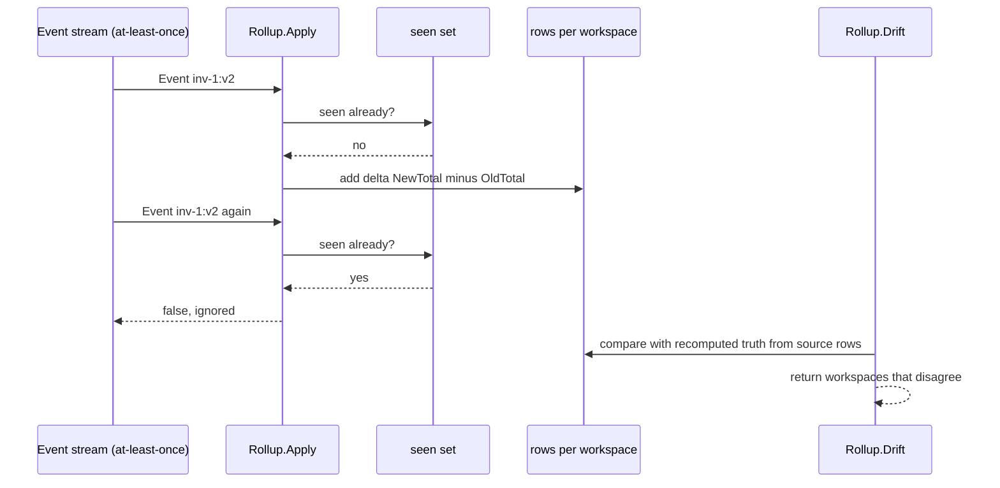
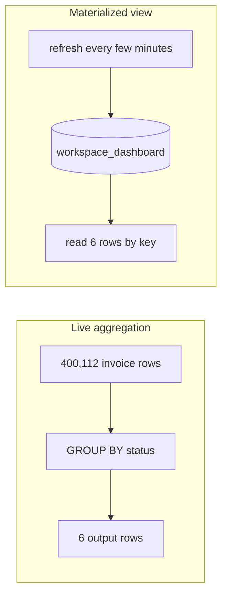
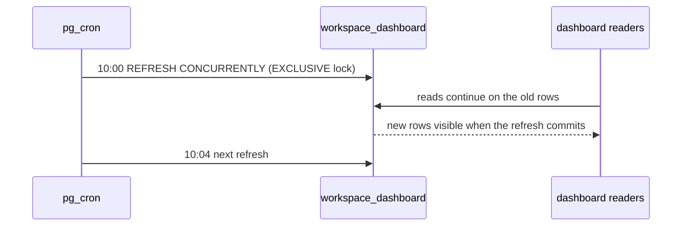
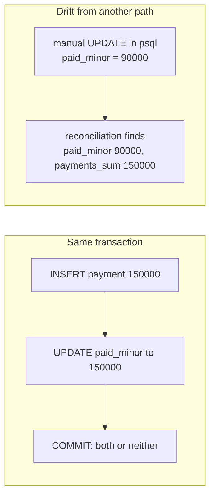
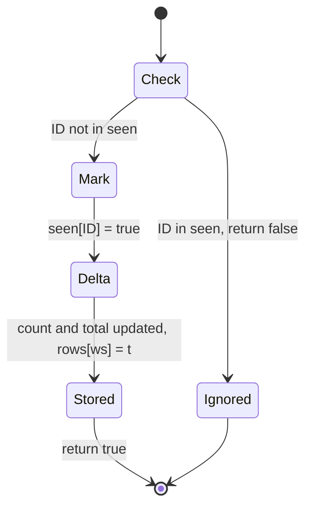
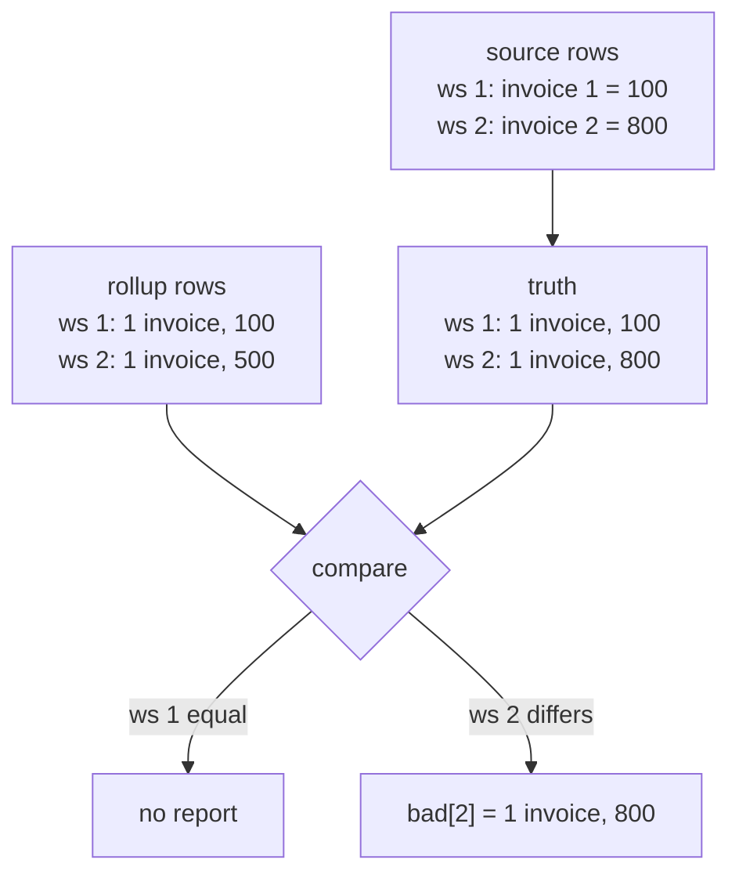
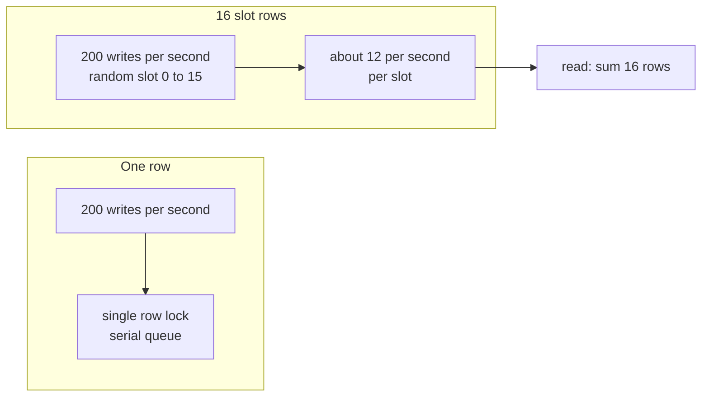

# Materialized Views and Denormalization - Go

> [!summary] TL;DR
> This note holds the code behind [[Materialized Views and Denormalization]]: the PostgreSQL 17 SQL for a materialized view and its refresh, the same-transaction payment update, the drift query, the slot-sharded counter, and a Go rollup that applies change events idempotently and detects drift, with race-tested unit tests.

## Before the code

- **Structs and maps**: the rollup is a map from workspace ID to `Totals`, plus a set of seen event IDs.
- **`sync.Mutex`**: one lock guards both maps so a duplicate check and an update happen together.
- **Idempotency**: `Apply` returns `false` for an event ID it has already seen, so redelivery is harmless.
- **Goroutines and `sync.WaitGroup`**: one test applies events, with duplicates, from many goroutines at once.
- **SQL blocks**: the PostgreSQL parts are SQL, not Go; read them as the database side of the same design.
- **Run**: `go vet ./... && go test -race ./...` (standard library only).

## What this code shows

The theory note describes three ways to keep a precomputed result: a scheduled full refresh, a same-transaction update, and an asynchronous rollup from events.

This note implements each of them, from the slowest query through the three maintenance styles to the failure modes (duplicate delivery, drift, hot rows). The SQL half is PostgreSQL 17 and the Go half is a self-contained rollup that is tested with `go test -race`.

| Code | Theory concept in [[Materialized Views and Denormalization]] |
| --- | --- |
| `workspace_dashboard` view, unique index, `REFRESH ... CONCURRENTLY` | materialized view and the refresh that does not block readers ([[Materialized Views and Denormalization#3.2 Creating and refreshing a materialized view in PostgreSQL 17]]) |
| `EXPLAIN` before and after | the live aggregation versus a keyed lookup ([[Materialized Views and Denormalization#4.1 Before: the live aggregation]], [[Materialized Views and Denormalization#4.2 After: read the materialized view]]) |
| `pg_cron` schedule | scheduled full refresh inside the staleness budget ([[Materialized Views and Denormalization#4.3 The refresh cost and cadence]]) |
| payment and `paid_minor` transaction, reconciliation query | synchronous denormalized copy and its drift check ([[Materialized Views and Denormalization#4.4 The same idea maintained by the application]]) |
| `Rollup.Apply` | idempotent asynchronous rollup from at-least-once events ([[Materialized Views and Denormalization#4.5 Asynchronous rollup in Go, with idempotency and a drift check]]) |
| `Rollup.Drift` | drift check against a full recomputation |
| `processed_events` SQL | the same idempotent apply inside Postgres |
| `workspace_totals_slots` | splitting a hot summary row into slots ([[Materialized Views and Denormalization#8. Deep dive]]) |



## Setup

- SQL: PostgreSQL 17. The plans below are representative output for that version, not measured in this vault.
- Go 1.24, standard library only. A scratch module `rollup` with `rollup.go` and `rollup_test.go`.
- Run: `go vet ./... && go test -race ./...`.

## Code

### Step 1: the dashboard query and the whiteboard view

**Concept.** The dashboard asks one question per workspace: how many invoices are in each status, and what do they add up to? Computing it live reads every invoice of the workspace ([[Materialized Views and Denormalization#3.1 View vs materialized view vs summary table]]).

A materialized view stores the answer for all workspaces once, so a page load becomes a small keyed read.

The alternatives are a plain view (always fresh but never faster) and a cache (only hot keys, outside the database), and the view is chosen here because every key is expensive to compute and the answer can be a few minutes old.

```sql
-- the slow question
SELECT status, count(*), sum(total_minor)
FROM invoices WHERE workspace_id = 42 GROUP BY status;

-- store the answer for every workspace
CREATE MATERIALIZED VIEW workspace_dashboard AS
SELECT workspace_id, status, count(*) AS invoice_count, sum(total_minor) AS total_minor
FROM invoices GROUP BY workspace_id, status;

CREATE UNIQUE INDEX ON workspace_dashboard (workspace_id, status);

-- read: a few rows by key
SELECT status, invoice_count, total_minor FROM workspace_dashboard WHERE workspace_id = 42;

-- every 5 minutes: recompute without blocking readers
REFRESH MATERIALIZED VIEW CONCURRENTLY workspace_dashboard;
```

**How it works.**

1. The first query groups one workspace's invoices. For a customer with 400,000 invoices it must read all of them to return about six rows.
2. `CREATE MATERIALIZED VIEW` runs the grouping once for every `(workspace_id, status)` and stores the rows on disk like a table.
3. The unique index serves two jobs: it makes the read a keyed lookup, and it is the index that `REFRESH ... CONCURRENTLY` requires.
4. The read query touches only the six or so rows for workspace 42.
5. `REFRESH ... CONCURRENTLY` re-runs the query and applies only the difference, so readers keep reading the old rows until the new ones commit.



### Step 2: the full materialized view

**Concept.** The production version adds `outstanding_minor`, the money still owed, and two details that the first version leaves implicit. `WITH DATA` populates the view immediately, because a view created `WITH NO DATA` is unreadable until its first refresh and cannot be refreshed `CONCURRENTLY` until then.

The index must be `UNIQUE` and cover plain column names with no `WHERE` clause, which is what makes the concurrent refresh possible: PostgreSQL needs a key to match old rows with new ones.

```sql
CREATE MATERIALIZED VIEW workspace_dashboard AS
SELECT workspace_id,
       status,
       count(*)                      AS invoice_count,
       sum(total_minor)              AS total_minor,
       sum(total_minor - paid_minor) AS outstanding_minor
FROM invoices
GROUP BY workspace_id, status
WITH DATA;   -- run the query now; WITH NO DATA leaves it unreadable until the first REFRESH

-- One row per (workspace_id, status), so this can be UNIQUE.
CREATE UNIQUE INDEX workspace_dashboard_uidx ON workspace_dashboard (workspace_id, status);
```

**How it works.**

1. `sum(total_minor - paid_minor)` precomputes the unpaid balance per group, so the dashboard does not compute it on every read.
2. `GROUP BY workspace_id, status` guarantees one row per pair, which is exactly what makes a unique index legal.
3. `WITH DATA` is the default, written out here so the intent is visible.
4. The named index `workspace_dashboard_uidx` is the one the plan in Step 4 uses.

### Step 3: the plan before the view

**Concept.** The plan is the evidence that the view is worth having ([[Query Plans and EXPLAIN]]). `EXPLAIN (ANALYZE, BUFFERS)` runs the query and shows how many pages it touched, which is a better cost measure than time alone. The block below is representative output for PostgreSQL 17, not a measurement from this vault.

```text
EXPLAIN (ANALYZE, BUFFERS)
SELECT status, count(*), sum(total_minor), sum(total_minor - paid_minor)
FROM invoices WHERE workspace_id = 42 GROUP BY status;

HashAggregate  (cost=61234.10..61234.16 rows=6 width=48) (actual time=381.902..381.905 rows=6 loops=1)
  Group Key: status
  Batches: 1  Memory Usage: 24kB
  Buffers: shared hit=31877 read=24120
  ->  Bitmap Heap Scan on invoices  (cost=5321.40..55234.10 rows=400000 width=24) (actual time=38.211..301.554 rows=400112 loops=1)
        Recheck Cond: (workspace_id = 42)
        Heap Blocks: exact=54301
        Buffers: shared hit=31877 read=24120
        ->  Bitmap Index Scan on invoices_ws_status_due_idx  (cost=0.00..5221.40 rows=400000 width=0) (actual time=31.904..31.904 rows=400112 loops=1)
              Index Cond: (workspace_id = 42)
Planning Time: 0.142 ms
Execution Time: 382.011 ms
```

**How it reads.**

1. The bottom node, `Bitmap Index Scan`, finds the 400,112 matching row locations through the index. It costs about 32 ms.
2. `Bitmap Heap Scan` then fetches those rows from 54,301 table pages. This is the expensive step, about 300 ms, because the rows are spread across the table.
3. `Buffers: shared hit=31877 read=24120` says 31,877 pages came from memory and 24,120 had to be read from disk.
4. `HashAggregate` groups the 400,112 rows into 6, and that is the whole point: 400,112 rows were read to produce 6.
5. `Execution Time: 382.011 ms` is the cost paid on every page load, and with 2,000 open tabs refreshing every 30 seconds it repeats about 67 times per second.

### Step 4: the plan after the view

**Concept.** After the view exists, the same dashboard question is a keyed lookup on the unique index. The work no longer depends on how many invoices the workspace has, only on the number of statuses.

```text
EXPLAIN (ANALYZE, BUFFERS)
SELECT status, invoice_count, total_minor, outstanding_minor
FROM workspace_dashboard WHERE workspace_id = 42;

Index Scan using workspace_dashboard_uidx on workspace_dashboard  (cost=0.42..12.55 rows=6 width=48) (actual time=0.021..0.026 rows=6 loops=1)
  Index Cond: (workspace_id = 42)
  Buffers: shared hit=4
Planning Time: 0.088 ms
Execution Time: 0.041 ms
```

**How it reads.**

1. A single `Index Scan` replaces the bitmap scans and the aggregate. There is nothing left to group.
2. `Index Cond: (workspace_id = 42)` is the key lookup through `workspace_dashboard_uidx`.
3. `Buffers: shared hit=4` is four page hits instead of about 56,000 page reads in Step 3.
4. `Execution Time: 0.041 ms` against 382 ms is roughly a 9,000 times speedup. The price is staleness, which Step 5 bounds.

| Plan | Pages touched | Execution time |
| --- | --- | --- |
| live aggregation (Step 3) | about 56,000 | 382 ms |
| view lookup (Step 4) | 4 | 0.04 ms |

### Step 5: schedule the refresh

**Concept.** A materialized view never refreshes itself, so something must run `REFRESH`.

The cadence comes from the staleness budget ([[Materialized Views and Denormalization#4.3 The refresh cost and cadence]]): with a 5-minute budget, refreshing every 4 minutes leaves room for a refresh that takes up to a minute.

Running it from exactly one scheduler matters because a concurrent refresh takes an `EXCLUSIVE` lock, and a second one would queue behind it.

```sql
-- pg_cron extension: run every 4 minutes
SELECT cron.schedule('dashboard-refresh', '*/4 * * * *',
  'REFRESH MATERIALIZED VIEW CONCURRENTLY workspace_dashboard');
```

**How it works.**

1. `cron.schedule(name, schedule, command)` stores a named job inside the database and runs it on the cron expression.
2. `*/4 * * * *` means every fourth minute. Staleness is then at most 4 minutes plus the refresh duration.
3. Naming the job `dashboard-refresh` makes scheduling idempotent: scheduling the same name again replaces the job instead of adding a second one.



### Step 6: the same idea maintained by the application

**Concept.** Some copies must be exact. The invoice list shows `paid_minor` and the status next to each invoice, and a 4-minute-old value would be wrong for a user who has just paid ([[Materialized Views and Denormalization#4.4 The same idea maintained by the application]]).

So the copy is updated in the same transaction as the payment, using the atomicity of [[Transactions and ACID]]: either both statements commit or neither does. The alternative is an asynchronous update, which keeps writes fast but lets the copy lag.

```sql
BEGIN;
INSERT INTO payments (workspace_id, invoice_id, amount_minor, provider, provider_ref)
VALUES (42, 9001, 150000, 'razorpay', 'pay_N8x2');
UPDATE invoices
SET paid_minor = paid_minor + 150000,
    status     = CASE WHEN paid_minor + 150000 >= total_minor THEN 'paid' ELSE 'partially_paid' END,
    updated_at = now()
WHERE id = 9001;
COMMIT;
```

**How it works.**

1. The `INSERT` records the payment. It is the source of truth.
2. `paid_minor = paid_minor + 150000` adds to the stored total. The right side reads the old value, so the update is a delta, not an overwrite.
3. The `CASE` derives the status from the new total. It uses the same expression on the right side, which still sees the old `paid_minor`, hence the `+ 150000` repeated.
4. `COMMIT` publishes both changes together. A failure before it rolls both back, so the copy cannot disagree with `payments` through this path.

A nightly reconciliation query still checks for drift from other paths (a manual fix in `psql`, a bug in a new code path).

```sql
SELECT i.id, i.paid_minor, coalesce(sum(p.amount_minor), 0) AS payments_sum
FROM invoices i
LEFT JOIN payments p ON p.invoice_id = i.id
GROUP BY i.id, i.paid_minor
HAVING i.paid_minor <> coalesce(sum(p.amount_minor), 0);
```

**How it works.**

1. `LEFT JOIN` keeps invoices that have no payments, whose `payments_sum` is 0.
2. `coalesce(sum(...), 0)` turns the NULL of an unpaid invoice into 0, so the comparison is valid.
3. `HAVING ... <>` returns only the invoices that disagree. An empty result means no drift. Each returned row is a bug to investigate, not only a value to fix.



### Step 7: the asynchronous rollup in Go

When the rollup lives outside Postgres (for example a dashboard store fed by CDC), each change arrives as an event, as in [[Materialized Views and Denormalization#4.5 Asynchronous rollup in Go, with idempotency and a drift check]].

Delivery is at-least-once, so the same event can arrive again, and applying it twice is the classic double-counting bug. The fix is to remember which event IDs were applied.

In SQL that is a `processed_events` table written in the same transaction as the rollup update, and in Go it is a `seen` set guarded by a mutex. The code is split into four pieces: the types, `Apply`, `Get`, and `Drift`.

#### 7a: the event and the rollup types

**Concept.** An `Event` carries the old and new total of one invoice, so the rollup can apply a delta without reading the invoice. The `ID` must be unique per change (for example invoice id plus version), because it is the idempotency key.

Carrying deltas instead of full state makes the rollup order-insensitive, since addition commutes. The alternative is to carry the new state and overwrite, which is naturally idempotent but needs a version check to survive out-of-order delivery.

```go
// Package rollup keeps an app-maintained summary table (per-workspace
// invoice totals) up to date from change events, and checks it for drift.
package rollup

import "sync"

// Event is one change to an invoice, as delivered by an outbox or CDC
// consumer. Delivery is at-least-once, so the same ID can arrive twice.
type Event struct {
	ID          string // unique per change, e.g. "inv-7:v3"
	WorkspaceID int64
	InvoiceID   int64
	OldTotal    int64 // total_minor before the change (0 for a new invoice)
	NewTotal    int64 // total_minor after the change (0 for a deleted invoice)
}

// Totals is one row of the rollup: workspace_totals in SQL.
type Totals struct {
	InvoiceCount int64
	TotalMinor   int64
}
```

**How it works.**

1. `ID` is the key of the dedupe set. `"inv-7:v3"` means invoice 7, third change, so two different changes never share an ID.
2. `OldTotal` and `NewTotal` together encode the operation: `0 -> x` is a create, `x -> 0` is a delete, anything else is an edit.
3. `Totals` is comparable (two `int64` fields), so `!=` works in `Drift`, and it is the zero value for a workspace with no invoices.

| Event | OldTotal | NewTotal | Count change | Total change |
| --- | --- | --- | --- | --- |
| create | 0 | 250,000 | +1 | +250,000 |
| edit | 250,000 | 300,000 | 0 | +50,000 |
| delete | 300,000 | 0 | -1 | -300,000 |

#### 7b: the rollup state

**Concept.** `Rollup` holds the two maps the SQL version stores in tables: `seen` is `processed_events` and `rows` is `workspace_totals`. One mutex guards both, because `Apply` must check the seen set and update the totals as a single step.

This is the in-memory version of putting both statements in one database transaction. The alternative of two separate locks would let two consumers pass the dedupe check together and both apply the same event.

```go
// Rollup applies events exactly once by remembering the IDs it has seen.
// In SQL the seen set is a processed_events table written in the same
// transaction as the rollup update.
type Rollup struct {
	mu   sync.Mutex
	seen map[string]bool
	rows map[int64]Totals
}

func New() *Rollup {
	return &Rollup{seen: map[string]bool{}, rows: map[int64]Totals{}}
}
```

**How it works.**

1. `mu sync.Mutex` is a value, not a pointer, and the struct must not be copied after first use. `New` returns a `*Rollup` for that reason.
2. `seen` maps event ID to `true`. A `map[string]struct{}` would use less memory, but `bool` reads more clearly with `if r.seen[id]`.
3. `rows` is keyed by workspace id and stores `Totals` by value, so an update is read, change, write back.
4. Both maps are created in `New`, because writing to a nil map panics.

#### 7c: apply one event

**Concept.** `Apply` is exactly-once processing built from at-least-once delivery: check the ID, mark it, apply the delta. It returns `false` for a duplicate, so the caller can acknowledge the message either way.

The mark and the delta happen under the same lock, so no other goroutine can observe one without the other. A duplicate is detected by ID only, not by comparing content, so IDs must be unique per change.

```go
// Apply adds the delta of one event. It reports false for a duplicate.
func (r *Rollup) Apply(e Event) bool {
	r.mu.Lock()
	defer r.mu.Unlock()
	if r.seen[e.ID] {
		return false
	}
	r.seen[e.ID] = true
	t := r.rows[e.WorkspaceID]
	switch {
	case e.OldTotal == 0 && e.NewTotal != 0:
		t.InvoiceCount++ // created
	case e.OldTotal != 0 && e.NewTotal == 0:
		t.InvoiceCount-- // deleted
	}
	t.TotalMinor += e.NewTotal - e.OldTotal
	r.rows[e.WorkspaceID] = t
	return true
}
```

**How it works.**

1. `defer r.mu.Unlock()` releases the lock on every return path, including the early `return false`.
2. `r.seen[e.ID]` is the duplicate test. A first delivery marks the ID and continues; a redelivery returns at once.
3. `t := r.rows[e.WorkspaceID]` copies the row. For a workspace with no row yet, the map returns the zero `Totals`, which is the right starting point.
4. The `switch` changes the count only for a create or a delete. An edit leaves the count alone.
5. `t.TotalMinor += e.NewTotal - e.OldTotal` applies the delta for all three event kinds.
6. `r.rows[e.WorkspaceID] = t` writes the copy back, since a map value is not addressable.



#### 7d: read one row

**Concept.** Reads take the same lock so they never see a half-applied event, which would be an invoice count already incremented while the total is not. For a read-heavy rollup a `sync.RWMutex` would let readers run in parallel, at the cost of a slightly more complex type.

```go
// Get returns the rollup row for one workspace.
func (r *Rollup) Get(ws int64) Totals {
	r.mu.Lock()
	defer r.mu.Unlock()
	return r.rows[ws]
}
```

**How it works.** `Get` locks, returns a copy of the `Totals` value, and unlocks. Because `Totals` is a value type, the caller cannot modify the rollup through the returned row.

#### 7e: drift, step one: recompute the truth

**Concept.** A rollup will eventually disagree with the source: an event is lost, a bug skips a code path, someone edits a row by hand.

`Drift` finds that by recomputing the totals from the source rows and comparing them with the rollup ([[Materialized Views and Denormalization#4.5 Asynchronous rollup in Go, with idempotency and a drift check]]). The first half builds the truth map.

This costs a full scan of the source, which is why a real system runs it nightly or on a sample, not on every request.

```go
// Drift compares the rollup with a full recomputation from the source
// rows (invoice id -> total_minor, per workspace) and returns the
// workspaces whose rows disagree, with the correct values.
func (r *Rollup) Drift(source map[int64]map[int64]int64) map[int64]Totals {
	truth := map[int64]Totals{}
	for ws, invoices := range source {
		var t Totals
		for _, total := range invoices {
			if total != 0 {
				t.InvoiceCount++
				t.TotalMinor += total
			}
		}
		truth[ws] = t
	}
```

**How it works.**

1. `source` maps workspace id to a map of invoice id to `total_minor`. It stands for the result of `SELECT workspace_id, id, total_minor FROM invoices`.
2. For each workspace the loop counts the invoices and sums their totals, which is the same grouping the rollup should have produced.
3. `if total != 0` treats a zero total as "no invoice", matching how `Apply` reads `OldTotal` and `NewTotal` (see Pitfalls).
4. The function has not yet taken the lock, because `truth` is local and needs no protection.

#### 7f: drift, step two: compare

**Concept.** The second half holds the lock only while it compares, and checks in both directions. A workspace in the truth whose rollup row differs is a missed or duplicated update.

A workspace present in the rollup but absent from the truth, with a non-zero row, is a phantom: events were counted for data that no longer exists.

The result is the set of workspaces to repair, each with its correct row, so the caller can fix them directly.

```go
	r.mu.Lock()
	defer r.mu.Unlock()
	bad := map[int64]Totals{}
	for ws, want := range truth {
		if r.rows[ws] != want {
			bad[ws] = want
		}
	}
	for ws, got := range r.rows {
		if _, ok := truth[ws]; !ok && got != (Totals{}) {
			bad[ws] = Totals{}
		}
	}
	return bad
}
```

**How it works.**

1. The lock is taken after the truth is built, so a slow source scan does not block `Apply`.
2. The first loop compares every true row with the rollup. A missing rollup row reads as the zero `Totals`, so a workspace the rollup never heard of is reported too.
3. The second loop finds rollup rows with no source data. `got != (Totals{})` ignores empty rows, so a workspace whose invoices were all deleted is not a false alarm.
4. `bad` holds the correct value for each broken workspace, which is exactly the repair a reconciliation job needs.



The toy treats `total_minor = 0` as "no invoice"; a real event carries an explicit `op` field (`create`, `update`, `delete`) as CDC tools do.

### Step 8: the same idempotent apply in SQL

**Concept.** Inside Postgres the same idea needs the dedupe key and the update in one transaction, because a crash between them would either lose the delta or apply it twice.

`INSERT ... ON CONFLICT DO NOTHING` into `processed_events` is the atomic "have I seen this?" check, and the row count says what happened. The alternative of a `SELECT` followed by an `INSERT` has a race between the two statements.

```sql
BEGIN;
INSERT INTO processed_events (event_id) VALUES ('inv-1:v2')
ON CONFLICT (event_id) DO NOTHING;
-- The app must check the row count here: if it is 0 (INSERT 0 0), the event
-- is a duplicate, so it issues ROLLBACK and skips the statements below.
-- SQL on its own does not stop; without that check the delta is applied twice.
INSERT INTO workspace_totals (workspace_id, invoice_count, total_minor)
VALUES (7, 0, 50000)
ON CONFLICT (workspace_id) DO UPDATE
SET invoice_count = workspace_totals.invoice_count + EXCLUDED.invoice_count,
    total_minor   = workspace_totals.total_minor + EXCLUDED.total_minor;
COMMIT;
```

**How it works.**

1. The first `INSERT` reports `INSERT 0 1` for a new event and `INSERT 0 0` for a duplicate.
2. The comment is the contract: SQL does not branch, so the application reads the row count and issues `ROLLBACK` for a duplicate. Skipping that check double-counts.
3. The second statement is an upsert. If workspace 7 has no row it is created with the delta; otherwise `DO UPDATE` adds the delta to the stored values, where `EXCLUDED` refers to the row that was proposed.
4. `COMMIT` makes the event ID and the delta visible together, which matches `Apply` holding one lock around both maps.

### Step 9: a hot summary row split into slots

**Concept.** A single summary row is a serial bottleneck: every transaction that updates it waits for the previous one's row lock ([[Materialized Views and Denormalization#8. Deep dive]]).

At 200 invoices per second and about 5 ms per commit (an estimate), one row caps throughput near 200 per second. Splitting the row into 16 slots spreads the writers over 16 locks, at the cost of a read that sums 16 rows.

The alternative is batching updates in memory and flushing them periodically, which is faster still but loses the same-transaction guarantee.

```sql
CREATE TABLE workspace_totals_slots (
  workspace_id  bigint NOT NULL,
  slot          smallint NOT NULL,      -- 0..15
  invoice_count bigint NOT NULL DEFAULT 0,
  total_minor   bigint NOT NULL DEFAULT 0,
  PRIMARY KEY (workspace_id, slot)
);

-- write: pick a random slot
INSERT INTO workspace_totals_slots (workspace_id, slot, invoice_count, total_minor)
VALUES (42, floor(random() * 16)::int, 1, 250000)
ON CONFLICT (workspace_id, slot) DO UPDATE
SET invoice_count = workspace_totals_slots.invoice_count + 1,
    total_minor   = workspace_totals_slots.total_minor + EXCLUDED.total_minor;

-- read: sum 16 rows
SELECT sum(invoice_count), sum(total_minor) FROM workspace_totals_slots WHERE workspace_id = 42;
```

**How it works.**

1. The primary key `(workspace_id, slot)` gives each workspace up to 16 independent rows.
2. `floor(random() * 16)::int` picks slot 0 to 15 uniformly, so 200 writes per second become about 12 per slot.
3. `ON CONFLICT ... DO UPDATE` creates a slot row on first use and adds to it afterwards, so no pre-population is needed.
4. The read sums all slots of one workspace. It reads at most 16 rows from the primary key, so it stays cheap.



## Design decisions

| Choice | Alternative | Trade-off |
| --- | --- | --- |
| `REFRESH ... CONCURRENTLY` | plain `REFRESH` | Readers never block, but it needs a unique index and does more work (diffs old against new) |
| Refresh every 4 minutes for a 5-minute budget | refresh on every write | Cost is bounded and simple; data is up to about 5 minutes old |
| Same-transaction `paid_minor` | async update | Always exact, but payments and invoices contend for the row |
| Delta events (`NewTotal - OldTotal`) | full-state events | Order-insensitive sums, but a lost event leaves permanent drift until reconciliation |
| `seen` set keyed by event ID | content comparison | Cheap and exact for unique IDs, but the set grows and needs retention |
| One mutex over `seen` and `rows` | two locks or lock-free | Mark and apply are atomic; all calls serialize |
| `Drift` recomputes from source | trust the events | Finds lost events and bugs, at the cost of a full scan |
| 16 slot rows for a hot counter | one row | Removes the lock queue; reads sum 16 rows |
| Plain structs and maps in Go | real database | Fast race-tested logic, but not a test of the SQL |

## Tests

All four tests exercise the in-memory `Rollup`: redelivery, deletes, a lost event caught by the drift check, and four concurrent consumers receiving the same 1,000 events. The SQL in Steps 1 to 6, 8 and 9 is representative and not executed by these tests.

### The test file header

**Concept.** The tests are in the same package so they can use the unexported fields if needed. The imports show what they need: `fmt` to build string IDs, `sync` for the concurrent test.

```go
package rollup

import (
	"fmt"
	"sync"
	"testing"
)
```

### Test 1: redelivery is ignored

**Property.** Applying the same event twice must change the rollup only once. This is the property that makes an at-least-once stream safe.

| Step | Event | Result of `Apply` | Rollup row |
| --- | --- | --- | --- |
| 1 | create inv-1:v1, 0 to 250,000 | true | 1 invoice, 250,000 |
| 2 | edit inv-1:v2, 250,000 to 300,000 | true | 1 invoice, 300,000 |
| 3 | edit inv-1:v2 again | false | unchanged: 1 invoice, 300,000 |

```go
func TestApplyIsIdempotent(t *testing.T) {
	r := New()
	create := Event{ID: "inv-1:v1", WorkspaceID: 7, InvoiceID: 1, OldTotal: 0, NewTotal: 250_000}
	edit := Event{ID: "inv-1:v2", WorkspaceID: 7, InvoiceID: 1, OldTotal: 250_000, NewTotal: 300_000}

	if !r.Apply(create) || !r.Apply(edit) {
		t.Fatal("first delivery must apply")
	}
	if r.Apply(edit) {
		t.Fatal("redelivered event must be ignored")
	}
	got := r.Get(7)
	want := Totals{InvoiceCount: 1, TotalMinor: 300_000}
	if got != want {
		t.Fatalf("got %+v, want %+v", got, want)
	}
}
```

**What a failure means.** A total of 350,000 means the dedupe check is missing and the delta of 50,000 was counted twice, which is the double-counting bug. If the first two `Apply` calls fail, the first delivery was wrongly treated as a duplicate.

### Test 2: a delete decrements the count

**Property.** A delete event (new total 0) must remove the invoice from both the count and the total, returning the row to zero.

| Step | Event | Rollup row |
| --- | --- | --- |
| 1 | create `a`, 0 to 100 | 1 invoice, 100 |
| 2 | delete `b`, 100 to 0 | 0 invoices, 0 |

```go
func TestDeleteDecrementsCount(t *testing.T) {
	r := New()
	r.Apply(Event{ID: "a", WorkspaceID: 1, InvoiceID: 1, NewTotal: 100})
	r.Apply(Event{ID: "b", WorkspaceID: 1, InvoiceID: 1, OldTotal: 100})
	if got := r.Get(1); got != (Totals{}) {
		t.Fatalf("got %+v, want zero row", got)
	}
}
```

**What a failure means.** A count of 1 with a total of 0 means the `switch` misses the delete case: the dashboard would show a phantom invoice worth nothing.

### Test 3: drift finds a lost event

**Property.** If an event is lost, the rollup silently disagrees with the source, and `Drift` must find exactly that workspace and report the correct row.

| Workspace | Rollup row | Source of truth | Drift report |
| --- | --- | --- | --- |
| 1 | 1 invoice, 100 | invoice 1 = 100 | none |
| 2 | 1 invoice, 500 | invoice 2 = 800 (the 500 to 800 event was lost) | 1 invoice, 800 |

```go
func TestDriftFindsMissedUpdate(t *testing.T) {
	r := New()
	r.Apply(Event{ID: "a", WorkspaceID: 1, InvoiceID: 1, NewTotal: 100})
	r.Apply(Event{ID: "b", WorkspaceID: 2, InvoiceID: 2, NewTotal: 500})
	// The event that changed invoice 2 from 500 to 800 was lost.
	source := map[int64]map[int64]int64{
		1: {1: 100},
		2: {2: 800},
	}
	bad := r.Drift(source)
	if len(bad) != 1 || bad[2] != (Totals{InvoiceCount: 1, TotalMinor: 800}) {
		t.Fatalf("drift = %+v, want only workspace 2 with 1 invoice / 800", bad)
	}
}
```

**What a failure means.** An empty result means `Drift` cannot see lost events, so wrong numbers would stay on the dashboard until a customer complains. A result that also lists workspace 1 means the comparison reports healthy rows, so the repair job would rewrite good data.

### Test 4: concurrent consumers with duplicates

**Property.** Four goroutines receive the same 1,000 events at once. Each event must be counted exactly once, and the race detector must stay quiet.

| Setup | Expected |
| --- | --- |
| 4 consumers, the same 1,000 event IDs, each worth 10 | 1,000 invoices, total 10,000 |

```go
func TestConcurrentApplyWithDuplicates(t *testing.T) {
	r := New()
	var wg sync.WaitGroup
	for w := 0; w < 4; w++ { // four consumers receive the same 1,000 events
		wg.Add(1)
		go func() {
			defer wg.Done()
			for i := 0; i < 1000; i++ {
				r.Apply(Event{ID: fmt.Sprint(i), WorkspaceID: 1, InvoiceID: int64(i), NewTotal: 10})
			}
		}()
	}
	wg.Wait()
	want := Totals{InvoiceCount: 1000, TotalMinor: 10_000}
	if got := r.Get(1); got != want {
		t.Fatalf("got %+v, want %+v", got, want)
	}
}
```

**What a failure means.** A total of 40,000 means two goroutines passed the `seen` check together, so the check and the mark are not atomic. A `go test -race` report means a map is touched outside the lock. Either failure would show up in production as a rollup that drifts under load.

## Running it

Measured output (Go 1.24, `go vet ./... && go test -race -v ./...`):

```text
=== RUN   TestApplyIsIdempotent
--- PASS: TestApplyIsIdempotent (0.00s)
=== RUN   TestDeleteDecrementsCount
--- PASS: TestDeleteDecrementsCount (0.00s)
=== RUN   TestDriftFindsMissedUpdate
--- PASS: TestDriftFindsMissedUpdate (0.00s)
=== RUN   TestConcurrentApplyWithDuplicates
--- PASS: TestConcurrentApplyWithDuplicates (0.01s)
PASS
ok  	rollup	1.480s
```

Reading the output line by line:

1. Each `=== RUN` line shows that a test started, and the `--- PASS` line after it gives the result and the wall time.
2. The first three tests take 0.00 s because they handle a handful of events.
3. `TestConcurrentApplyWithDuplicates` takes 0.01 s: 4,000 `Apply` calls from four goroutines, serialized by the mutex, with 3,000 of them rejected as duplicates.
4. `go vet` printed nothing, which means it found no problem, and `-race` found no data race.
5. `PASS` is the package result, and `ok  rollup  1.480s` is the summary line. Most of the time is compiling with the race detector.

## Pitfalls in the code

- **Zero means "no invoice".** `Apply` and `Drift` treat a total of 0 as absent, so a real zero-value invoice would be miscounted. Use an explicit operation field.
- **The seen set grows forever.** In memory it is a map of every event ID; in SQL, `processed_events` needs a retention policy, which must outlast the longest possible redelivery window.
- **SQL does not stop after `DO NOTHING`.** Without the application checking `INSERT 0 0` and rolling back, the delta is applied twice.
- **Deltas assume commutative sums.** This rollup tolerates out-of-order events only because it adds deltas; a "set status" copy needs a version check.
- **Slot reads must sum every slot.** Reads must sum all 16 slots; a reader that forgets a slot under-counts.
- **Plans are representative.** The `EXPLAIN` numbers come from the scenario in the theory note, not from a run here.

## Exercises

1. In `TestApplyIsIdempotent`, change the redelivered `edit` event's ID to `inv-1:v3`. Predict `Get(7)`.
2. In `TestConcurrentApplyWithDuplicates`, give each of the four consumers different event IDs (`fmt.Sprint(w, "-", i)`). Predict the final `Totals`.
3. In the slot-sharded SQL, change `16` to `1`. Predict the effect on concurrent writers.

> [!example]- Full file: rollup.go
> ```go
> // Package rollup keeps an app-maintained summary table (per-workspace
> // invoice totals) up to date from change events, and checks it for drift.
> package rollup
>
> import "sync"
>
> // Event is one change to an invoice, as delivered by an outbox or CDC
> // consumer. Delivery is at-least-once, so the same ID can arrive twice.
> type Event struct {
> 	ID          string // unique per change, e.g. "inv-7:v3"
> 	WorkspaceID int64
> 	InvoiceID   int64
> 	OldTotal    int64 // total_minor before the change (0 for a new invoice)
> 	NewTotal    int64 // total_minor after the change (0 for a deleted invoice)
> }
>
> // Totals is one row of the rollup: workspace_totals in SQL.
> type Totals struct {
> 	InvoiceCount int64
> 	TotalMinor   int64
> }
>
> // Rollup applies events exactly once by remembering the IDs it has seen.
> // In SQL the seen set is a processed_events table written in the same
> // transaction as the rollup update.
> type Rollup struct {
> 	mu   sync.Mutex
> 	seen map[string]bool
> 	rows map[int64]Totals
> }
>
> func New() *Rollup {
> 	return &Rollup{seen: map[string]bool{}, rows: map[int64]Totals{}}
> }
>
> // Apply adds the delta of one event. It reports false for a duplicate.
> func (r *Rollup) Apply(e Event) bool {
> 	r.mu.Lock()
> 	defer r.mu.Unlock()
> 	if r.seen[e.ID] {
> 		return false
> 	}
> 	r.seen[e.ID] = true
> 	t := r.rows[e.WorkspaceID]
> 	switch {
> 	case e.OldTotal == 0 && e.NewTotal != 0:
> 		t.InvoiceCount++ // created
> 	case e.OldTotal != 0 && e.NewTotal == 0:
> 		t.InvoiceCount-- // deleted
> 	}
> 	t.TotalMinor += e.NewTotal - e.OldTotal
> 	r.rows[e.WorkspaceID] = t
> 	return true
> }
>
> // Get returns the rollup row for one workspace.
> func (r *Rollup) Get(ws int64) Totals {
> 	r.mu.Lock()
> 	defer r.mu.Unlock()
> 	return r.rows[ws]
> }
>
> // Drift compares the rollup with a full recomputation from the source
> // rows (invoice id -> total_minor, per workspace) and returns the
> // workspaces whose rows disagree, with the correct values.
> func (r *Rollup) Drift(source map[int64]map[int64]int64) map[int64]Totals {
> 	truth := map[int64]Totals{}
> 	for ws, invoices := range source {
> 		var t Totals
> 		for _, total := range invoices {
> 			if total != 0 {
> 				t.InvoiceCount++
> 				t.TotalMinor += total
> 			}
> 		}
> 		truth[ws] = t
> 	}
> 	r.mu.Lock()
> 	defer r.mu.Unlock()
> 	bad := map[int64]Totals{}
> 	for ws, want := range truth {
> 		if r.rows[ws] != want {
> 			bad[ws] = want
> 		}
> 	}
> 	for ws, got := range r.rows {
> 		if _, ok := truth[ws]; !ok && got != (Totals{}) {
> 			bad[ws] = Totals{}
> 		}
> 	}
> 	return bad
> }
> ```

## Links

- **Theory:** [[Materialized Views and Denormalization]]
- **Related code:** [[NoSQL Data Modeling - Go]]
- **Before this:** [[Relational Schema Design]], [[Query Plans and EXPLAIN]]
