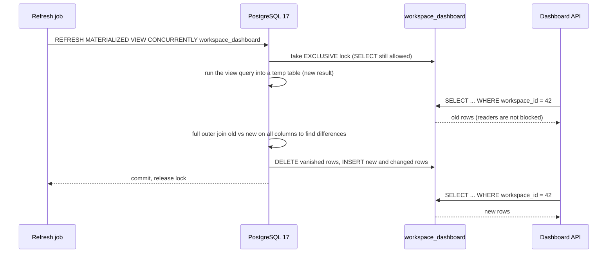
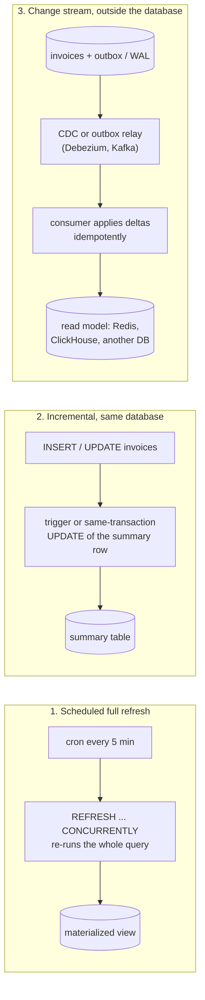

# Materialized Views and Denormalization

> [!summary] TL;DR
> A **materialized view** stores the *result* of a query as a real table, so reading it is a cheap lookup instead of re-running an expensive join or aggregation. **Denormalization** is the same idea done by hand: you keep a deliberate copy or summary of data (a counter, a total, a rollup table) to make reads fast. Both buy read speed with staleness, extra writes and the risk that the copy drifts from the truth.

> [!abstract] Core idea
> - A plain view is a saved query; a materialized view is a saved *answer* that goes stale until refreshed.
> - In PostgreSQL 17, `REFRESH MATERIALIZED VIEW` blocks readers; `REFRESH ... CONCURRENTLY` lets them keep reading but needs a unique index and does more work.
> - App-maintained summaries (counters, rollup tables) can be updated in the same transaction (always correct, adds write contention) or asynchronously from events (fast writes, must be idempotent).
> - Decide the **staleness budget** with the product owner ("the revenue chart may lag 5 minutes"), then pick the refresh strategy that meets it.
> - Every copy needs a rebuild path and a drift check, because it *will* disagree with the source one day.

## 1. Why it exists

InvoiceOps shows each workspace a dashboard: how many invoices are in each status, and how much money is invoiced, paid and outstanding. The source of truth is the `invoices` table from [[Relational Schema Design]], where money is stored as `bigint` minor units (`total_minor`, `paid_minor`; 1 rupee = 100 paise).

The dashboard query groups every invoice of the workspace:

```sql
SELECT status,
       count(*)                      AS invoice_count,
       sum(total_minor)              AS total_minor,
       sum(total_minor - paid_minor) AS outstanding_minor
FROM invoices
WHERE workspace_id = $1
GROUP BY status;
```

For a small workspace with 200 invoices this takes well under a millisecond. For the largest customer, with 400,000 invoices, Postgres has to read 400,000 rows on every page load. Suppose (an estimate for this example) it takes about 380 ms and the dashboard auto-refreshes every 30 seconds for 2,000 open browser tabs: that is about 67 executions per second, each reading hundreds of thousands of rows, all to produce six rows of output that barely change between calls.

The answer changes only when an invoice is created, edited or paid. Computing it once and storing it turns a 380 ms aggregation into a lookup of six rows by key.

## 2. Mental model

- A **view** (`CREATE VIEW`) is a named query. Reading it runs the query every time. It is never stale and never faster.
- A **materialized view** (`CREATE MATERIALIZED VIEW`) runs the query once and stores the rows on disk. Reading it is as fast as reading a small table. It is stale from the moment the base tables change until the next refresh.
- A **summary table** (also called a rollup table) is an ordinary table that your application or a trigger keeps up to date, one change at a time.
- **Denormalization** means storing a fact in more than one place on purpose, such as `invoices.paid_minor`, a copy of `sum(payments.amount_minor)` kept so the invoice list needs no join.

**Analogy:** a shop counts its cash drawer. A view is counting every coin each time someone asks the total. A materialized view is a sticky note with the total written at closing time: instant to read, wrong after the next sale. A summary table is a running tally that the cashier updates with every sale: always current if nobody forgets a sale.

## 3. How it works

### 3.1 View vs materialized view vs summary table

| | View | Materialized view (PostgreSQL 17) | Summary table |
| --- | --- | --- | --- |
| Stores rows | no | yes | yes |
| Freshness | always current | as of the last `REFRESH` | as current as the code that maintains it |
| Who updates it | nobody: it is re-run | you, by running `REFRESH` (no automatic refresh) | your app, a trigger, or a consumer |
| Can be indexed | no (indexes on the base tables are used) | yes | yes |
| Can be written to | only simple updatable views | no | yes |
| Cost of an update | none | recompute the whole query | one small delta per change |

### 3.2 Creating and refreshing a materialized view in PostgreSQL 17

```sql
CREATE MATERIALIZED VIEW workspace_dashboard AS
SELECT workspace_id,
       status,
       count(*)                      AS invoice_count,
       sum(total_minor)              AS total_minor,
       sum(total_minor - paid_minor) AS outstanding_minor
FROM invoices
GROUP BY workspace_id, status
WITH DATA;   -- run the query now; WITH NO DATA leaves it unreadable until the first REFRESH

-- One row per (workspace_id, status), so this can be UNIQUE.
CREATE UNIQUE INDEX workspace_dashboard_uidx ON workspace_dashboard (workspace_id, status);
```

There are two ways to refresh it:

| | `REFRESH MATERIALIZED VIEW` | `REFRESH MATERIALIZED VIEW CONCURRENTLY` |
| --- | --- | --- |
| Lock taken | `ACCESS EXCLUSIVE`: blocks every reader for the whole refresh | `EXCLUSIVE`: readers continue, another refresh waits |
| How | runs the query into a brand-new storage file and swaps it in | runs the query into a temporary table, diffs it with the current contents, then applies only the changed rows |
| Requires | nothing | a `UNIQUE` index on plain column names with no `WHERE` clause, covering all rows; the view must already be populated |
| Leaves dead rows | no (new file) | yes, the updated and deleted rows need vacuum, like any table |
| Speed | faster when most rows change | slower overall, but invisible to readers; best when few rows change |

The *lock* is what matters for users. With a plain refresh that takes 40 seconds, every dashboard request waits up to 40 seconds. With `CONCURRENTLY`, dashboards keep reading the old rows until the new ones are applied.



Because the whole refresh is one transaction, a reader sees either all of the old result or all of the new one, never a mix ([[Isolation Levels and MVCC]] explains why readers keep seeing the old snapshot).

### 3.3 Three ways to keep a precomputed result fresh



1. **Scheduled full refresh.** Simple, correct by construction (it recomputes from the source), and the staleness is at most the interval plus the refresh time. The cost is proportional to the *whole* base data, not to how much changed.
2. **Incremental in the same database.** Each write also adjusts the summary: `+1 invoice, +250000 total_minor`. Freshness is immediate when it runs in the same transaction ([[Transactions and ACID]]). Postgres has no built-in incremental materialized views; the `pg_ivm` extension adds them (`create_immv`) using triggers, for a restricted set of queries.
3. **Change stream outside the database.** Changes leave the database through an outbox table or change data capture (CDC: reading the database's write-ahead log as a stream of row changes), and a consumer updates a separate read store. This is a **projection** or **read model** in [[CQRS]] terms: a materialized view that lives outside the database. Details of the pipeline are in [[Transactional Outbox and CDC]].

### 3.4 The staleness budget is a product decision

Before choosing a mechanism, ask: *how old may this number be?*

- "Outstanding balance on the invoice page" must be exact after a payment: keep `paid_minor` in the same transaction as the payment insert.
- "Revenue by month chart" can lag 5 minutes: a scheduled `REFRESH ... CONCURRENTLY` every 5 minutes is enough.
- "Top clients this year" can lag a day: a nightly rebuild is fine.

Write the budget down next to the view, show "updated 3 min ago" in the UI when it matters, and alert when the real lag exceeds the budget.

## 4. Worked example

### Whiteboard version

```sql
-- the slow question
SELECT status, count(*), sum(total_minor)
FROM invoices WHERE workspace_id = 42 GROUP BY status;

-- store the answer for every workspace
CREATE MATERIALIZED VIEW workspace_dashboard AS
SELECT workspace_id, status, count(*) AS invoice_count, sum(total_minor) AS total_minor
FROM invoices GROUP BY workspace_id, status;

CREATE UNIQUE INDEX ON workspace_dashboard (workspace_id, status);

-- read: a few rows by key
SELECT status, invoice_count, total_minor FROM workspace_dashboard WHERE workspace_id = 42;

-- every 5 minutes: recompute without blocking readers
REFRESH MATERIALIZED VIEW CONCURRENTLY workspace_dashboard;
```

### 4.1 Before: the live aggregation

Assume (estimates for this example) 20 million invoices across 50,000 workspaces, with workspace 42 owning 400,000 of them. The index `invoices_ws_status_due_idx (workspace_id, status, due_date)` exists, but the query also needs `total_minor` and `paid_minor`, which are not in the index, so each matching row is fetched from the table.

Representative output (PostgreSQL 17):

```text
EXPLAIN (ANALYZE, BUFFERS)
SELECT status, count(*), sum(total_minor), sum(total_minor - paid_minor)
FROM invoices WHERE workspace_id = 42 GROUP BY status;

HashAggregate  (cost=61234.10..61234.16 rows=6 width=48) (actual time=381.902..381.905 rows=6 loops=1)
  Group Key: status
  Batches: 1  Memory Usage: 24kB
  Buffers: shared hit=31877 read=24120
  ->  Bitmap Heap Scan on invoices  (cost=5321.40..55234.10 rows=400000 width=24) (actual time=38.211..301.554 rows=400112 loops=1)
        Recheck Cond: (workspace_id = 42)
        Heap Blocks: exact=54301
        Buffers: shared hit=31877 read=24120
        ->  Bitmap Index Scan on invoices_ws_status_due_idx  (cost=0.00..5221.40 rows=400000 width=0) (actual time=31.904..31.904 rows=400112 loops=1)
              Index Cond: (workspace_id = 42)
Planning Time: 0.142 ms
Execution Time: 382.011 ms
```

Reading the plan ([[Query Plans and EXPLAIN]] covers this in detail): 400,112 rows are fetched from 54,301 table pages, of which 24,120 came from disk, only to be grouped into 6 output rows.

### 4.2 After: read the materialized view

Representative output (PostgreSQL 17):

```text
EXPLAIN (ANALYZE, BUFFERS)
SELECT status, invoice_count, total_minor, outstanding_minor
FROM workspace_dashboard WHERE workspace_id = 42;

Index Scan using workspace_dashboard_uidx on workspace_dashboard  (cost=0.42..12.55 rows=6 width=48) (actual time=0.021..0.026 rows=6 loops=1)
  Index Cond: (workspace_id = 42)
  Buffers: shared hit=4
Planning Time: 0.088 ms
Execution Time: 0.041 ms
```

Four buffer hits instead of 56,000 page reads. The view holds at most 50,000 × 6 = 300,000 small rows, so it fits in memory.

The unique index does two jobs: it makes this lookup an index scan, and it is the index that `REFRESH ... CONCURRENTLY` requires.

### 4.3 The refresh cost and cadence

The refresh re-runs the `GROUP BY` over all 20 million invoices. Estimate: a parallel sequential scan plus hash aggregate over a table of this size takes in the order of 10–60 seconds, depending on hardware and how much is cached. The concurrent variant then diffs about 300,000 rows. Measure it on your own data with `\timing` in `psql` before choosing the interval.

With a 5-minute budget, schedule the refresh every 4 minutes, and alert if a refresh takes more than 1 minute (budget minus interval). Run it from one place, for example a `pg_cron` job or one scheduled worker, so two refreshes never queue behind the `EXCLUSIVE` lock.

```sql
-- pg_cron extension: run every 4 minutes
SELECT cron.schedule('dashboard-refresh', '*/4 * * * *',
  'REFRESH MATERIALIZED VIEW CONCURRENTLY workspace_dashboard');
```

### 4.4 The same idea maintained by the application

The 4-minute lag is fine for the chart, but the invoice list must show the exact `paid_minor`. That copy is maintained in the same transaction as the payment:

```sql
BEGIN;
INSERT INTO payments (workspace_id, invoice_id, amount_minor, provider, provider_ref)
VALUES (42, 9001, 150000, 'razorpay', 'pay_N8x2');
UPDATE invoices
SET paid_minor = paid_minor + 150000,
    status     = CASE WHEN paid_minor + 150000 >= total_minor THEN 'paid' ELSE 'partially_paid' END,
    updated_at = now()
WHERE id = 9001;
COMMIT;
```

If either statement fails, both roll back, so the copy cannot disagree with the payments table through this path. A nightly reconciliation query still checks for drift from other paths (a manual fix in `psql`, a bug in a new code path):

```sql
SELECT i.id, i.paid_minor, coalesce(sum(p.amount_minor), 0) AS payments_sum
FROM invoices i
LEFT JOIN payments p ON p.invoice_id = i.id
GROUP BY i.id, i.paid_minor
HAVING i.paid_minor <> coalesce(sum(p.amount_minor), 0);
```

### 4.5 Asynchronous rollup in Go, with idempotency and a drift check

When the rollup lives outside Postgres (for example a dashboard store fed by CDC), each change arrives as an event. Delivery is **at-least-once**: after a consumer crash, the same event can arrive again. Applying it twice is the classic double-counting bug. The fix is to remember which event IDs were applied; in SQL, that is a `processed_events` table written in the same transaction as the rollup update.

```go
// Package rollup keeps an app-maintained summary table (per-workspace
// invoice totals) up to date from change events, and checks it for drift.
package rollup

import "sync"

// Event is one change to an invoice, as delivered by an outbox or CDC
// consumer. Delivery is at-least-once, so the same ID can arrive twice.
type Event struct {
	ID          string // unique per change, e.g. "inv-7:v3"
	WorkspaceID int64
	InvoiceID   int64
	OldTotal    int64 // total_minor before the change (0 for a new invoice)
	NewTotal    int64 // total_minor after the change (0 for a deleted invoice)
}

// Totals is one row of the rollup: workspace_totals in SQL.
type Totals struct {
	InvoiceCount int64
	TotalMinor   int64
}

// Rollup applies events exactly once by remembering the IDs it has seen.
// In SQL the seen set is a processed_events table written in the same
// transaction as the rollup update.
type Rollup struct {
	mu   sync.Mutex
	seen map[string]bool
	rows map[int64]Totals
}

func New() *Rollup {
	return &Rollup{seen: map[string]bool{}, rows: map[int64]Totals{}}
}

// Apply adds the delta of one event. It reports false for a duplicate.
func (r *Rollup) Apply(e Event) bool {
	r.mu.Lock()
	defer r.mu.Unlock()
	if r.seen[e.ID] {
		return false
	}
	r.seen[e.ID] = true
	t := r.rows[e.WorkspaceID]
	switch {
	case e.OldTotal == 0 && e.NewTotal != 0:
		t.InvoiceCount++ // created
	case e.OldTotal != 0 && e.NewTotal == 0:
		t.InvoiceCount-- // deleted
	}
	t.TotalMinor += e.NewTotal - e.OldTotal
	r.rows[e.WorkspaceID] = t
	return true
}

// Get returns the rollup row for one workspace.
func (r *Rollup) Get(ws int64) Totals {
	r.mu.Lock()
	defer r.mu.Unlock()
	return r.rows[ws]
}

// Drift compares the rollup with a full recomputation from the source
// rows (invoice id -> total_minor, per workspace) and returns the
// workspaces whose rows disagree, with the correct values.
func (r *Rollup) Drift(source map[int64]map[int64]int64) map[int64]Totals {
	truth := map[int64]Totals{}
	for ws, invoices := range source {
		var t Totals
		for _, total := range invoices {
			if total != 0 {
				t.InvoiceCount++
				t.TotalMinor += total
			}
		}
		truth[ws] = t
	}
	r.mu.Lock()
	defer r.mu.Unlock()
	bad := map[int64]Totals{}
	for ws, want := range truth {
		if r.rows[ws] != want {
			bad[ws] = want
		}
	}
	for ws, got := range r.rows {
		if _, ok := truth[ws]; !ok && got != (Totals{}) {
			bad[ws] = Totals{}
		}
	}
	return bad
}
```

The tests cover redelivery, deletes, a lost event caught by the drift check, and four concurrent consumers receiving the same 1,000 events:

```go
package rollup

import (
	"fmt"
	"sync"
	"testing"
)

func TestApplyIsIdempotent(t *testing.T) {
	r := New()
	create := Event{ID: "inv-1:v1", WorkspaceID: 7, InvoiceID: 1, OldTotal: 0, NewTotal: 250_000}
	edit := Event{ID: "inv-1:v2", WorkspaceID: 7, InvoiceID: 1, OldTotal: 250_000, NewTotal: 300_000}

	if !r.Apply(create) || !r.Apply(edit) {
		t.Fatal("first delivery must apply")
	}
	if r.Apply(edit) {
		t.Fatal("redelivered event must be ignored")
	}
	got := r.Get(7)
	want := Totals{InvoiceCount: 1, TotalMinor: 300_000}
	if got != want {
		t.Fatalf("got %+v, want %+v", got, want)
	}
}

func TestDeleteDecrementsCount(t *testing.T) {
	r := New()
	r.Apply(Event{ID: "a", WorkspaceID: 1, InvoiceID: 1, NewTotal: 100})
	r.Apply(Event{ID: "b", WorkspaceID: 1, InvoiceID: 1, OldTotal: 100})
	if got := r.Get(1); got != (Totals{}) {
		t.Fatalf("got %+v, want zero row", got)
	}
}

func TestDriftFindsMissedUpdate(t *testing.T) {
	r := New()
	r.Apply(Event{ID: "a", WorkspaceID: 1, InvoiceID: 1, NewTotal: 100})
	r.Apply(Event{ID: "b", WorkspaceID: 2, InvoiceID: 2, NewTotal: 500})
	// The event that changed invoice 2 from 500 to 800 was lost.
	source := map[int64]map[int64]int64{
		1: {1: 100},
		2: {2: 800},
	}
	bad := r.Drift(source)
	if len(bad) != 1 || bad[2] != (Totals{InvoiceCount: 1, TotalMinor: 800}) {
		t.Fatalf("drift = %+v, want only workspace 2 with 1 invoice / 800", bad)
	}
}

func TestConcurrentApplyWithDuplicates(t *testing.T) {
	r := New()
	var wg sync.WaitGroup
	for w := 0; w < 4; w++ { // four consumers receive the same 1,000 events
		wg.Add(1)
		go func() {
			defer wg.Done()
			for i := 0; i < 1000; i++ {
				r.Apply(Event{ID: fmt.Sprint(i), WorkspaceID: 1, InvoiceID: int64(i), NewTotal: 10})
			}
		}()
	}
	wg.Wait()
	want := Totals{InvoiceCount: 1000, TotalMinor: 10_000}
	if got := r.Get(1); got != want {
		t.Fatalf("got %+v, want %+v", got, want)
	}
}
```

These pass under `go test -race` with Go 1.24. The toy treats `total_minor = 0` as "no invoice"; a real event carries an explicit `op` field (`create`, `update`, `delete`) as CDC tools do.

In SQL, the same idempotent apply is one transaction:

```sql
BEGIN;
INSERT INTO processed_events (event_id) VALUES ('inv-1:v2')
ON CONFLICT (event_id) DO NOTHING;
-- The app must check the row count here: if it is 0 (INSERT 0 0), the event
-- is a duplicate, so it issues ROLLBACK and skips the statements below.
-- SQL on its own does not stop; without that check the delta is applied twice.
INSERT INTO workspace_totals (workspace_id, invoice_count, total_minor)
VALUES (7, 0, 50000)
ON CONFLICT (workspace_id) DO UPDATE
SET invoice_count = workspace_totals.invoice_count + EXCLUDED.invoice_count,
    total_minor   = workspace_totals.total_minor + EXCLUDED.total_minor;
COMMIT;
```

## 5. Variants and comparison

| Option | How it works | Use when | Cost |
| --- | --- | --- | --- |
| Plain view | saved query, re-run on read | you want a name for a query, not speed | none beyond the query |
| Postgres materialized view + scheduled `REFRESH CONCURRENTLY` | recompute everything on a timer | aggregates over large data, minutes of staleness acceptable | full recompute each time; dead rows to vacuum |
| `pg_ivm` incremental view (extension) | triggers apply deltas on each base-table write | you need a fresh view and the query fits its supported subset | slower writes; extension to operate and upgrade |
| Same-transaction denormalized column or counter | `UPDATE summary` next to the base write | the number must be exact right after the write | write contention on the summary row; every write path must remember it |
| Trigger-maintained summary table | database trigger does the `UPDATE` | many write paths you cannot all change | hidden logic, same contention, harder to debug |
| Async rollup from outbox/CDC | consumer applies deltas idempotently | high write rates, read model in another store | lag, idempotency, replay and backfill tooling |
| CQRS projection | read model per screen built from events | very different read and write shapes | a second data store and its operations ([[CQRS]]) |
| ClickHouse materialized view | an insert trigger: each inserted block is transformed and written into a target table, often `AggregatingMergeTree` or `SummingMergeTree` | analytics over append-only event data | rows merge in the background, so queries must still aggregate; updates and deletes in the source are not seen |
| Streaming database (Materialize, RisingWave) | SQL views kept incrementally up to date from Kafka or Postgres CDC | complex joins that must be fresh within seconds | another system to run; memory for join state |
| Cache (Redis) | store the query result with a TTL | a hot, small result where a few seconds of staleness is fine | invalidation and stampedes ([[Cache Invalidation, TTL and Consistency]]) |

**Cache or materialized view?** A cache holds results for *keys that are asked for*, expires them, and lives outside the database. A materialized view holds results for *every key*, can be indexed and joined in SQL, and is refreshed as a whole. Use a cache when a small fraction of keys is hot and recomputing one key is cheap. Use a materialized view when computing any single key requires scanning a lot of data, or when other queries want to join and filter the precomputed rows.

## 6. Trade-offs and when not to use

- **Staleness.** A refreshed view is wrong between refreshes. Never use one for a balance that drives a decision (allowing a refund, blocking an overdraft).
- **Refresh cost grows with total data, not with change.** A full refresh of 20 million rows every 4 minutes costs the same whether 10 invoices changed or 10,000. When the view grows, either refresh less often, move to incremental maintenance, or partition the source.
- **Write amplification and contention.** A same-transaction counter turns every invoice insert in workspace 42 into an `UPDATE` of one row. Concurrent transactions queue on that row lock ([[Locking - Optimistic vs Pessimistic]]).
- **Every write path must cooperate.** A bulk import that writes `invoices` with `COPY` and forgets the summary silently creates drift.
- **More storage and more vacuum.** Concurrent refreshes and hot summary rows create dead tuples.
- **When not to use:** if the right index makes the live query fast enough, stop there ([[Indexing Fundamentals]], [[Index Types and Index Design]]). For example, a covering index on `(workspace_id, status) INCLUDE (total_minor, paid_minor)` might turn the 380 ms query into an index-only scan. Precompute only when the remaining cost is the aggregation itself.
- **When not to use:** heavy analytics across all tenants. A column store ([[Time-Series and Columnar Storage]]) aggregates billions of rows faster than any row-store view refresh.

## 7. In production

**Real systems.**
- PostgreSQL materialized views have no automatic refresh; teams pair them with `pg_cron` or an application scheduler.
- ClickHouse materialized views are the standard way to build rollup tables over event streams: the raw table receives inserts, and the view writes pre-aggregated states into an `AggregatingMergeTree` table that dashboards query with `-Merge` combinators such as `sumMerge`.
- Oracle offers "fast refresh" using materialized view logs, and SQL Server offers indexed views that the engine maintains on every write; both are built-in versions of incremental maintenance.

**Failure modes and fixes.**
- *Readers block for the length of a refresh* → you used plain `REFRESH`; add a unique index and use `CONCURRENTLY`.
- *`ERROR: cannot refresh materialized view concurrently`* → the view lacks a qualifying unique index (it must use plain columns and have no `WHERE`), or it was created `WITH NO DATA` and was never populated; do one plain refresh first.
- *Refreshes pile up* → the refresh takes longer than its interval; lengthen the interval or make the query cheaper, and use a single scheduler.
- *Double counting* → an async consumer applied a redelivered event; record processed event IDs in the same transaction as the delta.
- *Missed updates* → a write path bypassed the summary, or an event was lost; run a drift check and repair.
- *Hot summary row* → many concurrent writers update the same row; split the counter into N slot rows and sum them on read (see Deep dive).

**Rebuild and backfill procedure.** Every precomputed store needs one:
1. Build a new copy from the source of truth (for an MV, a plain refresh into a new view; for a rollup, a full `INSERT ... SELECT ... GROUP BY` into a new table).
2. Replay the events that arrived during the rebuild, using the same idempotent apply.
3. Compare with the drift query; switch reads to the new copy (rename, or flip a config flag); drop the old copy.

**What to monitor.**
- Time since the last successful refresh, compared with the staleness budget.
- Refresh duration, and how close it is to the interval.
- Consumer lag (events or seconds behind) for async rollups.
- Rows reported by the nightly drift check (should be 0).
- Dead tuples and autovacuum activity on the view and summary tables.

## 8. Deep dive

**What `CONCURRENTLY` actually does.** PostgreSQL computes the new result into a temporary table, then compares it with the current contents using a full outer join on all columns. Rows only in the old result are deleted, rows only in the new result are inserted. A changed row is therefore a delete plus an insert. The unique index is used to match rows efficiently and guarantees the view has no duplicate rows, which the diff needs. This is why a view whose rows change completely each time (for example, a `now()`-relative column) gains nothing from `CONCURRENTLY` and costs more.

**Statistics on a view.** A materialized view is a table to the planner. Autovacuum analyzes it like any table, but right after creating it, run `ANALYZE workspace_dashboard;` so the planner knows its size.

**Hot rows and counter sharding.** If 200 invoices per second are created in one workspace and each transaction runs `UPDATE workspace_totals SET ... WHERE workspace_id = 42`, every transaction waits for the previous one's row lock until it commits. Throughput is capped at roughly `1 / (commit latency)`; at 5 ms per commit (an estimate), about 200 per second. Splitting the row into slots removes the queue:

```sql
CREATE TABLE workspace_totals_slots (
  workspace_id  bigint NOT NULL,
  slot          smallint NOT NULL,      -- 0..15
  invoice_count bigint NOT NULL DEFAULT 0,
  total_minor   bigint NOT NULL DEFAULT 0,
  PRIMARY KEY (workspace_id, slot)
);

-- write: pick a random slot
INSERT INTO workspace_totals_slots (workspace_id, slot, invoice_count, total_minor)
VALUES (42, floor(random() * 16)::int, 1, 250000)
ON CONFLICT (workspace_id, slot) DO UPDATE
SET invoice_count = workspace_totals_slots.invoice_count + 1,
    total_minor   = workspace_totals_slots.total_minor + EXCLUDED.total_minor;

-- read: sum 16 rows
SELECT sum(invoice_count), sum(total_minor) FROM workspace_totals_slots WHERE workspace_id = 42;
```

**Deltas versus recompute.** `sum` and `count` are easy to maintain incrementally: add on insert, subtract on delete. `min`, `max` and `count(DISTINCT ...)` are not: when the current maximum is deleted, the new maximum can only be found by looking at the remaining rows. That is why incremental view engines restrict which aggregates they support, and why ClickHouse stores intermediate *aggregate states* (for example a set for `uniq`) rather than final numbers.

**Ordering in async rollups.** Deltas commute (`+100` then `+50` equals `+50` then `+100`), so rollups of sums tolerate out-of-order events. "Set the status to X" does not commute. For non-commutative copies, carry a version number with each event and apply only if it is newer than the stored version.

**Read-your-writes with an async read model.** A user pays an invoice and immediately opens the dashboard, which still shows the old total. Options: read the single affected value from the primary database for that user's next request, show "updating…" until the projection's version catches up, or keep that value synchronous.

## 9. Interview questions

> [!question]- What is the difference between a view, a materialized view and a cache?
> A view is a saved query that re-runs on every read, so it is always fresh and never faster. A materialized view stores the result for all keys inside the database, can be indexed and joined, and is stale until refreshed. A cache stores results only for keys that were requested, outside the database, with TTL-based expiry. Choose by how many keys are hot and how expensive one key is to compute.

> [!question]- Your Postgres dashboard hangs for 40 seconds every 5 minutes. Why, and how do you fix it?
> A plain `REFRESH MATERIALIZED VIEW` takes an `ACCESS EXCLUSIVE` lock, which blocks every `SELECT` for the whole refresh. Add a unique index on plain columns covering all rows and use `REFRESH MATERIALIZED VIEW CONCURRENTLY`, which takes an `EXCLUSIVE` lock that still allows reads. It costs more work and leaves dead rows, but readers see the old result until the new one commits.

> [!question]- Does `REFRESH ... CONCURRENTLY` make the refresh faster? (trap)
> No. It is usually slower: it computes the full result, then diffs it with the current contents and applies the changes. What it improves is availability, because readers are not blocked. It also cannot be used on a view that has never been populated.

> [!question]- How do you keep a denormalized `paid_minor` column correct?
> Update it in the same transaction as the payment insert, through one code path, so both commit or neither does. Then run a scheduled reconciliation query that compares it with `sum(payments.amount_minor)` and alerts on any difference, because manual fixes and new code paths can still bypass it.

> [!question]- An async consumer maintains workspace revenue from CDC events. After an incident, totals are too high. What happened?
> Delivery is at-least-once, so events were redelivered after a crash and applied twice. Make the apply idempotent: store each processed event ID in the same transaction as the delta, and skip duplicates. Then rebuild the rollup from the source of truth and run a drift check to confirm it matches.

> [!question]- Why can `sum` be maintained incrementally but `max` cannot?
> A sum changes by exactly the inserted or deleted value, so a delta is enough. When you delete the current maximum, the new maximum depends on all the remaining rows, which the delta does not tell you. Incremental engines therefore either restrict aggregates or keep extra state, such as all values per group.

> [!question]- When would you not build a materialized view?
> When an index makes the live query fast enough, for example a covering index allowing an index-only scan. When the data must be exact (balances that gate actions). When the workload is cross-tenant analytics over billions of rows, where a column store is the better tool.

## 10. Cheat sheet

- View = saved query; materialized view = saved answer; summary table = answer you maintain row by row.
- PostgreSQL 17: no automatic refresh. `REFRESH` blocks readers (`ACCESS EXCLUSIVE`); `REFRESH ... CONCURRENTLY` does not, needs a unique index on plain columns with no `WHERE`, and is slower.
- Incremental views are not built into Postgres; `pg_ivm` is an extension.
- Agree a staleness budget per number; exact numbers stay synchronous in the same transaction.
- Async rollups must be idempotent (processed event IDs) and checked for drift.
- Hot summary rows: split into slots and sum on read.
- Have a rebuild procedure: build new copy, replay, compare, switch.
- Try indexes first; reach for a column store for heavy analytics.

## Links

- **Before this:** [[Relational Schema Design]], [[Query Plans and EXPLAIN]], [[Indexing Fundamentals]], [[Transactions and ACID]]
- **Next:** [[NoSQL Data Modeling]], [[Transactional Outbox and CDC]], [[CQRS]]
- **Compare with:** [[Caching Fundamentals]], [[Time-Series and Columnar Storage]], [[Index Types and Index Design]]
