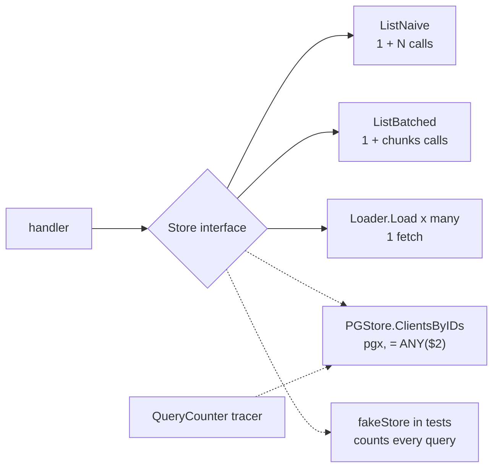
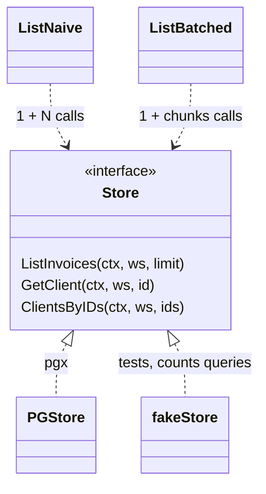
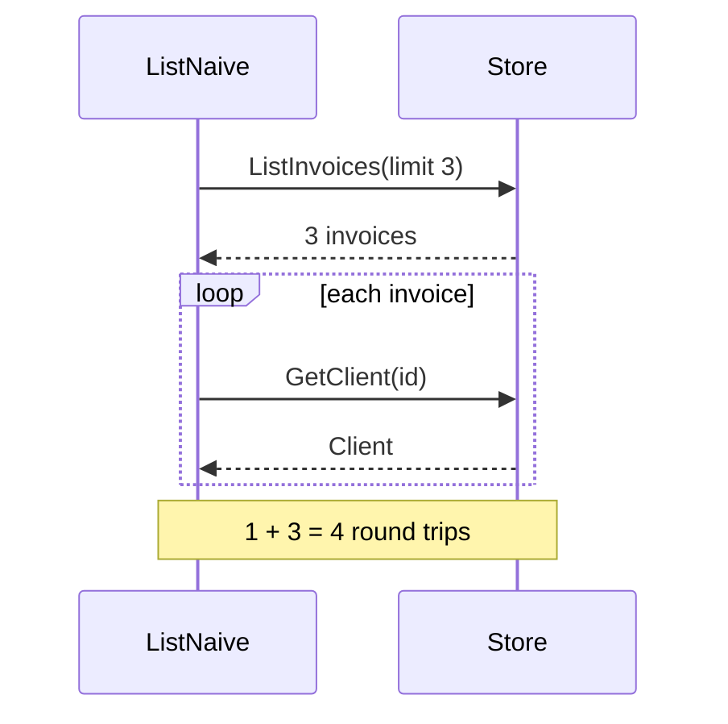
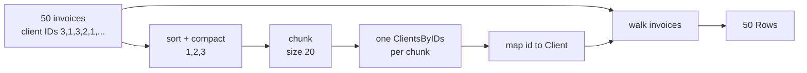
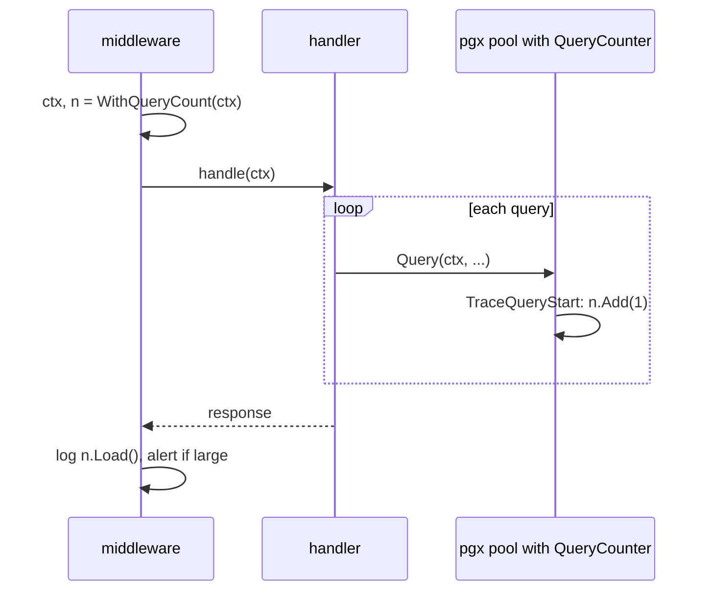
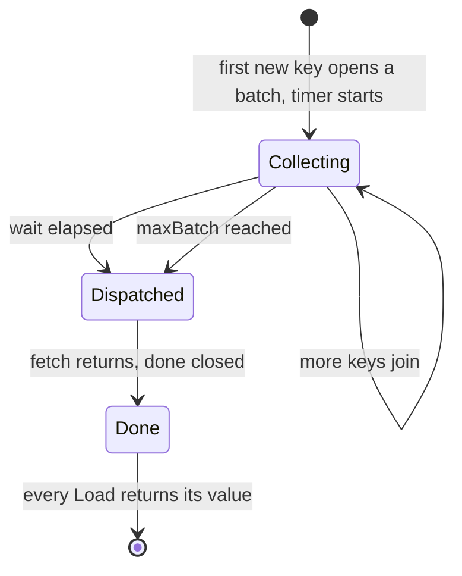
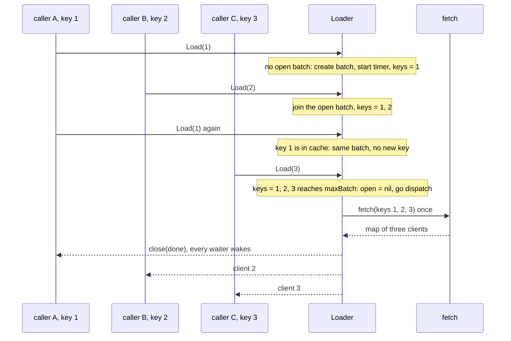

# N+1 Query Problem - Go

> [!summary] TL;DR
> The runnable side of [[N+1 Query Problem]]: an invoice-list handler written twice (one query per row, then one batched query), the pgx query that sends all IDs as a single `bigint[]` parameter, a query counter for pgx, a generic per-request DataLoader, and tests that pin the query count so it cannot grow with the page size.

> [!info] How to read this note (pick your level)
> - 🟢 **New to this?** Read "From zero" below, then "Before the code", "What this code shows" and Steps 1-3 (the bug and the fix). Stop there.
> - 🟡 **Know the basics?** Add Step 4 (the pgx query), Step 5 (the query counter), the Tests and "Query-count arithmetic".
> - 🔴 **Interview / SDE-3 prep?** Add Step 6 (the DataLoader), "The loader trace", "Pitfalls in the code" and the Exercises. Headings are tagged 🟢🟡🔴 so you always know where you are.

**From zero, in 60 seconds** 🟢

This file is the hands-on half of the N+1 note. It shows the bug and the fix as real Go code you can run: the same invoice-list page written twice — once querying the database inside a loop (slow, 51 trips) and once collecting the IDs and fetching them all in one query (fast, 2 trips) — plus the Postgres query that takes a whole list of IDs as one parameter, a small counter that tells you how many queries each web request made, and a DataLoader that quietly merges many little lookups into one batch. Read the theory note first if "N+1" is new to you; then read the steps here in order, and run `go test -race` to watch the tests prove the query count stays flat as the page grows.

## Before the code 🟢

- **Interfaces**: the handler depends on a small `Store` interface, so tests use a fake store that counts queries.
- **Generics**: `Loader[K, V]` batches lookups for any key and value type.
- **`slices.Chunk`** (Go 1.23+): splits a long ID list into fixed-size chunks.
- **Goroutines, `sync.Once`, `time.Timer` and channels**: the loader collects keys for a short window, then fetches once and wakes every waiter.
- **`context.Context`**: a waiting `Load` returns early if the request is cancelled.
- **Run**: `go mod tidy && go vet ./... && go test -race -v ./...` (no database needed).

## What this code shows 🟢

| Code | Concept in the theory note |
| --- | --- |
| `ListNaive` | The 1 + N loop ([[N+1 Query Problem#1. Why it exists]]) |
| `ListBatched` | Collect IDs, compact, chunk, one query per chunk, stitch in a map, fail on a missing client ([[N+1 Query Problem#The batching steps]]) |
| `PGStore.ClientsByIDs` | `= ANY($2)` with one array parameter and a tenant filter ([[N+1 Query Problem#The difference on the wire]]) |
| `WithQueryCount` and `QueryCounter` | Detecting N+1 per request with a pgx tracer |
| `Loader[K, V]` | A DataLoader without an event loop: wait window, `maxBatch`, per-request cache ([[N+1 Query Problem#How a DataLoader works without an event loop]]) |
| `wb` package | The whiteboard version of slow against fast |
| Tests | A constant query count as the page grows, chunking, missing clients, coalesced loads |



## Setup 🟢

- Go 1.24 (`slices.Chunk` needs 1.23 or later). The one dependency is `github.com/jackc/pgx/v5` v5.8.0, used by `pgstore.go` and `counter.go`.
- Layout: a module `n1` with `store.go`, `pgstore.go`, `counter.go`, `loader.go`, `n1_test.go`, and a small `wb` package for the whiteboard version.
- Run it with `go vet ./... && go test -race -v ./...`. The tests use an in-memory fake store that counts queries, so no PostgreSQL is needed. `PGStore` and `QueryCounter` are verified to compile only.

## How to read this note 🟢

Every step has a Concept paragraph that ties the code to the theory note and names the alternatives, a block of at most about 25 lines, and a numbered How it works list.

Where a file is long, it is cut into consecutive pieces; read them in order and they form the file. Every piece beginning without a `package` line belongs to the file of the piece above it.

## Code map 🟢

| Step | File | Idea | Theory section |
| --- | --- | --- | --- |
| 1 | `store.go` | The repository interface the handler depends on | [[N+1 Query Problem#1. Why it exists]] |
| 2 | `store.go` | The naive loop: 1 + N queries | [[N+1 Query Problem#1. Why it exists]] |
| 3 | `store.go` | The batched handler: collect, compact, chunk, stitch | [[N+1 Query Problem#The batching steps]] |
| 4 | `pgstore.go` | One array parameter on the wire | [[N+1 Query Problem#The difference on the wire]] |
| 5 | `counter.go` | Counting queries per request | [[N+1 Query Problem#7. In production]] |
| 6 | `loader.go` | A DataLoader without an event loop | [[N+1 Query Problem#How a DataLoader works without an event loop]] |
| 7 | `wb/` | The whiteboard version | [[N+1 Query Problem#Whiteboard version]] |

The recurring theme is that the fix changes the shape of the work, not the speed of the database. In every step, ask how many round trips happen and whether that number depends on the size of the page.

## Code 🟡

### Step 1: the repository interface and the types

**Concept.** The N+1 problem lives in the gap between "what the handler wants" (invoices with client names) and "what the repository offers" (one lookup per ID).

The handler therefore depends on a `Store` interface with both a single lookup (`GetClient`) and a batch lookup (`ClientsByIDs`), so the same handler logic can run against the naive loop, the batched version, or a fake that counts queries ([[N+1 Query Problem#1. Why it exists]]).

The alternatives are a concrete `*pgxpool.Pool` in the handler, which cannot be tested without a database, or an ORM relation, which hides the query count. The interface was chosen so that a test can assert the number of queries, which is the property that matters.

```go
package n1

import (
	"context"
	"errors"
	"fmt"
	"slices"
)

var ErrNotFound = errors.New("not found")

type Invoice struct{ ID, ClientID, TotalMinor int64 }
type Client struct {
	ID   int64
	Name string
}

// Store is the repository the invoice-list handler depends on.
type Store interface {
	ListInvoices(ctx context.Context, ws int64, limit int) ([]Invoice, error)
	GetClient(ctx context.Context, ws, id int64) (Client, error)
	ClientsByIDs(ctx context.Context, ws int64, ids []int64) ([]Client, error)
}
```

**How it works.**

1. `ErrNotFound` is a sentinel error, so callers test it with `errors.Is` even after it is wrapped with context.
2. Money is `TotalMinor int64`: minor units such as cents, never floats.
3. `ws` (workspace) is passed to every method. It is the tenant filter, and every query must use it.
4. `ListInvoices` is the "1" in 1+N; `GetClient` is the per-row query; `ClientsByIDs` is the batch query that replaces the N.



### Step 2: the naive list handler

**In plain words:** this is the bug on purpose — the line inside the loop makes one trip to the database per invoice, like a waiter walking to the kitchen once per dish.

**Concept.** This is the textbook N+1: one query for the page, then a query inside the loop for each row ([[N+1 Query Problem#1. Why it exists]]). It is correct, and it is fast on a developer laptop with five rows, which is why it ships.

The cost is N round trips, each paying network latency, a pool checkout and a query parse. It is kept in the code on purpose, as the baseline that the tests compare the batched version against.

```go
// Row is one line of the invoice list page.
type Row struct {
	InvoiceID  int64
	ClientName string
	TotalMinor int64
}

// ListNaive runs 1 query for the page plus 1 query per invoice: N+1.
func ListNaive(ctx context.Context, s Store, ws int64, limit int) ([]Row, error) {
	invs, err := s.ListInvoices(ctx, ws, limit)
	if err != nil {
		return nil, err
	}
	out := make([]Row, 0, len(invs))
	for _, inv := range invs {
		c, err := s.GetClient(ctx, ws, inv.ClientID) // one round trip per row
		if err != nil {
			return nil, err
		}
		out = append(out, Row{inv.ID, c.Name, inv.TotalMinor})
	}
	return out, nil
}
```

**How it works.**

1. `Row` is the shape the page needs: invoice ID, client name and total.
2. The first call fetches up to `limit` invoices, which is query number 1.
3. Inside the loop, `s.GetClient` runs a query for every invoice, so 50 invoices cost 50 more queries. This line is the whole bug.
4. `make([]Row, 0, len(invs))` pre-sizes the slice; the cost here is network, not allocation, but it is a good habit.
5. Any single failure aborts the whole page, so the handler returns the first error.



### Step 3: the batched list handler

**In plain words:** the fix is a four-step recipe — gather the IDs, drop duplicates, fetch them in one (or a few) queries, then match clients back to invoices with a map.

**Concept.** The fix follows the steps in [[N+1 Query Problem#The batching steps]]: collect the foreign keys, remove duplicates, fetch them in a few queries, and stitch the results in memory with a map. Sorting first matters because `slices.Compact` only removes adjacent duplicates.

Chunking bounds the size of each `ANY` list, so a page of ten thousand IDs does not become one enormous statement.

The alternatives are a SQL join, which fetches the client columns in the same query but repeats them on every row and is awkward to compose, and an ORM preload, which does the same two-query pattern under the hood.

The code does it by hand so that every step, and the failure on a missing client, is visible. The first piece collects IDs and fetches.

```go
// ListBatched runs 1 query for the page plus 1 query per chunk of distinct
// client IDs, so the query count no longer grows with the page size.
func ListBatched(ctx context.Context, s Store, ws int64, limit, chunk int) ([]Row, error) {
	invs, err := s.ListInvoices(ctx, ws, limit)
	if err != nil {
		return nil, err
	}
	ids := make([]int64, 0, len(invs))
	for _, inv := range invs {
		ids = append(ids, inv.ClientID)
	}
	slices.Sort(ids)
	ids = slices.Compact(ids) // 50 invoices usually share far fewer clients

	byID := make(map[int64]Client, len(ids))
	for part := range slices.Chunk(ids, chunk) { // slices.Chunk: Go 1.23+
		cs, err := s.ClientsByIDs(ctx, ws, part)
		if err != nil {
			return nil, err
		}
		for _, c := range cs {
			byID[c.ID] = c
		}
	}
```

**How it works.**

1. One query fetches the page, exactly as in the naive version.
2. The loop collects each invoice's `ClientID`. With 50 invoices and 7 clients, the list holds 50 values.
3. `slices.Sort` puts equal IDs next to each other, and `slices.Compact` then drops the repeats, leaving 7 IDs.
4. `slices.Chunk(ids, chunk)` is an iterator that yields slices of at most `chunk` IDs. With 50 distinct IDs and `chunk = 20` it yields 20, 20 and 10.
5. Each chunk is one `ClientsByIDs` query. The results go into `byID`, so lookups later cost O(1).

The second piece joins the results back to the invoices.

```go
	out := make([]Row, 0, len(invs))
	for _, inv := range invs {
		c, ok := byID[inv.ClientID]
		if !ok { // a batch query silently omits missing IDs, so check
			return nil, fmt.Errorf("invoice %d: client %d: %w", inv.ID, inv.ClientID, ErrNotFound)
		}
		out = append(out, Row{inv.ID, c.Name, inv.TotalMinor})
	}
	return out, nil
}
```

**How it works.**

1. The loop walks the original invoices, not the IDs, so the output keeps the page order and repeated clients appear on every row that references them.
2. `byID[inv.ClientID]` with the `ok` form separates "client present" from "zero value". Without the check, a deleted client would show as an empty name.
3. `%w` wraps `ErrNotFound` with the invoice and client IDs, so the caller can use `errors.Is` and the log says which row broke.



### Step 4: the Postgres side of the batch

**In plain words:** the trick on the wire — the whole list of IDs travels as one single parameter (a Postgres array), so one query serves 5 IDs or 500.

**Concept.** On the wire, a batch of IDs must be one statement with one parameter.

`id = ANY($2)` takes a PostgreSQL array, and pgx sends a Go `[]int64` as a `bigint[]`, so the statement text and the number of bind parameters stay constant for any list size ([[N+1 Query Problem#The difference on the wire]]).

The alternative is building `IN ($1, $2, ... $n)` by string concatenation, which creates a new statement text for every list length, defeats the prepared-statement cache and has a protocol limit on the number of parameters.

The `workspace_id` filter is part of the query, not an afterthought, so a bad ID cannot read another tenant's client.

```go
package n1

import (
	"context"

	"github.com/jackc/pgx/v5"
	"github.com/jackc/pgx/v5/pgxpool"
)

// PGStore is the PostgreSQL side of Store. Only ClientsByIDs is shown here;
// the other methods follow the same pattern.
type PGStore struct{ pool *pgxpool.Pool }

// ClientsByIDs is one round trip for any number of IDs: pgx sends the Go
// slice as a single bigint[] parameter.
func (s *PGStore) ClientsByIDs(ctx context.Context, ws int64, ids []int64) ([]Client, error) {
	rows, err := s.pool.Query(ctx,
		`SELECT id, name FROM clients WHERE workspace_id = $1 AND id = ANY($2)`, ws, ids)
	if err != nil {
		return nil, err
	}
	return pgx.CollectRows(rows, pgx.RowToStructByPos[Client]) // closes rows
}
```

**How it works.**

1. `PGStore` wraps a `*pgxpool.Pool`, so every query borrows a connection and returns it ([[Connection Pooling - Go]]).
2. `$1` is the tenant and `$2` is the whole `ids` slice. The statement text is the same for 1 ID or 500.
3. `pgx.CollectRows` reads all rows into a slice and closes the rows, so the connection goes back to the pool even on an error.
4. `pgx.RowToStructByPos[Client]` maps columns to struct fields by position, so the `SELECT` order must match `Client{ID, Name}`.

The same query as an sqlc declaration is in [[N+1 Query Problem]].

### Step 5: counting queries per request

**Concept.** The cheapest way to find N+1 in a running service is to count queries per request and alert when the count is large ([[N+1 Query Problem#7. In production]]).

A pgx `QueryTracer` is called at the start of every query, and a counter stored in the request context lets the tracer attribute each query to its request.

The alternatives are `pg_stat_statements`, which shows a hot statement with a huge call count but not which request caused it, and a distributed trace, which shows each query as a span but needs more infrastructure. The tracer is the lightweight option.

The first piece creates the counter.

```go
package n1

import (
	"context"
	"sync/atomic"

	"github.com/jackc/pgx/v5"
)

type queryCountKey struct{}

// WithQueryCount returns a context that counts the queries run with it.
// Middleware calls it once per request and logs the total when it ends.
func WithQueryCount(ctx context.Context) (context.Context, *atomic.Int64) {
	n := new(atomic.Int64)
	return context.WithValue(ctx, queryCountKey{}, n), n
}
```

**How it works.**

1. `queryCountKey` is an unexported empty struct type, so no other package can collide with this context key.
2. `atomic.Int64` makes the counter safe when one request runs queries from several goroutines.
3. The function returns both the new context and the counter pointer. Middleware keeps the pointer and reads it when the request ends.

The second piece is the tracer that increments it.

```go
// QueryCounter is a pgx.QueryTracer. Install it on the pool config:
// cfg.ConnConfig.Tracer = QueryCounter{}
type QueryCounter struct{}

func (QueryCounter) TraceQueryStart(ctx context.Context, _ *pgx.Conn, _ pgx.TraceQueryStartData) context.Context {
	if n, ok := ctx.Value(queryCountKey{}).(*atomic.Int64); ok {
		n.Add(1)
	}
	return ctx
}

func (QueryCounter) TraceQueryEnd(context.Context, *pgx.Conn, pgx.TraceQueryEndData) {}

var _ pgx.QueryTracer = QueryCounter{}
```

**How it works.**

1. `TraceQueryStart` receives the context the query was started with, which carries the counter if the request used `WithQueryCount`.
2. The type assertion with `ok` makes the tracer harmless for queries without a counter, such as background jobs.
3. `TraceQueryEnd` is required by the interface and does nothing here.
4. `var _ pgx.QueryTracer = QueryCounter{}` is a compile-time check that the type satisfies the interface.



### Step 6: a per-request DataLoader

**In plain words:** a DataLoader is a shuttle bus for lookups — each resolver asks for one key, the loader waits a moment for more passengers, then makes one trip for everyone.

**Concept.** In GraphQL, resolvers for different fields run independently, so no single function can collect all the IDs.

A DataLoader solves that by letting every resolver ask for one key and then running one batch for all keys asked within a short window ([[N+1 Query Problem#How a DataLoader works without an event loop]], [[N+1 Query Problem#The GraphQL flow it enables]]).

The JavaScript original batches within one event-loop tick; Go has no tick, so this loader uses a wait window plus a maximum batch size. The alternative is to prefetch in the parent resolver, which works but couples resolvers to each other.

The loader is created per request because it caches every key and shares the request's context. The first piece defines the types.

```go
package n1

import (
	"context"
	"fmt"
	"sync"
	"time"
)

// Loader coalesces concurrent Load calls into one batch fetch, like GraphQL's
// DataLoader. Create one per request: it caches every key it has seen, and
// all its callers share that request's context.
type Loader[K comparable, V any] struct {
	fetch    func(ctx context.Context, keys []K) (map[K]V, error)
	wait     time.Duration // how long a batch stays open for more keys
	maxBatch int           // dispatch early once this many keys are queued

	mu    sync.Mutex
	open  *batch[K, V]       // the batch still collecting keys, if any
	cache map[K]*batch[K, V] // key -> the batch that fetches it
}
```

**How it works.**

1. `Loader[K, V]` is generic: the key type `K` must be `comparable` because it is a map key, and the value type `V` can be anything.
2. `fetch` is the batch function: it receives all keys and returns a map from key to value. A key missing from the map means "not found".
3. `wait` and `maxBatch` are the two ways a batch closes: time or size.
4. `open` is the batch that is still collecting keys. `cache` maps every key ever requested to the batch that will answer it, which gives both de-duplication and caching.
5. One mutex protects `open` and `cache`.

```go
type batch[K comparable, V any] struct {
	keys  []K
	timer *time.Timer
	once  sync.Once
	done  chan struct{} // closed once vals and err are set
	vals  map[K]V
	err   error
}

// NewLoader builds a per-request loader around a batch fetch function.
func NewLoader[K comparable, V any](wait time.Duration, maxBatch int,
	fetch func(ctx context.Context, keys []K) (map[K]V, error)) *Loader[K, V] {
	return &Loader[K, V]{fetch: fetch, wait: wait, maxBatch: maxBatch, cache: map[K]*batch[K, V]{}}
}
```

**How it works.**

1. A `batch` holds the keys collected so far, the timer that will dispatch it, and the results.
2. `done` is a channel that is closed when `vals` and `err` are set. Closing a channel wakes every waiting goroutine at once, which is how 300 callers learn the answer together.
3. `sync.Once` guarantees the fetch runs once even if the timer and a full batch both try to dispatch.
4. `NewLoader` returns a pointer and initialises the cache map, since a nil map would panic on the first write.



The `Load` method has two halves. The first half decides which batch this key joins, under the lock.

```go
func (l *Loader[K, V]) Load(ctx context.Context, key K) (V, error) {
	var zero V
	l.mu.Lock()
	b, seen := l.cache[key]
	if !seen {
		if l.open == nil {
			nb := &batch[K, V]{done: make(chan struct{})}
			nb.timer = time.AfterFunc(l.wait, func() { l.dispatch(ctx, nb) })
			l.open = nb
		}
		b = l.open
		b.keys = append(b.keys, key)
		l.cache[key] = b
		if len(b.keys) >= l.maxBatch {
			l.open = nil // full: the next new key starts another batch
			go l.dispatch(ctx, b)
		}
	}
	l.mu.Unlock()
```

**How it works.**

1. A key already in `cache` skips straight to waiting. This is the per-request cache, and it also joins duplicate keys to the same batch.
2. If no batch is open, a new one is created and `time.AfterFunc` schedules its dispatch after `wait`.
3. The key is appended to the open batch and recorded in `cache`.
4. When the batch reaches `maxBatch` keys, `open` is cleared so the next new key starts a new batch, and `dispatch` runs in its own goroutine so the lock is released first.
5. The lock is held only for bookkeeping, never during the fetch.

The second half waits for the result outside the lock.

```go
	select {
	case <-b.done:
	case <-ctx.Done():
		return zero, ctx.Err()
	}
	if b.err != nil {
		return zero, b.err
	}
	v, ok := b.vals[key]
	if !ok {
		return zero, fmt.Errorf("key %v: %w", key, ErrNotFound)
	}
	return v, nil
}
```

**How it works.**

1. The `select` waits for the batch to finish or for this caller's own context to end, so one slow batch cannot hold a cancelled request forever.
2. A batch-level error is returned to every caller in the batch.
3. A key absent from `vals` becomes `ErrNotFound`, the same contract as `ListBatched`.
4. Reading `b.vals` without the lock is safe because `done` is closed after the write, and a channel close happens before a receive that observes it.

Finally, `dispatch` runs the fetch exactly once.

```go
// dispatch runs the batch's fetch exactly once, whether the timer or a full
// batch triggered it.
func (l *Loader[K, V]) dispatch(ctx context.Context, b *batch[K, V]) {
	l.mu.Lock()
	if l.open == b {
		l.open = nil
	}
	b.timer.Stop()
	l.mu.Unlock()
	b.once.Do(func() {
		b.vals, b.err = l.fetch(ctx, b.keys)
		close(b.done)
	})
}
```

**How it works.**

1. Under the lock, `dispatch` makes sure a timer-triggered batch is no longer the open one, so late keys start a new batch.
2. `b.timer.Stop()` cancels the timer if the dispatch came from a full batch.
3. `once.Do` runs the fetch with the whole key list. The fetch runs outside the lock, so other `Load` calls are not blocked.
4. Setting `vals` and `err` before `close(b.done)` is what makes the unlocked reads in `Load` correct.

### Step 7: the whiteboard version

**Concept.** The bare idea from [[N+1 Query Problem#Whiteboard version]], with no interface, no errors and no chunking, so it fits on a whiteboard: the slow function queries inside the loop, the fast one collects IDs, queries once and joins in a map.

It shows that the fix is a change of shape, not a faster database. It deliberately ignores missing clients, which the full version handles.

```go
package wb

type Invoice struct{ ID, ClientID int64 }
type Client struct {
	ID   int64
	Name string
}

// Bad: 1 query for the list, then 1 query per invoice.
func namesSlow(invs []Invoice, getClient func(int64) Client) []string {
	out := make([]string, 0, len(invs))
	for _, inv := range invs {
		out = append(out, getClient(inv.ClientID).Name) // N round trips
	}
	return out
}
```

```go
// Good: collect IDs, one batched query, then join in memory.
func namesFast(invs []Invoice, clientsByIDs func([]int64) []Client) []string {
	ids := make([]int64, 0, len(invs))
	for _, inv := range invs {
		ids = append(ids, inv.ClientID)
	}
	byID := make(map[int64]Client)
	for _, c := range clientsByIDs(ids) { // 1 round trip: WHERE id = ANY($1)
		byID[c.ID] = c
	}
	out := make([]string, 0, len(invs))
	for _, inv := range invs {
		out = append(out, byID[inv.ClientID].Name) // a missing client gives ""; the full version checks
	}
	return out
}
```

**How it works.**

1. The database is a function parameter (`getClient`, `clientsByIDs`), so a test can pass a map lookup instead of a connection.
2. `namesSlow` calls `getClient` once per invoice, which is N calls.
3. `namesFast` calls `clientsByIDs` once, builds `byID`, and reads names from it.
4. The last line reads `byID[...]` without the `ok` check, so a missing client silently gives an empty string. That is the bug the full `ListBatched` guards against.

## The loader trace 🔴

The loader test is the hardest one to picture, so here is the timeline for three of the 300 callers asking for keys 1, 2 and 1 again, with `maxBatch = 3` for brevity.



Reading the trace: the mutex is held only while the first four steps decide which batch a key belongs to, the fetch runs outside any lock, and a single `close(done)` releases all waiters at once. The duplicate `Load(1)` costs nothing because the cache already maps key 1 to the batch.

## Design decisions 🟡

| Decision | Alternative | Trade-off |
| --- | --- | --- |
| `Store` interface with `GetClient` and `ClientsByIDs` | Concrete pool in the handler | Handlers are testable and the query count is observable; one more indirection |
| `= ANY($2)` with one array parameter | `IN ($1,...,$n)` built by string | Constant statement text and prepared-statement reuse; needs array support in the driver |
| Sort, then `slices.Compact` | A `map[int64]struct{}` set | No extra map and ordered IDs, which are friendlier to the index; costs an O(n log n) sort |
| Chunking with `slices.Chunk` | One query for any size | Bounded statement size and memory; one extra round trip per chunk |
| Stitch with a map and fail on a missing key | A join in SQL, or tolerate blanks | Explicit failure instead of an empty name; the join would repeat client columns per row |
| Context-held query counter and tracer | `pg_stat_statements` or full tracing | Per-request attribution at almost no cost; it only sees queries that use the counted context |
| Loader with a wait window and `maxBatch` | Prefetch in the parent resolver | Resolvers stay independent; a lone `Load` pays the wait unless the batch fills |
| One loader per request | A global cache | No stale data and no cross-tenant leaks; no sharing between requests |
| `sync.Once` and a `done` channel | A lock held during the fetch | Many callers share one fetch without blocking each other |

## Query-count arithmetic 🟡

The tests assert counts, so it helps to be able to predict them. Let `n` be the number of invoices on the page, `d` the number of distinct clients among them, and `c` the chunk size.

| Version | Formula | n = 50, d = 7, c = 1000 | n = 50, d = 50, c = 20 |
| --- | --- | --- | --- |
| `ListNaive` | `1 + n` | 51 | 51 |
| `ListBatched` | `1 + ceil(d / c)` | 2 | 4 |
| `Loader` with `maxBatch >= d` | `1` fetch per batch | 1 | 1 per full batch |

Three things follow from the table.

1. The naive count depends on `n`, which the user controls through the page size, so it grows with load.
2. The batched count depends on `d`, which is bounded by the number of clients and is usually much smaller than `n`. Chunking caps the size of each query, not the total number of rows fetched.
3. A loader's count depends on timing: keys that arrive in the same wait window share a fetch, and keys that arrive later start a new one. That is why the loader test fixes `maxBatch` and uses a long wait, so the result does not depend on scheduling.

A useful habit is to write the expected formula in the test failure message, as the first two tests do, so a failing run says what the query count should have been and why.

## Tests 🟡

### Test fixture: a fake store that counts queries

**In plain words:** the tests do not need a real database — a fake store answers from memory and keeps a tally of how many times it was asked, which is the number the whole note cares about.

**Concept.** The key property of the batched code is the number of queries, so the fake store counts every call it serves in an atomic counter. It keeps invoices in a slice and clients in a map, and it behaves like SQL in one important way: `ClientsByIDs` silently omits IDs that do not exist.

```go
package n1

import (
	"context"
	"errors"
	"fmt"
	"slices"
	"sync"
	"sync/atomic"
	"testing"
	"time"
)

// fakeStore is an in-memory Store that counts every "query" it serves.
type fakeStore struct {
	invoices []Invoice
	clients  map[int64]Client
	queries  atomic.Int64
}
```

The constructor builds a predictable data set, so each test can state exactly how many queries it expects.

```go
// newFakeStore builds n invoices spread over at most nClients clients.
func newFakeStore(n, nClients int) *fakeStore {
	f := &fakeStore{clients: map[int64]Client{}}
	for i := 1; i <= nClients; i++ {
		f.clients[int64(i)] = Client{ID: int64(i), Name: fmt.Sprintf("Client %d", i)}
	}
	for i := 1; i <= n; i++ {
		f.invoices = append(f.invoices, Invoice{ID: int64(i), ClientID: int64(i%nClients + 1), TotalMinor: int64(i) * 1000})
	}
	return f
}
```

**How it works.**

1. `queries` is an `atomic.Int64` because the loader test calls the store from many goroutines.
2. `newFakeStore(n, nClients)` creates `nClients` clients and `n` invoices whose client IDs cycle through them with `i % nClients + 1`, so many invoices share a client.
3. With `n = 50` and `nClients = 7`, each client appears 7 or 8 times, which is the "50 invoices, few clients" shape from [[N+1 Query Problem#A page of 50 invoices, traced]].

```go
func (f *fakeStore) ListInvoices(_ context.Context, _ int64, limit int) ([]Invoice, error) {
	f.queries.Add(1)
	return f.invoices[:min(limit, len(f.invoices))], nil
}

func (f *fakeStore) GetClient(_ context.Context, _, id int64) (Client, error) {
	f.queries.Add(1)
	c, ok := f.clients[id]
	if !ok {
		return Client{}, ErrNotFound
	}
	return c, nil
}

func (f *fakeStore) ClientsByIDs(_ context.Context, _ int64, ids []int64) ([]Client, error) {
	f.queries.Add(1)
	var out []Client
	for _, id := range ids {
		if c, ok := f.clients[id]; ok { // like SQL, missing IDs are silently omitted
			out = append(out, c)
		}
	}
	return out, nil
}
```

**How it works.**

1. Each of the three methods adds exactly 1 to `queries`, regardless of how many rows it returns. That mirrors one round trip.
2. `GetClient` returns `ErrNotFound` for a missing ID, like `QueryRow` returning `ErrNoRows`.
3. `ClientsByIDs` skips missing IDs without an error, like `WHERE id = ANY(...)`. This is why `ListBatched` has to check for gaps itself.
4. `min` is the Go 1.21 built-in.

### Test 1: the query count does not grow with the page size

**Property.** The naive version costs `1 + n` queries and the batched version costs 2, independent of `n`, and both return the same rows. This is the whole point of the fix.

| Page size n | Naive queries | Batched queries | Rows equal |
| --- | --- | --- | --- |
| 1 | 2 | 2 | yes |
| 10 | 11 | 2 | yes |
| 50 | 51 | 2 | yes |

```go
func TestQueryCountDoesNotGrowWithPageSize(t *testing.T) {
	ctx := context.Background()
	for _, n := range []int{1, 10, 50} {
		s := newFakeStore(n, 7) // n invoices spread over at most 7 clients

		naive, err := ListNaive(ctx, s, 1, n)
		if err != nil {
			t.Fatal(err)
		}
		if got, want := s.queries.Swap(0), int64(1+n); got != want {
			t.Errorf("naive, %d invoices: %d queries, want %d", n, got, want)
		}

		batched, err := ListBatched(ctx, s, 1, n, 1000)
		if err != nil {
			t.Fatal(err)
		}
		if got := s.queries.Load(); got != 2 {
			t.Errorf("batched, %d invoices: %d queries, want 2", n, got)
		}
		if !slices.Equal(naive, batched) {
			t.Errorf("batched rows differ from naive rows")
		}
	}
}
```

**How it works.** `queries.Swap(0)` reads the naive count and resets it in one atomic step, so the batched run starts from zero. The chunk size is 1,000, larger than any list here, so the batched run is always one list query plus one client query.

`slices.Equal` compares the two row slices, which proves the fix is not just faster but identical.

**If it fails.** A naive count different from `1 + n` means the fake or the handler changed. A batched count above 2 means the code is querying per row or per client. Different rows mean the stitching is wrong.

### Test 2: chunking splits large ID lists

**Property.** The number of client queries is `ceil(distinct IDs / chunk)`, so a large page is bounded in statement size.

| Distinct clients | chunk | Expected queries |
| --- | --- | --- |
| 50 | 20 | 1 list + 3 chunks (20, 20, 10) = 4 |

```go
func TestChunkingSplitsLargeIDLists(t *testing.T) {
	s := newFakeStore(50, 50) // 50 distinct clients
	if _, err := ListBatched(context.Background(), s, 1, 50, 20); err != nil {
		t.Fatal(err)
	}
	if got := s.queries.Load(); got != 1+3 { // 1 list + ceil(50/20) chunks
		t.Fatalf("%d queries, want 4", got)
	}
}
```

**If it fails.** A count of 2 means chunking is ignored and one giant query is sent. A count above 4 means chunks are too small or duplicates are not removed.

### Test 3: a missing client is an error

**Property.** Because a batch query omits missing IDs without an error, the handler must turn a gap into `ErrNotFound`, never into a blank name.

| Setup | Expected |
| --- | --- |
| 5 invoices over 3 clients, client 2 deleted | `errors.Is(err, ErrNotFound)` |

```go
func TestMissingClientIsAnError(t *testing.T) {
	s := newFakeStore(5, 3)
	delete(s.clients, 2)
	_, err := ListBatched(context.Background(), s, 1, 5, 1000)
	if !errors.Is(err, ErrNotFound) {
		t.Fatalf("err = %v, want ErrNotFound", err)
	}
}
```

**If it fails.** A nil error means the `ok` check was removed and a row with an empty client name would be shown. A different error means the wrap lost `ErrNotFound`, for example by using `%v` instead of `%w`.

### Test 4: the loader coalesces concurrent loads

**Property.** 300 concurrent `Load` calls for 100 distinct keys make exactly one fetch carrying 100 keys. This is the DataLoader promise: many resolvers, one query ([[N+1 Query Problem#The GraphQL flow it enables]]).

| Input | Expected |
| --- | --- |
| 300 goroutines, `i % 100 + 1` as key, `wait = 1 h`, `maxBatch = 100` | 1 fetch, 100 keys, every `Load` returns its own client |

First a helper that counts the fetch calls.

```go
// clientFetcher is a batch fetch function that counts its calls and keys.
func clientFetcher(calls, keys *atomic.Int64) func(context.Context, []int64) (map[int64]Client, error) {
	return func(_ context.Context, ids []int64) (map[int64]Client, error) {
		calls.Add(1)
		keys.Add(int64(len(ids)))
		out := make(map[int64]Client, len(ids))
		for _, id := range ids {
			out[id] = Client{ID: id, Name: fmt.Sprintf("Client %d", id)}
		}
		return out, nil
	}
}
```

Then the test itself.

```go
func TestLoaderCoalescesConcurrentLoads(t *testing.T) {
	var calls, keys atomic.Int64
	// maxBatch equals the number of distinct keys, so the batch fires as soon
	// as all of them are queued; the one-hour wait never matters.
	l := NewLoader(time.Hour, 100, clientFetcher(&calls, &keys))

	var wg sync.WaitGroup
	for i := range 300 { // 300 resolver calls for 100 distinct clients
		wg.Add(1)
		go func() {
			defer wg.Done()
			id := int64(i%100 + 1)
			if c, err := l.Load(context.Background(), id); err != nil || c.ID != id {
				t.Errorf("Load(%d) = %v, %v", id, c, err)
			}
		}()
	}
	wg.Wait()
	if calls.Load() != 1 || keys.Load() != 100 {
		t.Fatalf("%d fetches for %d keys, want 1 fetch for 100 keys", calls.Load(), keys.Load())
	}
}
```

**How it works.**

1. The one-hour `wait` means the timer never fires; the batch can only be dispatched by reaching `maxBatch = 100`, so the test is deterministic and does not depend on timing.
2. 300 calls cover 100 distinct keys three times each. The duplicates hit the `cache` and join the same batch, so the batch receives 100 keys, not 300.
3. Each goroutine checks that the returned client has its own ID, which proves results are routed back to the right caller.
4. `-race` checks the unlocked reads in `Load` against the writes in `dispatch`.

**If it fails.** More than one fetch means batching or the `once` guard is broken. A key count above 100 means duplicates are not cached. A hang means the batch never reached `maxBatch` or `dispatch` forgot `close(b.done)`.

### Test 5: the whiteboard functions agree

**Property.** The slow and fast versions return the same names, so the fix changes only the number of round trips.

| Input | Expected |
| --- | --- |
| invoices for clients 1, 2, 1 | `[Acme Globex Acme]` from both functions |

```go
package wb

import (
	"slices"
	"testing"
)

func TestSlowAndFastAgree(t *testing.T) {
	cs := map[int64]Client{1: {1, "Acme"}, 2: {2, "Globex"}}
	invs := []Invoice{{10, 1}, {11, 2}, {12, 1}}
	slow := namesSlow(invs, func(id int64) Client { return cs[id] })
	fast := namesFast(invs, func(ids []int64) []Client {
		var out []Client
		for _, id := range slices.Compact(slices.Sorted(slices.Values(ids))) {
			out = append(out, cs[id])
		}
		return out
	})
	if !slices.Equal(slow, fast) {
		t.Fatalf("slow %v, fast %v", slow, fast)
	}
}
```

**How it works.** The fake batch function sorts and compacts the IDs like a real `ANY` lookup would, then returns each client once. `slices.Sorted(slices.Values(ids))` is the Go 1.23 way to sort an iterator's values into a new slice.

**If it fails.** A difference means the join in `namesFast` misaligns names with invoices.

## Running it 🟢

```bash
go vet ./... && go test -race -v ./...
```

`go vet ./...` is clean and `go test -race -v` passes on Go 1.24.4:

```text
--- PASS: TestQueryCountDoesNotGrowWithPageSize (0.00s)
--- PASS: TestChunkingSplitsLargeIDLists (0.00s)
--- PASS: TestMissingClientIsAnError (0.00s)
--- PASS: TestLoaderCoalescesConcurrentLoads (0.00s)
PASS
ok  	n1	1.308s
--- PASS: TestSlowAndFastAgree (0.00s)
PASS
ok  	n1/wb	1.434s
```

**Reading the output line by line.**

1. The four `--- PASS` lines in package `n1` are the four tests above. Each takes 0.00 s because the fake store does no I/O; the loader test is fast because it never waits for the timer.
2. `PASS` and `ok n1 1.308s` mean the whole package passed; the time is mostly compiling with the race detector, not running tests.
3. `n1/wb` is a separate package, so it has its own result: one test, `TestSlowAndFastAgree`, and its own `ok` line.
4. No `WARNING: DATA RACE` lines appear, so the loader's locking and channel hand-off are sound under the load of 300 goroutines.

## Pitfalls in the code 🔴

- **The batch query omits missing IDs without an error.** `ListBatched` has to check every stitched row, or a deleted client shows up as an empty name.
- **`slices.Compact` only removes adjacent duplicates,** so `ListBatched` sorts first.
- **Always pass the tenant.** `ClientsByIDs` filters on `workspace_id`; a version that filtered on `id` alone would let a bad ID read another tenant's client.
- **`Loader` must not outlive its request.** It caches every key forever, and its fetch runs with the context of the caller that opened the batch.
- **The loader's wait window is a latency floor.** A lone `Load` waits the full `wait` duration before dispatching, unless `maxBatch` is reached.
- **`QueryCounter` counts only queries that use the context from `WithQueryCount`.** A query run with `context.Background()` is invisible to it.

## Exercises 🔴

1. In `TestQueryCountDoesNotGrowWithPageSize`, change `newFakeStore(n, 7)` to `newFakeStore(n, n)` (every invoice has its own client). Predict how many queries `ListBatched` uses for `n = 50` with chunk 1,000 and with chunk 20, then run it.
2. Change the loader test to `maxBatch = 50` with the same 100 keys. Predict the number of fetches and the number of keys per fetch, then run it with `-race`.
3. Delete the `slices.Sort(ids)` line in `ListBatched`. Predict whether any test fails and what changes in the IDs sent to `ClientsByIDs`, and why `slices.Compact` alone is not enough. Then add an assertion that would catch it.

## Links

- **Theory:** [[N+1 Query Problem]]
- **Before this:** [[SQL Essentials]], [[Indexing Fundamentals]]
- **Related:** [[Connection Pooling]], [[Connection Pooling - Go]], [[Database Access (database-sql, pgx, sqlc)]], [[GraphQL]]
