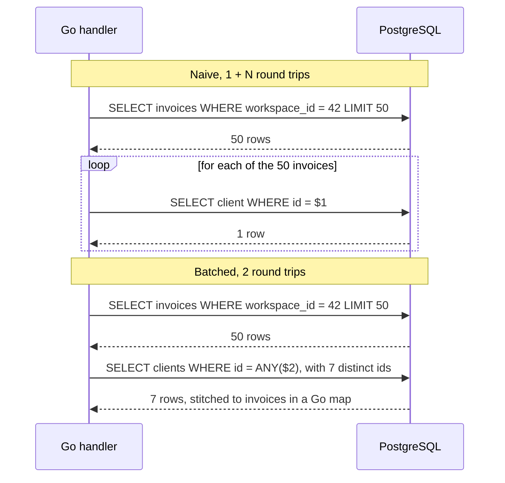
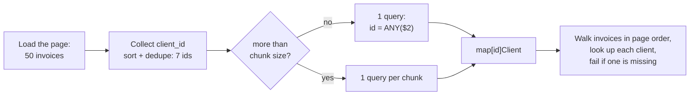
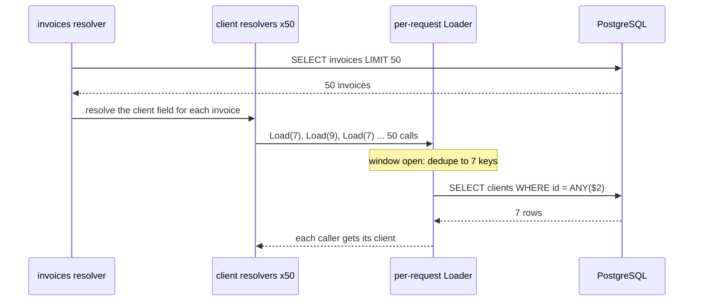

# N+1 Query Problem

> [!summary] TL;DR
> Code runs **1** query to load a list, then **1 more query per item** to load something related, so a page of 50 rows costs 51 round trips to the database. Each query is fast, but the waiting adds up. The fix is to fetch the related rows for the whole list at once: a JOIN, one batched `WHERE id = ANY($1)` query, or a loader that batches the lookups for you.

## 1. Why it exists

InvoiceOps shows a page of invoices with the client's name next to each total. The obvious code loads the page, then looks up each invoice's client:

```text
SELECT ... FROM invoices WHERE workspace_id = 42 ... LIMIT 50   -- 1 query
SELECT ... FROM clients WHERE id = 7                            -- 50 queries,
SELECT ... FROM clients WHERE id = 9                            -- one per invoice
...
```

Each client lookup is a primary-key hit that the server answers in microseconds. The cost is the **round trip**: the network hop, the driver, and borrowing a pooled connection. With roughly 1 ms per round trip (an estimate for an app and database in the same region):

| Page size | Queries (N+1) | Waiting (≈1 ms each) | Batched queries | Waiting |
| --------- | ------------- | -------------------- | --------------- | ------- |
| 10        | 11            | ~11 ms               | 2               | ~2 ms   |
| 50        | 51            | ~51 ms               | 2               | ~2 ms   |
| 100       | 101           | ~101 ms              | 2               | ~2 ms   |

At 200 page views per second, the N+1 version sends 10,200 queries per second where 400 would do. Latency grows with the page size, which is the signature of the bug.

## 2. Mental model

The number that matters is **round trips per request**, not milliseconds per query.

Think of a waiter who walks to the kitchen once per dish instead of once per table. Each trip is short, but 50 trips are slow, and the corridor fills up with waiters. Batching means writing the whole order on one ticket.

## 3. How it works

N+1 hides wherever code that loads one related row runs inside a loop:

- **Loops in Go handlers.** A repository call per row (`GetClient(ctx, inv.ClientID)`), often buried inside a helper or a JSON-building function.
- **ORM lazy loading.** In Rails, Django and Hibernate, reading `invoice.client` runs a query the first time. GORM has no lazy loading, so in Go the N+1 is an explicit call in a loop, such as `db.First(&client, inv.ClientID)`.
- **GraphQL resolvers.** The `client` field resolver runs once per invoice in the result. See [[GraphQL]].
- **Service calls.** One HTTP or gRPC call per item to another service: the same bug, with round trips of tens of milliseconds instead of about one.

The difference on the wire:



The batching steps in code:



## 4. Worked example

The repository interface and both versions of the list handler (Go 1.24, passes `go vet` and `go test -race`):

```go
// Store is the repository the invoice-list handler depends on.
type Store interface {
	ListInvoices(ctx context.Context, ws int64, limit int) ([]Invoice, error)
	GetClient(ctx context.Context, ws, id int64) (Client, error)
	ClientsByIDs(ctx context.Context, ws int64, ids []int64) ([]Client, error)
}

// Row is one line of the invoice list page.
type Row struct {
	InvoiceID  int64
	ClientName string
	TotalMinor int64
}

// ListNaive runs 1 query for the page plus 1 query per invoice: N+1.
func ListNaive(ctx context.Context, s Store, ws int64, limit int) ([]Row, error) {
	invs, err := s.ListInvoices(ctx, ws, limit)
	if err != nil {
		return nil, err
	}
	out := make([]Row, 0, len(invs))
	for _, inv := range invs {
		c, err := s.GetClient(ctx, ws, inv.ClientID) // one round trip per row
		if err != nil {
			return nil, err
		}
		out = append(out, Row{inv.ID, c.Name, inv.TotalMinor})
	}
	return out, nil
}

// ListBatched runs 1 query for the page plus 1 query per chunk of distinct
// client IDs, so the query count no longer grows with the page size.
func ListBatched(ctx context.Context, s Store, ws int64, limit, chunk int) ([]Row, error) {
	invs, err := s.ListInvoices(ctx, ws, limit)
	if err != nil {
		return nil, err
	}
	ids := make([]int64, 0, len(invs))
	for _, inv := range invs {
		ids = append(ids, inv.ClientID)
	}
	slices.Sort(ids)
	ids = slices.Compact(ids) // 50 invoices usually share far fewer clients

	byID := make(map[int64]Client, len(ids))
	for part := range slices.Chunk(ids, chunk) { // slices.Chunk: Go 1.23+
		cs, err := s.ClientsByIDs(ctx, ws, part)
		if err != nil {
			return nil, err
		}
		for _, c := range cs {
			byID[c.ID] = c
		}
	}

	out := make([]Row, 0, len(invs))
	for _, inv := range invs {
		c, ok := byID[inv.ClientID]
		if !ok { // a batch query silently omits missing IDs, so check
			return nil, fmt.Errorf("invoice %d: client %d: %w", inv.ID, inv.ClientID, ErrNotFound)
		}
		out = append(out, Row{inv.ID, c.Name, inv.TotalMinor})
	}
	return out, nil
}
```

The Postgres side of `ClientsByIDs` with pgx. The whole slice travels as **one** `bigint[]` parameter, and the `workspace_id` filter keeps a bad ID from reading another tenant's client:

```go
// ClientsByIDs is one round trip for any number of IDs: pgx sends the Go
// slice as a single bigint[] parameter.
func (s *PGStore) ClientsByIDs(ctx context.Context, ws int64, ids []int64) ([]Client, error) {
	rows, err := s.pool.Query(ctx,
		`SELECT id, name FROM clients WHERE workspace_id = $1 AND id = ANY($2)`, ws, ids)
	if err != nil {
		return nil, err
	}
	return pgx.CollectRows(rows, pgx.RowToStructByPos[Client]) // closes rows
}
```

The test that stops this bug from coming back counts queries against a fake store and checks that the count **does not grow with the page size**:

```go
// fakeStore is an in-memory Store that counts every "query" it serves.
type fakeStore struct {
	invoices []Invoice
	clients  map[int64]Client
	queries  atomic.Int64
}

func TestQueryCountDoesNotGrowWithPageSize(t *testing.T) {
	ctx := context.Background()
	for _, n := range []int{1, 10, 50} {
		s := newFakeStore(n, 7) // n invoices spread over at most 7 clients

		naive, err := ListNaive(ctx, s, 1, n)
		if err != nil {
			t.Fatal(err)
		}
		if got, want := s.queries.Swap(0), int64(1+n); got != want {
			t.Errorf("naive, %d invoices: %d queries, want %d", n, got, want)
		}

		batched, err := ListBatched(ctx, s, 1, n, 1000)
		if err != nil {
			t.Fatal(err)
		}
		if got := s.queries.Load(); got != 2 {
			t.Errorf("batched, %d invoices: %d queries, want 2", n, got)
		}
		if !slices.Equal(naive, batched) {
			t.Errorf("batched rows differ from naive rows")
		}
	}
}
```

Each fake method does `f.queries.Add(1)` and answers from memory. Two more tests in the same module check that 50 distinct clients with `chunk = 20` cost 1 + 3 queries, and that a missing client returns `ErrNotFound` instead of a blank name.

## 5. Variants and comparison

| Fix | How it works | Use when | Cost |
| --- | --- | --- | --- |
| `JOIN` | One query returns each invoice with its client's columns | Many-to-one lookups (invoice → client) | Parent columns repeat on every row; several 1:N joins multiply rows |
| `JOIN LATERAL` + `json_agg` | One query; each parent gets its children as a JSON array | You want nested children in one round trip | The subquery still runs once per parent inside the server; JSON decoding in Go |
| Batch `= ANY($1)` | Collect IDs, one query per relation, stitch in a map | 1:N children, or relations owned by other repositories | 2+ round trips; must reorder and detect missing IDs |
| Pipelining (`pgx.Batch`) | Queue N statements and send them in one network write | Many different queries that cannot be merged | Server still plans and runs N statements |
| ORM eager loading | GORM `Preload` (separate `IN` query) or `Joins` (`LEFT JOIN`) | You use an ORM | Easy to over-load associations the page never shows |
| DataLoader | Per-request object coalesces `Load(id)` calls into one batch | GraphQL resolvers, deep call trees | A few ms of wait window; code to wire per request |
| Batch endpoint | `POST /clients:batchGet` instead of N `GET /clients/{id}` | Cross-service N+1 | Another API to version |
| Denormalize | Store `client_name` on the invoice | Read-heavy lists, or values that should be frozen anyway | Updates fan out; see [[Materialized Views and Denormalization]] |

The other ORMs follow the same split. Django has `select_related` (JOIN) and `prefetch_related` (separate query). Rails has `includes`, `preload` and `eager_load`, plus `strict_loading` to raise on lazy loads. Hibernate has `JOIN FETCH` and `@BatchSize`.

## 6. Trade-offs and when not to use

- **JOIN with several 1:N relations multiplies rows.** 50 invoices × 10 line items × 3 payments in one JOIN return 1,500 rows. Three separate queries return 50 + 500 + 150 = 700.
- **`LIMIT` applies to joined rows, not to parents.** Joining line items and then `LIMIT 50` gives 50 *items*. Page the parents first (subquery or CTE), then join or batch the children.
- **Over-fetching.** `Preload` everything, or joining a wide `clients` row, moves bytes the page never shows.
- **Huge ID lists.** An `IN ($1, …, $n)` list has a hard ceiling: the protocol's Bind message counts parameters in 16 bits, so 65,535 at most. `= ANY($1)` sends one array parameter, but a 100,000-element array is still a slow, memory-heavy query. Chunk it, or ask why one page needs 100,000 IDs.
- **When N+1 is fine.** N is small and bounded (a detail page with 2 related rows), or each lookup hits an in-process cache.
- **Parallel goroutines are not a fix.** They cut latency but take up to N pool connections per request and leave the database load unchanged (see the trap question).

## 7. In production

- **Real systems:**
	- Facebook's DataLoader (JavaScript) popularised per-tick batching for GraphQL. gqlgen projects use Go loaders such as `dataloadgen`.
	- Rails apps catch lazy loads with the Bullet gem or `strict_loading`. Django tests pin query counts with `assertNumQueries`.
- **Detect it in Postgres.** N+1 statements are cheap, so they never top a "slowest queries" list. Sort `pg_stat_statements` by `calls` instead:

```sql
SELECT calls, round(mean_exec_time::numeric, 3) AS mean_ms, rows,
       left(query, 64) AS query
FROM pg_stat_statements
ORDER BY calls DESC
LIMIT 2;
```

Representative output (PostgreSQL 17):

```text
  calls  | mean_ms |  rows   |                              query
---------+---------+---------+------------------------------------------------------------------
 2105200 |   0.021 | 2105200 | SELECT id, name FROM clients WHERE workspace_id = $1 AND id = $2
   42104 |   0.389 | 2105200 | SELECT id, client_id, total_minor FROM invoices WHERE workspace_
```

2,105,200 / 42,104 = 50 client lookups per list query, exactly the page size. Server time per lookup is 0.021 ms; the real cost is round trips, which `pg_stat_statements` cannot see.

- **Detect it per request.** Count queries per request with a pgx tracer and log the count, or alert when it crosses a budget:

```go
type queryCountKey struct{}

// WithQueryCount returns a context that counts the queries run with it.
// Middleware calls it once per request and logs the total when it ends.
func WithQueryCount(ctx context.Context) (context.Context, *atomic.Int64) {
	n := new(atomic.Int64)
	return context.WithValue(ctx, queryCountKey{}, n), n
}

// QueryCounter is a pgx.QueryTracer. Install it on the pool config:
// cfg.ConnConfig.Tracer = QueryCounter{}
type QueryCounter struct{}

func (QueryCounter) TraceQueryStart(ctx context.Context, _ *pgx.Conn, _ pgx.TraceQueryStartData) context.Context {
	if n, ok := ctx.Value(queryCountKey{}).(*atomic.Int64); ok {
		n.Add(1)
	}
	return ctx
}

func (QueryCounter) TraceQueryEnd(context.Context, *pgx.Conn, pgx.TraceQueryEndData) {}
```

- **Detect it in traces.** With a pgx OpenTelemetry tracer (for example `otelpgx`), an N+1 request shows a "staircase" of 50 identical sibling DB spans under one HTTP span. See [[Distributed Tracing with OpenTelemetry]].
- **Failure modes → fixes:**
	- Page size raised from 20 to 100, and p99 jumps 5× → batch the lookups; add a query-count test.
	- Someone "fixes" latency with an `errgroup` per row, and the pool runs dry at peak → batch instead; see [[Connection Pooling]].
	- A shared, long-lived loader returns stale data, or another tenant's row → one loader per request, with the tenant in every query.
- **What to monitor:** queries per request (histogram per route), `pg_stat_statements` calls per route call, DB spans per trace, and pool wait time.

## 8. Deep dive

**How a DataLoader works without an event loop.** JavaScript's DataLoader batches every `load()` made in one event-loop tick. Go has no tick, so Go loaders collect keys for a short **wait window**, or until **maxBatch** keys arrive, then run one fetch. Every caller blocks on the result of the batch its key landed in. A per-request cache maps each key to its batch, so a key is never fetched twice:

```go
// Loader coalesces concurrent Load calls into one batch fetch, like GraphQL's
// DataLoader. Create one per request: it caches every key it has seen, and
// all its callers share that request's context.
type Loader[K comparable, V any] struct {
	fetch    func(ctx context.Context, keys []K) (map[K]V, error)
	wait     time.Duration // how long a batch stays open for more keys
	maxBatch int           // dispatch early once this many keys are queued

	mu    sync.Mutex
	open  *batch[K, V]       // the batch still collecting keys, if any
	cache map[K]*batch[K, V] // key -> the batch that fetches it
}

type batch[K comparable, V any] struct {
	keys  []K
	timer *time.Timer
	once  sync.Once
	done  chan struct{} // closed once vals and err are set
	vals  map[K]V
	err   error
}

func (l *Loader[K, V]) Load(ctx context.Context, key K) (V, error) {
	var zero V
	l.mu.Lock()
	b, seen := l.cache[key]
	if !seen {
		if l.open == nil {
			nb := &batch[K, V]{done: make(chan struct{})}
			nb.timer = time.AfterFunc(l.wait, func() { l.dispatch(ctx, nb) })
			l.open = nb
		}
		b = l.open
		b.keys = append(b.keys, key)
		l.cache[key] = b
		if len(b.keys) >= l.maxBatch {
			l.open = nil // full: the next new key starts another batch
			go l.dispatch(ctx, b)
		}
	}
	l.mu.Unlock()

	select {
	case <-b.done:
	case <-ctx.Done():
		return zero, ctx.Err()
	}
	if b.err != nil {
		return zero, b.err
	}
	v, ok := b.vals[key]
	if !ok {
		return zero, fmt.Errorf("key %v: %w", key, ErrNotFound)
	}
	return v, nil
}

// dispatch runs the batch's fetch exactly once, whether the timer or a full
// batch triggered it.
func (l *Loader[K, V]) dispatch(ctx context.Context, b *batch[K, V]) {
	l.mu.Lock()
	if l.open == b {
		l.open = nil
	}
	b.timer.Stop()
	l.mu.Unlock()
	b.once.Do(func() {
		b.vals, b.err = l.fetch(ctx, b.keys)
		close(b.done)
	})
}
```

Its test runs 300 concurrent resolver-style calls for 100 distinct clients. `maxBatch` is set to 100, so the batch fires as soon as the last key arrives and the test is deterministic:

```go
func TestLoaderCoalescesConcurrentLoads(t *testing.T) {
	var calls, keys atomic.Int64
	// maxBatch equals the number of distinct keys, so the batch fires as soon
	// as all of them are queued; the one-hour wait never matters.
	l := NewLoader(time.Hour, 100, clientFetcher(&calls, &keys))

	var wg sync.WaitGroup
	for i := range 300 { // 300 resolver calls for 100 distinct clients
		wg.Add(1)
		go func() {
			defer wg.Done()
			id := int64(i%100 + 1)
			if c, err := l.Load(context.Background(), id); err != nil || c.ID != id {
				t.Errorf("Load(%d) = %v, %v", id, c, err)
			}
		}()
	}
	wg.Wait()
	if calls.Load() != 1 || keys.Load() != 100 {
		t.Fatalf("%d fetches for %d keys, want 1 fetch for 100 keys", calls.Load(), keys.Load())
	}
}
```

The GraphQL flow it enables:



**Other internals worth knowing:**
- **`= ANY` versus a literal `IN` list.** `id = ANY($1)` is one statement text whatever the list length. That means one `pg_stat_statements` row and one cached prepared statement. Building `IN ($1, …, $n)` makes a new statement for every `n`, which churns pgx's per-connection statement cache (512 entries by default). PostgreSQL 17 also made B-tree index scans for a set of values, such as an `IN` list, more efficient, with fewer repeated index descents.
- **`ANY` ignores your order.** Rows come back in index or heap order. To keep the input order, join against the array: `JOIN unnest($1::bigint[]) WITH ORDINALITY AS u(id, pos) ON c.id = u.id ORDER BY u.pos`.
- **Pipelining** removes round trips without merging queries. `pgx.Batch` sends all queued statements at once, and they run in one implicit transaction. Use it when the N queries really are different. It still costs N plans and N executions.
- **Parallel N+1 can deadlock the pool.** A request holding a transaction (1 connection) that fans out goroutines needing more connections can starve itself. Example: pool size 10 and 10 such requests means every request holds 1 and waits for a second, until each context times out.
- **Across services** the same math applies with bigger numbers: 50 sequential calls at 20 ms each (an example figure) take 1 s. Add a batch endpoint, cache, or keep a local read model fed by events.

## 9. Interview questions

> [!question]- Each query takes 0.02 ms in `pg_stat_statements`. Why is the endpoint slow?
> Because the cost is round trips, not server time. 51 sequential queries pay 51 network hops, driver overheads and pool checkouts, about 1 ms each in the same region. The database sees only its 0.02 ms per query. Count queries per request, not just query latency.

> [!question]- How do you find N+1 queries in production?
> Sort `pg_stat_statements` by `calls` and compare calls per route call (50 client lookups per list query is the page size). Log a per-request query count from a driver tracer. Look for staircases of identical DB spans in traces, and for latency that grows with page size.

> [!question]- JOIN or a second batched query?
> JOIN for many-to-one (invoice → client): one round trip, little duplication. For one-to-many, and especially several of them, batch each child relation with `= ANY($1)`. Joining items and payments together multiplies rows, and `LIMIT` would cut child rows instead of parents.

> [!question]- How does a DataLoader work, and why one per request?
> It queues keys from many `Load` calls during a short window (or until a batch limit), runs one batch fetch, and hands each caller its value. It also dedupes keys. One per request keeps its cache short-lived (no stale data) and lets the batch query carry the request's tenant and context, so one workspace can never read another's rows.

> [!question]- Trap: "Just load the clients concurrently with goroutines. Fixed?"
> No. Latency drops, but the database still runs N queries and the request now takes up to N pool connections at once. Under load that exhausts the pool for every endpoint, and inside a transaction it can deadlock the pool. Batching reduces the work itself.

> [!question]- Trap: the batch has 200,000 IDs. Is `IN (...)` fine?
> No. A placeholder list hits the protocol's 65,535-parameter limit, and even one huge array is slow to plan and run, and heavy on memory. Chunk the IDs into batches of a few thousand, join against `unnest($1::bigint[])` or a temp table loaded with `COPY`, or fix the design that needs 200,000 IDs in one request.

> [!question]- How do you stop N+1 from coming back?
> Add tests that assert the query count stays constant as the page size grows (1 vs 50 rows), using a counting fake or a driver tracer against a real database. Turn on strict-loading modes in ORMs that have them. Track a per-route query budget in dashboards.

## 10. Cheat sheet

- N+1 = 1 list query + 1 query per row; cost grows with page size.
- Cost is round trips (~1 ms each in-region, an estimate), not server time.
- Detect: `pg_stat_statements` sorted by `calls`, query count per request, span staircases.
- Many-to-one → JOIN. One-to-many → batch `= ANY($1)` per relation, then stitch in a map.
- `= ANY($1)`: one parameter, one statement; chunk huge lists; check for missing IDs.
- GraphQL → one DataLoader per request.
- Goroutines per row hide latency but multiply connections.
- Guard with a query-count test.

## Links

- **Before this:** [[SQL Essentials]], [[Indexing Fundamentals]]
- **Next:** [[Query Plans and EXPLAIN]], [[Connection Pooling]], [[Materialized Views and Denormalization]]
- **Compare with:** [[GraphQL]] (wiring dataloaders into gqlgen), [[Database Access (database-sql, pgx, sqlc)]] (pgx and sqlc usage), [[Caching Patterns]] (when a cache is the better fix)
