# N+1 Query Problem

> [!summary] TL;DR
> Code runs **1** query to load a list, then **1 more query per item** to load something related, so a page of 50 rows costs 51 round trips to the database. Each query is fast, but the waiting adds up. The fix is to fetch the related rows for the whole list at once: a JOIN, one batched `WHERE id = ANY($1)` query, or a loader that batches the lookups for you.

> [!abstract] Core idea
> - The loop is the bug: one query for the list, then one query per row inside a loop.
> - Each query is fast; the cost is the network round trip, paid N times in a row.
> - The rule: fetch related rows for the whole list at once (JOIN, or one `WHERE id = ANY($1)` query).
> - Classic mistake: "fixing" it with goroutines. That still sends N queries and can exhaust the connection pool.

## Start here: the basics 🟢

> [!info] How to read this note (pick your level)
> - 🟢 **New to this?** Read "From zero" below, then sections 1, 2 and the cheat sheet (10). Stop there, that is a full first pass.
> - 🟡 **Know the basics?** Add section 3 (how it works), 4 (worked example) and 5-6 (fixes and trade-offs).
> - 🔴 **Interview / SDE-3 prep?** Add 7, 8 and 9. Headings are tagged 🟢🟡🔴 so you always know where you are.

> [!note] Before this note
> - [[SQL Essentials]]: you can read a `SELECT ... WHERE id = 7` and a simple `JOIN` of two tables.
> - [[Indexing Fundamentals]]: looking up one row by its ID through an index is very fast, so each single query here is cheap.

**From zero, in 60 seconds** 🟢

Your code asks the database for a list of 50 things. Then, for each thing on the list, it asks one more question. That is 51 separate trips to the database: 1 for the list plus N for the items. That pattern is the **N+1 problem**.

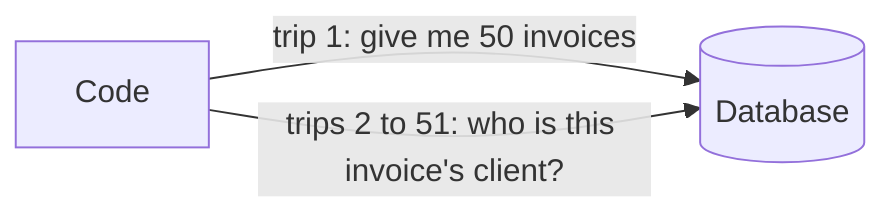

Each trip is fast on its own. The problem is the waiting between trips, called a **round trip**, paid 51 times in a row.

The fix is to ask for all the related things in one go, so 51 trips become 2.

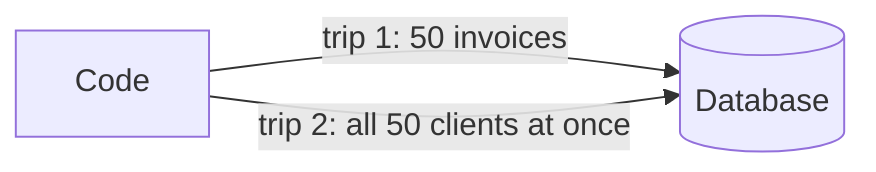

That is the whole bug and the whole fix. The rest of this note is just these 3 questions:
1. Where does the bug hide (loops, ORMs, GraphQL)?
2. Which one-trip fix do you pick (JOIN, batch query, DataLoader)?
3. How do you catch it in production and stop it coming back?

**The problem in one story.**
A page lists 50 invoices with each client's name.
The code loads the 50 invoices, then asks the database for one client name per invoice.
That is 51 trips to the database. Each trip is quick, but 51 of them in a row are slow.
The fix is to ask for all 50 client names in one trip.

**Words you need first**

| Word | Plain meaning | Tiny example |
| --- | --- | --- |
| Query | One question sent to the database | `SELECT * FROM clients WHERE id = 7` |
| Round trip | Send a query and wait for the answer over the network | About 0.5 ms inside a data centre |
| Related row | A row in another table linked by an ID | An invoice's client |
| ORM | A library that turns rows into objects and hides SQL | GORM, Hibernate |
| JOIN | One query that combines rows from two tables | `invoices JOIN clients` |
| Batch query | One query for many IDs at once | `WHERE id = ANY($1)` |
| Connection pool | A fixed set of open database connections shared by requests | 20 connections |
| Foreign key | A column that holds the ID of a row in another table | `invoices.client_id = 7` |
| Lazy loading | An ORM fetches a related row only when your code first touches it | reading `invoice.client` runs a query |
| DataLoader | A helper that waits a moment, gathers many single lookups, and runs them as one query | 50 `Load(id)` calls become 1 query |
| `pg_stat_statements` | A PostgreSQL add-on that counts how often each query ran and how long it took | shows a query called 2 million times |

**Picture it**

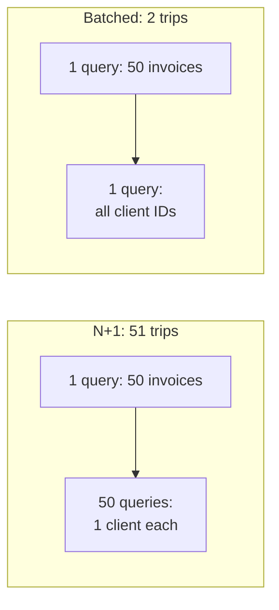

**Analogy.** Going to the shop once per item on your shopping list instead of once with the whole list.
Where it breaks: one huge list can also be a problem, so very large ID lists are split into chunks.

**How the rest of this note builds up**

- First, why N+1 appears, usually hidden by an ORM (section 1), and the mental model (section 2).
- Then what changes on the wire and the batching steps (section 3).
- Then a traced page of 50 invoices (section 4) and the fixes compared: JOIN, batch query, DataLoader (sections 5-6).
- Finally the SDE-3 view: detecting it in production and how a DataLoader works in Go (sections 7-8).

> [!tip] Remember
> Never query inside a loop: collect the IDs, fetch them in one query, join in memory.

## 1. Why it exists 🟢

InvoiceOps shows a page of invoices with the client's name next to each total. The obvious code loads the page, then looks up each invoice's client:

```text
SELECT ... FROM invoices WHERE workspace_id = 42 ... LIMIT 50   -- 1 query
SELECT ... FROM clients WHERE id = 7                            -- 50 queries,
SELECT ... FROM clients WHERE id = 9                            -- one per invoice
...
```

Each client lookup is a primary-key hit (a lookup by the table's unique ID column, through its index) that the server answers in microseconds. The cost is the **round trip**: the network hop, the driver, and borrowing a pooled connection. With roughly 1 ms per round trip (an estimate for an app and database in the same region):

| Page size | Queries (N+1) | Waiting (≈1 ms each) | Batched queries | Waiting |
| --------- | ------------- | -------------------- | --------------- | ------- |
| 10        | 11            | ~11 ms               | 2               | ~2 ms   |
| 50        | 51            | ~51 ms               | 2               | ~2 ms   |
| 100       | 101           | ~101 ms              | 2               | ~2 ms   |

At 200 page views per second, the N+1 version sends 10,200 queries per second where 400 would do. Latency grows with the page size, which is the signature of the bug.

### Real-life example 🟢

Picture a food app's home screen listing 20 restaurants, each with its rating and delivery time.
If the app's server loads the 20 restaurants and then asks the database for each rating one at a time, that is 21 trips.
With 1 ms per trip it hardly shows, but when the list grows to 100 and a million people open the app at dinner, those extra trips pile up.
Fetching all 20 ratings in one query keeps the screen fast no matter how long the list is.

## Common beginner mistakes 🟢

- **Calling the database inside a `for` loop** → one query per row, so time grows with the page size → collect the IDs first, then run one query with `WHERE id = ANY($1)`.
- **Judging by "each query is only 0.02 ms"** → the cost is the trip there and back, not the work inside the database → count queries per request, not just time per query.
- **"Fixing" it with one goroutine per row** → still N queries, and now N connections at once, which can empty the pool → batch the lookups instead.
- **Trusting the batch result to have every ID** → `ANY` silently skips IDs that do not exist, so you print a blank name → check for missing IDs when you match rows back.
- **Joining several one-to-many tables in one query** → rows multiply (50 × 10 × 3 = 1,500) → run one batched query per child table.

## 2. Mental model 🟢

The number that matters is **round trips per request**, not milliseconds per query.

Think of a waiter who walks to the kitchen once per dish instead of once per table. Each trip is short, but 50 trips are slow, and the corridor fills up with waiters. Batching means writing the whole order on one ticket.

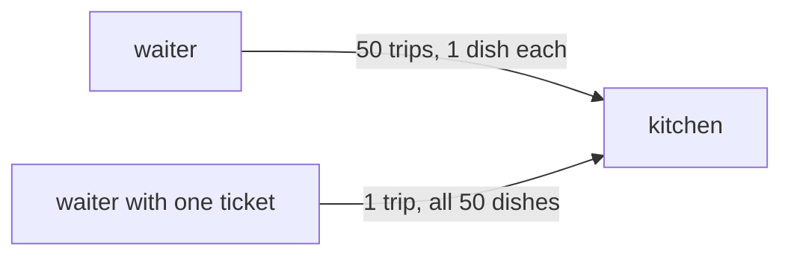

## 3. How it works 🟡

> 🟢 → 🟡 **You now know** the bug: a query inside a loop, paid as one round trip per row. **Next we open the box**: where that loop hides in real code, what the traffic to the database looks like, and the exact steps of the batched fix.

N+1 hides wherever code that loads one related row runs inside a loop:

- **Loops in Go handlers.** A repository call per row (`GetClient(ctx, inv.ClientID)`), often buried inside a helper or a JSON-building function.
- **ORM lazy loading** (the ORM runs a hidden query the first time you touch a related object). In Rails, Django and Hibernate, reading `invoice.client` runs a query the first time. GORM has no lazy loading, so in Go the N+1 is an explicit call in a loop, such as `db.First(&client, inv.ClientID)`.
- **GraphQL resolvers** (in GraphQL, a resolver is the small function that fills in one field of the answer). The `client` field resolver runs once per invoice in the result. See [[GraphQL]].
- **Service calls.** One HTTP or gRPC (a fast way for one service to call a function on another over the network) call per item to another service: the same bug, with round trips of tens of milliseconds instead of about one.

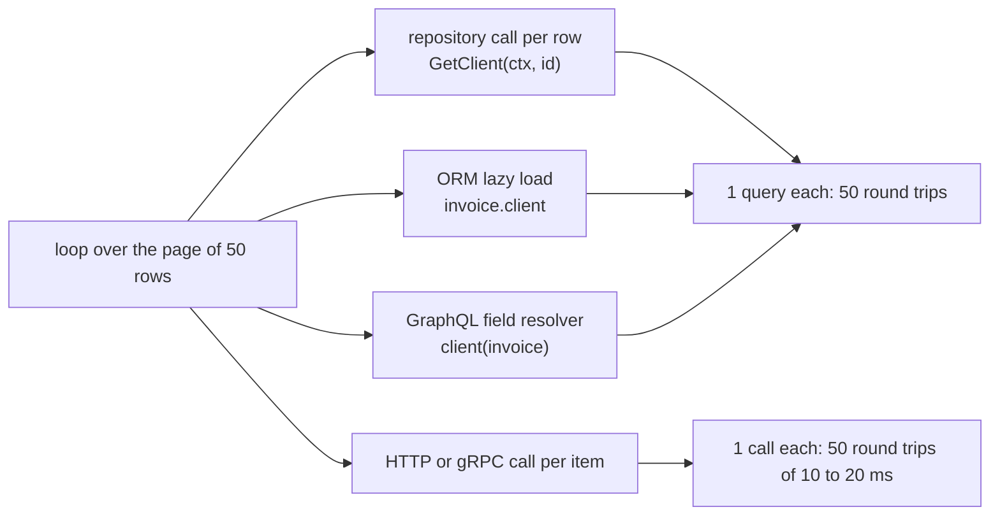

### The difference on the wire

**In plain words:** the diagram below shows the actual back-and-forth with the database — the slow version chats 51 times, the fast version chats twice.

**Step by step:**
1. The handler asks for 50 invoices of workspace 42. One trip, 50 rows back.
2. Naive way: for invoice 1 it asks "who is client 7?", waits, then invoice 2 asks "who is client 9?", waits, and so on 50 times.
3. Batched way: it looks at all 50 invoices, sees only 7 different client IDs, and asks once for those 7.
4. The 7 clients come back in one trip and are matched to the 50 invoices in Go memory.

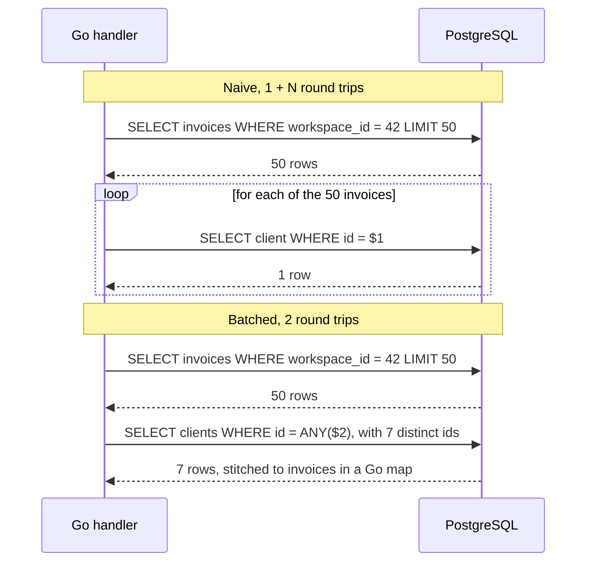

### The batching steps

**In plain words:** the fix is a recipe — gather the IDs, drop duplicates, fetch them all with one query, then match them back up in memory, like doing one shop run for the whole list.

**Step by step:**
1. Load the page: 50 invoices.
2. Pull out each invoice's `client_id`: 50 values such as 7, 9, 7, 3, 9...
3. Sort them and drop repeats: 3, 7, 9, 12, 15, 21, 30. Now 7 IDs.
4. Run one query: `SELECT ... FROM clients WHERE id = ANY($2)` with those 7 IDs.
5. Put the 7 clients in a map keyed by ID, then walk the 50 invoices in order and look each client up. If one is missing, return an error.

Collect the foreign keys (the `client_id` values), remove duplicates, fetch each chunk with one query and stitch the result by key:

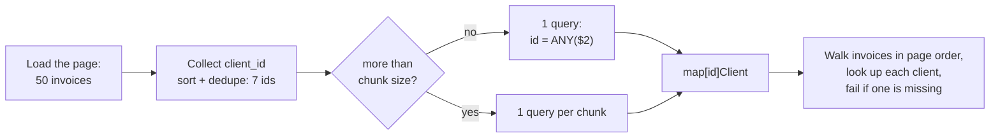

## 4. Worked example 🟡

### Whiteboard version

**In plain words:** the smallest possible Go version of the bug and the fix, side by side — the slow one queries inside the loop, the fast one queries once before it.

The bare idea: the slow version calls the database inside the loop; the fast one collects IDs, runs one batched query, and joins in a map.

```go
package wb

type Invoice struct{ ID, ClientID int64 }
type Client struct{ ID int64; Name string }

// Bad: 1 query for the list, then 1 query per invoice.
func namesSlow(invs []Invoice, getClient func(int64) Client) []string {
	out := make([]string, 0, len(invs))
	for _, inv := range invs {
		out = append(out, getClient(inv.ClientID).Name) // N round trips
	}
	return out
}

// Good: collect IDs, one batched query, then join in memory.
func namesFast(invs []Invoice, clientsByIDs func([]int64) []Client) []string {
	ids := make([]int64, 0, len(invs))
	for _, inv := range invs {
		ids = append(ids, inv.ClientID)
	}
	byID := make(map[int64]Client)
	for _, c := range clientsByIDs(ids) { // 1 round trip: WHERE id = ANY($1)
		byID[c.ID] = c
	}
	out := make([]string, 0, len(invs))
	for _, inv := range invs {
		out = append(out, byID[inv.ClientID].Name) // a missing client gives ""; the full version checks
	}
	return out
}
```

The runnable version adds workspace scoping, context, a missing-client check, and tests.

### A page of 50 invoices, traced

**In plain words:** the same page measured both ways — 51 trips (about 51 ms) against 2 trips (about 2 ms). The table shows where the saving comes from.

The page has 50 invoices that share 7 distinct clients, and the chunk size is 1,000.

| Step | Naive | Batched |
| --- | --- | --- |
| Load the page | 1 query | 1 query |
| Fetch clients | 50 queries, one per invoice, 43 of them repeats | collect 50 client IDs, sort, remove duplicates: 7 IDs; 1 query with `id = ANY($2)` |
| Total round trips | 51 | 2 |
| At about 1 ms each (an estimate) | about 51 ms | about 2 ms |

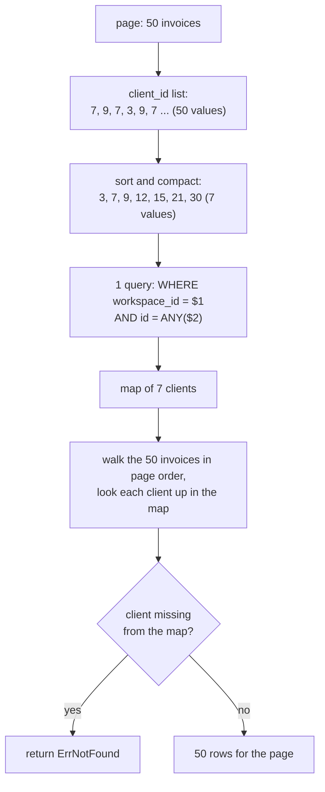

Two details matter. The batch query silently omits IDs that do not exist, so the stitching step must check for a missing client instead of printing a blank name.

And with 50 distinct clients and a chunk size of 20, the batched version runs 1 + 3 queries: the count depends on the number of chunks, not on the page size.

The pgx side (pgx is the popular PostgreSQL driver for Go) sends the whole ID slice as one `bigint[]` parameter, and the `workspace_id` filter keeps a bad ID from reading another tenant's client. With sqlc (a tool that turns SQL files into type-safe Go functions), the same query is declared once and sqlc generates a method that takes `[]int64`. sqlc does not allow mixing `$n` and named parameters in one query, so both are named here:

```sql
-- name: ClientsByIDs :many
SELECT id, name FROM clients
WHERE workspace_id = @workspace_id AND id = ANY(@ids::bigint[]);
```

The test that stops this bug from coming back counts queries against a fake store and checks that the count **does not grow with the page size**: for 1, 10 and 50 invoices the naive version costs 2, 11 and 51 queries, and the batched version always costs 2.

Runnable Go version: [[N+1 Query Problem - Go]]

## 5. Variants and comparison 🟡

| Fix | How it works | Use when | Cost |
| --- | --- | --- | --- |
| `JOIN` | One query returns each invoice with its client's columns | Many-to-one lookups (invoice → client) | Parent columns repeat on every row; several 1:N joins multiply rows |
| `JOIN LATERAL` + `json_agg` | One query; each parent gets its children as a JSON array | You want nested children in one round trip | The subquery still runs once per parent inside the server; JSON decoding in Go |
| Batch `= ANY($1)` | Collect IDs, one query per relation, stitch in a map | 1:N children, or relations owned by other repositories | 2+ round trips; must reorder and detect missing IDs |
| Pipelining (`pgx.Batch`) | Queue N statements and send them in one network write | Many different queries that cannot be merged | Server still plans and runs N statements |
| ORM eager loading | GORM `Preload` (separate `IN` query) or `Joins` (`LEFT JOIN`) | You use an ORM | Easy to over-load associations the page never shows |
| DataLoader | Per-request object coalesces `Load(id)` calls into one batch | GraphQL resolvers, deep call trees | A few ms of wait window; code to wire per request |
| Batch endpoint | `POST /clients:batchGet` instead of N `GET /clients/{id}` | Cross-service N+1 | Another API to version |
| Denormalize | Store `client_name` on the invoice | Read-heavy lists, or values that should be frozen anyway | Updates fan out; see [[Materialized Views and Denormalization]] |

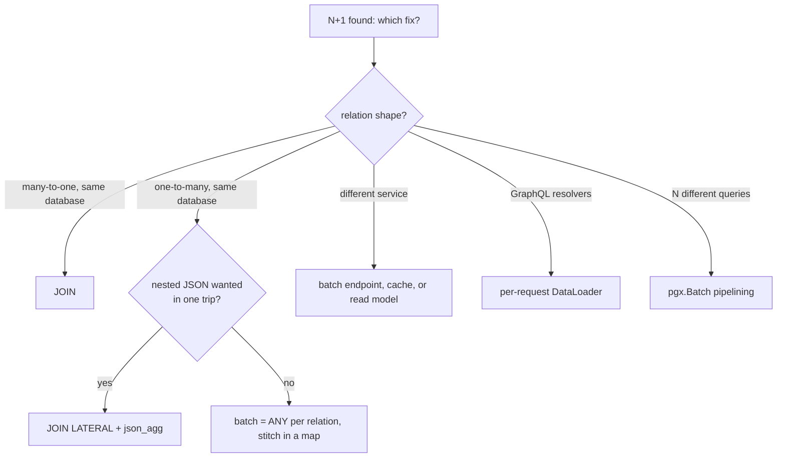

Pipelining removes round trips without merging the queries:

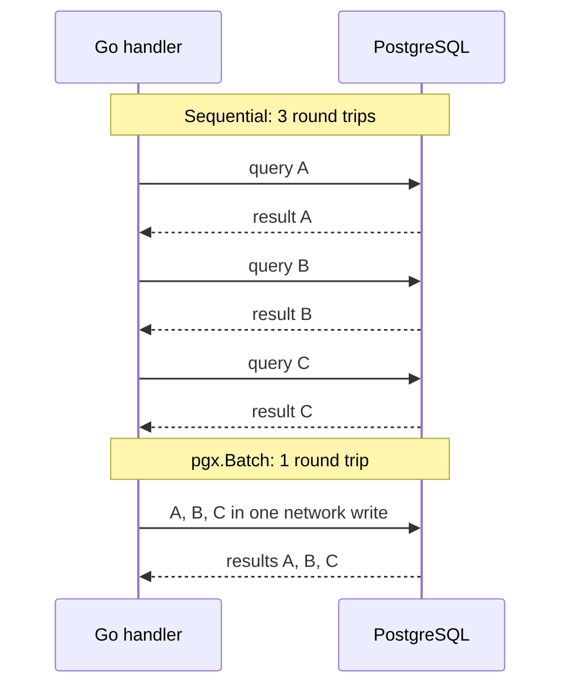

The other ORMs follow the same split. Django has `select_related` (JOIN) and `prefetch_related` (separate query). Rails has `includes`, `preload` and `eager_load`, plus `strict_loading` to raise on lazy loads. Hibernate has `JOIN FETCH` and `@BatchSize`.

## 6. Trade-offs and when not to use 🟡

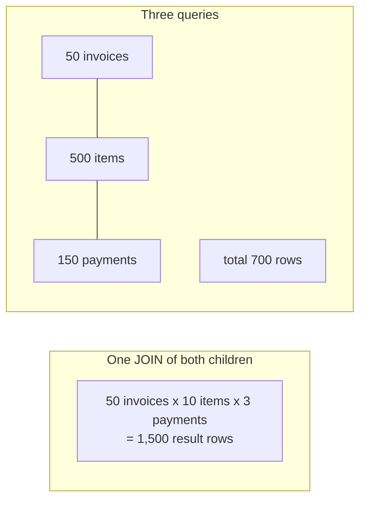

- **JOIN with several 1:N relations multiplies rows.** 50 invoices × 10 line items × 3 payments in one JOIN return 1,500 rows. Three separate queries return 50 + 500 + 150 = 700.
- **`LIMIT` applies to joined rows, not to parents.** Joining line items and then `LIMIT 50` gives 50 *items*. Page the parents first (subquery or CTE, a named sub-query written with `WITH`), then join or batch the children.
- **Over-fetching.** `Preload` everything, or joining a wide `clients` row, moves bytes the page never shows.
- **Huge ID lists.** An `IN ($1, …, $n)` list has a hard ceiling: the protocol's Bind message counts parameters in 16 bits, so 65,535 at most. `= ANY($1)` sends one array parameter, but a 100,000-element array is still a slow, memory-heavy query. Chunk it, or ask why one page needs 100,000 IDs.
- **When N+1 is fine.** N is small and bounded (a detail page with 2 related rows), or each lookup hits an in-process cache.
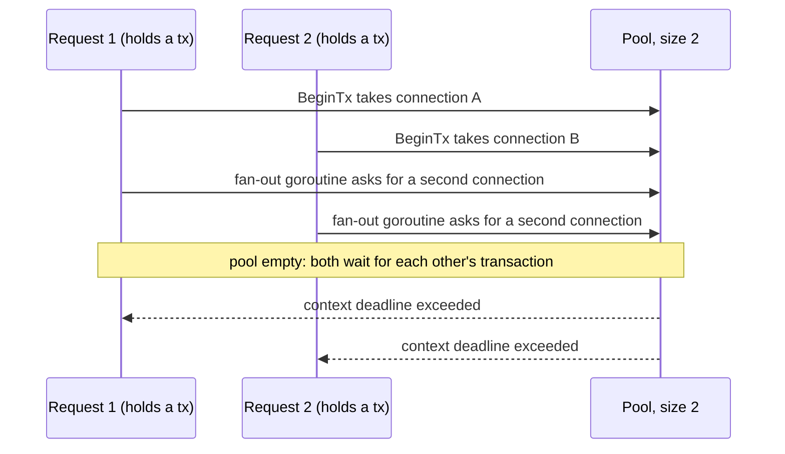

- **Parallel goroutines are not a fix.** They cut latency but take up to N pool connections per request and leave the database load unchanged (see the trap question).

## 7. In production 🔴

> 🟡 → 🔴 **You now know** the fixes and their costs. **Next is the senior view**: spotting N+1 in a live system from query counts and traces, the ways "fixes" go wrong in production, and how a Go DataLoader batches without an event loop.

- **Real systems:**
	- Facebook's DataLoader (JavaScript) popularised per-tick batching for GraphQL. gqlgen projects use Go loaders such as `dataloadgen`.
	- Rails apps catch lazy loads with the Bullet gem or `strict_loading`. Django tests pin query counts with `assertNumQueries`.
- **Detect it in Postgres.** N+1 statements are cheap, so they never top a "slowest queries" list. Sort `pg_stat_statements` by `calls` instead:

```sql
SELECT calls, round(mean_exec_time::numeric, 3) AS mean_ms, rows,
       left(query, 64) AS query
FROM pg_stat_statements
ORDER BY calls DESC
LIMIT 2;
```

Representative output (PostgreSQL 17):

```text
  calls  | mean_ms |  rows   |                              query
---------+---------+---------+------------------------------------------------------------------
 2105200 |   0.021 | 2105200 | SELECT id, name FROM clients WHERE workspace_id = $1 AND id = $2
   42104 |   0.389 | 2105200 | SELECT id, client_id, total_minor FROM invoices WHERE workspace_
```

2,105,200 / 42,104 = 50 client lookups per list query, exactly the page size. Server time per lookup is 0.021 ms; the real cost is round trips, which `pg_stat_statements` cannot see.

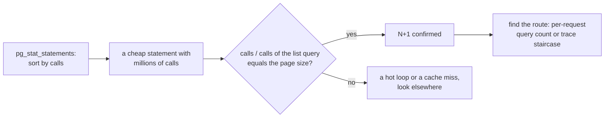

- **Detect it per request.** A pgx `QueryTracer` (a hook pgx calls around every query) increments a counter stored in the request context. Middleware creates the counter once per request, logs the total when the request ends, and alerts when it crosses a budget. The code is in the Go note.

- **Detect it in traces.** With a pgx OpenTelemetry tracer (for example `otelpgx`), an N+1 request shows a "staircase" of 50 identical sibling DB spans (a span is one timed step in a trace) under one HTTP span. See [[Distributed Tracing with OpenTelemetry]].
- **Failure modes → fixes:**
	- Page size raised from 20 to 100, and p99 (the time 99 out of 100 requests finish within) jumps 5× → batch the lookups; add a query-count test.
	- Someone "fixes" latency with an `errgroup` (a Go helper that runs goroutines and waits for all) per row, and the pool runs dry at peak → batch instead; see [[Connection Pooling]].
	- A shared, long-lived loader returns stale data, or another tenant's row → one loader per request, with the tenant in every query.
- **What to monitor:** queries per request (histogram per route), `pg_stat_statements` calls per route call, DB spans per trace, and pool wait time.

## 8. Deep dive 🔴

### How a DataLoader works without an event loop

**In plain words:** a DataLoader is like a shuttle bus — it waits a moment for passengers (lookup requests) to gather, then makes one trip for all of them instead of one trip each.

JavaScript's DataLoader batches every `load()` made in one event-loop tick. Go has no tick, so Go loaders collect keys for a short **wait window**, or until **maxBatch** keys arrive, then run one fetch.

Every caller blocks on the result of the batch its key landed in. A per-request cache maps each key to its batch, so a key is never fetched twice.

The `Loader[K, V]` type holds the open batch, a per-request cache from key to batch, a wait window and a `maxBatch` limit. `Load` joins or starts a batch and blocks until it finishes; `dispatch` runs the fetch exactly once, whether the timer or a full batch triggered it.

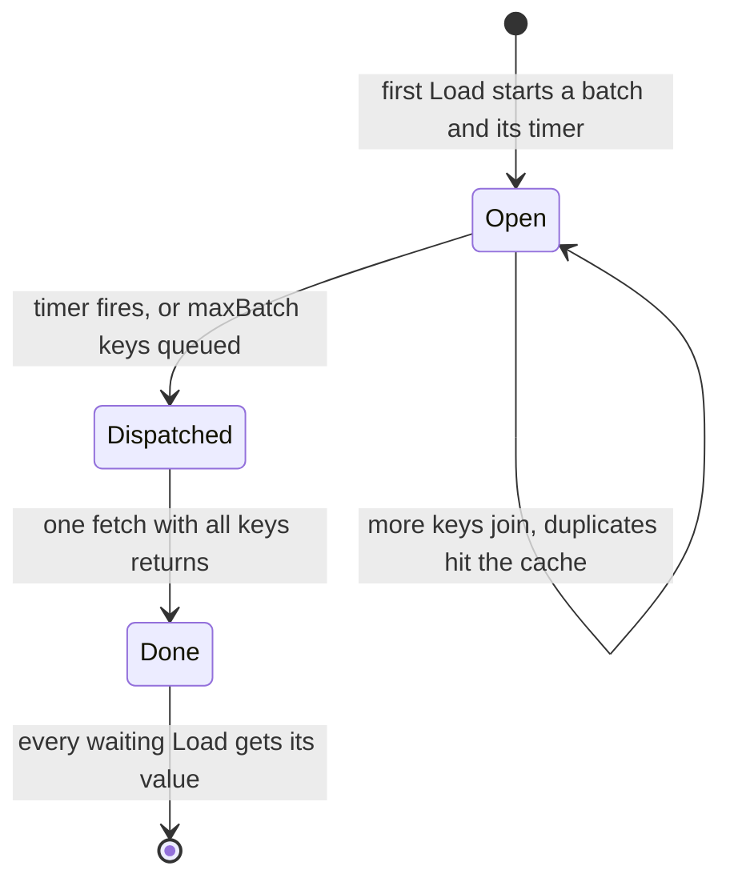

Its test runs 300 concurrent resolver-style calls for 100 distinct clients. `maxBatch` is set to 100, so the batch fires as soon as the last key arrives and the test is deterministic: the expected result is 1 fetch for 100 keys.

One caveat of this design: the batch runs with the context of the caller that opened it, so if that caller's context is cancelled, every caller in that batch gets the error.

Inside one request all callers share the request context, which is another reason to keep one loader per request. The code and the test are in [[N+1 Query Problem - Go]].

### The GraphQL flow it enables

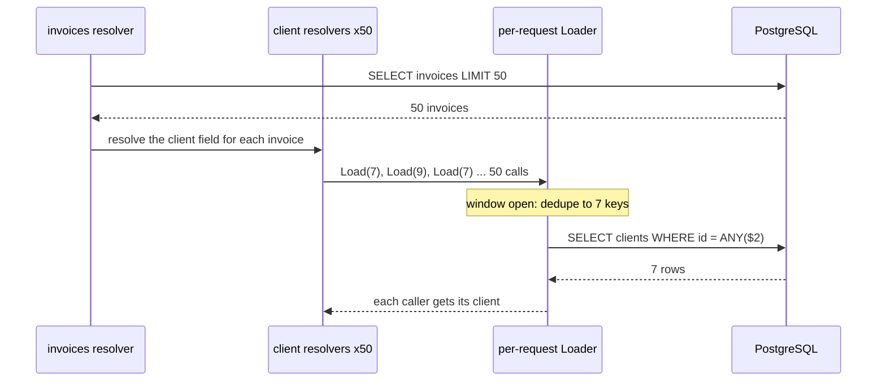

### Other internals worth knowing

- **`= ANY` versus a literal `IN` list.** `id = ANY($1)` is one statement text whatever the list length. That means one `pg_stat_statements` row and one cached prepared statement. Building `IN ($1, …, $n)` makes a new statement for every `n`, which churns pgx's per-connection statement cache (512 entries by default). PostgreSQL 17 also made B-tree index scans for a set of values, such as an `IN` list, more efficient, with fewer repeated index descents.
- **`ANY` ignores your order.** Rows come back in index or heap order. To keep the input order, join against the array: `JOIN unnest($1::bigint[]) WITH ORDINALITY AS u(id, pos) ON c.id = u.id ORDER BY u.pos`.
- **Pipelining** removes round trips without merging queries. `pgx.Batch` sends all queued statements at once, and they run in one implicit transaction. Use it when the N queries really are different. It still costs N plans and N executions.
- **Parallel N+1 can deadlock the pool.** A request holding a transaction (1 connection) that fans out goroutines needing more connections can starve itself. Example: pool size 10 and 10 such requests means every request holds 1 and waits for a second, until each context times out.
- **Across services** the same math applies with bigger numbers: 50 sequential calls at 20 ms each (an example figure) take 1 s. Add a batch endpoint, cache, or keep a local read model fed by events.

## 9. Interview questions 🔴

> [!question]- Each query takes 0.02 ms in `pg_stat_statements`. Why is the endpoint slow?
> Because the cost is round trips, not server time. 51 sequential queries pay 51 network hops, driver overheads and pool checkouts, about 1 ms each in the same region. The database sees only its 0.02 ms per query. Count queries per request, not just query latency.

> [!question]- How do you find N+1 queries in production?
> Sort `pg_stat_statements` by `calls` and compare calls per route call (50 client lookups per list query is the page size). Log a per-request query count from a driver tracer. Look for staircases of identical DB spans in traces, and for latency that grows with page size.

> [!question]- JOIN or a second batched query?
> JOIN for many-to-one (invoice → client): one round trip, little duplication. For one-to-many, and especially several of them, batch each child relation with `= ANY($1)`. Joining items and payments together multiplies rows, and `LIMIT` would cut child rows instead of parents.

> [!question]- How does a DataLoader work, and why one per request?
> It queues keys from many `Load` calls during a short window (or until a batch limit), runs one batch fetch, and hands each caller its value. It also dedupes keys. One per request keeps its cache short-lived (no stale data) and lets the batch query carry the request's tenant and context, so one workspace can never read another's rows.

> [!question]- Trap: "Just load the clients concurrently with goroutines. Fixed?"
> No. Latency drops, but the database still runs N queries and the request now takes up to N pool connections at once. Under load that exhausts the pool for every endpoint, and inside a transaction it can deadlock the pool. Batching reduces the work itself.

> [!question]- Trap: the batch has 200,000 IDs. Is `IN (...)` fine?
> No. A placeholder list hits the protocol's 65,535-parameter limit, and even one huge array is slow to plan and run, and heavy on memory. Chunk the IDs into batches of a few thousand, join against `unnest($1::bigint[])` or a temp table loaded with `COPY`, or fix the design that needs 200,000 IDs in one request.

> [!question]- How do you stop N+1 from coming back?
> Add tests that assert the query count stays constant as the page size grows (1 vs 50 rows), using a counting fake or a driver tracer against a real database. Turn on strict-loading modes in ORMs that have them. Track a per-route query budget in dashboards.

## 10. Cheat sheet 🟢

🟢 **Plain version:** Never ask the database a question inside a loop. Gather all the IDs first, ask once, and match the answers back in memory. Count how many queries one page makes; if it grows with the list size, you have N+1. Running the loop in parallel is not a fix.


- N+1 = 1 list query + 1 query per row; cost grows with page size.
- Cost is round trips (~1 ms each in-region, an estimate), not server time.
- Detect: `pg_stat_statements` sorted by `calls`, query count per request, span staircases.
- Many-to-one → JOIN. One-to-many → batch `= ANY($1)` per relation, then stitch in a map.
- `= ANY($1)`: one parameter, one statement; chunk huge lists; check for missing IDs.
- GraphQL → one DataLoader per request.
- Goroutines per row hide latency but multiply connections.
- Guard with a query-count test.

## Self-check 🟢🟡

🟢 Easy

> [!question]- What do the "1" and the "N" stand for in N+1?
> 1 query to load the list, then N more queries, one per item in the list.

> [!question]- Why is N+1 slow if each query takes 0.02 ms?
> Every query pays a network round trip of about 1 ms, and they run one after another.

> [!question]- What is the simplest fix?
> Collect the IDs, fetch them all with one query such as `WHERE id = ANY($1)`, and match them in a map.

🟡 Medium

> [!question]- Invoice to client is many-to-one. JOIN or batch?
> A JOIN: one round trip and little duplicated data.

> [!question]- How do you spot N+1 in `pg_stat_statements`?
> Sort by `calls`: a cheap query called about page-size times per list query is the sign.

> [!question]- Why does one goroutine per row make things worse under load?
> It still sends N queries and grabs up to N pool connections per request, which can starve every other request.

## Links

- **Before this:** [[SQL Essentials]], [[Indexing Fundamentals]]
- **Runnable code:** [[N+1 Query Problem - Go]] (naive and batched list handlers, the pgx batch query, a query counter, a generic DataLoader, tests)
- **Next:** [[Query Plans and EXPLAIN]], [[Connection Pooling]], [[Materialized Views and Denormalization]]
- **Compare with:** [[GraphQL]] (wiring dataloaders into gqlgen), [[Database Access (database-sql, pgx, sqlc)]] (pgx and sqlc usage), [[Caching Patterns]] (when a cache is the better fix)

### Watch on YouTube

- [Understanding the N+1 Select Problem in Database-Driven Applications](https://www.youtube.com/watch?v=kIUhMd2JeCY) · Asdf asdf1234 · explains the N+1 loop bug and batching fix
