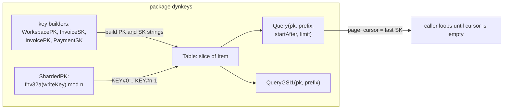
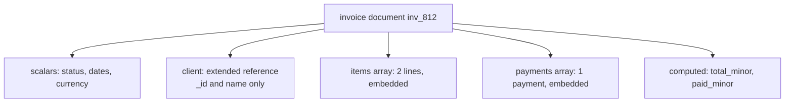
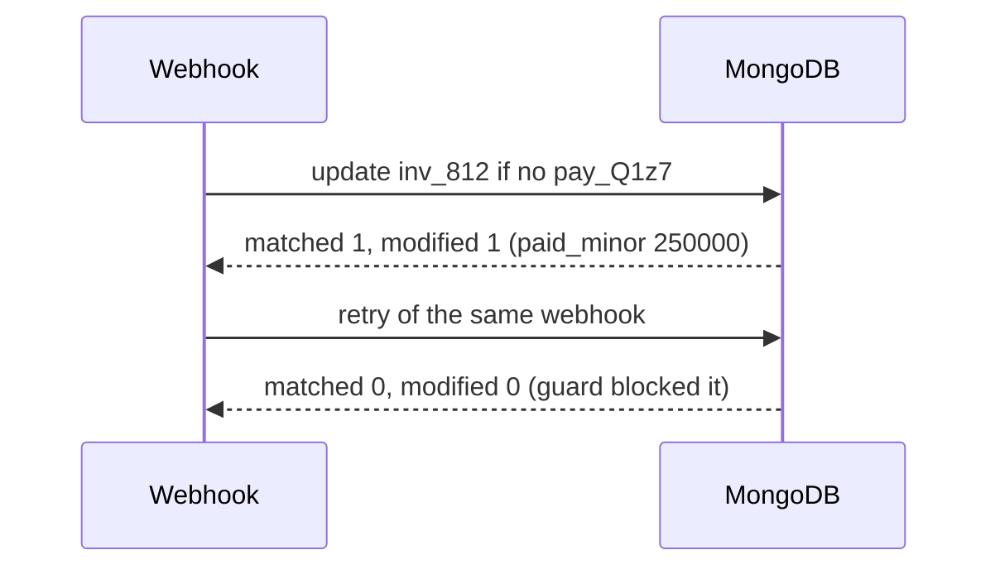
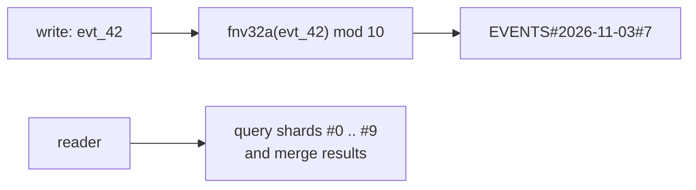
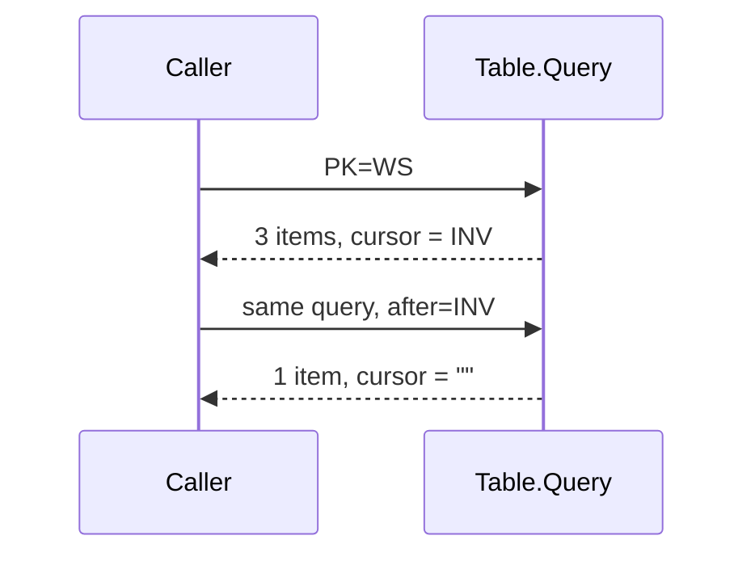

# NoSQL Data Modeling - Go

> [!summary] TL;DR
> This note holds the runnable code behind [[NoSQL Data Modeling]]: a key builder and an in-memory `Query` for a DynamoDB single table (prefix queries, pagination with a cursor, an overloaded GSI, write sharding), plus the MongoDB invoice document and the atomic payment update written out in full.

## Before the code

- **String keys**: plain functions build DynamoDB keys such as `WS#acme` and `INV#2026-11#0042`.
- **`sort` and `strings`**: the in-memory table keeps items in sort-key order and matches prefixes, like a real `Query`.
- **Cursor pagination**: `Query` returns at most `limit` items and a cursor to continue from.
- **`hash/fnv`**: spreads one hot key over several partition keys in a stable way.
- **`package main`**: a small program prints the whiteboard example.
- **Run**: `go vet ./... && go test -race ./...`, and `go run ./cmd` for the whiteboard.

## What this code shows

| Code | Theory concept in [[NoSQL Data Modeling]] |
| --- | --- |
| `main` printout (whiteboard program) | access pattern to key: every read is one `Query` on one partition key |
| `WorkspacePK`, `InvoiceSK`, `InvoicePK`, `PaymentSK` | composite sort keys that serve several prefixes |
| `Table.Query` with `startAfter` and a returned cursor | `LastEvaluatedKey` and `ExclusiveStartKey` pagination |
| `Table.QueryGSI1` | an overloaded GSI answering "this client and its invoices" |
| `ShardedPK` | write sharding to escape the 1,000 WCU per-partition limit |
| MongoDB invoice document and `$push`/`$inc` update | embedding, extended reference, computed fields and the idempotent single-document write |



## Setup

- Go 1.24, standard library only. A scratch module `dynkeys` with `dynkeys.go` (package `dynkeys`), `dynkeys_test.go`, and `cmd/main.go` for the whiteboard program.
- Run the tests with `go vet ./... && go test -race ./...`, and the whiteboard with `go run ./cmd`.
- The MongoDB documents are JSON and run in `mongosh`; they are not part of the Go module.

## Code

The code has two halves. The first half (steps 1 to 3) is the design on paper: the keys each access pattern uses, the MongoDB document, and the atomic payment write. The second half (steps 4 to 8) is a small Go model of the DynamoDB read path, so you can watch prefix queries, cursors and shard keys behave.

### Step 1: the whiteboard program

**Concept.** The central rule of [[NoSQL Data Modeling#3.1 Step 1: list the access patterns]] is that you list the reads first and derive the keys from them.

This program prints the key each access pattern would use, so the design can be checked at a glance before any table exists.

The alternative is to design entities first and discover the queries later, which is how you end up with scans; we chose to start from the queries because a DynamoDB `Query` can only touch one partition key.

```go
package main

import "fmt"

// Access pattern -> key. Every read is one Query on one partition key.
func main() {
	ws, inv, client := "acme", "inv_812", "c_1"
	fmt.Println("AP2 Query PK =", "WS#"+ws, "SK begins_with", "INV#2026-11")
	fmt.Println("AP1 Query PK =", "INVOICE#"+inv) // META, ITEM#001.., PAY#...
	fmt.Println("AP3 Query GSI1PK =", "CLIENT#"+client)
	// Item key of the invoice summary: entity # month # id, sortable by prefix.
	fmt.Println("item:", "WS#"+ws, "/", "INV#2026-11#"+inv)
	// Next page: send LastEvaluatedKey back as ExclusiveStartKey.
}
```

**How it works.**

1. The three variables are the only inputs: a workspace, an invoice id and a client id.
2. AP2 ("this workspace's invoices of one month") is a partition key `WS#acme` plus a sort-key prefix `INV#2026-11`.
3. AP1 ("one invoice with its lines and payments") uses a different partition key, `INVOICE#inv_812`, whose sort keys are `META`, `ITEM#...` and `PAY#...`.
4. AP3 ("this client and its invoices") uses the partition key of the overloaded index, `GSI1PK = CLIENT#c_1`.
5. The invoice summary item lives under the workspace partition with a sort key of the form entity, month, id, so one prefix selects a month.

| Access pattern | Table or index | Partition key | Sort-key condition |
| --- | --- | --- | --- |
| AP1 invoice detail | base table | `INVOICE#inv_812` | none (whole partition) |
| AP2 invoices in a month | base table | `WS#acme` | begins_with `INV#2026-11` |
| AP3 client and invoices | GSI1 | `CLIENT#c_1` | none |

### Step 2: the invoice document in MongoDB

**Concept.** [[NoSQL Data Modeling#3.2 MongoDB: embed or reference]] says to embed what is read together and bounded in size.

An invoice has a few line items and a few payments, so both are embedded; the client is only copied as a small extended reference (`_id` and `name`), because the full client changes independently ([[NoSQL Data Modeling#3.3 MongoDB design patterns]]).

`total_minor` and `paid_minor` are computed fields stored on write so a list screen never sums arrays. The alternative, one collection per entity joined with `$lookup`, would cost several reads per screen.

```json
{
  "_id": "inv_812",
  "schema_version": 2,
  "workspace_id": "acme",
  "number": "INV-2026-0812",
  "status": "partially_paid",
  "currency": "INR",
  "issue_date": "2026-11-01",
  "due_date": "2026-11-15",
  "client": { "_id": "c_1", "name": "Acme Ltd" },
  "items": [
    { "line_no": 1, "description": "Design retainer", "quantity": 1, "unit_price_minor": 200000 },
    { "line_no": 2, "description": "Hosting", "quantity": 2, "unit_price_minor": 25000 }
  ],
  "payments": [
    { "_id": "p_1", "amount_minor": 150000, "provider": "razorpay", "provider_ref": "pay_N8x2", "paid_at": "2026-11-02T10:00:00Z" }
  ],
  "total_minor": 250000,
  "paid_minor": 150000
}
```

**How it works.**

1. `_id` is the invoice id, so a lookup by invoice is a primary-key read.
2. `schema_version: 2` lets readers handle old and new shapes during a migration.
3. Money is stored as integer minor units (`_minor`), never as floating point.
4. `client` holds only the fields the invoice screen shows; a rename of the client is a background fan-out update.
5. `items` and `payments` are embedded arrays. The 16 MB document limit is not a concern at this size.
6. `total_minor` is 200000 + 2 x 25000 = 250000, and `paid_minor` is the sum of the payments, 150000.



### Step 3: recording a payment in one atomic write

**Concept.** AP6 in [[NoSQL Data Modeling#3.6 Transactions in both stores]] is "record a payment".

Because the payment lives inside the invoice document, one update changes the array and the running total together, and MongoDB guarantees a single-document write is atomic, so no multi-document transaction is needed.

The filter carries a guard: the update only matches when no payment with this `provider_ref` exists, which turns a retried webhook into a no-op. The alternative, a separate payments collection, would need a transaction to keep `paid_minor` consistent.

```json
{
  "update": "invoices",
  "updates": [{
    "q": { "_id": "inv_812", "payments.provider_ref": { "$ne": "pay_Q1z7" } },
    "u": {
      "$push": { "payments": { "_id": "p_2", "amount_minor": 100000, "provider": "razorpay", "provider_ref": "pay_Q1z7" } },
      "$inc": { "paid_minor": 100000 }
    }
  }]
}
```

**How it works.**

1. `q` selects the invoice by `_id` and requires that no existing payment has `provider_ref` equal to `pay_Q1z7`.
2. `$push` appends the new payment object to the `payments` array.
3. `$inc` adds the same amount to `paid_minor`, so both changes happen in one atomic step.
4. If the webhook is delivered a second time, the `$ne` condition fails, no document matches, and nothing is modified (`nModified: 0`).



### Step 4: the item, the key builders and the table type

**Concept.** [[NoSQL Data Modeling#3.5 Single-table design]] stores several entity types in one table and tells them apart by key prefixes such as `WS#`, `INV#` and `PAY#`.

The key builders below are plain functions so that every caller produces exactly the same strings; a typo in a prefix would silently create an unreachable item.

The alternative is to build keys inline with string concatenation at each call site, which is where the bugs come from. `Item` has two generic index attributes (`GSI1PK`, `GSI1SK`) because an overloaded GSI reuses the same attribute for different entities.

```go
// Package dynkeys builds DynamoDB single-table keys for InvoiceOps and
// simulates the one read a Query can do: one partition key, a sort-key
// condition, results in sort-key order, one page at a time.
package dynkeys

import (
	"fmt"
	"hash/fnv"
	"sort"
	"strings"
)

// Item is one row of the single table. Attrs holds everything else.
type Item struct {
	PK, SK string
	GSI1PK string // overloaded GSI: meaning depends on the entity type
	GSI1SK string
	Attrs  map[string]string
}
```

**How it works.**

1. `Item` mirrors a DynamoDB item: the primary key is the pair `PK`, `SK`; the two `GSI1` fields feed one secondary index; `Attrs` carries the rest.
2. Comparing `SK` with `<` and `>` in Go is byte order, which matches how DynamoDB sorts string sort keys.
3. The imports show the whole toolbox: `fmt` to build keys, `hash/fnv` for shard hashing, `sort` and `strings` for the query.

```go
func WorkspacePK(ws string) string { return "WS#" + ws }

// InvoiceSK sorts invoices by issue month, then id: "INV#2026-11#inv_812".
func InvoiceSK(month, invoiceID string) string {
	return fmt.Sprintf("INV#%s#%s", month, invoiceID)
}

func InvoicePK(invoiceID string) string { return "INVOICE#" + invoiceID }

func PaymentSK(paidAt, paymentID string) string {
	return fmt.Sprintf("PAY#%s#%s", paidAt, paymentID)
}
```

**How it works.**

1. `WorkspacePK` makes the partition key shared by workspace-level items, for example `WS#acme`.
2. `InvoiceSK` puts the month before the id, so `begins_with "INV#2026-11"` selects one month and results come out in date order.
3. `InvoicePK` is a separate partition for one invoice, so its metadata, lines and payments are read in one `Query`.
4. `PaymentSK` puts the timestamp before the id, so payments sort chronologically.

| Builder | Example output | Used for |
| --- | --- | --- |
| `WorkspacePK("acme")` | `WS#acme` | workspace partition |
| `InvoiceSK("2026-11", "inv_812")` | `INV#2026-11#inv_812` | invoice summary under a workspace |
| `InvoicePK("inv_812")` | `INVOICE#inv_812` | one invoice's partition |
| `PaymentSK("2026-11-02T10:00Z", "p_1")` | `PAY#2026-11-02T10:00Z#p_1` | payment under an invoice |

### Step 5: write sharding

**Concept.** A single partition accepts at most 1,000 write capacity units per second ([[NoSQL Data Modeling#3.4 DynamoDB: partition key, sort key and indexes]]). When one logical key is too hot, you append a shard number to the partition key so writes spread over `n` partitions.

Hashing the write key, rather than using a random number, makes the shard choice repeatable, so the same event always lands in the same shard. The price is that readers must query all `n` keys and merge.

```go
// ShardedPK spreads one hot logical key over n partition keys
// ("EVENTS#2026-11-03#0" .. "#n-1"). Readers must query all n.
func ShardedPK(base, writeKey string, n int) string {
	h := fnv.New32a()
	h.Write([]byte(writeKey))
	return fmt.Sprintf("%s#%d", base, h.Sum32()%uint32(n))
}
```

**How it works.**

1. `fnv.New32a()` is a fast, non-cryptographic 32-bit hash; it is enough because we only need an even spread.
2. `h.Write` hashes the write key (an event id, not the base).
3. `h.Sum32() % uint32(n)` reduces the hash to a shard number from 0 to n-1.
4. The result is `base#shard`, for example `EVENTS#2026-11-03#7`.



### Step 6: the in-memory table and Put

**Concept.** `Table` stands in for one DynamoDB table so we can run queries without AWS. A real table is keyed by `(PK, SK)` and `PutItem` with an existing key replaces the whole item; `Put` copies that behaviour.

We use a slice and a linear scan because clarity matters more than speed here; a map keyed by `PK+SK` would be faster but would hide the sorted-order idea that `Query` needs to show.

```go
// Table is an in-memory stand-in for one DynamoDB table.
type Table struct{ items []Item }

func (t *Table) Put(it Item) {
	for i := range t.items {
		if t.items[i].PK == it.PK && t.items[i].SK == it.SK {
			t.items[i] = it // same primary key: replace
			return
		}
	}
	t.items = append(t.items, it)
}
```

**How it works.**

1. The loop looks for an item with the same `PK` and `SK`.
2. On a match it overwrites the whole item and returns, which is the replace semantics of `PutItem`.
3. Otherwise `append` adds a new item.
4. The pointer receiver `*Table` is needed because `Put` changes the slice header.

### Step 7: Query with a cursor

**Concept.** [[NoSQL Data Modeling#4.2 The same invoice in DynamoDB, with pagination]] explains that a `Query` reads one partition, in sort-key order, one page at a time, and returns `LastEvaluatedKey` when more remains.

This function does the same on the stand-in: filter by partition and prefix, skip everything at or before the cursor, sort, then cut a page.

Returning the last sort key as the cursor is the simplest cursor that works for one partition; real DynamoDB returns a map of key attributes.

```go
// Query returns up to limit items with this PK whose SK starts with
// prefix, after the exclusive start key. The returned cursor is the last
// SK on the page ("LastEvaluatedKey"), or "" when there are no more.
func (t *Table) Query(pk, prefix, startAfter string, limit int) ([]Item, string) {
	var hits []Item
	for _, it := range t.items {
		if it.PK == pk && strings.HasPrefix(it.SK, prefix) && it.SK > startAfter {
			hits = append(hits, it)
		}
	}
	sort.Slice(hits, func(i, j int) bool { return hits[i].SK < hits[j].SK })
	if len(hits) <= limit {
		return hits, ""
	}
	page := hits[:limit]
	return page, page[len(page)-1].SK
}
```

**How it works.**

1. The condition keeps items with the exact partition key, a sort key that begins with `prefix`, and a sort key strictly greater than `startAfter` (an exclusive start key).
2. `sort.Slice` orders hits by `SK`, as DynamoDB stores them.
3. If the hits fit in `limit`, the caller gets all of them and an empty cursor, meaning "done".
4. Otherwise the page is the first `limit` hits and the cursor is the last sort key on the page.
5. The caller passes the cursor back as `startAfter` to get the next page.



### Step 8: the overloaded GSI query

**Concept.** [[NoSQL Data Modeling#3.4 DynamoDB: partition key, sort key and indexes]] describes a global secondary index as a second sort order of the same items.

Overloading means one index serves several entities: the client row and each of its invoices share `GSI1PK = CLIENT#c_1`, so one query returns "the client and its invoices".

The alternative is one index per entity, which costs more write capacity because each index is written on every change.

```go
// QueryGSI1 is the same read against the overloaded index.
func (t *Table) QueryGSI1(pk, prefix string) []Item {
	var hits []Item
	for _, it := range t.items {
		if it.GSI1PK == pk && strings.HasPrefix(it.GSI1SK, prefix) {
			hits = append(hits, it)
		}
	}
	sort.Slice(hits, func(i, j int) bool { return hits[i].GSI1SK < hits[j].GSI1SK })
	return hits
}
```

**How it works.**

1. The filter uses `GSI1PK` and `GSI1SK` instead of `PK` and `SK`.
2. Items without a `GSI1PK` (empty string) never match a real key, just as items without the index attributes are absent from a sparse index.
3. Sorting by `GSI1SK` gives index order: `META` for the client row and invoice keys after it.
4. There is no cursor, which is a simplification listed under the pitfalls.

In real code, `Query` is `dynamodb.Query` from the AWS SDK for Go v2, with `KeyConditionExpression: "PK = :pk AND begins_with(SK, :p)"` and the returned `LastEvaluatedKey` passed back as `ExclusiveStartKey`. The real cursor is a map of the key attributes, not a string, and a page also ends when it reaches 1 MB of data.

## Design decisions

| Choice in the code | Alternative | Trade-off |
| --- | --- | --- |
| Key builders as functions | inline string concatenation | one place to change a prefix, no typo drift; a small indirection |
| Month before id in `InvoiceSK` | id first | prefix query per month and date order; ids alone give no range reads |
| Last sort key as cursor | map of key attributes | simple and enough for one partition; real GSI queries need the map |
| FNV hash for `ShardedPK` | random shard per write | repeatable shard for a key; a random shard spreads evenly but cannot find one write again |
| Slice plus linear scan | map keyed by PK and SK | shows sort order and filters plainly; O(n) per query |
| Embed items and payments in Mongo | separate collections | one read and one atomic write; document growth must stay bounded |
| `$ne` guard on `provider_ref` | read, check, then write | atomic and retry-safe in one round trip; depends on `provider_ref` being unique |

## Tests

The tests share one fixture, `seed`, that builds one workspace with four invoices (in months 2026-09, 2026-10 and two in 2026-11), one client row and one payment. Seed first, then each test asserts one property.

```go
package dynkeys

import (
	"fmt"
	"testing"
)

func seed() *Table {
	t := &Table{}
	ws := WorkspacePK("acme")
	t.Put(Item{PK: ws, SK: "META", Attrs: map[string]string{"name": "Acme"}})
	t.Put(Item{PK: ws, SK: "CLIENT#c_1", GSI1PK: "CLIENT#c_1", GSI1SK: "META"})
	for i, m := range []string{"2026-09", "2026-10", "2026-11", "2026-11"} {
		id := fmt.Sprintf("inv_%d", i)
		t.Put(Item{PK: ws, SK: InvoiceSK(m, id), GSI1PK: "CLIENT#c_1", GSI1SK: InvoiceSK(m, id)})
	}
	t.Put(Item{PK: InvoicePK("inv_3"), SK: PaymentSK("2026-11-02T10:00Z", "p_1")})
	return t
}
```

**How the fixture works.** The loop creates `inv_0` to `inv_3`, so the two November invoices are `inv_2` and `inv_3`. Every invoice and the client row carry `GSI1PK = CLIENT#c_1`, so the GSI sees five items. The payment sits in a different partition (`INVOICE#inv_3`) and must never appear in the workspace queries.

### TestQueryByMonthPrefix

**Property.** A sort-key prefix selects one month and results come back in sort-key order. This is the whole reason the month is part of the sort key.

| Input | Expected |
| --- | --- |
| `Query(WS#acme, "INV#2026-11", "", 10)` | 2 items, cursor `""` |
| first item | `INV#2026-11#inv_2` |

```go
func TestQueryByMonthPrefix(t *testing.T) {
	got, cursor := seed().Query(WorkspacePK("acme"), "INV#2026-11", "", 10)
	if len(got) != 2 || cursor != "" {
		t.Fatalf("got %d items, cursor %q; want 2 items, no cursor", len(got), cursor)
	}
	if got[0].SK != "INV#2026-11#inv_2" {
		t.Fatalf("first SK = %s, want sort-key order", got[0].SK)
	}
}
```

**If it fails.** A wrong count means the prefix filter or the key builder is broken (for example a month pulled in from `2026-10`). A wrong first key means results are not sorted, so range reads and "newest first" designs would return the wrong rows.

### TestPaginationWithCursor

**Property.** Looping with the returned cursor visits every matching item exactly once. This is the contract every paged reader depends on.

| Input | Expected |
| --- | --- |
| prefix `INV#`, limit 3, loop until cursor is empty | page 1 has 3 items, page 2 has 1, total 4 |

```go
func TestPaginationWithCursor(t *testing.T) {
	tbl := seed()
	var all []string
	cursor := ""
	for {
		page, next := tbl.Query(WorkspacePK("acme"), "INV#", cursor, 3)
		for _, it := range page {
			all = append(all, it.SK)
		}
		if next == "" {
			break
		}
		cursor = next
	}
	if len(all) != 4 {
		t.Fatalf("paged %d invoices, want 4: %v", len(all), all)
	}
}
```

**If it fails.** Fewer than 4 means the cursor skipped items (an off-by-one in the exclusive start key); more than 4 means items were repeated, so a client would show duplicates. A hang means the cursor never becomes empty.

### TestGSIOverloadingServesClientView

**Property.** One index query returns the client row and all its invoices together, in index order. This proves the overloaded GSI answers AP3 in a single read.

| Input | Expected |
| --- | --- |
| `QueryGSI1("CLIENT#c_1", "")` | 5 items (1 client row and 4 invoices) |
| first item `GSI1SK` | `INV#2026-09#inv_0`, the oldest invoice first |

```go
func TestGSIOverloadingServesClientView(t *testing.T) {
	got := seed().QueryGSI1("CLIENT#c_1", "")
	if len(got) != 5 { // the client row + 4 invoices, in one query
		t.Fatalf("got %d items, want 5", len(got))
	}
	if got[0].GSI1SK != "INV#2026-09#inv_0" {
		t.Fatalf("first = %s, want oldest invoice first", got[0].GSI1SK)
	}
}
```

**If it fails.** A count other than 5 means the entities are not sharing the index key, so the client screen would need several queries. A different first key means the index sort order is wrong.

Note that `META` sorts after `INV#...` because `I` is less than `M` in byte order, so the oldest invoice, not the client row, comes first.

### TestShardedPKIsStableAndSpread

**Property.** The same write key always maps to the same shard, and many write keys use all shards. Stability lets you find a write again; spread is the reason to shard.

| Input | Expected |
| --- | --- |
| `ShardedPK(base, "evt_42", 10)` twice | identical strings |
| 1,000 distinct write keys, n = 10 | all 10 shards appear |

```go
func TestShardedPKIsStableAndSpread(t *testing.T) {
	a := ShardedPK("EVENTS#2026-11-03", "evt_42", 10)
	if a != ShardedPK("EVENTS#2026-11-03", "evt_42", 10) {
		t.Fatal("same write key must map to the same shard")
	}
	seen := map[string]bool{}
	for i := 0; i < 1000; i++ {
		seen[ShardedPK("EVENTS#2026-11-03", fmt.Sprint("evt_", i), 10)] = true
	}
	if len(seen) != 10 {
		t.Fatalf("1,000 writes used %d shards, want all 10", len(seen))
	}
}
```

**If it fails.** An unstable result means the hash depends on something other than the write key (such as a random seed), so reads cannot locate earlier writes. Fewer than 10 shards means the hash clusters, and the hottest shard would still hit the per-partition write limit.

## Running it

```bash
go vet ./... && go test -race -v ./...
go run ./cmd
```

Measured output (Go 1.24, in-memory table, no AWS):

```text
=== RUN   TestQueryByMonthPrefix
--- PASS: TestQueryByMonthPrefix (0.00s)
=== RUN   TestPaginationWithCursor
--- PASS: TestPaginationWithCursor (0.00s)
=== RUN   TestGSIOverloadingServesClientView
--- PASS: TestGSIOverloadingServesClientView (0.00s)
=== RUN   TestShardedPKIsStableAndSpread
--- PASS: TestShardedPKIsStableAndSpread (0.00s)
PASS
ok  	dynkeys	1.468s
```

Reading the output line by line:

1. `=== RUN` marks the start of a test and `--- PASS` its end with the time taken; 0.00s is expected because everything is in memory.
2. The four test names appear in source order, one pair of lines each.
3. `PASS` is the package summary; any `FAIL` or a data-race report from `-race` would appear instead.
4. `ok  dynkeys  1.468s` is the package result; the time is mostly compile and race-detector start-up, not test work.

The whiteboard program prints the four keys from Step 1:

```text
AP2 Query PK = WS#acme SK begins_with INV#2026-11
AP1 Query PK = INVOICE#inv_812
AP3 Query GSI1PK = CLIENT#c_1
item: WS#acme / INV#2026-11#inv_812
```

Each line is one access pattern turned into a key, in the same order as the code, with `item:` showing where the invoice summary is stored.

## Pitfalls in the code

- **The cursor is a plain string.** `Query` returns the last sort key as the cursor, which works because the tests query one partition key. DynamoDB's `LastEvaluatedKey` is a map of the table's key attributes (and the index's, for a GSI), so a real pager must pass the whole map back.
- **No 1 MB page limit and no filter.** The stand-in cuts pages only by `limit`. Real `Query` also stops at 1 MB and applies `Limit` before any `FilterExpression`, so a real page can come back empty with a cursor.
- **`ShardedPK` needs all `n` shards on read.** The function returns one shard for one write key; a reader has to query all `n` keys and merge. Changing `n` later re-maps existing keys.
- **String sort order is byte order.** `ITEM#10` sorts before `ITEM#2`; zero-pad numbers (`ITEM#001`).
- **The JSON update is not Go.** The `$ne` value must equal the `provider_ref` being pushed (`pay_Q1z7`), or the retry guard does nothing.
- **`QueryGSI1` has no pagination.** A real GSI query pages exactly like the base table.

## Exercises

1. Change `limit` in `TestPaginationWithCursor` from 3 to 1. Predict how many pages the loop reads and whether `all` still has 4 entries.
2. In `seed`, change `"2026-11"` (the third invoice) to `"2026-12"`. Predict the result of `TestQueryByMonthPrefix` and which prefix query would now return that invoice.
3. Change the shard count in `TestShardedPKIsStableAndSpread` from 10 to 1,000 with the same 1,000 write keys. Predict whether all 1,000 shards are used, and what that means for a reader.

## Links

- **Theory:** [[NoSQL Data Modeling]]
- **Related code:** [[Wide-Column Stores and Cassandra - Go]], [[Materialized Views and Denormalization - Go]]
- **Before this:** [[SQL vs NoSQL]], [[Relational Schema Design]]
