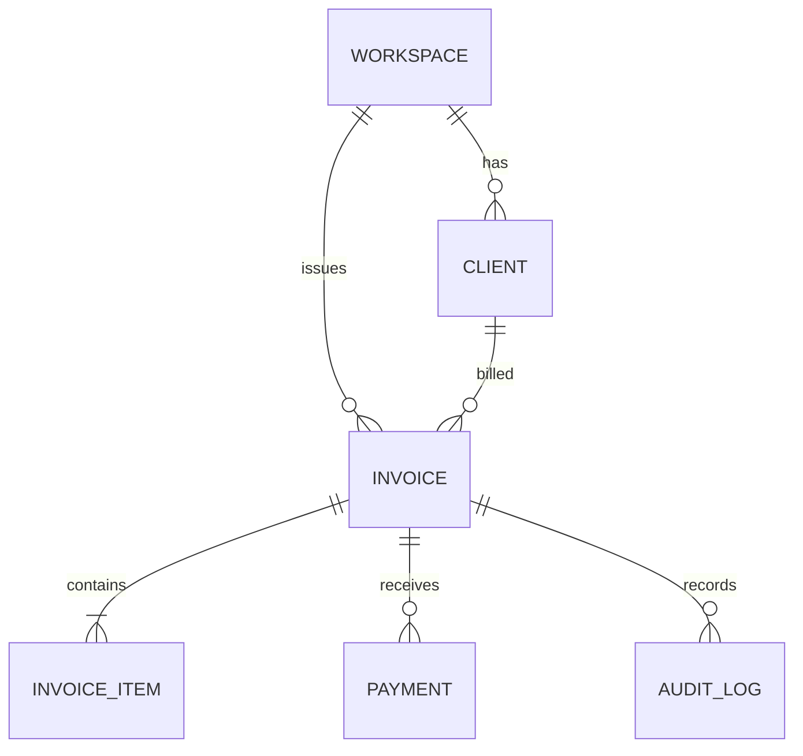
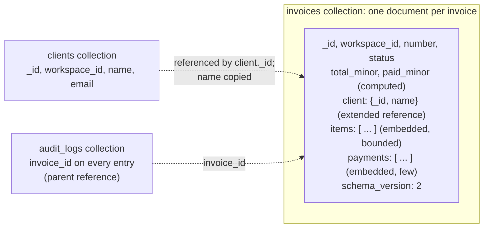
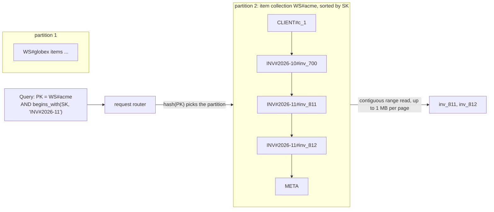

# NoSQL Data Modeling

> [!summary] TL;DR
> In a relational database you design tables first and write any query later. In a document store (MongoDB) or key-value store (DynamoDB) you do the opposite: list the **access patterns** (the exact reads and writes the app makes, with their rates) first, then shape documents and keys so each pattern is one cheap lookup. You trade flexible queries and joins for predictable, scalable reads.

> [!abstract] Core idea
> - Start from a numbered list of access patterns with expected QPS (queries per second); every pattern must map to one key lookup or one range query.
> - MongoDB: embed what is read together and bounded in size; reference what grows without limit or is shared.
> - DynamoDB: the partition key decides *where* an item lives, the sort key decides its *order*; one `Query` reads one partition key's items in sort order.
> - Single-table design stores several entity types in one table and overloads generic index attributes (`GSI1PK`, `GSI1SK`) to serve many patterns.
> - Both stores support multi-item transactions, but they cost more and are capped, so the model should make most writes touch one item or document.

## 1. Why it exists

InvoiceOps runs on PostgreSQL. Suppose a team moves its invoice reads to DynamoDB and copies the relational schema one-to-one: tables `workspaces`, `clients`, `invoices`, `invoice_items`, `payments`. The invoice detail page now needs one request for the invoice, one `Query` for its items and one for its payments, then a request for the client. DynamoDB has no joins, so that is 4 network round trips at about 5–10 ms each (an estimate) instead of one SQL query. The list page "invoices of client c_1" needs a filter on a non-key attribute, so it becomes a `Scan` of the whole table: at 20 million invoices of about 1 KB, that is roughly 20 GB read per request.

The data model did not fail because NoSQL is slow. It failed because it was designed for a database that can answer any query, and DynamoDB answers only the queries its keys were designed for. NoSQL data modeling is the discipline of designing those keys.

## 2. Mental model

**Relational:** model the *data* (entities, relationships, normal forms), then any query works, with indexes added for speed.

**NoSQL:** model the *questions*. Write the access patterns down, then build the storage so that each answer is already sitting together, in the right order, under one key.

**Analogy:** a library catalogue versus a meal-prep kitchen. The library (SQL) shelves books by a neutral system and lets you ask anything at the desk. The meal-prep kitchen (NoSQL) packs each customer's lunch box in the morning, because it knows exactly who will ask for what at noon. Handing over a box is instant; answering an unexpected question ("which boxes contain cumin?") means opening every box.

Key terms used below:
- **Access pattern:** one concrete operation, such as "get invoice by id with its lines and payments".
- **Document:** a JSON-like object (stored as BSON in MongoDB) that can nest objects and arrays.
- **Partition key (PK):** the attribute DynamoDB hashes to choose the physical partition that stores an item.
- **Sort key (SK):** the attribute that orders items sharing one partition key.
- **Item collection:** all items with the same partition key.
- **GSI / LSI:** global and local secondary indexes, copies of items keyed differently (explained in section 3.3).
- **RCU / WCU:** read and write capacity units; 1 WCU is one write per second of an item up to 1 KB, and 1 RCU is one strongly consistent read per second of up to 4 KB (or two eventually consistent reads).

## 3. How it works

### 3.1 Step 1: list the access patterns

For InvoiceOps (rates are estimates for a mid-sized deployment):

| # | Access pattern | Type | Expected QPS |
| --- | --- | --- | --- |
| AP1 | Get an invoice with its line items and payments | read | 300 |
| AP2 | List a workspace's invoices for a month, newest first | read | 80 |
| AP3 | List one client's invoices | read | 40 |
| AP4 | List a workspace's overdue invoices by due date | read | 20 |
| AP5 | List the workspaces a user belongs to, and the members of a workspace | read | 200 |
| AP6 | Record a payment and update the invoice's `paid_minor` and status | write | 30 |
| AP7 | Create an invoice with its lines | write | 20 |

Anything not on this list (for example "revenue by country across all tenants") is served elsewhere: an analytics store or a search engine.

### 3.2 MongoDB: embed or reference

The relational schema maps onto documents like this:





The rules of thumb (from MongoDB's guidance):

| Relationship | Example | Model |
| --- | --- | --- |
| one-to-few, read together | an invoice and its 1–50 line items | **embed** the array in the parent |
| one-to-many (hundreds to thousands) | a workspace and its clients | **reference**: separate documents, with an indexed `workspace_id` |
| one-to-squillions (unbounded) | an invoice and its audit log entries | **parent reference** only: each child stores the parent id; never keep an array of child ids in the parent |
| many-to-many | users and workspaces | arrays of ids on one or both sides, or a membership collection |

Two hard limits drive these rules:
- A document is at most **16 MB**. An array that grows forever (audit entries, comments, events) eventually hits it.
- Every update rewrites the document in the storage engine, and large arrays make updates and index maintenance expensive long before 16 MB. This is the **unbounded array anti-pattern**.

MongoDB's documented design patterns:
- **Bucket:** group many small time-ordered items into one document per period or per N items, for example one document per invoice per day of reminder events, with `count` and `events: [...]`.
- **Computed:** store a derived value at write time (`total_minor`, `paid_minor`) instead of summing on every read ([[Materialized Views and Denormalization]]).
- **Extended reference:** copy the few fields of a referenced document that the reader needs (`client: {_id, name}`), so the list page needs no `$lookup` (MongoDB's join stage).
- **Subset:** embed only the most-used part of a large related set (the 5 latest payments) and keep the rest in another collection.
- **Outlier:** design for the normal case and flag the rare huge one (`has_overflow: true`), storing an invoice with 10,000 lines in overflow documents.
- **Schema versioning:** each document carries `schema_version`; code reads every version and upgrades a document when it next writes it (**lazy migration**), while a background job converts the rest.

### 3.3 DynamoDB: partition key, sort key and indexes



- **Primary key** = partition key alone, or partition key + sort key. It must be unique.
- **`GetItem`** reads one item by full primary key. **`Query`** reads items of *one* partition key, optionally with a sort-key condition (`=`, `<`, `between`, `begins_with`), in sort-key order, forwards or backwards. **`Scan`** reads the whole table and is for exports, not for requests.
- **Composite sort keys** encode a hierarchy so one prefix serves several patterns: `INV#2026-11#inv_812` serves "this month" (`begins_with INV#2026-11`), "this year" (`begins_with INV#2026`) and "all invoices" (`begins_with INV#`).
- **Global secondary index (GSI):** a second copy of the items with a different partition and sort key. It can be added at any time, is replicated asynchronously, and is **eventually consistent**: `ConsistentRead` is not supported on a GSI.
- **Local secondary index (LSI):** same partition key, different sort key. It must be created with the table, supports strongly consistent reads, and limits each item collection (base items plus LSI copies for one partition key) to **10 GB**.
- **Per-partition limits:** one partition serves at most **3,000 RCU and 1,000 WCU** per second. An item is at most **400 KB**.

### 3.4 Single-table design

Single-table design puts every entity type in one table, with generic key names (`PK`, `SK`, `GSI1PK`, `GSI1SK`), so that related items share a partition and come back from one `Query`.

| PK | SK | GSI1PK | GSI1SK | Other attributes | Serves |
| --- | --- | --- | --- | --- | --- |
| `WS#acme` | `META` | | | name, plan | workspace profile |
| `WS#acme` | `USER#u_9` | `USER#u_9` | `WS#acme` | role | AP5 both ways (adjacency list) |
| `WS#acme` | `CLIENT#c_1` | `CLIENT#c_1` | `META` | name, email | client under its workspace |
| `WS#acme` | `INV#2026-11#inv_812` | `CLIENT#c_1` | `INV#2026-11#inv_812` | status, total_minor, due_date | AP2, AP3 |
| `WS#acme` | `INV#2026-11#inv_812` | | | `GSI2PK = WS#acme#OVERDUE`, `GSI2SK = 2026-10-31` (only while overdue) | AP4 (sparse index) |
| `INVOICE#inv_812` | `META` | | | full invoice, client name | AP1 |
| `INVOICE#inv_812` | `ITEM#001` | | | description, quantity, unit_price_minor | AP1 |
| `INVOICE#inv_812` | `PAY#2026-11-02T10:00Z#p_1` | | | amount_minor, provider_ref | AP1, AP6 |

(The two `WS#acme / INV#...` rows are one item; it is split here to show the `GSI2` attributes.)

How the patterns are served:
- **AP1:** `Query PK = INVOICE#inv_812` returns the invoice, its lines and its payments in one request (the item collection *is* the join).
- **AP2:** `Query PK = WS#acme, begins_with(SK, "INV#2026-11")`, `ScanIndexForward = false` for newest first.
- **AP3:** `Query GSI1 PK = CLIENT#c_1` returns the client row and its invoices. `GSI1` is **overloaded**: for a membership item `GSI1PK` holds a user, for an invoice it holds a client.
- **AP4:** a **sparse index**: only overdue invoices carry `GSI2PK`, so `GSI2` contains only overdue invoices. When the invoice is paid, the app removes the attribute and it leaves the index.
- **AP5:** an **adjacency list**: the membership item `WS#acme / USER#u_9` lists members under the workspace; `GSI1` flips it (`USER#u_9 → WS#acme`) to list a user's workspaces.
- **AP6:** `TransactWriteItems` puts the payment item and updates both copies of the invoice (detail `META` and summary under `WS#acme`) atomically.

The invoice summary appears twice on purpose. That is **denormalization fan-out**: an update to a duplicated field must touch every copy, so keep the duplicated fields few and rarely changing.

**Multi-table design** (one table per entity) is easier to understand, back up and stream per entity, and fine when patterns rarely cross entity types. Single-table design pays off when one request needs several entity types, as AP1 does.

### 3.5 Transactions in both stores

Both stores have them; neither makes them free.

| | MongoDB | DynamoDB |
| --- | --- | --- |
| Single unit always atomic | one document, including nested arrays | one item |
| Multi-unit transactions | multi-document ACID: replica sets since 4.0, sharded clusters since 4.2 | `TransactWriteItems` / `TransactGetItems`: up to 100 actions and 4 MB, within one Region |
| Limits and cost | default 60 s lifetime; docs advise at most 1,000 documents modified per transaction; write conflicts abort and must be retried | each item costs two underlying reads or writes (prepare and commit), so about twice the capacity |
| Modeling consequence | embed what changes together so most writes are single-document | keep most writes to one item; use transactions for the few cross-item invariants |

Transaction theory (atomicity, isolation) lives in [[Transactions and ACID]] and [[Isolation Levels and MVCC]].

## 4. Worked example

### Whiteboard version

```go
package main

import "fmt"

// Access pattern -> key. Every read is one Query on one partition key.
func main() {
	ws, inv, client := "acme", "inv_812", "c_1"
	fmt.Println("AP2 Query PK =", "WS#"+ws, "SK begins_with", "INV#2026-11")
	fmt.Println("AP1 Query PK =", "INVOICE#"+inv) // META, ITEM#001.., PAY#...
	fmt.Println("AP3 Query GSI1PK =", "CLIENT#"+client)
	// Item key of the invoice summary: entity # month # id, sortable by prefix.
	fmt.Println("item:", "WS#"+ws, "/", "INV#2026-11#"+inv)
	// Next page: send LastEvaluatedKey back as ExclusiveStartKey.
}
```

### 4.1 The same invoice in MongoDB

```json
{
  "_id": "inv_812",
  "schema_version": 2,
  "workspace_id": "acme",
  "number": "INV-2026-0812",
  "status": "partially_paid",
  "currency": "INR",
  "issue_date": "2026-11-01",
  "due_date": "2026-11-15",
  "client": { "_id": "c_1", "name": "Acme Ltd" },
  "items": [
    { "line_no": 1, "description": "Design retainer", "quantity": 1, "unit_price_minor": 200000 },
    { "line_no": 2, "description": "Hosting", "quantity": 2, "unit_price_minor": 25000 }
  ],
  "payments": [
    { "_id": "p_1", "amount_minor": 150000, "provider": "razorpay", "provider_ref": "pay_N8x2", "paid_at": "2026-11-02T10:00:00Z" }
  ],
  "total_minor": 250000,
  "paid_minor": 150000
}
```

- AP1 is one `findOne({_id: "inv_812"})`.
- AP2, AP3 and AP4 are served by compound indexes on `{workspace_id: 1, issue_date: -1}`, `{workspace_id: 1, "client._id": 1}` and `{workspace_id: 1, status: 1, due_date: 1}`. MongoDB, unlike DynamoDB, lets you add ad-hoc secondary indexes and filters, so it forgives a missing pattern more easily.
- AP6 is one atomic update on one document, with no transaction needed:

```json
{
  "update": "invoices",
  "updates": [{
    "q": { "_id": "inv_812", "payments.provider_ref": { "$ne": "pay_Q1z7" } },
    "u": {
      "$push": { "payments": { "_id": "p_2", "amount_minor": 100000, "provider": "razorpay", "provider_ref": "pay_Q1z7" } },
      "$inc": { "paid_minor": 100000 }
    }
  }]
}
```

The `$ne` condition makes a retried webhook a no-op instead of a double payment. The `$ne` must name the same `provider_ref` that is being pushed (`pay_Q1z7`). The status change (`paid` once `paid_minor >= total_minor`) can be made in the same single-document write by rewriting the update as an aggregation pipeline (`$set` with `$concatArrays` and `$cond`), because `$push` is not available inside a pipeline update.

What the SQL version had and this one must rebuild: the uniqueness of `(provider, provider_ref)` across all invoices (needs a separate unique index or collection), the client-rename fan-out (the copied `client.name`), and reports across clients (aggregation pipelines).

### 4.2 The same invoice in DynamoDB, with pagination

The key builders and an in-memory stand-in for `Query` make the design testable without AWS:

```go
// Package dynkeys builds DynamoDB single-table keys for InvoiceOps and
// simulates the one read a Query can do: one partition key, a sort-key
// condition, results in sort-key order, one page at a time.
package dynkeys

import (
	"fmt"
	"hash/fnv"
	"sort"
	"strings"
)

// Item is one row of the single table. Attrs holds everything else.
type Item struct {
	PK, SK string
	GSI1PK string // overloaded GSI: meaning depends on the entity type
	GSI1SK string
	Attrs  map[string]string
}

func WorkspacePK(ws string) string { return "WS#" + ws }

// InvoiceSK sorts invoices by issue month, then id: "INV#2026-11#inv_812".
func InvoiceSK(month, invoiceID string) string {
	return fmt.Sprintf("INV#%s#%s", month, invoiceID)
}

func InvoicePK(invoiceID string) string { return "INVOICE#" + invoiceID }

func PaymentSK(paidAt, paymentID string) string {
	return fmt.Sprintf("PAY#%s#%s", paidAt, paymentID)
}

// ShardedPK spreads one hot logical key over n partition keys
// ("EVENTS#2026-11-03#0" .. "#n-1"). Readers must query all n.
func ShardedPK(base, writeKey string, n int) string {
	h := fnv.New32a()
	h.Write([]byte(writeKey))
	return fmt.Sprintf("%s#%d", base, h.Sum32()%uint32(n))
}

// Table is an in-memory stand-in for one DynamoDB table.
type Table struct{ items []Item }

func (t *Table) Put(it Item) {
	for i := range t.items {
		if t.items[i].PK == it.PK && t.items[i].SK == it.SK {
			t.items[i] = it // same primary key: replace
			return
		}
	}
	t.items = append(t.items, it)
}

// Query returns up to limit items with this PK whose SK starts with
// prefix, after the exclusive start key. The returned cursor is the last
// SK on the page ("LastEvaluatedKey"), or "" when there are no more.
func (t *Table) Query(pk, prefix, startAfter string, limit int) ([]Item, string) {
	var hits []Item
	for _, it := range t.items {
		if it.PK == pk && strings.HasPrefix(it.SK, prefix) && it.SK > startAfter {
			hits = append(hits, it)
		}
	}
	sort.Slice(hits, func(i, j int) bool { return hits[i].SK < hits[j].SK })
	if len(hits) <= limit {
		return hits, ""
	}
	page := hits[:limit]
	return page, page[len(page)-1].SK
}

// QueryGSI1 is the same read against the overloaded index.
func (t *Table) QueryGSI1(pk, prefix string) []Item {
	var hits []Item
	for _, it := range t.items {
		if it.GSI1PK == pk && strings.HasPrefix(it.GSI1SK, prefix) {
			hits = append(hits, it)
		}
	}
	sort.Slice(hits, func(i, j int) bool { return hits[i].GSI1SK < hits[j].GSI1SK })
	return hits
}
```

```go
package dynkeys

import (
	"fmt"
	"testing"
)

func seed() *Table {
	t := &Table{}
	ws := WorkspacePK("acme")
	t.Put(Item{PK: ws, SK: "META", Attrs: map[string]string{"name": "Acme"}})
	t.Put(Item{PK: ws, SK: "CLIENT#c_1", GSI1PK: "CLIENT#c_1", GSI1SK: "META"})
	for i, m := range []string{"2026-09", "2026-10", "2026-11", "2026-11"} {
		id := fmt.Sprintf("inv_%d", i)
		t.Put(Item{PK: ws, SK: InvoiceSK(m, id), GSI1PK: "CLIENT#c_1", GSI1SK: InvoiceSK(m, id)})
	}
	t.Put(Item{PK: InvoicePK("inv_3"), SK: PaymentSK("2026-11-02T10:00Z", "p_1")})
	return t
}

func TestQueryByMonthPrefix(t *testing.T) {
	got, cursor := seed().Query(WorkspacePK("acme"), "INV#2026-11", "", 10)
	if len(got) != 2 || cursor != "" {
		t.Fatalf("got %d items, cursor %q; want 2 items, no cursor", len(got), cursor)
	}
	if got[0].SK != "INV#2026-11#inv_2" {
		t.Fatalf("first SK = %s, want sort-key order", got[0].SK)
	}
}

func TestPaginationWithCursor(t *testing.T) {
	tbl := seed()
	var all []string
	cursor := ""
	for {
		page, next := tbl.Query(WorkspacePK("acme"), "INV#", cursor, 3)
		for _, it := range page {
			all = append(all, it.SK)
		}
		if next == "" {
			break
		}
		cursor = next
	}
	if len(all) != 4 {
		t.Fatalf("paged %d invoices, want 4: %v", len(all), all)
	}
}

func TestGSIOverloadingServesClientView(t *testing.T) {
	got := seed().QueryGSI1("CLIENT#c_1", "")
	if len(got) != 5 { // the client row + 4 invoices, in one query
		t.Fatalf("got %d items, want 5", len(got))
	}
	if got[0].GSI1SK != "INV#2026-09#inv_0" {
		t.Fatalf("first = %s, want oldest invoice first", got[0].GSI1SK)
	}
}

func TestShardedPKIsStableAndSpread(t *testing.T) {
	a := ShardedPK("EVENTS#2026-11-03", "evt_42", 10)
	if a != ShardedPK("EVENTS#2026-11-03", "evt_42", 10) {
		t.Fatal("same write key must map to the same shard")
	}
	seen := map[string]bool{}
	for i := 0; i < 1000; i++ {
		seen[ShardedPK("EVENTS#2026-11-03", fmt.Sprint("evt_", i), 10)] = true
	}
	if len(seen) != 10 {
		t.Fatalf("1,000 writes used %d shards, want all 10", len(seen))
	}
}
```

These tests pass under `go vet` and `go test -race` with Go 1.24. In real code, `Query` is `dynamodb.Query` from the AWS SDK for Go v2, with `KeyConditionExpression: "PK = :pk AND begins_with(SK, :p)"` and the returned `LastEvaluatedKey` passed back as `ExclusiveStartKey`. The real cursor is a map of the key attributes, not a string, and a page also ends when it reaches 1 MB of data.

### 4.3 Capacity arithmetic

- AP1 reads about 3 KB per invoice (meta, 3 lines, 1 payment): one eventually consistent `Query` costs 0.5 RCU (3 KB rounds up to 4 KB, halved). At 300 QPS that is 150 RCU per second, far below any limit.
- AP6 writes a 0.5 KB payment and updates two 1 KB invoice copies in a transaction: 3 items × 1 WCU × 2 (transaction) = 6 WCU per payment, 180 WCU per second at 30 QPS.
- The danger is not the total but one key: if every invoice event of the day were written under `PK = EVENTS#2026-11-03`, that one partition would cap writes at 1,000 WCU per second. That is why the `ShardedPK` function spreads it over N keys.

## 5. Variants and comparison

| Option | How it works | Use when | Cost |
| --- | --- | --- | --- |
| Relational (Postgres) | normalized tables, joins, any query | patterns unknown or changing, strong invariants | scaling writes past one primary needs sharding ([[Partitioning and Sharding]]) |
| Postgres + `jsonb` | relational core, document columns for flexible attributes | a few flexible fields in a relational app | GIN indexes on `jsonb` are large ([[Index Types and Index Design]]) |
| MongoDB, embedded documents | aggregate in one document, secondary indexes, aggregation pipeline | data read as whole aggregates, varying shapes | duplication, 16 MB cap, cross-document invariants in code |
| DynamoDB multi-table | one table per entity | simple key lookups, few cross-entity reads | several round trips for joined views |
| DynamoDB single-table | many entity types, overloaded keys and GSIs | known patterns at high, predictable scale | hard to read and evolve; new patterns may need a new GSI and a backfill |
| Wide-column (Cassandra) | partition key + clustering columns, query-per-table | very high write rates, multi-region | no secondary access without another table ([[Wide-Column Stores and Cassandra]]) |

## 6. Trade-offs and when not to use

- **New questions are expensive.** A pattern you did not plan for means a new index, a backfill or a `Scan`. If the product changes weekly, a relational model is cheaper.
- **Duplication means fan-out.** Copying a client's name into 40,000 invoices makes the rename a 40,000-item background job, and readers see a mix during it.
- **Invariants move into code.** Uniqueness beyond the primary key, foreign keys and cross-item checks are your job. In DynamoDB, uniqueness of a second attribute is done with an extra marker item (`PK = PROVIDER_REF#pay_N8x2`) written in the same transaction with a condition `attribute_not_exists(PK)`.
- **Analytics do not fit.** Aggregations across all items are scans; export to an analytics store instead.
- **When not to use:** the data is relational, the scale fits one Postgres primary (most applications), and the team values ad-hoc queries. [[SQL vs NoSQL]] has the full decision.

## 7. In production

**Real systems.**
- Amazon's own guidance and public talks (Rick Houlihan, re:Invent 2018) popularised single-table design with overloaded GSIs.
- MongoDB's published patterns (bucket, computed, subset, outlier, extended reference, schema versioning) come from its consulting practice and are documented in its "Building with Patterns" series.

**Failure modes and fixes.**
- *Hot partition:* one partition key takes most traffic (a viral workspace, today's date) and is throttled at 3,000 RCU or 1,000 WCU. Fix: write sharding (`KEY#0`…`KEY#9`) with a scatter-gather read, or cache hot reads ([[Hot Keys and Hot Partitions]]). DynamoDB's adaptive capacity and split-for-heat help with uneven load but cannot make one item exceed per-partition limits.
- *GSI throttling backs up the table:* in provisioned mode, a GSI without enough write capacity throttles writes to the base table. Fix: provision GSIs for the base write rate, or use on-demand mode.
- *Reading your own write from a GSI fails:* GSIs are eventually consistent. Fix: read the base item for the user who just wrote, or design the read to use the primary key.
- *Unbounded array hits 16 MB:* Fix: move the growing list into its own collection (parent reference) or bucket it.
- *`Limit` returns nothing:* in DynamoDB, `Limit` counts items *read* before the `FilterExpression` runs, so a page can come back empty with a `LastEvaluatedKey`. Fix: loop until no `LastEvaluatedKey`, and prefer key conditions over filters.
- *Old documents break new code:* Fix: `schema_version` and readers that handle every version ([[Zero-Downtime Schema Migrations]]).

**What to monitor.**
- DynamoDB: `ThrottledRequests`, `ReadThrottleEvents`/`WriteThrottleEvents` per table and GSI, consumed versus provisioned capacity, CloudWatch Contributor Insights for the most-accessed keys.
- MongoDB: document size distribution, slow query log, `COLLSCAN` in query plans, transaction aborts and retries.

## 8. Deep dive

**Why a Query is cheap and a filter is not.** Inside a partition, DynamoDB stores items ordered by sort key, so a sort-key condition is a range read of contiguous items. A `FilterExpression` is applied after the items are read: you pay for every item read, including those dropped. Design keys so the filter becomes a key condition.

**Sort-key design tricks.**
- Zero-pad numbers (`ITEM#001`, not `ITEM#1`) because sort keys of type string compare byte by byte.
- Use ISO 8601 timestamps (`2026-11-02T10:00Z`) for time order.
- Put a version prefix (`v0#` for the current item, `v1#`, `v2#` for history) to keep the latest version first.
- Prefer ULIDs or KSUIDs over random UUIDs when ids should sort by creation time.

**GSI overloading as a projection.** A GSI is a materialized view maintained by DynamoDB: every write to the base table is propagated asynchronously. Projecting only the needed attributes (`KEYS_ONLY`, `INCLUDE`) shrinks the copy and its write cost. A GSI's own partition key can be hot even when the table's is not, for example `GSI1PK = STATUS#overdue` for all tenants.

**Item collections and LSIs.** With an LSI, one partition key's item collection is limited to 10 GB, because the index lives on the same partitions. Without an LSI, an item collection can grow beyond one partition: DynamoDB splits it by sort key range. Avoid LSIs unless you need strongly consistent alternative sort orders.

**Multi-document transactions in MongoDB under the hood.** A transaction runs on a snapshot (WiredTiger MVCC); a concurrent write to the same document causes a write conflict, and the driver retries with `TransientTransactionError`. On sharded clusters, a transaction across shards uses a two-phase commit run by a coordinator on one of the participating shards (`mongos` only routes) ([[Two-Phase Commit]]), with higher latency. Embedding what changes together avoids all of it.

**Lazy migration with schema versioning.** v1 invoices stored `amount` as a float; v2 stores `total_minor` as an integer of paise. Readers convert v1 on the fly (`round(amount * 100)`), writers always write v2, and a background job rewrites the remaining v1 documents with a conditional update (`{schema_version: 1}`) so it never overwrites a newer write. Once the count of v1 documents is zero, delete the v1 code path.

## 9. Interview questions

> [!question]- How do you start designing a DynamoDB or MongoDB schema?
> List every access pattern with its expected rate and size, and whether it reads or writes. Then design keys (DynamoDB) or document boundaries (MongoDB) so each pattern is one key lookup or one range query. Patterns not on the list go to another store or wait for a new index.

> [!question]- When do you embed and when do you reference in MongoDB?
> Embed one-to-few data that is read with the parent and stays small, such as invoice lines. Reference one-to-many data that is large or shared, such as clients of a workspace. For one-to-squillions data (logs, events), let each child store the parent's id and never keep a growing array in the parent, because of the 16 MB limit and the cost of rewriting large documents.

> [!question]- What is single-table design, and when is it worth it?
> Several entity types live in one table with generic keys, so items read together share a partition key and come back from one `Query`. Overloaded GSIs serve other patterns. It is worth it when patterns are known and requests need several entity types at high scale; otherwise multi-table is easier to operate.

> [!question]- A DynamoDB table is throttled although total consumed capacity is 20% of provisioned. Why?
> Capacity is enforced per partition: one partition serves at most 3,000 RCU and 1,000 WCU. A hot partition key (one viral tenant, today's date) is throttled while other partitions idle. Fix the key: shard writes across N suffixes, cache hot reads, or choose a higher-cardinality partition key.

> [!question]- Can you read your own write through a GSI? (trap)
> Not reliably. GSIs are updated asynchronously and do not support `ConsistentRead`, so a read right after a write may not see it. Read the base table by primary key with `ConsistentRead`, or use an LSI if you need a consistent alternative order and can accept its 10 GB item collection limit.

> [!question]- Do MongoDB and DynamoDB support transactions?
> Yes. MongoDB has multi-document ACID transactions (replica sets since 4.0, sharded clusters since 4.2). DynamoDB has `TransactWriteItems` and `TransactGetItems` with up to 100 actions and 4 MB, costing about twice the capacity. Good models still make most writes single-document or single-item.

> [!question]- Why did my DynamoDB `Query` with `Limit = 20` return 3 items and a `LastEvaluatedKey`?
> `Limit` caps the number of items read before the `FilterExpression` is applied, so 17 were read and filtered out. The page is not the end; keep paging until `LastEvaluatedKey` is absent, and move the filter into the key condition if possible.

## 10. Cheat sheet

- Access patterns first, with QPS; every pattern is a key lookup or range query.
- MongoDB: embed one-to-few, reference one-to-many, parent-reference one-to-squillions; 16 MB documents; no unbounded arrays.
- Patterns: bucket, computed, extended reference, subset, outlier, schema versioning with lazy migration.
- DynamoDB: PK picks the partition, SK orders the item collection; composite SKs like `INV#2026-11#<id>` serve several prefixes.
- Limits: 3,000 RCU / 1,000 WCU per partition, 400 KB item, 1 MB page, LSI 10 GB per item collection, GSIs eventually consistent.
- Single-table + overloaded GSIs + sparse indexes + adjacency lists; denormalized copies need fan-out on update.
- Transactions exist in both (Mongo 4.0+/4.2+, DynamoDB 100 actions) but cost more; model so most writes touch one unit.
- Paginate with `LastEvaluatedKey` → `ExclusiveStartKey`; `Limit` applies before filters.

## Links

- **Before this:** [[SQL vs NoSQL]], [[Relational Schema Design]], [[Partitioning and Sharding]]
- **Next:** [[Wide-Column Stores and Cassandra]], [[Hot Keys and Hot Partitions]], [[Search Engines and Inverted Indexes]]
- **Compare with:** [[Materialized Views and Denormalization]], [[Consistent Hashing]], [[Transactions and ACID]]
