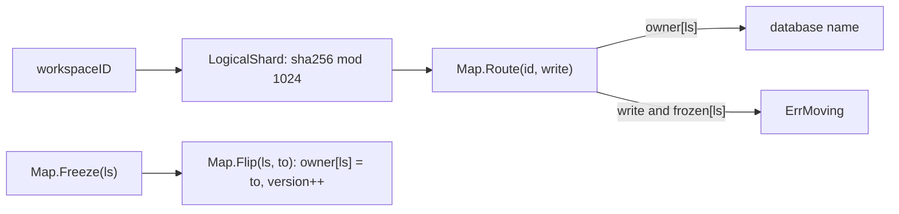
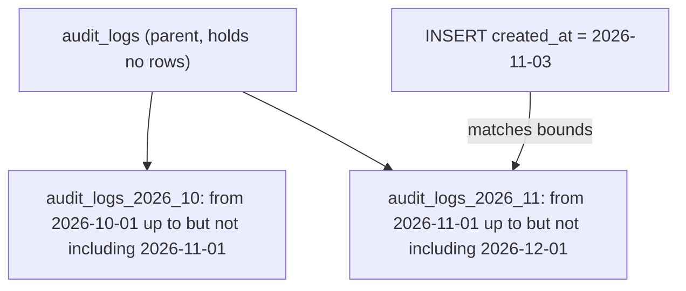
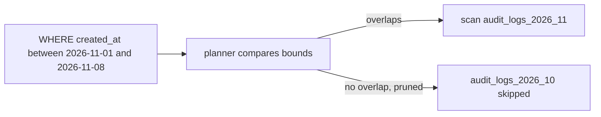
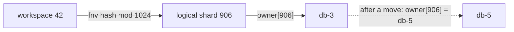
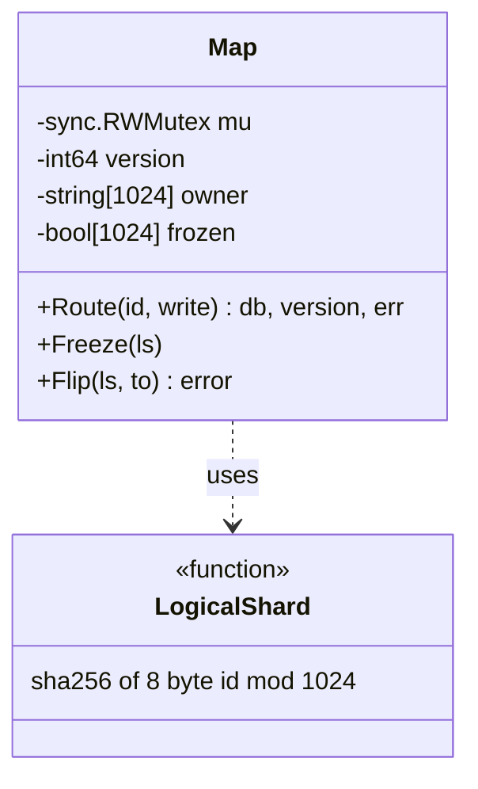
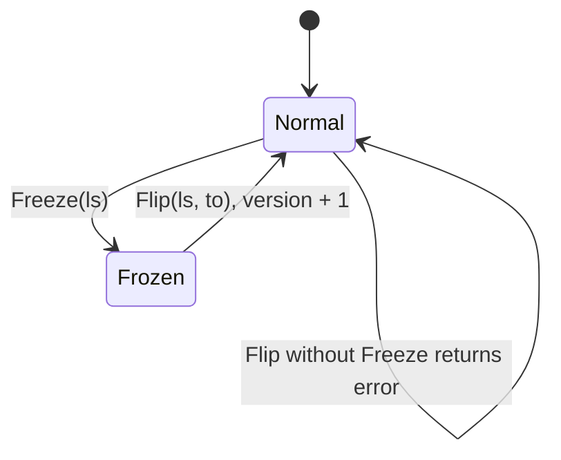
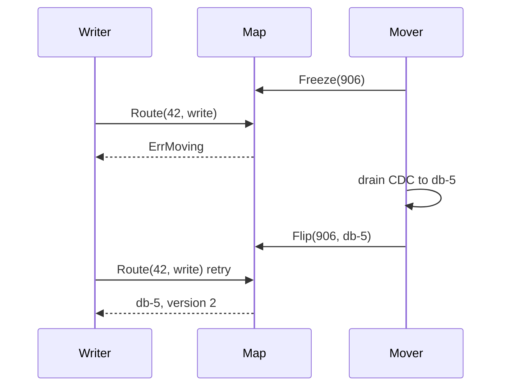

# Partitioning and Sharding - Go

> [!summary] TL;DR
> The full PostgreSQL 17 partitioning DDL (range, list and hash) and a Go logical-shard router with a versioned map and a freeze-and-flip move, as described in [[Partitioning and Sharding]]. The Go code is tested under `go test -race`; the SQL is representative PostgreSQL 17 and was not run here.

## What this code shows

| Code | Concept in [[Partitioning and Sharding]] |
| --- | --- |
| Range, list and hash DDL | The three partitioning kinds, [[Partitioning and Sharding#3.1 Partitioning inside PostgreSQL]] |
| `LogicalShard` | Hashing a key to a fixed number of logical shards, [[Partitioning and Sharding#3.4 Sharding across machines]] |
| `Map.Route` and `NewMap` | The shard map and router, §3.4 and [[Partitioning and Sharding#4. Worked example]] |
| `Map.Freeze` and `Map.Flip` | The freeze-and-flip step of an online move, §4 |
| `TestMoveTouchesOneLogicalShard` | A move changes the owner of exactly one logical shard, [[Partitioning and Sharding#8.1 Why many logical shards]] |
| `TestSequentialIDsSpreadEvenly` | Hash routing avoids the hot-shard anti-pattern, [[Partitioning and Sharding#3.6 The user-ID range example is a hot-shard anti-pattern]] |
| `ErrMoving` | Writes to a frozen shard fail fast and are retried, §4 |



The note has two halves. The SQL half (steps 1 to 3) shows what PostgreSQL does for you inside one database. The Go half (the whiteboard version and steps 4 and 5) shows what your own service must do once the data lives on several databases and PostgreSQL can no longer route for you.

## Setup

- Module `shard` with `shard.go`, `shard_test.go`, and a sub-package `wb/` for the whiteboard version.
- Go 1.24, standard library only.
- Run: `go vet ./... && go test -race -v ./...`
- The SQL needs PostgreSQL 17 (not run here; representative).

## Code

### Step 1: partitioned tables in SQL

**Concept.** Declarative partitioning ([[Partitioning and Sharding#3.1 Partitioning inside PostgreSQL]]) lets one logical table be stored as many physical tables. The parent holds no rows; PostgreSQL sends each inserted row to the single partition whose bounds match its partition key. The three kinds answer three different questions: RANGE for "which time window", LIST for "which named group" such as a data-residency region, and HASH for "spread evenly when there is no natural grouping". An alternative is to split tables by hand (`audit_logs_2026_10` as ordinary tables behind a UNION view), but then pruning, constraints and inserts are all your job. Declarative partitioning gives the same layout with the planner doing the routing.



The first block is the RANGE table, partitioned by month.

```sql
-- RANGE: audit logs by month
CREATE TABLE audit_logs (
    workspace_id bigint      NOT NULL,
    created_at   timestamptz NOT NULL,
    id           uuid        NOT NULL DEFAULT gen_random_uuid(),
    action       text        NOT NULL,
    payload      jsonb,
    PRIMARY KEY (workspace_id, created_at, id)   -- must include the partition key
) PARTITION BY RANGE (created_at);

CREATE TABLE audit_logs_2026_10 PARTITION OF audit_logs
    FOR VALUES FROM ('2026-10-01') TO ('2026-11-01');   -- FROM inclusive, TO exclusive
CREATE TABLE audit_logs_2026_11 PARTITION OF audit_logs
    FOR VALUES FROM ('2026-11-01') TO ('2026-12-01');
```

**How it works.**

1. `PARTITION BY RANGE (created_at)` marks the table as a parent. `created_at` is the partition key.
2. `PRIMARY KEY (workspace_id, created_at, id)` must contain the partition key. PostgreSQL enforces uniqueness inside each partition only, so a key that omits the partition column could not be checked across partitions and is rejected.
3. Each `PARTITION OF ... FOR VALUES FROM ... TO ...` creates one child. `FROM` is inclusive and `TO` is exclusive, so the months tile the timeline with no gap and no overlap: midnight on 2026-11-01 belongs to November only.
4. A row with a `created_at` outside every range fails the insert, because this table has no `DEFAULT` partition.

The second block is the LIST table, partitioned by data-residency region.

```sql
-- LIST: clients by data-residency region
CREATE TABLE clients (
    workspace_id bigint NOT NULL,
    id           bigint NOT NULL,
    region       text   NOT NULL,
    name         text   NOT NULL,
    PRIMARY KEY (workspace_id, id, region)
) PARTITION BY LIST (region);
CREATE TABLE clients_in    PARTITION OF clients FOR VALUES IN ('IN');
CREATE TABLE clients_eu    PARTITION OF clients FOR VALUES IN ('DE', 'FR', 'NL');
CREATE TABLE clients_other PARTITION OF clients DEFAULT;
```

**How it works.**

1. `PARTITION BY LIST (region)` routes on exact value match instead of an interval.
2. `clients_eu` takes three values, so several regions can share one partition. This is how you keep all EU data together, for example on one tablespace.
3. `DEFAULT` catches every region not listed. It prevents insert failures for a new region, but it also blocks `DETACH ... CONCURRENTLY` and makes adding a partition slower, because PostgreSQL must check that the default holds no rows that now belong to the new partition.
4. The primary key again contains the partition key (`region`).

The third block is the HASH table, which spreads rows evenly when there is no natural grouping.

```sql
-- HASH: invoices spread evenly over 4 partitions
CREATE TABLE invoices (
    workspace_id bigint NOT NULL,
    id           bigint NOT NULL,
    status       text   NOT NULL,
    total_minor  bigint NOT NULL,
    PRIMARY KEY (workspace_id, id)
) PARTITION BY HASH (workspace_id);
CREATE TABLE invoices_p0 PARTITION OF invoices FOR VALUES WITH (MODULUS 4, REMAINDER 0);
-- … invoices_p1 to invoices_p3 with REMAINDER 1, 2, 3
```

**How it works.**

1. `PARTITION BY HASH (workspace_id)` hashes the key and takes the result modulo 4.
2. `WITH (MODULUS 4, REMAINDER 0)` claims the rows whose hash mod 4 is 0. Four children with remainders 0 to 3 cover every possible row exactly once.
3. Partitioning on `workspace_id` means all of one workspace's invoices live in one partition, so a per-workspace query touches one child.

### Step 2: check pruning

**Concept.** Partition pruning ([[Partitioning and Sharding#3.2 Partition pruning]]) is the payoff of partitioning: the planner reads the `WHERE` clause, compares it to each partition's bounds and removes the partitions that cannot match. Pruning at plan time works when the bounds are constants. When the bound is only known at execution, such as `now()`, PostgreSQL prunes at run time and reports `Subplans Removed`. Without pruning, partitioning would be slower than one table because of per-partition planning overhead. Reading the plan is the only reliable way to know pruning worked.



The planner skips partitions whose bounds cannot match the `WHERE` clause. Only the November partition should appear in the plan:

```sql
EXPLAIN (ANALYZE, COSTS OFF)
SELECT count(*) FROM audit_logs
WHERE workspace_id = 7
  AND created_at >= '2026-11-01' AND created_at < '2026-11-08';
```

Run-time pruning (`Subplans Removed`) shows up when the bound comes from `now()`:

```sql
EXPLAIN (COSTS OFF)
SELECT count(*) FROM audit_logs WHERE created_at >= now() - interval '7 days';
```

**How it works.**

1. The first query filters on constants that fall entirely inside November, so the October child never appears in the plan.
2. `ANALYZE` actually runs the query, so the plan shows real row counts and confirms only one partition was read.
3. In the second query `now()` is not a constant at plan time, so the planner keeps the children and the executor drops the ones that cannot match when it starts; the plan text shows `Subplans Removed`.
4. If you filter on a column that is not the partition key, nothing is pruned and every partition is scanned.

Representative output for both is in [[Partitioning and Sharding#3.2 Partition pruning]].

### Step 3: retention

**Concept.** Retention as a metadata operation ([[Partitioning and Sharding#3.3 Retention as a metadata operation]]) is the second big payoff. Deleting a month of rows with `DELETE` rewrites millions of tuples, generates WAL, and leaves dead rows for vacuum. Detaching a whole partition changes only catalogue entries, and `DROP TABLE` then frees the files at once. The cost is that you must keep creating future partitions and dropping old ones on a schedule.

```sql
ALTER TABLE audit_logs DETACH PARTITION audit_logs_2025_12 CONCURRENTLY;  -- PostgreSQL 14+
DROP TABLE audit_logs_2025_12;   -- or archive it to object storage first
```

**How it works.**

1. `DETACH PARTITION` turns the child into an ordinary standalone table; the parent no longer sees its rows.
2. `CONCURRENTLY` avoids holding an `ACCESS EXCLUSIVE` lock on the parent for the whole operation. It cannot run inside a transaction block, and it cannot run on a table with a `DEFAULT` partition.
3. `DROP TABLE` removes the standalone table. Dump it to object storage first if you need an archive.

### Whiteboard version

**Concept.** This is the smallest form of the idea in [[Partitioning and Sharding#4. Worked example]]: a key is hashed to one of a fixed number of logical shards, and a table maps each logical shard to a database. Because the hash and the shard count never change, moving data is a single table update rather than a rehash of every key. The alternative, `hash(key) % numberOfDatabases`, ties placement to the server count, so adding a server moves almost every key. The cost of the logical-shard design is one extra lookup and a map you must store and keep consistent.

```go
package wb

import "hash/fnv"

const logicalShards = 1024 // fixed forever; only the map below changes

// owner[ls] = physical database that holds logical shard ls.
var owner [logicalShards]string
```

```go
func logicalShard(workspaceID string) int {
	h := fnv.New32a()
	h.Write([]byte(workspaceID))
	return int(h.Sum32() % logicalShards)
}

// dbFor routes a request: key -> logical shard -> database.
// Moving a shard to a new database is one map update, not a rehash.
func dbFor(workspaceID string) string {
	return owner[logicalShard(workspaceID)]
}
```

**How it works.**

1. `logicalShards = 1024` is a constant, so the modulus can never change by accident.
2. `owner` is a fixed-size array indexed by logical shard. Its values are the only thing that changes when data moves.
3. `logicalShard` uses FNV-1a, a fast non-cryptographic hash, to turn the string key into a 32-bit number, then reduces it modulo 1024.
4. `dbFor` composes the two steps. There is no locking here, because this version is for the whiteboard; the full version below adds a mutex.



### Step 4: the logical shard and the shard map

**Concept.** This step implements the fixed-logical-shards idea from [[Partitioning and Sharding#3.4 Sharding across machines]] and [[Partitioning and Sharding#8.1 Why many logical shards]]. The map stores the owner of each of the 1,024 logical shards, a `frozen` flag per shard for the cut-over, and a version number that routers compare to detect a change. SHA-256 is used instead of FNV because it spreads even sequential IDs uniformly and its output never changes between Go versions. The alternatives are a consistent-hash ring ([[Consistent Hashing - Go]]) and a database table for the map (needed in production so that all routers agree); fixed shards were chosen because a move is exactly one entry and easy to reason about.



The package header, the constant, the error and the hash function:

```go
// Package shard routes InvoiceOps workspaces to databases through a fixed
// set of logical shards.
package shard

import (
	"crypto/sha256"
	"encoding/binary"
	"errors"
	"sync"
)

// LogicalShards never changes. Only the placement of shards on databases does.
const LogicalShards = 1024

var ErrMoving = errors.New("shard: logical shard is moving, retry shortly")

// LogicalShard hashes a workspace ID to one of the logical shards.
func LogicalShard(workspaceID int64) int {
	var b [8]byte
	binary.BigEndian.PutUint64(b[:], uint64(workspaceID))
	sum := sha256.Sum256(b[:])
	return int(binary.BigEndian.Uint64(sum[:8]) % LogicalShards)
}
```

**How it works.**

1. `LogicalShards` is a constant, so a change needs a code change and a full data migration; it cannot happen by accident.
2. `ErrMoving` is a sentinel error. Callers detect it with `errors.Is` and retry after a short delay.
3. `LogicalShard` writes the ID as 8 big-endian bytes, so the hash input is the same on every machine and architecture.
4. `sha256.Sum256` returns 32 bytes; the first 8 become a `uint64`, which is reduced modulo 1024. Using 8 bytes keeps the modulo bias negligible.

The shard map and its constructor:

```go
// Map is the shard map: logical shard -> database. Routers cache it and
// refresh when Version changes.
type Map struct {
	mu      sync.RWMutex
	version int64
	owner   [LogicalShards]string
	frozen  [LogicalShards]bool
}

// NewMap spreads the logical shards evenly over the databases.
func NewMap(databases ...string) *Map {
	m := &Map{version: 1}
	for ls := range LogicalShards {
		m.owner[ls] = databases[ls%len(databases)]
	}
	return m
}
```

**How it works.**

1. `sync.RWMutex` allows many concurrent `Route` readers and one writer for `Freeze` and `Flip`. Reads dominate, so an `RWMutex` is cheaper than a plain `Mutex`.
2. `owner` and `frozen` are arrays, not slices, so the size is part of the type and lookup is one index.
3. `version` starts at 1 and increases on every `Flip`. A router that cached the map at version 1 can tell it is stale when it sees version 2.
4. `for ls := range LogicalShards` is Go 1.22+ range-over-int. `ls%len(databases)` deals shards round-robin, so 4 databases each get 256 shards.

### Step 5: routing, freezing and flipping

**Concept.** The online move in [[Partitioning and Sharding#4. Worked example]] has three phases: copy the data while writes continue, freeze writes for a short final drain, then flip the owner. `Route` implements the read and write rule, `Freeze` starts the cut-over and `Flip` finishes it. Reads can safely keep using the old owner during the freeze because the old database still has all the data. Writes must fail fast instead of queuing, so a stuck move cannot pile up requests. `Flip` refuses to run on an unfrozen shard, because flipping while writes are still arriving could lose them.



```go
// Route returns the database that owns a workspace. A write to a shard in
// its final cut-over fails fast so the caller can retry after the flip.
func (m *Map) Route(workspaceID int64, write bool) (db string, version int64, err error) {
	ls := LogicalShard(workspaceID)
	m.mu.RLock()
	defer m.mu.RUnlock()
	if write && m.frozen[ls] {
		return "", m.version, ErrMoving
	}
	return m.owner[ls], m.version, nil
}
```

**How it works.**

1. The shard is computed before taking the lock, because hashing needs no shared state.
2. `RLock` plus `defer RUnlock` lets many requests route at once and guarantees the unlock on every return path.
3. A write to a frozen shard returns `ErrMoving` and the current version, so the caller knows to retry and refresh.
4. Everything else, including reads of a frozen shard, returns the current owner and the version.

```go
// Freeze pauses writes to one logical shard while CDC drains to the target.
func (m *Map) Freeze(ls int) {
	m.mu.Lock()
	defer m.mu.Unlock()
	m.frozen[ls] = true
}

// Flip points a frozen logical shard at its new database and unfreezes it.
func (m *Map) Flip(ls int, to string) error {
	m.mu.Lock()
	defer m.mu.Unlock()
	if !m.frozen[ls] {
		return errors.New("shard: flip without freeze could lose writes")
	}
	m.owner[ls] = to
	m.frozen[ls] = false
	m.version++
	return nil
}
```

**How it works.**

1. `Freeze` takes the write lock, so no `Route` call is half-way through reading `frozen` while it changes.
2. `Flip` checks `frozen[ls]` first and returns an error otherwise. This is the guard that makes the freeze step mandatory.
3. Three assignments happen under one lock: new owner, unfreeze, version bump. A router never sees the new owner with the old version, or an unfrozen shard still pointing at the old database.
4. Because `Flip` unfreezes, a second `Flip` on the same shard fails (exercise 2).



## Design decisions

| Decision | Alternative | Trade-off |
| --- | --- | --- |
| 1,024 fixed logical shards | `hash % numberOfDatabases` | A move changes one map entry instead of rehashing almost every key. The cost is a map to store and a ceiling of 1,024 units of movement. |
| SHA-256 of the 8-byte ID | FNV or `hash/maphash` | Stable across Go versions and uniform on sequential IDs. It is slower, which is irrelevant next to a network round trip. |
| Arrays `[1024]string` | `map[int]string` or slice | The fixed size is part of the type and lookup is one index. The `Map` is large and must not be copied. |
| `RWMutex` | `atomic.Pointer` to an immutable map | Simple and correct. Copy-on-write would make reads lock-free, at the cost of copying 1,024 entries on each change. |
| Writes fail fast with `ErrMoving` | Block writes until the flip | No request pile-up and the caller decides the retry policy. Callers must handle the error. |
| `Flip` requires `Freeze` | Allow a direct flip | Prevents lost writes. Costs a short write pause per move. |
| Version counter | Compare the whole map | One integer check tells a router whether its cache is stale. |

## Tests

The tests prove the properties that matter: a move changes the owner of exactly one logical shard, sequential IDs spread evenly, the freeze guard works, and the map is safe under concurrent use. All use only the standard library; no database is needed.

### TestMoveTouchesOneLogicalShard

**Property.** Moving one logical shard must change the database for exactly the workspaces in that shard and for nobody else. This is the whole reason for logical shards: a move is small and local. The test also checks the freeze rules: writes are refused, reads keep using the old owner, and the version becomes 2.

| Step | Input | Expected |
| --- | --- | --- |
| Before | Route workspaces 1 to 10,000 | Record the owner of each |
| Freeze | `Freeze(LogicalShard(42))`, then `Route(42, true)` | `ErrMoving` |
| Read during freeze | `Route(42, false)` | The old owner, no error |
| Flip | `Flip(ls, "db-5")` | No error |
| After | Route all 10,000 again | Version 2; owner changed if and only if the workspace is in shard `ls` |

```go
func TestMoveTouchesOneLogicalShard(t *testing.T) {
	m := NewMap("db-1", "db-2", "db-3", "db-4")
	before := map[int64]string{}
	for id := int64(1); id <= 10_000; id++ {
		before[id], _, _ = m.Route(id, false)
	}

	ls := LogicalShard(42) // move workspace 42's logical shard to db-5
	m.Freeze(ls)
	if _, _, err := m.Route(42, true); !errors.Is(err, ErrMoving) {
		t.Fatalf("write during freeze: err = %v, want ErrMoving", err)
	}
	if db, _, err := m.Route(42, false); err != nil || db != before[42] {
		t.Fatalf("reads must keep using the old owner, got %s %v", db, err)
	}
	if err := m.Flip(ls, "db-5"); err != nil {
		t.Fatal(err)
	}
```

```go
	for id, old := range before {
		now, v, err := m.Route(id, true)
		if err != nil || v != 2 {
			t.Fatalf("workspace %d: err %v, version %d", id, err, v)
		}
		if moved := now != old; moved != (LogicalShard(id) == ls) {
			t.Fatalf("workspace %d: %s -> %s, only shard %d may move", id, old, now, ls)
		}
	}
}
```

**How it works.**

1. The first half records a baseline so the second half can compare before and after.
2. `errors.Is(err, ErrMoving)` checks the sentinel even if the error were wrapped.
3. The final loop uses one boolean equation: a workspace moved exactly when its logical shard equals `ls`. This catches both a moved shard that failed to move and an innocent shard that moved by accident.
4. `v != 2` verifies that exactly one `Flip` bumped the version.

**If it fails.** A failure in the loop means the move changed more or fewer shards than intended, so routing is no longer local and a "small" move would shuffle unrelated data. A failure on the freeze checks means writes could slip through the cut-over or reads would be blocked.

### TestSequentialIDsSpreadEvenly

**Property.** Hash routing must spread the newest IDs evenly. With range sharding by million, the 100,000 newest workspaces would all land on the third database (the hot-shard anti-pattern in [[Partitioning and Sharding#3.6 The user-ID range example is a hot-shard anti-pattern]]).

| Input | Expected |
| --- | --- |
| IDs 2,900,001 to 3,000,000 routed over 3 databases | Each database gets between 31,000 and 35,700 (ideal 33,333) |

```go
func TestSequentialIDsSpreadEvenly(t *testing.T) {
	m := NewMap("db-1", "db-2", "db-3")
	count := map[string]int{}
	// The newest 100,000 signups: range sharding by 1M IDs would put all of
	// them on the third shard.
	for id := int64(2_900_001); id <= 3_000_000; id++ {
		db, _, _ := m.Route(id, true)
		count[db]++
	}
	for db, n := range count {
		if n < 31_000 || n > 35_700 { // ideal is 33,333
			t.Fatalf("%s got %d of 100000 new workspaces", db, n)
		}
	}
	t.Logf("hash routing of the newest 100k IDs: %v", count)
}
```

**How it works.**

1. Routing 100,000 sequential IDs is the exact scenario that breaks range sharding.
2. The bounds allow about 7% deviation from the ideal, which is generous for a uniform hash but tight enough to fail if the hash were weak.
3. `t.Logf` prints the real counts so you can read them in `-v` output.

**If it fails.** A count outside the bounds means the hash is not spreading sequential input, so one database would become the hot shard for new signups.

### TestFlipWithoutFreezeFails

**Property.** A flip without a freeze must be refused, because it could lose writes that arrive during the copy.

| Input | Expected |
| --- | --- |
| `Flip(5, "db-9")` on a fresh map | A non-nil error |

```go
func TestFlipWithoutFreezeFails(t *testing.T) {
	m := NewMap("db-1", "db-2")
	if err := m.Flip(5, "db-9"); err == nil {
		t.Fatal("flip without freeze must fail")
	}
}
```

**If it fails.** `Flip` accepted an unfrozen shard, so a careless mover could silently skip the freeze step and lose writes.

### TestConcurrentRouteFreezeFlip

**Property.** The map is safe when four goroutines route while another goroutine freezes and flips 50 shards. Under `-race`, any unsynchronised access to `owner`, `frozen` or `version` is reported. The only error a router may see is `ErrMoving`.

| Input | Expected |
| --- | --- |
| 4 goroutines x 20,000 write routes, while 50 shards are frozen then flipped | No race report; every error is `ErrMoving` |

```go
// Routing from several goroutines while shards are frozen and flipped.
func TestConcurrentRouteFreezeFlip(t *testing.T) {
	m := NewMap("db-1", "db-2", "db-3", "db-4")
	var wg sync.WaitGroup
	for g := range 4 {
		wg.Add(1)
		go func() {
			defer wg.Done()
			for i := range 20_000 {
				_, _, err := m.Route(int64(g*20_000+i), true)
				if err != nil && !errors.Is(err, ErrMoving) {
					t.Errorf("unexpected error: %v", err)
					return
				}
			}
		}()
	}
	for ls := range 50 {
		m.Freeze(ls)
		if err := m.Flip(ls, "db-5"); err != nil {
			t.Fatal(err)
		}
	}
	wg.Wait()
}
```

**How it works.**

1. `for g := range 4` and `for i := range 20_000` use range-over-int; since Go 1.22 each loop variable is per-iteration, so each goroutine closure captures its own `g`.
2. Workers use `t.Errorf`, which is safe from other goroutines; `t.Fatal` would be wrong there.
3. The main goroutine freezes and flips while workers route, forcing real contention on the mutex.
4. `wg.Wait()` ensures all workers finish before the test returns.

**If it fails.** A race report means a field is read or written without the mutex. An unexpected error means `Route` returned something other than an owner or `ErrMoving`.

The test file imports `errors`, `sync` and `testing`. A small test in `wb/` checks that `dbFor` follows the owner table.

## Running it

```text
go vet ./... && go test -race -v ./...
```

**Measured** with `go test -race -v ./...` (Go 1.24, 2026-11-07):

```text
=== RUN   TestMoveTouchesOneLogicalShard
--- PASS: TestMoveTouchesOneLogicalShard (0.05s)
=== RUN   TestSequentialIDsSpreadEvenly
    shard_test.go:53: hash routing of the newest 100k IDs: map[db-1:33427 db-2:33459 db-3:33114]
--- PASS: TestSequentialIDsSpreadEvenly (0.11s)
=== RUN   TestFlipWithoutFreezeFails
--- PASS: TestFlipWithoutFreezeFails (0.00s)
=== RUN   TestConcurrentRouteFreezeFlip
--- PASS: TestConcurrentRouteFreezeFlip (0.03s)
PASS
ok  	shard	1.655s
```

**Reading the output.**

| Line | Meaning |
| --- | --- |
| `=== RUN ...` | The test runner starts a test. |
| `shard_test.go:53: hash routing ... map[db-1:33427 db-2:33459 db-3:33114]` | The `t.Logf` output. The three counts sum to 100,000 and each is within about 0.3% of the ideal 33,333, far inside the 31,000 to 35,700 bound. |
| `--- PASS: ... (0.05s)` | The test passed. The time is small because the work is hashing in memory. |
| `TestConcurrentRouteFreezeFlip (0.03s)` | The race detector found no unsynchronised access. |
| `ok shard 1.655s` | The package passed. The total is larger than the sum of the tests because `-race` instruments the binary at startup. |

## Pitfalls in the code

- **`Freeze` is not enough.** It stops new routing only. A write routed just before the freeze can still land after the final drain, so each database must also enforce shard ownership itself (the `shard_owner` check in [[Partitioning and Sharding#4. Worked example]]).
- **Reads during a freeze use the old owner.** That is correct until the flip; after the flip, reads must go to the new owner, so the router has to refresh its cached map by version.
- **`Map` holds `[1024]string` arrays by value.** Never copy a `Map`; it contains a mutex. Always use the pointer from `NewMap`.
- **`NewMap` panics with no databases** (division by zero in `ls%len(databases)`). Validate the input in real code.
- **The hash is SHA-256 of the 8-byte ID.** Changing the hash or `LogicalShards` re-places every workspace, so both are fixed forever.
- **The partition key must be in the primary key.** `PRIMARY KEY (workspace_id, id)` on a table partitioned by `created_at` is rejected by PostgreSQL.

## Exercises

1. Change `LogicalShards` to 8 and `NewMap` to 3 databases. Predict the distribution of the newest 100,000 IDs, then run `TestSequentialIDsSpreadEvenly` and see whether the 31,000 to 35,700 bound still passes.
2. In `TestMoveTouchesOneLogicalShard`, call `Flip` twice in a row on the same shard. Predict the error from the second call, and the final `version`.
3. Add a `Move` step that calls `Freeze`, a copy function, then `Flip`. Predict what a concurrent writer sees for workspace 42 during the copy.

## Links

- **Theory:** [[Partitioning and Sharding]]
- **Related:** [[Consistent Hashing - Go]] (a ring instead of fixed logical shards), [[Replication - Go]]
