# Partitioning and Sharding

> [!summary] TL;DR
> **Partitioning** splits one big table into smaller pieces by a key, inside one database. **Sharding** puts the pieces on different machines, so storage and writes can grow past one server. Both live or die by the key: a good key spreads the load and keeps each request on one piece; a bad one makes one shard hot, or forces every query to ask every shard.

> [!abstract] Core idea
> - Partitioning splits a table inside one database; sharding spreads the pieces across machines.
> - Everything depends on the key: it should spread load evenly and keep each request on one piece.
> - The rule: hash keys into many fixed logical shards, and keep a map from logical shard to database, so moving data is a map change.
> - Classic mistakes: sharding by ranges of a growing ID (all new writes hit one shard) and routing with `hash(key) % servers` (adding a server moves almost every key).

## 1. Why it exists

InvoiceOps after a few years, with numbers that are estimates for the scenario:

- `audit_logs` has 6 billion rows (about 2 TB). Deleting last year's rows with `DELETE` writes hundreds of GB of WAL, bloats the table, and runs for hours. Vacuuming the table takes most of a day.
- The primary peaks at 15,000 writes per second. Read replicas do not help writes (see [[Replication]]), and the largest instance available is already in use.

These are two different problems with two different fixes:

| Problem | Fix | What changes for the application |
| --- | --- | --- |
| One table is too big to maintain | **Partition** it inside PostgreSQL, e.g. one partition per month | Nothing: it is still one table |
| One machine cannot take the writes or hold the data | **Shard** across several PostgreSQL primaries | Every query must know which shard to ask |

### 1.1 The scaling ladder

Shard only after the cheaper rungs:

1. Optimize queries and indexes.
2. Add caching.
3. Add read replicas.
4. Partition big tables.
5. Scale the machine up.
6. Shard across machines.

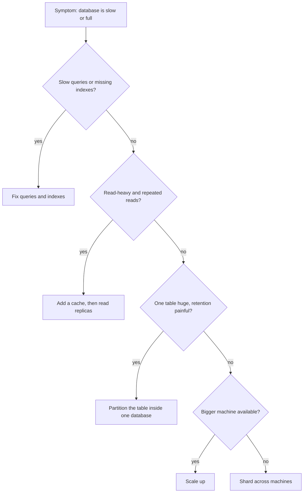

## 2. Mental model

Partitioning is a filing cabinet with one drawer per month: the same office, but you only open the drawer you need, and throwing away last year means emptying one drawer. Sharding is several offices, each with its own cabinets, plus a receptionist with a directory who tells you which office holds customer X. The **shard key** is the label every file is sorted by. Choose it badly and one office is overwhelmed while the others sit idle.

| Technique | What it solves | InvoiceOps example |
| --- | --- | --- |
| Replication | Read scale and availability | Read replicas for invoice list pages |
| Partitioning | Managing one big table in one database | Monthly partitions of `audit_logs` |
| Sharding | Spreading data and writes over several databases | Workspace A on db-1, workspace B on db-2 |

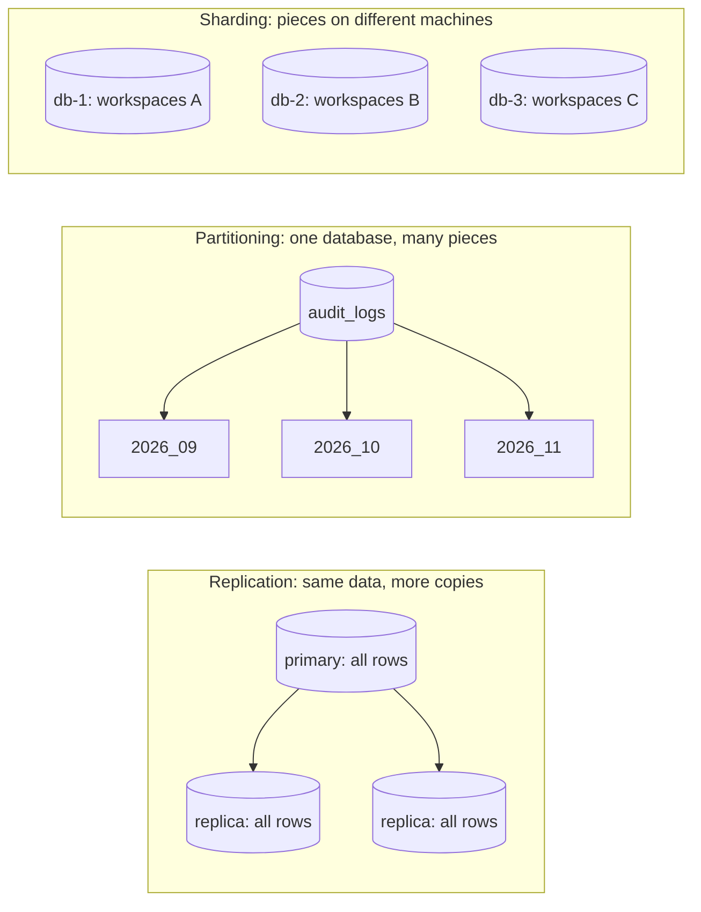

## 3. How it works

### 3.1 Partitioning inside PostgreSQL

PostgreSQL 17 supports three kinds of declarative partitioning. The parent table holds no rows; each row is stored in exactly one partition.

| Kind | Rule for placing a row | Example in InvoiceOps | Good at |
| --- | --- | --- | --- |
| `RANGE` | The key falls in `[from, to)` | `audit_logs` by `created_at`, one partition per month | Time series, retention by dropping old partitions |
| `LIST` | The key is in a listed set | `clients` by `region`: `IN`, `DE`/`FR`/`NL`, everything else | Data residency, known categories |
| `HASH` | `hash(key) mod MODULUS = REMAINDER` | `invoices` by `workspace_id` over 4 partitions | Even spread when there is no natural range |

The shortest useful example is the monthly range partition. `FROM` is inclusive and `TO` is exclusive, and the primary key must include the partition key (the other two kinds, with their full DDL, are in [[Partitioning and Sharding - Go]]):

```sql
CREATE TABLE audit_logs (
    workspace_id bigint NOT NULL, created_at timestamptz NOT NULL,
    id uuid NOT NULL DEFAULT gen_random_uuid(), action text NOT NULL, payload jsonb,
    PRIMARY KEY (workspace_id, created_at, id)   -- must include the partition key
) PARTITION BY RANGE (created_at);
CREATE TABLE audit_logs_2026_11 PARTITION OF audit_logs
    FOR VALUES FROM ('2026-11-01') TO ('2026-12-01');
```

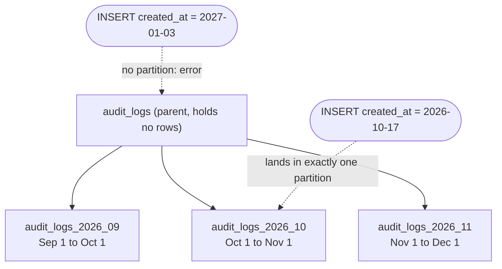

### 3.2 Partition pruning

**Partition pruning** is the payoff: the planner skips partitions whose bounds cannot match the `WHERE` clause.

```sql
EXPLAIN (ANALYZE, COSTS OFF)
SELECT count(*) FROM audit_logs
WHERE workspace_id = 7
  AND created_at >= '2026-11-01' AND created_at < '2026-11-08';
```

Representative output (PostgreSQL 17):

```text
 Aggregate (actual time=3.102..3.103 rows=1 loops=1)
   ->  Index Only Scan using audit_logs_2026_11_pkey on audit_logs_2026_11 audit_logs (actual time=0.038..2.671 rows=18240 loops=1)
         Index Cond: ((workspace_id = 7) AND (created_at >= '2026-11-01 00:00:00+00'::timestamp with time zone) AND (created_at < '2026-11-08 00:00:00+00'::timestamp with time zone))
         Heap Fetches: 412
 Planning Time: 0.406 ms
 Execution Time: 3.147 ms
```

Only `audit_logs_2026_11` appears: the other partitions were pruned while planning.

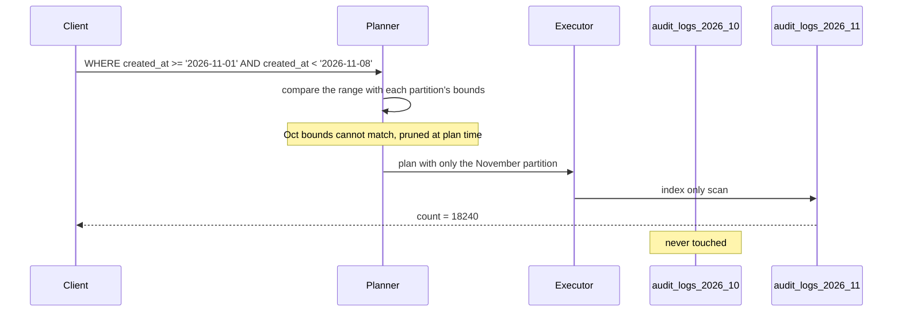

When the bound is only known at run time, such as `now()` or a parameter of a generic prepared plan, pruning happens when the executor starts and shows up as `Subplans Removed`:

```sql
EXPLAIN (COSTS OFF)
SELECT count(*) FROM audit_logs WHERE created_at >= now() - interval '7 days';
```

Representative output (PostgreSQL 17, 12 monthly partitions, run on 2026-11-02):

```text
 Aggregate
   ->  Append
         Subplans Removed: 10
         ->  Seq Scan on audit_logs_2026_10 audit_logs_1
               Filter: (created_at >= (now() - '7 days'::interval))
         ->  Seq Scan on audit_logs_2026_11 audit_logs_2
               Filter: (created_at >= (now() - '7 days'::interval))
```

### 3.3 Retention as a metadata operation

**Retention becomes a metadata operation** instead of a giant `DELETE`:

```sql
ALTER TABLE audit_logs DETACH PARTITION audit_logs_2025_12 CONCURRENTLY;  -- PostgreSQL 14+
DROP TABLE audit_logs_2025_12;   -- or archive it to object storage first
```

| Approach | Work done | WAL written | Locks and bloat |
| --- | --- | --- | --- |
| `DELETE` last December's rows | Visit and mark about 500 million rows dead (estimate) | Hundreds of GB | Dead rows to vacuum, table bloat |
| `DETACH` then `DROP` the partition | Edit the catalog, delete one file set | Almost none | Nothing to vacuum |

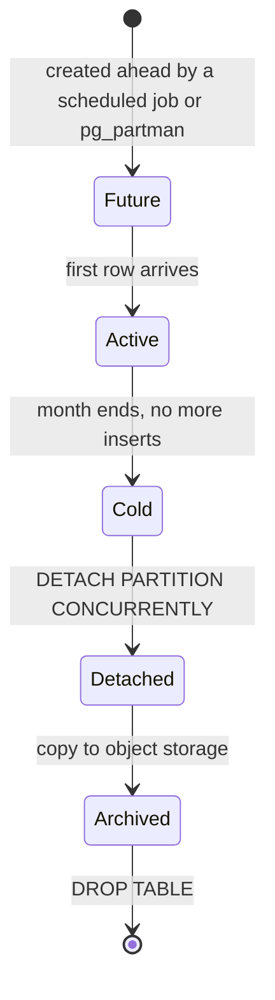

`DETACH … CONCURRENTLY` cannot run inside a transaction block or on a table with a `DEFAULT` partition. Create future partitions ahead of time with a scheduled job or `pg_partman`: an insert with no matching partition fails with `no partition of relation "audit_logs" found for row`.

### 3.4 Sharding across machines

A sharded system has three parts: a **shard key** on every row, a **shard map** that says which database owns which key, and a **router** that reads the map for every query.

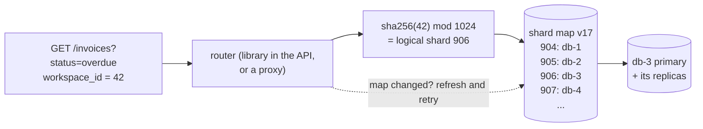

The router hashes the key to one of a **fixed** number of logical shards, then looks up which physical database currently owns that logical shard. Moving data means reassigning whole logical shards. The hash never changes, so no key is ever rehashed.

The whole routing idea is three lines (the runnable version with a versioned map is in [[Partitioning and Sharding - Go]]):

```go
func dbFor(workspaceID string) string {
	return owner[logicalShard(workspaceID)] // key -> logical shard -> database
}
```

The router can be a library inside each service, a proxy (Vitess `vtgate`, MongoDB `mongos`) or a coordinator database (Citus). The map itself is small and lives in a strongly consistent store such as etcd, ZooKeeper or a tiny replicated table; routers cache it and refresh it when its version changes.

### 3.5 Strategies

| Strategy | How a key finds its shard | Good at | Risk |
| --- | --- | --- | --- |
| Range | Sorted key ranges: `[1, 1M)` on shard 1, and so on | Range scans, ordered reads | A monotonic key sends every new write to the last range |
| Hash | `hash(key)` picks a logical shard or a hash range | Even spread of keys and writes | Range queries hit every shard; never use plain `hash % N` with N = servers (see [[Consistent Hashing]]) |
| Directory (lookup) | A table maps each key, or tenant, to a shard | Move any tenant at any time; dedicated shards for big ones | The directory is on every request's path: cache it and replicate it |
| Geo | The user's region picks the shard | Data residency, local latency | Uneven regions; users who travel or span regions |
| Tenant | The tenant ID picks the shard, through hash or directory | Every tenant query is single-shard | One huge tenant can outgrow its shard |

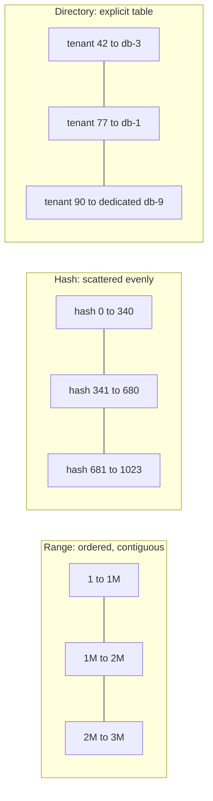

### 3.6 The user-ID range example is a hot-shard anti-pattern

A classic textbook example splits users by ID:

- Shard 1: user ID 1 to 1,000,000
- Shard 2: user ID 1,000,001 to 2,000,000
- Shard 3: user ID 2,000,001 to 3,000,000

With auto-increment IDs this is the hot-shard problem in its purest form:

- **Every insert hits the last shard.** The next signup is always the highest ID. Measured with the router in [[Partitioning and Sharding - Go]]: of the newest 100,000 IDs (2,900,001 to 3,000,000), range sharding puts **all 100,000** on shard 3, while hashing spreads them 33,427 / 33,459 / 33,114.
- **The newest users are the busiest.** Onboarding, first invoices and first payments all hit shard 3, while shards 1 and 2 hold older, quieter accounts.
- **There is a cliff.** User 3,000,001 has no shard until someone creates shard 4, which then becomes the new hot spot.

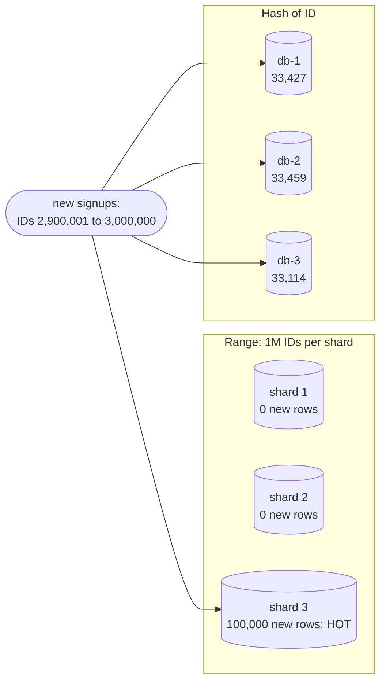

Fixes: hash the ID; or shard by a key that is not monotonic; or keep range sharding but split ranges automatically by load, as Bigtable, HBase and the [[Distributed SQL]] databases do.

### 3.7 Choosing the shard key for InvoiceOps

A good shard key has high cardinality, spreads load evenly, appears in almost every query, never changes, and keeps data that is used together in one place. Bad keys: `status` or other low-cardinality fields, `created_at` alone for write-heavy tables, `region` alone, and anything most queries do not filter on.

| Candidate key | Cardinality | Spreads load | In every query | Verdict |
| --- | --- | --- | --- | --- |
| `status` | 4 values | No: most rows are `paid` | No | Reject |
| `created_at` alone | High | No: all writes hit "now" | No | Reject for writes |
| `region` alone | A handful | No: one region dominates | No | Reject |
| `invoice_id` | Very high | Yes | No: list pages are per workspace, so they would fan out | Reject |
| `workspace_id` | Thousands | Yes, except a few huge tenants | Yes | Choose |

InvoiceOps uses **`workspace_id`**. Every API request is scoped to one workspace, since authorization is per workspace, and every table carries the column, so a workspace's clients, invoices, line items and payments all live on one shard:

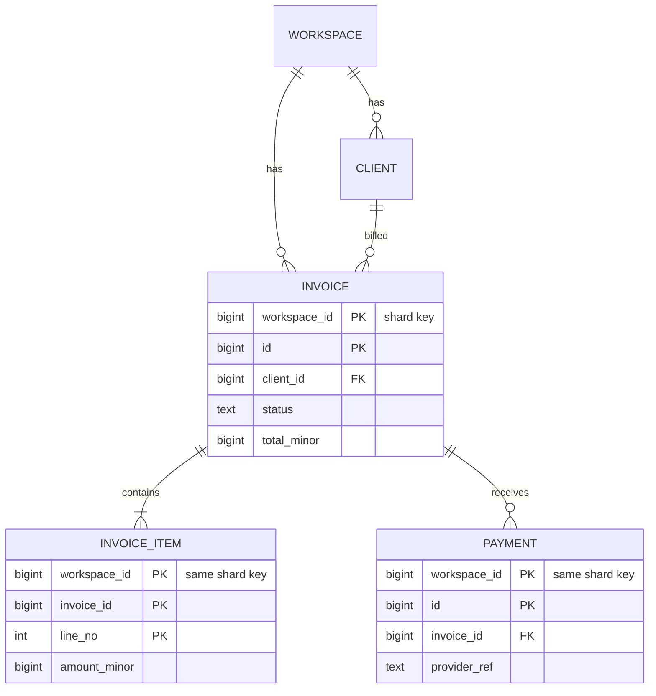

Joins and transactions inside a workspace stay on one shard. What does not fit, and the answer for each:

- **The payment webhook carries only the provider's payment ID.** Store `workspace_id` in the payment order's metadata when you create it, or keep a small global lookup table `provider_ref → workspace_id`.
- **Global uniqueness.** `UNIQUE (workspace_id, invoice_number)` is shard-local and cheap. A globally unique `provider_ref` needs the lookup table, because no shard sees the others' rows.
- **IDs.** A single sequence no longer exists. Use UUIDv7, Snowflake-style or shard-prefixed IDs (see [[Unique ID Generation]]).
- **A huge enterprise workspace.** Give it a directory override to a dedicated shard.
- **Cross-workspace reports.** Send them to a warehouse fed by CDC, not to a fan-out over every shard.

## 4. Worked example

### Whiteboard version

The bare idea: key, then a fixed logical shard, then a database from a map. A request for workspace 42 hashes to logical shard 906 (of 1,024, fixed forever) and the map says shard 906 lives on db-3. Moving shard 906 to a new database is one map update; the hash is never recomputed with a different modulus. The runnable whiteboard code is the `dbFor` function in [[Partitioning and Sharding - Go]].

### Routing and the versioned map, traced

| Step | What happens | Numbers |
| --- | --- | --- |
| 1 | The API receives a request for workspace 42 | `workspace_id = 42` |
| 2 | The router hashes to a logical shard | `sha256(42) mod 1024 = 906` |
| 3 | The router reads its cached shard map | map version 17, shard 906 on db-3 |
| 4 | The query goes to db-3 | one shard, one database |
| 5 | If the map moved, db-3 rejects the write | router refreshes to version 18 and retries |

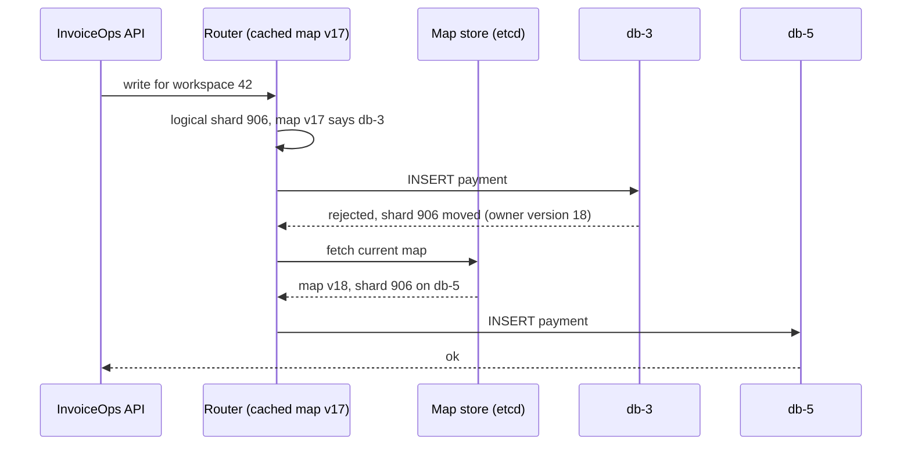

### Moving a workspace online

Moving logical shard 906 (workspace 42 and its neighbours) from db-3 to a new db-5 while InvoiceOps keeps running:

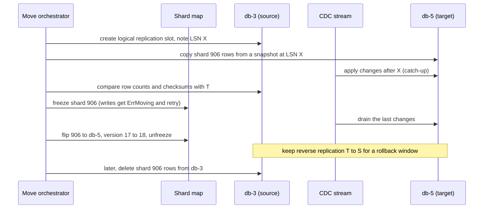

- Taking the snapshot at a known LSN and streaming from that same LSN means no change is missed and none is applied twice.
- The freeze lasts only as long as the final drain, normally seconds (an estimate that depends on write rate). Clients see `ErrMoving` and retry, or a proxy buffers them.
- The map version acts as a fence: a router holding version 17 must not write to db-3 after the flip.
- `Freeze` only stops *new* routing. A write that was routed to db-3 just before the freeze can still be in flight and land after the final drain, and the CDC stream would then miss it. So the source must enforce ownership itself: keep a small `shard_owner(logical_shard, version)` table on each database, have every write transaction check (or `SELECT ... FOR SHARE`) its shard's row and abort when the shard is marked moved, and mark it moved in the same step as the final drain. Late writes then fail with `ErrMoving` and are retried against the new owner instead of being lost.

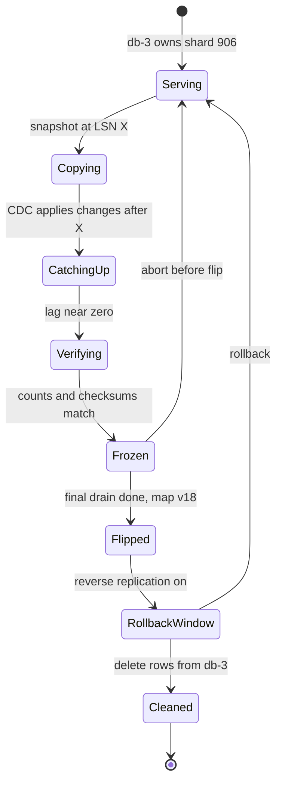

**Double writes** are the alternative: the application writes to both old and new, a backfill copies history, reads are compared, then switched. It needs no CDC, but a crash between the two writes leaves them different, so it also needs a reconciliation job. With CDC there is only one writer at any time, which is why most tools use it:

- **Vitess `Reshard` and `MoveTables`:** copy, then catch up through VReplication, verify with **VDiff**, then `SwitchTraffic`, which briefly pauses writes and keeps reverse replication on for rollback, and finally `Complete`.
- **Citus:** the shard rebalancer moves shards with logical replication, so writes block only at the end.

Runnable Go version: [[Partitioning and Sharding - Go]]

## 5. Variants and comparison

| Where routing lives | Examples | Strengths | Costs |
| --- | --- | --- | --- |
| Library in the application plus a shard map | Notion: 480 logical shards over 32 PostgreSQL hosts, re-sharded onto 96 in 2023. Instagram: thousands of logical shards as PostgreSQL schemas | No extra network hop, full control | Every service needs the library; you build resharding yourself |
| Proxy | Vitess `vtgate` in front of MySQL (YouTube, Slack) | Applications see one database; resharding is built in | Another tier to run; some cross-shard SQL is limited |
| Coordinator database | Citus, a PostgreSQL extension: `create_distributed_table('invoices', 'workspace_id')`, co-located tables, reference tables copied to every node | Real SQL, including many cross-shard queries | Coordinator overhead; rules about the distribution column |
| Managed auto-sharding | DynamoDB splits partitions automatically, each capped at 3,000 read units and 1,000 write units per second. MongoDB has chunks and a balancer. [[Distributed SQL]] splits ranges automatically | No manual resharding | Less control over placement; a bad key still makes a hot partition |

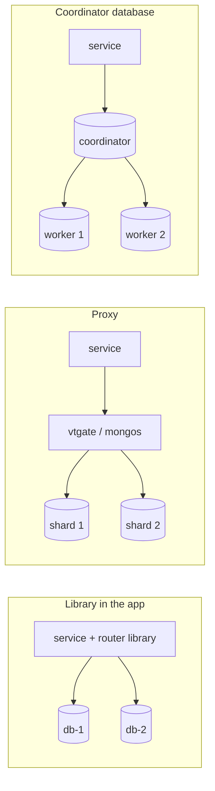

## 6. Trade-offs and when not to use

- **Partitioning costs:**
	- Primary keys and unique constraints must include the partition key; PostgreSQL has no global index.
	- A query that does not filter on the partition key scans every partition, which is slower than one table with one index.
	- The PostgreSQL docs say the planner handles "up to a few thousand partitions fairly well" only when queries prune all but a few. So keep the partition count in the hundreds.
- **Sharding costs:**
	- Cross-shard queries fan out, and a fan-out is as slow as its slowest shard (see §8).
	- Cross-shard transactions need [[Two-Phase Commit]] or a [[Saga Pattern]].
	- Global constraints need lookup tables.
	- Every operation now runs N times: N backups, N schema migrations, N dashboards.
	- Resharding is a project, not a command.
- **When not to shard:**
	- When one well-tuned primary with replicas, caching and partitioned big tables still has headroom. Sharding changes the application's architecture and is very hard to undo.
	- When you want SQL transactions across the whole dataset with automatic splitting: look at [[Distributed SQL]] before building your own router.

## 7. In production

- **Real systems:**
	- Notion shards PostgreSQL by workspace ID into 480 logical shards. 480 divides evenly over 32 hosts (15 each) and over 96 hosts (5 each), which made the re-shard a move of whole logical shards.
	- Instagram's design keeps thousands of logical shards as PostgreSQL schemas on fewer physical servers, and puts the logical shard ID inside every 64-bit ID.
	- Figma (2024) shards PostgreSQL behind DBProxy, its own Go query proxy that parses each query and picks the shard. Tables that share a shard key form a "colo", so joins inside a colo stay on one shard. It first shipped *logical* sharding (routing as if sharded, over PostgreSQL views) and split the data physically afterwards.
	- Slack moved its MySQL fleet to Vitess. YouTube is where Vitess was built.
	- Citus powers sharded PostgreSQL, including Azure Cosmos DB for PostgreSQL.
- **Failure modes → fixes:**
	- One tenant overloads its shard → directory override to a dedicated shard, or split the logical shard (see [[Hot Keys and Hot Partitions]]).
	- One hot key in a key-value store (a counter, a viral item) → salt it into `key#0 … key#9` and fan reads in.
	- Routers with a stale map write to the old owner → version the map; the old owner rejects writes for shards it no longer owns; routers refresh on rejection.
	- Monthly partition not created, so inserts fail at midnight → create partitions weeks ahead and alert on "partitions ahead < 2".
	- Fan-out queries dominate p99 → add the shard key to the query, or move the report to a warehouse.
	- A schema migration succeeds on 31 shards and fails on 1 → orchestrated migrations with per-shard status and backward-compatible steps (see [[Zero-Downtime Schema Migrations]]).
- **What to monitor:**
	- Per shard: CPU, storage, QPS, p99 latency, connections, replication lag.
	- Skew: the busiest shard divided by the average.
	- The rate of scatter-gather queries.
	- CDC lag and the freeze duration during moves.
	- For partitions: the newest partition that exists, and partitions past retention not yet dropped.

## 8. Deep dive

### 8.1 Why many logical shards

With 1,024 logical shards on 4 servers, adding a fifth server means moving about 205 logical shards (1/5 of them), each a self-contained copy. With `hash % servers` you would rehash and move about 80% of all rows (measured in [[Consistent Hashing]]). Logical shards also allow weighting: a bigger server simply gets more of them.

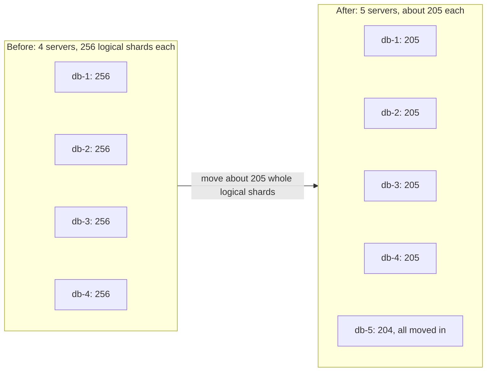

### 8.2 Global secondary indexes

InvoiceOps sometimes needs "find the invoice by `provider_ref`", a column that is not the shard key.

- A **local** index (each shard indexes its own rows) is cheap to write, but the read must scatter to every shard.
- A **global** index is partitioned by the indexed value: the read goes to one index shard, then one data shard, but every write touches two shards. That needs a distributed transaction, or the index is updated asynchronously and can be briefly stale. DynamoDB global secondary indexes are eventually consistent; Vitess lookup vindexes keep a lookup table in step with the data.

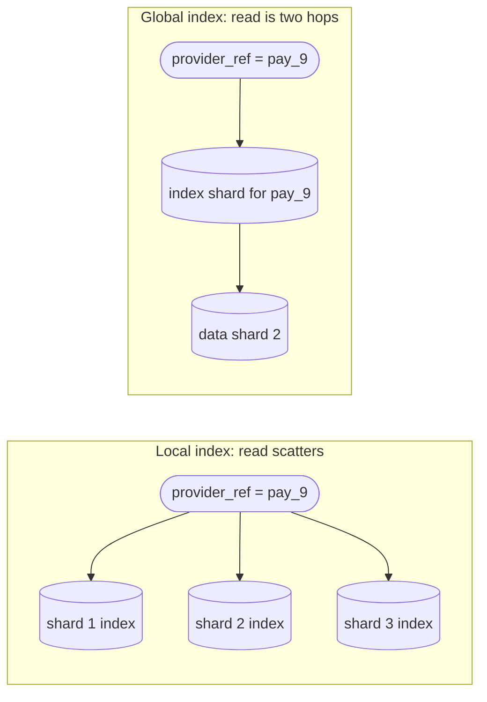

### 8.3 Fan-out tail latency

If each shard answers within 20 ms 99% of the time, a query that must wait for all 32 shards finishes within 20 ms only `0.99^32 ≈ 72.5%` of the time, so about 1 in 4 such queries is slower than any single shard's p99. Fan-out multiplies tail latency.

| Shards a query waits for | Probability all answer within the per-shard p99 |
| --- | --- |
| 1 | 99.0% |
| 8 | 92.3% |
| 32 | 72.5% |
| 100 | 36.6% |

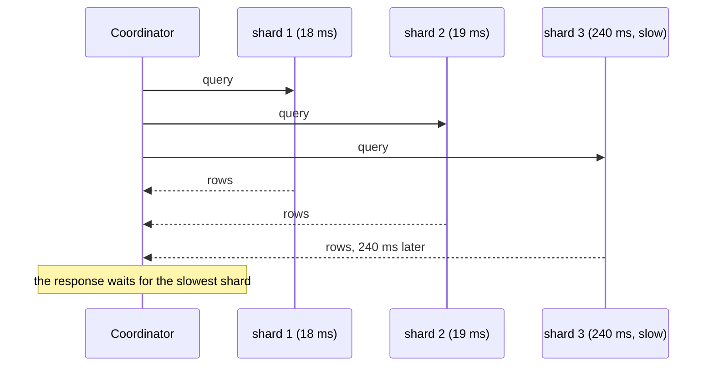

### 8.4 Other internals

- **Cross-shard joins.**
	- Co-locate: shard every tenant table by `workspace_id`, so joins inside a tenant are local.
	- Copy small, shared tables (plans, currencies, tax rates) to every shard as reference tables.
	- Do the rare cross-tenant join in the application, or in a warehouse.
- **Cross-shard transactions.** Design workflows so most operations stay inside one shard. When one cannot, use a saga with an outbox and compensating steps rather than pretending it is a local transaction. Citus and Vitess can run multi-shard writes atomically with 2PC, which costs extra round trips and holds locks across machines.
- **Splitting hash partitions in place.** PostgreSQL allows different moduli in one table as long as each modulus divides the next larger one. To split `REMAINDER 0` of `MODULUS 4`, detach it, create `MODULUS 8, REMAINDER 0` and `MODULUS 8, REMAINDER 4`, then reinsert its rows.
- **Hot ranges in range-sharded systems.** Systems that split ranges automatically (Bigtable, HBase, CockroachDB) still suffer when every insert has the newest key. The usual fix is to prefix or hash the key, such as hash-sharded indexes in CockroachDB or bit-reversed sequences in Spanner, which trades away range-scan locality on that key.

## 9. Interview questions

> [!question]- What is the difference between replication, partitioning and sharding?
> Replication copies the same data to more servers, which scales reads and availability. Partitioning splits a table into pieces inside one database, which helps maintenance, retention and pruning. Sharding places those pieces on different servers, which scales writes and storage, but the application or a router must find the right shard for every query.

> [!question]- Shard 1 holds users 1 to 1M, shard 2 holds 1M to 2M, and so on. What is wrong?
> With auto-increment IDs every new user lands on the newest shard, so it takes 100% of inserts and most onboarding traffic while the older shards idle. When IDs pass the last range, there is no shard at all. Hash the ID instead, or use a range-sharded system that splits hot ranges automatically, with a non-monotonic key.

> [!question]- How would you shard InvoiceOps?
> By `workspace_id`: every request is scoped to one workspace and every table carries it, so joins and transactions stay on one shard. Hash it into a fixed set of logical shards (for example 1,024) mapped to databases. Handle the misfits: a lookup table for webhooks keyed by `provider_ref`, global IDs (UUIDv7 or Snowflake-style), dedicated shards for huge tenants, and a CDC-fed warehouse for cross-workspace analytics.

> [!question]- How do you move a tenant to another shard without downtime?
> Snapshot its rows at a known WAL position, stream changes from that position (CDC) until the target catches up, and verify with counts and checksums. Then freeze writes for that tenant for a few seconds, drain the last changes, flip the shard map (bumping its version), and unfreeze. Keep reverse replication for rollback, and clean up the source later.

> [!question]- How do you serve a query on a column that is not the shard key?
> Either scatter-gather to every shard (simple, but cost and tail latency grow with shard count), or maintain a global secondary index partitioned by that column: one extra lookup on reads, but every write touches two shards, so the index is either updated transactionally (2PC) or eventually consistent. For rare admin queries, use a warehouse.

> [!question]- How do cross-shard transactions work?
> Avoid them by choosing a shard key that keeps related data together. When one is unavoidable, use a saga: local transactions with an outbox and compensating actions, accepting intermediate states. Two-phase commit gives atomicity, but costs extra round trips, holds locks across machines, and blocks if the coordinator dies at the wrong moment.

> [!question]- Why not route with `hash(key) % number_of_servers`?
> Adding one server changes almost every key's result (about 80% move when going from 4 to 5 servers), so you reshuffle nearly all data. Hash into a fixed, large number of logical shards and move whole logical shards, or use consistent hashing.

## 10. Cheat sheet

- The ladder: indexes → cache → replicas → partitions → bigger machine → shards.
- PostgreSQL partitioning: `RANGE`, `LIST`, `HASH`; the primary key must include the partition key; pruning shows as missing partitions or `Subplans Removed`.
- Retention: detach and drop partitions, never `DELETE` billions of rows.
- Shard key: high cardinality, in every query, immutable, keeps related rows together. InvoiceOps uses `workspace_id`.
- Sequential IDs with range sharding put 100% of new writes on one shard: hash them.
- Many logical shards on few servers, plus a versioned map, make moves cheap.
- Online move: snapshot at an LSN, CDC catch-up, verify, short freeze, flip the map, keep a rollback path.
- Fan-out to N shards multiplies tail latency (`0.99^32 ≈ 72.5%` within p99).

## Links

- **Go implementation:** [[Partitioning and Sharding - Go]]
- **Before this:** [[Replication]], [[Indexing Fundamentals]], [[Query Plans and EXPLAIN]]
- **Next:** [[Consistent Hashing]], [[Hot Keys and Hot Partitions]], [[Distributed SQL]]
- **Compare with:** [[Wide-Column Stores and Cassandra]] (partitioning built into the data model), [[Unique ID Generation]] (IDs without a central sequence), [[Two-Phase Commit]] and [[Saga Pattern]] (work that spans shards)
