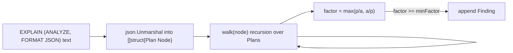
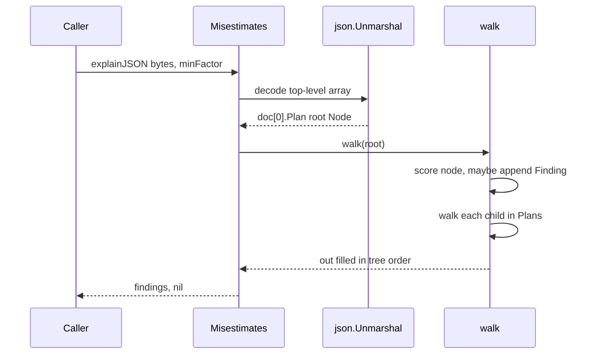
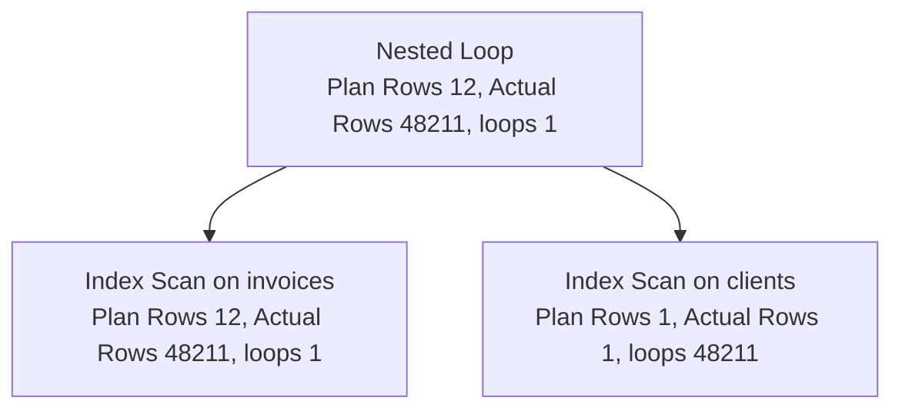

# Query Plans and EXPLAIN - Go

> [!summary] TL;DR
> This note parses `EXPLAIN (ANALYZE, FORMAT JSON)` output in Go and flags every plan node whose row estimate is off by a chosen factor, which is the mechanical version of the "compare estimated rows with actual rows" step from [[Query Plans and EXPLAIN]]. It uses only the standard library and needs no database.

## What this code shows

| Code | Theory concept | Where explained |
| --- | --- | --- |
| `Node` | One plan node: type, relation, estimated rows, actual rows per loop, loops, children | [[Query Plans and EXPLAIN]], "Reading a plan" |
| `Misestimates` | Walk the tree and compare `Plan Rows` with `Actual Rows` on every node | [[Query Plans and EXPLAIN]], "Plan 3: a bad estimate" |
| `max(p/a, a/p)` with 0 treated as 1 | Over- and under-estimates count equally, and a node that returned 0 rows does not divide by zero | [[Query Plans and EXPLAIN]], "Finding misestimates mechanically" |
| Per-loop comparison | A node that ran 48,211 times is judged on its per-loop numbers, so the fix is aimed at the outer node | [[Query Plans and EXPLAIN]], "Reading a plan" |



## Setup

- Go 1.24, standard library only (`encoding/json`, `fmt`, `testing`). The built-in `max` needs Go 1.21 or later.
- Module layout: one package `plans` with two files.

```text
plans/
  go.mod          // module plans, go 1.24
  plans.go        // Node, Finding, Misestimates
  plans_test.go   // three tests
```

- Run: `go vet ./... && go test -race -v ./...`
- To feed it a real plan, run `EXPLAIN (ANALYZE, FORMAT JSON) <query>` in `psql` and pass the output bytes to `Misestimates`.

## Code

The program has one job: read a JSON plan tree and list the nodes whose estimates were wrong. It is built in three pieces, in one file `plans.go`: the data model, the entry point that decodes JSON, and the recursive walk.



### Step 1: model the JSON and the result

**Concept.** The theory note teaches reading a plan as a tree of nodes, each with an estimate and an actual count ([[Query Plans and EXPLAIN#3.4 Reading a plan]]). `Node` is that node as a Go struct, and the `json` tags are the exact key names PostgreSQL emits in `FORMAT JSON`. Only six fields are kept, because a struct that decodes everything would be large and fragile across versions, while `encoding/json` simply ignores the keys that have no field. `Finding` is the output, kept separate from `Node` so callers get a small stable value instead of the whole tree.

```go
package plans

import (
	"encoding/json"
	"fmt"
)

// Node is the part of one EXPLAIN (ANALYZE, FORMAT JSON) plan node we need.
type Node struct {
	NodeType     string  `json:"Node Type"`
	RelationName string  `json:"Relation Name"`
	PlanRows     float64 `json:"Plan Rows"`
	ActualRows   float64 `json:"Actual Rows"`  // average per loop
	ActualLoops  float64 `json:"Actual Loops"`
	Plans        []Node  `json:"Plans"`
}
```

**How it works.**

1. The tags contain spaces, `"Node Type"`, because that is how PostgreSQL spells its keys. A mismatch does not error: the field silently stays zero.
2. `PlanRows` and `ActualRows` are `float64`, because PostgreSQL can report fractional per-loop averages such as `0.5`.
3. `Plans []Node` makes the type recursive. A slice breaks the infinite size, and one type describes a plan of any depth.
4. `ActualLoops` is decoded but not used in the arithmetic. It is kept because the per-loop meaning of the other two numbers depends on it, and exercise 1 uses it.

Shape of the data this struct receives, for the join in the theory note:



```go
// Finding is one node whose row estimate was off by at least the factor.
type Finding struct {
	Node   string
	Plan   float64
	Actual float64
	Factor float64 // >= 1, how many times off in either direction
}

func (f Finding) String() string {
	return fmt.Sprintf("%s: planned %.0f rows, got %.0f (%.0fx off)", f.Node, f.Plan, f.Actual, f.Factor)
}
```

**How it works.**

1. `Node` here is a label such as `Index Scan on invoices`, not the struct. It is a string because the report is for a person reading it.
2. `Factor` is always at least 1, because the code takes the larger of two ratios. A reader never has to ask whether 0.01 means "under" or "over".
3. Implementing `String()` makes `fmt.Println(finding)` and `%v` print the readable line, for example `Index Scan on invoices: planned 12 rows, got 48211 (4018x off)`.

### Step 2: decode the document

**Concept.** `EXPLAIN (FORMAT JSON)` returns an array with one element per statement, and each element wraps the tree under a `"Plan"` key. This is the first half of the "Finding misestimates mechanically" procedure ([[Query Plans and EXPLAIN#Finding misestimates mechanically]]): get the tree into memory. The function takes raw bytes and returns an error rather than panicking, because the input comes from outside the program. A streaming decoder or `json.RawMessage` would save memory on huge plans, but plan JSON is small, so a plain `Unmarshal` is clearer.

```go
// Misestimates walks the plan and returns nodes whose estimate and actual
// row counts differ by at least minFactor. Both sides are per loop, as
// PostgreSQL reports them; a 0 is treated as 1 to avoid dividing by zero.
func Misestimates(explainJSON []byte, minFactor float64) ([]Finding, error) {
	var doc []struct {
		Plan Node `json:"Plan"`
	}
	if err := json.Unmarshal(explainJSON, &doc); err != nil {
		return nil, err
	}
	if len(doc) == 0 {
		return nil, fmt.Errorf("empty EXPLAIN output")
	}
	var out []Finding
```

**How it works.**

1. The anonymous struct `struct{ Plan Node }` matches one array element, so no named wrapper type is needed.
2. A malformed document returns the `json` error unchanged, so the caller sees the byte offset of the problem.
3. A valid but empty array `[]` is checked separately, because `json.Unmarshal` accepts it and `doc[0]` would then panic.
4. `out` starts as `nil`. Returning a nil slice with a nil error means "no findings", which the caller can range over safely.

### Step 3: walk the tree and score every node

**Concept.** The mechanical check from the theory note is to compare `Plan Rows` with `Actual Rows` on every node ([[Query Plans and EXPLAIN#Plan 3: a bad estimate]]). Because plans are trees, the natural implementation is a recursive depth-first walk that visits the parent before its children. The score is `max(p/a, a/p)`, so overestimates and underestimates count equally, and `max(x, 1)` guards against a node that returned zero rows. A closure is used so that `walk` can append to `out` without passing it around.

```go
	var walk func(n Node)
	walk = func(n Node) {
		p, a := max(n.PlanRows, 1), max(n.ActualRows, 1)
		f := max(p/a, a/p)
		if f >= minFactor {
			name := n.NodeType
			if n.RelationName != "" {
				name += " on " + n.RelationName
			}
			out = append(out, Finding{Node: name, Plan: n.PlanRows, Actual: n.ActualRows, Factor: f})
		}
		for _, c := range n.Plans {
			walk(c)
		}
	}
	walk(doc[0].Plan)
	return out, nil
}
```

**How it works.**

1. `var walk func(n Node)` is declared first and assigned on the next line. A function literal cannot call itself by name unless the variable already exists.
2. `max(..., 1)` is the built-in from Go 1.21. It clamps both numbers to at least 1, so an actual of 0 does not divide by zero and a plan of 0.4 is treated as 1.
3. `max(p/a, a/p)` is the factor: one of the two ratios is at least 1 and the other at most 1. The larger is the "how many times off".
4. The `Finding` stores the original `n.PlanRows` and `n.ActualRows`, not the clamped values, so the report shows the real numbers.
5. The loop `for _, c := range n.Plans` recurses after the parent is recorded. That fixes the order of findings: parent first, then children left to right.
6. `walk(doc[0].Plan)` starts at the root of the first statement only.

Scoring of the three nodes in the sample (all `loops` ignored, since the numbers are per loop):

| Node | p | a | `max(p/a, a/p)` | Flagged at 10 |
| --- | --- | --- | --- | --- |
| Nested Loop | 12 | 48,211 | 4,017.6 | yes |
| Index Scan on invoices | 12 | 48,211 | 4,017.6 | yes |
| Index Scan on clients | 1 | 1 | 1 | no |

## Design decisions

| Decision | Alternative | Trade-off |
| --- | --- | --- |
| Decode only six fields into `Node` | Decode the full plan with every key | Small and resilient to new PostgreSQL versions, but cannot report costs or buffers |
| Factor is `max(p/a, a/p)` | Report signed ratio or difference | Symmetric and always at least 1, but loses whether it was an over- or under-estimate (both numbers are still in `Finding`) |
| Clamp zero to 1 with built-in `max` | Skip nodes with zero rows or return infinity | No special cases and no divide by zero, but 0 and 1 are treated as equal |
| Per-loop numbers compared directly | Multiply by `ActualLoops` first | Matches how PostgreSQL reports and how the planner estimates, but a node's total volume is hidden |
| Recursive closure `walk` | Explicit stack or iterator | Shortest and readable for trees that are tens of nodes deep, but recursion depth follows plan depth |
| Return `([]Finding, error)` | Panic on bad input | The caller decides what to do with bad input, at the cost of an error check |
| Takes `[]byte` | Takes `io.Reader` or runs the query | Easy to test with string constants and needs no database, but the caller must read the whole output first |

## Tests

Three tests cover the main path, the boundary arithmetic and the error paths. The first sample is trimmed from the representative Plan 3 output (PostgreSQL 17) in the theory note.

### TestMisestimates: a join with a 4,018x error

**Property.** The nested loop and its outer scan are flagged, the correctly estimated inner scan is not, and findings come back in tree order. This matters because the whole point of the helper is to point at the node where the estimate first went wrong.

| Input | `minFactor` | Expected |
| --- | --- | --- |
| Plan 3 JSON, three nodes | 10 | 2 findings |
| `got[1]` | | `Index Scan on invoices`, `Factor` at least 4000 |

```go
package plans

import "testing"

// Trimmed from representative output (PostgreSQL 17), FORMAT JSON.
const sample = `[{"Plan": {
  "Node Type": "Nested Loop", "Plan Rows": 12, "Actual Rows": 48211, "Actual Loops": 1,
  "Plans": [
    {"Node Type": "Index Scan", "Relation Name": "invoices",
     "Plan Rows": 12, "Actual Rows": 48211, "Actual Loops": 1},
    {"Node Type": "Index Scan", "Relation Name": "clients",
     "Plan Rows": 1, "Actual Rows": 1, "Actual Loops": 48211}
  ]}}]`

func TestMisestimates(t *testing.T) {
	got, err := Misestimates([]byte(sample), 10)
	if err != nil {
		t.Fatal(err)
	}
	if len(got) != 2 {
		t.Fatalf("want 2 findings, got %v", got)
	}
	if got[1].Node != "Index Scan on invoices" || got[1].Factor < 4000 {
		t.Fatalf("unexpected finding %v", got[1])
	}
}
```

**What a failure means.** `want 2 findings` with a different count means the factor formula or the `minFactor` comparison changed. If the count is right but `got[1]` is wrong, the traversal order or the name building changed. If `err` is set, a JSON tag no longer matches the sample.

### TestUnderestimateAndZero: the boundary arithmetic

**Property.** A node estimated at 5,000 rows that returned 0 is flagged with factor exactly 5,000. This proves both the symmetric factor (an overestimate, `p/a`) and the zero clamp (0 becomes 1, no division by zero).

| Input | `minFactor` | Expected |
| --- | --- | --- |
| Seq Scan on payments, plan 5000, actual 0 | 10 | one finding, `Factor` 5000, no error |

```go
func TestUnderestimateAndZero(t *testing.T) {
	js := `[{"Plan": {"Node Type": "Seq Scan", "Relation Name": "payments",
	  "Plan Rows": 5000, "Actual Rows": 0, "Actual Loops": 1}}]`
	got, err := Misestimates([]byte(js), 10)
	if err != nil || len(got) != 1 || got[0].Factor != 5000 {
		t.Fatalf("got %v, %v", got, err)
	}
}
```

**What a failure means.** A factor of `+Inf` or a panic means the zero clamp was removed. A factor of 0 or a missing finding means the code only checks one direction of the ratio.

### TestBadInput: errors instead of panics

**Property.** Empty and malformed input produce errors. This matters because the bytes come from outside the program.

| Input | Expected |
| --- | --- |
| `[]` | error "empty EXPLAIN output" |
| `{` | JSON syntax error |

```go
func TestBadInput(t *testing.T) {
	if _, err := Misestimates([]byte(`[]`), 10); err == nil {
		t.Fatal("want error for empty output")
	}
	if _, err := Misestimates([]byte(`{`), 10); err == nil {
		t.Fatal("want JSON error")
	}
}
```

**What a failure means.** A panic with `index out of range` on the `[]` case means the `len(doc) == 0` guard is gone. A passing `{` case with no error would mean decode errors are being swallowed.

## Running it

```bash
go vet ./... && go test -race -v ./...
```

Measured with Go 1.24.4:

```text
=== RUN   TestMisestimates
--- PASS: TestMisestimates (0.00s)
=== RUN   TestUnderestimateAndZero
--- PASS: TestUnderestimateAndZero (0.00s)
=== RUN   TestBadInput
--- PASS: TestBadInput (0.00s)
PASS
ok  	plans	1.465s
```

Reading the output line by line:

1. Each `=== RUN` line is a test starting, and each `--- PASS` line gives its name and duration. Three pairs means all three tests ran in source order.
2. `(0.00s)` is expected: decoding a few hundred bytes of JSON takes microseconds.
3. `PASS` means no test failed, and `ok plans 1.465s` is the package total, which includes compiling with the race detector.
4. `go vet` printed nothing, so it found no suspicious constructs.

To feed it a real plan, run `EXPLAIN (ANALYZE, FORMAT JSON) <query>` in `psql` and pass the output bytes to `Misestimates`.

## Pitfalls in the code

- `Actual Rows` is an average per loop in the JSON, rounded by PostgreSQL. A node with 0 reported rows and 1,000 loops may still have returned some rows.
- The struct tags must match PostgreSQL's key names exactly, including the spaces (`"Node Type"`, `"Plan Rows"`). A typo decodes silently to zero.
- With `ANALYZE` off, `Actual Rows` is absent and decodes to 0, so every node with more than a few planned rows would be flagged. Run it only on `ANALYZE` output.
- Parallel plans report per-worker averages, so a `Gather` subtree can look more wrong than it is.
- The helper flags nodes but does not say which one is the root cause; errors compound upward, so start with the deepest flagged node.
- `Misestimates` returns the findings in tree order (parent before child), which the first test relies on when it reads `got[1]`.

## Exercises

1. Add a `Loops`-weighted total (`ActualRows * ActualLoops`) to `Finding` and print it. Predict the total for the `clients` node in the sample before running it.
2. Raise `minFactor` in `TestMisestimates` from 10 to 5,000. Predict how many findings remain and what that says about the sample's 4,018x error.
3. Add a node with `Plan Rows: 1` and `Actual Rows: 100` to the sample and predict whether it is flagged at `minFactor` 10.

## Links

- Theory: [[Query Plans and EXPLAIN]]
- Before this: [[Index Types and Index Design - Go]]
