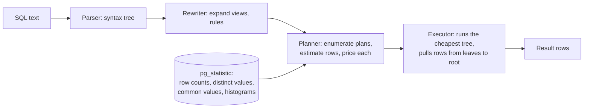
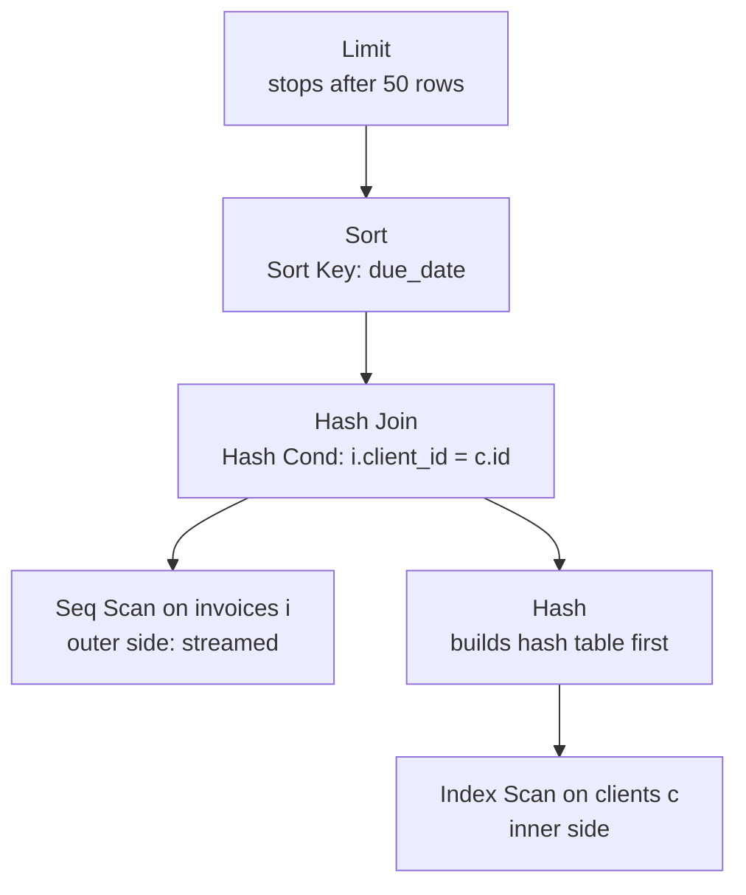
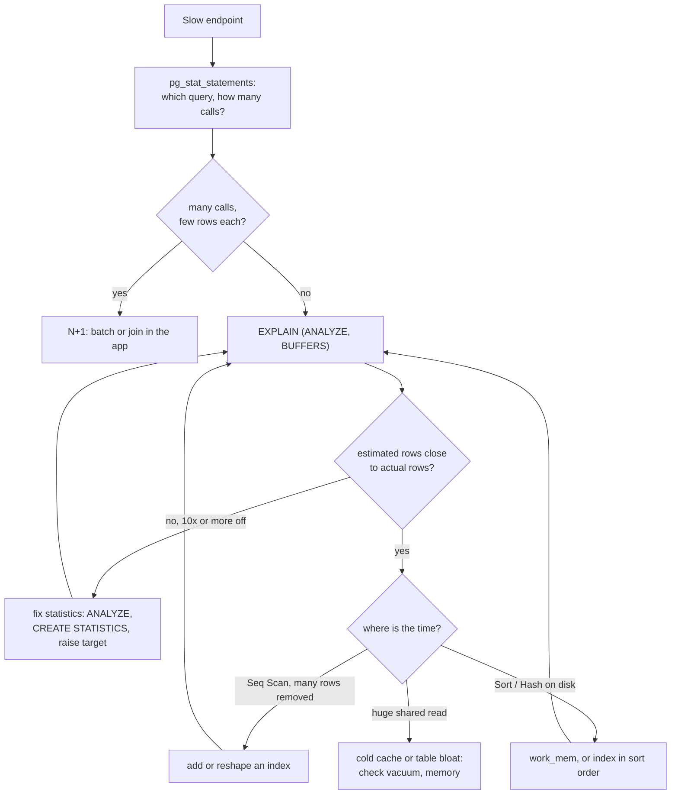

# Query Plans and EXPLAIN

> [!summary] TL;DR
> SQL says *what* rows you want, not *how* to fetch them. The database's **planner** picks the how: which index to use, in which order to join tables, how to sort. That choice is the **query plan**, and `EXPLAIN` prints it. `EXPLAIN ANALYZE` also runs the query and shows what really happened, so you can see where the time went and why.

> [!abstract] Core idea
> - A plan is a tree of steps (nodes); rows flow from the leaves (table scans) up to the root (your result).
> - The planner guesses how many rows each step will produce from table **statistics**, prices each candidate plan, and keeps the cheapest.
> - Most slow queries are a bad guess: compare the estimated `rows` with the actual `rows` on every node.
> - `EXPLAIN (ANALYZE, BUFFERS)` shows real time, real rows and how many 8 kB pages were read; it really executes the statement.
> - Find which queries to fix first with `pg_stat_statements`, then read their plans.

## 1. Why it exists

InvoiceOps shows each workspace an "Overdue invoices" page, the 50 oldest overdue invoices:

```sql
SELECT id, number, total_minor, due_date
  FROM invoices
 WHERE workspace_id = 42 AND status = 'overdue'
 ORDER BY due_date
 LIMIT 50;
```

On a staging copy with 1.2 million invoices and only a primary-key index, this takes about 1.2 seconds, and the page makes three similar queries. The SQL is correct and short. Nothing in the SQL text tells you why it is slow: the reason is the plan, which here reads every one of the 1.2 million rows to keep 4,870 of them. `EXPLAIN` is how you see that, and how you confirm that a fix (here, an index) actually changed the plan rather than hoping it did.

Throughout this note, plan output is **representative output (PostgreSQL 17)**, written to be internally consistent (costs, row counts, buffer counts) but not captured from a live server. Timings are illustrative.

## 2. Mental model

The planner is a route planner for data. You give a destination (the result you want). It knows the roads (tables, indexes), has a rough traffic model (statistics about how many rows match what), estimates the travel time of several routes, and picks the fastest **estimated** route. It does not drive the routes first.

So there are only two ways a plan goes wrong:

1. **The best route does not exist.** No useful index, a query shape that defeats indexes, too little memory for a sort. Fix: give it a better road.
2. **The traffic model is wrong.** The planner thought 12 rows would match and 48,211 did, so it chose a route that is great for 12 and terrible for 48,211. Fix: give it better statistics, or rewrite the query so the estimate becomes easy.

Reading a plan means checking both: what route was chosen, and how wrong the guesses were.

## 3. How it works

### 3.1 From SQL text to rows



### 3.2 Statistics and selectivity

`ANALYZE` (run automatically by autovacuum after enough rows change) samples each table and stores per-column statistics, readable through the `pg_stats` view. With the default `default_statistics_target = 100`, it samples 30,000 rows (300 × the target) and keeps:

| Statistic | Meaning | Used for |
| --- | --- | --- |
| `reltuples`, `relpages` (in `pg_class`) | total rows and 8 kB pages | scaling every estimate |
| `null_frac` | share of NULLs | `IS NULL` filters |
| `n_distinct` | number of distinct values (negative = a fraction of rows) | `=` on values not in the common list |
| `most_common_vals` / `_freqs` | up to 100 frequent values and how often each occurs | `=` on popular values, such as `status = 'paid'` |
| `histogram_bounds` | boundaries splitting the other values into equal-count buckets | ranges such as `due_date < '2026-10-01'` |
| `correlation` | how closely physical row order follows the column's sort order | cost of index scans |

**Selectivity** is the fraction of rows a condition keeps (0.01 = 1%). **Cardinality** here means the estimated row count: table rows × selectivity. For `status = 'overdue'`, the planner looks up `'overdue'` in `most_common_vals`; if its frequency is 0.04, it expects 1,200,000 × 0.04 = 48,000 rows. For two conditions joined with `AND`, it multiplies the selectivities, which assumes the columns are **independent**. That assumption is the single most common source of bad estimates (section 4 shows one).

```sql
SELECT attname, n_distinct, most_common_vals, most_common_freqs
  FROM pg_stats
 WHERE tablename = 'invoices' AND attname IN ('status', 'workspace_id');
```

### 3.3 The cost model

**Cost** is an abstract unit, not milliseconds. By default one sequential 8 kB page read costs `seq_page_cost = 1.0`, a random page read `random_page_cost = 4.0`, processing one row `cpu_tuple_cost = 0.01`, one index entry `cpu_index_tuple_cost = 0.005`, and one operator such as `=` `cpu_operator_cost = 0.0025`.

Worked: a sequential scan of `invoices` (30,000 pages, 1,200,000 rows) with two `=` conditions costs
30,000 × 1.0 + 1,200,000 × 0.01 + 1,200,000 × 2 × 0.0025 = 30,000 + 12,000 + 6,000 = **48,000**.
An index scan pays 4.0 per heap page it touches but touches few pages; the planner compares the totals. On SSDs many teams lower `random_page_cost` to about 1.1 so index scans are not over-priced; treat that as a tuning choice to measure, not a rule.

### 3.4 Reading a plan

```sql
EXPLAIN (ANALYZE, BUFFERS)
SELECT ...;
```

- `EXPLAIN` alone shows estimates only and does not run the query.
- `ANALYZE` **runs the statement** and adds actual numbers. For `INSERT`, `UPDATE` or `DELETE`, wrap it: `BEGIN; EXPLAIN ANALYZE UPDATE …; ROLLBACK;`.
- `BUFFERS` adds page counts: `shared hit` (page found in PostgreSQL's cache), `read` (fetched from the OS or disk), `dirtied`, `written`. In PostgreSQL 17 you must ask for it; PostgreSQL 18 includes it by default with `ANALYZE`.
- PostgreSQL 17 also added `SERIALIZE` (time to convert output rows to text) and `MEMORY` (planner memory).

Every node line has the same shape:

```text
Index Scan using clients_pkey on clients c  (cost=0.42..4.75 rows=1 width=32) (actual time=0.006..0.006 rows=1 loops=48211)
```

| Field | Meaning |
| --- | --- |
| `cost=0.42..4.75` | estimated **startup** cost (before the first row) .. **total** cost (all rows) |
| `rows=1` (first parentheses) | estimated rows this node returns, per execution |
| `width=32` | estimated average row size in bytes |
| `actual time=0.006..0.006` | real milliseconds to first row .. to last row, **per loop** |
| `rows=1` (second parentheses) | real rows, **averaged per loop** |
| `loops=48211` | how many times this node ran |

Two rules make plans readable:

1. **Read from the innermost (most indented) node outward.** Children produce rows; parents consume them.
2. **Multiply by `loops`.** The node above ran 48,211 times, so its real total is about 0.006 ms × 48,211 ≈ 289 ms, even though each line looks tiny.



Rows flow upward: the scans at the bottom run first, the `Hash` node is built completely before the join emits anything (a high startup cost), and `Limit` stops pulling once it has 50 rows.

### 3.5 Node types you will meet

| Node | What it does | Good sign / warning sign |
| --- | --- | --- |
| Seq Scan | reads every page of the table | fine for small tables or when most rows match; `Rows Removed by Filter` in the millions is a warning |
| Index Scan | walks a B-tree, then fetches each matching row from the table (the **heap**) | great for few rows; random reads add up for many |
| Index Only Scan | answers from the index alone | check `Heap Fetches`: high means the **visibility map** (a per-page "all rows visible" bit set by VACUUM) is stale, so it still visits the table |
| Bitmap Index Scan + Bitmap Heap Scan | collects matching row locations into a bitmap, then reads table pages in physical order | medium selectivity; `lossy` heap blocks mean the bitmap ran out of `work_mem` and must `Recheck Cond` whole pages |
| Nested Loop | for each outer row, look up matches in the inner side | great when the outer side is small and the inner is indexed; terrible with a large, underestimated outer side |
| Hash Join | builds a hash table on one input, streams the other | large unsorted inputs with `=`; `Batches: 4` means the hash spilled to disk |
| Merge Join | walks two inputs already sorted on the join key | both sides come sorted (from indexes) or are huge |
| Sort | sorts rows | `Sort Method: quicksort Memory: …` fine; `external merge Disk: …` spilled; `top-N heapsort` means a `LIMIT` helped |
| HashAggregate / GroupAggregate | `GROUP BY` via hash table or pre-sorted input | `Disk Usage` on HashAggregate means it spilled |
| Memoize (since PostgreSQL 14) | caches inner results of a nested loop by key | high `Hits` is good |
| Gather / Gather Merge | collects rows from parallel workers | `Workers Launched` lower than `Planned` means the worker pool was busy |

Index structure and index choice are owned by [[Indexing Fundamentals]] and [[Index Types and Index Design]]; this note only reads which index the plan used.

## 4. Worked example

### Whiteboard version

```sql
-- 1. See the plan and what really happened.
EXPLAIN (ANALYZE, BUFFERS)
SELECT id, number, total_minor, due_date
  FROM invoices
 WHERE workspace_id = 42 AND status = 'overdue'
 ORDER BY due_date LIMIT 50;
-- Look for: Seq Scan, "Rows Removed by Filter: 1195130", Execution Time ~1.2 s

-- 2. Give the planner a better road: equality columns first, then the sort column.
CREATE INDEX CONCURRENTLY invoices_ws_status_due_idx
    ON invoices (workspace_id, status, due_date);

-- 3. Re-run step 1. Expect: Index Scan, no Sort node, a few dozen buffers, ~3 ms.
```

### Plan 1: the slow version

Staging copy: 1,200,000 invoices in 30,000 pages, primary key only. For a readable single-process plan, parallel query is off (`SET max_parallel_workers_per_gather = 0`); with it on you would see a `Gather Merge` over parallel scans doing the same total work.

Representative output (PostgreSQL 17):

```text
Limit  (cost=48163.20..48163.32 rows=50 width=48) (actual time=1184.551..1184.562 rows=50 loops=1)
  Buffers: shared hit=2113 read=27887
  ->  Sort  (cost=48163.20..48175.70 rows=5000 width=48) (actual time=1184.548..1184.555 rows=50 loops=1)
        Sort Key: due_date
        Sort Method: top-N heapsort  Memory: 32kB
        Buffers: shared hit=2113 read=27887
        ->  Seq Scan on invoices  (cost=0.00..48000.00 rows=5000 width=48) (actual time=0.412..1181.902 rows=4870 loops=1)
              Filter: ((workspace_id = 42) AND (status = 'overdue'::text))
              Rows Removed by Filter: 1195130
              Buffers: shared hit=2113 read=27887
Planning Time: 0.180 ms
Execution Time: 1184.620 ms
```

Reading it inside out:

1. **Seq Scan** cost 48,000, exactly the arithmetic from section 3.3. It read all 30,000 pages (2,113 + 27,887) and threw away 1,195,130 rows to keep 4,870.
2. The estimate (5,000) is close to the actual (4,870), so the statistics are fine. This is a missing-road problem, not a bad-guess problem.
3. **Sort** used `top-N heapsort` in 32 kB because of the `LIMIT`, so the sort is cheap. Almost all the 1,184 ms is in the scan.

### Plan 2: after the composite index

The index puts the two equality columns first and the sort column last, so the matching entries are already in `due_date` order (why this column order works is covered in [[Index Types and Index Design]]).

Representative output (PostgreSQL 17):

```text
Limit  (cost=0.43..61.12 rows=50 width=48) (actual time=0.052..2.871 rows=50 loops=1)
  Buffers: shared hit=4 read=49
  ->  Index Scan using invoices_ws_status_due_idx on invoices  (cost=0.43..6069.43 rows=5000 width=48) (actual time=0.050..2.860 rows=50 loops=1)
        Index Cond: ((workspace_id = 42) AND (status = 'overdue'::text))
        Buffers: shared hit=4 read=49
Planning Time: 0.210 ms
Execution Time: 2.903 ms
```

- No `Sort` node: the index delivers rows in order, and `Limit` stops after 50.
- `Limit` total cost 61.12 = 0.43 + (6,069.43 − 0.43) × 50 / 5,000. The planner prices a `LIMIT` as a fraction of its child, which is why it prefers plans with a low startup cost here.
- 53 pages instead of 30,000: about 3 index pages plus one table page per row. Time drops from about 1.2 s to about 3 ms (illustrative), almost all of it the 49 page reads from disk; a second run with a warm cache would show `hit=53` and well under a millisecond.

### Plan 3: a bad estimate

A report joins invoices to clients for workspace 77 in rupees. Workspace 77 is a new, large Indian customer that imported its whole history after the last `ANALYZE`, so the statistics still describe it as a tiny tenant (unlike workspace 42 in Plans 1 and 2, whose estimate was accurate):

```sql
EXPLAIN (ANALYZE, BUFFERS)
SELECT i.number, i.total_minor, c.name
  FROM invoices i
  JOIN clients c ON c.id = i.client_id
 WHERE i.workspace_id = 77 AND i.currency = 'INR';
```

Representative output (PostgreSQL 17):

```text
Nested Loop  (cost=0.85..105.20 rows=12 width=64) (actual time=0.060..412.733 rows=48211 loops=1)
  Buffers: shared hit=196150 read=1802
  ->  Index Scan using invoices_ws_status_due_idx on invoices i  (cost=0.43..48.12 rows=12 width=40) (actual time=0.041..61.250 rows=48211 loops=1)
        Index Cond: (workspace_id = 77)
        Filter: (currency = 'INR'::bpchar)
        Buffers: shared hit=3360 read=1802
  ->  Index Scan using clients_pkey on clients c  (cost=0.42..4.75 rows=1 width=32) (actual time=0.006..0.006 rows=1 loops=48211)
        Index Cond: (id = i.client_id)
        Buffers: shared hit=192790
Planning Time: 0.240 ms
Execution Time: 415.882 ms
```

The planner expected **12** invoices and got **48,211**, about 4,000 times more. Where 12 came from: the statistics were gathered before workspace 77 imported its history, so `workspace_id = 77` was estimated at 1 in ~1,000 workspaces (1,200 rows), and `currency = 'INR'` at 1% of rows. Multiplying, as if the columns were independent, gives 1,200 × 0.01 = 12. In reality workspace 77 is a large Indian customer, so every one of its invoices is INR.

For 12 outer rows, a nested loop with 12 primary-key lookups is the best plan. For 48,211 it means 48,211 separate index probes (192,790 buffer hits on `clients` alone). Two fixes, one per wrong guess:

```sql
ANALYZE invoices;                         -- refresh stale per-column statistics

CREATE STATISTICS invoices_ws_currency (dependencies, mcv)
    ON workspace_id, currency FROM invoices;
ANALYZE invoices;                         -- extended statistics are filled by ANALYZE
```

`CREATE STATISTICS` builds **extended statistics**: `dependencies` records that one column largely determines another, and `mcv` records common value combinations, so the planner stops multiplying independent selectivities. Representative output (PostgreSQL 17) after both:

```text
Hash Join  (cost=1330.41..10003.60 rows=47900 width=64) (actual time=14.902..58.411 rows=48211 loops=1)
  Hash Cond: (i.client_id = c.id)
  Buffers: shared hit=3105 read=1290
  ->  Bitmap Heap Scan on invoices i  (cost=652.31..8820.15 rows=47900 width=40) (actual time=4.180..31.077 rows=48211 loops=1)
        Recheck Cond: (workspace_id = 77)
        Filter: (currency = 'INR'::bpchar)
        Heap Blocks: exact=3920
        ->  Bitmap Index Scan on invoices_ws_status_due_idx  (cost=0.00..640.33 rows=47900 width=0) (actual time=3.611..3.611 rows=48211 loops=1)
              Index Cond: (workspace_id = 77)
  ->  Hash  (cost=678.10..678.10 rows=40210 width=32) (actual time=10.488..10.489 rows=40210 loops=1)
        Buckets: 65536  Batches: 1  Memory Usage: 2913kB
        ->  Seq Scan on clients c  (cost=0.00..678.10 rows=40210 width=32) (actual time=0.010..4.902 rows=40210 loops=1)
Planning Time: 0.390 ms
Execution Time: 61.207 ms
```

Estimate 47,900 vs actual 48,211: within 1%. The planner now reads the table pages in order through a bitmap and joins with one hash table. `Batches: 1` means the hash fit in `work_mem`.

### Finding misestimates in Go

For large plans, scanning by eye is error prone. `EXPLAIN (ANALYZE, FORMAT JSON)` returns the same tree as JSON, and a small helper can flag every node whose estimate is off by 10× or more. Both sides are compared per loop, as PostgreSQL reports them.

```go
package plans

import (
	"encoding/json"
	"fmt"
)

// Node is the part of one EXPLAIN (ANALYZE, FORMAT JSON) plan node we need.
type Node struct {
	NodeType     string  `json:"Node Type"`
	RelationName string  `json:"Relation Name"`
	PlanRows     float64 `json:"Plan Rows"`
	ActualRows   float64 `json:"Actual Rows"`  // average per loop
	ActualLoops  float64 `json:"Actual Loops"`
	Plans        []Node  `json:"Plans"`
}

// Finding is one node whose row estimate was off by at least the factor.
type Finding struct {
	Node   string
	Plan   float64
	Actual float64
	Factor float64 // >= 1, how many times off in either direction
}

func (f Finding) String() string {
	return fmt.Sprintf("%s: planned %.0f rows, got %.0f (%.0fx off)", f.Node, f.Plan, f.Actual, f.Factor)
}

// Misestimates walks the plan and returns nodes whose estimate and actual
// row counts differ by at least minFactor. Both sides are per loop, as
// PostgreSQL reports them; a 0 is treated as 1 to avoid dividing by zero.
func Misestimates(explainJSON []byte, minFactor float64) ([]Finding, error) {
	var doc []struct {
		Plan Node `json:"Plan"`
	}
	if err := json.Unmarshal(explainJSON, &doc); err != nil {
		return nil, err
	}
	if len(doc) == 0 {
		return nil, fmt.Errorf("empty EXPLAIN output")
	}
	var out []Finding
	var walk func(n Node)
	walk = func(n Node) {
		p, a := max(n.PlanRows, 1), max(n.ActualRows, 1)
		f := max(p/a, a/p)
		if f >= minFactor {
			name := n.NodeType
			if n.RelationName != "" {
				name += " on " + n.RelationName
			}
			out = append(out, Finding{Node: name, Plan: n.PlanRows, Actual: n.ActualRows, Factor: f})
		}
		for _, c := range n.Plans {
			walk(c)
		}
	}
	walk(doc[0].Plan)
	return out, nil
}
```

```go
package plans

import "testing"

// Trimmed from representative output (PostgreSQL 17), FORMAT JSON.
const sample = `[{"Plan": {
  "Node Type": "Nested Loop", "Plan Rows": 12, "Actual Rows": 48211, "Actual Loops": 1,
  "Plans": [
    {"Node Type": "Index Scan", "Relation Name": "invoices",
     "Plan Rows": 12, "Actual Rows": 48211, "Actual Loops": 1},
    {"Node Type": "Index Scan", "Relation Name": "clients",
     "Plan Rows": 1, "Actual Rows": 1, "Actual Loops": 48211}
  ]}}]`

func TestMisestimates(t *testing.T) {
	got, err := Misestimates([]byte(sample), 10)
	if err != nil {
		t.Fatal(err)
	}
	if len(got) != 2 {
		t.Fatalf("want 2 findings, got %v", got)
	}
	if got[1].Node != "Index Scan on invoices" || got[1].Factor < 4000 {
		t.Fatalf("unexpected finding %v", got[1])
	}
}

func TestUnderestimateAndZero(t *testing.T) {
	js := `[{"Plan": {"Node Type": "Seq Scan", "Relation Name": "payments",
	  "Plan Rows": 5000, "Actual Rows": 0, "Actual Loops": 1}}]`
	got, err := Misestimates([]byte(js), 10)
	if err != nil || len(got) != 1 || got[0].Factor != 5000 {
		t.Fatalf("got %v, %v", got, err)
	}
}

func TestBadInput(t *testing.T) {
	if _, err := Misestimates([]byte(`[]`), 10); err == nil {
		t.Fatal("want error for empty output")
	}
	if _, err := Misestimates([]byte(`{`), 10); err == nil {
		t.Fatal("want JSON error")
	}
}
```

Measured: `go vet` is clean and `go test -race` passes with Go 1.24.4. The helper correctly ignores the `clients` lookup (1 planned, 1 actual per loop), even though it ran 48,211 times: the misestimate lives in the outer node, which is where the fix belongs.

## 5. Variants and comparison

### Join algorithms

| Join | How it works | Wins when | Cost / risk |
| --- | --- | --- | --- |
| Nested Loop | for each outer row, probe the inner side (ideally by index) | outer side small (tens to low thousands); inner indexed on the join key | inner work × outer rows; catastrophic if the outer is underestimated |
| Hash Join | build a hash table on the smaller input, stream the larger one | large inputs, equality join, no useful order | memory up to `work_mem` × `hash_mem_multiplier` (2.0 by default) before spilling into batches |
| Merge Join | walk two sorted inputs in step | both inputs already sorted (indexes) or very large; also supports some range joins | needs sorted input; adding two big sorts often loses to a hash join |

### Tools for seeing plans

| Tool | What it shows | Use when | Cost |
| --- | --- | --- | --- |
| `EXPLAIN` | estimated plan only | any statement, including dangerous writes | free; estimates can be wrong |
| `EXPLAIN (ANALYZE, BUFFERS)` | estimates, actual rows, time, pages | diagnosing one query | runs the query; per-row timing adds overhead (use `TIMING OFF` for counts only) |
| `EXPLAIN (ANALYZE, FORMAT JSON)` | same, machine readable | tooling, plan visualizers, the Go helper above | verbose |
| `pg_stat_statements` | totals per normalized query: calls, time, rows, blocks | deciding which query to look at first | small always-on overhead; needs `shared_preload_libraries` |
| `auto_explain` | logs plans of statements slower than a threshold | plans that are slow only in production | with `log_analyze` on, adds timing overhead to every query |
| `log_min_duration_statement` | logs slow statement text and duration | first-line slow query log | log volume |
| MySQL `EXPLAIN` / `FORMAT=TREE` / `EXPLAIN ANALYZE` | tabular access types (`ALL`, `ref`, `range`, `const`), `Extra: Using filesort`; a tree format since 8.0.16; executed with actual time, rows and loops since 8.0.18 | MySQL and InnoDB | tabular output hides join order details |

Finding the queries first is usually the bigger win than reading any single plan:

```sql
-- Needs: shared_preload_libraries = 'pg_stat_statements'; CREATE EXTENSION pg_stat_statements;
SELECT calls,
       round(total_exec_time) AS total_ms,
       round(mean_exec_time, 2) AS mean_ms,
       rows,
       shared_blks_read,
       left(query, 70) AS query
  FROM pg_stat_statements
 ORDER BY total_exec_time DESC
 LIMIT 10;
```

Sort by `total_exec_time`, not `mean_exec_time`: a 2 ms query called 5 million times a day costs more than a 4 s report run twice. A very high `calls` count with tiny `rows` per call often means an [[N+1 Query Problem]].

## 6. Trade-offs and when not to use

- **`EXPLAIN ANALYZE` executes.** On a `DELETE` it deletes. Use `BEGIN … ROLLBACK`, and remember that even a rolled-back write takes row locks and generates WAL.
- **Timing overhead.** Per-node timing calls the clock twice per row per node; on very fast nodes over millions of rows the reported time can be noticeably inflated. `TIMING OFF` keeps row counts accurate.
- **A plan on your laptop is not the plan in production.** Different data volume, statistics, `work_mem`, cache state and parameter values all change the plan. Read production plans (`auto_explain`) or a production-sized copy.
- **Do not fight the planner with switches in application code.** `SET enable_seqscan = off` is a good diagnostic ("is an index plan even possible, and what would it cost?") and a bad fix. PostgreSQL has no built-in hints; the `pg_hint_plan` extension exists, but fixing statistics, indexes or the query is almost always better.
- **More indexes are not free.** Each index slows writes and takes space; see [[Index Types and Index Design]] before adding the fifth index to a hot table.
- **Cache warmth lies.** The second run of any query is faster. Compare `shared read` counts, not only milliseconds.

## 7. In production

- **Real systems:** `pg_stat_statements` ships with PostgreSQL as a contrib module and is available on the major managed services (Amazon RDS, Cloud SQL, Azure Database for PostgreSQL); you still run `CREATE EXTENSION` in each database. Visual tools such as explain.depesz.com and PEV2 render text or JSON plans. MySQL's equivalent of `pg_stat_statements` is `performance_schema.events_statements_summary_by_digest`.
- **Failure modes → fixes:**
	- Plan flips overnight after autovacuum's `ANALYZE` → compare old and new plan from `auto_explain`; fix the estimate (extended statistics, a higher per-column target with `ALTER TABLE … ALTER COLUMN … SET STATISTICS 500`) rather than freezing a plan.
	- Fast in `psql`, slow from Go → the driver uses **prepared statements**. PostgreSQL plans the first five executions with the real parameter values (custom plans), then may switch to a **generic plan** that ignores the values. For skewed data (one huge tenant), the generic plan suits the average tenant and hurts the big one. Check with `EXPLAIN (GENERIC_PLAN)` (PostgreSQL 16+) and set `plan_cache_mode = force_custom_plan` for that role or session if needed. pgx v5 prepares and caches statements by default, which also matters with [[Connection Pooling]] in transaction mode.
	- `Sort Method: external merge  Disk: 61432kB` → raise `work_mem` for that session or report (`SET LOCAL work_mem = '128MB'`), or remove the sort with an index in sort order. `work_mem` applies per sort or hash node per process, so raising it globally multiplies.
	- `ORDER BY created_at LIMIT 20` with a rare filter → the planner walks the `created_at` index hoping to find 20 matches early, but the matches are rare and old, so it scans most of the index. Fix with an index that leads with the filter column.
	- `OFFSET 100000 LIMIT 20` → the executor still produces and throws away 100,000 rows. Use keyset pagination ([[Pagination, Filtering and Sorting]]).
	- `Index Only Scan` with `Heap Fetches` close to the row count → the visibility map is stale; tune autovacuum on that table.
- **What to monitor:** top-10 `pg_stat_statements` by total time, week over week; `temp_blks_written` (spills); `auto_explain` logs over a threshold such as 500 ms; `n_mod_since_analyze` in `pg_stat_user_tables` for tables whose statistics are going stale. The step-by-step incident workflow lives in [[Debugging Database Performance]].

The decision path for one slow query:



## 8. Deep dive

**How the planner searches.** For each table, it builds candidate access paths (sequential, each usable index, bitmap combinations). For joins it uses dynamic programming over join orders: best plan for every pair of tables, then every triple, keeping the cheapest path for each set and for each useful sort order. The number of orders grows factorially, so above `join_collapse_limit` / `from_collapse_limit` (8 by default) it keeps your written join order for the extra tables, and above `geqo_threshold` (12 FROM items by default) it switches to a genetic search that is fast but not guaranteed optimal. Queries joining 15 tables can therefore get odd plans that change between runs.

**Why errors compound.** Each join's estimate multiplies its inputs' estimates. If each of three joins is off by 10×, the top estimate can be off by 1,000×, and the planner makes its join-method choice (nested loop vs hash) at every level using those numbers. This is why estimate errors near the leaves matter most, and why the Go helper reports all nodes, not just the root.

**Startup cost and `LIMIT`.** With a `LIMIT`, the planner charges only the fraction of a child's total cost needed to produce the limited rows. A plan with startup cost 0.43 and a large total can beat one with startup 48,000, as in Plan 2. The flip side is the `ORDER BY … LIMIT` trap: if the matching rows are not evenly spread, as the cost model assumes, "stop early" never happens.

**`Rows` per loop and parallel plans.** `actual rows` is averaged over loops and rounded, so a node with `rows=0 loops=1000` may have returned up to a few hundred rows in total. In parallel plans, each worker's node counts as a loop; the leader's line shows per-worker averages, so multiply by `loops` to get table totals.

**What `EXPLAIN ANALYZE` cannot see.** Time spent sending rows to the client, network latency, and lock waits before the executor starts are mostly invisible (`SERIALIZE` in PostgreSQL 17 adds the output-conversion part). If `Execution Time` is 3 ms and the app sees 300 ms, look at the pool wait, the network and row locks ([[Locking - Optimistic vs Pessimistic]]), not the plan.

**JIT.** For expensive queries (total cost above `jit_above_cost`, 100,000 by default) PostgreSQL may compile expressions with LLVM; the plan then ends with a `JIT:` block showing compile time. On short OLTP queries that cross the threshold because of a bad estimate, JIT compile time of tens of milliseconds can exceed the query time itself.

## 9. Interview questions

> [!question]- What is the difference between EXPLAIN and EXPLAIN ANALYZE?
> `EXPLAIN` prints the chosen plan with estimated costs and row counts, without running anything. `EXPLAIN ANALYZE` runs the statement and adds actual time, rows and loops per node. Because it runs it, wrap writes in `BEGIN … ROLLBACK`. Add `BUFFERS` to see page reads.

> [!question]- How do you read cost=0.43..61.12 rows=50?
> 0.43 is the estimated startup cost (before the first row), 61.12 the estimated total cost, in abstract units where one sequential page read is 1.0. `rows=50` is the estimated number of rows returned per execution. Costs are only comparable between plans on the same server settings, and they are not milliseconds.

> [!question]- Trap: the plan shows actual time=0.006 ms for a node. Is that node cheap?
> Not necessarily. Actual time and rows are per loop. If `loops=48211`, the node ran 48,211 times for about 289 ms in total. Always multiply by `loops`, and look at the parent nested loop that drove it.

> [!question]- The estimated rows are 12 and the actual rows are 48,211. What do you do?
> First check whether statistics are stale (`ANALYZE`, `n_mod_since_analyze`). If the columns in the condition are correlated, add extended statistics with `CREATE STATISTICS (dependencies, mcv)`. For skewed columns raise the per-column statistics target. Then re-run `EXPLAIN ANALYZE` and confirm the estimate and the join method changed.

> [!question]- When does the planner choose a sequential scan even though an index exists?
> When the condition matches a large share of the table, reading all pages in order is cheaper than many random index-and-heap reads. Also when the table is small, when the predicate cannot use the index (a function on the column, a type mismatch, a leading wildcard), or when the statistics wrongly say many rows match.

> [!question]- Nested loop, hash join, merge join: when does each win?
> Nested loop: small outer input with an indexed inner side. Hash join: large inputs joined on equality with no useful order, memory permitting. Merge join: both inputs already sorted on the join key, or very large. A nested loop chosen for a badly underestimated outer side is the classic slow-plan pattern.

> [!question]- A query is fast in psql but slow from the Go service. Why might that be?
> The driver uses prepared statements, and after five executions PostgreSQL may switch to a generic plan that ignores parameter values, which is bad for skewed data. Other causes are different `work_mem` or `search_path` settings for the app role, waiting for a pool connection, or lock waits. Compare with `EXPLAIN (GENERIC_PLAN)` and try `plan_cache_mode = force_custom_plan`.

## 10. Cheat sheet

- `EXPLAIN (ANALYZE, BUFFERS)`; it executes, so use `BEGIN … ROLLBACK` for writes.
- Read inside out; `cost=startup..total` in abstract units; actual time and rows are per loop, so multiply by `loops`.
- First check: estimated vs actual rows on every node. 10× off means fix statistics before anything else.
- Fixes for bad estimates: `ANALYZE`, `CREATE STATISTICS (dependencies, mcv)`, `ALTER COLUMN … SET STATISTICS`.
- Seq Scan with millions removed by filter → index; `external merge Disk` → `work_mem` or an index in sort order.
- Nested loop for small outer, hash for big equality joins, merge for pre-sorted inputs.
- Find targets with `pg_stat_statements` ordered by `total_exec_time`; catch production plans with `auto_explain`.
- Prepared statements can switch to a generic plan after 5 runs; `plan_cache_mode` controls it.

## Links

- **Before this:** [[SQL Essentials]], [[Indexing Fundamentals]]
- **Next:** [[Index Types and Index Design]], [[Debugging Database Performance]], [[Locking - Optimistic vs Pessimistic]]
- **Compare with:** [[N+1 Query Problem]], [[Pagination, Filtering and Sorting]], [[Connection Pooling]]
