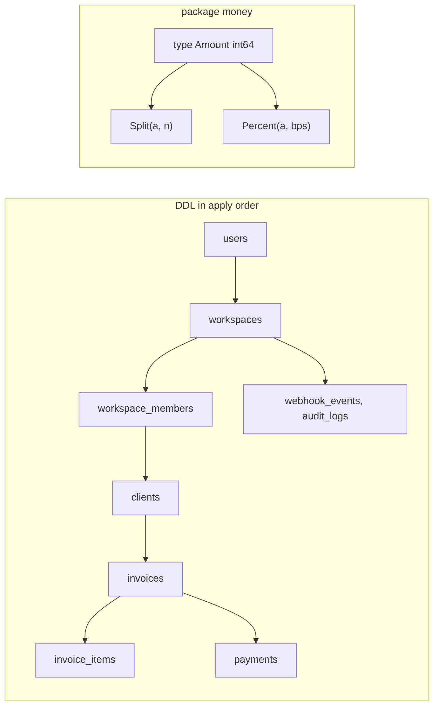
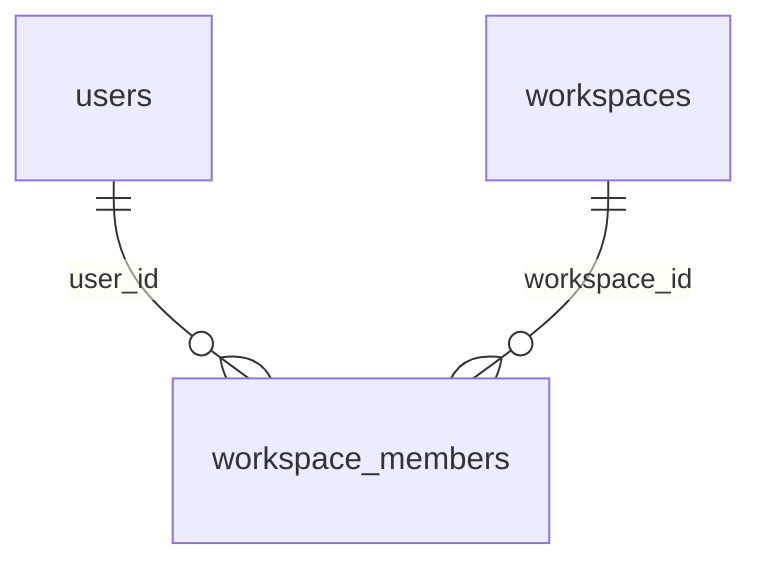
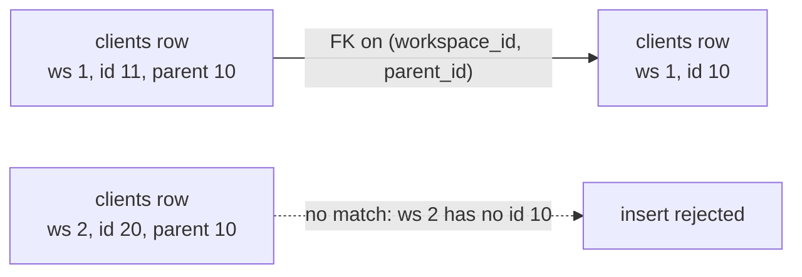
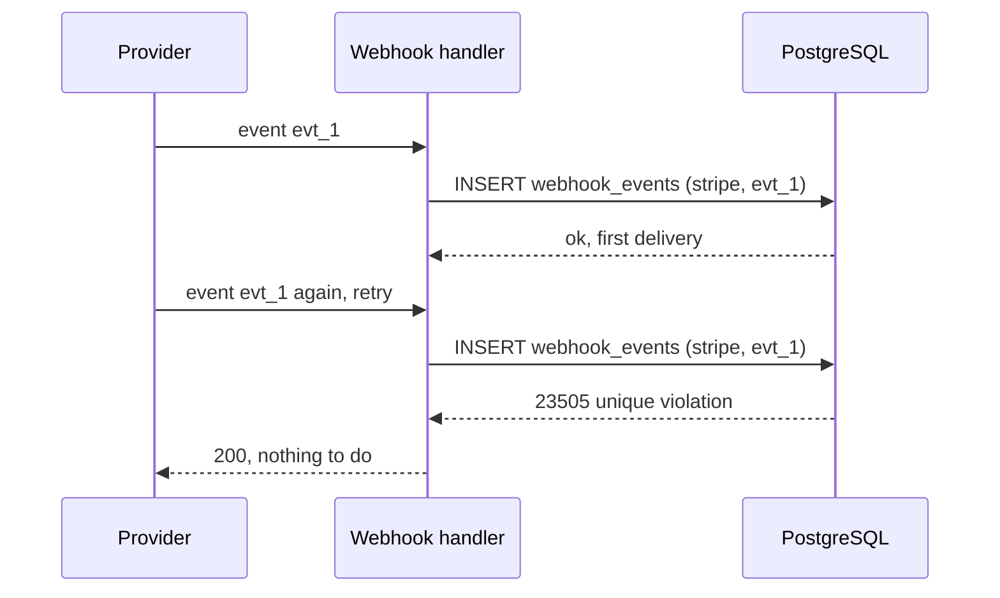
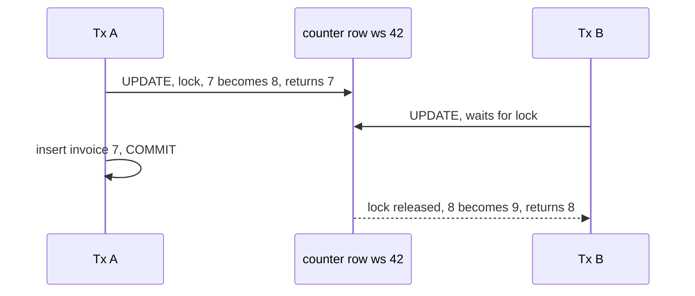
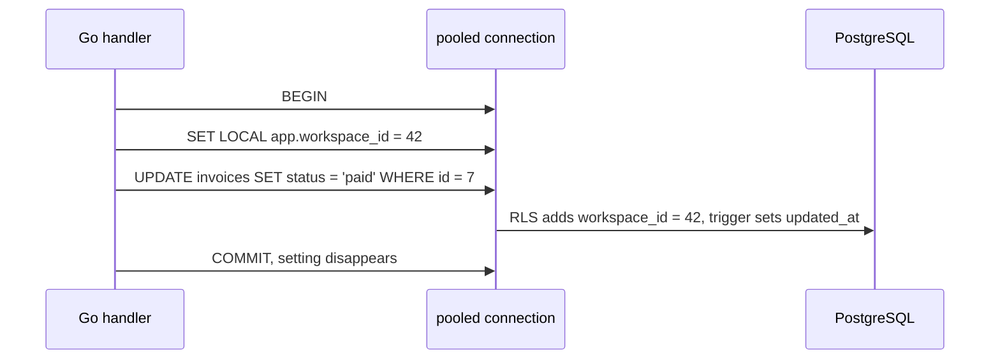
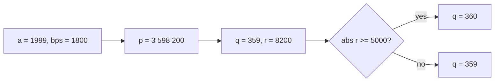

# Relational Schema Design - Go

> [!summary] TL;DR
> The runnable side of [[Relational Schema Design]]: the complete InvoiceOps PostgreSQL 17 DDL (tenant-safe composite keys, soft delete, audit log), the `updated_at` trigger with row-level security, and a small Go `money` package that keeps amounts in integer minor units, with tests that show float drift and exact splitting.
>
> Each block is short, explained before and after, and tied to a section of the theory note.

## Before the code

- **Named integer type**: `type Amount int64` gives money its own type so it cannot be mixed up with a plain count.
- **Integer arithmetic**: amounts stay in paise or cents, so adding and splitting never drifts like `float64` does.
- **Slices**: `Split` returns a `[]Amount` whose parts always sum to the original.
- **`reflect.DeepEqual`**: the tests compare whole slices in one call.
- **SQL blocks**: the DDL is plain PostgreSQL 17 and runs in `psql`, not in Go.
- **Run**: `go vet ./... && go test -race ./...` inside the `money` module.

## What this code shows

| Code | Concept in the theory note |
| --- | --- |
| `users`, `workspaces`, `workspace_members` | The M:N join table with a composite primary key; case-insensitive unique email ([[Relational Schema Design#Step 4: keys]]) |
| `clients`, `invoices` | Composite foreign keys `(workspace_id, id)` that make cross-tenant references impossible; partial unique index for soft delete ([[Relational Schema Design#Step 8: soft deletes and audit columns]]) |
| `invoice_items`, `payments`, `webhook_events` | `ON DELETE CASCADE` for pure children, unique `(provider, provider_ref)` and `(provider, event_id)` for idempotency ([[Relational Schema Design#Step 5: constraints are invariants]]) |
| `audit_logs` | An append-only polymorphic reference with no foreign key, on purpose |
| Trigger and RLS policy | `updated_at` set by the database; tenant isolation as a backstop |
| `money.Split`, `money.Percent` | Integer minor units, one documented rounding rule ([[Relational Schema Design#Money in Go: integer minor units]]) |



The left half is a dependency order: a table can be created only after the tables its foreign keys point at. The right half is independent of the database; it is the Go code that handles the values the `*_minor` columns hold.

## Setup

- Go 1.24, standard library only. The module is `money` with `money.go` and `money_test.go`.
- Run it with `go vet ./... && go test -race ./...`.
- The SQL targets PostgreSQL 17 and was not run against a live server in this vault; apply the statements in the order shown, because later tables reference earlier ones (create `workspaces` before `clients`, and `clients` before `invoices`).
- The counter-row, reconciliation and trigger statements assume the tables below exist.

## Code

The code has two halves: SQL (steps 1 to 8) and Go (steps 9 and 10). Design decisions behind the schema are explained in [[Relational Schema Design]]: `workspace_id` on every tenant-owned table, composite foreign keys, indexes on every referencing column, and `paid_minor` as a deliberate copy.

### Step 1: users, workspaces and membership

**Concept.** A user can belong to many workspaces and a workspace has many users, so the relationship is many-to-many and needs its own table ([[Relational Schema Design#Step 2: entities and relationships]]).

The join table's primary key is the pair `(workspace_id, user_id)`, which also forbids duplicate memberships. Emails are unique case-insensitively through an index on `lower(email)`; the alternative, the `citext` extension, does the same with a special type, while the index keeps a plain `text` column.

Identity columns are used rather than `serial` because they are the standard SQL form and cannot be overridden by accident.

```sql
CREATE TABLE users (
  id            bigint GENERATED ALWAYS AS IDENTITY PRIMARY KEY,
  email         text NOT NULL,
  password_hash text NOT NULL,
  created_at    timestamptz NOT NULL DEFAULT now()
);
CREATE UNIQUE INDEX users_email_uidx ON users (lower(email));

CREATE TABLE workspaces (
  id         bigint GENERATED ALWAYS AS IDENTITY PRIMARY KEY,
  name       text NOT NULL CHECK (char_length(name) BETWEEN 1 AND 200),
  created_at timestamptz NOT NULL DEFAULT now()
);
```

```sql
CREATE TABLE workspace_members (                    -- M:N users <-> workspaces
  workspace_id bigint NOT NULL REFERENCES workspaces (id) ON DELETE CASCADE,
  user_id      bigint NOT NULL REFERENCES users (id) ON DELETE CASCADE,
  role         text NOT NULL CHECK (role IN ('owner', 'admin', 'member')),
  created_at   timestamptz NOT NULL DEFAULT now(),
  PRIMARY KEY (workspace_id, user_id)
);
CREATE INDEX workspace_members_user_idx ON workspace_members (user_id);
```

**How it works.**

1. `CREATE UNIQUE INDEX ... ON users (lower(email))` is an expression index: `Ada@x.com` and `ada@x.com` both index as `ada@x.com`, so the second insert fails with SQLSTATE 23505.
2. The `CHECK` on `name` bounds the length in the database, so no code path can store an empty or enormous name.
3. In `workspace_members`, `ON DELETE CASCADE` on both foreign keys removes memberships when either side is deleted; a membership has no meaning without both.
4. `PRIMARY KEY (workspace_id, user_id)` creates an index that serves "members of workspace W" (leftmost column) but not "workspaces of user U".
5. `workspace_members_user_idx` covers exactly that second lookup, because PostgreSQL does not index foreign keys automatically.



### Step 2: clients

**Concept.** Every tenant-owned table carries `workspace_id`, and children reference the pair `(workspace_id, id)` rather than `id` alone, so a child row cannot point at a parent from another tenant ([[Relational Schema Design#Step 4: keys]]).

For that, the parent needs `UNIQUE (workspace_id, id)` as a foreign-key target. The self-referencing `parent_id` uses the same pair. The alternative is checking tenancy in application code, which every new code path must remember; the composite key makes the database enforce it.

Deleting is soft (`deleted_at`), so uniqueness of email must apply only to live rows, which is what the partial index does.

```sql
CREATE TABLE clients (
  id           bigint GENERATED ALWAYS AS IDENTITY PRIMARY KEY,
  workspace_id bigint NOT NULL REFERENCES workspaces (id),
  parent_id    bigint,
  name         text NOT NULL,
  email        text,
  created_at   timestamptz NOT NULL DEFAULT now(),
  updated_at   timestamptz NOT NULL DEFAULT now(),
  deleted_at   timestamptz,
  UNIQUE (workspace_id, id),                         -- target for tenant-safe foreign keys
  FOREIGN KEY (workspace_id, parent_id) REFERENCES clients (workspace_id, id)
    ON DELETE SET NULL (parent_id)                   -- PostgreSQL 15+: keep workspace_id
);
CREATE UNIQUE INDEX clients_ws_email_uidx ON clients (workspace_id, lower(email))
  WHERE deleted_at IS NULL;
CREATE INDEX clients_parent_idx ON clients (parent_id);
```

**How it works.**

1. `UNIQUE (workspace_id, id)` looks redundant, since `id` is already unique, but a foreign key can only reference a unique constraint on exactly the referenced columns.
2. The composite foreign key means a client's parent must be in the same workspace. When the parent row is deleted, `ON DELETE SET NULL (parent_id)` nulls only `parent_id`; without the column list, PostgreSQL would try to null `workspace_id` as well, which is `NOT NULL`.
3. The partial unique index `WHERE deleted_at IS NULL` enforces one live client per email per workspace, while a soft-deleted client's email can be reused.
4. `clients_parent_idx` indexes the referencing column, so deleting a parent and walking children do not scan the table.



### Step 3: invoices

**Concept.** An invoice belongs to one client in the same workspace, so it uses the same composite-key pattern ([[Relational Schema Design#Step 5: constraints are invariants]]).

Business rules that can be written as constraints are: allowed statuses, non-negative amounts, and a due date not before the issue date. The `jsonb` columns hold data that is a snapshot (`billing_address`, copied when the invoice is sent) or genuinely free-form (`custom_fields`).

The alternative of one table per rule is heavier; the alternative of enforcing these only in Go leaves other writers (scripts, migrations) unchecked.

```sql
CREATE TABLE invoices (
  id              bigint GENERATED ALWAYS AS IDENTITY PRIMARY KEY,
  workspace_id    bigint NOT NULL REFERENCES workspaces (id),
  client_id       bigint NOT NULL,
  number          text NOT NULL,
  status          text NOT NULL DEFAULT 'draft'
                  CHECK (status IN ('draft', 'sent', 'partially_paid', 'paid', 'overdue', 'cancelled')),
  currency        char(3) NOT NULL DEFAULT 'INR',
  total_minor     bigint NOT NULL DEFAULT 0 CHECK (total_minor >= 0),
  paid_minor      bigint NOT NULL DEFAULT 0 CHECK (paid_minor >= 0),
  billing_address jsonb,                             -- snapshot taken when the invoice is sent
  custom_fields   jsonb NOT NULL DEFAULT '{}',
  issue_date      date,
  due_date        date,
  created_at      timestamptz NOT NULL DEFAULT now(),
  updated_at      timestamptz NOT NULL DEFAULT now(),
  CHECK (due_date >= issue_date),
  UNIQUE (workspace_id, number),
  UNIQUE (workspace_id, id),
  FOREIGN KEY (workspace_id, client_id) REFERENCES clients (workspace_id, id)
);
CREATE INDEX invoices_ws_status_due_idx ON invoices (workspace_id, status, due_date);
CREATE INDEX invoices_ws_client_idx ON invoices (workspace_id, client_id);
```

**How it works.**

1. `client_id bigint NOT NULL` has no inline `REFERENCES`; the table-level composite foreign key at the bottom carries it.
2. `CHECK (due_date >= issue_date)` passes when either date is NULL (a check passes on NULL), so drafts without dates are still allowed.
3. `UNIQUE (workspace_id, number)` makes invoice numbers unique per tenant, not globally; `UNIQUE (workspace_id, id)` is the foreign-key target for items and payments.
4. `invoices_ws_status_due_idx` serves the dashboard query "workspace W, status S, ordered by due date" through the leftmost-prefix rule of [[Indexing Fundamentals - Go]].
5. `invoices_ws_client_idx` indexes the foreign-key columns so "all invoices of a client" is not a table scan.

### Step 4: items, payments and webhook events

**Concept.** Line items are pure children of an invoice: they cascade. Payments are financial history and do not. Both reference `(workspace_id, id)` of the invoice.

Retries are a fact of life with payment providers, so idempotency is built into the keys: a payment is unique per `(provider, provider_ref)`, and a webhook event is unique per `(provider, event_id)`, whose `INSERT` either succeeds (first delivery) or fails with 23505 (duplicate).

The alternative is a "have I seen this?" `SELECT` before every insert, which races under concurrency.

```sql
CREATE TABLE invoice_items (
  id               bigint GENERATED ALWAYS AS IDENTITY PRIMARY KEY,
  workspace_id     bigint NOT NULL,
  invoice_id       bigint NOT NULL,
  line_no          int NOT NULL CHECK (line_no > 0),
  description      text NOT NULL,
  quantity         int NOT NULL CHECK (quantity > 0),
  unit_price_minor bigint NOT NULL CHECK (unit_price_minor >= 0),  -- price charged, not catalogue price
  UNIQUE (invoice_id, line_no),
  FOREIGN KEY (workspace_id, invoice_id) REFERENCES invoices (workspace_id, id) ON DELETE CASCADE
);
```

```sql
CREATE TABLE payments (
  id           bigint GENERATED ALWAYS AS IDENTITY PRIMARY KEY,
  workspace_id bigint NOT NULL,
  invoice_id   bigint NOT NULL,
  amount_minor bigint NOT NULL CHECK (amount_minor > 0),
  provider     text NOT NULL,
  provider_ref text NOT NULL,
  paid_at      timestamptz NOT NULL DEFAULT now(),
  UNIQUE (provider, provider_ref),
  FOREIGN KEY (workspace_id, invoice_id) REFERENCES invoices (workspace_id, id)
);
CREATE INDEX payments_invoice_idx ON payments (invoice_id);

CREATE TABLE webhook_events (
  provider    text NOT NULL,
  event_id    text NOT NULL,
  received_at timestamptz NOT NULL DEFAULT now(),
  PRIMARY KEY (provider, event_id)
);
```

**How it works.**

1. `UNIQUE (invoice_id, line_no)` keeps line numbers distinct within an invoice, so the printed order is stable.
2. `unit_price_minor` stores the price actually charged, not the catalogue price, so later price changes do not rewrite history.
3. The cascade on `invoice_items` is deliberate; `payments` has no cascade, so deleting a paid invoice fails.
4. `UNIQUE (provider, provider_ref)` is the idempotency key for payments; a second delivery of the same provider reference raises 23505, which the handler turns into "already processed".
5. `webhook_events` has only a composite primary key: recording an event is itself the duplicate check.



### Step 5: the audit log

**Concept.** An audit log must outlive the rows it describes, so it deliberately has no foreign keys: a foreign key would block deleting a client with history, or cascade the history away.

It refers to its subject with `entity_type` and `entity_id`, a polymorphic reference that the database cannot verify. That is acceptable here because the log is append-only and read for investigation, not joined in hot queries.

The alternative, one audit table per entity, preserves integrity but multiplies tables. See [[Relational Schema Design#Step 8: soft deletes and audit columns]].

```sql
CREATE TABLE audit_logs (
  id            bigint GENERATED ALWAYS AS IDENTITY PRIMARY KEY,
  workspace_id  bigint NOT NULL,                     -- no FK: the log outlives what it describes
  actor_user_id bigint,
  action        text NOT NULL,
  entity_type   text NOT NULL,
  entity_id     bigint NOT NULL,
  details       jsonb NOT NULL DEFAULT '{}',
  created_at    timestamptz NOT NULL DEFAULT now()
);
CREATE INDEX audit_logs_ws_created_idx ON audit_logs (workspace_id, created_at DESC);
```

**How it works.**

1. `workspace_id` has no `REFERENCES`, which is the point of the table.
2. `actor_user_id` is nullable, so system actions (a nightly job) can be logged without a user.
3. `(entity_type, entity_id)` identifies the subject, for example `('invoice', 102)`.
4. `details jsonb` stores the before and after values; its shape may vary per action.
5. The index `(workspace_id, created_at DESC)` serves "latest events of a workspace", the only access pattern the log needs.

### Step 6: gapless invoice numbers, the counter row

**Concept.** A database sequence can skip numbers (a rolled-back transaction still consumes one), but invoice numbers must be consecutive per tenant for tax reasons.

The fix is one counter row per workspace, incremented in the same transaction that issues the invoice ([[Relational Schema Design#Step 4: keys]]). The row lock taken by `UPDATE` serialises numbering per workspace, and a rollback undoes the increment, so no gap appears.

The cost is that concurrent issuers of one workspace queue behind each other, which is acceptable for invoices and not for high-volume ids.

```sql
CREATE TABLE invoice_counters (
  workspace_id bigint PRIMARY KEY REFERENCES workspaces (id),
  next_number  bigint NOT NULL DEFAULT 1
);

UPDATE invoice_counters
SET next_number = next_number + 1
WHERE workspace_id = 42
RETURNING next_number - 1 AS number;
```

**How it works.**

1. The `UPDATE` takes a row lock on workspace 42's counter; a concurrent issuer waits until this transaction commits or rolls back.
2. `RETURNING next_number - 1` returns the value the row held before the increment, which is the number to use.
3. Because the increment and the invoice insert share one transaction, a rollback of the invoice also rolls back the counter.



### Step 7: the nightly reconciliation query

**Concept.** `paid_minor` is a deliberate copy of `sum(payments.amount_minor)`, kept on the invoice so lists do not need a join ([[Materialized Views and Denormalization]]). Any copy can drift, so a scheduled query checks it.

`LEFT JOIN` keeps invoices with no payments, and `coalesce` turns their NULL sum into 0 so they compare correctly. The alternative of trusting the copy forever is the usual way ledgers go wrong silently.

```sql
SELECT i.id, i.paid_minor, coalesce(sum(p.amount_minor), 0) AS payments_sum
FROM invoices i
LEFT JOIN payments p ON p.invoice_id = i.id
GROUP BY i.id
HAVING i.paid_minor <> coalesce(sum(p.amount_minor), 0);
```

**How it works.**

1. `LEFT JOIN` guarantees every invoice appears, including unpaid ones.
2. `GROUP BY i.id` is enough for `i.paid_minor` to be selectable, since `id` is the primary key.
3. `HAVING` keeps only the invoices where the copy disagrees with the source of truth; an empty result means healthy data.
4. Without `coalesce`, an unpaid invoice would compare `0 <> NULL`, which is NULL, and the row would be silently dropped. The query must return nothing on a healthy database; any row is a bug to investigate.

### Step 8: `updated_at` trigger and row-level security

**Concept.** Two protections live in the database so no code path can skip them. The trigger stamps `updated_at` on every update, because application code forgets.

Row-level security (RLS) restricts every statement on `invoices` to the workspace set in the transaction-local setting `app.workspace_id`: a backstop against a missing `WHERE workspace_id = ...` in application code, not a replacement for it.

The alternatives are setting the column in each Go query (easy to forget) and one database per tenant (strong isolation, high operating cost).

```sql
CREATE FUNCTION set_updated_at() RETURNS trigger
LANGUAGE plpgsql AS $$
BEGIN
  NEW.updated_at := now();
  RETURN NEW;
END;
$$;

CREATE TRIGGER invoices_set_updated_at
BEFORE UPDATE ON invoices
FOR EACH ROW EXECUTE FUNCTION set_updated_at();
```

```sql
ALTER TABLE invoices ENABLE ROW LEVEL SECURITY;

CREATE POLICY tenant_isolation ON invoices
  USING (workspace_id = current_setting('app.workspace_id')::bigint)
  WITH CHECK (workspace_id = current_setting('app.workspace_id')::bigint);
```

**How it works.**

1. `BEFORE UPDATE ... FOR EACH ROW` runs the function once per row, before it is written; assigning to `NEW.updated_at` changes the row that gets stored.
2. `RETURN NEW` is required in a `BEFORE` row trigger; returning NULL would silently cancel the update.
3. `ENABLE ROW LEVEL SECURITY` turns the policy system on for the table.
4. `USING` filters which existing rows a statement can see or modify; `WITH CHECK` rejects new or changed rows that would fall outside the tenant.
5. `current_setting('app.workspace_id')` is set per transaction with `SET LOCAL` (or `set_config(..., true)`), and it raises an error if never set, which fails safe.



### Step 9: money in Go, the Amount type and Split

**Concept.** The Go side must keep the same discipline as the `*_minor` columns ([[Relational Schema Design#Money in Go: integer minor units]]): integer minor units, never floats.

`Split` divides an amount into n parts that differ by at most one unit and add back exactly, for example an invoice paid in three instalments. The remainder is spread one unit at a time over the first parts.

Alternatives are giving the whole remainder to the last part (parts differ by up to n-1 units) or using a decimal library (more code and slower, though sometimes the right call when currencies have different exponents).

```go
package money

// Amount is money in integer minor units: paise for INR, cents for USD.
// The currency lives next to it (a currency column, or a Currency field).
type Amount int64

// Split divides a into n parts that differ by at most one minor unit and add
// up to exactly a, for example an invoice paid in three instalments.
func Split(a Amount, n int) []Amount {
	if n <= 0 {
		panic("money: Split needs n > 0")
	}
	base, rem := a/Amount(n), a%Amount(n) // rem has the sign of a
	step := Amount(1)
	if rem < 0 {
		rem, step = -rem, -1
	}
	parts := make([]Amount, n)
	for i := range parts {
		parts[i] = base
		if Amount(i) < rem {
			parts[i] += step // the first |rem| parts carry the leftover units
		}
	}
	return parts
}
```

**How it works.**

1. `type Amount int64` is a defined type: it stops you passing a raw `int64` where an amount is expected by accident, though it does not stop mixing rupees and paise.
2. `a/Amount(n)` and `a%Amount(n)` give the base share and the remainder. In Go, integer division truncates toward zero, so the remainder takes the sign of `a`.
3. For a negative amount (a credit note), the code flips `rem` positive and sets `step` to -1, so leftover units are subtracted instead of added.
4. The loop gives every part `base` and the first `rem` parts one extra `step`. For 100000 in 3 parts: base 33333, remainder 1, so the first part becomes 33334.
5. `n <= 0` panics, because it is a programming error, not bad input; validate at the API edge.

| a | n | base | rem | result |
| --- | --- | --- | --- | --- |
| 100000 | 3 | 33333 | 1 | `[33334 33333 33333]` |
| 7 | 3 | 2 | 1 | `[3 2 2]` |
| -7 | 3 | -2 | -1 flipped to 1, step -1 | `[-3 -2 -2]` |

### Step 10: money in Go, Percent

**Concept.** Taxes and discounts multiply an amount by a rate. Using basis points (1 bp = 0.01%, so 1800 bps = 18%) keeps the rate an integer too.

Multiplying before dividing keeps full precision, and then one explicit rounding rule is applied: half away from zero. Writing the rule once, in one function, is the fix for "every handler rounds differently".

Alternatives are banker's rounding (half to even), which is common in finance but surprises invoice readers, and float math, which is wrong by construction.

```go
// Percent returns a × bps / 10,000, rounded half away from zero. bps is in
// basis points: 1800 = 18%. a × bps must fit in int64 (|a| up to ~9.2e14
// minor units at 100%), which covers any invoice.
func Percent(a Amount, bps int64) Amount {
	p := int64(a) * bps
	q, r := p/10_000, p%10_000
	switch {
	case r >= 5_000:
		q++
	case r <= -5_000:
		q--
	}
	return Amount(q)
}
```

**How it works.**

1. `p := int64(a) * bps` multiplies first, so no precision is lost before the division.
2. `q, r := p/10_000, p%10_000` splits the result into a whole part and a remainder; `10_000` uses Go's digit separator for readability.
3. If the remainder is at least half of 10,000 the quotient moves one step away from zero, and symmetrically for negatives, which makes the rule symmetric: `Percent(-x)` is `-Percent(x)`.
4. For 1999 at 1800 bps: `p = 3,598,200`, `q = 359`, `r = 8,200`, which is at least 5,000, so the result is 360.



## Design decisions

| Decision | Alternative | Trade-off |
| --- | --- | --- |
| Composite foreign keys `(workspace_id, id)` | Single-column `id` references plus application checks | The database blocks cross-tenant links; every parent needs an extra unique constraint and children carry `workspace_id` |
| `ON DELETE SET NULL (parent_id)` | Plain `SET NULL` or `RESTRICT` | Keeps `workspace_id` intact; needs PostgreSQL 15 or later |
| Partial unique index on live clients | Hard delete, or a unique index including `deleted_at` | Soft delete keeps history and frees the email; every query must filter `deleted_at IS NULL` |
| Counter row for invoice numbers | `SEQUENCE` | No gaps, as tax rules require; issuers of one workspace serialise |
| No foreign keys on `audit_logs` | Per-entity audit tables with foreign keys | The log survives deletes; the database cannot verify `entity_id` |
| Trigger for `updated_at` | Set it in each Go `UPDATE` | No code path can forget; hidden behaviour that tests must know about |
| RLS with `SET LOCAL` | Application-only tenant filters | A backstop against a missing `WHERE`; needs a non-owner role and per-transaction setup |
| `Amount int64` minor units | `float64`, or `decimal` | Exact and fast; one currency exponent assumption per column |
| Remainder spread over first parts | All remainder to the last part | Parts differ by at most one unit; the first parts are slightly larger |
| Half away from zero | Half to even | Matches what readers expect on invoices; accumulates a tiny upward bias over huge batches |

## Tests

The tests live in `money_test.go`, which needs this header first:

```go
package money

import (
	"reflect"
	"testing"
)
```

### Test 1: float drifts, integers do not

**Property.** Ten payments of Rs 0.10 must equal Rs 1.00. In `float64` they do not, which is why money never uses floats.

| Input | Expected |
| --- | --- |
| 10 additions of `0.10` as `float64` | not equal to `1.0` (about `0.99999999999999989`) |
| 10 additions of `10` as `Amount` | exactly `100` |

```go
func TestFloatDriftsIntegersDoNot(t *testing.T) {
	var rupees float64 // ₹0.10 as a float
	var paise Amount   // ₹0.10 as 10 paise
	for range 10 {
		rupees += 0.10
		paise += 10
	}
	if rupees == 1.0 || paise != 100 {
		t.Fatalf("rupees = %v, paise = %d", rupees, paise)
	}
	t.Logf("float64: %.17f  int64: %d paise", rupees, paise)
}
```

The test is unusual: it asserts that the float is wrong. If it fails, either the float happened to be exact (not on IEEE 754 hardware) or `Amount` arithmetic changed. `for range 10` is the Go 1.22 range-over-int form.

### Test 2: Split sums exactly

**Property.** For any amount and any n from 1 to 9, the parts add up to exactly the amount and differ by at most one unit, including negative credit notes and tiny amounts.

| Input | Expected |
| --- | --- |
| `Split(100000, 3)` | `[33334 33333 33333]` |
| every `a` in `{0, 1, 7, 100000, -100000, -7, 99999}`, every `n` in 1..9 | sum equals `a`, max minus min at most 1 |

```go
func TestSplitSumsExactly(t *testing.T) {
	got := Split(100000, 3)
	if !reflect.DeepEqual(got, []Amount{33334, 33333, 33333}) {
		t.Fatalf("got %v", got)
	}
	for _, a := range []Amount{0, 1, 7, 100000, -100000, -7, 99999} {
		for n := 1; n <= 9; n++ {
			var sum Amount
			parts := Split(a, n)
			lo, hi := parts[0], parts[0]
			for _, p := range parts {
				sum += p
				lo, hi = min(lo, p), max(hi, p)
			}
			if sum != a || hi-lo > 1 {
				t.Fatalf("Split(%d, %d) = %v", a, n, parts)
			}
		}
	}
}
```

A failure means money was created or destroyed (`sum != a`) or the parts are uneven (`hi-lo > 1`). The first would show up as a reconciliation mismatch in production. The built-ins `min` and `max` come with Go 1.21.

### Test 3: Percent rounding

**Property.** One rule: round half away from zero, symmetric for negatives.

| Input | Expected | Why |
| --- | --- | --- |
| `Percent(1999, 1800)` | 360 | 18% of 1999 is 359.82 |
| `Percent(-1999, 1800)` | -360 | symmetric for a credit note |
| `Percent(50, 100)` | 1 | 0.5 rounds away from zero |

```go
func TestPercentRounding(t *testing.T) {
	if got := Percent(1999, 1800); got != 360 { // 359.82 rounds to 360
		t.Fatalf("got %d", got)
	}
	if got := Percent(-1999, 1800); got != -360 {
		t.Fatalf("got %d", got)
	}
	if got := Percent(50, 100); got != 1 { // 0.5 rounds away from zero
		t.Fatalf("got %d", got)
	}
}
```

A failure on the third line means the code rounds half down or to even; a failure on the second means positive and negative amounts are handled differently, so a refund would not exactly reverse a charge.

## Running it

```bash
go vet ./... && go test -race -v ./...
```

Measured (Go 1.24.4, darwin/arm64):

```text
=== RUN   TestFloatDriftsIntegersDoNot
    money_test.go:18: float64: 0.99999999999999989  int64: 100 paise
--- PASS: TestFloatDriftsIntegersDoNot (0.00s)
--- PASS: TestSplitSumsExactly (0.00s)
--- PASS: TestPercentRounding (0.00s)
PASS
ok  	money	1.470s
```

| Line | Meaning |
| --- | --- |
| `=== RUN ...` | Shown by `-v` for the first test only here, because only it logs |
| `money_test.go:18: float64: 0.99999999999999989 ...` | The `t.Logf` output: ten additions of 0.1 gave a value just under 1, while integer paise gave exactly 100 |
| `--- PASS: ...` | The three properties hold |
| `ok  money  1.470s` | Package passed under the race detector |

Ten payments of Rs 0.10 do not make Rs 1.00 in floating point. Pick one rounding rule, write it down, and apply it in one place.

> [!example]- Full file: money.go
> ```go
> package money
>
> // Amount is money in integer minor units: paise for INR, cents for USD.
> // The currency lives next to it (a currency column, or a Currency field).
> type Amount int64
>
> // Split divides a into n parts that differ by at most one minor unit and add
> // up to exactly a, for example an invoice paid in three instalments.
> func Split(a Amount, n int) []Amount {
> 	if n <= 0 {
> 		panic("money: Split needs n > 0")
> 	}
> 	base, rem := a/Amount(n), a%Amount(n) // rem has the sign of a
> 	step := Amount(1)
> 	if rem < 0 {
> 		rem, step = -rem, -1
> 	}
> 	parts := make([]Amount, n)
> 	for i := range parts {
> 		parts[i] = base
> 		if Amount(i) < rem {
> 			parts[i] += step // the first |rem| parts carry the leftover units
> 		}
> 	}
> 	return parts
> }
>
> // Percent returns a × bps / 10,000, rounded half away from zero. bps is in
> // basis points: 1800 = 18%. a × bps must fit in int64 (|a| up to ~9.2e14
> // minor units at 100%), which covers any invoice.
> func Percent(a Amount, bps int64) Amount {
> 	p := int64(a) * bps
> 	q, r := p/10_000, p%10_000
> 	switch {
> 	case r >= 5_000:
> 		q++
> 	case r <= -5_000:
> 		q--
> 	}
> 	return Amount(q)
> }
> ```

> [!example]- Full file: money_test.go
> ```go
> package money
>
> import (
> 	"reflect"
> 	"testing"
> )
>
> func TestFloatDriftsIntegersDoNot(t *testing.T) {
> 	var rupees float64 // ₹0.10 as a float
> 	var paise Amount   // ₹0.10 as 10 paise
> 	for range 10 {
> 		rupees += 0.10
> 		paise += 10
> 	}
> 	if rupees == 1.0 || paise != 100 {
> 		t.Fatalf("rupees = %v, paise = %d", rupees, paise)
> 	}
> 	t.Logf("float64: %.17f  int64: %d paise", rupees, paise)
> }
>
> func TestSplitSumsExactly(t *testing.T) {
> 	got := Split(100000, 3)
> 	if !reflect.DeepEqual(got, []Amount{33334, 33333, 33333}) {
> 		t.Fatalf("got %v", got)
> 	}
> 	for _, a := range []Amount{0, 1, 7, 100000, -100000, -7, 99999} {
> 		for n := 1; n <= 9; n++ {
> 			var sum Amount
> 			parts := Split(a, n)
> 			lo, hi := parts[0], parts[0]
> 			for _, p := range parts {
> 				sum += p
> 				lo, hi = min(lo, p), max(hi, p)
> 			}
> 			if sum != a || hi-lo > 1 {
> 				t.Fatalf("Split(%d, %d) = %v", a, n, parts)
> 			}
> 		}
> 	}
> }
>
> func TestPercentRounding(t *testing.T) {
> 	if got := Percent(1999, 1800); got != 360 { // 359.82 rounds to 360
> 		t.Fatalf("got %d", got)
> 	}
> 	if got := Percent(-1999, 1800); got != -360 {
> 		t.Fatalf("got %d", got)
> 	}
> 	if got := Percent(50, 100); got != 1 { // 0.5 rounds away from zero
> 		t.Fatalf("got %d", got)
> 	}
> }
> ```

## Pitfalls in the code

- **`Amount` is a plain `int64`.** Adding paise to rupees compiles; keep the unit in the type name or the currency beside the value.
- **`Split` panics for `n <= 0`.** Validate the instalment count at the API boundary instead of recovering.
- **`Percent` multiplies before dividing.** `a * bps` must fit in `int64`; the comment bounds it at about 9.2e14 minor units at 100%.
- **Order of DDL matters.** `clients` has a self-referencing composite foreign key, which needs its own `UNIQUE (workspace_id, id)` declared in the same statement.
- **`ON DELETE SET NULL (parent_id)` needs PostgreSQL 15 or later.** On older versions the plain `SET NULL` also tries to null `workspace_id`.
- **`app.workspace_id` must be set with `is_local = true`.** A session-level setting survives on the pooled connection into the next request.
- **Connect as a role that does not own the tables,** or add `FORCE ROW LEVEL SECURITY`, otherwise the owner bypasses the policy.

## Exercises

1. Predict `Split(-100000, 3)` before running it, then confirm it with a test line. Which parts carry the extra unit?
2. Change `Percent` to round half to even and predict which of the three rounding assertions fail.
3. Remove `ON DELETE SET NULL (parent_id)` from `clients` and predict the error when you delete a parent client that has a subsidiary in the same workspace.

## Links

- Theory: [[Relational Schema Design]]
- Query side: [[SQL Essentials - Go]]
- Next: [[Transactions and ACID]], [[Zero-Downtime Schema Migrations]]
