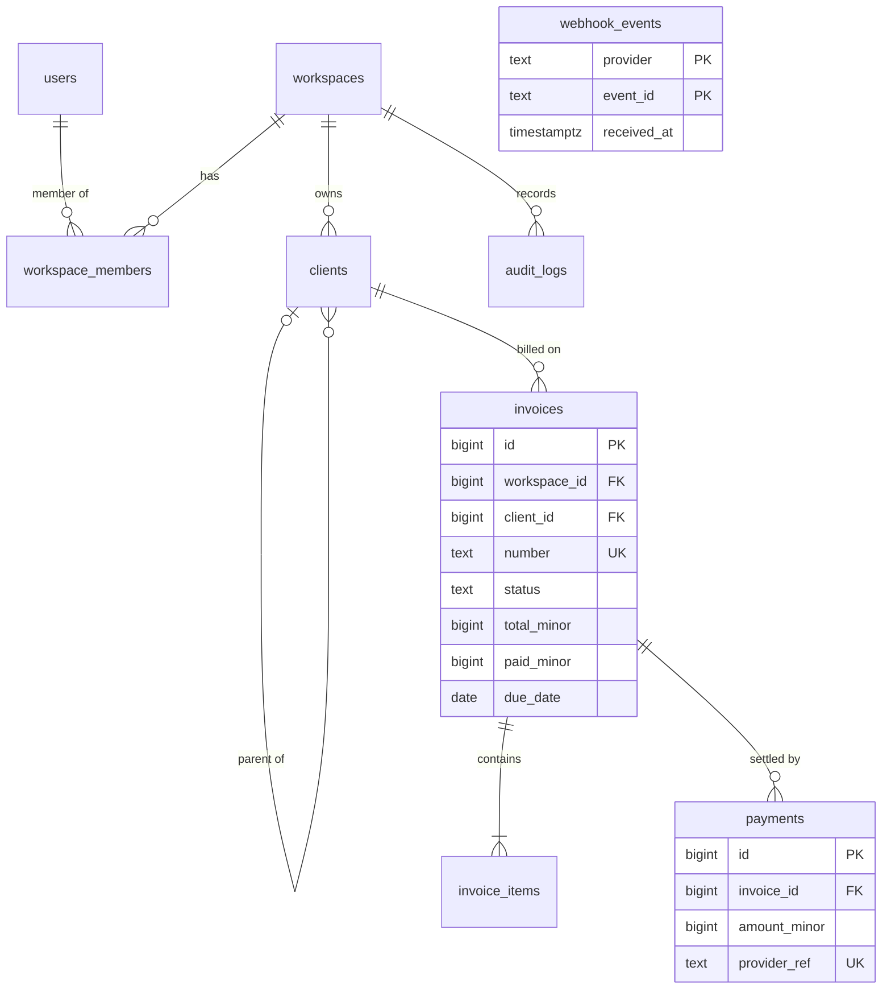
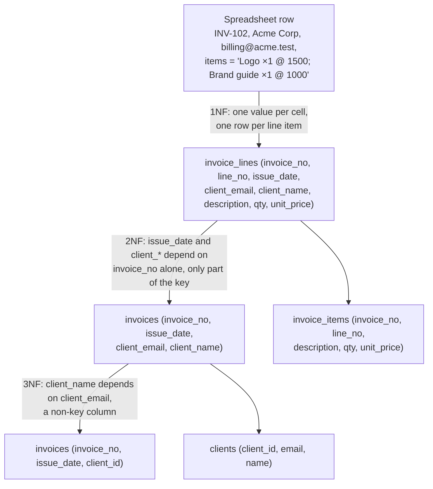
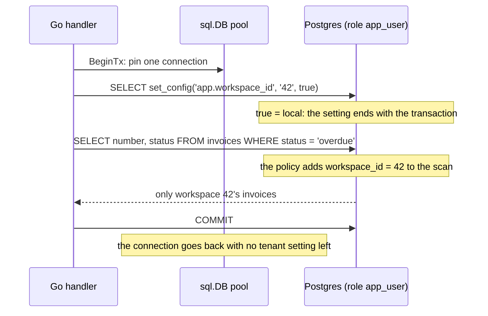

# Relational Schema Design

> [!summary] TL;DR
> Schema design decides which tables exist, which columns they hold, how they reference each other, and which rules the database itself enforces. A good relational schema stores each fact once (normalization), lets the database reject impossible data (constraints), and uses types that cannot lose money or time zones. You then denormalize on purpose, with a plan to keep the copies correct.

## 1. Why it exists

The first InvoiceOps prototype kept invoices in one wide table, the way a spreadsheet would:

| invoice_no | client     | client_email      | items                                            | total   |
| ---------- | ---------- | ----------------- | ------------------------------------------------ | ------- |
| INV-102    | Acme Corp  | billing@acme.test | Logo ×1 @ ₹1,500; Brand guide ×1 @ ₹1,000        | 2500.00 |
| INV-108    | ACME Corp. | billing@acme.test | Retainer ×1 @ ₹3,000                             | 3000.00 |

Within a month it had three real bugs:
- **Update anomaly.** Acme changed its billing email; support fixed one row and missed eleven, so reminders went to a dead address.
- **Unqueryable data.** "Revenue from logo work" needed string parsing of the `items` cell.
- **Silent corruption.** `total` was a `double precision`, and the monthly sum drifted by a paisa against the bank statement.

A designed schema removes all three: the email lives in one row of `clients`, line items are rows you can filter and sum, and money is an integer that cannot drift.

## 2. Mental model

- **One fact, one place.** Each fact ("Acme's billing email is X") is stored once and referenced by key everywhere else. That is what normalization formalizes.
- **The schema is the last line of defence.** Application code has bugs, scripts skip validation, and two services race. A `CHECK`, `UNIQUE` or `FOREIGN KEY` holds no matter who writes.
- **Design from access patterns too.** Entities tell you the tables; the queries tell you the keys, indexes and where a deliberate copy pays off.

**Analogy:** a well-run office keeps one master contact card per client and writes the client number on every invoice. A sloppy office copies the whole address onto every document and then cannot tell which copy is current. Except for one thing: a *sent* invoice must keep the address it was sent to, because that is a different fact.

## 3. How it works

### Step 1: ask the questions before drawing tables

1. What are the main objects?
2. Which queries are most common?
3. Which writes must happen together, in one transaction?
4. Which data must be strongly consistent?
5. What can be eventually consistent?
6. What grows fastest?
7. What needs indexes?
8. What must be kept for audit or compliance?
9. How will schema changes roll out safely?

For InvoiceOps: the objects form the chain `users → workspace_members → workspaces → clients → invoices → invoice_items`, with `payments` and `audit_logs` hanging off it. Recording a payment must update `payments`, `invoices` and `audit_logs` together, and every list screen filters by workspace first.

### Step 2: entities and relationships



- **1:N** (a client has many invoices): a foreign key on the "many" side, `invoices.client_id`.
- **M:N** (users belong to many workspaces, workspaces have many users): a join table, `workspace_members (workspace_id, user_id, role)`, whose primary key is the pair.
- **1:1** (a user and a profile): a foreign key that is also `UNIQUE`, or simply the same table.
- **Hierarchy** (a subsidiary client): a self-reference, `clients.parent_id`.
- `webhook_events` has no foreign keys: it records which provider events were already processed, so a redelivered webhook is ignored.

### Step 3: normalize

Normal forms remove the anomalies from section 1, one kind of dependency at a time.



- **1NF:** every cell holds one atomic value, with no repeating groups. A comma-separated list in a column (Karwin calls it *Jaywalking*) breaks it.
- **2NF:** no column depends on only *part* of a composite key. `issue_date` depends on `invoice_no`, not on `(invoice_no, line_no)`.
- **3NF:** no column depends on another non-key column. `client_name` follows from `client_email`, so it moves to `clients`.
- **BCNF:** every determinant (a column set that fixes another column) is a candidate key. 3NF tables almost always satisfy it; the deep dive shows the rare case that does not.

Not every repeated value is a violation. `invoice_items.unit_price_minor` looks like it duplicates a catalogue price, but it records *the price charged on this invoice*. If the catalogue price changes tomorrow, issued invoices must not. The same holds for `invoices.billing_address`, a snapshot taken when the invoice is sent.

### Step 4: keys

- **Natural key:** a real-world identifier, such as an email or an invoice number. Natural keys change (emails do; draft numbers get corrected), and composite ones bloat every referencing table. Keep them as `UNIQUE` constraints.
- **Surrogate key:** a meaningless generated id that never changes. Reference rows by it.

| Surrogate           | Size     | Ordered?                    | Generated where     | Watch out for                                                           |
| ------------------- | -------- | --------------------------- | ------------------- | ----------------------------------------------------------------------- |
| `bigint` identity   | 8 bytes  | yes, increasing             | the database        | exposes row counts and is guessable; never skip the authorization check |
| UUIDv4              | 16 bytes | no, random                  | anywhere            | random inserts spread over the whole index: more page splits, larger working set |
| UUIDv7 (RFC 9562)   | 16 bytes | by creation millisecond     | anywhere            | reveals creation time; PostgreSQL 17 has no generator, so create it in Go |
| ULID                | 16 bytes | by creation millisecond     | anywhere            | a text format; store it as `uuid`                                       |

Use `GENERATED ALWAYS AS IDENTITY` (SQL standard, PostgreSQL 10+) rather than the older `serial`. If ids are created outside the database or exposed publicly, use UUIDv7: `uuid.NewV7()` from `github.com/google/uuid` (v1.5.0+), or `uuidv7()` built in since PostgreSQL 18. The measured effect of random keys on a B-tree is in [[Indexing Fundamentals]]; ID generation at scale is in [[Unique ID Generation]].

**Invoice numbers are not ids.** Accountants expect them gapless and sequential per workspace, and sequences cannot promise that: a `nextval` is never returned after a rollback. Allocate them from a counter row in the same transaction that sends the invoice; the row lock serializes numbering per workspace, which is fine at invoice rates.

```sql
CREATE TABLE invoice_counters (
  workspace_id bigint PRIMARY KEY REFERENCES workspaces (id),
  next_number  bigint NOT NULL DEFAULT 1
);

UPDATE invoice_counters
SET next_number = next_number + 1
WHERE workspace_id = 42
RETURNING next_number - 1 AS number;
```

### Step 5: constraints are invariants

| Rule                                         | Constraint                                                          |
| -------------------------------------------- | ------------------------------------------------------------------- |
| every invoice has a status from the lifecycle | `CHECK (status IN (…))` plus `NOT NULL`                            |
| amounts are never negative                   | `CHECK (total_minor >= 0)`                                          |
| a due date is not before the issue date      | `CHECK (due_date >= issue_date)` (passes when either is NULL)       |
| invoice numbers are unique per workspace     | `UNIQUE (workspace_id, number)`                                     |
| an invoice's client is in the same workspace | composite FK `(workspace_id, client_id) → clients (workspace_id, id)` |
| a provider event is processed once           | `PRIMARY KEY (provider, event_id)` on `webhook_events`              |

**`ON DELETE` choices:** `NO ACTION` / `RESTRICT` (the default family) refuse to delete a client that still has invoices, which is what financial history needs. `CASCADE` suits pure children: line items die with their invoice. `SET NULL` suits optional links: deleting a parent client turns subsidiaries into top-level clients.

### Step 6: types

| Data                | Use                                                         | Avoid                                                                                 |
| ------------------- | ----------------------------------------------------------- | ------------------------------------------------------------------------------------- |
| money               | `bigint` minor units + `currency char(3)`; or `numeric(14,2)` | `real` / `double precision` (binary fractions drift); PostgreSQL's `money` type (format depends on `lc_monetary`, one currency) |
| an instant          | `timestamptz` (stored as UTC, shown in the session time zone) | `timestamp` without time zone for events: the zone is lost                           |
| a calendar date     | `date` (a due date is a date in the business's zone)        | a `timestamptz` at midnight, which shifts across zones                                |
| strings             | `text`, plus `CHECK (char_length(x) <= n)` when a limit is a rule | `varchar(n)` for speed: in Postgres `text` and `varchar` perform the same          |
| a fixed set         | `text` + `CHECK`, or a lookup table with a foreign key      | a Postgres `enum` if values will be removed or renamed often                          |
| truly variable data | `jsonb` (custom fields, raw provider payloads)              | `jsonb` for anything you join, constrain or sort on                                   |

Minor units differ by currency (ISO 4217): 2 decimals for INR and USD, 0 for JPY, 3 for KWD, so store the currency next to every amount.

### Step 7: soft deletes and audit columns

- **Soft delete:** `deleted_at timestamptz` instead of `DELETE`. Uniqueness must then ignore deleted rows, which a **partial unique index** does: `UNIQUE (workspace_id, lower(email)) WHERE deleted_at IS NULL`. The costs: every query must filter `deleted_at IS NULL`, foreign keys still point at "deleted" rows, the table keeps growing, and a legal erasure request still needs a real delete or anonymization. Moving the row to an archive table in the same transaction is often simpler.
- **Audit columns:** `created_at` and `updated_at` on every mutable table, with `updated_at` set by a trigger so no code path forgets. `now()` returns the *transaction's* start time, so all rows changed in one transaction share it.
- **Audit log:** an append-only `audit_logs` table written in the same transaction as the change. Its `(entity_type, entity_id)` pair is a polymorphic reference with no foreign key, on purpose: the log must outlive what it describes. Grant the application only `SELECT, INSERT` on it.

## 4. Worked example

### The InvoiceOps DDL (PostgreSQL 17)

```sql
CREATE TABLE users (
  id            bigint GENERATED ALWAYS AS IDENTITY PRIMARY KEY,
  email         text NOT NULL,
  password_hash text NOT NULL,
  created_at    timestamptz NOT NULL DEFAULT now()
);
CREATE UNIQUE INDEX users_email_uidx ON users (lower(email));

CREATE TABLE workspaces (
  id         bigint GENERATED ALWAYS AS IDENTITY PRIMARY KEY,
  name       text NOT NULL CHECK (char_length(name) BETWEEN 1 AND 200),
  created_at timestamptz NOT NULL DEFAULT now()
);

CREATE TABLE workspace_members (                    -- M:N users <-> workspaces
  workspace_id bigint NOT NULL REFERENCES workspaces (id) ON DELETE CASCADE,
  user_id      bigint NOT NULL REFERENCES users (id) ON DELETE CASCADE,
  role         text NOT NULL CHECK (role IN ('owner', 'admin', 'member')),
  created_at   timestamptz NOT NULL DEFAULT now(),
  PRIMARY KEY (workspace_id, user_id)
);
CREATE INDEX workspace_members_user_idx ON workspace_members (user_id);

CREATE TABLE clients (
  id           bigint GENERATED ALWAYS AS IDENTITY PRIMARY KEY,
  workspace_id bigint NOT NULL REFERENCES workspaces (id),
  parent_id    bigint,
  name         text NOT NULL,
  email        text,
  created_at   timestamptz NOT NULL DEFAULT now(),
  updated_at   timestamptz NOT NULL DEFAULT now(),
  deleted_at   timestamptz,
  UNIQUE (workspace_id, id),                         -- target for tenant-safe foreign keys
  FOREIGN KEY (workspace_id, parent_id) REFERENCES clients (workspace_id, id)
    ON DELETE SET NULL (parent_id)                   -- PostgreSQL 15+: keep workspace_id
);
CREATE UNIQUE INDEX clients_ws_email_uidx ON clients (workspace_id, lower(email))
  WHERE deleted_at IS NULL;
CREATE INDEX clients_parent_idx ON clients (parent_id);

CREATE TABLE invoices (
  id              bigint GENERATED ALWAYS AS IDENTITY PRIMARY KEY,
  workspace_id    bigint NOT NULL REFERENCES workspaces (id),
  client_id       bigint NOT NULL,
  number          text NOT NULL,
  status          text NOT NULL DEFAULT 'draft'
                  CHECK (status IN ('draft', 'sent', 'partially_paid', 'paid', 'overdue', 'cancelled')),
  currency        char(3) NOT NULL DEFAULT 'INR',
  total_minor     bigint NOT NULL DEFAULT 0 CHECK (total_minor >= 0),
  paid_minor      bigint NOT NULL DEFAULT 0 CHECK (paid_minor >= 0),
  billing_address jsonb,                             -- snapshot taken when the invoice is sent
  custom_fields   jsonb NOT NULL DEFAULT '{}',
  issue_date      date,
  due_date        date,
  created_at      timestamptz NOT NULL DEFAULT now(),
  updated_at      timestamptz NOT NULL DEFAULT now(),
  CHECK (due_date >= issue_date),
  UNIQUE (workspace_id, number),
  UNIQUE (workspace_id, id),
  FOREIGN KEY (workspace_id, client_id) REFERENCES clients (workspace_id, id)
);
CREATE INDEX invoices_ws_status_due_idx ON invoices (workspace_id, status, due_date);
CREATE INDEX invoices_ws_client_idx ON invoices (workspace_id, client_id);

CREATE TABLE invoice_items (
  id               bigint GENERATED ALWAYS AS IDENTITY PRIMARY KEY,
  workspace_id     bigint NOT NULL,
  invoice_id       bigint NOT NULL,
  line_no          int NOT NULL CHECK (line_no > 0),
  description      text NOT NULL,
  quantity         int NOT NULL CHECK (quantity > 0),
  unit_price_minor bigint NOT NULL CHECK (unit_price_minor >= 0),  -- price charged, not catalogue price
  UNIQUE (invoice_id, line_no),
  FOREIGN KEY (workspace_id, invoice_id) REFERENCES invoices (workspace_id, id) ON DELETE CASCADE
);

CREATE TABLE payments (
  id           bigint GENERATED ALWAYS AS IDENTITY PRIMARY KEY,
  workspace_id bigint NOT NULL,
  invoice_id   bigint NOT NULL,
  amount_minor bigint NOT NULL CHECK (amount_minor > 0),
  provider     text NOT NULL,
  provider_ref text NOT NULL,
  paid_at      timestamptz NOT NULL DEFAULT now(),
  UNIQUE (provider, provider_ref),
  FOREIGN KEY (workspace_id, invoice_id) REFERENCES invoices (workspace_id, id)
);
CREATE INDEX payments_invoice_idx ON payments (invoice_id);

CREATE TABLE webhook_events (
  provider    text NOT NULL,
  event_id    text NOT NULL,
  received_at timestamptz NOT NULL DEFAULT now(),
  PRIMARY KEY (provider, event_id)
);

CREATE TABLE audit_logs (
  id            bigint GENERATED ALWAYS AS IDENTITY PRIMARY KEY,
  workspace_id  bigint NOT NULL,                     -- no FK: the log outlives what it describes
  actor_user_id bigint,
  action        text NOT NULL,
  entity_type   text NOT NULL,
  entity_id     bigint NOT NULL,
  details       jsonb NOT NULL DEFAULT '{}',
  created_at    timestamptz NOT NULL DEFAULT now()
);
CREATE INDEX audit_logs_ws_created_idx ON audit_logs (workspace_id, created_at DESC);
```

Design decisions worth reading twice:
- **`workspace_id` on every tenant-owned table**, including children such as `invoice_items` and `payments`. Every query filters by it, row-level security can check it without a join, and sharding by workspace later needs it in every table.
- **Composite foreign keys** such as `(workspace_id, client_id) → clients (workspace_id, id)` make "an invoice for another workspace's client" impossible to store, even with a bug in the code. The price is one extra unique index per parent table.
- **Indexes on referencing columns.** Postgres does not create them automatically, and without one, deleting a parent scans the whole child table. Every foreign key above has a usable index. The DDL also covers the original InvoiceOps index checklist: unique `users(email)`, `workspace_members(user_id, workspace_id)`, `clients(workspace_id)`, `invoices(workspace_id, status)` and `(workspace_id, due_date)`, `payments(invoice_id)`, unique `webhook_events(provider, event_id)`, `audit_logs(workspace_id, created_at)`. Index design itself is in [[Indexing Fundamentals]].
- **`paid_minor` is a deliberate copy** of `sum(payments.amount_minor)`, kept so the list page needs no join. It is updated in the same transaction as each payment insert ([[Transactions and ACID]]) and checked nightly:

```sql
SELECT i.id, i.paid_minor, coalesce(sum(p.amount_minor), 0) AS payments_sum
FROM invoices i
LEFT JOIN payments p ON p.invoice_id = i.id
GROUP BY i.id
HAVING i.paid_minor <> coalesce(sum(p.amount_minor), 0);
```

**Triggers for `updated_at`**, and tenant isolation with row-level security (RLS):

```sql
CREATE FUNCTION set_updated_at() RETURNS trigger
LANGUAGE plpgsql AS $$
BEGIN
  NEW.updated_at := now();
  RETURN NEW;
END;
$$;

CREATE TRIGGER invoices_set_updated_at
BEFORE UPDATE ON invoices
FOR EACH ROW EXECUTE FUNCTION set_updated_at();

ALTER TABLE invoices ENABLE ROW LEVEL SECURITY;

CREATE POLICY tenant_isolation ON invoices
  USING (workspace_id = current_setting('app.workspace_id')::bigint)
  WITH CHECK (workspace_id = current_setting('app.workspace_id')::bigint);
```



RLS is a backstop, not a replacement for `WHERE workspace_id = $1` (which the indexes need anyway). Two traps: the table owner, superusers and roles with `BYPASSRLS` skip policies, so the app must log in as a separate role (or the table needs `FORCE ROW LEVEL SECURITY`); and a setting made with `is_local = false` survives on the pooled connection into the next request.

### Money in Go: integer minor units

The Go side must keep the same discipline as the columns. This passes `go vet` and `go test -race` on Go 1.24:

```go
package money

// Amount is money in integer minor units: paise for INR, cents for USD.
// The currency lives next to it (a currency column, or a Currency field).
type Amount int64

// Split divides a into n parts that differ by at most one minor unit and add
// up to exactly a, for example an invoice paid in three instalments.
func Split(a Amount, n int) []Amount {
	if n <= 0 {
		panic("money: Split needs n > 0")
	}
	base, rem := a/Amount(n), a%Amount(n) // rem has the sign of a
	step := Amount(1)
	if rem < 0 {
		rem, step = -rem, -1
	}
	parts := make([]Amount, n)
	for i := range parts {
		parts[i] = base
		if Amount(i) < rem {
			parts[i] += step // the first |rem| parts carry the leftover units
		}
	}
	return parts
}

// Percent returns a × bps / 10,000, rounded half away from zero. bps is in
// basis points: 1800 = 18%. a × bps must fit in int64 (|a| up to ~9.2e14
// minor units at 100%), which covers any invoice.
func Percent(a Amount, bps int64) Amount {
	p := int64(a) * bps
	q, r := p/10_000, p%10_000
	switch {
	case r >= 5_000:
		q++
	case r <= -5_000:
		q--
	}
	return Amount(q)
}
```

```go
func TestFloatDriftsIntegersDoNot(t *testing.T) {
	var rupees float64 // ₹0.10 as a float
	var paise Amount   // ₹0.10 as 10 paise
	for range 10 {
		rupees += 0.10
		paise += 10
	}
	if rupees == 1.0 || paise != 100 {
		t.Fatalf("rupees = %v, paise = %d", rupees, paise)
	}
	t.Logf("float64: %.17f  int64: %d paise", rupees, paise)
}
```

**Measured** (`go test -v`, Go 1.24.4): `float64: 0.99999999999999989  int64: 100 paise`. Ten payments of ₹0.10 do not make ₹1.00 in floating point. Other tests check that `Split(100000, 3)` returns `[33334 33333 33333]` and that every split, including negative credit notes, sums back exactly; and that 18% of ₹19.99 is 360 paise (359.82 rounded). Pick one rounding rule, write it down, and apply it in one place.

## 5. Variants and comparison

Multi-tenancy, the decision InvoiceOps makes once and lives with:

| Pattern                                    | How it works                                                      | Use when                                                     | Cost                                                                                                  |
| ------------------------------------------ | ----------------------------------------------------------------- | ------------------------------------------------------------ | ----------------------------------------------------------------------------------------------------- |
| Shared tables + `workspace_id` (+ RLS)     | every row carries the tenant id; queries and policies filter on it | many small tenants: the InvoiceOps default                   | one missed filter leaks data unless RLS backs it up; noisy neighbours share one database             |
| Schema per tenant                          | one Postgres schema per tenant, chosen with `search_path`         | tens to hundreds of mid-size tenants needing light per-tenant customization | every migration runs N times; catalog and backup tooling slow down as schemas multiply   |
| Database per tenant                        | a database (or cluster) per tenant                                | a few large or regulated tenants: separate keys, restores, regions | N connection pools, N upgrades; cross-tenant reporting needs a pipeline                       |
| Shared tables, sharded by tenant           | the shared design spread over nodes by `workspace_id` (for example Citus) | the shared design outgrew one primary                     | every unique key and foreign key must include the tenant id                                           |

Most products start shared and move their largest tenants out later. Including `workspace_id` in every key from day one keeps that move open.

## 6. Trade-offs and when not to use

- **Normalization costs joins.** Fully normalized reads touch more tables. Denormalize only with (1) one owner of the truth, (2) a write path that updates the copy in the same transaction or a rebuild job, and (3) a reconciliation query like the one above. Read models and summary tables are in [[Materialized Views and Denormalization]].
- **Constraints cost write time,** a little: a foreign key check is one index lookup on the parent. That is cheap insurance; skip constraints only on bulk-loaded analytics tables you can rebuild.
- **`jsonb` is fine for** data you store and return as a whole or filter by containment: custom fields, provider payloads. It is wrong for data you join, constrain or report on; promote those keys to columns.
- **Soft delete is not free.** If nobody needs undo and the audit log keeps history, a hard delete plus the audit row is simpler.
- **Do not normalize history away.** Snapshots (billing address, unit price, tax rate at issue time) are facts of their own.
- **Anti-patterns:**
	- **EAV** (entity-attribute-value: `attributes(entity_id, name, value text)`) loses types and constraints and turns every read into N self-joins → real columns, or `jsonb`.
	- **Polymorphic associations** (`commentable_type`, `commentable_id`) cannot have a foreign key → one nullable FK per parent plus `CHECK (num_nonnulls(invoice_id, client_id) = 1)`, or a join table per parent. Append-only audit logs are the deliberate exception.
	- **Boolean soup** (`is_sent`, `is_paid`, `is_cancelled`) allows impossible combinations → one `status` column with a `CHECK`.
	- **Floats for money** → integer minor units.

## 7. In production

- **Real systems:**
	- Supabase's API layer relies on Postgres row-level security for per-user access.
	- Citus distributes multi-tenant Postgres by a tenant column and co-locates each tenant's rows, which is why it asks for the tenant id in every key.
	- Rails and Django popularized `created_at`/`updated_at` and soft-delete conventions; the database-side versions above work no matter which service writes.
- **Failure modes → fixes:**
	- A query without the tenant filter returns another workspace's rows → `workspace_id` in every query, RLS as a backstop, composite foreign keys.
	- Duplicate users `Bob@x.com` and `bob@x.com` → a unique index on `lower(email)`.
	- A soft-deleted client blocks re-adding the same email → a partial unique index `WHERE deleted_at IS NULL`.
	- Invoice numbers with gaps from a sequence → a counter row in the issuing transaction.
	- Slow deletes on a parent table → index the referencing columns.
	- `paid_minor` disagrees with the payments table → one write path in one transaction, plus the nightly reconciliation query.
	- Times shifted by 5.5 hours after a server moved regions → `timestamptz` everywhere for instants.
- **What to monitor:**
	- Constraint violations by constraint name (SQLSTATE 23505, 23503, 23514): a sudden rise means a bug or an attack.
	- RLS rejections (42501 "new row violates row-level security policy").
	- Reconciliation mismatches between copies and their source.
	- Rows and bytes per tenant, to spot the noisy neighbour before it hurts others.
	- Table bloat from soft-deleted rows.

## 8. Deep dive

- **A table in 3NF but not BCNF.** An agency assigns account managers: `account_managers(client_id, service, manager_id)`, with two rules: one manager per client per service, and each manager works in exactly one service. Dependencies: `(client_id, service) → manager_id` and `manager_id → service`. Candidate keys are `(client_id, service)` and `(client_id, manager_id)`, so every column is part of a key and 3NF holds. But `manager_id` determines `service` without being a key, which breaks BCNF: when Meera moves from design to development, every one of her rows must change. Decomposing into `managers(manager_id, service)` and `client_managers(client_id, manager_id)` fixes that, but "one manager per client per service" can no longer be a simple `UNIQUE`, because `service` now lives in another table. BCNF can cost dependency preservation; the usual fix keeps `service` in `client_managers` and guards it with a composite foreign key to `managers (manager_id, service)` plus `UNIQUE (client_id, service)`.
- **Composite foreign keys and NULL.** With the default `MATCH SIMPLE`, a foreign key is not checked if any of its columns is NULL, so `(workspace_id, parent_id)` with a NULL `parent_id` is a valid top-level client. That is also why `ON DELETE SET NULL (parent_id)` (PostgreSQL 15+) matters: plain `SET NULL` would try to null `workspace_id` too and hit its `NOT NULL`.
- **Unique checks are immediate.** A non-deferrable `UNIQUE` is checked row by row, so renumbering line items with `UPDATE … SET line_no = line_no + 1` can fail midway. Declaring it `DEFERRABLE INITIALLY IMMEDIATE` checks at the end of the statement, as the SQL standard says, but it is slower, and a deferrable constraint cannot be an `ON CONFLICT` arbiter.
- **Partitioning and sharding want the tenant in the key.** Postgres requires the partition key in every primary key and unique constraint of a partitioned table, and Citus requires the distribution column in them. A schema that already uses `(workspace_id, id)` everywhere can be partitioned or sharded by workspace without redesign; one that relies on a bare `id` primary key cannot.
- **Enums vs `CHECK`.** `ALTER TYPE … ADD VALUE` is easy (inside a transaction block since PostgreSQL 12, usable after commit), renaming a value works since PostgreSQL 10, but removing one is not supported. A `CHECK` constraint can be replaced in one migration, adding the new one `NOT VALID` and validating it later to avoid a long lock ([[Zero-Downtime Schema Migrations]]).

## 9. Interview questions

> [!question]- Trap: a reviewer says `invoices.billing_address` duplicates the client's address and breaks 3NF. Are they right?
> No. The column stores the address the invoice was *sent to*, a fact fixed at issue time that must not change when the client moves. Normal forms are about functional dependencies that actually hold, and "current client address" does not determine "address on invoice INV-102". The same goes for `unit_price_minor` on line items.

> [!question]- Walk through 1NF, 2NF and 3NF on an invoice spreadsheet.
> 1NF: one value per cell, so a cell listing several items becomes one row per line item, keyed by `(invoice_no, line_no)`. 2NF: `issue_date` and client fields depend only on `invoice_no`, so they move to `invoices`. 3NF: `client_name` depends on `client_email`, a non-key column, so client data moves to `clients` and invoices keep `client_id`.

> [!question]- bigint identity, UUIDv4 or UUIDv7 for primary keys?
> `bigint` identity is smallest and insert-friendly but guessable and generated only by the database. UUIDv4 can be generated anywhere but scatters inserts across the whole B-tree. UUIDv7 is generated anywhere and time-ordered, so it inserts like a sequence; it reveals creation time. On PostgreSQL 17 generate it in the app; `uuidv7()` arrived in PostgreSQL 18.

> [!question]- How do you make tenant isolation hard to get wrong?
> Put `workspace_id` on every tenant-owned table and in every query, make cross-tenant references impossible with composite foreign keys, and add row-level security as a backstop. Set the tenant with `set_config(…, true)` inside each transaction so pooled connections cannot leak it, and connect as a role that does not own the tables.

> [!question]- Why can't invoice numbers come from a sequence?
> Sequences are deliberately non-transactional: a value taken by a transaction that rolls back is never reused, and upserts consume values too, so gaps appear. Gapless numbers per workspace need a counter row updated in the same transaction that issues the invoice; its row lock serializes issuance per workspace.

> [!question]- Soft delete: what breaks, and how do you keep emails unique?
> Every query must remember the `deleted_at IS NULL` filter, foreign keys still reference deleted rows, tables grow, and legal erasure needs a real delete anyway. Uniqueness among live rows needs a partial unique index: `UNIQUE (workspace_id, lower(email)) WHERE deleted_at IS NULL`.

> [!question]- Why store money as integer minor units instead of float?
> Binary floating point cannot represent 0.10 exactly; ten additions of 0.10 give 0.99999999999999989. Integers in paise are exact, and rounding happens only where you decide, with one documented rule. Store the ISO 4217 currency next to the amount, because minor units differ (JPY has none, KWD has three).

> [!question]- When is a jsonb column the right call?
> For data that varies per tenant or per provider and is read with the row: custom fields, raw webhook payloads, snapshots. Not for anything you join, constrain with foreign keys, sort or report on. Index containment queries with GIN and promote a key to a column once queries depend on it.

## 10. Cheat sheet

- Start from the 9 questions: objects, hot queries, transactional writes, consistency, growth, indexes, audit, migrations.
- Normalize to 3NF; keep snapshots (address, price at issue time) as their own facts.
- Surrogate keys for references, natural keys as `UNIQUE`; `bigint` identity or UUIDv7, not UUIDv4, for hot tables.
- Encode invariants: `NOT NULL`, `CHECK`, `UNIQUE`, composite tenant-safe foreign keys, deliberate `ON DELETE`.
- Money: `bigint` minor units + currency; instants: `timestamptz`; dates: `date`; text: `text`.
- `workspace_id` on every tenant table and in every key; RLS with a transaction-local setting as a backstop.
- Soft delete needs a partial unique index; audit logs are append-only and written in the same transaction.
- Every denormalized copy needs an owner, a same-transaction write path and a reconciliation query.

## Links

- **Before this:** [[SQL Essentials]], [[SQL vs NoSQL]]
- **Next:** [[Transactions and ACID]], [[Indexing Fundamentals]], [[Zero-Downtime Schema Migrations]]
- **Compare with:** [[NoSQL Data Modeling]] (modelling for access patterns instead of normalization), [[Materialized Views and Denormalization]] (planned copies for reads), [[Unique ID Generation]] (ids at scale)
