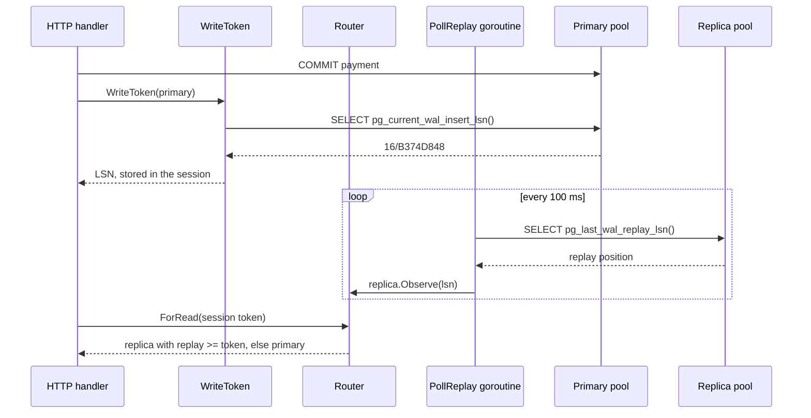
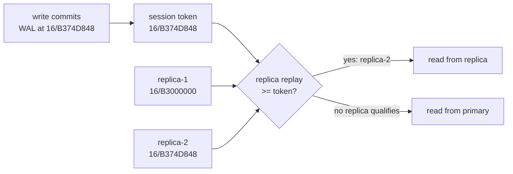
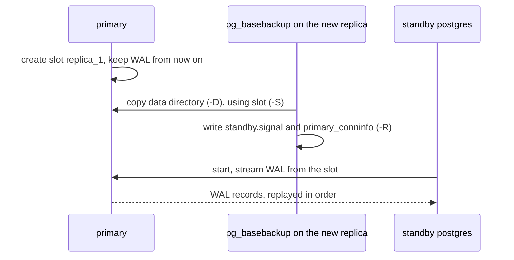
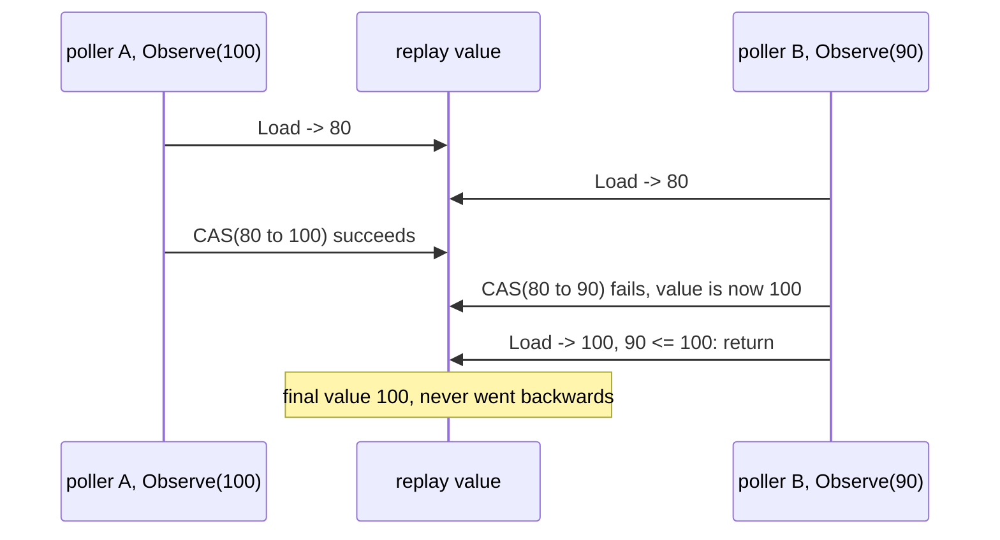
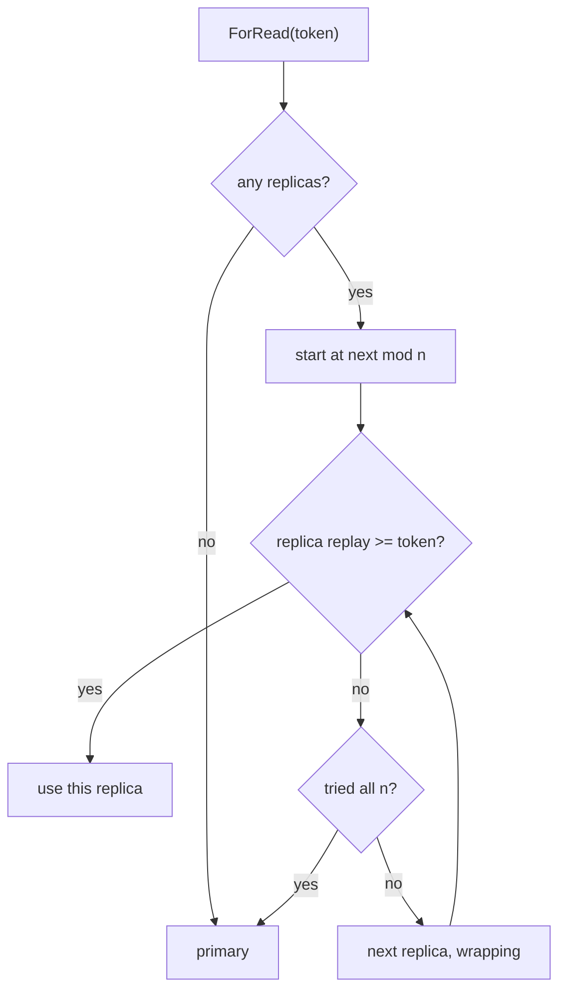

# Replication - Go

> [!summary] TL;DR
> A read router in Go that keeps read-your-writes on asynchronous PostgreSQL replicas: it parses WAL positions (LSNs), tracks each replica's replay position, and only sends a read to a replica that has replayed past the user's last write, as explained in [[Replication]].
>
> The router logic is tested under `go test -race`; the pgx calls need a live PostgreSQL 17 cluster and are verified to compile only.

## Before the code

- **Generics**: `Router[T any]` and `Replica[T any]` work for any connection type, so tests use `string` and production uses `*pgxpool.Pool`.
- **Atomics**: each replica's replay position is read and written with `sync/atomic`, so the poller and readers never race.
- **Goroutines and `sync.WaitGroup`**: the concurrency test starts many goroutines and waits for all to finish.
- **`context.Context`**: `PollReplay` stops when its context is cancelled.
- **`time.Ticker`**: fires on a fixed interval to refresh replay positions.
- **Run**: `go mod tidy`, then `go vet ./... && go test -race -v ./...`; the tests need no database.

## What this code shows

| Code | Concept in [[Replication]] |
| --- | --- |
| `LSN`, `ParseLSN`, `String` | WAL positions such as `16/B374D848`, §2 and §3.3 ([[Replication#3.3 Measuring lag]]) |
| `WriteToken` | Reading the primary's WAL insert position after a commit, the session token in §4 ([[Replication#The stale read]]) |
| `PollReplay` | Reading each replica's replay position, the `replay_lsn` of §3.3 |
| `Replica.Observe` | A cached position that can only under-report progress |
| `Router.ForRead` | Choosing a replica that is past the token, else the primary |
| `TestReadYourWrites` | The read-your-writes fix for the stale read in §4 |
| `TestParseLSN` | Why LSNs must be parsed, not compared as strings |
| Setup and monitoring SQL | Slots, lag and logical replication ([[Replication#3.4 Replication slots]]) |



## Setup

- Module `rwsplit` with `rwsplit.go`, `rwsplit_test.go`, and a sub-package `wb/` for the whiteboard version.
- Go 1.24 and `github.com/jackc/pgx/v5` v5.8.0 (for `pgxpool`). Run `go mod tidy` after creating the module.
- Run: `go vet ./... && go test -race -v ./...`
- The tests use the generic `Router[string]` and need no database. `WriteToken` and `PollReplay` need PostgreSQL 17 and are checked by compilation only.

## How to read this note

The note has two halves. The first is operational SQL and shell commands (create a slot, take a base backup, read lag, set up logical replication), which you run against a real cluster. The second is the Go read router, which you can run anywhere.

Each step has a Concept paragraph, a short block and a numbered How it works list; blocks of one file continue each other.

The core idea in one line: **a write returns a WAL position (the token), every replica reports how far it has replayed, and a read may go to a replica only when its position is at least the token.**



## Code

### Step 1: replica setup commands

**Concept.** A physical replica is a byte-for-byte copy of the primary that replays the primary's write-ahead log ([[Replication#3.1 PostgreSQL streaming replication]]).

Two things are needed to start one: a base backup to copy the data directory, and a replication slot so the primary does not delete WAL that the replica has not received yet ([[Replication#3.4 Replication slots]]).

The alternative to a slot is `wal_keep_size` or an archive, which are simpler but let the primary recycle WAL the replica still needs if the replica is slow or offline.

The cost of a slot is the opposite risk: a dead replica makes the primary keep WAL forever.

```sql
-- On the primary (PostgreSQL 17)
SELECT pg_create_physical_replication_slot('replica_1');
```

```bash
# On the new replica: copy the data directory, write standby.signal and
# primary_conninfo (-R), and stream from the slot (-S)
pg_basebackup -h primary.internal -U replicator -D /var/lib/postgresql/17/main -R -S replica_1
```

**How it works.**

1. `pg_create_physical_replication_slot('replica_1')` registers a named bookmark on the primary. Its `restart_lsn` marks the oldest WAL the primary must keep for this replica.
2. `pg_basebackup` connects as the `replicator` role and copies the whole data directory into `-D`.
3. `-R` writes `standby.signal` and `primary_conninfo`, which is what tells PostgreSQL on start-up to run as a standby instead of a primary.
4. `-S replica_1` makes the backup and the later streaming use the slot, so no WAL is lost between the backup and the first connection.



### Step 2: monitoring and tuning SQL

**Concept.** Replication needs measurement. The primary tracks each connected replica in `pg_stat_replication`, with the byte lag and three time lags (write, flush and replay), and tracks slots in `pg_replication_slots` ([[Replication#3.3 Measuring lag]]).

The router in this note trusts the replay position, so you should know how to read the same number by hand. The alternatives are an exporter that scrapes the same views, or the cloud provider's lag metric; the SQL shows what those tools read.

```sql
-- On the primary: one row per connected replica
SELECT application_name, state, sync_state,
       pg_wal_lsn_diff(pg_current_wal_lsn(), replay_lsn) AS replay_lag_bytes,
       write_lag, flush_lag, replay_lag
FROM pg_stat_replication;
```

**How it works.**

1. Each row of `pg_stat_replication` is one WAL sender, so one connected replica.
2. `state` should be `streaming`, and `sync_state` says `async`, `sync`, `potential` or `quorum`.
3. `pg_wal_lsn_diff(a, b)` subtracts two LSNs and returns bytes, so `replay_lag_bytes` is how much WAL the replica has received but not yet applied, or not even received.
4. `write_lag`, `flush_lag` and `replay_lag` are time intervals for the three stages: the replica wrote the WAL, flushed it to disk, and applied it. Reads depend on the last one.

Replication slots and the WAL they retain. An inactive slot that keeps growing is the one that will fill the primary's disk:

```sql
SELECT slot_name, slot_type, active, wal_status,
       pg_size_pretty(pg_wal_lsn_diff(pg_current_wal_lsn(), restart_lsn)) AS retained_wal
FROM pg_replication_slots;
```

**How it works.**

1. `restart_lsn` is the oldest WAL position the slot forces the primary to keep.
2. The difference between the current WAL position and `restart_lsn` is the WAL being retained on the primary's disk for this slot.
3. `active = false` with a growing `retained_wal` is the alarm condition: nobody is consuming the slot.
4. `wal_status` goes from `reserved` to `extended`, `unreserved` and finally `lost` when `max_slot_wal_keep_size` is exceeded.

Logical replication in PostgreSQL 17, with a publisher and a subscriber on another cluster (the tables must already exist there):

```sql
-- Publisher
CREATE PUBLICATION invoiceops_pub FOR TABLE invoices, invoice_items, payments;

-- Subscriber
CREATE SUBSCRIPTION invoiceops_sub
    CONNECTION 'host=primary.internal dbname=invoiceops user=replicator'
    PUBLICATION invoiceops_pub;
```

**How it works.**

1. A publication names the tables whose row changes are published; unlike physical replication, it ships row changes, not WAL bytes.
2. `CREATE SUBSCRIPTION` on the other cluster connects, creates a logical slot on the publisher, copies the initial table contents, then applies changes.
3. The tables must exist on the subscriber with compatible columns, because DDL is not replicated.
4. The subscriber can be a different major version or have extra indexes, which is the reason to choose logical over physical replication.

### Step 3: the whiteboard version

**Concept.** The bare read-your-writes idea from [[Replication#Whiteboard version]]: remember the WAL position (LSN) where the user's write ended, and read only from a replica that has replayed that far. It fits in a dozen lines because it ignores concurrency, parsing and polling. It is the model to draw in an interview before the full version.

```go
package wb

type LSN uint64

type Replica struct {
	Name     string
	Replayed LSN // last WAL position this replica has applied
}

// pickForRead returns a replica that has replayed the user's last write
// (token), or "primary" if none has caught up yet.
func pickForRead(replicas []Replica, token LSN) string {
	for _, r := range replicas {
		if r.Replayed >= token {
			return r.Name
		}
	}
	return "primary"
}
```

**How it works.**

1. `LSN` is a `uint64`, so positions compare with ordinary `>=`.
2. `Replayed` is the last WAL position a replica has applied. It is a plain field here, so it is not safe for concurrent use.
3. The loop returns the first replica that has reached the token. There is no round-robin, so replica order decides the winner.
4. When no replica qualifies, the answer is `"primary"`, which is always up to date. That fallback is what makes the scheme safe.

The full version adds LSN parsing, a background poller, round-robin, concurrency safety, and tests.

### Step 4: parse and print LSNs

**Concept.** PostgreSQL prints an LSN as two hexadecimal numbers separated by a slash, the high and the low 32 bits, such as `16/B374D848` ([[Replication#3.3 Measuring lag]]). The numbers are not zero-padded, so as text `16/FFFFFF` sorts after `16/1000000` even though it is the smaller position.

Parsing into one `uint64` makes positions comparable numerically. The alternative is to ask PostgreSQL to compare them with `pg_wal_lsn_diff`, which costs a round trip for each comparison; parsing once in Go costs nothing.

```go
// Package rwsplit sends reads to replicas without breaking read-your-writes.
package rwsplit

import (
	"context"
	"fmt"
	"strconv"
	"strings"
	"sync/atomic"
	"time"

	"github.com/jackc/pgx/v5/pgxpool"
)

// LSN is a position in the PostgreSQL write-ahead log. Postgres prints it as
// two hex numbers, "16/B374D848": the high and the low 32 bits.
type LSN uint64
```

The parser and the printer come next.

```go
func ParseLSN(s string) (LSN, error) {
	hi, lo, ok := strings.Cut(s, "/")
	if !ok {
		return 0, fmt.Errorf("parse lsn %q: missing '/'", s)
	}
	h, err := strconv.ParseUint(hi, 16, 32)
	if err != nil {
		return 0, fmt.Errorf("parse lsn %q: %w", s, err)
	}
	l, err := strconv.ParseUint(lo, 16, 32)
	if err != nil {
		return 0, fmt.Errorf("parse lsn %q: %w", s, err)
	}
	return LSN(h<<32 | l), nil
}

func (l LSN) String() string {
	return fmt.Sprintf("%X/%X", uint64(l)>>32, uint64(l)&0xFFFFFFFF)
}
```

**How it works.**

1. `strings.Cut` splits at the first `/` and reports whether it found one, so `16B374D848` (no slash) is rejected with a clear error.
2. `strconv.ParseUint(x, 16, 32)` parses base 16 and limits the result to 32 bits, so a part with more than 8 hex digits fails instead of overflowing silently.
3. `h<<32 | l` places the high part in the upper 32 bits of the `uint64` and the low part in the lower 32.
4. Errors wrap the original with `%w`, keeping the input string in the message for the log.
5. `String` is the inverse: shift right for the high half, mask for the low half, and print both in uppercase hex without padding, the way PostgreSQL does. The round trip is tested in `TestParseLSN`.

| Text | High | Low | `uint64` value |
| --- | --- | --- | --- |
| `0/0` | 0 | 0 | 0 |
| `16/B374D848` | 0x16 | 0xB374D848 | 0x16B374D848 |
| `16/FFFFFF` | 0x16 | 0xFFFFFF | 0x1600FFFFFF |
| `16/1000000` | 0x16 | 0x1000000 | 0x1601000000 |

The last two rows show why strings must not be compared: as text `16/FFFFFF` is greater, but as a number it is smaller.

### Step 5: a replica that never moves backwards

**Concept.** Each replica carries the last replay position seen by a poller, and several goroutines may update it.

The position must never move backwards, because a stale value that overwrote a newer one would make a replica look further behind than it is, and a stale value that looked further ahead would break read-your-writes.

Under-reporting is safe (the read just goes elsewhere), over-reporting is not. A compare-and-swap loop on an atomic integer keeps the maximum without a mutex ([[Replication#3.3 Measuring lag]]).

The alternative is a `sync.Mutex` around a plain field, which is also correct but takes a lock on the hot read path of every `ForRead`.

```go
// Replica is a read target plus the last replay position seen by a poller.
type Replica[T any] struct {
	Name   string
	Conn   T
	replay atomic.Uint64
}

// Observe records a replay position. It never moves backwards, so a stale
// value only under-reports progress, which is the safe direction.
func (r *Replica[T]) Observe(l LSN) {
	for {
		cur := r.replay.Load()
		if uint64(l) <= cur || r.replay.CompareAndSwap(cur, uint64(l)) {
			return
		}
	}
}
```

**How it works.**

1. `Replica[T]` is generic in the connection type: production uses `*pgxpool.Pool`, tests use a string, so no database is needed to test routing.
2. `replay` is an `atomic.Uint64`, so reads in `ForRead` and writes in `Observe` need no lock.
3. `Observe` loads the current value. If the new one is not larger, it returns, which is what keeps the value monotonic.
4. Otherwise `CompareAndSwap(cur, new)` sets the new value only if nobody changed it in between. If another poller won the race, the loop re-reads and tries again.
5. The loop ends in a bounded number of steps, because each failed swap means someone else stored a larger value.



### Step 6: the router

**Concept.** The router decides, for each read, which connection to use. A read that carries a token goes to a replica whose replay position is at least that token; a session that never wrote passes 0 and may use any replica.

If no replica qualifies, the read goes to the primary, which is always up to date. This is the read-your-writes fix for the stale read in [[Replication#The stale read]]. Starting from a rotating index spreads load round-robin.

The alternatives are pinning a user to one replica, which also keeps later reads consistent but does not survive a replica restart, or reading everything from the primary, which is correct but wastes the replicas.

```go
// Router picks a connection for each read.
type Router[T any] struct {
	primary  T
	replicas []*Replica[T]
	next     atomic.Uint64
}

func NewRouter[T any](primary T, replicas ...*Replica[T]) *Router[T] {
	return &Router[T]{primary: primary, replicas: replicas}
}
```

```go
// ForRead returns a replica that has replayed at least minLSN (the session's
// token), trying replicas round-robin. If none has caught up, it returns the
// primary. A session that has never written passes 0.
func (r *Router[T]) ForRead(minLSN LSN) (conn T, name string) {
	n := len(r.replicas)
	if n == 0 {
		return r.primary, "primary"
	}
	start := int(r.next.Add(1) % uint64(n))
	for i := range n {
		rep := r.replicas[(start+i)%n]
		if LSN(rep.replay.Load()) >= minLSN {
			return rep.Conn, rep.Name
		}
	}
	return r.primary, "primary"
}
```

**How it works.**

1. `Router[T]` holds the primary connection, the replicas and an atomic counter for the round-robin start.
2. `NewRouter` takes the replicas as a variadic list, so `NewRouter("p", r1, r2)` reads naturally in tests.
3. With no replicas the primary is returned. The same fallback applies when none qualifies.
4. `r.next.Add(1) % n` picks a different starting replica for each call, safely under concurrency.
5. The loop tries each replica once, starting at that index, and wraps around with `(start+i)%n`.
6. `rep.replay.Load() >= minLSN` is the whole freshness rule. A replica that has not replayed the user's write does not qualify.
7. Returning the `name` lets callers log where reads went, which feeds the fallback-rate metric from [[Replication#7. In production]].



### Step 7: the database calls

**Concept.** Two small functions connect the router to PostgreSQL. After a write commits, `WriteToken` reads the primary's current WAL insert position; this is never behind the commit record, so a replica that has replayed it has certainly replayed the write ([[Replication#The stale read]]).

`PollReplay` runs in a goroutine and refreshes a replica's replay position every interval.

The alternative to polling is asking the replica on every read with `pg_last_wal_replay_lsn()`, which is always exact but adds a round trip to every read; a cached value is cheaper and can only under-report. The token function comes first.

```go
// WriteToken reads the primary's WAL insert position. Call it after COMMIT and
// keep max(old, new) in the user's session. The insert position is never
// behind our commit record, even with synchronous_commit = off.
func WriteToken(ctx context.Context, primary *pgxpool.Pool) (LSN, error) {
	var s string
	err := primary.QueryRow(ctx, "SELECT pg_current_wal_insert_lsn()::text").Scan(&s)
	if err != nil {
		return 0, err
	}
	return ParseLSN(s)
}
```

**How it works.**

1. `pg_current_wal_insert_lsn()` returns the position where the next WAL record would be written, which is at or after the end of your commit.
2. The `::text` cast returns the familiar `16/B374D848` string, which `ParseLSN` converts. Without the cast pgx would have to decode the `pg_lsn` type.
3. The function returns the token; the caller stores `max(old, new)` in the session, so two writes in a row leave the larger value.
4. Using the insert position instead of the flush position keeps it correct even when `synchronous_commit = off`, when the commit record may not be flushed yet.

Now the poller.

```go
// PollReplay refreshes a replica's replay position until ctx ends.
func PollReplay(ctx context.Context, rep *Replica[*pgxpool.Pool], every time.Duration) {
	tick := time.NewTicker(every)
	defer tick.Stop()
	for {
		var s string
		err := rep.Conn.QueryRow(ctx, "SELECT pg_last_wal_replay_lsn()::text").Scan(&s)
		if err == nil {
			if l, err := ParseLSN(s); err == nil {
				rep.Observe(l)
			}
		}
		select {
		case <-ctx.Done():
			return
		case <-tick.C:
		}
	}
}
```

**How it works.**

1. `time.NewTicker` fires every `every` (for example 100 ms), and `defer tick.Stop()` releases it when the function returns.
2. Each loop queries the replica itself with `pg_last_wal_replay_lsn()`, the position of the last WAL record the replica has applied.
3. On success the value goes through `ParseLSN` and `Observe`, which keeps it monotonic. Errors are skipped, so a failed poll leaves the old value in place.
4. The `select` waits for the next tick or for `ctx.Done()`, so cancelling the context stops the goroutine cleanly.
5. A caller starts one goroutine per replica: `go PollReplay(ctx, rep, 100*time.Millisecond)`.

## Design decisions

| Decision | Alternative | Trade-off |
| --- | --- | --- |
| Token is the primary's WAL insert LSN | Commit LSN from the client protocol, or a timestamp | Always at or after the commit, simple to read; it may be slightly ahead, so a read can fall back to the primary unnecessarily |
| Cached replay LSN refreshed by polling | Query the replica on every read | No extra round trip on reads; up to one poll interval stale, which is the safe direction |
| CAS loop in `Observe` | A mutex around the field | Lock-free reads in `ForRead`; slightly more subtle code |
| Fall back to the primary when no replica qualifies | Wait for a replica to catch up, or serve stale data | Always correct and no added latency; the primary takes the load while replicas lag |
| Round-robin start index | Always start at 0, or random | Spreads load evenly with one atomic counter; not weighted by replica capacity |
| Generic `Router[T]` | `Router` holding `*pgxpool.Pool` | The tests need no database; one more type parameter |
| `LSN` parsed into `uint64` | Compare strings, or call `pg_wal_lsn_diff` | Cheap, exact numeric order; must parse every poll result |
| Poll errors ignored | Mark the replica unhealthy | The router stays simple; a dead replica silently stops qualifying |
| Physical slot per replica | `wal_keep_size` only | The primary never recycles needed WAL; a stuck slot can fill the disk |

## Tests

### Helper: `lsn`

`lsn` is a helper that calls `ParseLSN` and fails the test on error, so the tests can write LSNs as readable strings. `t.Helper()` makes a failure point at the caller's line, not at the helper.

```go
func lsn(t *testing.T, s string) LSN {
	t.Helper()
	l, err := ParseLSN(s)
	if err != nil {
		t.Fatal(err)
	}
	return l
}
```

### Test 1: read-your-writes

**Property.** A read carrying a token never goes to a replica that has not replayed the token, falls back to the primary when none has, and spreads over all replicas when there is no token. This is the property that removes the stale read described in [[Replication#The stale read]].

| Replicas | Token | Expected |
| --- | --- | --- |
| r1 at `16/B3000000`, r2 at `16/B374D848` | `16/B374D848` | always `replica-2` (10 calls) |
| the same | `16/B374D900` (newer than both) | `primary` |
| the same | 0 | both replicas used, never `primary` |

The setup and the first two assertions come first.

```go
func TestReadYourWrites(t *testing.T) {
	r1 := &Replica[string]{Name: "replica-1", Conn: "r1"}
	r2 := &Replica[string]{Name: "replica-2", Conn: "r2"}
	r := NewRouter("p", r1, r2)
	r1.Observe(lsn(t, "16/B3000000")) // lagging
	r2.Observe(lsn(t, "16/B374D848")) // caught up with our write

	token := lsn(t, "16/B374D848")
	for range 10 {
		if _, name := r.ForRead(token); name != "replica-2" {
			t.Fatalf("read after write went to %s, want replica-2", name)
		}
	}
	if _, name := r.ForRead(lsn(t, "16/B374D900")); name != "primary" {
		t.Fatalf("no replica has the write yet, got %s", name)
	}
```

The last assertion checks that a session without a token still gets load spread.

```go
	seen := map[string]bool{}
	for range 10 {
		_, name := r.ForRead(0) // session never wrote: any replica
		seen[name] = true
	}
	if !seen["replica-1"] || !seen["replica-2"] || seen["primary"] {
		t.Fatalf("token 0 should spread over replicas, got %v", seen)
	}
}
```

**How it works.**

1. Replica 1 is behind the write and replica 2 has caught up. The router is built with string connections, so no database is involved.
2. Ten reads with the token all land on `replica-2`. Ten calls matter because round-robin starts at a different replica each time; a router that sometimes picked `replica-1` would be caught.
3. A token newer than every replica must go to the primary, the safe fallback.
4. With token 0 every replica qualifies, so ten round-robin calls must visit both replicas and never the primary.

**If it fails.** A read that went to `replica-1` is a stale read waiting to happen: the router ignores the token. A read that went to the primary with token 0 means the freshness rule is wrongly strict. A single replica in `seen` means round-robin is broken.

### Test 2: LSN parsing

**Property.** LSNs round-trip through `ParseLSN` and `String`, are ordered numerically rather than textually, and malformed input is rejected.

| Input | Expected |
| --- | --- |
| `0/0`, `16/B374D848`, `FFFFFFFF/FFFFFFFF` | parse then print gives the same text |
| `16/FFFFFF` against `16/1000000` | the first is smaller |
| `16B374D848` | error (missing `/`) |

```go
func TestParseLSN(t *testing.T) {
	for _, s := range []string{"0/0", "16/B374D848", "FFFFFFFF/FFFFFFFF"} {
		if got := lsn(t, s).String(); got != s {
			t.Fatalf("round trip %s -> %s", s, got)
		}
	}
	// Postgres does not zero-pad, so comparing LSNs as strings is wrong.
	if !(lsn(t, "16/FFFFFF") < lsn(t, "16/1000000")) {
		t.Fatal("16/FFFFFF must sort before 16/1000000")
	}
	if _, err := ParseLSN("16B374D848"); err == nil {
		t.Fatal("want error for missing '/'")
	}
}
```

**How it works.** The first value is the minimum, the second is a typical LSN and the third is the maximum, which proves the full 64 bits survive. The comparison line is the reason this note parses LSNs at all: as text, `16/FFFFFF` is larger than `16/1000000` (`F` sorts after `1`), but numerically it is smaller.

**If it fails.** A round-trip failure means `String` pads or lower-cases differently from PostgreSQL. A failed comparison means the high and low halves were swapped or mis-shifted. A missing error means a malformed token could silently become a bogus position.

### Test 3: concurrent `Observe`

**Property.** Under concurrent updates, the stored position is the maximum value ever observed, and the router is safe to call at the same time. It is run under `-race`, which would report any unsynchronised access.

| Input | Expected |
| --- | --- |
| 8 goroutines, each observing `g*1000 + i` for `i = 1..1000`, while calling `ForRead` | final `replay == 8000` |

```go
func TestObserveConcurrent(t *testing.T) {
	rep := &Replica[string]{Name: "r", Conn: "c"}
	r := NewRouter("p", rep)
	var wg sync.WaitGroup
	for g := range 8 {
		wg.Add(1)
		go func() {
			defer wg.Done()
			for i := 1; i <= 1000; i++ {
				rep.Observe(LSN(g*1000 + i))
				r.ForRead(LSN(i))
			}
		}()
	}
	wg.Wait()
	if got := LSN(rep.replay.Load()); got != 7*1000+1000 {
		t.Fatalf("replay = %d, want the maximum observed value 8000", got)
	}
}
```

**How it works.** Goroutine `g` observes the values `g*1000+1` to `g*1000+1000`, so the largest value anywhere is `7*1000 + 1000 = 8000`, from the last goroutine.

Because the goroutines interleave, many `Observe` calls carry a value lower than the current one; the CAS loop must ignore those. The `ForRead` call in the loop reads the position while it is being written, which is what `-race` checks.

The file imports `sync` and `testing`.

**If it fails.** A final value below 8000 means a stale write overwrote a newer one, so `Observe` can move backwards. A race report means the position is accessed without atomics.

### Test 4: the whiteboard function

A small test in the `wb` package checks that `pickForRead` returns a caught-up replica and falls back to `"primary"`.

```go
package wb

import "testing"

func TestPickForRead(t *testing.T) {
	rs := []Replica{{"r1", 10}, {"r2", 20}}
	if got := pickForRead(rs, 15); got != "r2" {
		t.Fatalf("got %s, want r2", got)
	}
	if got := pickForRead(rs, 25); got != "primary" {
		t.Fatalf("got %s, want primary", got)
	}
}
```

| Replicas | Token | Expected |
| --- | --- | --- |
| r1 at 10, r2 at 20 | 15 | `r2` |
| the same | 25 | `primary` |

**If it fails.** `r1` for token 15 means the comparison is reversed; anything other than `primary` for token 25 means the fallback is missing.

## Running it

```bash
go vet ./... && go test -race -v ./...
```

**Measured** with `go vet ./...` and `go test -race -v ./...` on Go 1.24 with pgx v5.8.0 (2026-11-07):

```text
=== RUN   TestReadYourWrites
--- PASS: TestReadYourWrites (0.00s)
=== RUN   TestParseLSN
--- PASS: TestParseLSN (0.00s)
=== RUN   TestObserveConcurrent
--- PASS: TestObserveConcurrent (0.00s)
PASS
ok  	rwsplit	1.461s
```

**Reading the output line by line.**

1. `=== RUN` marks a test starting; `--- PASS` marks it finishing, with its duration.
2. All three tests take 0.00 s because they use in-memory strings and no I/O. The concurrent test does 8,000 `Observe` calls, which still takes microseconds.
3. `PASS` means every test passed and the race detector reported nothing. A race would print `WARNING: DATA RACE` and fail the test.
4. `ok rwsplit 1.461s` is the package total. Most of the time is compiling with the race detector, not running tests.
5. `go vet` prints nothing when it is clean. The `wb` package has its own `ok` line with `TestPickForRead`.

## Pitfalls in the code

- **`WriteToken` is not the commit LSN.** It returns the insert position at the time of the call, which may be slightly ahead of your commit. That is safe (reads wait a little longer) but never use it as a precise commit position.
- **Keep the maximum in the session.** Two writes in a row must leave the larger token. Overwriting with a smaller value from a different pooled connection reintroduces stale reads.
- **A cached replay position is up to one poll old.** With a 100 ms poll, a read right after a write may fall back to the primary even though a replica has caught up. Fall-back is safe; watch the rate of fallbacks (see §7 of the theory note).
- **A poll error leaves the old value.** `PollReplay` ignores query errors, so a dead replica stays at its last position and simply stops qualifying once the tokens pass it. Add health checks if you want it removed from rotation.
- **Do not compare LSN strings.** `16/FFFFFF` sorts after `16/1000000` as text but is smaller as a number.
- **`ForRead(0)` ignores freshness.** Only sessions that never wrote may pass 0.
- **Monotonic reads are not covered.** The router fixes read-your-writes; pin sessions to a replica, or also keep the highest LSN the session has seen, to stop reads going backwards ([[Replication#Monotonic reads, traced]]).

## Exercises

1. In `TestReadYourWrites`, make `replica-1` also reach `16/B374D848`. Predict which replicas the ten token reads return, then run it.
2. Change `ForRead` to skip the round-robin and always start at index 0. Predict which assertion in `TestReadYourWrites` fails.
3. Add a `Seen` token to the session: after each read, store `max(seen, replica replay position)` and pass it as the minimum for the next read. Predict how this changes behaviour for the "refresh twice and data goes backwards" anomaly.

## Links

- **Theory:** [[Replication]]
- **Related:** [[Partitioning and Sharding - Go]], [[Consistent Hashing - Go]]
