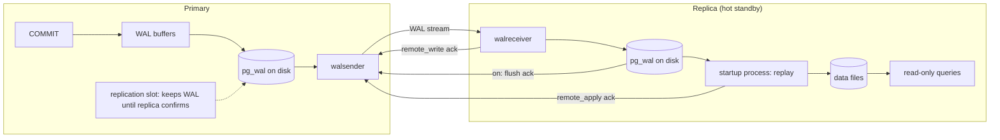
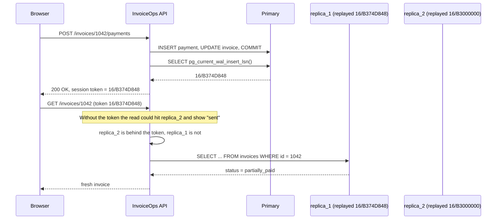
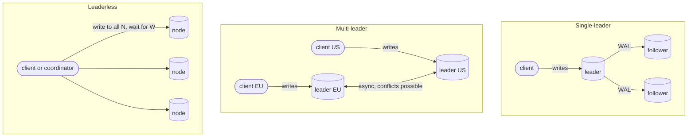

# Replication

> [!summary] TL;DR
> Replication keeps copies of the same database on several servers. In the usual setup one **primary** takes all writes and streams its change log (the WAL) to **replicas**, which serve reads and can take over if the primary dies. The price is **replication lag**: a replica can be a little behind, so a read sent there may not see a write that just succeeded.

> [!abstract] Core idea
> - The primary writes a change log (the WAL); replicas replay it in order to keep their own copy.
> - Replicas are usually a little behind (replication lag), so a read right after a write can return old data.
> - The rule: a read that must see the user's own write goes to a replica that has replayed past that write, or to the primary.
> - Classic mistakes: treating a replica as a backup (it replays deletes too), and adding replicas to scale writes (every replica still applies every write).

## 1. Why it exists

InvoiceOps runs on one PostgreSQL server. Four problems appear as it grows:

| Problem | Without replication | With replication |
| --- | --- | --- |
| Read load: dashboards and invoice lists are most of the traffic | The primary's CPU is spent on reads, and writes slow down | Send list and dashboard reads to replicas |
| The server's disk dies | Restore the last backup and replay WAL: tens of minutes to hours | Promote a replica: seconds to a minute |
| Users in another continent | Every read crosses an ocean (about 150 ms per round trip; estimate) | A replica in their region answers locally |
| Analysts run month-end reports | Long scans compete with checkout traffic | Point reports at a dedicated replica, or stream changes out (CDC) |

Two things replication does **not** do:

- **It does not scale writes.** Every replica applies every write. To spread writes, see [[Partitioning and Sharding]].
- **It is not a backup.** A bad `DELETE` reaches every replica within milliseconds. See §6.

## 2. Mental model

The primary keeps a journal of every change, in order: PostgreSQL's **write-ahead log (WAL)**. A replica is a server that receives that journal and replays it, entry by entry, against its own copy of the data. Every point in the journal has an address, the **LSN** (log sequence number), shown as `16/B374D848`.

Analogy: head office writes every transaction into a ledger and faxes each page to the branches. A branch's books always match head office **as of some page**. A branch two pages behind still shows a balance that was true a moment ago, but it does not show the deposit you just made.

Vocabulary:

- **Primary** (leader, source): accepts writes.
- **Replica** (standby, follower): applies the primary's changes; in PostgreSQL a *hot standby* also answers read-only queries.
- **Lag**: how far a replica is behind, in bytes of WAL or in seconds.
- **Failover**: promoting a replica when the primary is gone.

## 3. How it works

### 3.1 PostgreSQL streaming replication

1. A transaction commits on the primary. Its WAL records are written to `pg_wal/` and flushed to disk.
2. A **walsender** process streams new WAL to each replica over a replication connection.
3. The replica's **walreceiver** writes the WAL to its own `pg_wal/`, flushes it, and reports three positions back: written, flushed and replayed.
4. The replica's **startup process** replays the WAL into its data files. With `hot_standby = on` (the default) the replica serves read-only queries meanwhile.
5. A **replication slot** on the primary records the oldest WAL each replica still needs, so the primary never recycles WAL a replica has not received.



The three acknowledgements are what `synchronous_commit` can wait for (§3.2). Setting up a replica takes one slot and one base backup:

```sql
-- On the primary (PostgreSQL 17)
SELECT pg_create_physical_replication_slot('replica_1');
```

```bash
# On the new replica: copy the data directory, write standby.signal and
# primary_conninfo (-R), and stream from the slot (-S)
pg_basebackup -h primary.internal -U replicator -D /var/lib/postgresql/17/main -R -S replica_1
```

### 3.2 Synchronous, asynchronous and semi-synchronous

| Mode | `COMMIT` returns after | Committed data lost if the primary dies | Write latency added |
| --- | --- | --- | --- |
| Asynchronous (PostgreSQL default) | The primary flushes its own WAL | Whatever the replica had not received yet (the lag window) | None |
| Semi-sync (MySQL) | At least one replica has **received** the change (not applied it) | None while it is on, but if no replica acknowledges within `rpl_semi_sync_source_timeout` (10 s by default) MySQL falls back to async, and the client is not told | One round trip |
| Sync, `synchronous_commit = remote_write` | The standby's OS has the WAL (not yet fsynced) | Only if the standby's OS crashes too | One round trip |
| Sync, `synchronous_commit = on` | The standby has **flushed** the WAL to disk | None for acknowledged commits | Round trip + standby fsync |
| Sync, `synchronous_commit = remote_apply` | The standby has **replayed** it, so reads there see it | None | Round trip + replay time |

Which standbys count is set by `synchronous_standby_names`:

```sql
-- Wait for one of two standbys, whichever answers first (quorum commit)
ALTER SYSTEM SET synchronous_standby_names = 'ANY 1 (replica_1, replica_2)';
SELECT pg_reload_conf();

-- Durability can be chosen per transaction: pay for remote_apply only
-- on the write that the next page must see.
BEGIN;
SET LOCAL synchronous_commit = remote_apply;
UPDATE invoices SET status = 'paid' WHERE workspace_id = 7 AND id = 1042;
COMMIT;
```

> [!warning] A synchronous standby is an availability dependency
> With `'FIRST 1 (replica_1)'` and `replica_1` down, every commit on the primary **waits** until it returns. Name two candidates, or use `ANY 1 (…)` over two or three standbys.

### 3.3 Measuring lag

```sql
-- On the primary: one row per connected replica
SELECT application_name, state, sync_state,
       pg_wal_lsn_diff(pg_current_wal_lsn(), replay_lsn) AS replay_lag_bytes,
       write_lag, flush_lag, replay_lag
FROM pg_stat_replication;
```

Representative output (PostgreSQL 17):

```text
 application_name |   state   | sync_state | replay_lag_bytes |    write_lag    |    flush_lag    |   replay_lag
------------------+-----------+------------+------------------+-----------------+-----------------+-----------------
 replica_1        | streaming | quorum     |            12288 | 00:00:00.000412 | 00:00:00.000981 | 00:00:00.001730
 replica_2        | streaming | quorum     |         48234496 | 00:00:00.000508 | 00:00:00.001102 | 00:00:02.814233
```

`replica_2` received and flushed the WAL within about a millisecond but is **replaying** 46 MiB (2.8 s) behind. Receiving is fast and applying is slow, which usually means a heavy write burst or a long query on the replica holding up replay (§8).

On a replica, `now() - pg_last_xact_replay_timestamp()` gives lag in seconds, but it keeps growing when the primary is idle even though nothing is missing. Prefer the byte-based lag above, or a heartbeat row that the primary updates every second.

### 3.4 Replication slots

A slot guarantees that WAL stays until its consumer confirms it. That cuts both ways: a replica or CDC connector that disappears leaves an **inactive slot**, and the primary keeps every WAL file from then on until its disk fills and it stops.

```sql
SELECT slot_name, slot_type, active, wal_status,
       pg_size_pretty(pg_wal_lsn_diff(pg_current_wal_lsn(), restart_lsn)) AS retained_wal
FROM pg_replication_slots;
```

Set `max_slot_wal_keep_size` (PostgreSQL 13+). A slot that would retain more is invalidated (`wal_status = lost`), and that replica must be re-cloned. Losing a replica beats losing the primary.

## 4. Worked example

### Whiteboard version

The bare idea: remember the WAL position (LSN) where the user's write ended, and read only from a replica that has replayed that far.

```go
package wb

type LSN uint64

type Replica struct {
	Name     string
	Replayed LSN // last WAL position this replica has applied
}

// pickForRead returns a replica that has replayed the user's last write
// (token), or "primary" if none has caught up yet.
func pickForRead(replicas []Replica, token LSN) string {
	for _, r := range replicas {
		if r.Replayed >= token {
			return r.Name
		}
	}
	return "primary"
}
```

The full version below adds production concerns: LSN parsing, a background poller, round-robin, concurrency safety, and tests.

### The stale read

A client records a ₹5,000 partial payment on invoice INV-1042. The write goes to the primary and the API returns 200. The browser immediately reloads the invoice, and that read goes to `replica_2`, which is 2.8 s behind. The page still says **sent** with the old balance, so the client pays again or opens a support ticket.

This is a **read-your-writes** violation. The fix below remembers *where in the WAL* the user's write ended, and only reads from a replica that has replayed past that point.



### The router in Go

A poller reads each replica's replay position every 100 ms. Reads compare the cached position with the session's token, and fall back to the primary when no replica has caught up. A cached position can only be *older* than the truth, so it never sends a read to a replica that lacks the write. This compiles and passes `go vet` and `go test -race` on Go 1.24 with pgx v5.8.

```go
// Package rwsplit sends reads to replicas without breaking read-your-writes.
package rwsplit

import (
	"context"
	"fmt"
	"strconv"
	"strings"
	"sync/atomic"
	"time"

	"github.com/jackc/pgx/v5/pgxpool"
)

// LSN is a position in the PostgreSQL write-ahead log. Postgres prints it as
// two hex numbers, "16/B374D848": the high and the low 32 bits.
type LSN uint64

func ParseLSN(s string) (LSN, error) {
	hi, lo, ok := strings.Cut(s, "/")
	if !ok {
		return 0, fmt.Errorf("parse lsn %q: missing '/'", s)
	}
	h, err := strconv.ParseUint(hi, 16, 32)
	if err != nil {
		return 0, fmt.Errorf("parse lsn %q: %w", s, err)
	}
	l, err := strconv.ParseUint(lo, 16, 32)
	if err != nil {
		return 0, fmt.Errorf("parse lsn %q: %w", s, err)
	}
	return LSN(h<<32 | l), nil
}

func (l LSN) String() string {
	return fmt.Sprintf("%X/%X", uint64(l)>>32, uint64(l)&0xFFFFFFFF)
}

// Replica is a read target plus the last replay position seen by a poller.
type Replica[T any] struct {
	Name   string
	Conn   T
	replay atomic.Uint64
}

// Observe records a replay position. It never moves backwards, so a stale
// value only under-reports progress, which is the safe direction.
func (r *Replica[T]) Observe(l LSN) {
	for {
		cur := r.replay.Load()
		if uint64(l) <= cur || r.replay.CompareAndSwap(cur, uint64(l)) {
			return
		}
	}
}

// Router picks a connection for each read.
type Router[T any] struct {
	primary  T
	replicas []*Replica[T]
	next     atomic.Uint64
}

func NewRouter[T any](primary T, replicas ...*Replica[T]) *Router[T] {
	return &Router[T]{primary: primary, replicas: replicas}
}

// ForRead returns a replica that has replayed at least minLSN (the session's
// token), trying replicas round-robin. If none has caught up, it returns the
// primary. A session that has never written passes 0.
func (r *Router[T]) ForRead(minLSN LSN) (conn T, name string) {
	n := len(r.replicas)
	if n == 0 {
		return r.primary, "primary"
	}
	start := int(r.next.Add(1) % uint64(n))
	for i := range n {
		rep := r.replicas[(start+i)%n]
		if LSN(rep.replay.Load()) >= minLSN {
			return rep.Conn, rep.Name
		}
	}
	return r.primary, "primary"
}

// WriteToken reads the primary's WAL insert position. Call it after COMMIT and
// keep max(old, new) in the user's session. The insert position is never
// behind our commit record, even with synchronous_commit = off.
func WriteToken(ctx context.Context, primary *pgxpool.Pool) (LSN, error) {
	var s string
	err := primary.QueryRow(ctx, "SELECT pg_current_wal_insert_lsn()::text").Scan(&s)
	if err != nil {
		return 0, err
	}
	return ParseLSN(s)
}

// PollReplay refreshes a replica's replay position until ctx ends.
func PollReplay(ctx context.Context, rep *Replica[*pgxpool.Pool], every time.Duration) {
	tick := time.NewTicker(every)
	defer tick.Stop()
	for {
		var s string
		err := rep.Conn.QueryRow(ctx, "SELECT pg_last_wal_replay_lsn()::text").Scan(&s)
		if err == nil {
			if l, err := ParseLSN(s); err == nil {
				rep.Observe(l)
			}
		}
		select {
		case <-ctx.Done():
			return
		case <-tick.C:
		}
	}
}
```

The test that pins the behaviour, including why LSNs must be parsed rather than compared as strings:

```go
func TestReadYourWrites(t *testing.T) {
	r1 := &Replica[string]{Name: "replica-1", Conn: "r1"}
	r2 := &Replica[string]{Name: "replica-2", Conn: "r2"}
	r := NewRouter("p", r1, r2)
	r1.Observe(lsn(t, "16/B3000000")) // lagging
	r2.Observe(lsn(t, "16/B374D848")) // caught up with our write

	token := lsn(t, "16/B374D848")
	for range 10 {
		if _, name := r.ForRead(token); name != "replica-2" {
			t.Fatalf("read after write went to %s, want replica-2", name)
		}
	}
	if _, name := r.ForRead(lsn(t, "16/B374D900")); name != "primary" {
		t.Fatalf("no replica has the write yet, got %s", name)
	}
	seen := map[string]bool{}
	for range 10 {
		_, name := r.ForRead(0) // session never wrote: any replica
		seen[name] = true
	}
	if !seen["replica-1"] || !seen["replica-2"] || seen["primary"] {
		t.Fatalf("token 0 should spread over replicas, got %v", seen)
	}
}

func TestParseLSN(t *testing.T) {
	for _, s := range []string{"0/0", "16/B374D848", "FFFFFFFF/FFFFFFFF"} {
		if got := lsn(t, s).String(); got != s {
			t.Fatalf("round trip %s -> %s", s, got)
		}
	}
	// Postgres does not zero-pad, so comparing LSNs as strings is wrong.
	if !(lsn(t, "16/FFFFFF") < lsn(t, "16/1000000")) {
		t.Fatal("16/FFFFFF must sort before 16/1000000")
	}
	if _, err := ParseLSN("16B374D848"); err == nil {
		t.Fatal("want error for missing '/'")
	}
}
```

(`lsn` is a three-line helper that calls `ParseLSN` and fails the test on error. A third test hammers `Observe` and `ForRead` from 8 goroutines under `-race`.)

### Other fixes, and the two related anomalies

| Anomaly | What the user sees | Fixes |
| --- | --- | --- |
| Read-your-writes | Their own change is missing | LSN token (above); read from the primary for N seconds after a write, with N above p99 lag (a cookie holding the write time); always read "my own" pages from the primary; `remote_apply` for that one transaction |
| Monotonic reads | Refresh twice and data goes **backwards**, because the second read hit a staler replica | Pin a session to one replica (`hash(session) % replicas`), or keep the highest LSN the session has *seen* in the token as well |
| Consistent prefix | An effect appears before its cause, e.g. a payment without its invoice update | Not possible inside one PostgreSQL cluster: a replica replays one ordered WAL, so it always shows a prefix of the primary's history. It does happen across **shards** or independent streams; keep causally related writes in one shard |

## 5. Variants and comparison

### Topologies



| Topology | How writes flow | Write conflicts | Use when | Cost |
| --- | --- | --- | --- | --- |
| Single-leader (PostgreSQL, MySQL, MongoDB replica sets) | All writes go to one node and stream out in one order | None | The default for OLTP | Write throughput of one node; needs failover |
| Multi-leader (EDB Postgres Distributed, offline-first apps) | Each leader accepts writes and they exchange changes asynchronously | Yes: last-writer-wins, merge functions or CRDTs, see [[CRDTs and Conflict Resolution]] | Writes in several regions, or clients that work offline | Conflict handling in every table |
| Group replication (MySQL Group Replication, multi-primary mode) | Any member accepts writes, but every transaction is ordered through Paxos-based group communication and certified before commit | Detected at certification: the first committer wins and the later conflicting transaction is rolled back (no last-writer-wins, no CRDTs) | Write availability inside one data centre or region with consistent ordering | Commit latency of a group round trip; conflict errors the app must retry |
| Leaderless (Cassandra, ScyllaDB, Riak) | Write to N replicas and wait for W; read from R | Concurrent writes resolved by timestamps or version vectors | High write availability with no failover step, see [[Quorums and Leaderless Replication]] | Weaker guarantees; needs read repair and anti-entropy |
| Shared storage (Amazon Aurora) | The database ships redo log records to a replicated storage service | None | Managed cloud, fast replicas | Vendor-specific |

### What gets shipped

| Mechanism | What travels | Strengths | Limits |
| --- | --- | --- | --- |
| Statement-based (old MySQL default) | The SQL text | Small | Non-deterministic SQL (`NOW()`, `RAND()`, `UPDATE … LIMIT`) diverges |
| Physical WAL streaming (PostgreSQL) | Byte-level page changes | Exact copy, everything included | Whole cluster only, same major version and platform, replica is read-only |
| Logical / row-based (PostgreSQL logical replication, MySQL `binlog_format = ROW`) | Row images: "row with key k now has values v" | Per table, across major versions, subscriber stays writable, feeds CDC | PostgreSQL 17 does not replicate DDL or sequence values; `UPDATE` and `DELETE` need a replica identity (usually the primary key) |

Logical replication in PostgreSQL 17:

```sql
-- Publisher
CREATE PUBLICATION invoiceops_pub FOR TABLE invoices, invoice_items, payments;

-- Subscriber (another cluster; the tables must already exist there)
CREATE SUBSCRIPTION invoiceops_sub
    CONNECTION 'host=primary.internal dbname=invoiceops user=replicator'
    PUBLICATION invoiceops_pub;
```

Its main uses are major-version upgrades with a short cut-over, copying a subset of tables, and **CDC**: Debezium reads the same logical decoding stream through a slot and publishes row changes to Kafka (see [[Transactional Outbox and CDC]]). PostgreSQL 16 allows logical decoding on a standby. PostgreSQL 17 adds **failover slots** (create the slot with `failover = true` and set `sync_replication_slots = on` on the standby), so a CDC connector can continue after a failover, and `pg_createsubscriber`, which turns a physical standby into a logical replica.

## 6. Trade-offs and when not to use

- **Replicas multiply reads, not writes.** Each replica replays the full write stream, and a replica that cannot keep up only falls further behind.
- **Async replication can lose acknowledged commits.** On failover you lose whatever the new primary had not received: the RPO equals the lag at that moment. Sync replication closes that gap but adds a round trip to every commit, and the primary stalls when no synchronous standby is reachable.
- **Replicas move consistency problems into the application.** Every read path needs a decision: fresh (primary) or fast (replica).
- **Never check-then-write against a replica.** Checking "does a payment with this `provider_ref` exist?" on a replica, then inserting on the primary, double-charges when the replica lags. Use a unique constraint on the primary (see [[Idempotency and Idempotency Keys]]).
- **A replica is not a backup.** Example: at 10:02:13 someone runs `DELETE FROM invoices WHERE workspace_id = 7` against the wrong workspace. The delete is on every replica a few milliseconds later. Recovery means point-in-time recovery to 10:02:12 from a base backup plus archived WAL (see [[Backup, PITR and Disaster Recovery]]). A **delayed replica** (`recovery_min_apply_delay = '1h'`) gives an hour to run `pg_wal_replay_pause()` and copy the rows back, but it shares the primary's failure domain and keeps one hour of history. It is an extra layer, not a replacement.
- **When a simpler option wins:** if one primary handles the load, keep reads on the primary and run a standby only for failover. Add read replicas when there is a measured read bottleneck that caching or indexing cannot fix.

## 7. In production

- **Real systems:**
	- PostgreSQL streaming replication managed by **Patroni** (leader key in etcd, Consul or ZooKeeper; `synchronous_mode` for zero-loss failover) or repmgr. `pg_rewind` turns a failed primary back into a replica.
	- MySQL: binlog replication with GTIDs, semi-sync, and Orchestrator for topology and failover.
	- AWS RDS: a **Multi-AZ** standby is synchronous and exists for failover (in the classic instance deployment it serves no reads), while **read replicas** are asynchronous and readable. Aurora keeps 6 copies of the data across 3 availability zones and needs 4 of the 6 to acknowledge a write. Its read replicas share that storage. See [[AWS 08 - RDS and Aurora]].
- **Failover basics** (depth in [[High Availability and Failover]]):
	1. Detect: missed heartbeats for longer than a timeout. A timeout cannot tell "dead" from "slow".
	2. Choose the replica that has received the most WAL (highest LSN) to lose the least data.
	3. Promote it: `SELECT pg_promote();` (PostgreSQL 12+). It starts a new **timeline**.
	4. Fence the old primary so it can no longer accept writes: power it off, cut its network, or make it demote itself when it cannot renew its leader lease.
	5. Repoint clients through DNS, a virtual IP or a proxy, then rebuild the old primary as a replica with `pg_rewind`.
- **Split brain:** after a network partition the old primary is still up and still accepting writes from clients that can reach it, while a new primary takes the rest. The two histories diverge and must be merged by hand. Prevent it with majority-based leader election and fencing (see [[Leader Election]] and [[Distributed Locks and Fencing Tokens]]); never with timeouts alone.
- **Failure modes → fixes:**
	- Lag spikes after a bulk `UPDATE` or index build → batch and throttle large writes; watch `replay_lag` during migrations.
	- Replica queries fail with `canceling statement due to conflict with recovery` → raise `max_standby_streaming_delay` (default 30 s) on a reporting replica, or enable `hot_standby_feedback` and accept bloat on the primary.
	- An abandoned slot fills the primary's disk → set `max_slot_wal_keep_size`, alert on retained WAL, drop dead slots.
	- The only synchronous standby dies and commits hang → use `ANY 1 (replica_1, replica_2)`.
	- Failover loses the last async commits → promote the highest-LSN replica, and use quorum sync for data that must not be lost.
- **What to monitor:**
	- `replay_lag` and lag bytes per replica, and `sync_state`.
	- Retained WAL and `wal_status` per slot.
	- `pg_stat_database_conflicts` on replicas.
	- WAL generated per second on the primary.
	- How often the read router falls back to the primary: a rising rate means replicas are lagging.

## 8. Deep dive

- **What "synchronous" really guarantees.** PostgreSQL's promise is narrow: the client gets no acknowledgement until the synchronous standbys have the WAL. If the primary crashes while a commit is waiting, the commit is already in the primary's local WAL, so it is committed after restart even though the standby may never have received it. If the waiting session is cancelled, PostgreSQL warns that the transaction committed locally but may not have been replicated. Code that treats a timeout as "not committed" is wrong. Treat it as **unknown**, and make the operation idempotent.
- **Why replicas fall behind under write-heavy load.** The primary generates WAL from many backends in parallel, but a standby replays it with **one** startup process. PostgreSQL 15 added `recovery_prefetch` to hide read I/O during replay, but the apply step itself is still single-process. Sustained write rates that a big primary handles can therefore outrun a same-sized replica.
- **Replay conflicts.** Replay may need to remove row versions that a long replica query still reads (vacuum cleanup on the primary), or to take an `ACCESS EXCLUSIVE` lock (for example `DROP TABLE`). Replay waits up to `max_standby_streaming_delay` and then cancels the query. `hot_standby_feedback = on` reports the replica's oldest snapshot to the primary so that vacuum keeps those rows. That trades cancellations for bloat on the primary, and it does not help with lock conflicts.
- **Cascading replication.** A replica can stream to further replicas. This takes walsender load off the primary and sends WAL across a region boundary once instead of once per replica.
- **Timelines.** Promotion forks history. WAL that the old primary wrote after the fork exists nowhere else, so the old primary cannot simply reconnect: `pg_rewind` rolls it back to the fork point first, and those unreplicated writes are gone.
- **Writable subscribers conflict.** A logical subscriber is a normal database. If a row inserted locally collides with an incoming insert, the apply worker errors and replication stops until someone fixes the row or skips the transaction (`ALTER SUBSCRIPTION … SKIP`, PostgreSQL 15+).
- **Leaderless is not "Dynamo-named".** Amazon DynamoDB (the service) replicates each partition across three availability zones with a Multi-Paxos leader that takes all writes. The 2007 Dynamo paper's leaderless design survives in Cassandra and Riak, not in DynamoDB.

## 9. Interview questions

> [!question]- Is a read replica a backup?
> No. Replication copies mistakes as faithfully as data: a bad `DELETE`, a broken migration or application-level corruption reaches every replica within milliseconds. Backups mean a base backup plus archived WAL for point-in-time recovery, stored somewhere else. A delayed replica is a useful extra layer, not a backup.

> [!question]- A user records a payment and the next page still shows the old balance. Why, and how do you fix it?
> The read went to an asynchronous replica that had not replayed the write yet: a read-your-writes violation. Fixes: after the commit, store the primary's WAL position in the session and read only from replicas that have replayed past it; or read from the primary for a few seconds after the user's writes; or use `synchronous_commit = remote_apply` for that one transaction.

> [!question]- What do synchronous and asynchronous replication each cost you?
> Async adds no write latency, but an acknowledged commit can be lost on failover: the RPO equals the lag. Sync waits for a standby on every commit (one round trip plus a flush), and the primary blocks if no synchronous standby is reachable. Quorum sync (`ANY 1` of two or three) keeps zero loss while tolerating one slow or dead standby.

> [!question]- Why don't more replicas increase write throughput?
> Every replica must apply every write, so the write capacity of the group is the capacity of one node, and in PostgreSQL replay is single-process, which is often slower. To scale writes, split the data across primaries (sharding) or use a database that partitions and replicates each range, such as [[Distributed SQL]].

> [!question]- The primary dies under async replication. What happens to the last writes, and how do you avoid split brain?
> Writes the chosen replica had not received are lost. Pick the replica with the highest received LSN to keep the loss small. Avoid split brain by electing the new primary through a majority (etcd, Consul or ZooKeeper, as Patroni does) and **fencing** the old one, so a primary that loses its lease stops accepting writes.

> [!question]- What is a replication slot, and how can it take down the primary?
> A slot makes the primary keep WAL until its consumer (a replica or a CDC connector) confirms it. If the consumer disappears, WAL accumulates until the primary's disk is full. Cap it with `max_slot_wal_keep_size` and alert on retained WAL per slot.

> [!question]- DynamoDB descends from the Dynamo paper, so it is leaderless, right?
> No, and that is the trap. The 2022 DynamoDB paper describes each partition as a replication group with a Multi-Paxos-elected leader that takes all writes and strongly consistent reads. Leaderless Dynamo-style replication lives on in Cassandra, ScyllaDB and Riak.

> [!question]- When would you choose logical replication over physical?
> Physical replication for HA standbys and read replicas: an exact copy of the whole cluster. Logical replication when you need a subset of tables, a different major version (upgrades), a writable target, or a change stream for CDC. Remember that it skips DDL and sequence values, and needs a replica identity for updates and deletes.

## 10. Cheat sheet

- Replication = the primary streams its WAL; replicas replay it in order. It scales reads and availability, never writes.
- Async: no latency cost, loses the lag window on failover. Sync (`on`, `remote_apply`, `ANY n`): zero loss, plus a round trip per commit and an availability dependency.
- Lag = bytes or seconds not yet replayed; watch `pg_stat_replication.replay_lag`.
- Read-your-writes: an LSN token, or read the primary briefly after a write. Monotonic reads: pin the session to a replica.
- Slots keep WAL. A dead slot fills the disk, so cap it with `max_slot_wal_keep_size`.
- Failover: highest LSN wins, promote, fence the old primary, repoint clients, `pg_rewind`.
- Logical replication: per table, cross-version, feeds CDC, no DDL or sequences.
- A replica is not a backup: keep PITR.

## Links

- **Before this:** [[Transactions and ACID]], [[Storage Engines - B-tree vs LSM and WAL]]
- **Next:** [[High Availability and Failover]], [[Partitioning and Sharding]], [[Quorums and Leaderless Replication]]
- **Compare with:** [[Backup, PITR and Disaster Recovery]] (copies that survive mistakes), [[Distributed SQL]] (consensus replication per range), [[Transactional Outbox and CDC]] (logical decoding as an event source)
