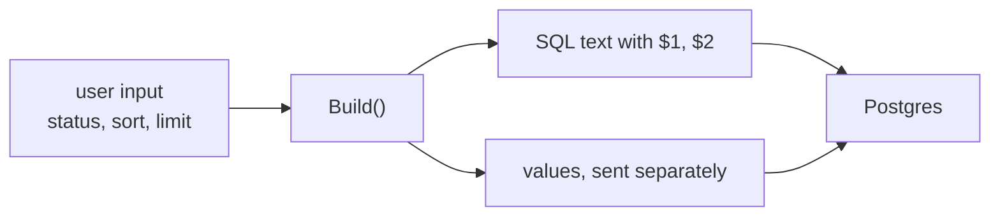
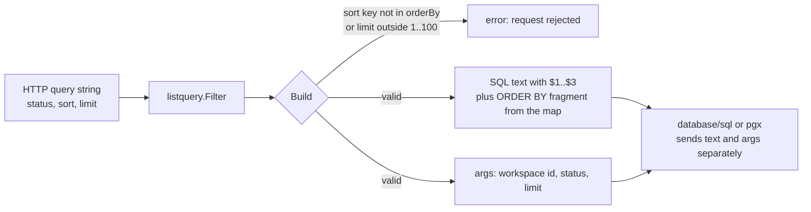
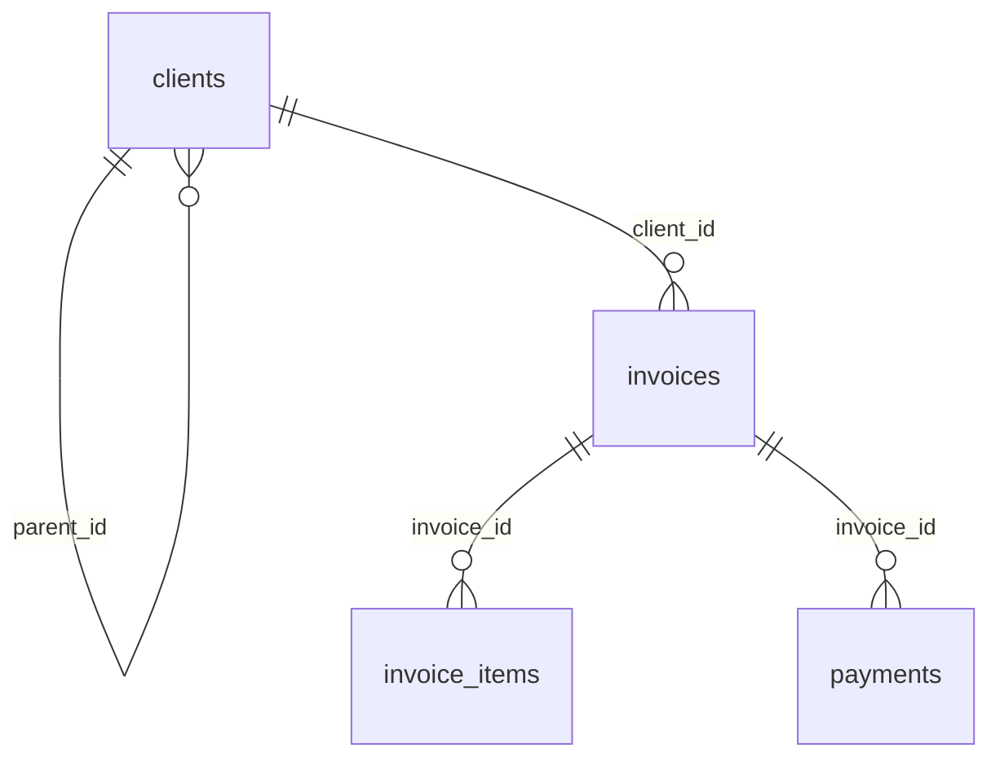
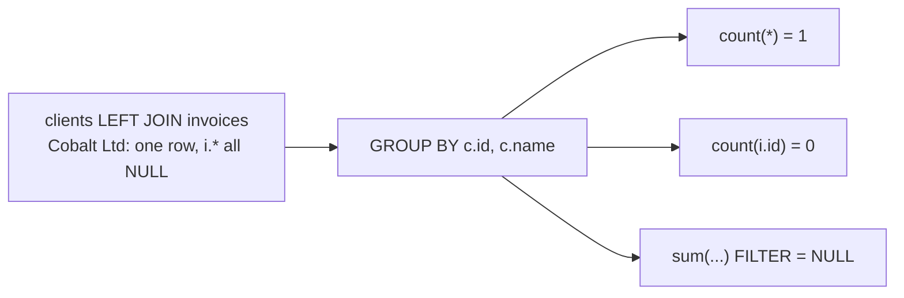
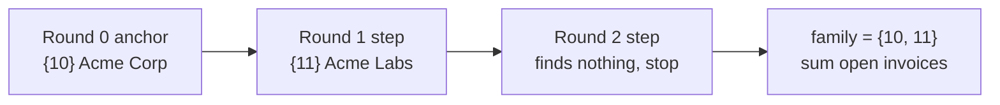
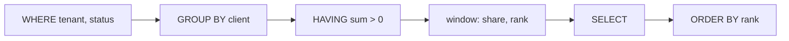
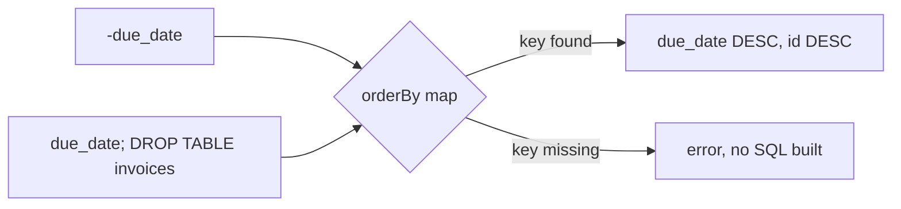
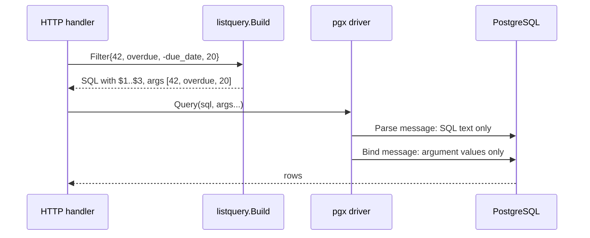
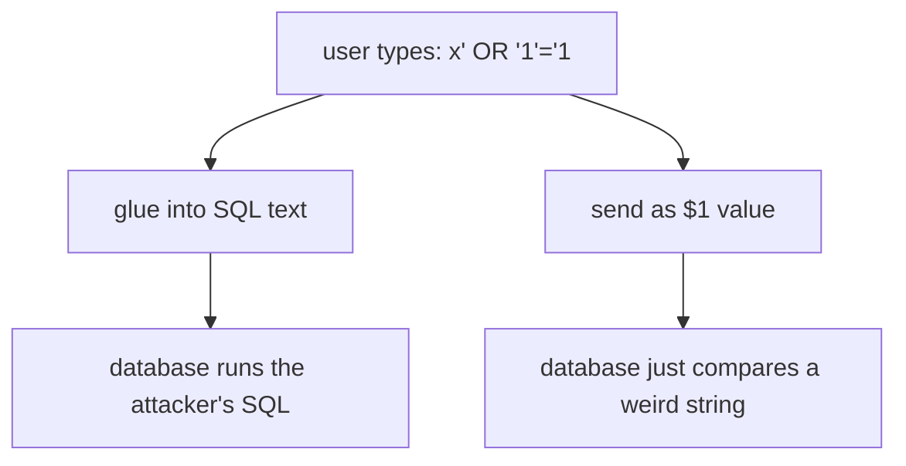

# SQL Essentials - Go

> [!info] How to read this note (pick your level)
> - 🟢 **New to this?** Read "From zero" below, then "Before the code", "What this code shows" and Step 1 (the tables). Stop there.
> - 🟡 **Know the basics?** Add Steps 2 to 6 and the Tests.
> - 🔴 **Interview / SDE-3 prep?** Add Design decisions, Pitfalls and the Exercises. Headings are tagged 🟢🟡🔴 so you always know where you are.

**From zero, in 60 seconds** 🟢

This file is the hands-on twin of [[SQL Essentials]]. The first half is plain SQL you can paste into Postgres: four small tables (clients, invoices, invoice items, payments) and a few bigger queries that group, total and rank them. The second half is a tiny Go package that builds a search query safely. The key safety idea is a **placeholder**: the SQL text says `$1`, and the real value travels separately, so a user can never sneak SQL in. A second guard is a **whitelist**: sort options come from a fixed list, never from raw user text. Read it top to bottom: each step is a short Concept, the code, then a numbered walkthrough.



> [!summary] TL;DR
> The runnable side of [[SQL Essentials]]: the InvoiceOps schema and the long reference queries (grouping, recursive CTE, the traced collections report) as PostgreSQL 17 SQL, plus a small Go package that builds a list query with `$n` placeholders and a fixed sort whitelist, so user input can never become SQL.
>
> Every block is short and comes with a concept paragraph, a numbered walkthrough, and a diagram where one helps.

## Before the code 🟢

- **Structs as input**: a `Filter` struct holds the user's choices (workspace, status, sort, limit).
- **Maps as whitelists**: `orderBy` maps a sort key to a fixed SQL fragment, so unknown keys are rejected.
- **`strings.Builder` and `fmt`**: build the SQL text with `$1`, `$2`, ... placeholders.
- **`[]any` arguments**: values travel separately from the SQL, so the driver sends them as parameters.
- **Multiple return values**: `Build` returns SQL, args and an `error`.
- **Run**: `go vet ./... && go test -race ./...` inside the `listquery` module; no database needed.

## What this code shows 🟢

| Code | Concept in the theory note |
| --- | --- |
| Running schema DDL | The tables behind every example in [[SQL Essentials#The running schema]] (clients, invoices, items, payments) |
| Grouping query | `count(*)` versus `count(col)`, `FILTER`, and `sum` over zero rows returning NULL ([[SQL Essentials#Grouping and aggregates]]) |
| Recursive CTE | Anchor plus step, walking `clients.parent_id` ([[SQL Essentials#Subqueries and CTEs]]) |
| Collections query | The logical processing order, traced clause by clause ([[SQL Essentials#The collections query, traced]]) |
| `listquery.Build` | Values as parameters, identifiers from a whitelist, a total sort order for stable paging ([[SQL Essentials#Building SQL safely from Go]]) |



The diagram is the whole Go story in one picture: the HTTP request becomes a `Filter` struct, `Build` either rejects it or splits it into SQL text and an argument list, and the driver sends those two halves to the server separately.

The SQL parts of this note have no Go in them; they are the queries the theory note traces by hand.

## Setup 🟢

- Go 1.24, standard library only (`fmt`, `strings`; the test adds `reflect` and `testing`).
- Layout: a module `listquery` with `listquery.go` and `listquery_test.go`.
- Run it with `go vet ./... && go test -race ./...`.
- The SQL runs on PostgreSQL 17. The outputs shown are representative output (PostgreSQL 17), computed by hand from the sample data in the theory note; they were not produced by a live server in this vault.

## Code 🟡

### Step 1: the running schema

**In plain words:** four tables that every later query uses: who the clients are, what they were billed, the lines on each bill, and what they paid.

**Concept.** Every example in [[SQL Essentials#The running schema]] runs against four tables: clients, invoices, invoice items and payments. This is a trimmed version, only as wide as the queries need.

Columns ending in `_minor` hold money as integer minor units (paise), so Rs 1,500.00 is `150000`; the reasoning is in [[Relational Schema Design#Step 6: types]]. The constraints (`CHECK`, `UNIQUE`, `REFERENCES`) are written in the table so the database, not the application, rejects bad rows.

The full production DDL, with tenant-safe composite keys, is in [[Relational Schema Design - Go]]; this version keeps simple single-column foreign keys so the queries stay readable.



Clients and invoices first:

```sql
CREATE TABLE clients (
  id           bigint GENERATED ALWAYS AS IDENTITY PRIMARY KEY,
  workspace_id bigint NOT NULL REFERENCES workspaces (id),
  parent_id    bigint REFERENCES clients (id),   -- subsidiary of another client, or NULL
  name         text NOT NULL,
  email        text,                             -- NULL: no billing email yet
  UNIQUE (workspace_id, email)
);

CREATE TABLE invoices (
  id           bigint GENERATED ALWAYS AS IDENTITY PRIMARY KEY,
  workspace_id bigint NOT NULL REFERENCES workspaces (id),
  client_id    bigint NOT NULL REFERENCES clients (id),
  number       text NOT NULL,
  status       text NOT NULL CHECK (status IN ('draft', 'sent', 'partially_paid', 'paid', 'overdue', 'cancelled')),
  total_minor  bigint NOT NULL CHECK (total_minor >= 0),
  paid_minor   bigint NOT NULL DEFAULT 0,
  issue_date   date,
  due_date     date,
  UNIQUE (workspace_id, number)
);
```

Then the two child tables:

```sql
CREATE TABLE invoice_items (
  id               bigint GENERATED ALWAYS AS IDENTITY PRIMARY KEY,
  invoice_id       bigint NOT NULL REFERENCES invoices (id) ON DELETE CASCADE,
  description      text NOT NULL,
  quantity         integer NOT NULL CHECK (quantity > 0),
  unit_price_minor bigint NOT NULL CHECK (unit_price_minor >= 0)
);

CREATE TABLE payments (
  id           bigint GENERATED ALWAYS AS IDENTITY PRIMARY KEY,
  invoice_id   bigint NOT NULL REFERENCES invoices (id),
  amount_minor bigint NOT NULL CHECK (amount_minor > 0),
  provider_ref text NOT NULL UNIQUE,
  paid_at      timestamptz NOT NULL DEFAULT now()
);
```

**How it works.**

1. `GENERATED ALWAYS AS IDENTITY PRIMARY KEY` makes the database assign ids; an `INSERT` that names an id is rejected unless it uses `OVERRIDING SYSTEM VALUE`.
2. `parent_id ... REFERENCES clients (id)` is a self-reference. A NULL parent means a top-level client; otherwise the value must be an existing client. This is the edge the recursive CTE in step 3 walks.
3. `UNIQUE (workspace_id, email)` treats NULLs as distinct by default, so any number of clients may have no email, but two clients in one workspace cannot share one.
4. The `status` `CHECK` lists the allowed values. A `CHECK` passes when its expression is NULL, which is why `status` is also `NOT NULL`.
5. `ON DELETE CASCADE` on `invoice_items` removes lines with their invoice, since a line has no meaning alone. `payments` has no cascade: deleting an invoice that has payments must fail, because payments are financial records.
6. `provider_ref ... UNIQUE` lets a retried payment-provider callback fail with SQLSTATE 23505 instead of recording the payment twice.

### Step 2: grouping and aggregates

**In plain words:** put rows into piles (one pile per client, say), then count or add up each pile.

**Concept.** This implements [[SQL Essentials#Grouping and aggregates]]. After `GROUP BY`, each output row stands for a whole group and aggregate functions summarise it.

The query is built to expose two classic surprises: `count(*)` counts joined rows while `count(i.id)` counts only non-NULL values, and `sum` over no rows is NULL, not 0.

`FILTER` is used instead of several subqueries or `CASE` expressions because it computes several conditional aggregates in one pass over the grouped rows. The alternative, a separate query per metric, reads the table several times and gives results that can disagree under concurrent writes.

```sql
SELECT c.name,
       count(*)                                     AS joined_rows,
       count(i.id)                                  AS invoices,
       count(*) FILTER (WHERE i.status = 'overdue') AS overdue,
       sum(i.total_minor - i.paid_minor)
         FILTER (WHERE i.status IN ('sent', 'partially_paid', 'overdue')) AS open_minor
FROM clients c
LEFT JOIN invoices i ON i.client_id = c.id
GROUP BY c.id, c.name
ORDER BY c.id;
```

**How it works.**

1. `FROM clients c LEFT JOIN invoices i` keeps every client, even one with no invoices; that client gets one joined row whose `i.*` columns are all NULL.
2. `GROUP BY c.id, c.name` collapses the joined rows into one row per client. Grouping by the primary key `c.id` is what makes `c.name` legal in the select list.
3. `count(*)` counts joined rows, so Cobalt Ltd scores 1 even though it has no invoice. `count(i.id)` skips NULLs, so Cobalt Ltd scores 0.
4. `count(*) FILTER (WHERE ...)` counts only the rows passing the condition, per group.
5. The `sum(...) FILTER` aggregates the open amount; for Cobalt Ltd no row qualifies, so the result is NULL rather than 0.
6. `ORDER BY c.id` runs last, after grouping, and fixes the output order.



Representative output (PostgreSQL 17), computed from the sample data:

| name       | joined_rows | invoices | overdue | open_minor |
| ---------- | ----------- | -------- | ------- | ---------- |
| Acme Corp  | 2           | 2        | 1       | 150000     |
| Acme Labs  | 1           | 1        | 1       | 80000      |
| Bolt Foods | 3           | 3        | 1       | 105000     |
| Cobalt Ltd | 1           | 0        | 0       | NULL       |

Read the last row first: `joined_rows = 1` against `invoices = 0` is the `count(*)` versus `count(col)` gap, and `open_minor = NULL` is `sum` over zero qualifying rows. Wrap it in `coalesce(..., 0)` if a report needs a number.

### Step 3: a recursive CTE

**In plain words:** a query that keeps calling itself to walk down a family tree of companies, however deep it goes.

**Concept.** This is the recursive form of [[SQL Essentials#Subqueries and CTEs]]. A client can be the parent of other clients, so "Acme's balance including subsidiaries" needs a walk down a tree of unknown depth, which a fixed number of self-joins cannot do.

A recursive CTE has an anchor (the starting rows) and a step (rows reached from rows already found); the database repeats the step until it finds nothing new.

The alternatives are a loop in Go issuing one query per level, which costs a round trip per level, or storing a materialised path, which is faster to read but harder to keep correct.

```sql
WITH RECURSIVE family AS (
  SELECT id FROM clients WHERE id = 10               -- anchor: Acme Corp
  UNION ALL
  SELECT c.id
  FROM clients c
  JOIN family f ON c.parent_id = f.id                -- step: children of rows found so far
)
SELECT sum(i.total_minor - i.paid_minor) AS group_open_minor
FROM invoices i
WHERE i.client_id IN (SELECT id FROM family)
  AND i.status IN ('sent', 'partially_paid', 'overdue');
```

**How it works.**

1. The anchor `SELECT id FROM clients WHERE id = 10` runs once and yields `{10}`.
2. The step joins `clients` to the rows found in the previous round (`family f`) on `c.parent_id = f.id`, which finds the children of those rows.
3. `UNION ALL` appends each round's rows to the result and skips duplicate removal, which is cheaper; it is safe only when the data has no cycle.
4. Recursion stops when a round returns no rows.
5. The outer query uses `family` as a list of client ids and sums the open amount of their invoices.



Representative output (PostgreSQL 17): `group_open_minor = 230000` (150000 from INV-102 plus 80000 from INV-103). If the data could contain a cycle, add PostgreSQL 14's `CYCLE id SET is_cycle USING path` clause, which marks and stops on a repeated row instead of looping forever.

### Step 4: the collections query

**In plain words:** one bigger query that answers "who owes us the most, and how late are they?" using every trick from the theory note.

**Concept.** This is the whiteboard query from [[SQL Essentials#The collections query, traced]], with every feature of the topic in one statement: a tenant filter, a CTE, lateness arithmetic, a share of the total and a rank.

It exists to show the logical processing order (FROM, WHERE, GROUP BY, HAVING, window functions, SELECT, ORDER BY) working together.

Splitting the work into a CTE keeps the filter and the date arithmetic separate from the report, which makes each half easy to test; the alternative is one flat query with a subquery in `FROM`, which does the same thing.

The CTE, the part that selects invoices still owing money:

```sql
WITH open_invoices AS (                               -- invoices that still owe money
  SELECT client_id,
         total_minor - paid_minor     AS open_minor,
         DATE '2026-11-02' - due_date AS days_late     -- date - date = whole days
  FROM invoices
  WHERE workspace_id = 1
    AND status IN ('sent', 'partially_paid', 'overdue')
)
```

The report on top of it (the `WITH` clause above is its first half):

```sql
SELECT c.name,
       sum(o.open_minor)                                AS open_minor,
       max(o.days_late) FILTER (WHERE o.days_late > 0)  AS worst_days_late,
       round(100.0 * sum(o.open_minor) / sum(sum(o.open_minor)) OVER (), 1) AS pct_of_open,
       rank() OVER (ORDER BY sum(o.open_minor) DESC)    AS rank
FROM open_invoices o
JOIN clients c ON c.id = o.client_id
GROUP BY c.id, c.name
HAVING sum(o.open_minor) > 0
ORDER BY rank;
```

**How it works.**

1. `WHERE workspace_id = 1` is the tenant filter; it runs first, before any grouping, so other tenants' rows never reach the aggregates.
2. `DATE '2026-11-02' - due_date` subtracts two dates and gives a whole number of days. A negative result means not yet due.
3. `JOIN clients` attaches names to the CTE rows; `GROUP BY c.id, c.name` makes one row per client.
4. `HAVING sum(o.open_minor) > 0` filters groups after aggregation, which `WHERE` cannot do.
5. `max(...) FILTER (WHERE o.days_late > 0)` ignores invoices that are not late yet, so a negative number never becomes "the worst".
6. `sum(sum(o.open_minor)) OVER ()` is a window over the group rows: the inner `sum` is each client's total, the outer one adds the group rows. This works because windows run after grouping.
7. `rank() OVER (ORDER BY sum(...) DESC)` numbers the groups by open amount; ties share a rank.



Representative output (PostgreSQL 17):

```text
    name    | open_minor | worst_days_late | pct_of_open | rank
------------+------------+-----------------+-------------+------
 Acme Corp  |     150000 |              32 |        44.8 |    1
 Bolt Foods |     105000 |              33 |        31.3 |    2
 Acme Labs  |      80000 |              13 |        23.9 |    3
(3 rows)
```

Reading it line by line:

| Row | What to check |
| --- | --- |
| Acme Corp, 150000 | The largest open amount, so rank 1; 150000 / 335000 = 44.8% |
| Bolt Foods, 105000 | Worst lateness is 33 days, not a negative number, because INV-104 (not late yet, -18 days) is excluded by the `FILTER` |
| Acme Labs, 80000 | 80000 / 335000 = 23.9%; the three shares sum to 100.0 |
| `(3 rows)` | Cobalt Ltd has no open invoices, so it never reaches the report |

### Step 5: building SQL safely from Go, the types

**In plain words:** the shapes of the data: what the user may ask for, and the fixed list of allowed sort orders.

**Concept.** This is [[SQL Essentials#Building SQL safely from Go]]. Values must travel as parameters (`$1`, `$2`): drivers such as pgx send the SQL text and the values in separate protocol messages by default, so a value can never become SQL.

Column names and `ASC`/`DESC` cannot be parameters, so the builder maps each public sort key to a fixed fragment.

The alternatives are an ORM or a query builder library, which solve the same problem with more machinery, and quoting user input into the string, which is the injection bug itself. A map whitelist is the smallest design that is safe.

```go
package listquery

import (
	"fmt"
	"strings"
)

// Filter is what GET /invoices?status=overdue&sort=-due_date&limit=20 parses into.
type Filter struct {
	WorkspaceID int64
	Status      string // "" means any status
	Sort        string // a key of orderBy
	Limit       int
}

// orderBy maps each public sort key to a fixed SQL fragment. Column names and
// ASC/DESC cannot be bind parameters, so user input never reaches the SQL text.
// The trailing id makes the order total: equal due dates still page stably.
var orderBy = map[string]string{
	"due_date":  "due_date ASC, id ASC",
	"-due_date": "due_date DESC, id DESC",
	"total":     "total_minor ASC, id ASC",
	"-total":    "total_minor DESC, id DESC",
}
```

**How it works.**

1. `Filter` is the parsed request. `Status` is optional: the empty string means "any status".
2. `Sort` holds the public key the client sent, such as `-due_date`. It is never placed in SQL directly.
3. `orderBy` is the whitelist. The key is what the client may say; the value is the only SQL text that can ever reach the `ORDER BY` clause.
4. Every value ends with `id` as a tie-breaker. Without it, rows with equal due dates may swap places between pages, so paging skips or repeats rows.



### Step 6: building SQL safely from Go, `Build`

**In plain words:** check the request first; only if it is valid, write the SQL text with numbered blanks and a separate list of values.

**Concept.** `Build` turns a `Filter` into SQL text with `$n` placeholders plus the argument slice. It validates first and builds second, so an invalid request never produces SQL at all.

The placeholder number is `len(args)` after appending, so numbers stay correct whether or not the optional status filter is present. A `strings.Builder` avoids repeated string concatenation. The alternative of hard-coding one query per filter combination does not scale past two optional filters.

```go
// Build returns SQL with $n placeholders plus the matching arguments.
func Build(f Filter) (string, []any, error) {
	order, ok := orderBy[f.Sort]
	if !ok {
		return "", nil, fmt.Errorf("unsupported sort %q", f.Sort)
	}
	if f.Limit < 1 || f.Limit > 100 {
		return "", nil, fmt.Errorf("limit %d not in 1..100", f.Limit)
	}
	var sql strings.Builder
	args := []any{f.WorkspaceID}
	sql.WriteString("SELECT id, number, status, total_minor, due_date FROM invoices WHERE workspace_id = $1")
	if f.Status != "" {
		args = append(args, f.Status)
		fmt.Fprintf(&sql, " AND status = $%d", len(args))
	}
	args = append(args, f.Limit)
	fmt.Fprintf(&sql, " ORDER BY %s LIMIT $%d", order, len(args))
	return sql.String(), args, nil
}
```

**How it works.**

1. `orderBy[f.Sort]` with the `, ok` form distinguishes a missing key from an empty value. A missing key returns an error with `%q`, which quotes the offending text safely in the message.
2. The limit check runs in Go, so a negative or huge `LIMIT` never reaches the database.
3. `args` starts with the workspace id, and `$1` is always the tenant filter. The tenant condition is never optional.
4. If `Status` is set, its value is appended to `args`, and the placeholder number is `len(args)`, which is 2.
5. The limit is appended last, so its placeholder is `$2` or `$3` depending on the status filter.
6. `Fprintf` formats only the whitelisted fragment and the generated `$n` number into the SQL, never a request value. The function returns three values: the SQL, the arguments, and an error, as Go convention expects.

The SQL it produces for status `overdue` and sort `-due_date`:

```sql
SELECT id, number, status, total_minor, due_date FROM invoices
WHERE workspace_id = $1 AND status = $2 ORDER BY due_date DESC, id DESC LIMIT $3
```



**Safe vs unsafe, as a picture** 🟢



## Design decisions 🔴

| Decision | Alternative | Trade-off |
| --- | --- | --- |
| Values as `$n` parameters | Quote values into the SQL string | Parameters make injection structurally impossible; quoting depends on every call site getting escaping right |
| Sort whitelist map | Pass the column name through after checking characters | The map allows only known columns and directions; a character check can miss valid-looking but unintended column names |
| `id` appended to every sort | Sort by the user's column only | A total order gives stable paging; it costs one more column in any index that serves the sort |
| Limit capped at 100 in Go | Trust the client, or cap in SQL | An early error saves a round trip and bounds response size; the cap lives in code, so changing it is a deploy |
| `strings.Builder` plus `Fprintf` | One `fmt.Sprintf` with all branches | The builder grows only the parts that are present; one format string needs a branch per optional filter |
| Money as integer minor units | `numeric` or float | Integers are exact and compact; the unit must be remembered by the reader |
| Plain `database/sql`-style SQL text | ORM or code generation ([[Database Access (database-sql, pgx, sqlc)]]) | Full control and no dependency; more hand-written code to maintain |

## Tests 🟡

The three tests prove three properties of `Build`, each of which would otherwise be a security or correctness bug.

### Test 1: values travel as parameters

**In plain words:** a nasty value like `'; DROP TABLE` stays a plain value and never lands inside the SQL text.

**Property.** A hostile value stays a value. It appears in `args` and never in the SQL text, which is the definition of injection safety here.

| Input | Expected |
| --- | --- |
| `Status = "overdue' OR '1'='1"`, sort `-due_date`, limit 20 | SQL text identical to the normal overdue query; `args = [42, hostile string, 20]` |

```go
package listquery

import (
	"reflect"
	"testing"
)

func TestValuesTravelAsParameters(t *testing.T) {
	evil := "overdue' OR '1'='1"
	sql, args, err := Build(Filter{WorkspaceID: 42, Status: evil, Sort: "-due_date", Limit: 20})
	if err != nil {
		t.Fatal(err)
	}
	want := "SELECT id, number, status, total_minor, due_date FROM invoices " +
		"WHERE workspace_id = $1 AND status = $2 ORDER BY due_date DESC, id DESC LIMIT $3"
	if sql != want {
		t.Fatalf("sql:\n got %s\nwant %s", sql, want)
	}
	if !reflect.DeepEqual(args, []any{int64(42), evil, 20}) {
		t.Fatalf("args = %#v", args)
	}
}
```

If it fails, either the hostile text leaked into the SQL (an injection hole) or the placeholder numbering is wrong. `reflect.DeepEqual` also checks types, so `int64(42)` must stay an `int64` and the limit an `int`.

### Test 2: placeholders renumber without a status

**In plain words:** if a filter is left out, the blanks are still numbered 1, 2, 3 with no gaps.

**Property.** The optional filter does not break numbering. With no status, the limit must become `$2`, not `$3`; a gap in numbering is a protocol error at the database.

| Input | Expected |
| --- | --- |
| Workspace 7, no status, sort `total`, limit 5 | `... WHERE workspace_id = $1 ORDER BY total_minor ASC, id ASC LIMIT $2`, args `[7, 5]` |

```go
func TestPlaceholdersRenumberWithoutStatus(t *testing.T) {
	sql, args, err := Build(Filter{WorkspaceID: 7, Sort: "total", Limit: 5})
	if err != nil {
		t.Fatal(err)
	}
	want := "SELECT id, number, status, total_minor, due_date FROM invoices " +
		"WHERE workspace_id = $1 ORDER BY total_minor ASC, id ASC LIMIT $2"
	if sql != want {
		t.Fatalf("sql:\n got %s\nwant %s", sql, want)
	}
	if !reflect.DeepEqual(args, []any{int64(7), 5}) {
		t.Fatalf("args = %#v", args)
	}
}
```

A failure here means the code uses a fixed placeholder number for the limit instead of `len(args)`.

### Test 3: unknown sort and bad limit are rejected

**In plain words:** anything not on the allowed list is refused before any SQL is written.

**Property.** Anything outside the whitelist or the limit range is refused before SQL exists.

| Input | Expected |
| --- | --- |
| Sort `due_date; DROP TABLE invoices`, limit 10 | error |
| Sort `due_date`, limit 0, -1 or 101 | error for each limit |

```go
func TestUnknownSortAndBadLimitRejected(t *testing.T) {
	if _, _, err := Build(Filter{WorkspaceID: 1, Sort: "due_date; DROP TABLE invoices", Limit: 10}); err == nil {
		t.Fatal("injected sort key accepted")
	}
	for _, l := range []int{0, -1, 101} {
		if _, _, err := Build(Filter{WorkspaceID: 1, Sort: "due_date", Limit: l}); err == nil {
			t.Fatalf("limit %d accepted", l)
		}
	}
}
```

A failure means the whitelist lookup or the range check was bypassed. Note the boundary values: 0 and 101 are the first invalid values on each side, and the loop does not test 1 or 100, which tests 1 and 2 cover implicitly by succeeding with limits 20 and 5.

## Running it 🟢

```bash
go vet ./... && go test -race -v ./...
```

Measured (Go 1.24.4, darwin/arm64):

```text
--- PASS: TestValuesTravelAsParameters (0.00s)
--- PASS: TestPlaceholdersRenumberWithoutStatus (0.00s)
--- PASS: TestUnknownSortAndBadLimitRejected (0.00s)
PASS
ok  	listquery	1.489s
```

| Line | Meaning |
| --- | --- |
| `--- PASS: ...(0.00s)` | One line per test; each runs in well under a millisecond because nothing touches a database |
| `PASS` | The package as a whole passed with the race detector enabled |
| `ok  listquery  1.489s` | Package name and total time; most of it is compiling with `-race` |

`go vet` printed nothing, which means it found no suspicious constructs. The `-race` flag adds no information for this single-threaded code, but it is a good habit to keep in CI.

> [!example]- Full file: listquery.go
> ```go
> package listquery
>
> import (
> 	"fmt"
> 	"strings"
> )
>
> // Filter is what GET /invoices?status=overdue&sort=-due_date&limit=20 parses into.
> type Filter struct {
> 	WorkspaceID int64
> 	Status      string // "" means any status
> 	Sort        string // a key of orderBy
> 	Limit       int
> }
>
> // orderBy maps each public sort key to a fixed SQL fragment. Column names and
> // ASC/DESC cannot be bind parameters, so user input never reaches the SQL text.
> // The trailing id makes the order total: equal due dates still page stably.
> var orderBy = map[string]string{
> 	"due_date":  "due_date ASC, id ASC",
> 	"-due_date": "due_date DESC, id DESC",
> 	"total":     "total_minor ASC, id ASC",
> 	"-total":    "total_minor DESC, id DESC",
> }
>
> // Build returns SQL with $n placeholders plus the matching arguments.
> func Build(f Filter) (string, []any, error) {
> 	order, ok := orderBy[f.Sort]
> 	if !ok {
> 		return "", nil, fmt.Errorf("unsupported sort %q", f.Sort)
> 	}
> 	if f.Limit < 1 || f.Limit > 100 {
> 		return "", nil, fmt.Errorf("limit %d not in 1..100", f.Limit)
> 	}
> 	var sql strings.Builder
> 	args := []any{f.WorkspaceID}
> 	sql.WriteString("SELECT id, number, status, total_minor, due_date FROM invoices WHERE workspace_id = $1")
> 	if f.Status != "" {
> 		args = append(args, f.Status)
> 		fmt.Fprintf(&sql, " AND status = $%d", len(args))
> 	}
> 	args = append(args, f.Limit)
> 	fmt.Fprintf(&sql, " ORDER BY %s LIMIT $%d", order, len(args))
> 	return sql.String(), args, nil
> }
> ```

> [!example]- Full file: listquery_test.go
> ```go
> package listquery
>
> import (
> 	"reflect"
> 	"testing"
> )
>
> func TestValuesTravelAsParameters(t *testing.T) {
> 	evil := "overdue' OR '1'='1"
> 	sql, args, err := Build(Filter{WorkspaceID: 42, Status: evil, Sort: "-due_date", Limit: 20})
> 	if err != nil {
> 		t.Fatal(err)
> 	}
> 	want := "SELECT id, number, status, total_minor, due_date FROM invoices " +
> 		"WHERE workspace_id = $1 AND status = $2 ORDER BY due_date DESC, id DESC LIMIT $3"
> 	if sql != want {
> 		t.Fatalf("sql:\n got %s\nwant %s", sql, want)
> 	}
> 	if !reflect.DeepEqual(args, []any{int64(42), evil, 20}) {
> 		t.Fatalf("args = %#v", args)
> 	}
> }
>
> func TestPlaceholdersRenumberWithoutStatus(t *testing.T) {
> 	sql, args, err := Build(Filter{WorkspaceID: 7, Sort: "total", Limit: 5})
> 	if err != nil {
> 		t.Fatal(err)
> 	}
> 	want := "SELECT id, number, status, total_minor, due_date FROM invoices " +
> 		"WHERE workspace_id = $1 ORDER BY total_minor ASC, id ASC LIMIT $2"
> 	if sql != want {
> 		t.Fatalf("sql:\n got %s\nwant %s", sql, want)
> 	}
> 	if !reflect.DeepEqual(args, []any{int64(7), 5}) {
> 		t.Fatalf("args = %#v", args)
> 	}
> }
>
> func TestUnknownSortAndBadLimitRejected(t *testing.T) {
> 	if _, _, err := Build(Filter{WorkspaceID: 1, Sort: "due_date; DROP TABLE invoices", Limit: 10}); err == nil {
> 		t.Fatal("injected sort key accepted")
> 	}
> 	for _, l := range []int{0, -1, 101} {
> 		if _, _, err := Build(Filter{WorkspaceID: 1, Sort: "due_date", Limit: l}); err == nil {
> 			t.Fatalf("limit %d accepted", l)
> 		}
> 	}
> }
> ```

## Pitfalls in the code 🔴

- **Placeholders cannot stand in for identifiers.** `ORDER BY $1` sorts by a constant string, not by a column. That is why the sort goes through a map of fixed fragments.
- **Do not format values into the SQL string.** Only the whitelisted fragment and the generated `$n` numbers are formatted in with `Fprintf`; every value goes into `args`.
- **A missing tie-breaker makes paging unstable.** Every `orderBy` fragment ends with `id`, so two invoices with the same due date keep one fixed order across pages.
- **`Limit` is validated in Go.** A negative or huge `LIMIT` would otherwise reach the database; the check returns an error before any SQL exists.
- **`LastInsertId` does not work with Postgres drivers.** Read generated ids with `QueryRowContext(...).Scan(&id)` on an `INSERT ... RETURNING id`.
- **Map the SQLSTATE, not the message.** 23505 becomes a 409 Conflict, 23503 and 23514 become 422 or 400, decided from the error code.

## Exercises 🔴

1. Add a sort key `"-number"` that orders by `number DESC, id DESC`. Predict which test breaks if you forget the `id` tie-breaker, then write a test for the new key.
2. Run the grouping query after inserting a client with `parent_id = 13` and no invoices. Predict the new row's `joined_rows`, `invoices` and `open_minor` values before running it.
3. Change the recursive CTE's anchor to `id = 11`. Predict `group_open_minor`, and explain why Acme Corp's invoice is not included.

## Links 🟢

- Theory: [[SQL Essentials]]
- Schema in full: [[Relational Schema Design - Go]]
- Next: [[Query Plans and EXPLAIN]], [[Database Access (database-sql, pgx, sqlc)]]
