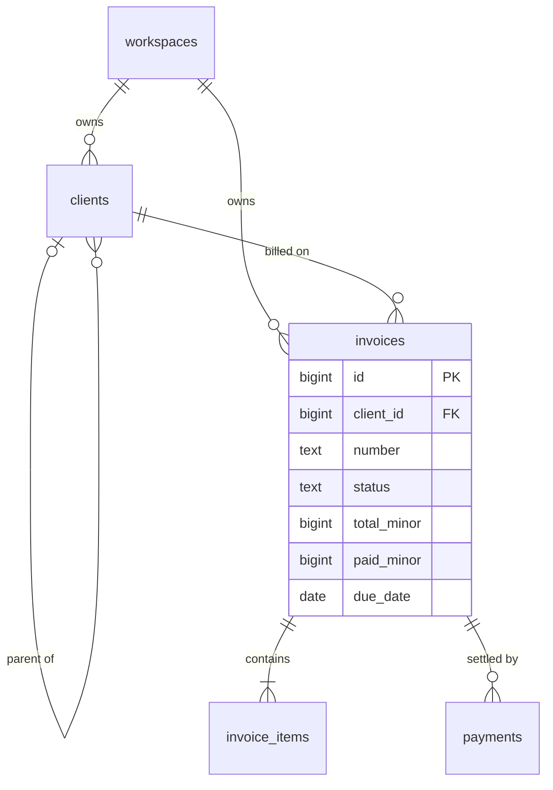
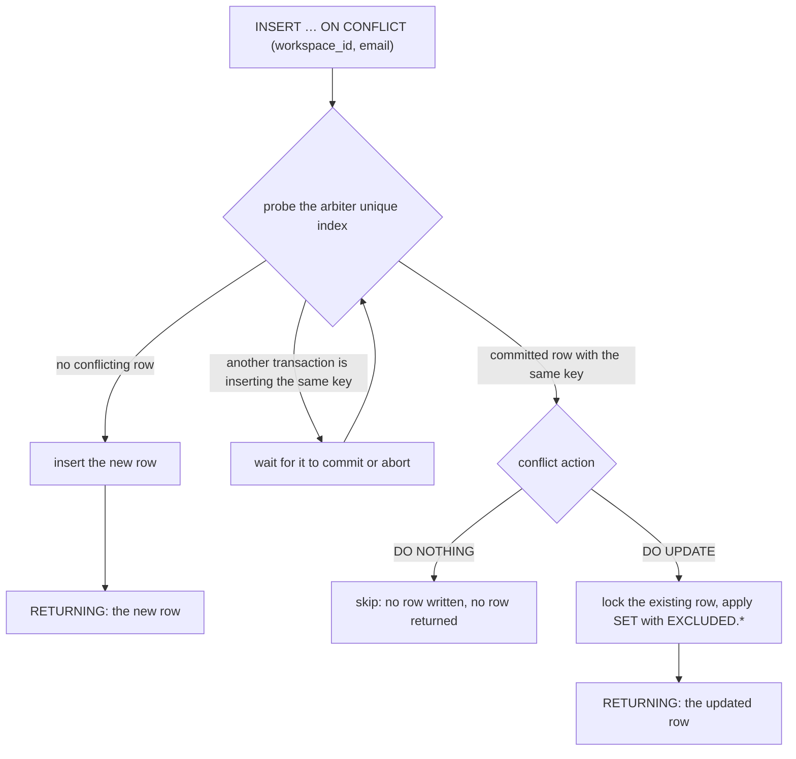

# SQL Essentials

> [!summary] TL;DR
> SQL is how you ask a relational database for data. You describe **what** you want (which tables, how they connect, which rows, how to group and sort them) and the database decides **how** to fetch it. Most SQL bugs come from three places: `NULL`, which makes a condition "unknown" instead of true or false; joins that multiply rows; and forgetting the order in which a query's clauses apply.

## 1. Why it exists

InvoiceOps' collections page asks: *which clients owe money on overdue invoices, and how late are they?*

Without SQL, the Go service would load every invoice, loop over them and add up balances per client. That is fine for 1,000 invoices. For a report over a 10-million-row `invoices` table it means pulling about 1.5 GB over the network (an estimate at ~150 bytes per row) to compute three numbers, and rewriting the loop every time the question changes.

SQL sends the question to the data instead. The server filters, joins and adds up next to the storage, then returns three rows. Because the query states only the result, the same text keeps working when you add an index or the table grows tenfold: the planner simply picks a new way to run it.

## 2. Mental model

- A **table** (a *relation* in Codd's 1970 model) holds **rows** that share the same **columns**. Each row is one fact: "invoice INV-102 belongs to client 10 and is overdue".
- A **query** is a pipeline of steps that each take a table and return a table: build rows (`FROM`, `JOIN`), drop rows (`WHERE`), fold rows into groups (`GROUP BY`), drop groups (`HAVING`), compute output columns (`SELECT`), sort (`ORDER BY`), cut (`LIMIT`).
- SQL bends the mathematical model in two ways you must remember: a table can hold **duplicate rows**, and **`NULL`** means "unknown", which adds a third truth value.

**Analogy:** a query is a recipe for a spreadsheet. "Match these two sheets on client id, delete rows that are not overdue, pivot by client, keep pivots above ₹0, sort by amount." You hand over the recipe; the kitchen chooses the knives.

## 3. How it works

### The running schema

A trimmed InvoiceOps schema. The full DDL with tenant-safe keys is in [[Relational Schema Design]]. Columns ending in `_minor` hold money as integer **minor units** (paise): ₹1,500.00 is `150000`.

```sql
CREATE TABLE clients (
  id           bigint GENERATED ALWAYS AS IDENTITY PRIMARY KEY,
  workspace_id bigint NOT NULL REFERENCES workspaces (id),
  parent_id    bigint REFERENCES clients (id),   -- subsidiary of another client, or NULL
  name         text NOT NULL,
  email        text,                             -- NULL: no billing email yet
  UNIQUE (workspace_id, email)
);

CREATE TABLE invoices (
  id           bigint GENERATED ALWAYS AS IDENTITY PRIMARY KEY,
  workspace_id bigint NOT NULL REFERENCES workspaces (id),
  client_id    bigint NOT NULL REFERENCES clients (id),
  number       text NOT NULL,
  status       text NOT NULL CHECK (status IN ('draft', 'sent', 'partially_paid', 'paid', 'overdue', 'cancelled')),
  total_minor  bigint NOT NULL CHECK (total_minor >= 0),
  paid_minor   bigint NOT NULL DEFAULT 0,
  issue_date   date,
  due_date     date,
  UNIQUE (workspace_id, number)
);

CREATE TABLE invoice_items (
  id               bigint GENERATED ALWAYS AS IDENTITY PRIMARY KEY,
  invoice_id       bigint NOT NULL REFERENCES invoices (id) ON DELETE CASCADE,
  description      text NOT NULL,
  quantity         integer NOT NULL CHECK (quantity > 0),
  unit_price_minor bigint NOT NULL CHECK (unit_price_minor >= 0)
);

CREATE TABLE payments (
  id           bigint GENERATED ALWAYS AS IDENTITY PRIMARY KEY,
  invoice_id   bigint NOT NULL REFERENCES invoices (id),
  amount_minor bigint NOT NULL CHECK (amount_minor > 0),
  provider_ref text NOT NULL UNIQUE,
  paid_at      timestamptz NOT NULL DEFAULT now()
);
```



**Sample data** for workspace 1. "Today" is 2026-11-02. Clients: 10 Acme Corp, 11 Acme Labs (a subsidiary: `parent_id = 10`, `email` NULL), 12 Bolt Foods, 13 Cobalt Ltd (no invoices yet).

| invoice | client | status  | total_minor | paid_minor | issue_date | due_date   |
| ------- | ------ | ------- | ----------- | ---------- | ---------- | ---------- |
| INV-101 | 10     | paid    | 120000      | 120000     | 2026-08-16 | 2026-09-15 |
| INV-102 | 10     | overdue | 250000      | 100000     | 2026-09-01 | 2026-10-01 |
| INV-103 | 11     | overdue | 80000       | 0          | 2026-09-20 | 2026-10-20 |
| INV-104 | 12     | sent    | 60000       | 0          | 2026-10-21 | 2026-11-20 |
| INV-105 | 12     | overdue | 45000       | 0          | 2026-08-31 | 2026-09-30 |
| INV-106 | 12     | draft   | 30000       | 0          | NULL       | NULL       |

INV-102 has two line items (₹1,500 logo and ₹1,000 brand guide) and one payment of 100000.

### Logical processing order

You write `SELECT … FROM … WHERE …`, but PostgreSQL defines the result as if the clauses ran in this order:

```mermaid
flowchart LR
    W["WITH: CTEs"] --> F["FROM + JOIN: build rows"] --> WH["WHERE: keep rows that are TRUE"] --> G["GROUP BY: fold rows into groups"] --> H["HAVING: keep groups that are TRUE"]
    H --> S["SELECT list: expressions, then window functions"] --> D["DISTINCT"] --> U["UNION / INTERSECT / EXCEPT"] --> O["ORDER BY"] --> L["LIMIT / OFFSET"]
```



What follows from it (PostgreSQL 17):
- `WHERE` cannot use aggregates (no groups exist yet). Filter groups with `HAVING`.
- An output alias works in `ORDER BY` and `GROUP BY`, but not in `WHERE` or `HAVING`. There you repeat the expression.
- Window functions run after `HAVING`, so `WHERE rank <= 3` fails. Wrap the query in a subquery or CTE and filter outside.
- Without `ORDER BY`, rows come back in whatever order was fastest. Never rely on it.
- The order is **logical**. The planner may push filters below joins, reorder inner joins, or read an index in sorted order so no sort runs, as long as the result is the same. See [[Query Plans and EXPLAIN]].

### Joins

| Join (clients `c`, invoices `i`)                       | Keeps                                             | Rows on the sample      |
| ------------------------------------------------------ | ------------------------------------------------- | ----------------------- |
| `c JOIN i ON i.client_id = c.id`                       | matched pairs only                                | 6 (Cobalt disappears)   |
| `c LEFT JOIN i ON …`                                   | every client; NULLs where nothing matched         | 7 (Cobalt with NULLs)   |
| `FULL JOIN`                                            | everything from both sides                        | used for reconciliation |
| `CROSS JOIN`                                           | every pair, e.g. clients × months for a report    | 4 × N                   |
| self join `clients c JOIN clients p ON c.parent_id = p.id` | a row with its parent                         | 1 (Acme Labs → Acme Corp) |
| semi-join `WHERE EXISTS (… overdue …)`                 | each client once if any match                     | 3                       |
| anti-join `WHERE NOT EXISTS (…)`                       | clients with no match                             | 1 (Cobalt)              |
| `c LEFT JOIN LATERAL (… WHERE client_id = c.id … LIMIT 1) ON true` | a per-row subquery: each client's latest invoice | 4                 |

`RIGHT JOIN` is a mirrored `LEFT JOIN`; write it as a `LEFT JOIN` for readability. A `FULL JOIN` earns its keep in reconciliation: join your `payments` to the provider's settlement file on `provider_ref`, and rows with NULL on either side are the mismatches.

The most common join bug: a condition on the right-hand table in `WHERE` turns a `LEFT JOIN` back into an inner join, because `NULL = 'overdue'` is not TRUE.

```sql
-- Wrong: clients without an overdue invoice vanish again
SELECT c.name, i.number
FROM clients c
LEFT JOIN invoices i ON i.client_id = c.id
WHERE i.status = 'overdue';

-- Right: the condition decides what matches, not which clients survive
SELECT c.name, i.number
FROM clients c
LEFT JOIN invoices i ON i.client_id = c.id AND i.status = 'overdue';
```

### Grouping and aggregates

```sql
SELECT c.name,
       count(*)                                     AS joined_rows,
       count(i.id)                                  AS invoices,
       count(*) FILTER (WHERE i.status = 'overdue') AS overdue,
       sum(i.total_minor - i.paid_minor)
         FILTER (WHERE i.status IN ('sent', 'partially_paid', 'overdue')) AS open_minor
FROM clients c
LEFT JOIN invoices i ON i.client_id = c.id
GROUP BY c.id, c.name
ORDER BY c.id;
```

Representative output (PostgreSQL 17), computed from the sample data:

| name       | joined_rows | invoices | overdue | open_minor |
| ---------- | ----------- | -------- | ------- | ---------- |
| Acme Corp  | 2           | 2        | 1       | 150000     |
| Acme Labs  | 1           | 1        | 1       | 80000      |
| Bolt Foods | 3           | 3        | 1       | 105000     |
| Cobalt Ltd | 1           | 0        | 0       | NULL       |

- Every selected column is either grouped or aggregated. Postgres also accepts columns of a table whose primary key is grouped, so `GROUP BY c.id` alone would allow `c.name`.
- `count(*)` counts rows, `count(col)` counts non-NULL values. Cobalt's NULL-extended row makes `count(*)` 1 and `count(i.id)` 0.
- `sum`, `avg` and `max` over zero rows return NULL, not 0. Use `coalesce(sum(…), 0)` when the API needs a number.
- `FILTER (WHERE …)` aggregates a subset of each group without a second query.

### Window functions

A window function computes over a set of rows related to the current row, like `GROUP BY` that keeps every row.

```sql
SELECT client_id, number, issue_date, total_minor,
       row_number() OVER w                                AS nth_invoice,
       sum(total_minor) OVER (w ROWS UNBOUNDED PRECEDING) AS billed_to_date,
       issue_date - lag(issue_date) OVER w                AS days_since_previous
FROM invoices
WHERE workspace_id = 1 AND issue_date IS NOT NULL
WINDOW w AS (PARTITION BY client_id ORDER BY issue_date)
ORDER BY client_id, issue_date;
```

Representative output (PostgreSQL 17):

```text
 client_id | number  | issue_date | total_minor | nth_invoice | billed_to_date | days_since_previous
-----------+---------+------------+-------------+-------------+----------------+---------------------
        10 | INV-101 | 2026-08-16 |      120000 |           1 |         120000 |
        10 | INV-102 | 2026-09-01 |      250000 |           2 |         370000 |                  16
        11 | INV-103 | 2026-09-20 |       80000 |           1 |          80000 |
        12 | INV-105 | 2026-08-31 |       45000 |           1 |          45000 |
        12 | INV-104 | 2026-10-21 |       60000 |           2 |         105000 |                  51
(5 rows)
```

- `PARTITION BY` splits rows into independent windows; `ORDER BY` inside `OVER` orders each one.
- `row_number()` gives 1, 2, 3; `rank()` gives 1, 1, 3 on a tie; `dense_rank()` gives 1, 1, 2.
- With `ORDER BY` and no frame, the default frame is `RANGE BETWEEN UNBOUNDED PRECEDING AND CURRENT ROW`, which includes the current row's **peers** (rows with equal sort values). Two invoices issued on the same day would then share one running total. `ROWS` makes it per row.
- To keep only the latest invoice per client, filter outside, and mind NULLs: in Postgres `DESC` sorts NULLs **first**, so the undated draft INV-106 would win.

```sql
SELECT *
FROM (
  SELECT i.*, row_number() OVER (PARTITION BY client_id
                                 ORDER BY issue_date DESC NULLS LAST, id DESC) AS rn
  FROM invoices i
  WHERE workspace_id = 1
) ranked
WHERE rn = 1;
```

### Subqueries and CTEs

- **Scalar subquery:** returns one value, e.g. `(SELECT max(paid_at) FROM payments p WHERE p.invoice_id = i.id)`. It is *correlated*: it refers to the outer row.
- **`IN` / `EXISTS`:** a semi-join. `EXISTS` stops at the first match.
- **Derived table:** a subquery in `FROM`, as in the latest-invoice query above.
- **`LATERAL`:** a subquery in `FROM` that may refer to earlier tables, the clean way to get "top N per row".
- **CTE (`WITH name AS (…)`):** names a step so the query reads top to bottom. Since PostgreSQL 12, a side-effect-free CTE that is referenced once is inlined and optimized like a subquery. `AS MATERIALIZED` forces it to be computed once, separately.

A **recursive CTE** walks a hierarchy. Acme's group balance, including subsidiaries:

```sql
WITH RECURSIVE family AS (
  SELECT id FROM clients WHERE id = 10               -- anchor: Acme Corp
  UNION ALL
  SELECT c.id
  FROM clients c
  JOIN family f ON c.parent_id = f.id                -- step: children of rows found so far
)
SELECT sum(i.total_minor - i.paid_minor) AS group_open_minor
FROM invoices i
WHERE i.client_id IN (SELECT id FROM family)
  AND i.status IN ('sent', 'partially_paid', 'overdue');
```

The anchor yields `{10}`, the first step adds `{11}`, the second step finds nothing and recursion stops. Representative output (PostgreSQL 17): `group_open_minor = 230000` (150000 from INV-102 plus 80000 from INV-103). If the data could contain a cycle, add PostgreSQL 14's `CYCLE id SET is_cycle USING path` clause.

### NULL and three-valued logic

A comparison with NULL is neither true nor false but **UNKNOWN**.

| a       | b       | a AND b | a OR b  | NOT a   |
| ------- | ------- | ------- | ------- | ------- |
| TRUE    | UNKNOWN | UNKNOWN | TRUE    | FALSE   |
| FALSE   | UNKNOWN | FALSE   | UNKNOWN | TRUE    |
| UNKNOWN | UNKNOWN | UNKNOWN | UNKNOWN | UNKNOWN |

- `WHERE` keeps only TRUE rows. `CHECK` rejects only FALSE rows, so `CHECK (due_date >= issue_date)` lets a row with a NULL `due_date` through.
- `email = NULL` is never true. Write `email IS NULL`, or `a IS DISTINCT FROM b` for a NULL-safe "not equal".
- `UNIQUE (workspace_id, email)` allows many NULL emails: NULLs are distinct by default. PostgreSQL 15 added `UNIQUE NULLS NOT DISTINCT` for the other behaviour.
- `ORDER BY` puts NULLs last for `ASC` and first for `DESC` unless you write `NULLS FIRST` or `NULLS LAST`.

**The `NOT IN` trap.** "Clients that are nobody's parent":

```sql
SELECT name FROM clients
WHERE id NOT IN (SELECT parent_id FROM clients);
```

Representative output (PostgreSQL 17): **0 rows**. The subquery returns `{NULL, 10, NULL, NULL}`. For Acme Labs (11) the test expands to `11 <> NULL AND 11 <> 10 AND …`, which is UNKNOWN, so the row is dropped. Bolt Foods and Cobalt Ltd are dropped the same way, and Acme Corp because 10 is in the list. `NOT EXISTS` asks the intended question and returns Acme Labs, Bolt Foods and Cobalt Ltd:

```sql
SELECT c.name FROM clients c
WHERE NOT EXISTS (SELECT 1 FROM clients ch WHERE ch.parent_id = c.id);
```

### Constraints

| Constraint             | Rejects                                                       | SQLSTATE on violation         |
| ---------------------- | ------------------------------------------------------------- | ----------------------------- |
| `NOT NULL`             | a missing value                                               | 23502 not_null_violation      |
| `CHECK (expr)`         | a row where `expr` is FALSE (NULL passes)                     | 23514 check_violation         |
| `UNIQUE`, `PRIMARY KEY`| a duplicate key (a primary key is also NOT NULL)              | 23505 unique_violation        |
| `FOREIGN KEY`          | a reference to a missing row, or deleting a referenced row    | 23503 foreign_key_violation   |
| `EXCLUDE`              | overlapping values, such as a double-booked time range        | 23P01 exclusion_violation     |

Your Go code should map these codes to API errors (23505 → 409 Conflict). Which invariants to encode is a design question for [[Relational Schema Design]]; why they matter for correctness is in [[Transactions and ACID]].

### Writing: RETURNING, upserts and MERGE

```sql
-- RETURNING hands back generated values in the same round trip
INSERT INTO invoices (workspace_id, client_id, number, status, total_minor)
VALUES (1, 12, 'INV-107', 'draft', 0)
RETURNING id, status;

-- Upsert: a client CSV import; the same email in a workspace updates the name
INSERT INTO clients (workspace_id, name, email)
VALUES (1, 'Bolt Foods Pvt Ltd', 'ap@bolt.test')
ON CONFLICT (workspace_id, email) DO UPDATE
SET name = EXCLUDED.name
RETURNING id, name;
```

In Go, read `RETURNING` with `QueryRowContext(…).Scan(&id)`. Postgres drivers do not support `Result.LastInsertId()`.



- The conflict target must match a unique index or constraint exactly, here `UNIQUE (workspace_id, email)`. `EXCLUDED` is the row you tried to insert.
- `DO NOTHING … RETURNING` returns **no row** on a conflict, which breaks naive "get or create" code. Follow it with a `SELECT`.
- One statement may not touch the same row twice. A CSV with the same email on two lines fails with "ON CONFLICT DO UPDATE command cannot affect row a second time"; deduplicate the input first.
- `MERGE` (PostgreSQL 15+) syncs a target from a source with `WHEN MATCHED` / `WHEN NOT MATCHED` branches, and PostgreSQL 17 lets it `RETURNING merge_action()`. When other sessions may insert the same keys concurrently, the docs point to `INSERT … ON CONFLICT`, which can switch to an `UPDATE` if a concurrent `INSERT` wins.

```sql
MERGE INTO clients c
USING staged_clients s ON c.workspace_id = s.workspace_id AND c.email = s.email
WHEN MATCHED THEN UPDATE SET name = s.name
WHEN NOT MATCHED THEN INSERT (workspace_id, name, email) VALUES (s.workspace_id, s.name, s.email)
RETURNING merge_action(), c.id;
```

## 4. Worked example

### The collections query, traced

```sql
WITH open_invoices AS (                               -- invoices that still owe money
  SELECT client_id,
         total_minor - paid_minor     AS open_minor,
         DATE '2026-11-02' - due_date AS days_late     -- date - date = whole days
  FROM invoices
  WHERE workspace_id = 1
    AND status IN ('sent', 'partially_paid', 'overdue')
)
SELECT c.name,
       sum(o.open_minor)                                AS open_minor,
       max(o.days_late) FILTER (WHERE o.days_late > 0)  AS worst_days_late,
       round(100.0 * sum(o.open_minor) / sum(sum(o.open_minor)) OVER (), 1) AS pct_of_open,
       rank() OVER (ORDER BY sum(o.open_minor) DESC)    AS rank
FROM open_invoices o
JOIN clients c ON c.id = o.client_id
GROUP BY c.id, c.name
HAVING sum(o.open_minor) > 0
ORDER BY rank;
```

| Step | Clause                                   | Rows                                                                 |
| ---- | ---------------------------------------- | -------------------------------------------------------------------- |
| 1    | CTE: `FROM invoices WHERE …`             | 6 → 4 (INV-102, 103, 104, 105; days late 32, 13, −18, 33)            |
| 2    | `JOIN clients`                           | 4                                                                    |
| 3    | `GROUP BY c.id`                          | 3 groups: Acme Corp {102}, Acme Labs {103}, Bolt Foods {104, 105}    |
| 4    | `HAVING sum > 0`                         | 3                                                                    |
| 5    | `SELECT`, then windows over the 3 groups | total open 335000; `sum(sum(…)) OVER ()` sees it on every row        |
| 6    | `ORDER BY rank`                          | 3                                                                    |

Representative output (PostgreSQL 17):

```text
    name    | open_minor | worst_days_late | pct_of_open | rank
------------+------------+-----------------+-------------+------
 Acme Corp  |     150000 |              32 |        44.8 |    1
 Bolt Foods |     105000 |              33 |        31.3 |    2
 Acme Labs  |      80000 |              13 |        23.9 |    3
(3 rows)
```

Two details are worth checking against the trace. INV-104 is not late yet (−18 days), so the `FILTER` keeps Bolt Foods' worst lateness at 33 instead of letting a negative number in. And `sum(sum(…)) OVER ()` works because windows run after grouping: the inner `sum` is the per-client aggregate, and the outer one adds the three group rows.

### Building SQL safely from Go

Values must travel as **parameters** (`$1`, `$2`). Drivers such as pgx send the SQL text and the values in separate protocol messages by default, so a value can never become SQL. Column names and `ASC`/`DESC` cannot be parameters, so the builder maps user input to fixed fragments. It passes `go vet` and `go test -race` on Go 1.24.

```go
package listquery

import (
	"fmt"
	"strings"
)

// Filter is what GET /invoices?status=overdue&sort=-due_date&limit=20 parses into.
type Filter struct {
	WorkspaceID int64
	Status      string // "" means any status
	Sort        string // a key of orderBy
	Limit       int
}

// orderBy maps each public sort key to a fixed SQL fragment. Column names and
// ASC/DESC cannot be bind parameters, so user input never reaches the SQL text.
// The trailing id makes the order total: equal due dates still page stably.
var orderBy = map[string]string{
	"due_date":  "due_date ASC, id ASC",
	"-due_date": "due_date DESC, id DESC",
	"total":     "total_minor ASC, id ASC",
	"-total":    "total_minor DESC, id DESC",
}

// Build returns SQL with $n placeholders plus the matching arguments.
func Build(f Filter) (string, []any, error) {
	order, ok := orderBy[f.Sort]
	if !ok {
		return "", nil, fmt.Errorf("unsupported sort %q", f.Sort)
	}
	if f.Limit < 1 || f.Limit > 100 {
		return "", nil, fmt.Errorf("limit %d not in 1..100", f.Limit)
	}
	var sql strings.Builder
	args := []any{f.WorkspaceID}
	sql.WriteString("SELECT id, number, status, total_minor, due_date FROM invoices WHERE workspace_id = $1")
	if f.Status != "" {
		args = append(args, f.Status)
		fmt.Fprintf(&sql, " AND status = $%d", len(args))
	}
	args = append(args, f.Limit)
	fmt.Fprintf(&sql, " ORDER BY %s LIMIT $%d", order, len(args))
	return sql.String(), args, nil
}
```

The test that proves an injection attempt stays a value:

```go
func TestValuesTravelAsParameters(t *testing.T) {
	evil := "overdue' OR '1'='1"
	sql, args, err := Build(Filter{WorkspaceID: 42, Status: evil, Sort: "-due_date", Limit: 20})
	if err != nil {
		t.Fatal(err)
	}
	want := "SELECT id, number, status, total_minor, due_date FROM invoices " +
		"WHERE workspace_id = $1 AND status = $2 ORDER BY due_date DESC, id DESC LIMIT $3"
	if sql != want {
		t.Fatalf("sql:\n got %s\nwant %s", sql, want)
	}
	if !reflect.DeepEqual(args, []any{int64(42), evil, 20}) {
		t.Fatalf("args = %#v", args)
	}
}
```

Two more tests check that placeholders renumber when the status filter is absent and that a sort key outside the map (`"due_date; DROP TABLE invoices"`) is rejected. The SQL it produces:

```sql
SELECT id, number, status, total_minor, due_date FROM invoices
WHERE workspace_id = $1 AND status = $2 ORDER BY due_date DESC, id DESC LIMIT $3
```

## 5. Variants and comparison

The same question can often be written several ways. They differ in NULL behaviour and in the plans they allow.

| Task                       | Option                                     | How it works                                        | Use when                                   | Cost or risk                                                      |
| -------------------------- | ------------------------------------------ | --------------------------------------------------- | ------------------------------------------ | ----------------------------------------------------------------- |
| Rows with no match         | `NOT EXISTS`                               | anti-join; stops at the first match                 | the default                                | none                                                              |
|                            | `LEFT JOIN … WHERE b.id IS NULL`           | outer join, keep NULL-extended rows                 | you also need columns from a third table   | easy to break by adding a `WHERE` on `b`                          |
|                            | `NOT IN (subquery)`                        | `x <> every value`                                  | the subquery column is `NOT NULL`          | one NULL empties the result; cannot become an anti-join           |
| Latest row per group       | `row_number()` in a subquery               | rank inside each partition, filter `rn = 1`         | portable SQL; also top-N                   | ranks every row before filtering                                  |
|                            | `DISTINCT ON (client_id) … ORDER BY`       | keeps the first row per key                         | Postgres only, short to write              | not portable; sorts every row unless an index supplies the order  |
|                            | `LATERAL (… ORDER BY … LIMIT n)`           | a per-row subquery                                  | many rows per group, index on (key, sort column) | one index probe per outer row                              |
| Insert or update           | `INSERT … ON CONFLICT`                     | speculative insert on a unique index                | concurrent writers                         | needs a matching unique index                                     |
|                            | `MERGE`                                    | joins source to target, runs branches               | batch sync, deletes too                    | concurrent inserts can still raise unique violations              |
|                            | `SELECT` then `INSERT`                     | two statements                                      | never for uniqueness                       | two requests both see "absent" and both insert                    |
| Totals next to detail      | window function                            | aggregate over a window, rows kept                  | running totals, shares, ranks              | sorts per partition                                               |
|                            | join to a grouped subquery                 | aggregate once, join back                           | other engines lack the window you need     | an extra join                                                     |

## 6. Trade-offs and when not to use

- **Push work to the database when it shrinks data.** Filtering and aggregating 10 million rows into 3 belongs in SQL. Business rules with many branches belong in Go, where they can be unit tested; a 200-line query nobody can change is a liability.
- **CTEs are for readability, not speed.** Since PostgreSQL 12 they are usually inlined. `MATERIALIZED` makes the CTE an optimization fence: good for an expensive step used twice, bad when the outer filter could have pushed into it.
- **`OFFSET` pagination** reads and throws away every skipped row: page 1,000 at 20 rows per page first discards 19,980 rows. Use keyset pagination ([[Pagination, Filtering and Sorting]]).
- **`SELECT *` in application code** breaks when columns are added or reordered and fetches columns you do not need, including large ones.
- **Dialects differ.** MySQL 8.0 has `ON DUPLICATE KEY UPDATE` instead of `ON CONFLICT` and no `RETURNING`. Portable SQL is a goal only if you really plan to switch engines.

## 7. In production

- **Real systems:**
	- PostgreSQL, MySQL, SQL Server, Oracle and SQLite all speak SQL, with different upsert, `RETURNING` and `LIMIT` syntax.
	- Analytics engines (BigQuery, Snowflake, ClickHouse, DuckDB) use SQL over columnar storage: [[Time-Series and Columnar Storage]].
	- Go services send SQL through `database/sql` or pgx, or generate typed code from SQL files with sqlc: [[Database Access (database-sql, pgx, sqlc)]].
- **Failure modes → fixes:**
	- `NOT IN` over a nullable column returns nothing → use `NOT EXISTS`.
	- `LEFT JOIN` silently became inner → move the right-table condition into `ON`.
	- **Fan-out double counting.** Joining invoices to both `invoice_items` and `payments` multiplies rows: INV-102 (2 items × 1 payment) yields 2 rows, so `sum(p.amount_minor)` reports 200000 instead of 100000 → aggregate each child in its own subquery or `LATERAL`, then join.
	- **Implicit cast on the column.** `WHERE id = 42.0` compares `bigint` with `numeric`, so Postgres casts the column (`id::numeric = 42.0`) and cannot use the `bigint` index → match the column type. In MySQL, comparing a string column with a number converts the column and disables its index.
	- **Function on the column.** `WHERE paid_at::date = '2026-11-01'` cannot use an index on `paid_at` → write a range, `paid_at >= … AND paid_at < …`.
	- **Time zone of literals.** `paid_at >= '2026-11-01'` means midnight in the *session's* `TimeZone`; a UTC session and an Asia/Kolkata session get rows 5.5 hours apart → write the zone: `timestamptz '2026-11-01 00:00 Asia/Kolkata'`.
	- **Integer division.** `paid_minor / total_minor` is 0 for 100000 / 250000 → `100.0 * paid_minor / total_minor`.
	- **Unstable pagination.** `ORDER BY due_date` alone lets ties swap between pages → add a unique tie-breaker (`, id`).
- **What to monitor:**
	- `pg_stat_statements`: `calls`, `mean_exec_time` and `rows` per call, to spot a query returning far more rows than the page shows.
	- Error rates by SQLSTATE class: class 23 (integrity) and 40 (rollbacks).
	- `log_min_duration_statement` for slow statements.

## 8. Deep dive

- **Why `NOT IN` is also slow.** Because of its NULL semantics, the planner cannot turn `NOT IN (subquery)` into an anti-join. It becomes a hashed SubPlan when the subquery result fits in `work_mem`, otherwise a plain SubPlan that rescans the subquery per outer row, which is quadratic. `NOT EXISTS` becomes a Hash or Merge Anti Join.
- **ON CONFLICT under concurrency.** Postgres inserts *speculatively*: it probes the arbiter index, and if another transaction is inserting the same key it waits for that transaction to finish, then re-checks. In Read Committed the docs guarantee one of the two outcomes, insert or update. If the conflicting row comes from a transaction your snapshot cannot see, the `UPDATE` still applies to it, although no version of that row is visible to your statement.
- **Upserts burn identity values.** The row to insert, including any `nextval`, is computed before the conflict is detected. A busy upsert path therefore leaves gaps in `id`. That is harmless for surrogate keys and a reason never to promise gapless numbers from a sequence.
- **Window frames.** `ROWS` counts physical rows, `RANGE` groups peers by value (and allows `RANGE '7 days' PRECEDING` on dates), and `GROUPS` (PostgreSQL 11+) counts peer groups. `EXCLUDE CURRENT ROW` removes the row itself, for example for "average of the other invoices".
- **Logical order vs plan.** Inner joins commute, so the planner chooses the join order itself. `join_collapse_limit` (default 8) caps how many explicit `JOIN`s it reorders freely, and from `geqo_threshold` (default 12) relations it switches to a genetic search. Outer joins restrict reordering, which is one reason an innocent `LEFT JOIN` can change a plan.
- **Three-valued logic in constraints.** Because `CHECK` passes on UNKNOWN, a constraint that must hold even when values are missing needs `NOT NULL` too, or an explicit `IS NOT NULL` inside the check.

## 9. Interview questions

> [!question]- Trap: `SELECT name FROM clients WHERE id NOT IN (SELECT parent_id FROM clients)` returns no rows, although most clients have no children. Why?
> `parent_id` contains NULLs. `x NOT IN (…, NULL)` expands to `x <> … AND x <> NULL`, and `x <> NULL` is UNKNOWN, so the whole condition is never TRUE. Use `NOT EXISTS (SELECT 1 FROM clients ch WHERE ch.parent_id = c.id)`, which is NULL-safe and planned as an anti-join.

> [!question]- What is the difference between WHERE and HAVING, and why can't WHERE use a SELECT alias?
> `WHERE` filters rows before grouping; `HAVING` filters groups after aggregates are computed. Logically the `SELECT` list is evaluated after both, so its aliases do not exist yet. Postgres lets you use an alias in `ORDER BY` and `GROUP BY`, but not in `WHERE` or `HAVING`.

> [!question]- Your LEFT JOIN returns the same rows as an INNER JOIN. What happened?
> A condition on the right-hand table sits in `WHERE`. For unmatched rows that column is NULL, the condition is UNKNOWN, and the row is dropped. Move the condition into the `ON` clause, or allow NULL explicitly.

> [!question]- Revenue doubled after you joined invoice_items to add an item count. Why?
> Joining one invoice to N items and M payments creates N × M rows, so every payment is counted N times. Aggregate each child table separately (a grouped subquery or `LATERAL`) and join the aggregates, or use `count(DISTINCT …)` only where the values really are distinct.

> [!question]- How do you get the latest invoice per client?
> `row_number() OVER (PARTITION BY client_id ORDER BY issue_date DESC NULLS LAST, id DESC)` in a subquery, then `WHERE rn = 1`. In Postgres, `DISTINCT ON (client_id)` is shorter, and `LATERAL (… LIMIT 1)` is fastest when each client has many invoices and the key is indexed. Mention `NULLS LAST`: `DESC` puts NULLs first.

> [!question]- Why not "SELECT, and INSERT if absent" for an upsert?
> Two concurrent requests both see "absent" and both insert: you get a duplicate or a unique-violation error. `INSERT … ON CONFLICT` checks and writes atomically against a unique index. Note that `DO NOTHING … RETURNING` returns no row on a conflict.

> [!question]- Why does `WHERE paid_at::date = '2026-11-01'` ignore the index on paid_at, and what else is wrong with it?
> The index stores `paid_at` values, not `paid_at::date`, so the planner cannot search it; use a half-open range on the raw column. The cast also uses the session's `TimeZone`, so the "day" moves with the connection's setting. Name the zone in the range bounds.

## 10. Cheat sheet

- Logical order: FROM/JOIN → WHERE → GROUP BY → HAVING → SELECT (windows) → DISTINCT → ORDER BY → LIMIT.
- NULL makes comparisons UNKNOWN: `WHERE` keeps only TRUE, `CHECK` rejects only FALSE. Use `IS NULL`, `IS DISTINCT FROM`, `coalesce`.
- Prefer `NOT EXISTS` to `NOT IN`; put right-table conditions of a `LEFT JOIN` in `ON`.
- `count(*)` counts rows, `count(col)` counts non-NULLs; `sum` of nothing is NULL.
- Windows keep rows; filter on them outside; use `ROWS` for per-row running totals.
- Upsert with `ON CONFLICT` on a matching unique index; `RETURNING` instead of `LastInsertId`.
- Parameters for values, a whitelist for identifiers; always end `ORDER BY` with a unique column.
- Keep the column bare in predicates: no casts or functions on it, no type mismatches.

## Links

- **Before this:** nothing required. This note opens [[07 Databases MOC]].
- **Next:** [[Relational Schema Design]], [[Transactions and ACID]], [[Indexing Fundamentals]]
- **Compare with:** [[SQL vs NoSQL]] (when not to use a relational store), [[Query Plans and EXPLAIN]] (how the planner executes what you declared), [[Pagination, Filtering and Sorting]] (keyset pagination)
