# SQL vs NoSQL

> [!summary] TL;DR
> **SQL** (relational) databases store tables with a declared schema and let you join them, query them any way you like, and change many rows in one transaction.
>
> **NoSQL** is an umbrella for stores built on other data models (documents, key-value pairs, wide rows, graphs) that usually give up ad-hoc joins in exchange for a data layout matched to a few known queries at large scale.
>
> Choose by access patterns, relationships, consistency and scale, not by the label: NoSQL stores now have transactions, and SQL databases now scale out.

> [!abstract] Core idea
> - Pick a store from its access patterns (which queries, how often, how big), not from the SQL or NoSQL label.
> - Relational: one fact stored once, joined at read time, any new question answerable with SQL, multi-row transactions.
> - Document or key-value: data laid out to match a few known queries, scaled by partition key; new questions need new copies of the data.
> - Classic mistake: writing two stores from one request (a dual write). Keep one source of truth and copy changes out with an outbox or CDC.

## Start here: the basics 🟢

> [!info] How to read this note (pick your level)
> - 🟢 **New to this?** Read "From zero" below, then sections 1, 2 and the cheat sheet (10). Stop there, that is a full first pass.
> - 🟡 **Know the basics?** Add section 3 (how it works), 4 (worked example), 5 (variants) and 6 (trade-offs).
> - 🔴 **Interview / SDE-3 prep?** Add 7, 8 and 9. Headings are tagged 🟢🟡🔴 so you always know where you are.

> [!note] Before this note
> - [[SQL Essentials]]: you can read a `SELECT` with a `JOIN`, and you know a transaction makes several changes succeed or fail together.

**From zero, in 60 seconds** 🟢

An app needs a place to keep its data. That place is a database.

The classic kind is a **relational database** (also called SQL): data lives in neat tables with fixed columns, like spreadsheets that can be combined. You can ask it almost any question later.

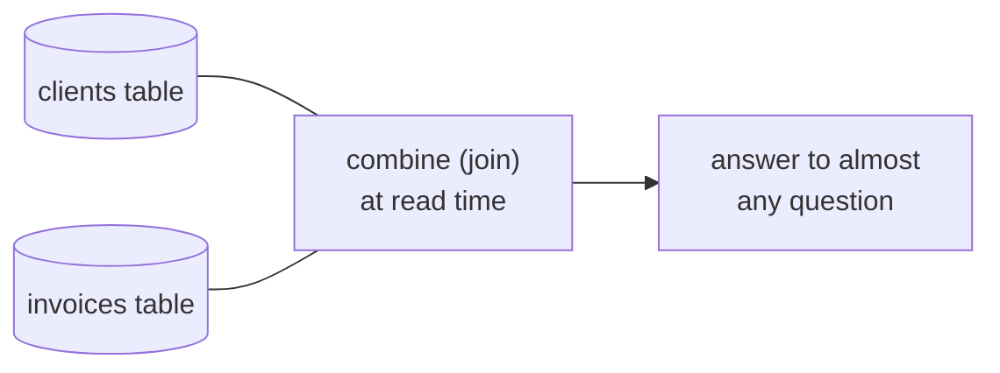

The other kind is **NoSQL**: a family of stores that skip the neat tables. Instead they keep data pre-packed in the exact shape one known question needs, so that one question is very fast, even with billions of records.

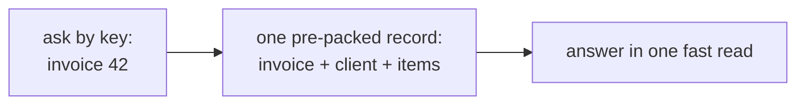

Neither is "better". Tables answer any question but need assembling; pre-packed records are instant but only for the questions you planned. The rest of this note is just these 3 questions:
1. When do neat tables (SQL) win, and when do pre-packed records (NoSQL) win?
2. What do you give up on each side (flexible questions, easy scaling, safety rules)?
3. How do real companies mix both without the copies drifting apart?

**The problem in one story.**
You can keep your kitchen in labelled jars on shelves, or pack a ready-made lunchbox for each day.
Jars let you cook any recipe, but you have to gather ingredients each time.
Lunchboxes are instant to grab, but only for the meals you planned.
Relational (SQL) and NoSQL databases make this same trade.

**Words you need first**

| Word | Plain meaning | Tiny example |
|---|---|---|
| Relational database | Data in tables with a fixed schema, queried with SQL | PostgreSQL, MySQL |
| NoSQL | Umbrella name for non-relational stores | DynamoDB, MongoDB, Redis, Cassandra |
| Schema | The declared shape of the data | `invoices(id, client_id, amount)` |
| Access pattern | A query the app runs, with how often and how big | "Get a client's last 20 invoices" |
| Join | Combining rows from tables at read time | invoices + clients |
| Denormalize | Copy data so one read gets everything | Client name stored inside each invoice document |
| Partition key | The value that decides which server holds a record | `client_id` |
| Transaction | Several changes that succeed or fail together | Debit and credit in one step |
| Replica | A live copy of the data on another server | a read-only copy in another region |
| Eventually consistent | Copies catch up a moment later, so a read may be briefly old | a like count that updates a second late |
| TTL | Time to live: a record deletes itself after a set time | a login session that expires in 30 minutes |
| `jsonb` | A PostgreSQL column type that stores JSON in a fast binary form | custom fields on an invoice |

**Picture it**

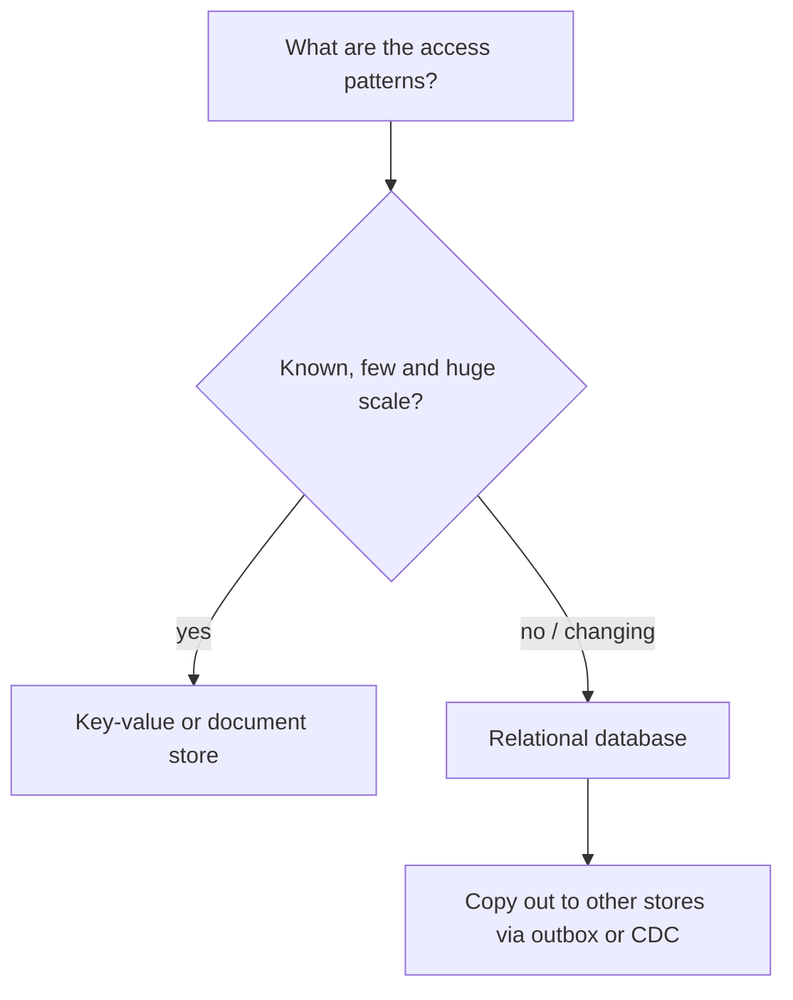

**Analogy.**
SQL is the jars-on-shelves kitchen; a document or key-value store is the pre-packed lunchbox.
Where it breaks: real systems often use both, with one store as the source of truth feeding the other.

**How the rest of this note builds up**

- First, why so many kinds of database exist and a simple mental model.
- Then the families, schema-on-write versus schema-on-read, joins versus aggregates, ACID versus BASE, and scaling.
- Then a worked example choosing a store for InvoiceOps.
- Finally, dual writes versus the outbox, production practice and the SDE-3 deep dive.

> [!tip] Remember
> Choose a store from your access patterns, not from the SQL or NoSQL label.

## 1. Why it exists 🟢

Relational databases were built for one server, strong consistency and flexible queries. In the 2000s, web companies outgrew single machines.

Google's Bigtable (2006) and Amazon's Dynamo (2007) gave up joins and multi-row transactions so that data could be spread over many machines by key and stay available when some failed.

Document stores such as MongoDB (first released in 2009) added a JSON-shaped model that maps directly onto application objects.

InvoiceOps shows why the choice is per access pattern, not per company:
- **Recording a payment** must insert the payment, raise the invoice's paid amount and write an audit row together. Finance also asks new questions every month ("revenue by client country, by quarter"). That is relational work.
- **An invoice activity timeline** (sent, opened, reminder, viewed) is append-only and read newest-first per invoice. At an estimated 1M invoices a month × 20 events, that is 20M rows a month: easy for a partitioned Postgres table. At 1,000 times that volume, a wide-column store partitioned by invoice becomes the natural home.

### Real-life example 🟢

A food delivery app usually uses both kinds.
Your payment and order record live in a relational database, because money must be exact and finance asks new questions every month.
Your login session and the "rider is 2 minutes away" location live in a fast key-value store like Redis, because they are read thousands of times a second by one key and expire on their own.
Restaurant search runs on a search engine, fed copies of the menu from the main database.
No single database does all of these jobs best.

## Common beginner mistakes 🟢

- **Picking NoSQL "because it scales"** → most apps fit easily on one PostgreSQL server with replicas, and you lose joins and constraints for nothing → start relational and measure.
- **Thinking NoSQL has no schema** → the shape still exists; now every reader must handle every old shape → version your documents and test old shapes.
- **Thinking NoSQL has no transactions** → MongoDB and DynamoDB both have them, with limits → check the actual limits instead of the label.
- **Writing to two databases from the same request** → if the second write fails, the two disagree forever → write once, then copy out with an outbox or CDC.
- **Choosing a store before listing the questions** → the data ends up in the wrong shape for the real queries → list access patterns with their rates first.

## 2. Mental model 🟢

- **Relational:** model the *data* (entities and relationships), normalize it, then ask any question later. The schema protects the truth; queries adapt to it.
- **Most NoSQL:** model the *queries*, then store the data in the shape each query reads, often more than once. A new query may need a new copy of the data.

**Analogy:** a library with one copy of every book and catalogues by author, title and subject answers any question, but you walk the shelves. Meal kits are packed per recipe: you grab one box and cook, but a new recipe needs new boxes, and when an ingredient changes every box containing it must be repacked.

## 3. How it works 🟡

> 🟢 → 🟡 **You now know** the core trade: tables answer any question, pre-packed records answer planned ones fast. **Next we open the box**: the main families of NoSQL, where the schema lives, joins versus bundles, ACID versus BASE, how each side scales, and how to choose. Each subsection starts with a short step-by-step walk.

### The families

**In plain words:** there is no one "NoSQL database"; it is a shelf of different tools, each built to be great at one shape of question, like different knives in a kitchen.

**Step by step (match the question to the family):**
1. "Record a payment and update the invoice together" → relational.
2. "Get this user's session by its token, a million times a minute" → key-value (Redis).
3. "Store billions of chat messages, read the latest 50 per channel" → wide-column (Cassandra).
4. "Find invoices whose description mentions 'logo'" → search engine.
5. "Friends of friends" → graph; "most similar product" → vector store.

| Family           | Data model                                       | Example                    | Reads well                                         | Struggles with                                                 |
| ---------------- | ------------------------------------------------ | -------------------------- | -------------------------------------------------- | -------------------------------------------------------------- |
| Relational       | tables, foreign keys, SQL                        | PostgreSQL, MySQL          | ad-hoc queries, joins, multi-row invariants        | write scaling past one primary needs sharding                  |
| Document         | JSON-like documents in collections               | MongoDB                    | one aggregate (invoice + items) in one read        | cross-document joins, keeping embedded copies in sync          |
| Key-value        | opaque value per key                             | Redis, DynamoDB            | get/put by key at very high rates, TTLs            | any query not by key (DynamoDB adds secondary indexes)         |
| Wide-column      | partition key → rows sorted by a clustering key  | Cassandra, ScyllaDB        | huge write volume; time-ordered reads per partition | joins, ad-hoc queries, read-before-write                      |
| Graph            | nodes and edges with properties                  | Neo4j                      | multi-hop traversals (friends of friends)          | whole-dataset aggregates, sharding the graph                   |
| Time-series      | (series, timestamp) → value                      | Prometheus, TimescaleDB    | append, time-range scans, downsampling             | updates, very high label cardinality                           |
| Search           | inverted index over documents                    | Elasticsearch, OpenSearch  | full-text relevance, facets                        | being the source of truth (refresh lag, no multi-doc transactions) |
| Vector           | embeddings in an approximate-nearest-neighbour index | pgvector, Milvus       | "most similar to this" queries                     | exact filters and joins without a hybrid design                |

Deeper notes: [[NoSQL Data Modeling]], [[Wide-Column Stores and Cassandra]], [[Search Engines and Inverted Indexes]], [[Time-Series and Columnar Storage]], [[Vector Databases and ANN Indexes]], [[Redis Fundamentals]].

### Schema-on-write vs schema-on-read

**In plain words:** either the database checks the shape of your data when you save it (like a bouncer at the door), or it lets anything in and every reader has to cope with whatever is inside.

**Step by step:**
1. Version 1 invoices have no `currency` field. Version 2 adds it.
2. **Postgres:** you run a migration that adds the column with a default; every row now has it, and the database refuses rows without it.
3. **MongoDB:** old documents simply lack the field; new ones have it.
4. So every reader of MongoDB data must handle "no currency" forever, or until a job rewrites the old documents.

- **Schema-on-write** (Postgres): the database rejects a row with a missing column or a wrong type at insert time. Changing the shape takes a migration ([[Zero-Downtime Schema Migrations]]).
- **Schema-on-read** (MongoDB, DynamoDB): the store accepts any document, and every reader must handle every shape ever written: v1 invoices without `currency`, v2 with it. The schema still exists; it moved into your code and your tests. MongoDB can enforce one with optional `$jsonSchema` validation.

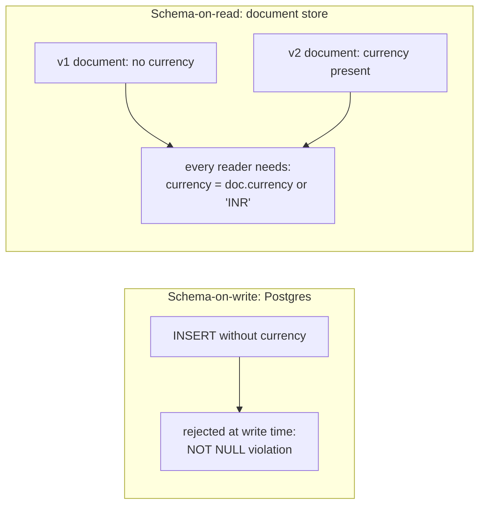

Example with numbers: if 2 million v1 invoices exist and v2 adds `currency`, a relational migration touches 2 million rows once (see [[Zero-Downtime Schema Migrations]]). A document store touches none, but every reader has to handle both shapes for as long as v1 documents exist.

### Normalized joins vs denormalized aggregates

**In plain words:** store each fact once and assemble answers on the fly, or store ready-made bundles that read fast but must all be rewritten when a shared fact changes.

**Step by step:**
1. **Relational:** the client's name lives once in `clients`. Showing an invoice joins three tables at read time.
2. **Document:** the client's name is copied into every invoice document. Showing an invoice is one fetch.
3. The client renames itself. Relational: change one row. Document: rewrite every invoice holding the old name.
4. A new question nobody planned ("all unpaid items mentioning 'logo'") is easy in SQL and hard in the document store.

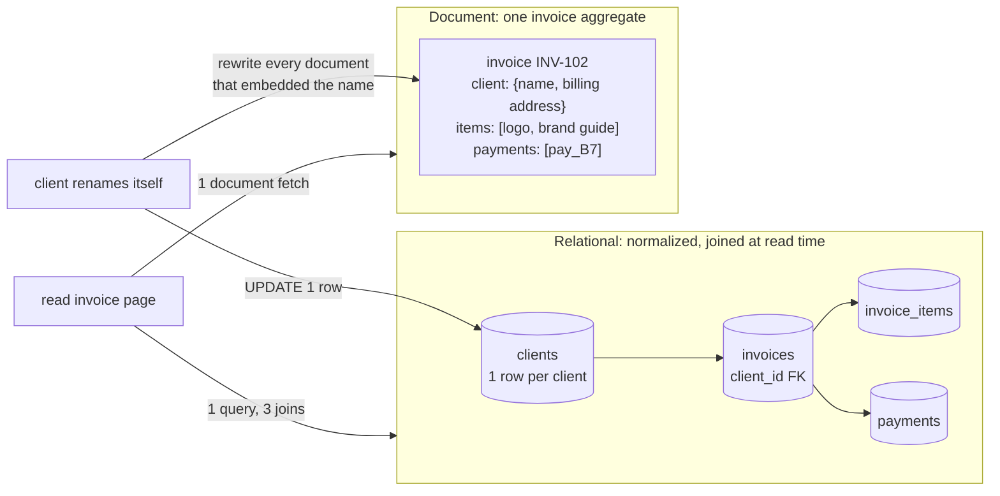

The document wins the read; the relational model wins the update and every query nobody planned for ("all unpaid items mentioning 'logo' across clients"). One subtlety: an issued invoice *should* keep the billing address it was issued with, so copying it into the invoice is the correct model in both worlds, not a denormalization. See [[Relational Schema Design]].

### ACID vs BASE

**In plain words:** ACID means your changes land together and everyone sees them at once; BASE means copies catch up a moment later, like a scoreboard that updates a second behind the game.

**Step by step:**
1. You save a payment. With **ACID**, once you hear "saved", every reader sees the new balance.
2. With **BASE**, the main copy has it, but some copies get it a moment later.
3. A reader hitting a lagging copy sees the old balance for that moment.
4. In practice each store lets you pick per request: stronger (slower) or eventual (faster).

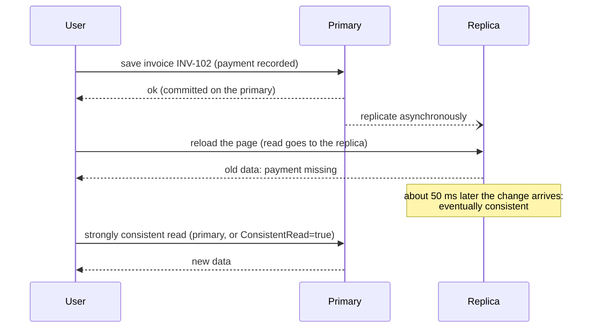

- **ACID** (atomicity, consistency, isolation, durability) is the relational default: [[Transactions and ACID]].
- **BASE** (*basically available, soft state, eventually consistent*), named by Pritchett in 2008, accepts that replicas and derived copies are briefly out of date in exchange for availability and partition tolerance (staying up when the network between servers breaks).

In practice both are per-operation settings, not product properties:

| Store         | Default                                                    | Stronger option                                                          |
| ------------- | ---------------------------------------------------------- | ------------------------------------------------------------------------ |
| PostgreSQL    | Read Committed; asynchronous replicas may lag              | Serializable isolation; synchronous replication                          |
| MySQL InnoDB  | Repeatable Read                                            | Serializable                                                             |
| MongoDB       | write concern `majority` (since 5.0), read concern `local` | read concern `majority` or `linearizable`; multi-document transactions   |
| DynamoDB      | eventually consistent reads                                | `ConsistentRead=true` on the table or a local secondary index (not on global secondary indexes); transactions |
| Cassandra     | consistency level chosen per request                       | `QUORUM` reads and writes; lightweight transactions (Paxos) for compare-and-set |

### Scaling paths

**In plain words:** SQL grows step by step as you need it (bigger box, then copies, then splitting); partitioned NoSQL spreads over many boxes from day one, but every fast question must say which box to look in.

**Step by step:**
1. **SQL:** start with one server. Add indexes, then a cache, then read replicas, then a bigger machine.
2. Only when writes outgrow one primary do you shard, and then every query must carry the shard key.
3. **Partitioned NoSQL:** data is spread over many servers by a key from day one.
4. Every fast query must include that key; a query without it asks every server.

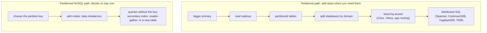

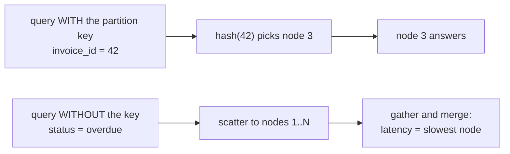

A partitioned store scales writes from the start, but every hot query must carry the partition key. Sharded SQL has exactly the same rule once you shard: the tenant id must be in every query. See [[Partitioning and Sharding]].

### Choosing

**In plain words:** write down your real questions and their sizes first, then walk this flowchart; the label on the box matters far less than the questions you will ask it.

**Step by step:**
1. List every access pattern with its rate, like "record a payment, 50 per second".
2. Mark which need multi-table rules or changing ad-hoc questions: keep those relational.
3. Mark which are a single key at a huge rate, or need expiry: key-value.
4. Mark special shapes: text search, graph, vectors, time series.
5. Pick the fewest stores that cover the list; each extra store is extra work to run.

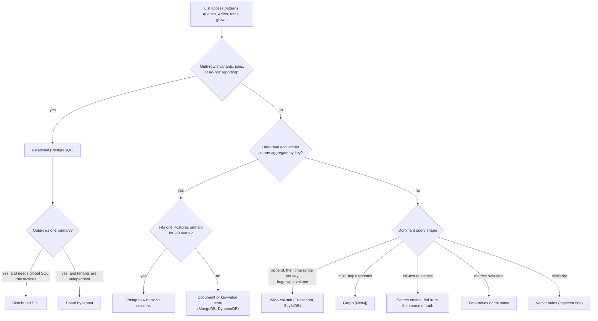

The question "does it need transactions?" no longer separates the two sides: MongoDB (multi-document since 4.0) and DynamoDB (`TransactWriteItems`) both offer them.

## 4. Worked example 🟡

### Whiteboard version

**In plain words:** here is the exact same question answered both ways, so you can see the trade with your own eyes: SQL assembles the answer, the document store had it pre-assembled.

The same read, two ways. Relational stores each fact once and joins on read; a document store keeps a copy shaped for this one query.

```sql
-- Relational: any question, joins at read time
SELECT i.number, c.name, SUM(it.quantity * it.unit_price_minor)
FROM invoices i
JOIN clients c        ON c.id = i.client_id
JOIN invoice_items it ON it.invoice_id = i.id
WHERE i.id = 42
GROUP BY i.number, c.name;
```

```text
Document store: one key fetch, data pre-joined
GET invoice#42 -> { number, client: {name}, items: [{quantity, unit_price_minor}] }
(client renamed? every invoice document holding the copy must be updated)
```

The full worked example below goes pattern by pattern through InvoiceOps with rates and picks a store for each.

**Choosing stores for InvoiceOps.** Start from access patterns with rough rates (all rates are estimates for a product with 10,000 active workspaces):

| # | Access pattern                                                                  | Rate         | Needs                                         | Store                                                      |
| - | ------------------------------------------------------------------------------- | ------------ | --------------------------------------------- | ---------------------------------------------------------- |
| 1 | Record a payment: insert payment, update invoice balance and status, audit row  | peak ~50/s   | one transaction across 3 tables, unique keys  | Postgres                                                   |
| 2 | List a workspace's overdue invoices by due date                                  | ~200/s       | composite index, sort, pagination             | Postgres                                                   |
| 3 | Revenue by client country by quarter                                             | a few a day  | ad-hoc joins and aggregates                   | Postgres replica; a columnar store if it ever gets slow    |
| 4 | Session lookup by token, 30-minute expiry                                        | ~2,000/s     | key lookup, TTL                               | Redis                                                      |
| 5 | Invoice activity timeline, newest first                                          | 20M rows/month | append, range scan per invoice              | Postgres table partitioned by month                        |
| 6 | Per-workspace custom fields (PO number, project code)                            | with #1–#2   | flexible keys, filter by one of them          | Postgres `jsonb`                                           |

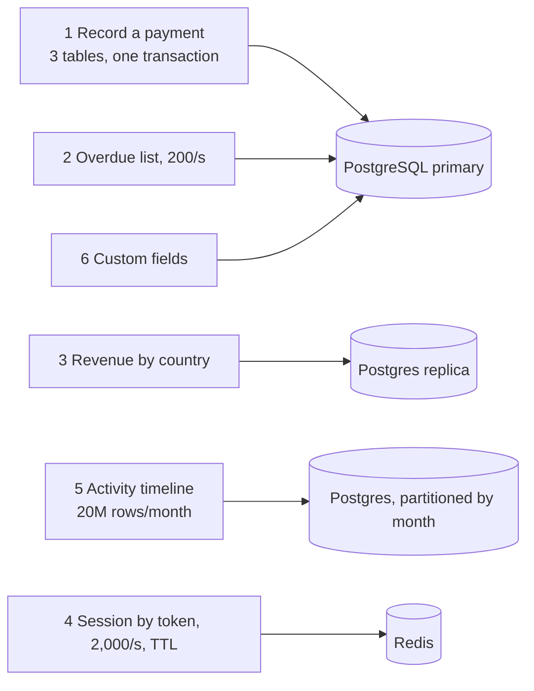

**Back-of-envelope (estimate):** 10,000 workspaces × 100 invoices a month = 1M invoices a month, about 0.4 inserts per second on average. Even a 100× peak is 40 per second.

Storage is about 1M × (1 KB invoice + 5 items × 200 B) ≈ 2 GB a month. One Postgres primary with a replica handles this with large headroom, so the core stays relational.

**Pattern 6 without a second database.** The custom fields live in one `jsonb` column; a GIN index (an index type that indexes every key inside the JSON, like a book's index) serves containment queries on it.

```sql
ALTER TABLE invoices ADD COLUMN custom_fields jsonb NOT NULL DEFAULT '{}';

CREATE INDEX invoices_custom_fields_gin ON invoices USING gin (custom_fields jsonb_path_ops);

SELECT id, number
FROM invoices
WHERE workspace_id = 42
  AND custom_fields @> '{"po_number": "PO-7781"}';
```

`jsonb_path_ops` indexes containment (`@>`) compactly. The workspace keeps its fields; the payment logic keeps its constraints.

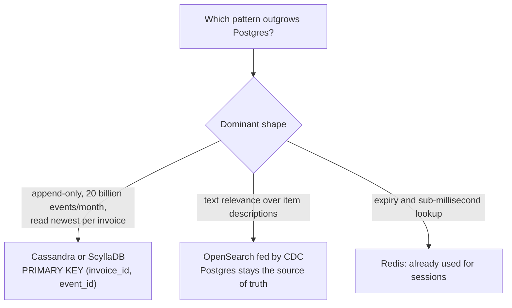

**What would move a pattern out of Postgres:**
- Pattern 5 at 1,000 times today's volume (about 20 billion events a month) → Cassandra or ScyllaDB with `PRIMARY KEY (invoice_id, event_id)`: one small partition per invoice, newest first by a time-ordered `event_id`. A workspace-wide feed would need time buckets in the key, as Discord's ever-growing channels do.
- Full-text search across line-item descriptions with relevance ranking → OpenSearch, fed by change data capture so Postgres stays the source of truth ([[Transactional Outbox and CDC]]).
- Pattern 4 is already elsewhere because expiry and sub-millisecond lookups are what Redis is for.

**The same app on MongoDB** would also work: embed items and payments in the invoice document (single-document writes are atomic) or use a multi-document transaction. You would then rebuild in code what Postgres gave you: cross-client reports through aggregation pipelines, uniqueness of payment references, and the referential checks between clients and invoices.

## 5. Variants and comparison 🟡

Choosing by workload:

| Workload              | Access pattern                                          | Good default                                                            | Why                                                                                   |
| --------------------- | ------------------------------------------------------- | ----------------------------------------------------------------------- | ------------------------------------------------------------------------------------- |
| Payments, ledgers     | multi-row invariants, audits, reconciliation queries    | PostgreSQL or MySQL                                                     | transactions, constraints, SQL reports                                                |
| Sessions, tokens      | get/put by id, expiry, very high rate                   | Redis; DynamoDB with TTL                                                | key lookups with built-in expiry                                                      |
| Product catalog       | read a whole product; attributes vary by category       | Postgres + `jsonb`, or MongoDB; a search engine for text                | flexible attributes; relevance search lives in the search engine                       |
| Chat messages         | append per channel, read the latest N, enormous volume  | Cassandra or ScyllaDB, key `((channel_id, bucket), message_id)`         | sequential writes per partition; bounded partitions                                    |
| Social graph          | friends-of-friends, recommendations                     | a graph DB for deep traversals; sharded MySQL plus a cache for one-hop reads at huge scale (Facebook TAO) | traversals vs raw scale                                         |
| Logs and metrics      | append-only, time-range scans, aggregates               | Prometheus or another TSDB for metrics; Elasticsearch, OpenSearch or Loki for logs; ClickHouse for analytics | compression and time-partitioned storage                      |
| Embeddings            | nearest-neighbour by vector, with filters               | pgvector until it hurts, then a dedicated vector DB                     | keeps filters and joins in SQL                                                         |
| Global, strongly consistent OLTP | serializable transactions across regions     | Distributed SQL ([[Distributed SQL]])                                   | consensus replication with SQL on top                                                  |

## 6. Trade-offs and when not to use 🟡

**Reach for a NoSQL store when:**
- The access patterns are few, known and keyed, and the data is read and written as one aggregate.
- Write volume or data size outgrows one primary and the data partitions cleanly by a key.
- You need multi-region writes with availability over immediate consistency.
- The model is the product: graph traversals, full-text relevance, vectors, TTL caches.

**Stay relational when:**
- The queries will change (they always do in reporting, admin and finance).
- Correctness depends on constraints across rows or tables.
- The scale is "might be big one day". Postgres with indexes, replicas and partitioning goes very far, and moving later is cheaper than living with the wrong model now.

**Myths to drop:**
- *"NoSQL has no transactions."* MongoDB has multi-document ACID transactions (replica sets since 4.0, sharded clusters since 4.2). DynamoDB's `TransactWriteItems` covers up to 100 actions and 4 MB in one Region, at twice the capacity cost (prepare and commit). Cassandra offers single-partition compare-and-set through lightweight transactions.
- *"SQL cannot scale out."* Vitess (built at YouTube, used by Slack) shards MySQL; Citus distributes Postgres tables; Aurora PostgreSQL Limitless Database (GA in October 2024) shards writes; distributed SQL systems are SQL end to end.
- *"NoSQL is schemaless."* The schema moved from the database into every reader.
- *"NoSQL is faster."* Speed comes from data laid out for the query. A key lookup is fast in any engine that is built for that key.

### Dual write versus outbox

**In plain words:** never send the same update to two stores yourself, because one send can fail and the stores drift apart; save it once in the main store and let a relay copy it out until it sticks.

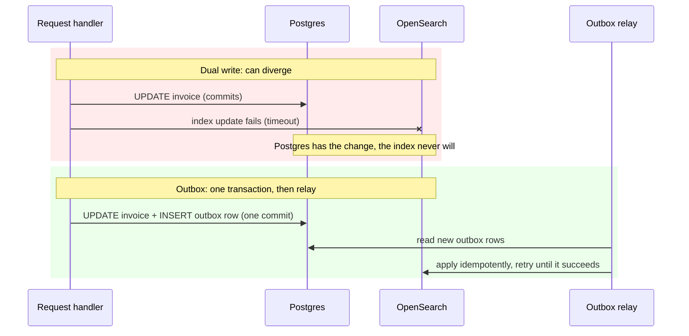

**Polyglot persistence costs.** Every extra store adds backups, upgrades, monitoring, security review and on-call knowledge. Data copied between stores needs one writer and a pipeline: writing to Postgres and Elasticsearch from the same request is a *dual write* that silently diverges when one side fails.

Use an outbox (a table written in the same transaction as the change, which a relay then publishes) or CDC (change data capture: streaming changes out of the database log), and run a reconciliation job.

## 7. In production 🔴

> 🟡 → 🔴 **You now know** how to choose a store per access pattern and why copies need an outbox. **Next is the senior view**: how Discord, Uber, Instagram and Facebook actually moved or stayed, the failures at scale, and the deeper ideas (CAP, distributed SQL, `jsonb` internals).

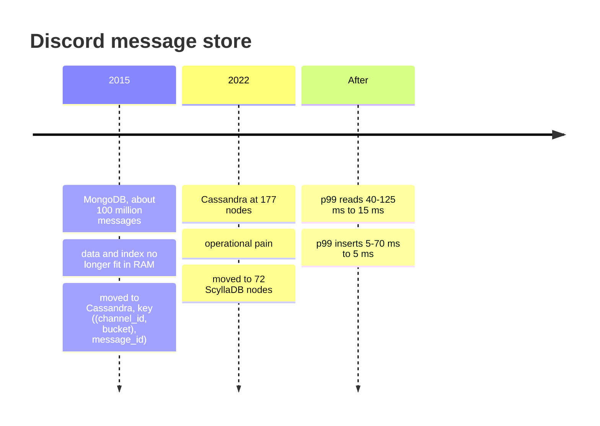

- **Real migrations:**
	- **Discord** started on MongoDB. Around November 2015, at 100 million stored messages, the data and index no longer fit in RAM and latency became unpredictable, so it moved messages to Cassandra with key `((channel_id, bucket), message_id)` and about 10 days per bucket to keep partitions under 100 MB. By early 2022 that cluster had 177 nodes. Discord then moved to 72 ScyllaDB nodes: p99 historical reads went from 40–125 ms to 15 ms, and p99 inserts from 5–70 ms to a steady 5 ms.
	- **Uber** ran its core trips data on a single Postgres instance until it was running out of space in early 2014, then built Schemaless: an append-only key-value store on sharded MySQL.
	- **Instagram** stayed relational and sharded Postgres: several thousand *logical* shards, each a Postgres schema, mapped onto far fewer physical servers so shards could move without re-bucketing data.
	- **Facebook's TAO** serves the social graph from a graph-aware cache in front of sharded MySQL.
- **Failure modes → fixes:**
	- Hot partition: one key (a viral channel, a big tenant) takes all the traffic → split the key (`channel_id` plus time bucket), add write sharding, or isolate the tenant ([[Hot Keys and Hot Partitions]]).
	- A new query has no key to use → a scatter-gather scan across all partitions → add a secondary index or a query-specific table written alongside, or answer it from an analytics copy.
	- Unbounded documents or partitions (a MongoDB document grows toward the 16 MB limit; a Cassandra partition per channel grows forever) → bucket by time or count.
	- Denormalized copies drift → one owner per fact, CDC to the copies, a periodic reconciliation query.
	- Eventual consistency surprises: a user saves, reloads and sees old data → strongly consistent reads on the paths that need read-your-writes.
	- Delete-heavy wide-column tables pile up tombstones (markers that say "this was deleted") and slow reads → model deletes with TTLs and partitions you can drop.
- **What to monitor:**
	- Throughput and throttling per partition or shard (for example, DynamoDB throttled requests).
	- p99 latency (the time 99 in 100 requests finish within) per access pattern, not per database.
	- Replication lag, and mismatches found by reconciliation jobs between stores.
	- Size of the largest partition or document, and growth per tenant.

## 8. Deep dive 🔴

- **CAP and PACELC defaults.** Dynamo-style stores choose availability during a partition and low latency otherwise; Spanner and CockroachDB choose consistency in both cases and pay in latency. That choice, more than the data model, decides how a store behaves under failure: [[CAP and PACELC]], [[Consistency Models]].
- **What "scales horizontally" really requires.** A partition key in every hot query, partitions small enough to move, and keys spread evenly. Cross-partition joins and transactions are either unavailable or slow, whether the store says NoSQL or SQL.
- **Distributed SQL.** Spanner (Paxos groups plus TrueTime), CockroachDB, TiDB (Raft-replicated TiKV) and YugabyteDB (which reuses the Postgres query layer) split tables into ranges, replicate each range with consensus and run SQL transactions across them. A commit waits for a majority of a range's replicas, so when those replicas are spread over regions to survive a region failure, every write pays at least one inter-region round trip: [[Distributed SQL]].
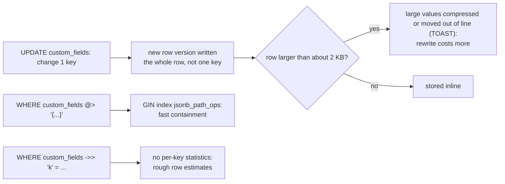

- **Inside `jsonb`.** Postgres stores it in a parsed binary form, so reads do not re-parse text. A GIN index makes `@>` and key-existence queries fast; `jsonb_path_ops` is smaller but supports only containment and jsonpath operators. Updating one key writes a new version of the whole row; once a row passes about 2 KB its large values are compressed or moved out of line (TOAST), and rewriting them costs more; and the planner has no per-key statistics, so estimates on `jsonb` predicates are rough. Promote a key to a real column once you filter, join or constrain on it.
- **The models converged.** Postgres has `jsonb`; MongoDB has transactions and schema validation; DynamoDB has transactions and PartiQL, a SQL-compatible query language. The labels now describe defaults and strengths, not capabilities.

## 9. Interview questions 🔴

> [!question]- Trap: "If we need transactions we use SQL, otherwise NoSQL." Agree?
> No. MongoDB has multi-document transactions since 4.0, DynamoDB has `TransactWriteItems`, and Cassandra has lightweight transactions for single-partition compare-and-set. Decide by access patterns, relationships and ad-hoc querying needs, consistency requirements per operation, and the scale you can actually forecast.

> [!question]- When would you choose DynamoDB over Postgres for a new service?
> When the access patterns are few and keyed (get a session, list a user's items by time), the traffic is spiky or very large, and you want a managed store that partitions automatically. Not when the queries are still evolving, you need joins or reports, or invariants span many items.

> [!question]- Why did Discord move messages from MongoDB to Cassandra, and later to ScyllaDB?
> At 100 million messages the MongoDB data and index no longer fit in RAM and latency became unpredictable. Cassandra fit the pattern: append per channel, read recent messages, with key `((channel_id, bucket), message_id)`. Later, operational pain at 177 nodes led to ScyllaDB on 72 nodes, with p99 reads down from 40–125 ms to 15 ms.

> [!question]- How do you scale Postgres before leaving SQL?
> Fix queries and indexes, scale the instance up, send reads to replicas, partition big tables, split databases by domain, then shard by tenant (Citus or app-level routing). Distributed SQL is the next step if you need cross-shard transactions. Each step keeps SQL and constraints.

> [!question]- What does schema-on-read cost you?
> Every reader must handle every historical shape, so the schema lives scattered across code paths and tests. Bad data is discovered at read time, often by a customer. Typical mitigations: a schema-version field, lazy migration on read, and validation at write time anyway.

> [!question]- A jsonb column, a child table, or a document database for custom invoice fields?
> `jsonb` when keys vary per workspace and you mostly read them with the row, filtering by containment with a GIN index. A child table or real column once you join, constrain or sort on a field. A document database only if most of the domain is aggregate-shaped, which InvoiceOps is not.

> [!question]- You keep invoices in Postgres and a search index in OpenSearch. How do you keep them consistent?
> Do not write both from the request handler: one write can fail after the other succeeded. Make Postgres the source of truth, capture changes with a transactional outbox or CDC (Debezium reading the WAL), apply them idempotently to the index, and run a periodic reconciliation that compares counts or checksums.

## 10. Cheat sheet 🟢

🟢 **Plain version:** Do not pick a database by its label. Write down the questions your app asks, how often, and how much data there is. Keep money and anything with cross-table rules in a relational database. Use a NoSQL store for a few huge, keyed questions, and copy data to it from the main store with an outbox or CDC, never by writing to both.


- Choose by access patterns, relationships, consistency and scale, never by the label.
- Relational: model the data, query freely, enforce invariants. NoSQL: model the queries, copy data per query.
- Transactions exist on both sides (MongoDB 4.0+, DynamoDB up to 100 actions); scale-out exists on both sides (Vitess, Citus, distributed SQL).
- Every partitioned store, SQL or not, needs the partition key in every hot query.
- `jsonb` is the middle ground for variable attributes inside a relational model.
- Schema-on-read moves the schema into every reader.
- Each extra store costs operations and consistency work: one writer, outbox or CDC, reconciliation.
- InvoiceOps: Postgres for the core, Redis for sessions, a search engine or wide-column store only when a measured pattern demands it.

## Self-check 🟢🟡

🟢 Easy

> [!question]- What does "schema-on-read" mean?
> The store accepts any shape, and every reader must handle whatever shapes were written.

> [!question]- Name one job where a key-value store like Redis fits better than Postgres.
> Session lookup by token with automatic expiry, at thousands of reads per second.

> [!question]- Do MongoDB and DynamoDB support transactions?
> Yes, both do, with limits (for example DynamoDB allows up to 100 actions per transaction).

🟡 Medium

> [!question]- Why not write to Postgres and Elasticsearch from the same request?
> If one write fails, the stores drift apart; write once and copy out with an outbox or CDC.

> [!question]- InvoiceOps' timeline is 20 million rows a month. Does it need Cassandra?
> No; a Postgres table partitioned by month handles it. Cassandra makes sense around 1,000 times that volume.

> [!question]- What must every hot query carry in any partitioned store, SQL or NoSQL?
> The partition (shard) key; without it the query asks every partition.

## Links

- **Before this:** [[SQL Essentials]]
- **Next:** [[Relational Schema Design]], [[NoSQL Data Modeling]], [[Partitioning and Sharding]]
- **Compare with:** [[Distributed SQL]] (SQL with built-in scale-out), [[CAP and PACELC]] (the consistency trade-off behind the defaults), [[Wide-Column Stores and Cassandra]] (the Discord-style message store)

### Watch on YouTube

- [SQL vs NoSQL Explained: Why Your Bank and Your Feed Differ](https://www.youtube.com/watch?v=auBGsfDdQyE) · 𝗦𝘁𝗮𝗿𝗖𝗼𝗱𝗲 𝗞𝗵 · covers ACID vs NoSQL families and CAP tradeoffs, matching note's framing
- [SQL Vs NoSQL — Choosing The Right Database](https://www.youtube.com/watch?v=2nPT2mv93pk) · Destination Engineer (Formally Destination FAANG) · interview-style walkthrough of choosing by access patterns and scale
