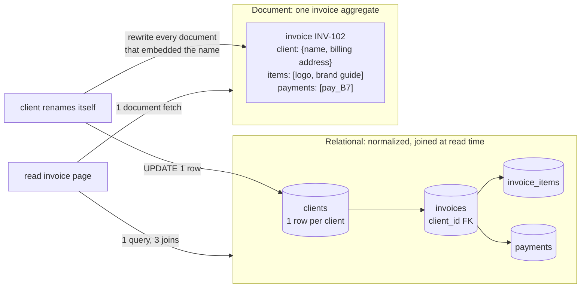
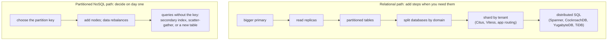
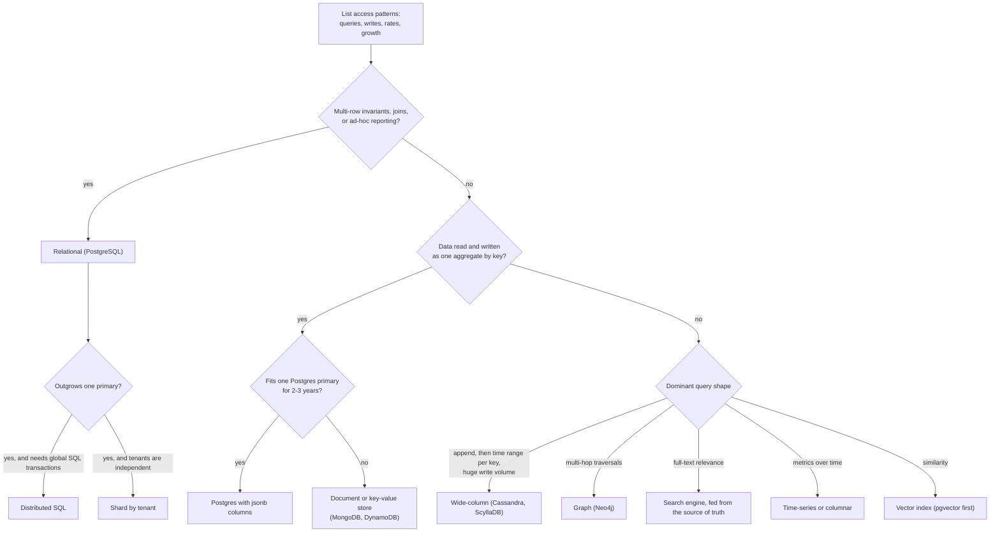

# SQL vs NoSQL

> [!summary] TL;DR
> **SQL** (relational) databases store tables with a declared schema and let you join them, query them any way you like, and change many rows in one transaction. **NoSQL** is an umbrella for stores built on other data models (documents, key-value pairs, wide rows, graphs) that usually give up ad-hoc joins in exchange for a data layout matched to a few known queries at large scale. Choose by access patterns, relationships, consistency and scale, not by the label: NoSQL stores now have transactions, and SQL databases now scale out.

## 1. Why it exists

Relational databases were built for one server, strong consistency and flexible queries. In the 2000s, web companies outgrew single machines. Google's Bigtable (2006) and Amazon's Dynamo (2007) gave up joins and multi-row transactions so that data could be spread over many machines by key and stay available when some failed. Document stores such as MongoDB (first released in 2009) added a JSON-shaped model that maps directly onto application objects.

InvoiceOps shows why the choice is per access pattern, not per company:
- **Recording a payment** must insert the payment, raise the invoice's paid amount and write an audit row together. Finance also asks new questions every month ("revenue by client country, by quarter"). That is relational work.
- **An invoice activity timeline** (sent, opened, reminder, viewed) is append-only and read newest-first per invoice. At an estimated 1M invoices a month × 20 events, that is 20M rows a month: easy for a partitioned Postgres table. At 1,000 times that volume, a wide-column store partitioned by invoice becomes the natural home.

## 2. Mental model

- **Relational:** model the *data* (entities and relationships), normalize it, then ask any question later. The schema protects the truth; queries adapt to it.
- **Most NoSQL:** model the *queries*, then store the data in the shape each query reads, often more than once. A new query may need a new copy of the data.

**Analogy:** a library with one copy of every book and catalogues by author, title and subject answers any question, but you walk the shelves. Meal kits are packed per recipe: you grab one box and cook, but a new recipe needs new boxes, and when an ingredient changes every box containing it must be repacked.

## 3. How it works

### The families

| Family           | Data model                                       | Example                    | Reads well                                         | Struggles with                                                 |
| ---------------- | ------------------------------------------------ | -------------------------- | -------------------------------------------------- | -------------------------------------------------------------- |
| Relational       | tables, foreign keys, SQL                        | PostgreSQL, MySQL          | ad-hoc queries, joins, multi-row invariants        | write scaling past one primary needs sharding                  |
| Document         | JSON-like documents in collections               | MongoDB                    | one aggregate (invoice + items) in one read        | cross-document joins, keeping embedded copies in sync          |
| Key-value        | opaque value per key                             | Redis, DynamoDB            | get/put by key at very high rates, TTLs            | any query not by key (DynamoDB adds secondary indexes)         |
| Wide-column      | partition key → rows sorted by a clustering key  | Cassandra, ScyllaDB        | huge write volume; time-ordered reads per partition | joins, ad-hoc queries, read-before-write                      |
| Graph            | nodes and edges with properties                  | Neo4j                      | multi-hop traversals (friends of friends)          | whole-dataset aggregates, sharding the graph                   |
| Time-series      | (series, timestamp) → value                      | Prometheus, TimescaleDB    | append, time-range scans, downsampling             | updates, very high label cardinality                           |
| Search           | inverted index over documents                    | Elasticsearch, OpenSearch  | full-text relevance, facets                        | being the source of truth (refresh lag, no multi-doc transactions) |
| Vector           | embeddings in an approximate-nearest-neighbour index | pgvector, Milvus       | "most similar to this" queries                     | exact filters and joins without a hybrid design                |

Deeper notes: [[NoSQL Data Modeling]], [[Wide-Column Stores and Cassandra]], [[Search Engines and Inverted Indexes]], [[Time-Series and Columnar Storage]], [[Vector Databases and ANN Indexes]], [[Redis Fundamentals]].

### Schema-on-write vs schema-on-read

- **Schema-on-write** (Postgres): the database rejects a row with a missing column or a wrong type at insert time. Changing the shape takes a migration ([[Zero-Downtime Schema Migrations]]).
- **Schema-on-read** (MongoDB, DynamoDB): the store accepts any document, and every reader must handle every shape ever written: v1 invoices without `currency`, v2 with it. The schema still exists; it moved into your code and your tests. MongoDB can enforce one with optional `$jsonSchema` validation.

### Normalized joins vs denormalized aggregates



The document wins the read; the relational model wins the update and every query nobody planned for ("all unpaid items mentioning 'logo' across clients"). One subtlety: an issued invoice *should* keep the billing address it was issued with, so copying it into the invoice is the correct model in both worlds, not a denormalization. See [[Relational Schema Design]].

### ACID vs BASE

- **ACID** (atomicity, consistency, isolation, durability) is the relational default: [[Transactions and ACID]].
- **BASE** (*basically available, soft state, eventually consistent*), named by Pritchett in 2008, accepts that replicas and derived copies are briefly out of date in exchange for availability and partition tolerance.

In practice both are per-operation settings, not product properties:

| Store         | Default                                                    | Stronger option                                                          |
| ------------- | ---------------------------------------------------------- | ------------------------------------------------------------------------ |
| PostgreSQL    | Read Committed; asynchronous replicas may lag              | Serializable isolation; synchronous replication                          |
| MySQL InnoDB  | Repeatable Read                                            | Serializable                                                             |
| MongoDB       | write concern `majority` (since 5.0), read concern `local` | read concern `majority` or `linearizable`; multi-document transactions   |
| DynamoDB      | eventually consistent reads                                | `ConsistentRead=true` on the table (not on global secondary indexes); transactions |
| Cassandra     | consistency level chosen per request                       | `QUORUM` reads and writes; lightweight transactions (Paxos) for compare-and-set |

### Scaling paths



A partitioned store scales writes from the start, but every hot query must carry the partition key. Sharded SQL has exactly the same rule once you shard: the tenant id must be in every query. See [[Partitioning and Sharding]].

### Choosing



The question "does it need transactions?" no longer separates the two sides: MongoDB (multi-document since 4.0) and DynamoDB (`TransactWriteItems`) both offer them.

## 4. Worked example

**Choosing stores for InvoiceOps.** Start from access patterns with rough rates (all rates are estimates for a product with 10,000 active workspaces):

| # | Access pattern                                                                  | Rate         | Needs                                         | Store                                                      |
| - | ------------------------------------------------------------------------------- | ------------ | --------------------------------------------- | ---------------------------------------------------------- |
| 1 | Record a payment: insert payment, update invoice balance and status, audit row  | peak ~50/s   | one transaction across 3 tables, unique keys  | Postgres                                                   |
| 2 | List a workspace's overdue invoices by due date                                  | ~200/s       | composite index, sort, pagination             | Postgres                                                   |
| 3 | Revenue by client country by quarter                                             | a few a day  | ad-hoc joins and aggregates                   | Postgres replica; a columnar store if it ever gets slow    |
| 4 | Session lookup by token, 30-minute expiry                                        | ~2,000/s     | key lookup, TTL                               | Redis                                                      |
| 5 | Invoice activity timeline, newest first                                          | 20M rows/month | append, range scan per invoice              | Postgres table partitioned by month                        |
| 6 | Per-workspace custom fields (PO number, project code)                            | with #1–#2   | flexible keys, filter by one of them          | Postgres `jsonb`                                           |

**Back-of-envelope (estimate):** 10,000 workspaces × 100 invoices a month = 1M invoices a month, about 0.4 inserts per second on average. Even a 100× peak is 40 per second. Storage is about 1M × (1 KB invoice + 5 items × 200 B) ≈ 2 GB a month. One Postgres primary with a replica handles this with large headroom, so the core stays relational.

**Pattern 6 without a second database:**

```sql
ALTER TABLE invoices ADD COLUMN custom_fields jsonb NOT NULL DEFAULT '{}';

CREATE INDEX invoices_custom_fields_gin ON invoices USING gin (custom_fields jsonb_path_ops);

SELECT id, number
FROM invoices
WHERE workspace_id = 42
  AND custom_fields @> '{"po_number": "PO-7781"}';
```

`jsonb_path_ops` indexes containment (`@>`) compactly. The workspace keeps its fields; the payment logic keeps its constraints.

**What would move a pattern out of Postgres:**
- Pattern 5 at 1,000 times today's volume (about 20 billion events a month) → Cassandra or ScyllaDB with `PRIMARY KEY (invoice_id, event_id)`: one small partition per invoice, newest first by a time-ordered `event_id`. A workspace-wide feed would need time buckets in the key, as Discord's ever-growing channels do.
- Full-text search across line-item descriptions with relevance ranking → OpenSearch, fed by change data capture so Postgres stays the source of truth ([[Transactional Outbox and CDC]]).
- Pattern 4 is already elsewhere because expiry and sub-millisecond lookups are what Redis is for.

**The same app on MongoDB** would also work: embed items and payments in the invoice document (single-document writes are atomic) or use a multi-document transaction. You would then rebuild in code what Postgres gave you: cross-client reports through aggregation pipelines, uniqueness of payment references, and the referential checks between clients and invoices.

## 5. Variants and comparison

Choosing by workload:

| Workload              | Access pattern                                          | Good default                                                            | Why                                                                                   |
| --------------------- | ------------------------------------------------------- | ----------------------------------------------------------------------- | ------------------------------------------------------------------------------------- |
| Payments, ledgers     | multi-row invariants, audits, reconciliation queries    | PostgreSQL or MySQL                                                     | transactions, constraints, SQL reports                                                |
| Sessions, tokens      | get/put by id, expiry, very high rate                   | Redis; DynamoDB with TTL                                                | key lookups with built-in expiry                                                      |
| Product catalog       | read a whole product; attributes vary by category       | Postgres + `jsonb`, or MongoDB; a search engine for text                | flexible attributes; relevance search lives in the search engine                       |
| Chat messages         | append per channel, read the latest N, enormous volume  | Cassandra or ScyllaDB, key `((channel_id, bucket), message_id)`         | sequential writes per partition; bounded partitions                                    |
| Social graph          | friends-of-friends, recommendations                     | a graph DB for deep traversals; sharded MySQL plus a cache for one-hop reads at huge scale (Facebook TAO) | traversals vs raw scale                                         |
| Logs and metrics      | append-only, time-range scans, aggregates               | Prometheus or another TSDB for metrics; Elasticsearch, OpenSearch or Loki for logs; ClickHouse for analytics | compression and time-partitioned storage                      |
| Embeddings            | nearest-neighbour by vector, with filters               | pgvector until it hurts, then a dedicated vector DB                     | keeps filters and joins in SQL                                                         |
| Global, strongly consistent OLTP | serializable transactions across regions     | Distributed SQL ([[Distributed SQL]])                                   | consensus replication with SQL on top                                                  |

## 6. Trade-offs and when not to use

**Reach for a NoSQL store when:**
- The access patterns are few, known and keyed, and the data is read and written as one aggregate.
- Write volume or data size outgrows one primary and the data partitions cleanly by a key.
- You need multi-region writes with availability over immediate consistency.
- The model is the product: graph traversals, full-text relevance, vectors, TTL caches.

**Stay relational when:**
- The queries will change (they always do in reporting, admin and finance).
- Correctness depends on constraints across rows or tables.
- The scale is "might be big one day". Postgres with indexes, replicas and partitioning goes very far, and moving later is cheaper than living with the wrong model now.

**Myths to drop:**
- *"NoSQL has no transactions."* MongoDB has multi-document ACID transactions (replica sets since 4.0, sharded clusters since 4.2). DynamoDB's `TransactWriteItems` covers up to 100 actions and 4 MB in one Region, at twice the capacity cost (prepare and commit). Cassandra offers single-partition compare-and-set through lightweight transactions.
- *"SQL cannot scale out."* Vitess (built at YouTube, used by Slack) shards MySQL; Citus distributes Postgres tables; Aurora PostgreSQL Limitless Database (GA in October 2024) shards writes; distributed SQL systems are SQL end to end.
- *"NoSQL is schemaless."* The schema moved from the database into every reader.
- *"NoSQL is faster."* Speed comes from data laid out for the query. A key lookup is fast in any engine that is built for that key.

**Polyglot persistence costs.** Every extra store adds backups, upgrades, monitoring, security review and on-call knowledge. Data copied between stores needs one writer and a pipeline: writing to Postgres and Elasticsearch from the same request is a *dual write* that silently diverges when one side fails. Use an outbox or CDC, and run a reconciliation job.

## 7. In production

- **Real migrations:**
	- **Discord** started on MongoDB. Around November 2015, at 100 million stored messages, the data and index no longer fit in RAM and latency became unpredictable, so it moved messages to Cassandra with key `((channel_id, bucket), message_id)` and about 10 days per bucket to keep partitions under 100 MB. By early 2022 that cluster had 177 nodes. Discord then moved to 72 ScyllaDB nodes: p99 historical reads went from 40–125 ms to 15 ms, and p99 inserts from 5–70 ms to a steady 5 ms.
	- **Uber** ran its core trips data on a single Postgres instance until it was running out of space in early 2014, then built Schemaless: an append-only key-value store on sharded MySQL.
	- **Instagram** stayed relational and sharded Postgres: several thousand *logical* shards, each a Postgres schema, mapped onto far fewer physical servers so shards could move without re-bucketing data.
	- **Facebook's TAO** serves the social graph from a graph-aware cache in front of sharded MySQL.
- **Failure modes → fixes:**
	- Hot partition: one key (a viral channel, a big tenant) takes all the traffic → split the key (`channel_id` plus time bucket), add write sharding, or isolate the tenant ([[Hot Keys and Hot Partitions]]).
	- A new query has no key to use → a scatter-gather scan across all partitions → add a secondary index or a query-specific table written alongside, or answer it from an analytics copy.
	- Unbounded documents or partitions (a MongoDB document grows toward the 16 MB limit; a Cassandra partition per channel grows forever) → bucket by time or count.
	- Denormalized copies drift → one owner per fact, CDC to the copies, a periodic reconciliation query.
	- Eventual consistency surprises: a user saves, reloads and sees old data → strongly consistent reads on the paths that need read-your-writes.
	- Delete-heavy wide-column tables pile up tombstones and slow reads → model deletes with TTLs and partitions you can drop.
- **What to monitor:**
	- Throughput and throttling per partition or shard (for example, DynamoDB throttled requests).
	- p99 latency per access pattern, not per database.
	- Replication lag, and mismatches found by reconciliation jobs between stores.
	- Size of the largest partition or document, and growth per tenant.

## 8. Deep dive

- **CAP and PACELC defaults.** Dynamo-style stores choose availability during a partition and low latency otherwise; Spanner and CockroachDB choose consistency in both cases and pay in latency. That choice, more than the data model, decides how a store behaves under failure: [[CAP and PACELC]], [[Consistency Models]].
- **What "scales horizontally" really requires.** A partition key in every hot query, partitions small enough to move, and keys spread evenly. Cross-partition joins and transactions are either unavailable or slow, whether the store says NoSQL or SQL.
- **Distributed SQL.** Spanner (Paxos groups plus TrueTime), CockroachDB, TiDB (Raft-replicated TiKV) and YugabyteDB (which reuses the Postgres query layer) split tables into ranges, replicate each range with consensus and run SQL transactions across them. A commit waits for a majority of a range's replicas, so when those replicas are spread over regions to survive a region failure, every write pays at least one inter-region round trip: [[Distributed SQL]].
- **Inside `jsonb`.** Postgres stores it in a parsed binary form, so reads do not re-parse text. A GIN index makes `@>` and key-existence queries fast; `jsonb_path_ops` is smaller but supports only containment and jsonpath operators. Updating one key writes a new version of the whole row; once a row passes about 2 KB its large values are compressed or moved out of line (TOAST), and rewriting them costs more; and the planner has no per-key statistics, so estimates on `jsonb` predicates are rough. Promote a key to a real column once you filter, join or constrain on it.
- **The models converged.** Postgres has `jsonb`; MongoDB has transactions and schema validation; DynamoDB has transactions and PartiQL, a SQL-compatible query language. The labels now describe defaults and strengths, not capabilities.

## 9. Interview questions

> [!question]- Trap: "If we need transactions we use SQL, otherwise NoSQL." Agree?
> No. MongoDB has multi-document transactions since 4.0, DynamoDB has `TransactWriteItems`, and Cassandra has lightweight transactions for single-partition compare-and-set. Decide by access patterns, relationships and ad-hoc querying needs, consistency requirements per operation, and the scale you can actually forecast.

> [!question]- When would you choose DynamoDB over Postgres for a new service?
> When the access patterns are few and keyed (get a session, list a user's items by time), the traffic is spiky or very large, and you want a managed store that partitions automatically. Not when the queries are still evolving, you need joins or reports, or invariants span many items.

> [!question]- Why did Discord move messages from MongoDB to Cassandra, and later to ScyllaDB?
> At 100 million messages the MongoDB data and index no longer fit in RAM and latency became unpredictable. Cassandra fit the pattern: append per channel, read recent messages, with key `((channel_id, bucket), message_id)`. Later, operational pain at 177 nodes led to ScyllaDB on 72 nodes, with p99 reads down from 40–125 ms to 15 ms.

> [!question]- How do you scale Postgres before leaving SQL?
> Fix queries and indexes, scale the instance up, send reads to replicas, partition big tables, split databases by domain, then shard by tenant (Citus or app-level routing). Distributed SQL is the next step if you need cross-shard transactions. Each step keeps SQL and constraints.

> [!question]- What does schema-on-read cost you?
> Every reader must handle every historical shape, so the schema lives scattered across code paths and tests. Bad data is discovered at read time, often by a customer. Typical mitigations: a schema-version field, lazy migration on read, and validation at write time anyway.

> [!question]- A jsonb column, a child table, or a document database for custom invoice fields?
> `jsonb` when keys vary per workspace and you mostly read them with the row, filtering by containment with a GIN index. A child table or real column once you join, constrain or sort on a field. A document database only if most of the domain is aggregate-shaped, which InvoiceOps is not.

> [!question]- You keep invoices in Postgres and a search index in OpenSearch. How do you keep them consistent?
> Do not write both from the request handler: one write can fail after the other succeeded. Make Postgres the source of truth, capture changes with a transactional outbox or CDC (Debezium reading the WAL), apply them idempotently to the index, and run a periodic reconciliation that compares counts or checksums.

## 10. Cheat sheet

- Choose by access patterns, relationships, consistency and scale, never by the label.
- Relational: model the data, query freely, enforce invariants. NoSQL: model the queries, copy data per query.
- Transactions exist on both sides (MongoDB 4.0+, DynamoDB up to 100 actions); scale-out exists on both sides (Vitess, Citus, distributed SQL).
- Every partitioned store, SQL or not, needs the partition key in every hot query.
- `jsonb` is the middle ground for variable attributes inside a relational model.
- Schema-on-read moves the schema into every reader.
- Each extra store costs operations and consistency work: one writer, outbox or CDC, reconciliation.
- InvoiceOps: Postgres for the core, Redis for sessions, a search engine or wide-column store only when a measured pattern demands it.

## Links

- **Before this:** [[SQL Essentials]]
- **Next:** [[Relational Schema Design]], [[NoSQL Data Modeling]], [[Partitioning and Sharding]]
- **Compare with:** [[Distributed SQL]] (SQL with built-in scale-out), [[CAP and PACELC]] (the consistency trade-off behind the defaults), [[Wide-Column Stores and Cassandra]] (the Discord-style message store)
