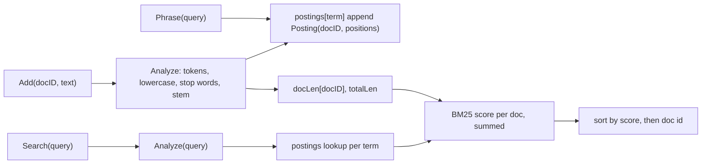
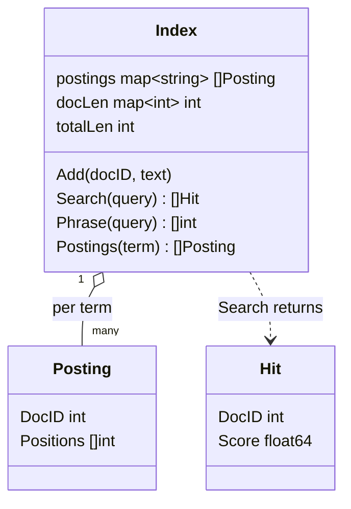
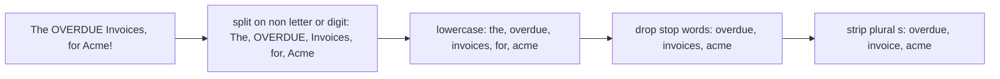
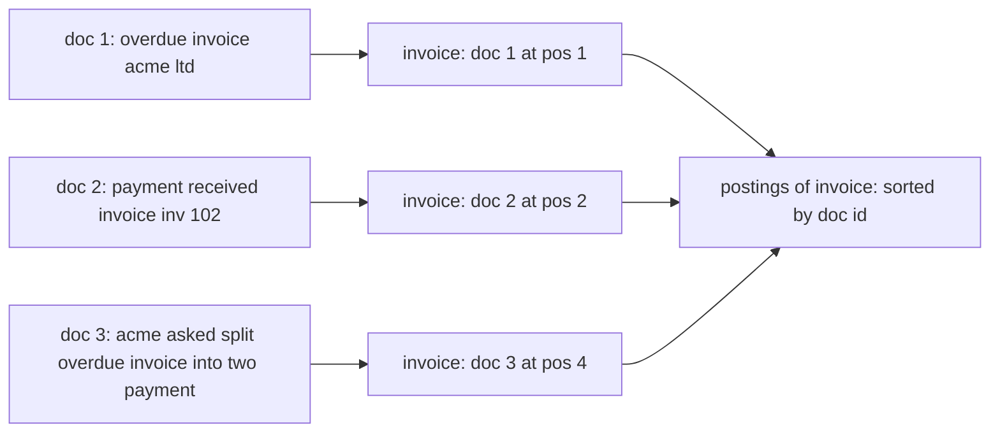
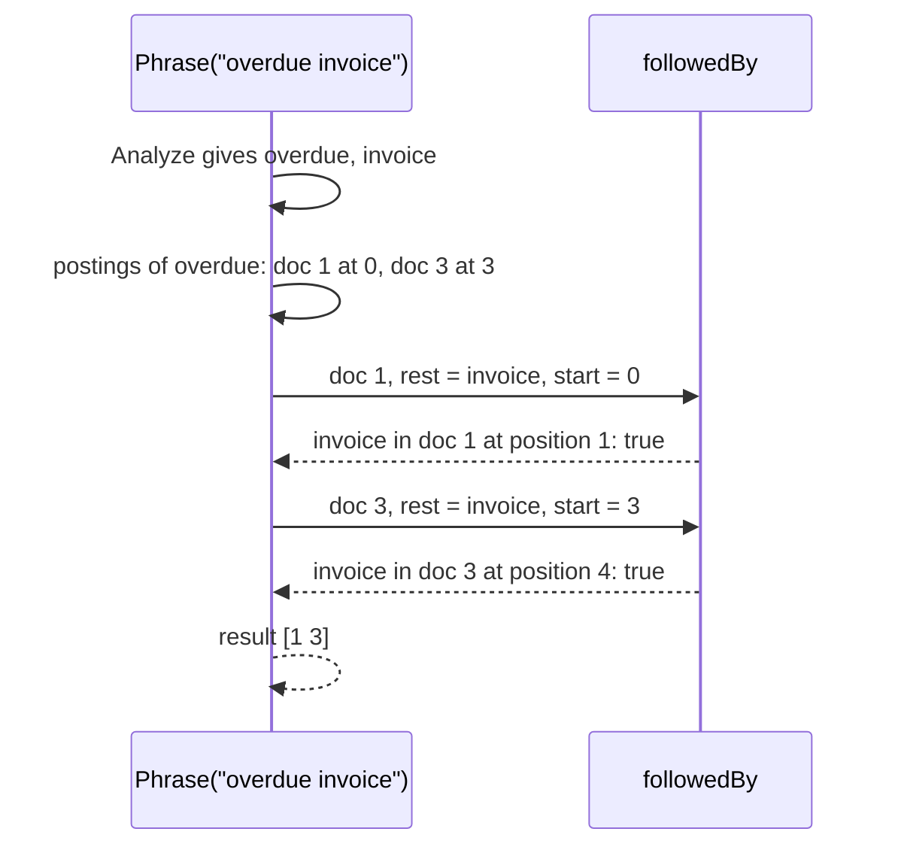
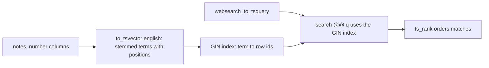

# Search Engines and Inverted Indexes - Go

> [!info] How to read this note (pick your level)
> - 🟢 **New to this?** Read the theory note [[Search Engines and Inverted Indexes]] first, then just "Before the code" and "What this code shows" here.
> - 🟡 **Know the basics?** Walk the Code section step by step, then the Tests: each code block has a numbered walkthrough right under it.
> - 🔴 **Interview / SDE-3 prep?** Add Design decisions, Pitfalls and the Exercises. Headings are tagged 🟢🟡🔴 so you always know where you are.

> [!note] Before this note
> - [[Search Engines and Inverted Indexes]]: the theory half. Text is cleaned into terms, each term points to the documents containing it, and BM25 ranks the matches.
> - [[Indexing Fundamentals]]: an index is a prepared structure that saves scanning everything.
> - [[Index Types and Index Design]]: GIN is PostgreSQL's inverted-index type, used in Step 5.
> - [[Storage Engines - B-tree vs LSM and WAL]]: real engines store the index in write-once segments; this toy keeps it in memory.

**From zero, in one paragraph** 🟢

This file builds a tiny search engine in plain Go, small enough to read in one sitting. It teaches by doing what the theory note explains in words: clean text into search words (the analyzer), keep a map from each word to the documents that contain it (the inverted index), rank matches with the BM25 formula, and answer quoted-phrase searches from stored word positions. Read each short code block, then the numbered notes right below it; nothing uses anything outside Go's standard library, and you can run the whole thing with one test command.

> [!summary] TL;DR
> A teaching-sized inverted index in Go: an analyzer, postings lists with positions, BM25 ranking with the Lucene defaults (`k1 = 1.2`, `b = 0.75`) and a phrase query.
>
> It is the runnable companion of [[Search Engines and Inverted Indexes]], and it also holds the Postgres full-text search SQL used to compare against a search engine.
>
> Every piece of code below is small, is introduced by the theory it implements, and is followed by a numbered walkthrough.

## Before the code 🟢

- **Maps of slices**: the index is `map[string][]Posting`, term to postings list.
- **`unicode` and `strings`**: the analyzer splits on non-letters, lowercases and strips a plural `s`.
- **Methods on a struct**: `Add`, `Search` and `Phrase` are methods on `*Index`.
- **`math.Log` and `sort.Slice`**: compute BM25 scores, then sort hits best first.
- **Table tests with `reflect.DeepEqual`**: compare whole result slices.
- **Run**: `go vet ./... && go test -race -v ./...` inside the `search` module.

## What this code shows 🟢

| Code | Theory concept | Where the theory explains it |
| --- | --- | --- |
| `Analyze` | The analysis chain: tokenizer, lowercase, stop words, stemmer | [[Search Engines and Inverted Indexes#3.1 Analysis: text to terms]] |
| `Index.Add`, `Posting` | The inverted index: term to sorted postings with positions | [[Search Engines and Inverted Indexes#3.2 The inverted index]] |
| `Index.Search` | BM25 with IDF, saturating TF and length normalization | [[Search Engines and Inverted Indexes#3.4 Relevance: TF-IDF to BM25]] |
| `Index.Phrase`, `followedBy` | Phrase queries answered from stored positions | [[Search Engines and Inverted Indexes#3.3 Query execution: AND, OR and phrases]] |
| Postgres `tsvector` + GIN SQL | The "good enough" alternative to a search engine | [[Search Engines and Inverted Indexes#4.3 Postgres full-text search: the "good enough" option]] |

The code has two paths. The write path analyzes a document and records where each term occurs. The read path analyzes the query with the same function, looks the terms up, and either scores the documents (BM25) or checks term positions (phrase).



The three data structures the code builds, and how they relate:



## Setup 🟢

- Module layout: one package `search` with `search.go` and `search_test.go`.
- Go 1.24, standard library only (`math`, `sort`, `strings`, `unicode`, `reflect`, `testing`).
- The code blocks in the Code section are consecutive pieces of one file. Concatenate them in order (a comment marks each place where a function continues in the next block) to get `search.go`.
- Run it with:

```bash
mkdir search && cd search
go mod init search
# put search.go and search_test.go here
go vet ./... && go test -race -v ./...
```

## Code 🟡

> 🟢 → 🟡 **You now know** what the toy engine does: clean text, record where each term appears, score with BM25 and check phrases. **Next we open the box** one function at a time, then compare it with Postgres full-text search.

The package implements the analyzer, postings with positions, BM25 with Lucene's default parameters, and a phrase query. It is a teaching model: Lucene compresses postings, keeps position gaps where stop words were removed (this toy compacts them), and stores everything in immutable segments.

### Step 1: the analyzer

**Concept.** Search engines never match raw text. They first turn text into normalized terms, as explained in [[Search Engines and Inverted Indexes#3.1 Analysis: text to terms]].

The important rule is that the same analyzer must run at index time and at query time, otherwise `Invoices` in a document and `invoice` in a query would never meet. This toy chain has four stages: split, lowercase, drop stop words, stem.

Real engines make each stage pluggable (Lucene analyzers, Elasticsearch `analyzer` setting) and use proper stemmers such as Porter or Snowball; a one-rule stemmer was chosen here so the whole chain fits on one screen and the tests can predict every output.



First the package header, the imports and the stop-word set.

```go
// Package search is a teaching-sized inverted index with BM25 ranking.
package search

import (
	"math"
	"sort"
	"strings"
	"unicode"
)

var stopWords = map[string]bool{"the": true, "a": true, "an": true, "for": true, "of": true, "and": true, "to": true}
```

1. The package comment becomes the package documentation shown by `go doc`.
2. The imports are all standard library: `math` for the logarithm in BM25, `sort` for ranking, `strings` and `unicode` for the analyzer.
3. `stopWords` is a `map[string]bool` used as a set. Looking up a missing key returns `false`, so `stopWords[t]` works without a presence check.

Now the analysis function itself.

**What this code does, in plain words:** it walks through the text, cuts it into words at anything that is not a letter or digit, lowercases each word, drops stop words like "the", and strips a trailing plural `s`. "Overdue invoices for Acme" becomes `overdue`, `invoice`, `acme`.

```go
// Analyze is the analysis chain: tokenize on non-letters/digits,
// lowercase, drop stop words, then a toy stemmer that strips a plural "s".
func Analyze(text string) []string {
	fields := strings.FieldsFunc(text, func(r rune) bool {
		return !unicode.IsLetter(r) && !unicode.IsDigit(r)
	})
	var terms []string
	for _, f := range fields {
		t := strings.ToLower(f)
		if stopWords[t] {
			continue
		}
		if len(t) > 3 && strings.HasSuffix(t, "s") && !strings.HasSuffix(t, "ss") {
			t = t[:len(t)-1]
		}
		terms = append(terms, t)
	}
	return terms
}
```

1. `strings.FieldsFunc` splits wherever the callback returns true, here on any rune that is neither a letter nor a digit. Punctuation and spaces disappear, and `INV-102` becomes two tokens, `INV` and `102`.
2. `strings.ToLower` lowercases each token, so matching is case-insensitive.
3. Stop words are dropped with `continue` before anything else happens to them. Because they are dropped before positions are assigned, the later position numbers are compacted (see the pitfalls).
4. The stemmer strips one trailing `s` only when the term is longer than 3 letters and does not end in `ss`. That keeps `ss` words such as `business` intact and leaves short words like `its` alone.
5. `terms` starts as a nil slice; `append` allocates on first use. An empty input returns nil, which the callers handle.

### Step 2: postings and indexing

**Concept.** The inverted index in [[Search Engines and Inverted Indexes#3.2 The inverted index]] flips the usual document-to-words direction into term to documents. Each term owns a postings list: one `Posting` per document containing it, with the positions where it occurs.

Positions make phrase queries possible; the document length and the total length are the extra statistics BM25 needs. The alternative design, a hash map from term to a plain set of document ids, is smaller but cannot answer phrase queries or compute term frequency.

A sorted postings list is also what allows merge-style AND intersection and delta compression in a real engine, which is why `Add` insists on increasing document ids.



The types come first.

**What this code does, in plain words:** it defines one posting (a document ID plus the positions where the term appears) and the index itself: a map from term to its postings, plus each document's length and the total length, which BM25 needs.

```go
// Posting records one document that contains a term and where.
type Posting struct {
	DocID     int
	Positions []int
}

// Index maps term -> postings list sorted by DocID.
type Index struct {
	postings map[string][]Posting
	docLen   map[int]int
	totalLen int
}

func NewIndex() *Index {
	return &Index{postings: map[string][]Posting{}, docLen: map[int]int{}}
}
```

1. `Posting` pairs a document id with the zero-based positions of one term in that document. The term frequency is simply `len(Positions)`; no separate counter is stored.
2. `Index.postings` is the dictionary: a Go map from term to its postings slice. Lucene uses a sorted term dictionary (an FST) instead, which also supports prefix and range lookups; a hash map is enough to teach the idea.
3. `docLen` stores the number of terms per document and `totalLen` their sum. Together they give the average document length used for BM25 length normalization.
4. `NewIndex` initializes the maps. Writing to a nil map panics in Go, so the constructor matters.

Now the write method.

**What this code does, in plain words:** `Add` cleans a document's text, then for each term appends "document N, at position P" to that term's list, and records the document's length.

```go
// Add indexes one document. Doc IDs must be added in increasing order,
// which keeps every postings list sorted (as Lucene's are).
func (ix *Index) Add(docID int, text string) {
	terms := Analyze(text)
	ix.docLen[docID] = len(terms)
	ix.totalLen += len(terms)
	pos := map[string][]int{}
	var order []string
	for i, t := range terms {
		if _, ok := pos[t]; !ok {
			order = append(order, t)
		}
		pos[t] = append(pos[t], i)
	}
	for _, t := range order {
		ix.postings[t] = append(ix.postings[t], Posting{DocID: docID, Positions: pos[t]})
	}
}

// Postings returns the postings list of an already-analyzed term.
func (ix *Index) Postings(term string) []Posting { return ix.postings[term] }
```

1. `Add` analyzes the text and records the document length and the running total before building postings.
2. `pos` collects, for each distinct term in this document, every position where it appears. Positions are the index in the analyzed term slice, so they ignore removed stop words.
3. `order` remembers the first appearance order of terms. Go map iteration order is random; iterating `order` instead makes indexing deterministic and the postings of a document append in a stable order.
4. For each distinct term, one `Posting` is appended to that term's list. Because document ids arrive in increasing order, every list stays sorted by `DocID` without any sorting step.
5. `Postings` is a read accessor for the tests. It expects an already-analyzed term, so callers must run `Analyze` first.

### Step 3: BM25 search

**Concept.** Ranking by raw term count would reward long documents and common words.

BM25, explained in [[Search Engines and Inverted Indexes#3.4 Relevance: TF-IDF to BM25]], fixes both with three ideas: IDF (rare terms count more), saturating term frequency (the tenth occurrence adds little) and length normalization (a match in a short document counts more).

The code uses the Lucene and Elasticsearch defaults `k1 = 1.2` and `b = 0.75`. Alternatives are plain TF-IDF, which has no saturation, and learned rankers, which need training data; BM25 needs only the statistics this index already holds.

The score of one document for one query term is:

```text
score = idf * tf * (k1 + 1) / (tf + k1 * (1 - b + b * dl / avgdl))
idf   = ln(1 + (N - df + 0.5) / (df + 0.5))
```

First the result type and the two constants.

```go
// Hit is one ranked result.
type Hit struct {
	DocID int
	Score float64
}

// BM25 parameters, the Lucene/Elasticsearch defaults.
const (
	k1 = 1.2
	b  = 0.75
)
```

1. `Hit` is the public result: a document id and its score.
2. `k1` controls how fast term frequency saturates; `b` controls how strongly length is normalized. With `b = 0` length is ignored; with `k1 = 0` frequency is ignored. The exercises use this.

Then the scoring loop.

**What this code does, in plain words:** for each query term it works out how rare the term is (IDF), then for every document containing it adds that term's BM25 score to the document's running total.

```go
// Search scores every document that contains at least one query term
// (OR semantics) with BM25 and returns hits, best first.
func (ix *Index) Search(query string) []Hit {
	n := float64(len(ix.docLen))
	if n == 0 {
		return nil
	}
	avgdl := float64(ix.totalLen) / n
	scores := map[int]float64{}
	for _, term := range Analyze(query) {
		list := ix.postings[term]
		if len(list) == 0 {
			continue
		}
		df := float64(len(list))
		idf := math.Log(1 + (n-df+0.5)/(df+0.5))
		for _, p := range list {
			tf := float64(len(p.Positions))
			dl := float64(ix.docLen[p.DocID])
			scores[p.DocID] += idf * tf * (k1 + 1) / (tf + k1*(1-b+b*dl/avgdl))
		}
	}
```

1. `n` is the number of indexed documents. An empty index returns nil early, which also prevents a division by zero in `avgdl`.
2. `avgdl` is the average document length in terms across the index.
3. For each analyzed query term the code takes its postings list. A term with no postings is skipped, which gives OR semantics: documents need to match only some terms.
4. `df`, the document frequency, is the list length. The `idf` formula is the Lucene variant with `1 +` inside the logarithm, which keeps IDF positive even for a term in every document.
5. For each posting, `tf` is the number of positions and `dl` the document length. The score contribution is added into `scores[docID]`, so a document that matches several query terms accumulates a sum.

Then the map of scores is turned into a ranked slice.

**What this code does, in plain words:** it turns the "document → score" map into a list and sorts it best first, breaking ties by document ID so results are always in the same order.

```go
	// Search, continued: rank the accumulated scores.
	hits := make([]Hit, 0, len(scores))
	for id, s := range scores {
		hits = append(hits, Hit{DocID: id, Score: s})
	}
	sort.Slice(hits, func(i, j int) bool {
		if hits[i].Score != hits[j].Score {
			return hits[i].Score > hits[j].Score
		}
		return hits[i].DocID < hits[j].DocID
	})
	return hits
}
```

1. The `scores` map becomes a slice of `Hit`, pre-sized with `make(..., 0, len(scores))` to avoid regrowth.
2. `sort.Slice` orders by score descending. When two scores are exactly equal, it falls back to the smaller document id, so the output is deterministic. Without that tie-break, Go's random map order would make equal-scored results flip between runs.
3. The function returns every matching document. A real engine would keep a top-k heap instead of sorting all hits.

### Step 4: phrase queries from positions

**Concept.** A phrase query such as `"overdue invoice"` needs the terms to be adjacent and in order.

As described in [[Search Engines and Inverted Indexes#3.3 Query execution: AND, OR and phrases]], that is possible only because the postings store positions: find documents that contain the first term, then check that term `i` sits at position `start + i`.

The alternative is to index shingles (word pairs) as terms, which answers a fixed phrase length quickly but bloats the index. Checking positions needs no extra index data.



The entry point walks the postings of the first term.

**What this code does, in plain words:** for every document that contains the phrase's first word, it tries each position of that word as a possible start and asks the helper whether the other words follow right after.

```go
// Phrase returns docs where the analyzed query terms appear next to each
// other, in order, using the positions stored in the postings.
func (ix *Index) Phrase(query string) []int {
	terms := Analyze(query)
	if len(terms) == 0 {
		return nil
	}
	var out []int
	for _, first := range ix.postings[terms[0]] {
		for _, start := range first.Positions {
			if ix.followedBy(first.DocID, terms[1:], start) {
				out = append(out, first.DocID)
				break
			}
		}
	}
	return out
}
```

1. The query is analyzed first, exactly like documents, so `Overdue   Invoices` matches `overdue invoice`.
2. An empty analyzed query (for example only stop words) returns nil.
3. The outer loop visits each document that contains the first term; the inner loop tries each position of that term as a possible phrase start.
4. `followedBy` checks the remaining terms. On the first successful start the document is added once and `break` stops looking at other starts in the same document.

The helper verifies that each remaining term sits exactly one position further along.

**What this code does, in plain words:** given a start position, it checks that word 2 sits at start + 1, word 3 at start + 2, and so on, in the same document.

```go
func (ix *Index) followedBy(doc int, rest []string, at int) bool {
	for i, t := range rest {
		found := false
		for _, p := range ix.postings[t] {
			if p.DocID != doc {
				continue
			}
			for _, pos := range p.Positions {
				if pos == at+i+1 {
					found = true
				}
			}
		}
		if !found {
			return false
		}
	}
	return true
}
```

1. `rest` holds the terms after the first one, and `at` is the position of the first term. The term at index `i` of `rest` must be at `at + i + 1`.
2. For each remaining term the helper scans that term's postings for the same document and compares positions.
3. If any term is not found at its expected position the helper returns false immediately.
4. The scan is a nested loop, which is fine for a toy. A real engine advances sorted position iterators in step instead.

### Step 5: Postgres full-text search

**Concept.** [[Search Engines and Inverted Indexes#4.3 Postgres full-text search: the "good enough" option]] argues that many products never need a search cluster.

Postgres already has the same ingredients as the Go code above: an analyzer (a text search configuration such as `english`), an inverted index (GIN) and a ranking function.

The trade-off is weaker relevance and no facets, in return for no second system to run and keep in sync.



The first statements add a generated column and its index.

```sql
ALTER TABLE invoices
  ADD COLUMN search tsvector GENERATED ALWAYS AS (
    setweight(to_tsvector('english', coalesce(number, '')), 'A') ||
    setweight(to_tsvector('english', coalesce(notes, '')), 'C')
  ) STORED;

CREATE INDEX invoices_search_gin ON invoices USING gin (search);
```

1. `to_tsvector('english', ...)` analyzes text into stemmed terms with positions, the same job as `Analyze` plus `Add`.
2. `setweight` labels fields A to D, so a match in `number` (A) can outrank a match in `notes` (C).
3. `GENERATED ALWAYS ... STORED` keeps the column in sync on every write, so no application code builds the vector.
4. The GIN index is Postgres's inverted index: term to the rows that contain it.

The query matches and ranks.

```sql
SELECT id, number, ts_rank(search, q) AS rank
FROM invoices, websearch_to_tsquery('english', 'acme overdue') AS q
WHERE workspace_id = 42 AND search @@ q
ORDER BY rank DESC
LIMIT 20;
```

1. `websearch_to_tsquery` parses user input with quotes and `-` the way a web search box does.
2. `@@` is the match operator; the GIN index turns it into an index lookup, and `workspace_id = 42` is applied as a filter on the matching rows.
3. `ts_rank` orders the matches; `LIMIT 20` lets Postgres use a top-N sort.

For typo tolerance and substring search, the `pg_trgm` extension indexes 3-character sequences: `CREATE INDEX ON clients USING gin (name gin_trgm_ops);` speeds up `ILIKE '%acm%'` and `similarity()` lookups.

Representative output (PostgreSQL 17):

```text
Limit  (cost=412.33..412.38 rows=20 width=44) (actual time=2.811..2.817 rows=20 loops=1)
  ->  Sort  (cost=412.33..412.61 rows=112 width=44) (actual time=2.809..2.813 rows=20 loops=1)
        Sort Key: (ts_rank(invoices.search, q.q)) DESC
        Sort Method: top-N heapsort  Memory: 27kB
        ->  Bitmap Heap Scan on invoices  (cost=36.87..409.35 rows=112 width=44) (actual time=0.402..2.701 rows=131 loops=1)
              Recheck Cond: (search @@ q.q)
              Filter: (workspace_id = 42)
              Rows Removed by Filter: 389
              Heap Blocks: exact=498
              ->  Bitmap Index Scan on invoices_search_gin  (cost=0.00..36.84 rows=520 width=0) (actual time=0.311..0.311 rows=520 loops=1)
                    Index Cond: (search @@ q.q)
Planning Time: 0.402 ms
Execution Time: 2.874 ms
```

How to read the plan from the bottom up:

1. The Bitmap Index Scan on `invoices_search_gin` finds 520 candidate rows in 0.31 ms.
2. The Bitmap Heap Scan fetches 498 heap blocks, rechecks the match, and the filter `workspace_id = 42` removes 389 rows, leaving 131.
3. The Sort uses a top-N heapsort of 27 kB to keep only 20 rows, and `Limit` returns them. Total execution is 2.9 ms.

Limits: `ts_rank` uses term frequency and proximity but **no IDF**, so it is not BM25; there are no built-in facets, fuzzy matching beyond `pg_trgm`, or per-field analyzers at scale; and every search runs on the database you also write to.

## Design decisions 🔴

> 🟡 → 🔴 **You now know** how each function works. **Next is the senior view**: why the toy is built this way, the tests that check every number by hand, and where it differs from a real engine (stemming, OR semantics, per-index IDF).

| Decision | Alternative | Trade-off |
| --- | --- | --- |
| Hash map from term to postings | Sorted term dictionary (FST) | Simple and O(1) lookup, but no prefix or range queries on terms |
| Positions stored in every posting | Doc ids only | Larger index, but phrase queries and term frequency become possible |
| Doc ids must arrive in increasing order | Sort on insert or on read | `Add` stays an append, but callers carry the ordering rule |
| `order` slice for term order in `Add` | Iterate the map directly | Deterministic indexing for one extra slice |
| OR semantics in `Search` | AND semantics | More recall, but one rare term can outrank two common terms |
| Lucene BM25 IDF with `1 +` inside `ln` | Classic `ln(N/df)` | IDF never goes negative for terms in most documents |
| Tie-break on document id | Leave map order | Deterministic output, which tests need |
| One-rule plural stemmer | Porter or Snowball | Fits on a screen, but misses `invoiced`, `invoicing` |
| Full sort of all hits | Top-k heap | Simpler code; wasteful for large result sets |
| Per-index IDF statistics | Global statistics across shards | Scores from different indexes are not comparable |

## Tests 🟡

The five tests below share one fixture of four documents, then check the analyzer, the postings layout, BM25 behavior and the phrase query.

The fixture:

**What this code does, in plain words:** it builds one small index from the same four invoice notes used in the theory note, so every test can predict exact terms, positions and scores.

```go
package search

import (
	"reflect"
	"testing"
)

func build() *Index {
	ix := NewIndex()
	ix.Add(1, "Overdue invoice for Acme Ltd")
	ix.Add(2, "Payment received for invoice INV-102")
	ix.Add(3, "Acme asked to split the overdue invoices into two payments")
	ix.Add(4, "Quarterly retainer, Globex")
	return ix
}
```

| Doc | Text | Analyzed terms | Length |
| --- | --- | --- | --- |
| 1 | Overdue invoice for Acme Ltd | overdue, invoice, acme, ltd | 4 |
| 2 | Payment received for invoice INV-102 | payment, received, invoice, inv, 102 | 5 |
| 3 | Acme asked to split the overdue invoices into two payments | acme, asked, split, overdue, invoice, into, two, payment | 8 |
| 4 | Quarterly retainer, Globex | quarterly, retainer, globex | 3 |

### TestAnalyze

Property: the analysis chain lowercases, removes punctuation and stop words, and stems plurals. This matters because every other behavior depends on index-time and query-time terms matching.

| Input | Expected output |
| --- | --- |
| `The OVERDUE Invoices, for Acme!` | `[overdue invoice acme]` |

```go
func TestAnalyze(t *testing.T) {
	got := Analyze("The OVERDUE Invoices, for Acme!")
	want := []string{"overdue", "invoice", "acme"}
	if !reflect.DeepEqual(got, want) {
		t.Fatalf("got %v, want %v", got, want)
	}
}
```

A failure here means the index and the query would disagree about what a term is, so correct documents would silently stop matching.

### TestPostingsAreSortedWithPositions

Property: the postings of a term list every document in increasing id order, each with the right positions.

| Term | Expected postings |
| --- | --- |
| `invoice` | doc 1 at [1], doc 2 at [2], doc 3 at [4] |

```go
func TestPostingsAreSortedWithPositions(t *testing.T) {
	got := build().Postings("invoice")
	want := []Posting{{1, []int{1}}, {2, []int{2}}, {3, []int{4}}}
	if !reflect.DeepEqual(got, want) {
		t.Fatalf("got %v, want %v", got, want)
	}
}
```

A failure would mean the list is unsorted or the positions are off, which breaks merge-style intersection and phrase queries.

### TestBM25PrefersShortDocAndRareTerms

Property: when two documents contain the same query terms the same number of times, the shorter one scores higher (length normalization).

| Query | Expected hits | Why |
| --- | --- | --- |
| `overdue acme` | doc 1 then doc 3 (2 hits) | Both match both terms once; doc 1 has 4 terms, doc 3 has 8 |

```go
func TestBM25PrefersShortDocAndRareTerms(t *testing.T) {
	hits := build().Search("overdue acme")
	if len(hits) != 2 {
		t.Fatalf("got %d hits, want 2", len(hits))
	}
	// Both docs contain both terms once; doc 1 is shorter, so it wins.
	if hits[0].DocID != 1 || hits[1].DocID != 3 {
		t.Fatalf("order = %v, want doc 1 then doc 3", hits)
	}
}
```

By hand, with N = 4 and an average length of 5, both terms have df = 2, so `idf = ln(1 + 2.5 / 2.5) = ln 2 = 0.6931`.

For doc 1 the term part is `2.2 / (1 + 1.2 * (0.25 + 0.75 * 4/5)) = 2.2 / 2.02 = 1.0891`, and two terms give `2 * 0.6931 * 1.0891 = 1.5098`.

For doc 3 the length is 8, the denominator is 2.74, and the score is 1.1131. A failure would mean length normalization is missing or wrong.

### TestRareTermOutweighsCommonTerm

Property: IDF makes a rare term worth more than a common one, even when the rare term matches a different, unrelated document.

| Query | Expected top hit | Why |
| --- | --- | --- |
| `invoice globex` | doc 4 | `globex` has df = 1, while `invoice` has df = 3 |

```go
func TestRareTermOutweighsCommonTerm(t *testing.T) {
	hits := build().Search("invoice globex")
	if hits[0].DocID != 4 {
		t.Fatalf("top = %d, want doc 4: rare term globex beats common invoice", hits[0].DocID)
	}
}
```

A failure would mean IDF is not applied, so common words would drown out the distinctive ones.

### TestPhraseUsesPositions

Property: a phrase matches only adjacent terms in the right order.

| Query | Expected result |
| --- | --- |
| `overdue invoice` | `[1 3]` |
| `invoice overdue` | no documents (nil) |

```go
func TestPhraseUsesPositions(t *testing.T) {
	ix := build()
	if got := ix.Phrase("overdue invoice"); !reflect.DeepEqual(got, []int{1, 3}) {
		t.Fatalf("phrase hits = %v, want [1 3]", got)
	}
	if got := ix.Phrase("invoice overdue"); got != nil {
		t.Fatalf("reversed phrase hits = %v, want none", got)
	}
}
```

A failure on the first assertion means positions are lost or off by one; a failure on the second means the order is not enforced.

### Running it

Measured with `go vet ./...` and `go test -race -v ./...` (Go 1.24, darwin/arm64):

```text
--- PASS: TestAnalyze
--- PASS: TestPostingsAreSortedWithPositions
--- PASS: TestBM25PrefersShortDocAndRareTerms
--- PASS: TestRareTermOutweighsCommonTerm
--- PASS: TestPhraseUsesPositions
PASS
ok  	search
```

1. Each `--- PASS` line is one test function; the order is the order in the file.
2. `PASS` is the package result and `ok  search` shows the package passed, with `-race` having found no data races.
3. `go vet` prints nothing when it finds no suspicious code.

The scores of `Search` on the four test documents (measured with a temporary `t.Logf`, printed to 4 decimals):

| Query | Doc | Doc length (terms) | Score |
| --- | --- | --- | --- |
| `overdue acme` | 1: "Overdue invoice for Acme Ltd" | 4 | 1.5098 |
| `overdue acme` | 3: "Acme asked to split the overdue invoices into two payments" | 8 | 1.1131 |
| `invoice globex` | 4: "Quarterly retainer, Globex" | 3 | 1.4395 |
| `invoice globex` | 1 | 4 | 0.3885 |
| `invoice globex` | 2: "Payment received for invoice INV-102" | 5 | 0.3567 |
| `invoice globex` | 3 | 8 | 0.2864 |

Reading the table: in the first query, only length separates doc 1 and doc 3. In the second query, doc 4 wins with one rare match, and the three `invoice` documents are ordered by length alone: 4, then 5, then 8 terms.

## Pitfalls in the code 🔴

- `Add` must receive document ids in increasing order; otherwise postings lists are not sorted and any merge-style intersection built on them would be wrong.
- The toy stemmer only strips a plural `s`: `invoices` becomes `invoice`, but `invoiced` stays unchanged. Real stemmers (Porter, Snowball) handle far more.
- `Search` uses OR semantics. A document matching one rare term can outrank one matching two common terms, as `TestRareTermOutweighsCommonTerm` shows.
- Stop words are dropped before positions are assigned, so positions are compacted. A document saying `overdue for invoice` therefore matches the phrase `overdue invoice`; Lucene keeps position gaps to avoid this.
- IDF is computed from this one index only, like a single shard. Scores from two such indexes are not comparable.

## Exercises 🔴

1. Change `k1` to `0` and run `TestBM25PrefersShortDocAndRareTerms`. Predict whether term frequency still matters, and which of the two documents wins.
2. Change `b` to `0` and re-run the same test. Predict the order of documents 1 and 3, then confirm the scores are equal.
3. Add a document `ix.Add(5, "invoice invoice invoice")` and search `invoice`. Predict whether it takes first place and how much the third occurrence adds compared with the second (saturation).

## Self-check 🟢🟡

🟢 Easy

> [!question]- What does `Analyze("Overdue invoices for Acme")` return?
> `overdue`, `invoice`, `acme`: lowercased, stop word dropped, plural stripped.

> [!question]- Why must `Add` receive document IDs in increasing order?
> So every postings list stays sorted, which merge-style AND intersection relies on.

> [!question]- What extra data does a posting store so phrase queries work?
> The positions of the term inside the document.

🟡 Medium

> [!question]- Why does doc 4 (`globex`) beat docs containing `invoice` for the query `invoice globex`?
> `globex` is in 1 of 4 documents, so its IDF (about 1.204) is over three times that of `invoice` (about 0.357).

> [!question]- Why might `overdue for invoice` match the phrase `overdue invoice` here?
> Stop words are dropped before positions are assigned, so `invoice` ends up right after `overdue`.

> [!question]- What is Postgres's `ts_rank` missing compared with BM25?
> IDF: it does not weight rare terms higher.

## Links

- **Theory:** [[Search Engines and Inverted Indexes]]
- **Before this:** [[Indexing Fundamentals]], [[Index Types and Index Design]]
- **Next:** [[Keyword, Semantic and Hybrid Search]], [[Transactional Outbox and CDC]]
