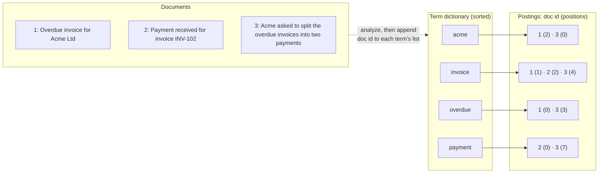
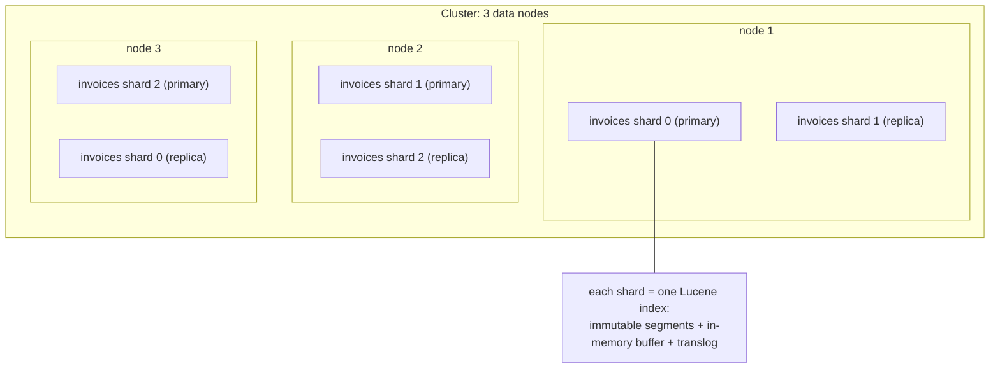
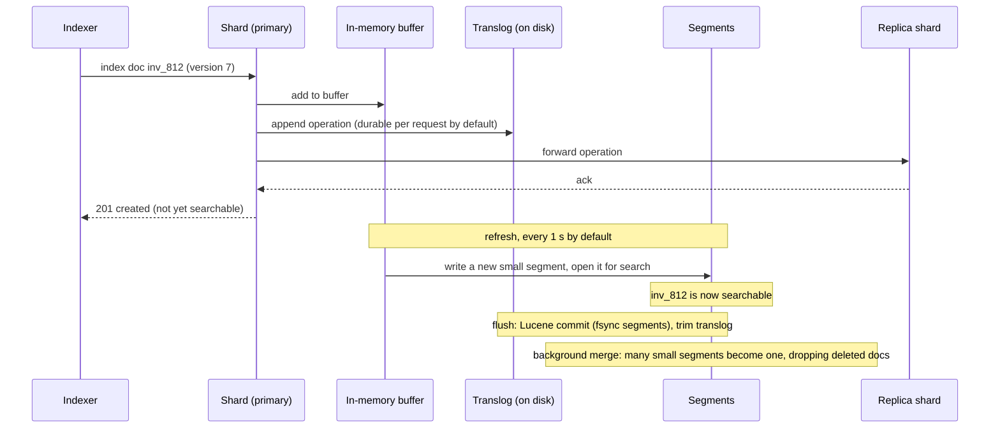
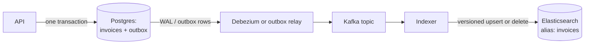

# Search Engines and Inverted Indexes

> [!summary] TL;DR
> A search engine answers "which documents contain these words, and which are most relevant?" It does this with an **inverted index**: for every word (term), a sorted list of the documents that contain it. Text is broken into terms by an **analyzer**, matches are ranked with a formula such as **BM25**, and engines like Elasticsearch and OpenSearch spread the index over shards of immutable Lucene segments. Your database stays the source of truth; the search index is a copy kept in sync.

> [!abstract] Core idea
> - An inverted index maps term → postings list (document ids, often with positions), so a query reads a few lists instead of scanning every document.
> - The same analyzer (tokenize, lowercase, stem, ...) must run at index time and at query time, or terms will not match.
> - BM25 ranks a document higher when it contains the query terms often, when the terms are rare in the collection, and when the document is short.
> - Elasticsearch/OpenSearch: index → primary and replica shards → Lucene segments; new documents become searchable after a refresh (1 s by default), not on write.
> - Start with Postgres full-text search; add a search engine when relevance, fuzziness, facets or load demand it, and feed it through an outbox or CDC.

## 1. Why it exists

InvoiceOps users want to type `acme overdue` and find invoices whose notes, client name or line items mention those words. The obvious SQL is:

```sql
SELECT id FROM invoices
WHERE workspace_id = 42
  AND (notes ILIKE '%acme%' AND notes ILIKE '%overdue%');
```

A B-tree index cannot help a pattern that starts with `%`, so Postgres reads every invoice of the workspace and runs a substring match on each `notes` value. For 400,000 invoices with 1 KB of notes each, that is about 400 MB of text per search (an estimate). It also fails at the job itself:
- Searching `invoices` does not find a note that says `invoice` (no stemming), and `Acme` in another case only works because of `ILIKE`.
- `acme` with a typo (`acne`) finds nothing.
- Results come back in no useful order: an invoice whose title is "Acme Ltd" is not ranked above one that mentions Acme once in a footnote.

A search engine fixes all three: it indexes terms once at write time, normalizes them, and ranks results.

## 2. Mental model

Think of the index at the back of a textbook. You do not read the whole book to find "photosynthesis"; you look the word up and get page numbers. An inverted index is that back-of-book index for every word of every document, with page numbers replaced by document ids.

From the source note's example:

```text
"invoice" -> doc1, doc7, doc9
"overdue" -> doc7, doc9
"payment" -> doc2, doc9
```

The query `overdue invoice` intersects (for AND) or unions (for OR) the lists: `doc7, doc9`. Then a ranking formula orders those documents.

Terms used below:
- **Document:** one searchable record, such as an invoice flattened to JSON.
- **Field:** a named part of a document (`client_name`, `notes`, `status`).
- **Term:** a normalized token, the unit stored in the index.
- **Postings list:** for one term, the sorted list of documents containing it, with optional term frequency and positions.
- **Analyzer:** the pipeline that turns text into terms.
- **Relevance score:** a number that orders matching documents.

## 3. How it works

### 3.1 Analysis: text to terms


- **Tokenizer:** splits text into tokens, for example on whitespace and punctuation (Elasticsearch's `standard` tokenizer follows Unicode word boundaries).
- **Token filters:** lowercase, remove stop words (`the`, `for`), **stem** (reduce words to a root: `invoices` → `invoice`), add **synonyms**.
- The **same analyzer runs on the query**, so `Invoices` typed by a user becomes `invoice` and matches.

Field types decide whether analysis happens:
- `text` fields are analyzed and used for full-text matching (`notes`, `client_name`).
- `keyword` fields are stored as one exact term, for filters, sorting and aggregations (`status`, `workspace_id`, `number`). Searching a `keyword` field for `inv-102` does not match `INV-102`.

A common Elasticsearch mapping uses both: `client_name` as `text` plus a `client_name.raw` sub-field as `keyword`.

### 3.2 The inverted index



- The **term dictionary** is sorted, so a term is found by lookup (Lucene stores it in a compact finite-state structure).
- Each **postings list** is sorted by document id. AND queries intersect lists by walking them together, skipping ahead with skip data; OR queries merge them.
- **Term frequency** (how often the term appears in that document) feeds ranking. **Positions** make phrase queries possible: `"overdue invoice"` matches only where `invoice` sits at the position right after `overdue`.

### 3.3 Relevance: TF-IDF to BM25

Two intuitions:
- **TF (term frequency):** a document that says `acme` five times is probably more about Acme than one that says it once.
- **IDF (inverse document frequency):** a match on a rare word (`globex`) says more than a match on a word in every document (`invoice`).

TF-IDF multiplies them. Its weakness is that TF grows without limit and long documents win just by being long. **BM25**, the default in Lucene, Elasticsearch and OpenSearch, fixes both. For each query term `t` and document `d`:

```text
score(t, d) = IDF(t) * tf * (k1 + 1) / (tf + k1 * (1 - b + b * dl / avgdl))
IDF(t)      = ln(1 + (N - n + 0.5) / (n + 0.5))

tf    = occurrences of t in d          N     = documents in the index
dl    = length of d in terms           n     = documents containing t
avgdl = average document length        k1 = 1.2, b = 0.75 (Lucene defaults)
```

- **`k1` saturates TF:** the 2nd occurrence adds a lot, the 10th adds little.
- **`b` normalizes length:** with `b = 0.75`, a document twice the average length needs more matches to score the same.
- The document's score is the sum over query terms. Since Lucene 8.0, Lucene's implementation omits the constant `(k1 + 1)` factor, which scales every score equally and does not change the order.

Business ranking sits on top: **field boosts** (`client_name^3` so a name match beats a notes match), an **exact-match boost** (a `keyword` match on the full client name), and signals such as recency or status. In the source example, searching `acme` should put the client "Acme Ltd" above an old note that mentions acme once.

### 3.4 Elasticsearch and OpenSearch architecture



- An **index** (for example `invoices_v3`) is split into **primary shards**. A document goes to shard `hash(_routing) % number_of_primary_shards` (simplified; Elasticsearch uses a Murmur3 hash and an internal `routing_num_shards` factor), where `_routing` defaults to the document id. That is why the number of primary shards is **fixed at index creation**; changing it means the split/shrink APIs or a reindex. Since Elasticsearch 7.0 the default is 1 primary shard.
- Each primary has **replica shards** on other nodes, for failover and to serve more searches.
- A **search** goes to one copy of every shard (scatter), each returns its top hits, and the coordinating node merges them (gather).
- Each shard is a **Lucene index** made of **segments**.

### 3.5 Segments, refresh, flush and merge



- **Segments are immutable.** A new document goes into a new segment. An **update** is a delete (a bit set in the old segment's *live docs*) plus an insert into a new segment. A **delete** only marks the document.
- **Refresh** turns the in-memory buffer into a searchable segment. The default `refresh_interval` is 1 second, which is why search is **near real-time**. Since 7.0, if `refresh_interval` is not set explicitly, a shard that has not been searched for 30 seconds (`index.search.idle.after`) skips scheduled refreshes until the next search arrives, which then waits for a refresh.
- **Translog:** a write-ahead log of operations, so acknowledged writes survive a crash before the next Lucene commit (compare the WAL in [[Storage Engines - B-tree vs LSM and WAL]]; segments plus merges are an LSM-style design).
- **Merge:** a background merge policy (Lucene's `TieredMergePolicy`) combines small segments into larger ones and physically drops deleted documents. Merges cost disk I/O and temporarily need extra disk space.

## 4. Worked example

### Whiteboard version

```go
package main

import (
	"fmt"
	"strings"
)

func main() {
	docs := map[int]string{1: "overdue invoice acme", 2: "payment invoice", 3: "acme payment"}
	index := map[string][]int{} // term -> postings (doc ids)
	for id := 1; id <= len(docs); id++ {
		for _, term := range strings.Fields(docs[id]) {
			index[term] = append(index[term], id)
		}
	}
	fmt.Println(index["acme"])    // [1 3]
	fmt.Println(index["invoice"]) // [1 2]
}
```

### 4.1 A small inverted index with BM25 and phrase search in Go

The package below implements the analyzer, postings with positions, BM25 with Lucene's default parameters, and a phrase query. It is a teaching model: Lucene compresses postings, keeps position gaps where stop words were removed (this toy compacts them), and stores everything in segments.

```go
// Package search is a teaching-sized inverted index with BM25 ranking.
package search

import (
	"math"
	"sort"
	"strings"
	"unicode"
)

var stopWords = map[string]bool{"the": true, "a": true, "an": true, "for": true, "of": true, "and": true, "to": true}

// Analyze is the analysis chain: tokenize on non-letters/digits,
// lowercase, drop stop words, then a toy stemmer that strips a plural "s".
func Analyze(text string) []string {
	fields := strings.FieldsFunc(text, func(r rune) bool {
		return !unicode.IsLetter(r) && !unicode.IsDigit(r)
	})
	var terms []string
	for _, f := range fields {
		t := strings.ToLower(f)
		if stopWords[t] {
			continue
		}
		if len(t) > 3 && strings.HasSuffix(t, "s") && !strings.HasSuffix(t, "ss") {
			t = t[:len(t)-1]
		}
		terms = append(terms, t)
	}
	return terms
}

// Posting records one document that contains a term and where.
type Posting struct {
	DocID     int
	Positions []int
}

// Index maps term -> postings list sorted by DocID.
type Index struct {
	postings map[string][]Posting
	docLen   map[int]int
	totalLen int
}

func NewIndex() *Index {
	return &Index{postings: map[string][]Posting{}, docLen: map[int]int{}}
}

// Add indexes one document. Doc IDs must be added in increasing order,
// which keeps every postings list sorted (as Lucene's are).
func (ix *Index) Add(docID int, text string) {
	terms := Analyze(text)
	ix.docLen[docID] = len(terms)
	ix.totalLen += len(terms)
	pos := map[string][]int{}
	var order []string
	for i, t := range terms {
		if _, ok := pos[t]; !ok {
			order = append(order, t)
		}
		pos[t] = append(pos[t], i)
	}
	for _, t := range order {
		ix.postings[t] = append(ix.postings[t], Posting{DocID: docID, Positions: pos[t]})
	}
}

// Postings returns the postings list of an already-analyzed term.
func (ix *Index) Postings(term string) []Posting { return ix.postings[term] }

// Hit is one ranked result.
type Hit struct {
	DocID int
	Score float64
}

// BM25 parameters, the Lucene/Elasticsearch defaults.
const (
	k1 = 1.2
	b  = 0.75
)

// Search scores every document that contains at least one query term
// (OR semantics) with BM25 and returns hits, best first.
func (ix *Index) Search(query string) []Hit {
	n := float64(len(ix.docLen))
	if n == 0 {
		return nil
	}
	avgdl := float64(ix.totalLen) / n
	scores := map[int]float64{}
	for _, term := range Analyze(query) {
		list := ix.postings[term]
		if len(list) == 0 {
			continue
		}
		df := float64(len(list))
		idf := math.Log(1 + (n-df+0.5)/(df+0.5))
		for _, p := range list {
			tf := float64(len(p.Positions))
			dl := float64(ix.docLen[p.DocID])
			scores[p.DocID] += idf * tf * (k1 + 1) / (tf + k1*(1-b+b*dl/avgdl))
		}
	}
	hits := make([]Hit, 0, len(scores))
	for id, s := range scores {
		hits = append(hits, Hit{DocID: id, Score: s})
	}
	sort.Slice(hits, func(i, j int) bool {
		if hits[i].Score != hits[j].Score {
			return hits[i].Score > hits[j].Score
		}
		return hits[i].DocID < hits[j].DocID
	})
	return hits
}

// Phrase returns docs where the analyzed query terms appear next to each
// other, in order, using the positions stored in the postings.
func (ix *Index) Phrase(query string) []int {
	terms := Analyze(query)
	if len(terms) == 0 {
		return nil
	}
	var out []int
	for _, first := range ix.postings[terms[0]] {
		for _, start := range first.Positions {
			if ix.followedBy(first.DocID, terms[1:], start) {
				out = append(out, first.DocID)
				break
			}
		}
	}
	return out
}

func (ix *Index) followedBy(doc int, rest []string, at int) bool {
	for i, t := range rest {
		found := false
		for _, p := range ix.postings[t] {
			if p.DocID != doc {
				continue
			}
			for _, pos := range p.Positions {
				if pos == at+i+1 {
					found = true
				}
			}
		}
		if !found {
			return false
		}
	}
	return true
}
```

```go
package search

import (
	"reflect"
	"testing"
)

func build() *Index {
	ix := NewIndex()
	ix.Add(1, "Overdue invoice for Acme Ltd")
	ix.Add(2, "Payment received for invoice INV-102")
	ix.Add(3, "Acme asked to split the overdue invoices into two payments")
	ix.Add(4, "Quarterly retainer, Globex")
	return ix
}

func TestAnalyze(t *testing.T) {
	got := Analyze("The OVERDUE Invoices, for Acme!")
	want := []string{"overdue", "invoice", "acme"}
	if !reflect.DeepEqual(got, want) {
		t.Fatalf("got %v, want %v", got, want)
	}
}

func TestPostingsAreSortedWithPositions(t *testing.T) {
	got := build().Postings("invoice")
	want := []Posting{{1, []int{1}}, {2, []int{2}}, {3, []int{4}}}
	if !reflect.DeepEqual(got, want) {
		t.Fatalf("got %v, want %v", got, want)
	}
}

func TestBM25PrefersShortDocAndRareTerms(t *testing.T) {
	hits := build().Search("overdue acme")
	if len(hits) != 2 {
		t.Fatalf("got %d hits, want 2", len(hits))
	}
	// Both docs contain both terms once; doc 1 is shorter, so it wins.
	if hits[0].DocID != 1 || hits[1].DocID != 3 {
		t.Fatalf("order = %v, want doc 1 then doc 3", hits)
	}
}

func TestRareTermOutweighsCommonTerm(t *testing.T) {
	hits := build().Search("invoice globex")
	if hits[0].DocID != 4 {
		t.Fatalf("top = %d, want doc 4: rare term globex beats common invoice", hits[0].DocID)
	}
}

func TestPhraseUsesPositions(t *testing.T) {
	ix := build()
	if got := ix.Phrase("overdue invoice"); !reflect.DeepEqual(got, []int{1, 3}) {
		t.Fatalf("phrase hits = %v, want [1 3]", got)
	}
	if got := ix.Phrase("invoice overdue"); got != nil {
		t.Fatalf("reversed phrase hits = %v, want none", got)
	}
}
```

These pass under `go vet` and `go test -race` with Go 1.24.

### 4.2 The scores, measured

Running `Search` on the four test documents (measured with a temporary `t.Logf` in the test, printed to 4 decimals):

| Query | Doc | Doc length (terms) | Score |
| --- | --- | --- | --- |
| `overdue acme` | 1: "Overdue invoice for Acme Ltd" | 4 | 1.5098 |
| `overdue acme` | 3: "Acme asked to split the overdue invoices into two payments" | 8 | 1.1131 |
| `invoice globex` | 4: "Quarterly retainer, Globex" | 3 | 1.4395 |
| `invoice globex` | 1 | 4 | 0.3885 |
| `invoice globex` | 2: "Payment received for invoice INV-102" | 5 | 0.3567 |
| `invoice globex` | 3 | 8 | 0.2864 |

What the numbers show:
- Documents 1 and 3 both contain `overdue` and `acme` once; document 1 wins only because it is shorter (length normalization, `b`).
- `invoice` appears in 3 of 4 documents, so its IDF is `ln(1 + 1.5/3.5) ≈ 0.357`. `globex` appears in 1 of 4: `ln(1 + 3.5/1.5) ≈ 1.204`. One rare match beats one common match by more than 3×.

### 4.3 Postgres full-text search: the "good enough" option

Before running a search cluster, try Postgres. It has an analyzer (text search configurations such as `english`), an inverted index (GIN; the index type itself is covered in [[Index Types and Index Design]]) and ranking.

```sql
ALTER TABLE invoices
  ADD COLUMN search tsvector GENERATED ALWAYS AS (
    setweight(to_tsvector('english', coalesce(number, '')), 'A') ||
    setweight(to_tsvector('english', coalesce(notes, '')), 'C')
  ) STORED;

CREATE INDEX invoices_search_gin ON invoices USING gin (search);

SELECT id, number, ts_rank(search, q) AS rank
FROM invoices, websearch_to_tsquery('english', 'acme overdue') AS q
WHERE workspace_id = 42 AND search @@ q
ORDER BY rank DESC
LIMIT 20;
```

- `to_tsvector` analyzes text into stemmed terms with positions; `websearch_to_tsquery` parses user input with quotes and `-` like a web search box.
- `@@` is the match operator; the GIN index makes it an index lookup.
- `setweight` labels fields A–D so `ts_rank` can weight a match in `number` above one in `notes`.
- For typo tolerance and substring search, the `pg_trgm` extension indexes 3-character sequences: `CREATE INDEX ON clients USING gin (name gin_trgm_ops);` speeds up `ILIKE '%acm%'` and `similarity()` lookups.

Representative output (PostgreSQL 17):

```text
Limit  (cost=412.33..412.38 rows=20 width=44) (actual time=2.811..2.817 rows=20 loops=1)
  ->  Sort  (cost=412.33..412.61 rows=112 width=44) (actual time=2.809..2.813 rows=20 loops=1)
        Sort Key: (ts_rank(invoices.search, q.q)) DESC
        Sort Method: top-N heapsort  Memory: 27kB
        ->  Bitmap Heap Scan on invoices  (cost=36.87..409.35 rows=112 width=44) (actual time=0.402..2.701 rows=131 loops=1)
              Recheck Cond: (search @@ q.q)
              Filter: (workspace_id = 42)
              Rows Removed by Filter: 389
              Heap Blocks: exact=498
              ->  Bitmap Index Scan on invoices_search_gin  (cost=0.00..36.84 rows=520 width=0) (actual time=0.311..0.311 rows=520 loops=1)
                    Index Cond: (search @@ q.q)
Planning Time: 0.402 ms
Execution Time: 2.874 ms
```

Limits: `ts_rank` uses term frequency and proximity but **no IDF**, so it is not BM25; there are no built-in facets, fuzzy matching beyond `pg_trgm`, or per-field analyzers at scale; and every search runs on the database you also write to.

### 4.4 Keeping the search index in sync

The database is the source of truth. **Dual writes** (the API writes Postgres, then writes Elasticsearch) are unsafe: if the second write fails or the process crashes between them, the index silently disagrees with the database, and two concurrent updates can reach the index in the opposite order.

Instead, make index updates replayable:
- **Transactional outbox:** the API writes the invoice and an `outbox` row in one transaction; a relay reads the outbox and indexes the document.
- **CDC (change data capture):** a tool such as Debezium reads the Postgres write-ahead log and publishes row changes to Kafka; an indexer consumes them.



Both are covered in [[Transactional Outbox and CDC]]. The indexer must handle three things:
- **Ordering:** use **external versioning**. Send the document with `version_type=external` and a version that only increases, such as the row's `updated_at` in microseconds or the WAL position. Elasticsearch rejects a write whose version is not higher than the stored one, so a late, older event cannot overwrite a newer document.
- **Deletes:** a deleted or soft-deleted invoice must become a delete in the index, also versioned.
- **Rebuilds:** you must be able to re-index everything from the database at any time.

### 4.5 Zero-downtime reindex with aliases

Changing an analyzer or a field type requires a new index. Applications query an **alias** (`invoices`) instead of a concrete index:

1. Create `invoices_v4` with the new mapping.
2. Start the indexer writing to both `invoices_v3` and `invoices_v4` (or record the CDC position).
3. Backfill `invoices_v4` from the database (or the `_reindex` API), using external versions so the backfill never overwrites newer live updates.
4. Compare document counts and run sample queries.
5. Atomically move the alias: one `_aliases` request removes `invoices → invoices_v3` and adds `invoices → invoices_v4`.
6. Delete `invoices_v3` after a safe period.

## 5. Variants and comparison

| Option | How it works | Use when | Cost |
| --- | --- | --- | --- |
| B-tree index, `LIKE 'abc%'` | prefix lookup on exact values | exact or prefix lookups (invoice number) | nothing new; no relevance |
| Postgres FTS (`tsvector` + GIN) | analyzed terms in a GIN inverted index, `ts_rank` | moderate data, simple relevance, one database | no IDF, few search features, load on the primary |
| `pg_trgm` | trigram GIN/GiST index | fuzzy names, `ILIKE '%x%'` | large index; short patterns are slow |
| Elasticsearch / OpenSearch | distributed Lucene, BM25, analyzers, aggregations | relevance, facets, autocomplete, high search load | a cluster to run, sync pipeline, eventual consistency |
| Meilisearch / Typesense | single-binary engines tuned for typo-tolerant instant search | product or site search with modest data | fewer analytics and scaling options |
| Vector search (kNN) | nearest neighbours of embeddings | "similar meaning" queries | embeddings pipeline; see [[Vector Databases and ANN Indexes]] |
| Hybrid | BM25 and kNN results fused | both exact terms and meaning matter | two retrievals plus fusion; see [[Keyword, Semantic and Hybrid Search]] |

The source note's search-type table, kept:

| Search type | Example | Tool |
| --- | --- | --- |
| exact lookup | invoice id | database index |
| filtered list | overdue invoices | SQL index |
| full-text search | client notes contain words | Postgres FTS / Elasticsearch |
| autocomplete | client name prefix | search index (edge n-grams, completion suggester) |
| semantic search | similar meaning | vector index |
| hybrid search | keyword + semantic | search engine + vector index |

## 6. Trade-offs and when not to use

**When database search is enough:** filters are simple, data volume is moderate, search is exact, prefix or simple full text, and ranking is not complex.

**When to add a search engine:** full-text relevance matters, fuzzy matching or autocomplete matters, you need facets or complex ranking, or search load should not hit the primary database.

Costs of a search engine:
- **Eventual consistency:** a just-saved invoice is not searchable until the sync pipeline delivers it and the shard refreshes (seconds).
- **A second system:** cluster sizing, shard planning, upgrades, snapshots and the sync pipeline.
- **Security moves out of the database:** see section 7.
- **Not a primary store:** no multi-document transactions, and mappings cannot change in place. Keep the database as the source of truth.

Common mistakes:
- Adding Elasticsearch before trying SQL indexes and Postgres FTS.
- No plan for keeping the index in sync, or using dual writes.
- Returning unauthorized records from search results.
- No reindex strategy.
- No way to explain a ranking (use the `_explain` API).

## 7. In production

**Search result security.** The engine is separate from the database, so authorization must be designed into it:
- Index `workspace_id` and access fields as `keyword` fields.
- Always filter by tenant and permissions inside the query (a `filter` clause, which is not scored and is cached), never only in the UI.
- Re-check critical permissions in the API before returning records.
- Do not index secrets that must never be searchable.
- Support deletion and re-indexing when access changes.
- For many small tenants, one shared index with a tenant filter and **custom routing** by `workspace_id` (all of a tenant's documents on one shard) beats one index per tenant, which multiplies shards. Document-level security in Elastic's paid tiers and in the OpenSearch security plugin can enforce the filter on the server.

**Autocomplete and fuzzy matching.**
- **Edge n-grams** index prefixes at write time (`acme` → `a`, `ac`, `acm`, `acme`), so a prefix query becomes an exact term lookup. Larger index, flexible.
- **Completion suggester** keeps an in-memory finite-state transducer of suggestions; very fast, prefix-only.
- **Fuzzy queries** match terms within a Levenshtein edit distance. `fuzziness: AUTO` allows 0 edits for terms of 1–2 characters, 1 edit for 3–5 and 2 edits for longer terms.

**Facets.** Aggregations count matches per `keyword` value ("status: overdue 12, paid 40") over the query's result set, using column-oriented doc values rather than the inverted index.

**Deep pagination.** `from` + `size` makes every shard return `from + size` hits to the coordinator, so cost grows with depth; `index.max_result_window` caps `from + size` at 10,000 by default. For deep or exported result sets use `search_after` (the sort values of the last hit) together with a **point in time** (PIT) so the pages come from one consistent view ([[Pagination, Filtering and Sorting]] covers cursor pagination in APIs).

**Failure modes and fixes.**
- *Too many small shards* (one index per tenant per month) → heap and cluster-state overhead; consolidate with routing and fewer indices.
- *Indexing slows under bulk load* → raise `refresh_interval` (for example `30s`, or `-1` during a backfill) and use the `_bulk` API.
- *Older update overwrote a newer one* → no external versioning in the indexer.
- *Mapping explosion* → indexing arbitrary user JSON as fields; use `flattened` or a fixed mapping.
- *Disk fills during merges* → keep headroom; Elasticsearch blocks writes at the flood-stage disk watermark (95% by default).

**What to monitor.** Sync lag (seconds between the database commit and the document being searchable), indexing and search latency per shard, rejected thread pool tasks, segment count and merge time, JVM heap, disk watermarks, and the count difference between database and index.

## 8. Deep dive

**Postings compression and skipping.** Lucene stores postings in blocks of 128 document ids as deltas from the previous id, bit-packed. Skip data lets an AND query jump over blocks that cannot contain the next candidate, so intersecting a rare term with a common one costs about the length of the rare list. Top-k scoring additionally uses per-block maximum scores (block-max WAND) to skip blocks that cannot reach the current top-k.

**Why `refresh` and not `commit`.** Making a segment searchable (refresh) only needs it to be written to the file system cache; making it durable (Lucene commit, called flush in Elasticsearch) needs an fsync, which is expensive. The translog covers durability between commits, so refreshes can be cheap and frequent.

**Scores are per shard.** IDF uses the document counts of the shard that scores the document. With few documents or uneven routing, the same document can score differently on different shards. `search_type=dfs_query_then_fetch` collects global term statistics first, at the cost of an extra round trip.

**Replication models.** Elasticsearch replicates *operations*: each replica re-analyzes and re-indexes every document. OpenSearch also offers **segment replication**, where the primary indexes once and replicas copy the finished segments, trading CPU for network and a slightly longer delay before replicas see new documents. Compare database [[Replication]].

**Updates are expensive.** Because segments are immutable, an update rewrites the whole document. A counter that changes every second (view count) should not live in the main search document; keep it in the database or a separate small index and join at query time in the application.

**Hybrid search fusion.** BM25 scores and vector similarities are on different scales, so engines combine *ranks* rather than scores with **reciprocal rank fusion**: `score(d) = Σ 1 / (k + rank_i(d))`, with `k = 60` as the common default. Vector index internals belong to [[Vector Databases and ANN Indexes]].

## 9. Interview questions

> [!question]- What is an inverted index and why is it fast?
> It maps each term to a sorted postings list of the documents containing it, optionally with term frequencies and positions. A query looks up a few terms in a sorted dictionary and intersects or merges their lists, so its cost depends on the lengths of those lists, not on the number of documents. Positions allow phrase queries.

> [!question]- Explain BM25 in words.
> A document scores higher when it contains the query terms, more so for rare terms (IDF), with diminishing returns for repeated occurrences (k1 saturation), and with a penalty for being longer than average (b length normalization). The document's score is the sum over query terms. Lucene's defaults are k1 = 1.2 and b = 0.75.

> [!question]- I indexed a document and searched for it immediately, and it was not found. Is Elasticsearch broken? (trap)
> No. Indexing is acknowledged once the operation is in the buffer and translog, but it becomes searchable only after a refresh, every 1 second by default. A `GET` by id is real-time, a search is near real-time. Use `refresh=wait_for` on that write if a user must see it, not a forced refresh on every write.

> [!question]- Why can you not change the number of primary shards of an existing index?
> Documents are placed by `hash(routing) % number_of_primary_shards`, so changing the count would change where every document should live. You use the split or shrink APIs (by integer factors, with restrictions) or create a new index and reindex behind an alias.

> [!question]- How do you keep Elasticsearch in sync with Postgres?
> Not with dual writes, which can leave the index silently stale or out of order. Use a transactional outbox or CDC (Debezium on the WAL) so every change is durable and replayable, index with external versions so stale events are rejected, propagate deletes, and keep a full reindex path behind an alias.

> [!question]- When is Postgres full-text search enough?
> When data is moderate, ranking is simple and search load is fine on the database: `tsvector` with a GIN index and `ts_rank`, plus `pg_trgm` for fuzzy names. Move to a search engine for BM25-quality relevance, facets, autocomplete, typo tolerance at scale, or to take search load off the primary.

> [!question]- How do you paginate to page 600 of search results?
> Not with `from`/`size`: each shard must return `from + size` hits and the default window caps at 10,000. Use `search_after` with the sort values of the last hit and a point in time so pages are consistent. For a user-facing UI, also question whether page 600 is needed.

> [!question]- How do you stop tenant A from seeing tenant B's invoices in search?
> Index `workspace_id` as a keyword field and add it as a mandatory filter clause on every query in the backend, ideally through one query-building function or server-side document-level security. Re-check permissions on the returned records and re-index or delete when access changes.

## 10. Cheat sheet

- Inverted index: term → sorted postings (doc ids, frequencies, positions); analysis must match at index and query time.
- `text` is analyzed for matching; `keyword` is exact, for filters, sorts and facets.
- BM25: rare terms, repeated terms (saturating) and short documents score higher; k1 = 1.2, b = 0.75.
- Elasticsearch/OpenSearch: index → primary/replica shards → immutable Lucene segments; refresh 1 s, translog for durability, background merges remove deletes.
- Primary shard count is fixed at creation; reindex behind an alias.
- Sync via outbox or CDC with external versions and deletes; never dual-write.
- Deep pages: `search_after` + point in time, not `from`/`size` past 10,000.
- Start with Postgres `tsvector` + GIN and `pg_trgm`; always filter by tenant in the query.

## Links

- **Before this:** [[Indexing Fundamentals]], [[Index Types and Index Design]], [[Storage Engines - B-tree vs LSM and WAL]]
- **Next:** [[Keyword, Semantic and Hybrid Search]], [[Vector Databases and ANN Indexes]], [[Transactional Outbox and CDC]]
- **Compare with:** [[Materialized Views and Denormalization]], [[Partitioning and Sharding]], [[Replication]]
