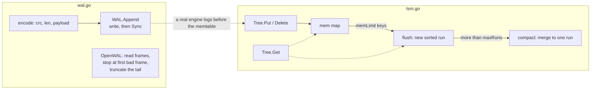
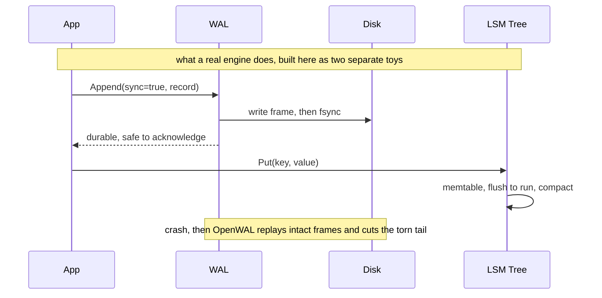
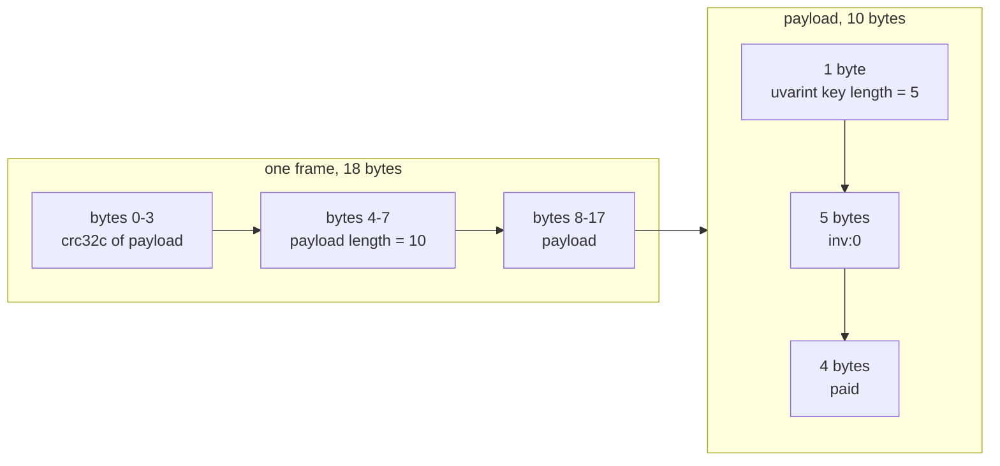
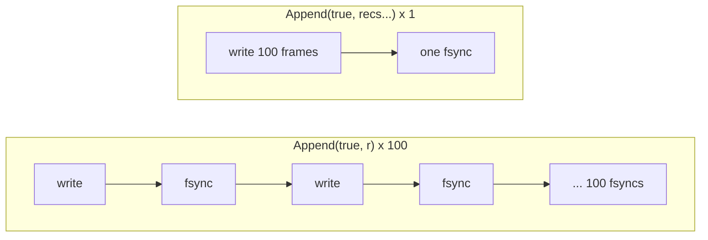
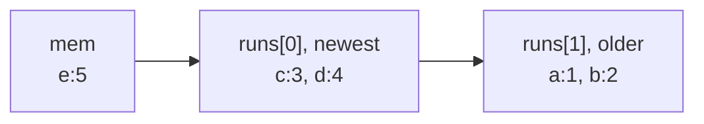

# Storage Engines - B-tree vs LSM and WAL - Go

> [!summary] TL;DR
> The runnable side of [[Storage Engines - B-tree vs LSM and WAL]]: a toy write-ahead log whose records carry a CRC-32C and a length so recovery can drop a torn tail, a benchmark that measures one `fsync` per commit against one `fsync` for a group, and a toy LSM tree that shows the write-amplification versus read-amplification trade-off of compaction.

## Before the code 🟢

> [!info] How to read this note (pick your level)
> - 🟢 **New to this?** Read "From zero" below, then "What this code shows" and "Setup". Skim the diagrams in the Code section; skip the line-by-line parts.
> - 🟡 **Know the basics?** Work through the Code steps, Design decisions, Tests and Running it.
> - 🔴 **Interview / SDE-3 prep?** Add Pitfalls and do the Exercises. Headings are tagged 🟢🟡🔴 so you always know where you are.

**From zero, in 60 seconds** 🟢

This file is the hands-on half of [[Storage Engines - B-tree vs LSM and WAL]]. It builds two tiny toys in plain Go: a **WAL** (a diary file the database writes before saying "saved", with checksums so a crash cannot leave a lie in it) and a mini **LSM tree** (writes pile up in memory, get dumped as sorted files, and get merged later). You then run real tests and benchmarks on your own machine and see the theory's numbers appear: one disk flush per commit is about 100 times slower than one flush shared by 100 commits, and merging files more often makes writes expensive but reads cheap. Read it top to bottom; every code block is followed by a "How it works" list that explains it line by line.

- **Files and `fsync`** (`os.OpenFile`, `f.Sync()`): open a file for appending; `Sync` asks the OS to really put the bytes on disk, which is what makes a commit durable.
- **`encoding/binary` and `hash/crc32`**: write lengths as little-endian integers and varints, and add a checksum so a half-written (torn) record is detected on replay.
- **`bufio`**: buffered reading, so replaying the log does not make one system call per byte.
- **`slices` and `maps` packages** (`slices.SortFunc`, `slices.BinarySearchFunc`, `maps.Values`): standard helpers for sorting the memtable and searching sorted runs.
- **Tests and benchmarks**: `t.TempDir()` gives each test a real throwaway folder; `b.Loop()` is the Go 1.24 benchmark loop used to compare fsync-per-commit with group commit.
- **What to run**: `go vet ./... && go test -race -v ./...`, then `go test -run xxx -bench Commit ./...` for the fsync cost.

## What this code shows 🟢

| Code | Concept in the theory note |
| --- | --- |
| `encode` and `OpenWAL` | A framed log record, and crash recovery that stops at the first invalid record ([[Storage Engines - B-tree vs LSM and WAL]], "Crash recovery in PostgreSQL") |
| `WAL.Append(sync, recs...)` | Log before acknowledging, and group commit: one `fsync` for many records |
| `BenchmarkCommitFsyncEach` and `BenchmarkCommitGrouped` | The measured cost of the flush in the "Why it exists" section |
| `Tree.Put`, `flush`, `Get` | Memtable, flushed sorted runs and the newest-first read path |
| `Tree.Delete` and `compact` | Tombstones and compaction dropping overwritten versions |
| `TestCompactionTradeoff` | Write amplification against read amplification |



## Setup 🟢

- Go 1.24, standard library only (`bufio`, `encoding/binary`, `hash/crc32`, `maps`, `slices`).
- Layout: a module `kv` with `wal.go`, `wal_test.go`, `lsm.go` and `lsm_test.go`.
- Run it with `go vet ./... && go test -race -v ./...`. Run the benchmarks with `go test -run xxx -bench Commit ./...`.
- The tests use real files in `t.TempDir()`, so `File.Sync` really flushes. On macOS Go issues `F_FULLFSYNC`, which is why a single flush costs milliseconds.

## Code 🟡

The code is two independent pieces that a real engine would combine. `wal.go` is the durability half: a log you append to and replay after a crash. `lsm.go` is the speed half: an in-memory table that spills to sorted runs and merges them. The WAL is left out of the LSM tree on purpose, to keep each lesson small.



### Step 1: the record frame and the types

**In plain words:** every diary entry gets a wrapper — a checksum and a length — so a half-written entry can be spotted later, like a sealed envelope you can tell has been opened.

**Concept.** A log is only useful for recovery if recovery can tell a complete record from a half-written one ([[Storage Engines - B-tree vs LSM and WAL#Crash recovery in PostgreSQL]]). The fix used here is framing: every record carries a CRC-32C checksum and a length, the same idea PostgreSQL uses to find the end of its WAL.

The alternative of a plain text log with newlines cannot detect a corrupt middle, and a database record may contain a newline anyway. CRC-32C is the Castagnoli polynomial, which is the one with hardware support on modern CPUs.

```go
package kv

import (
	"bufio"
	"encoding/binary"
	"hash/crc32"
	"io"
	"os"
)

var crcTable = crc32.MakeTable(crc32.Castagnoli)

// Record is one logged change.
type Record struct{ Key, Value string }

// WAL is an append-only log. Each record is framed as
// crc32c(payload) | len(payload) | payload, so a torn write is detectable.
type WAL struct{ f *os.File }
```

**How it works.**

1. `crcTable` is built once at package start, so each checksum only does table lookups.
2. `Record` is a key and a value as strings. A real WAL logs page changes or row images, but a key-value pair shows the same framing.
3. `WAL` wraps one `*os.File`. The comment states the on-disk layout, which the next two functions must agree on.

Frame layout for the record `inv:0` = `paid` (18 bytes in total):



### Step 2: encode a record

**In plain words:** this function packs one key-value pair into bytes in exactly the shape the reader expects to unpack.

**Concept.** Encoding is the write side of the frame, and it must produce exactly what the reader in step 3 expects. The payload is built first, because the checksum and the length both describe the payload. The key length is stored as a varint so the reader knows where the key ends and the value begins, since neither has a terminator.

Fixed-width little-endian integers are used for the checksum and the length so that the header is always 8 bytes and the reader can read it in one call.

```go
func encode(r Record) []byte {
	p := binary.AppendUvarint(nil, uint64(len(r.Key)))
	p = append(append(p, r.Key...), r.Value...)
	frame := binary.LittleEndian.AppendUint32(nil, crc32.Checksum(p, crcTable))
	frame = binary.LittleEndian.AppendUint32(frame, uint32(len(p)))
	return append(frame, p...)
}
```

**How it works.**

1. `binary.AppendUvarint(nil, ...)` starts the payload with the key length.
2. The nested `append` adds the key bytes and then the value bytes. The `string` is appended directly to the `[]byte`, which Go allows without a conversion.
3. The checksum is computed over the payload only, then the length is appended, then the payload. The header is therefore `crc | len`, matching the comment on `WAL`.
4. Each `Append...` returns a new slice, so there is no shared buffer and the function is safe to call concurrently.

### Step 3: open and recover

**In plain words:** at startup we read the diary entry by entry, keep every entry that checks out, and cut the file off at the first broken one.

**Concept.** Recovery replays the log from the start and stops at the first frame that is not provably whole, exactly as in [[Storage Engines - B-tree vs LSM and WAL#Crash recovery in PostgreSQL]]. Everything after a bad frame is untrusted, even if it looks valid, because the bad frame means the write that followed it may have been lost or reordered.

After the loop, the file is truncated to the last good offset so new appends start on a clean edge. The alternative of leaving the garbage in place would put the next valid frame after unreadable bytes, and it would never be found on the next recovery.

```go
// OpenWAL replays every intact record through apply, in order, then cuts off
// a torn or corrupt tail left by a crash so new appends start on a clean edge.
func OpenWAL(path string, apply func(Record)) (*WAL, error) {
	f, err := os.OpenFile(path, os.O_RDWR|os.O_CREATE, 0o644)
	if err != nil {
		return nil, err
	}
	r := bufio.NewReader(f)
	var good int64 // offset just past the last intact record
	for {
		var hdr [8]byte
		if _, err := io.ReadFull(r, hdr[:]); err != nil {
			break // clean end of the log, or a torn header
		}
		n := binary.LittleEndian.Uint32(hdr[4:])
		if n > 1<<20 {
			break // a length this large can only be garbage
		}
		p := make([]byte, n)
		if _, err := io.ReadFull(r, p); err != nil {
			break // torn payload
		}
		if crc32.Checksum(p, crcTable) != binary.LittleEndian.Uint32(hdr[:4]) {
			break // corrupt: nothing after this point can be trusted
		}
```

**How it works.**

1. `O_RDWR|O_CREATE` opens the file for reading and writing and creates it on first use, so the same call works for a new log and for recovery.
2. `good` is the byte offset after the last intact frame. It only moves forward when a whole record has been accepted.
3. `io.ReadFull` returns an error when fewer bytes than asked remain. That covers a clean end of file (no bytes) and a torn header (some bytes), and both simply end the replay.
4. The `n > 1<<20` guard rejects a length above 1 MiB before `make([]byte, n)`. Without it, a garbage length could allocate gigabytes.
5. A short payload read is a torn payload, and a checksum mismatch is corruption. Both `break` out of the loop.

Where each failure kind is caught, for a log of three good frames followed by damage:

| Damage after frame 3 | Check that stops the loop |
| --- | --- |
| nothing, file ends | header `ReadFull` fails with EOF |
| 3 bytes of a header | header `ReadFull` fails with unexpected EOF |
| full header, half payload | payload `ReadFull` fails |
| full frame, flipped bit | CRC mismatch |
| garbage header with length 4 GiB | `n > 1<<20` guard |

```go
		klen, w := binary.Uvarint(p)
		if w <= 0 || klen > uint64(len(p)-w) {
			break
		}
		k := w + int(klen)
		apply(Record{Key: string(p[w:k]), Value: string(p[k:])})
		good += 8 + int64(n)
	}
	if _, err = f.Seek(good, io.SeekStart); err == nil {
		err = f.Truncate(good)
	}
	if err != nil {
		f.Close()
		return nil, err
	}
	return &WAL{f: f}, nil
}
```

**How it works.**

1. `binary.Uvarint` returns the key length and the number of bytes `w` it used. `w <= 0` means a broken varint, and `klen > len(p)-w` means the key would run past the payload. Either is treated as corruption, even though the CRC passed.
2. `apply` is called only after every check, so the caller never sees a half-valid record.
3. `good += 8 + int64(n)` adds the header and the payload, moving the offset to the start of the next frame.
4. After the loop, `Seek(good)` puts the file position at the clean edge and `Truncate(good)` removes the torn bytes. Seek comes first so that later writes start there.
5. On an error, `f.Close()` runs before returning, so a failed open does not leak a file descriptor.

### Step 4: append, and group commit

**In plain words:** writing bytes is cheap; waiting for the disk to confirm them (`fsync`) is the slow part, so we let many commits share one wait.

**Concept.** The WAL rule is to log before acknowledging, and the commit point is the `fsync` that makes the log durable ([[Storage Engines - B-tree vs LSM and WAL#Write-ahead logging]]). An `fsync` costs milliseconds because it waits for the device, while the write itself only copies into the OS page cache.

So the cost is the flush, and group commit shares one flush among many records ([[Storage Engines - B-tree vs LSM and WAL#Group commit]]). `Append` takes a variadic list of records so a caller can pick one record per flush or many.

A background goroutine that collects concurrent commits, as PostgreSQL does, is the production design, but a single batch call shows the arithmetic without concurrency.

```go
// Append writes the records with one write call. With sync it also fsyncs,
// so one Append of many records is one durable "group commit".
func (w *WAL) Append(sync bool, recs ...Record) error {
	var buf []byte
	for _, r := range recs {
		buf = append(buf, encode(r)...)
	}
	if _, err := w.f.Write(buf); err != nil {
		return err
	}
	if sync {
		return w.f.Sync()
	}
	return nil
}

func (w *WAL) Close() error { return w.f.Close() }
```

**How it works.**

1. All records are encoded into one buffer, so there is a single `Write` system call no matter how many records.
2. `w.f.Sync()` is the `fsync`. On macOS Go issues `F_FULLFSYNC`, which is why one flush costs milliseconds.
3. With `sync` false, the function returns after the copy into the page cache. The data is not durable and is not a commit.
4. The batch is written as one buffer but is not atomic: a crash in the middle can leave only the first records of the batch, and recovery keeps them.

One flush per commit against one flush for a group of 100:



### Step 5: the LSM entry and the tree type

**In plain words:** the toy LSM is just a map in memory, a list of sorted lists standing in for files, and three counters that measure how much work it is doing.

**Concept.** An LSM tree turns random writes into sequential ones: updates go to an in-memory table and are written out later as sorted, immutable runs ([[Storage Engines - B-tree vs LSM and WAL#LSM write and read paths]]). The `Tree` type holds exactly those parts: a memtable, a list of runs ordered newest first, and counters that measure the trade-off.

Runs are in-memory sorted slices standing in for SSTable files, so the test can run 100,000 writes without disk noise. An entry has a `tombstone` flag because a delete must be written as data, not as an absence.

```go
package kv

import (
	"maps"
	"slices"
	"strings"
)

type entry struct {
	key, value string
	tombstone  bool
}

func byKey(a, b entry) int { return strings.Compare(a.key, b.key) }
```

**How it works.**

1. `maps` and `slices` are the Go 1.23 standard packages, used for sorted iteration and merging.
2. `entry` is the unit stored in memtable and runs. A tombstone is an entry whose `tombstone` is true and whose value is ignored.
3. `byKey` has the signature `slices.SortedFunc` and `slices.SortFunc` expect, returning negative, zero or positive.

```go
// Tree is a toy LSM tree. Each run stands in for one immutable SSTable file.
type Tree struct {
	mem       map[string]entry // memtable (real engines use a skiplist)
	memLimit  int              // flush when the memtable holds this many keys
	runs      [][]entry        // sorted runs, newest first
	maxRuns   int              // merge all runs into one when there are more
	UserBytes int              // bytes the application wrote
	DiskBytes int              // bytes written to runs by flushes and compactions
	Probes    int              // runs searched by Get (read amplification)
}

func NewTree(memLimit, maxRuns int) *Tree {
	return &Tree{mem: map[string]entry{}, memLimit: memLimit, maxRuns: maxRuns}
}
```

**How it works.**

1. `mem` is a map for simplicity, because lookup and overwrite are cheap. A real memtable is a skiplist so it can be iterated in order without sorting at flush time.
2. `runs[0]` is the newest run. `Get` relies on that order.
3. The three exported counters are the measuring instruments: `DiskBytes / UserBytes` is write amplification and `Probes` per lookup is read amplification.
4. `maxRuns` is the whole compaction policy: the knob the test turns.

The tree after two flushes, with `memLimit` 2:



### Step 6: write path and flush

**In plain words:** a write just updates the in-memory pad; when the pad is full, it is sorted and dumped out as one new file, and a delete is written the same way, just marked "gone".

**Concept.** A write is a memory operation. Only when the memtable is full is it turned into a new sorted run, which is a sequential write. This is the write path from [[Storage Engines - B-tree vs LSM and WAL#LSM write and read paths]].

Flushing can trigger compaction, which is the policy step that keeps the run count bounded. Writing the flush check inside `write` keeps `Put` and `Delete` identical, since a delete is just a write of a tombstone.

```go
func (t *Tree) Put(k, v string) { t.write(entry{key: k, value: v}) }
func (t *Tree) Delete(k string) { t.write(entry{key: k, tombstone: true}) }

func (t *Tree) write(e entry) {
	t.UserBytes += len(e.key) + len(e.value)
	t.mem[e.key] = e // a real engine appends to its WAL first
	if len(t.mem) >= t.memLimit {
		t.flush()
	}
}

// flush writes the memtable out as a new sorted run.
func (t *Tree) flush() {
	run := slices.SortedFunc(maps.Values(t.mem), byKey)
	t.runs = append([][]entry{run}, t.runs...)
	t.DiskBytes += size(run)
	t.mem = map[string]entry{}
	if len(t.runs) > t.maxRuns {
		t.compact()
	}
}
```

**How it works.**

1. `UserBytes` counts what the application wrote, at write time, so it is the denominator of write amplification.
2. `t.mem[e.key] = e` overwrites an older version in memory. Overwriting inside the memtable is free: only the latest version ever reaches disk.
3. The comment marks where a real engine would append to its WAL first. That is the link to the first half of this note.
4. `slices.SortedFunc(maps.Values(...), byKey)` collects the map values and sorts them, giving the run in key order.
5. `append([][]entry{run}, t.runs...)` puts the new run at the front, so the slice stays newest first.
6. A fresh `map` replaces the memtable, and `compact` runs only when there are too many runs.

### Step 7: compaction and read

**In plain words:** compaction merges all the files into one, keeping only the newest copy of each key, and a read checks the pad first and then the files newest to oldest.

**Concept.** Compaction merges runs so that reads probe fewer files and old versions and tombstones are discarded ([[Storage Engines - B-tree vs LSM and WAL#Deletes and compaction]]). The price is rewriting data, which is write amplification. This code uses the simplest policy, "merge everything into one run when there are more than `maxRuns`", which is enough to show the trade-off without levels or tiers.

Real engines use leveled or size-tiered compaction because merging everything rewrites the whole database each time.

```go
// compact merges every run into one, keeping only the newest version of each
// key. Tombstones are dropped because no older run is left for them to hide.
func (t *Tree) compact() {
	newest := map[string]entry{}
	for i := len(t.runs) - 1; i >= 0; i-- { // oldest first; newer runs overwrite
		for _, e := range t.runs[i] {
			newest[e.key] = e
		}
	}
	merged := slices.DeleteFunc(slices.Collect(maps.Values(newest)),
		func(e entry) bool { return e.tombstone })
	slices.SortFunc(merged, byKey)
	t.runs = [][]entry{merged}
	t.DiskBytes += size(merged)
}
```

**How it works.**

1. The loop goes from the oldest run to the newest, so a newer version overwrites an older one in `newest`. At the end `newest` holds one entry per key, the latest.
2. `slices.DeleteFunc` removes tombstones. This is safe only because after this merge there is exactly one run, so no older version of the key survives for the deleted key to resurface from.
3. The result is sorted again because iterating a map is unordered.
4. `DiskBytes` grows by the whole merged size, which is the rewrite cost. This single line is the write amplification of compaction.

Before and after one compaction with a tombstone, `maxRuns` 1:

| | runs[0] (newest) | runs[1] (oldest) |
| --- | --- | --- |
| before | `a` tombstone, `c`=3 | `a`=1, `b`=2 |
| after (one run) | `b`=2, `c`=3 | none |

```go
// Get checks the memtable, then each run from newest to oldest.
// The first version found wins, even if it is a tombstone.
func (t *Tree) Get(k string) (string, bool) {
	if e, ok := t.mem[k]; ok {
		return e.value, !e.tombstone
	}
	for _, run := range t.runs {
		t.Probes++
		i, found := slices.BinarySearchFunc(run, k,
			func(e entry, k string) int { return strings.Compare(e.key, k) })
		if found {
			return run[i].value, !run[i].tombstone
		}
	}
	return "", false
}

func size(run []entry) (n int) {
	for _, e := range run {
		n += len(e.key) + len(e.value)
	}
	return n
}
```

**How it works.**

1. The memtable is checked first because it holds the newest data, and a hit there needs no run probe.
2. Each run counts as one probe in `t.Probes`. That is read amplification, as the number of places a lookup may look.
3. `BinarySearchFunc` works because every run is sorted by key.
4. The first match returns immediately, even if it is a tombstone. Skipping it to look in older runs would bring a deleted key back to life.
5. A key in no run returns the empty value and `false`, which costs one probe per run: the worst case, which the test deliberately triggers.

## Design decisions 🟡

| Decision | Alternative | Trade-off |
| --- | --- | --- |
| Frame is `crc32c`, length, then payload | Newline-delimited text, or length only | Detects torn and corrupt records and can stop exactly, but adds 8 bytes per record |
| CRC-32C (Castagnoli) | CRC-32 IEEE, or a cryptographic hash | Hardware-accelerated and standard for storage, but not collision-resistant against an attacker |
| Stop replay at the first bad frame | Skip the bad frame and continue | Never applies records that follow lost data, at the risk of discarding later good records |
| Truncate the tail after recovery | Leave it and append past it | New appends are always readable, but needs a write to the file at open |
| `Append(sync bool, recs ...Record)` | Separate `Append` and `Commit` methods | One call shows group commit with a flag, but a caller can forget to sync |
| One `fsync` per batch | Background goroutine batching concurrent commits | Simple and deterministic, but does not batch across callers like PostgreSQL does |
| Memtable is a `map` plus a sort at flush | Skiplist or B-tree memtable | Shorter code, but flush costs an extra O(n log n) sort |
| Runs are in-memory slices | Real SSTable files | Fast, deterministic measurement, but ignores disk and caching effects |
| Compaction merges all runs into one | Leveled or size-tiered compaction | Easiest to reason about and shows the trade-off, but rewrites everything each time |
| Counters are plain `int` fields | `atomic` counters or metrics | Simple, but the tree is not safe for concurrent use |

## Tests 🟡

There are three checks: one correctness test for the WAL, two benchmarks that measure the cost of a flush, and one measuring test for compaction. The tests use real files in `t.TempDir()`, so `File.Sync` really flushes.

### TestWALDropsTornTailAndKeepsCommittedRecords

**In plain words:** we fake a power cut halfway through writing the 4th entry and check that recovery keeps the 3 finished entries and throws away the broken one.

**Property.** After a crash in the middle of writing a record, recovery returns exactly the committed records, drops the torn one, and leaves the log ready for new appends. This is the guarantee a WAL exists to give.

| Step | Action | Expected |
| --- | --- | --- |
| 1 | append 3 records with `sync=true`, close | 54 bytes on disk (3 frames of 18) |
| 2 | append the first 9 of the 18 bytes of record 4 | torn header plus one payload byte |
| 3 | reopen and replay | 3 records, last key `inv:2` |
| 4 | append `inv:4`, close, replay | 4 records, last key `inv:4` |

```go
package kv

import (
	"os"
	"path/filepath"
	"strconv"
	"testing"
)

func replay(t *testing.T, path string) (*WAL, []Record) {
	t.Helper()
	var got []Record
	w, err := OpenWAL(path, func(r Record) { got = append(got, r) })
	if err != nil {
		t.Fatal(err)
	}
	return w, got
}

func TestWALDropsTornTailAndKeepsCommittedRecords(t *testing.T) {
	path := filepath.Join(t.TempDir(), "wal")
	w, _ := replay(t, path)
	for i := range 3 {
		if err := w.Append(true, Record{Key: "inv:" + strconv.Itoa(i), Value: "paid"}); err != nil {
			t.Fatal(err)
		}
	}
	w.Close()
```

The crash simulation and the checks after recovery:

```go
	// Simulate a crash in the middle of writing a 4th record.
	torn := encode(Record{Key: "inv:3", Value: "paid"})
	f, _ := os.OpenFile(path, os.O_WRONLY|os.O_APPEND, 0)
	f.Write(torn[:len(torn)/2])
	f.Close()

	w, got := replay(t, path)
	if len(got) != 3 || got[2].Key != "inv:2" {
		t.Fatalf("recovered %v, want the 3 complete records", got)
	}
	// The torn bytes are gone, so the next append starts on a clean edge.
	if err := w.Append(true, Record{Key: "inv:4", Value: "sent"}); err != nil {
		t.Fatal(err)
	}
	w.Close()
	_, got = replay(t, path)
	if len(got) != 4 || got[3].Key != "inv:4" {
		t.Fatalf("after re-append got %v", got)
	}
}
```

**What a failure means.** The first `Fatalf` firing means recovery either lost a committed record (fewer than 3) or applied the torn one (more than 3). The second firing is the subtle one: it means the tail was not truncated, so `inv:4` was written after unreadable bytes and the next recovery stopped before it.

### The two commit benchmarks

**In plain words:** same 100 commits twice — once with 100 disk waits, once with 1 — to measure how much group commit saves.

**Property.** The same 100 durable commits cost about 100 times less when they share one `fsync`. This is the measured basis for group commit ([[Storage Engines - B-tree vs LSM and WAL#Group commit]]).

| Benchmark | Calls per iteration | `fsync` calls |
| --- | --- | --- |
| `BenchmarkCommitFsyncEach` | `Append(true, rec)` 100 times | 100 |
| `BenchmarkCommitGrouped` | `Append(true, recs...)` once | 1 |

```go
// BenchmarkCommitFsyncEach fsyncs once per commit; BenchmarkCommitGrouped
// shares one fsync across the same 100 commits.
func benchRecs() []Record {
	recs := make([]Record, 100)
	for i := range recs {
		recs[i] = Record{Key: "inv:" + strconv.Itoa(i), Value: "paid"}
	}
	return recs
}

func BenchmarkCommitFsyncEach(b *testing.B) {
	w, err := OpenWAL(filepath.Join(b.TempDir(), "wal"), func(Record) {})
	if err != nil {
		b.Fatal(err)
	}
	defer w.Close()
	recs := benchRecs()
	for b.Loop() {
		for _, r := range recs {
			if err := w.Append(true, r); err != nil {
				b.Fatal(err)
			}
		}
	}
}
```

```go
func BenchmarkCommitGrouped(b *testing.B) {
	w, err := OpenWAL(filepath.Join(b.TempDir(), "wal"), func(Record) {})
	if err != nil {
		b.Fatal(err)
	}
	defer w.Close()
	recs := benchRecs()
	for b.Loop() {
		if err := w.Append(true, recs...); err != nil {
			b.Fatal(err)
		}
	}
}
```

**What a failure means.** Benchmarks do not assert, so they cannot fail on speed. A `b.Fatal` means the log could not be opened or written. If the two numbers come out close together, the device is acknowledging `fsync` from a volatile cache, so the measurement says nothing about real durability.

### TestCompactionTradeoff

**In plain words:** we turn the one knob (how many files may pile up before a merge) and watch write cost and read cost move in opposite directions.

**Property.** As `maxRuns` grows, write amplification falls and the runs probed per missing key rise, which is the write against read amplification trade-off ([[Storage Engines - B-tree vs LSM and WAL#Read, write and space amplification]]).

The test writes 100,000 invoice keys with a 1,000-key memtable and looks up one absent key every 100 writes. There are no bloom filters, so every run is searched.

| `maxRuns` | Expected write amp | Expected probes per miss |
| --- | --- | --- |
| 1 | highest | lowest |
| 4 | lower | higher |
| 16 | lowest | highest |

```go
package kv

import (
	"fmt"
	"testing"
)

// Fewer runs means fewer probes per read but more rewriting.
func TestCompactionTradeoff(t *testing.T) {
	prevWA, prevProbes := 1e9, -1.0
	for _, maxRuns := range []int{1, 4, 16} {
		tr := NewTree(1_000, maxRuns)
		for i := range 100_000 {
			tr.Put(fmt.Sprintf("inv:%07d", i), "status=sent;total=125000")
			if i%100 == 99 { // an absent key: every run must be searched
				tr.Get(fmt.Sprintf("missing:%d", i))
			}
		}
		wa := float64(tr.DiskBytes) / float64(tr.UserBytes)
		probes := float64(tr.Probes) / 1_000
		t.Logf("maxRuns=%-2d write amp=%5.1f  runs probed per miss=%4.1f", maxRuns, wa, probes)
		if wa >= prevWA || probes <= prevProbes {
			t.Fatalf("expected write amp to fall and probes to rise as maxRuns grows")
		}
		prevWA, prevProbes = wa, probes
	}
}
```

**What a failure means.** The `Fatalf` fires when either measure moves the wrong way from one `maxRuns` to the next. That means a compaction bug: for example, `compact` not counting its output in `DiskBytes`, or `Get` not incrementing `Probes` for every run.

## Running it 🟡

```bash
go vet ./... && go test -race -v ./...
go test -run xxx -bench Commit -benchtime 3x ./...
```

Measured on Go 1.24.4 (Apple M4, macOS), `go vet` clean:

```text
=== RUN   TestCompactionTradeoff
    lsm_test.go:21: maxRuns=1  write amp= 51.5  runs probed per miss= 1.0
    lsm_test.go:21: maxRuns=4  write amp= 13.2  runs probed per miss= 2.5
    lsm_test.go:21: maxRuns=16 write amp=  4.4  runs probed per miss= 8.2
--- PASS: TestCompactionTradeoff (7.32s)
--- PASS: TestWALDropsTornTailAndKeepsCommittedRecords (0.02s)
PASS
ok  	kv	8.567s
```

Reading it line by line:

1. `maxRuns=1`: every flush creates a second run, which triggers a merge of everything. After about 100 flushes the merges have rewritten roughly 50 times the data on average, plus 1 for the flush itself, which gives 51.5. A miss touches exactly one run.
2. `maxRuns=4`: a merge happens only every fifth flush, so write amplification drops to 13.2. The run count cycles between 1 and 4, averaging 2.5 probes.
3. `maxRuns=16`: merges are rare, so write amplification is 4.4 and a miss may probe up to 16 runs, averaging 8.2.
4. `--- PASS` for the compaction test takes 7.32 s because it writes 300,000 keys in total. The WAL test takes 0.02 s because it does a few real `fsync` calls.
5. `ok kv 8.567s` is the package total including the race detector.

Benchmarks:

```text
BenchmarkCommitFsyncEach-10    	       3	 397713181 ns/op
BenchmarkCommitGrouped-10      	       3	   3953264 ns/op
```

1. `-10` is `GOMAXPROCS`, and `3` is the iteration count requested with `-benchtime 3x`.
2. `397713181 ns/op` is about 398 ms for 100 commits, so about 3.98 ms per commit with one `fsync` each.
3. `3953264 ns/op` is about 3.95 ms for the same 100 commits, which is about 40 microseconds per commit when 100 share one flush. That is roughly 100 times cheaper, and it is the whole case for group commit.
4. An earlier set of three runs on the same machine gave 373-384 ms and 3.6-3.8 ms for the 100 commits, so the ratio is stable even though the absolute times vary.

## Pitfalls in the code 🔴

- **`Append` without `sync` is not a commit.** The write sits in the OS page cache until something flushes it; a machine crash can lose it. Only `Append(true, ...)` is the commit point.
- **A grouped `Append` is all or nothing only up to the first torn record.** If the crash happens mid-way through a batch, recovery keeps the intact leading records and drops the rest, so a caller must not acknowledge any record in a batch before `Append` returns.
- **The length check in `OpenWAL` matters.** Without the `n > 1<<20` guard, a garbage length in a torn header could make `make([]byte, n)` allocate gigabytes.
- **The tombstone drop in `compact` is only safe because there is exactly one run left.** With levels or tiers, a tombstone must be kept until it has passed every older version of its key.
- **`Tree` is not safe for concurrent use**, and its counters are plain integers. The tests use one goroutine.
- **`Get` returns the first version it finds, even a tombstone.** Skipping tombstones to look in older runs would resurrect deleted keys.

## Exercises 🔴

1. In `TestCompactionTradeoff`, change the memtable limit from 1,000 to 5,000 keys. Predict the direction of write amplification and of runs probed per miss for `maxRuns = 4`, then run it.
2. Call `Append(false, rec)` in the torn-tail test instead of `Append(true, rec)`. Does the test still pass on your machine? Explain why that does not prove the unsynced version is crash safe.
3. Add a `Tree.Delete` test: put a key, flush it into a run, delete it, and check that `Get` reports it missing before and after `compact`. Predict how `DiskBytes` changes after the compaction.

## Links 🟢

- **Theory:** [[Storage Engines - B-tree vs LSM and WAL]]
- **Before this:** [[Indexing Fundamentals]], [[Transactions and ACID]], [[Page Cache, File Systems and fsync]]
- **Related:** [[Replication]], [[Backup, PITR and Disaster Recovery]], [[Bloom Filters and Probabilistic Data Structures]], [[Wide-Column Stores and Cassandra]]
