# Storage Engines - B-tree vs LSM and WAL

> [!summary] TL;DR
> A **storage engine** is the part of a database that lays rows out on disk and finds them again. **B-tree** engines (PostgreSQL, InnoDB) keep one sorted structure of fixed-size pages and edit pages in place. **LSM** engines (RocksDB, Cassandra) never edit a file: they write new sorted files and merge them in the background.
>
> Both survive crashes the same way: every change is first appended to a **write-ahead log (WAL)**, and a commit is acknowledged only after that log is flushed to disk with `fsync`.

> [!abstract] Core idea
> - Every change is appended to the write-ahead log (WAL) and flushed with `fsync` before the commit is acknowledged; data pages are written later.
> - After a crash, the database replays the WAL to rebuild any page that had not reached disk.
> - B-tree: one sorted tree of pages edited in place; good reads, random writes.
> - LSM: buffer writes in memory, flush sorted immutable files, merge them in the background; cheap writes, reads check several files.
> - Classic mistake: thinking COMMIT means the row is in the table file. It only means it is in the WAL.

## Start here: the basics 🟢

> [!info] How to read this note (pick your level)
> - 🟢 **New to this?** Read "From zero" below, then sections 1, 2 and the cheat sheet (10). Stop there, that is a full first pass.
> - 🟡 **Know the basics?** Add section 3 (how it works), 4 (worked example), 5 and 6.
> - 🔴 **Interview / SDE-3 prep?** Add 7, 8 and 9. Headings are tagged 🟢🟡🔴 so you always know where you are.

> [!note] Before this note
> - [[Indexing Fundamentals]]: an index is a sorted structure (usually a B-tree) that finds rows without reading everything.
> - [[Transactions and ACID]]: after `COMMIT` returns, the change must survive a crash (the D in ACID). This note shows how.
> - [[Page Cache, File Systems and fsync]]: a normal write lands in the operating system's memory first; only `fsync` forces it onto the disk.

**From zero, in 60 seconds** 🟢

You type something into an app and press save. If the power dies one second later, you still expect your save to be there when the machine comes back.

A database keeps that promise with a simple trick: before it touches anything, it writes one line describing your change into a diary file. That diary is called the **WAL** (write-ahead log). Only after the diary line is safely on the disk does the database say "saved".


If the power cuts out, the database just re-reads the diary at restart and redoes anything the data files missed.

The second question is how to organise the data files themselves. There are two big families. A **B-tree** keeps one neat sorted book and edits pages of it in place. An **LSM tree** never edits a file: it keeps writing new sorted files and merges them in the background, like stacking new notebooks and binding them together later.

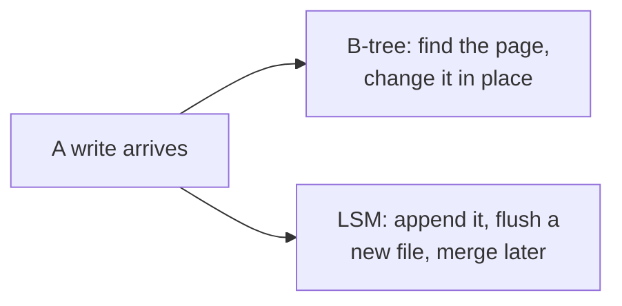

That is the whole note. The rest is just these 4 questions:
1. Why is a diary (WAL) cheaper and safer than writing the real data at once?
2. How does a B-tree edit pages in place without breaking?
3. How does an LSM tree write, read and merge its files?
4. Which one do you pick for a given workload, and what does each cost?

**The problem in one story.**
You save a note in an app and the power cuts out one second later.
When the machine restarts, you expect the note to still be there, whole, not half-written.
A database has the same promise for millions of saves per second.
This note is about how it keeps that promise and how it lays data out on disk so reads and writes stay fast.

**Words you need first**

| Word | Plain meaning | Tiny example |
| --- | --- | --- |
| Disk page | A fixed-size block the database reads and writes as one unit | 8 KB in PostgreSQL, 16 KB in InnoDB |
| `fsync` | Asking the OS to really push data onto the disk, not just into memory | `COMMIT` waits for one `fsync` of the log |
| Log (append-only) | A file you only ever add to the end of | A diary: new entries go at the bottom |
| Index | A sorted lookup structure that finds rows without scanning everything | Finding invoice 42 without reading all invoices |
| Buffer pool | Pages the database keeps cached in RAM | Hot pages stay in memory, cold ones go to disk |
| Crash recovery | What the database does at restart to get back to a correct state | Replaying the log after a power cut |
| Compaction | Background merging of files to drop old versions and deleted data | Merging 4 small sorted files into 1 |
| WAL (write-ahead log) | The diary file every change is written to before the data files | replayed after a crash |
| Checkpoint | The moment the data files are caught up with the WAL, so older WAL can be recycled | every 5 minutes in PostgreSQL |
| Memtable / SSTable | An LSM's sorted in-memory buffer, and the sorted read-only file it is dumped into | 64 MB memtable → one SSTable |
| Tombstone | A "this key is deleted" marker in an LSM | removed later by compaction |
| Torn page | A page left half old, half new by a crash mid-write | 4 kB of an 8 kB page written |
| LSN | Log sequence number: a byte position in the WAL | stamped on each page |

**Picture it**

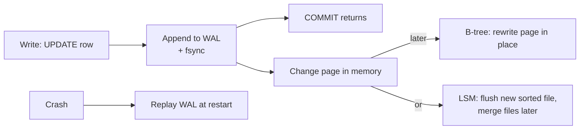

**Analogy.** A shop clerk first writes every sale in a receipt book (the WAL), then updates the shelf inventory sheet (the data pages) when there is time.
If the clerk faints, the next clerk replays the receipt book to fix the sheet.
Where it breaks: a real receipt book never gets "compacted"; a database also has to manage files, caches and torn half-written pages.

**How the rest of this note builds up**

- First, why a log is needed at all (section 1) and the mental model of "log first, pages later" (section 2).
- Then pages, the buffer pool, B+trees, WAL, group commit and checkpoints (section 3).
- Then LSM trees: memtables, SSTables, tombstones and compaction, plus read, write and space amplification.
- Then a traced crash and a measured compaction choice (section 4), trade-offs and production settings.
- Finally the SDE-3 deep dive, interview questions and cheat sheet.

> [!tip] Remember
> COMMIT means "it is in the log on disk", not "it is in the table file"; B-trees edit in place, LSM trees append and merge later.

## 1. Why it exists 🟢

InvoiceOps receives a payment webhook, marks invoice 42 as `paid` and answers `200 OK`. The power fails 5 ms later. Two things must still be true after the restart:

- **Durability:** the payment is there.
- **No corruption:** a page that was half-written when the power failed does not break the table.

Writing every changed 8 kB data page to disk at commit time would mean several random writes per commit. A power cut in the middle of one leaves a **torn page**: part old bytes, part new.

So engines do something cheaper and safer: append a small record describing the change to a log, flush only the log, and write the data pages later. Many commits can share one flush.

**Measured on this laptop** (Apple M4, macOS 26.5, Go 1.24, the toy WAL from section 4; Go's `File.Sync` issues `F_FULLFSYNC` on macOS, a real flush to the SSD). `BenchmarkCommitFsyncEach` calls `Append(true, rec)` 100 times; `BenchmarkCommitGrouped` calls `Append(true, recs...)` once with the same 100 records:

| How 100 commits reach the disk     | Time for 100 commits (3 runs) | Commits per second |
| ---------------------------------- | ----------------------------- | ------------------ |
| One `fsync` per commit             | 373–384 ms                    | about 265          |
| One `fsync` for all 100 (grouped)  | 3.6–3.8 ms                    | about 27,000       |

The flush, not the write, is the expensive part. Every design in this note is shaped by that.

### Real-life example 🟢

When you send a payment in a UPI app, the bank's database must remember it even if a server loses power a moment later.
It does not rewrite the big account tables right away; it first appends one short line ("account A −₹500, account B +₹500, committed") to its log and forces that line onto disk.
Only then does the app show "Payment successful".
The account tables are brought up to date a little later, and after a crash the log is replayed so nothing confirmed is lost.

## Common beginner mistakes 🟢

- **Thinking `COMMIT` means "written to the table file"** → it only means "written to the log on disk"; the table files catch up later → trust the WAL, and keep it on reliable storage.
- **Turning off `fsync` or `full_page_writes` for speed** → a power cut can then corrupt data, not just lose the last commits → if you must trade safety, use `synchronous_commit = off`, which can lose recent commits but never corrupts.
- **Using random UUIDv4 keys on a hot B-tree** → inserts land all over the index, causing many page splits and half-empty pages → use ever-increasing keys such as identity columns or UUIDv7.
- **Assuming a delete in an LSM frees space at once** → it only writes a tombstone; space comes back after compaction → watch tombstone counts and plan compaction.
- **Picking an LSM engine for a normal app "because writes are faster"** → reads and range scans get more expensive, and compaction needs tuning → use a B-tree engine like PostgreSQL unless write volume is the real bottleneck.

## 2. Mental model 🟢

- **Pages and a cache.** Data lives in fixed-size pages: 8 kB in PostgreSQL, 16 kB by default in InnoDB. The engine copies pages into an in-memory **buffer pool**, changes them there, and writes them back later.
- **The log is the truth; the data files catch up.** A change is durable once its log record is on disk. After a crash, the engine replays the log to bring the data files up to date.
- **Two ways to organise the data files:**
	- A **B+tree** keeps one sorted copy and rewrites pages in place.
	- An **LSM tree** (log-structured merge tree) only writes new sorted files, then merges them in the background.

Analogy: an accountant's **journal and ledger**. Every transaction is first written, in order, into the journal (the WAL). The ledger (the data files) is brought up to date later, in batches. When the books are balanced (a **checkpoint**), older journal pages are no longer needed. If the ledger is damaged, you replay the journal from the last balance.

## 3. How it works 🟡

> 🟢 → 🟡 **You now know** the one rule (write the log, flush it, then answer) and the two ways to lay out data files. **Next we open the box**: pages and the cache, how a B+tree grows, the WAL rules, group commit, checkpoints, crash recovery, and how LSM trees write, read and compact. Most subsections start with a short step-by-step walk.

### Pages and the buffer pool

**In plain words:** the database reads and writes the disk in fixed-size blocks called pages, like a binder that only accepts full sheets, and keeps the busiest sheets copied in RAM.

**Step by step (update invoice 42):**
1. The row lives on some 8 kB page of the `invoices` file.
2. If that page is not already in RAM (the buffer pool), read the whole page from disk.
3. Change the row inside the page in RAM. The page is now "dirty" (newer in RAM than on disk).
4. Write a small WAL record describing the change.
5. The dirty page is written back to its file later, not at commit time.

A PostgreSQL page has a 24-byte header, an array of 4-byte line pointers (small slots that say where each row sits inside the page) growing forward, row versions (tuples) growing backward from the end, and free space in between. The header records the **LSN** (log sequence number, a byte position in the WAL) of the last WAL record that changed the page.

Recovery uses it to skip changes the page already has.

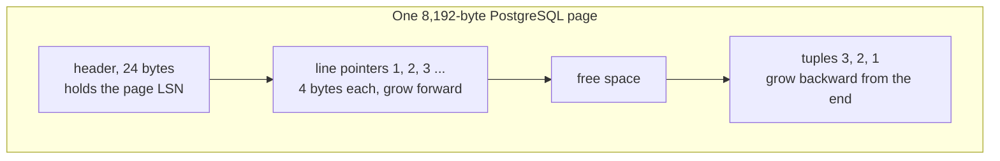

Example with numbers: if each row version takes about 100 bytes, every row costs 104 bytes (100 plus its 4-byte line pointer). The 8,168 bytes after the header hold about 78 rows. Changing one of them dirties the whole 8 kB page (an estimate by arithmetic, ignoring tuple-header detail).

| | PostgreSQL 17 | MySQL 8.0 InnoDB |
| --- | --- | --- |
| Page size | 8 kB (compile-time) | 16 kB default (`innodb_page_size`) |
| Table layout | **Heap**: rows in no particular order; every index, including the primary key, points to `(page, slot)` | **Clustered index**: the table *is* the primary-key B+tree; secondary indexes store the primary key |
| Buffer pool | `shared_buffers` (default 128 MB; the docs suggest 25% of RAM as a start on a dedicated server), plus the OS page cache | `innodb_buffer_pool_size`, often most of RAM on a dedicated server |
| Eviction | Clock sweep with a usage count per buffer | LRU with midpoint insertion: new pages enter 3/8 from the tail, so one big scan cannot flush the hot set |

### B+tree: in-place updates and page splits

**In plain words:** a B+tree is a sorted filing cabinet; a new entry goes into the right folder, and when a folder is full you add a new folder and move half the papers over (a "split").

Internal pages hold separator keys and child pointers; leaf pages hold the entries and link to their right neighbour. [[Indexing Fundamentals]] covers lookups and fan-out. What matters to the storage engine is what happens on a write:

1. Descend to the leaf that should hold the key and insert it if the page has room. One dirty page, one WAL record.
2. If the leaf is full, **split** it: allocate a new page, move about half the entries over, and insert a separator for the new page into the parent. That is three dirty pages, and the split can cascade up; a root split adds a level.

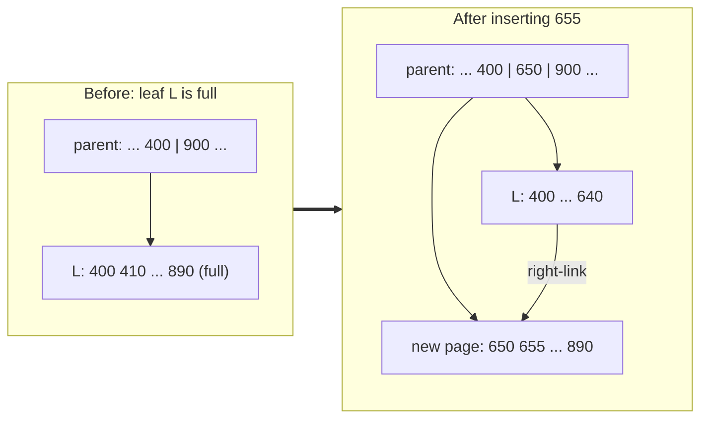

- **Key order decides page fill.** Ever-increasing keys (identity columns, UUIDv7) always land on the rightmost leaf. PostgreSQL then splits so the left page stays at the fillfactor (how full a page is packed, leaving room for later updates; 90% for B-tree indexes), and InnoDB leaves pages about 15/16 full. Random keys (UUIDv4) split pages everywhere; InnoDB documents random-order pages as 1/2 to 15/16 full. That means more pages, more cache misses and more writes; see [[Unique ID Generation]].
- **Splits run concurrently.** PostgreSQL's B-tree is a Lehman–Yao **B-link tree**: every page has a right-link and a "high key", so a reader that lands on a page that was just split simply moves right instead of waiting for a lock on the parent.
- **Space is not given back eagerly.** Deleting entries leaves half-empty pages. PostgreSQL's VACUUM recycles a B-tree page only once it is completely empty.

### Write-ahead logging

**In plain words:** write it in the diary first, push the diary to disk, and only then tell the caller "done"; the real data files can catch up whenever.

Two rules make the log trustworthy:

1. **Log before data.** A dirty page may be written to its data file only after the WAL up to that page's LSN is on disk.
2. **Log before acknowledging.** `COMMIT` returns only after the commit record is flushed.

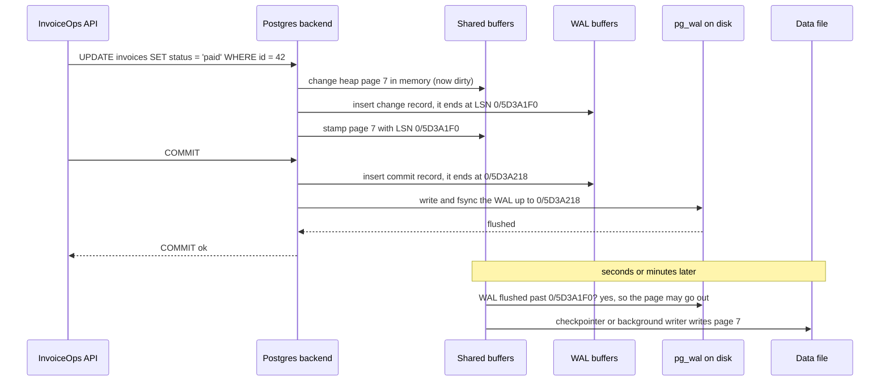

### Group commit

**In plain words:** one trip to the disk can carry many commits at once, like one delivery van taking everyone's parcels instead of one van per parcel.

**Step by step:**
1. Session A commits and starts an `fsync` of the WAL, which takes about 3.8 ms.
2. While that flush is running, sessions B and C write their commit records and wait.
3. When A's flush ends, one more `fsync` makes both B's and C's records durable.
4. Three commits needed two flushes instead of three; with more sessions the saving grows.

One `fsync` makes every record written before it durable, so commits that arrive while a flush is running can share the next one.

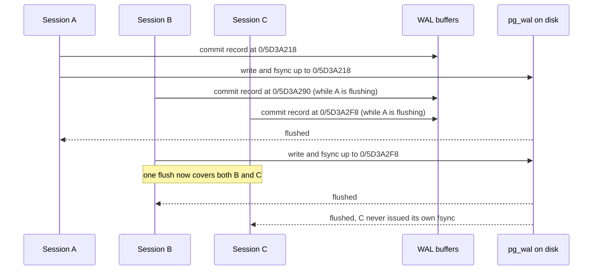

With a flush costing about 3.8 ms (measured above), three sessions that commit inside one flush pay about 7.6 ms in total instead of 11.4 ms, and under load the saving grows with the number of waiters.

### Durability settings

**In plain words:** every engine has knobs that trade a little safety for speed; they decide how many of your very latest commits a crash may eat.

**Step by step:**
1. Default PostgreSQL: each `COMMIT` waits for the WAL flush. A crash loses nothing that was acknowledged.
2. `synchronous_commit = off`: `COMMIT` returns before the flush. A crash can lose up to about 0.6 s of recent commits, but data is never corrupted.
3. InnoDB `innodb_flush_log_at_trx_commit = 1`: flush at every commit (safe). `2` or `0`: flush once a second (faster, can lose about a second).
4. Choose per kind of data: payments stay safe; click-tracking events can use the faster setting.

- **PostgreSQL:** the WAL lives in 16 MB segment files in `pg_wal`. One flush covers every record written so far, so commits that arrive together share it (**group commit**). The same WAL stream feeds [[Replication]] and point-in-time recovery ([[Backup, PITR and Disaster Recovery]]).
	- `synchronous_commit = off` acknowledges before the flush. A crash can lose the last commits (at most about three times `wal_writer_delay`, 600 ms by default) but never corrupts data. It can be set per transaction, for example for analytics events but not payments.
	- `commit_delay` (default 0) makes the flushing backend wait briefly so more commits join the flush.
- **InnoDB** keeps two logs. The **redo log** (sized by `innodb_redo_log_capacity` since MySQL 8.0.30) is the WAL. The **undo log** keeps old row versions for rollback and MVCC, see [[Isolation Levels and MVCC]].
	- `innodb_flush_log_at_trx_commit`: `1` (default) writes and flushes at every commit; `2` writes at commit and flushes once a second (an OS crash can lose about a second); `0` writes and flushes once a second (even a `mysqld` crash can lose about a second).
	- The binary log has its own flush, `sync_binlog` (default 1).

### Checkpoints and torn pages

**In plain words:** a checkpoint is the moment the database catches the data files up with the diary, so old diary pages can be thrown away; a torn page is a sheet the power cut left half old, half new.

**Step by step:**
1. Every 5 minutes (or after 1 GB of WAL) a checkpoint starts.
2. It writes all dirty pages from RAM to the data files, spread out over time.
3. It writes a checkpoint record to the WAL. WAL from before this point is no longer needed for recovery.
4. The first time each page changes after the checkpoint, PostgreSQL logs a full copy of that page, so a page torn by a crash can be restored whole.

A **checkpoint** writes every dirty page to the data files, then writes a checkpoint record to the WAL. Recovery starts from the last checkpoint's REDO point, so WAL before it can be recycled.

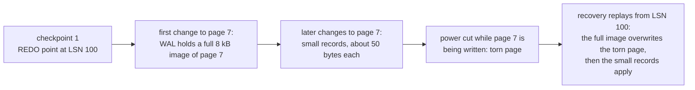

Example: after checkpoint 1, a hot page changes 5 times before the next checkpoint. With `full_page_writes = on` the WAL carries one 8,192-byte image plus 4 small records of about 50 bytes each, about 8.4 kB in total (an estimate), instead of 5 small records. That is why WAL volume spikes right after each checkpoint.

- PostgreSQL starts one every `checkpoint_timeout` (default 5 min), or earlier when the WAL would otherwise grow past `max_wal_size` (default 1 GB). `checkpoint_completion_target = 0.9` spreads the writes over 90% of the interval to avoid an I/O spike.
- **Torn pages.** The OS and disk only promise atomic writes of smaller units (often 4 kB), so an 8 kB page can be half-written by a crash. Replaying a small change record onto a torn page cannot repair it.
	- PostgreSQL (`full_page_writes = on`) logs the **entire page** the first time it changes after each checkpoint; recovery restores that image first.
	- InnoDB uses a **doublewrite buffer**: every page is first written to a doublewrite area (separate files since MySQL 8.0.20), then to its real place. After a crash, a torn page is replaced by its intact copy.

### Crash recovery in PostgreSQL

**In plain words:** at restart the database opens the diary at the last "books balanced" mark and redoes every entry from there, skipping anything the pages already have.

1. Read `pg_control` to find the last checkpoint and its REDO point.
2. Replay WAL records in order from there. A full-page image overwrites the page. A normal record is applied only if the page's LSN is older than the record's, which makes replay idempotent (running it twice has the same effect as once).
3. Stop at the first record with a bad CRC (checksum: a number that shows whether bytes were damaged) or a missing next segment: that is the end of the WAL.
4. There is **no undo pass**. A transaction without a commit record counts as aborted; its row versions stay invisible and VACUUM removes them later. InnoDB, which updates rows in place, must also roll back unfinished transactions from the undo log, which it does in the background after startup.

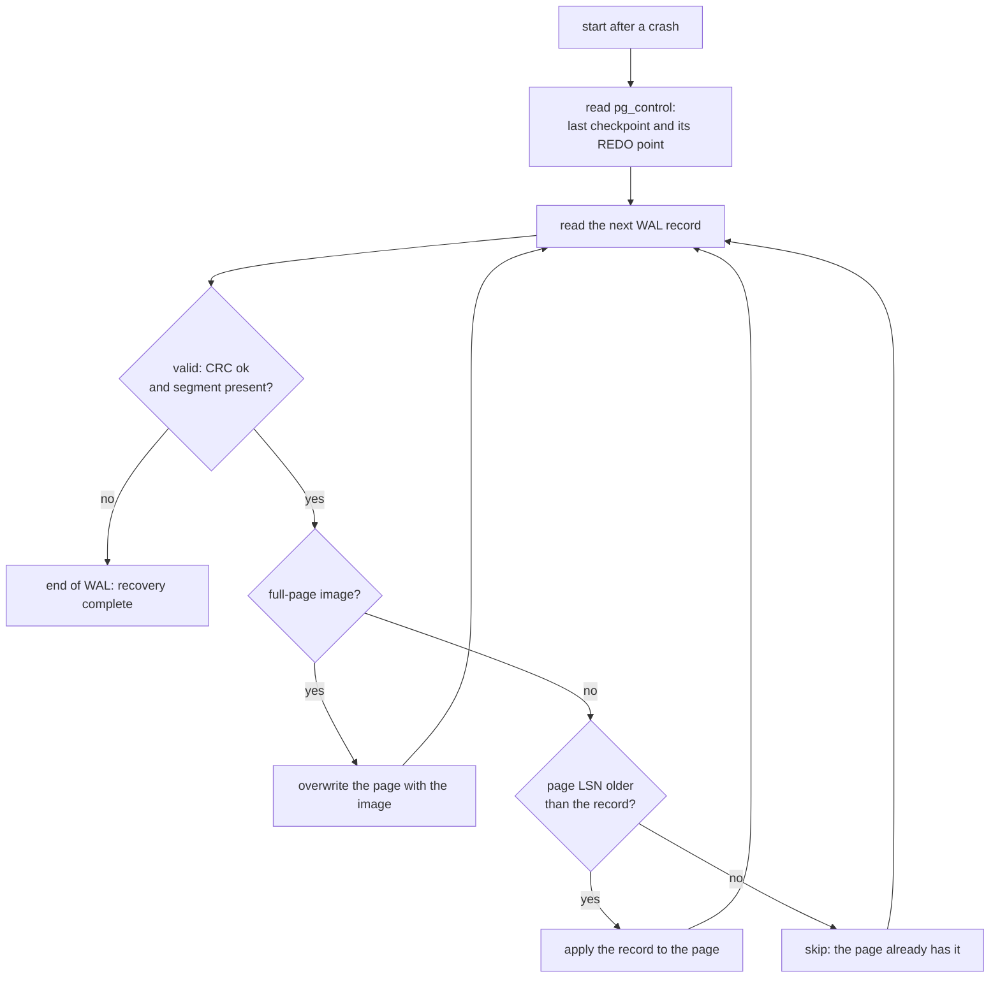

This is ARIES-style "redo history, then undo the losers", minus the undo step that PostgreSQL's multi-version heap does not need.

### LSM trees

An LSM engine turns every write into a sequential append.

### LSM write and read paths

**In plain words:** writes pile up in a sorted in-memory pad, get dumped as read-only sorted files, and a read checks the pad first and then the files from newest to oldest.

**Step by step:**
1. A write `invoice:42 = paid` is appended to the WAL and inserted into the memtable (a sorted structure in RAM).
2. When the memtable reaches 64 MB, it is frozen and written to disk as one sorted, read-only file: an SSTable (sorted string table).
3. A read for `invoice:42` checks the memtable first, then SSTables from newest to oldest.
4. Each SSTable has a bloom filter (a tiny summary that can say "definitely not here"), so most files are skipped without reading them.
5. The first version found is the newest, and it wins.

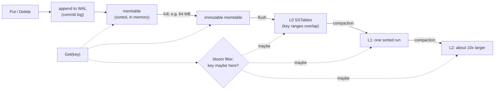

- **Write.** Append to the WAL, insert into the **memtable** (a skiplist in LevelDB and RocksDB, see [[Union-Find and Skip Lists]]), acknowledge. When the memtable fills (RocksDB `write_buffer_size`, default 64 MB) it becomes immutable, a fresh one takes writes, and a background thread **flushes** it as an **SSTable** (sorted string table): sorted data blocks (4 KB by default in RocksDB), an index block, a bloom filter and a footer. Once flushed, that memtable's WAL can be deleted.
- **Read.** Check the memtable, then immutable memtables, then every L0 file newest first (their key ranges overlap), then at most one file per lower level (their ranges do not overlap). The first version found wins.
- **Bloom filters.** Each SSTable carries a [[Bloom Filters and Probabilistic Data Structures|bloom filter]]. About 10 bits per key gives roughly a 1% false-positive rate, so a lookup for an absent key touches almost no data blocks. Range scans cannot use them: they must merge an iterator from every level.
### Deletes and compaction

**In plain words:** an LSM never erases anything on the spot; a delete is just a "this is gone" note (a tombstone), and a background merge later throws out the old copies and the notes together.

**Step by step:**
1. You delete `invoice:42`. The engine writes a tombstone: "`invoice:42` deleted".
2. Older SSTables still hold the old value; reads see the tombstone first and return "not found".
3. Compaction merges a few SSTables into one, keeping only the newest version of each key.
4. Once the tombstone has passed every older copy, both are dropped and the space is freed.

- **Delete.** Write a **tombstone**. The old value is only physically removed when compaction carries the tombstone past every older version.
- **Compaction** merges SSTables, drops overwritten versions and expired tombstones, and keeps reads bounded. **Leveled** compaction (RocksDB default, LevelDB, Cassandra LCS) keeps one sorted run per level, each about 10 times larger than the last (RocksDB L1 target 256 MB). **Size-tiered** (Cassandra STCS, RocksDB "universal") merges files of similar size.

Example with numbers (leveled, using RocksDB defaults): four 64 MB L0 files each overlap L1's key range, and L1 holds 256 MB. Compaction reads the 4 × 64 MB plus the overlapping part of L1 and writes a new sorted L1. Merging 256 MB of new data into, say, 256 MB of existing L1 data writes about 512 MB for 256 MB of user data, so this single step already has a write amplification of about 2 (an estimate from the model); the data is then rewritten again when L1 spills into L2.

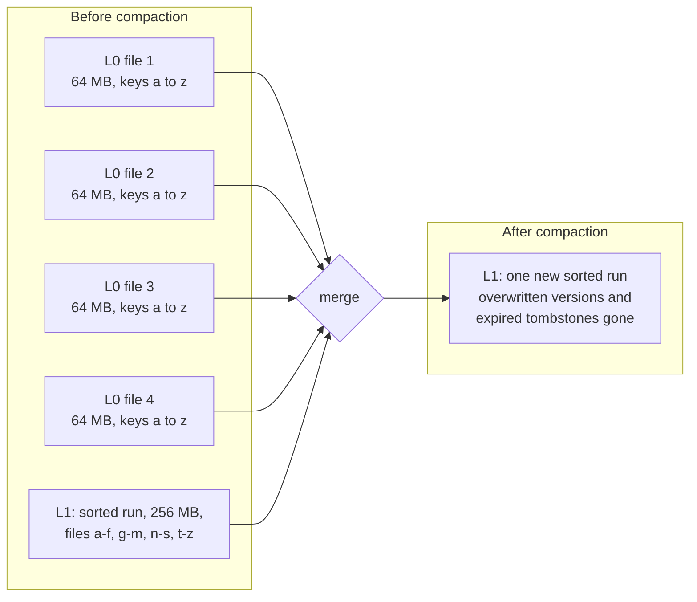

### Read, write and space amplification

**In plain words:** these three numbers say how much extra work the engine does per read, how many extra bytes it writes per byte you save, and how much extra disk it wastes — and no design can win on all three at once.

**Step by step (the three ratios with small numbers):**
1. You write 1 MB. Compaction rewrites it several times over its life, say 10 MB in total: write amplification 10.
2. A point read checks the memtable and 3 files: read amplification about 4.
3. 1 GB of live data takes 1.1 GB on disk because old versions wait for compaction: space amplification 1.1.
4. Making one of these smaller usually makes another bigger.

- **Write amplification:** bytes written to storage ÷ bytes the application wrote.
- **Read amplification:** pages or files touched per logical read.
- **Space amplification:** bytes on disk ÷ bytes of live data.

The **RUM conjecture** (Athanassoulis et al., 2016) says an access method can minimise at most two of read overhead, update overhead and memory/space overhead. Engines pick their two:

| | B+tree (PostgreSQL, InnoDB) | LSM, leveled | LSM, size-tiered |
| --- | --- | --- | --- |
| Write amp | Page-granular: changing a 100-byte row dirties an 8 kB page, about 80× if nothing else on the page changed before it is written, plus a full-page WAL image after each checkpoint (estimate by arithmetic) | Each byte is rewritten about once per level, merging with up to about 10× as much data from the next level (estimate from the model) | Each byte is rewritten about once per tier: lowest of the three |
| Read amp | Root-to-leaf path, upper levels nearly always cached | Memtable + L0 files + one file per level; bloom filters cut point misses | Many overlapping runs per key range |
| Space amp | Free space in pages, plus bloat from dead rows (PostgreSQL) | About 1.11× with a 10× fan-out, since about 90% of data sits in the last level (Dong et al., 2017) | A full merge may temporarily need as much free space again as the data being merged |

## 4. Worked example 🟡

### Whiteboard version

**In plain words:** the smallest possible WAL in a few lines of Go — write the diary line, force it to disk, then change memory.

The one rule of a WAL: log, flush, then change data. The snippet is deliberately the smallest version of the idea.

```go
package wal

import "os"

type DB struct {
	log  *os.File
	data map[string]string // the "pages", flushed to disk later
}

// Put: append to the log, fsync, then change memory. Only then ack.
func (db *DB) Put(k, v string) error {
	if _, err := db.log.WriteString("SET " + k + " " + v + "\n"); err != nil {
		return err
	}
	if err := db.log.Sync(); err != nil { // the commit point
		return err
	}
	db.data[k] = v
	return nil
}
```

The runnable version adds checksums so recovery can detect a torn record, replay, and a toy LSM tree with memtable, flush and merge.

### A WAL commit and a crash, traced

InvoiceOps appends three payment records, each with its own `fsync`, and the power fails halfway through the fourth.

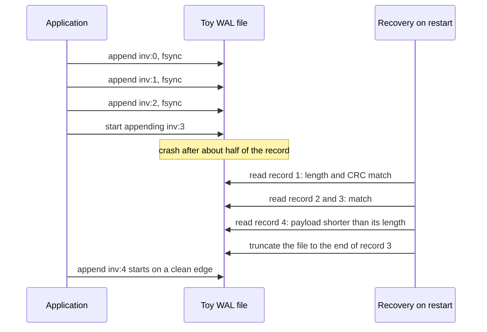

Each record is framed as a CRC-32C, a length and a payload. Recovery stops at the first record whose length or CRC does not match, cuts the file there, and so the three acknowledged commits survive while the half-written fourth is dropped. It was never acknowledged, so nothing is lost.

### Compaction policy, measured

**In plain words:** we let a toy LSM merge its files eagerly, sometimes, or rarely, and measure the trade: merge more and reads get cheap but you rewrite data over and over; merge less and writes get cheap but reads must search more files.

The toy LSM tree buffers 1,000 keys per memtable and merges everything into one run once there are more than `maxRuns` runs. It writes 100,000 invoice keys and looks up one absent key every 100 writes, with no bloom filters, so every run is searched.

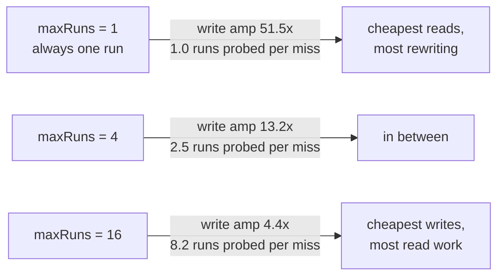

**Measured** (`go test -race -v`, Go 1.24, 2026-11-02):

| `maxRuns` | Write amplification | Runs probed per absent key | Behaves like |
| --- | --- | --- | --- |
| 1 | 51.5× | 1.0 | Always fully merged: cheapest reads, most rewriting |
| 4 | 13.2× | 2.5 | In between |
| 16 | 4.4× | 8.2 | Tiered: cheapest writes, most read work |

Two lessons. Merging everything into one run rewrites the whole dataset again and again, so its write amplification grows with the data; that is why real engines merge level by level or tier by tier. And there is no free setting: every write saved is paid back in read work, and in real engines in space as well.

Runnable Go version: [[Storage Engines - B-tree vs LSM and WAL - Go]]

## 5. Variants and comparison 🟡

| Design | How it writes | Use when | Cost | Examples |
| --- | --- | --- | --- | --- |
| B+tree, in place + WAL | Change pages in the buffer pool, log the change, write pages at checkpoints | Read-heavy OLTP, range scans, predictable latency | Random page writes, page-level write amp, fragmentation | PostgreSQL, InnoDB, SQL Server, Oracle, SQLite |
| Copy-on-write B+tree | Write new copies of every page on the path to the root, then switch the root pointer | Embedded stores that want crash safety without a WAL and lock-free readers | Whole-path rewrite per commit, one writer at a time | LMDB, bbolt (used by etcd) |
| LSM, leveled | Memtable → SSTables → one sorted run per level | Write-heavy with point reads, tight disk budget | 10s of × write amp, compaction CPU and I/O | RocksDB default, LevelDB, Pebble (CockroachDB), Cassandra LCS |
| LSM, size-tiered | Merge runs of similar size | Ingest-heavy, few reads, spare disk | More runs per read, temporary 2× space | Cassandra STCS (its long-time default), RocksDB universal |
| LSM, time-window | Compact only within time buckets; drop whole expired files | Append-only time series with TTLs | Bad for updates to old data | Cassandra TWCS; see [[Time-Series and Columnar Storage]] |
| Log + in-memory hash index | Append to a log; keep `key → offset` in RAM | Small key sets with a high write rate | Every key must fit in RAM; no range scans | Bitcask (Riak) |

Who uses what:
- **PostgreSQL:** heap tables plus B-tree (and other) indexes, redo-only WAL, old row versions kept in the heap and cleaned by VACUUM.
- **MySQL InnoDB:** clustered primary-key B+tree, redo log, undo log, doublewrite buffer.
- **RocksDB:** leveled LSM by default. It is the engine under MyRocks, TiKV (TiDB), Kafka Streams state stores and YugabyteDB's DocDB (a modified fork).
- **CockroachDB:** Pebble, a Go LSM engine inspired by RocksDB, the default since v20.2.
- **Cassandra and ScyllaDB:** LSM with a commit log; Cassandra 5.0 adds the Unified Compaction Strategy. See [[Wide-Column Stores and Cassandra]].
- **MongoDB WiredTiger:** B-tree with a journal (its WAL) and periodic checkpoints.

## 6. Trade-offs and when not to use 🟡

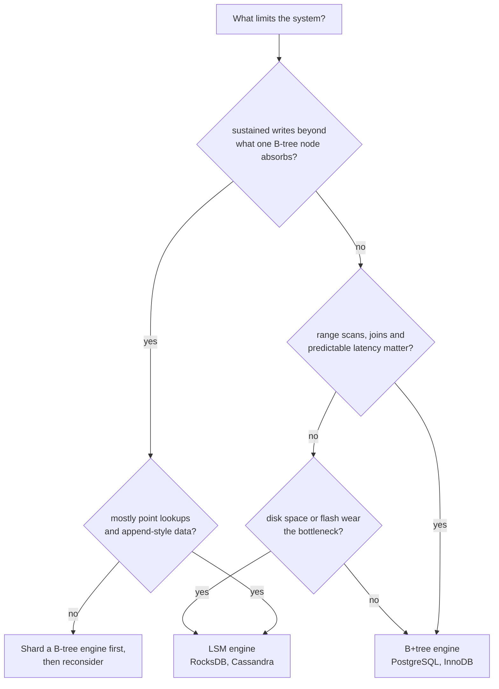

- **Pick a B+tree engine** (in practice: PostgreSQL or MySQL) for general OLTP. Reads touch a bounded number of pages, range scans are cheap, and the tooling is mature. Most InvoiceOps-sized systems never need anything else.
- **Pick an LSM engine** when sustained write volume is the bottleneck (event ingestion, time series, large key-value workloads) or when storage efficiency matters: no half-empty pages, and SSTables compress well.
- **LSM costs:**
	- Compaction competes with foreground traffic, and falling behind causes write stalls.
	- Tombstones slow reads until compaction purges them.
	- Range scans merge many sources.
	- Latency is less predictable than a B-tree's.
- **B-tree costs:**
	- Random writes and splits.
	- Page-granular write amplification.
	- In PostgreSQL, dead row versions that VACUUM must clean ([[Isolation Levels and MVCC]]).
- **Do not weaken durability by accident.** `synchronous_commit = off`, `innodb_flush_log_at_trx_commit = 2`, RocksDB writes without `sync` and Cassandra's default periodic commit log all trade the last moments of commits for speed. That is fine for clickstream events and wrong for payments.

## 7. In production 🔴

> 🟡 → 🔴 **You now know** how both engine families write, read, recover and clean up. **Next is the senior view**: real tuning settings and failure modes in production, and the deeper internals interviewers probe.

- **Real systems:** see the list in section 5. Defaults differ in ways that matter:
	- Cassandra's default `commitlog_sync: periodic` (every 10 s) acknowledges writes before they are fsynced, relying on replicas for durability.
	- RocksDB's `WriteOptions.sync` is false by default: a process crash loses nothing (the WAL is in the OS page cache), but a machine crash can.
- **Failure modes → fixes:**
	- *Checkpoint I/O spikes and WAL bursts* (every page's first change after a checkpoint writes a full image) → raise `max_wal_size` so checkpoints are triggered by time, keep `checkpoint_completion_target` at 0.9, and consider `wal_compression` (`lz4` or `zstd` since PostgreSQL 15).
	- *Slow crash recovery* after a huge `max_wal_size` → recovery replays everything since the last checkpoint; size it against your recovery-time objective.
	- *Torn pages after disabling `full_page_writes`* → only disable it on storage that guarantees atomic 8 kB writes (for example ZFS), never "for speed".
	- *LSM write stalls* (RocksDB slows writes at 20 L0 files and stops them at 36, or at 64 GB / 256 GB of pending compaction bytes) → more compaction threads, faster disks, rate-limit ingestion, or split the data.
	- *Tombstone storms* (Cassandra warns at 1,000 tombstones read by one query and fails it at 100,000) → avoid queue-like delete patterns, use TTLs with TWCS, and remember `gc_grace_seconds` (default 10 days) delays purging.
	- *Random primary keys* → page splits and a cold buffer pool, worst in InnoDB where the table itself is ordered by the key. Use sequential IDs or UUIDv7.
- **What to monitor:**
	- **PostgreSQL:** `pg_stat_checkpointer` (new in 17: `num_timed` vs `num_requested`); `pg_stat_wal` (`wal_bytes`, `wal_fpi`, `wal_buffers_full`); `pg_stat_io` (since 16); buffer hit ratio from `pg_statio_user_tables`. `log_checkpoints` is on by default since 15.
	- **InnoDB:** buffer pool reads vs read requests, redo log fill (checkpoint age), history list length.
	- **RocksDB:** per-level compaction stats, L0 file count, pending compaction bytes, stall counters.
	- **Cassandra:** SSTables per read, tombstones per read, pending compactions (`nodetool tablestats`, `nodetool compactionstats`).

## 8. Deep dive 🔴

- **"fsyncgate" (2018).** PostgreSQL used to retry a failed `fsync`, assuming the dirty pages were still in the page cache. On Linux a failed writeback can drop those pages, so the retry "succeeds" although the data never reached disk. PostgreSQL now PANICs on an `fsync` failure and recovers from the WAL instead (the `data_sync_retry` setting, off by default, added in the February 2019 minor releases). Lesson: the WAL, not the page cache, is the only copy you can trust.
- **Why PostgreSQL needs no undo log.** An `UPDATE` writes a new row version and leaves the old one in place, so an aborted transaction's versions are simply invisible. The bill arrives later as VACUUM work and table bloat. InnoDB updates rows in place and moves old versions to undo, so its bill is purge work and a growing history list. Both are covered in [[Isolation Levels and MVCC]].
- **HOT updates.** If no indexed column changes and the new version fits on the same heap page, PostgreSQL skips every index update (a heap-only tuple). A lower table `fillfactor` (for example 90) leaves room for this on hot, frequently updated tables.
- **Large values in LSMs.** Every compaction rewrites values along with keys. WiscKey (FAST 2016) and RocksDB's BlobDB store large values in a separate log and keep only pointers in the tree, cutting write amplification at the cost of an extra read and value-log garbage collection.
- **Group commit is free throughput.** One flush makes every record written before it durable. Under concurrency, a PostgreSQL backend's WAL flush also covers other sessions' commit records, which is the effect the benchmark in section 1 measures from a single thread.
- **Copy-on-write instead of a WAL.** LMDB and bbolt never overwrite a live page, so a crash leaves either the old root or the new one. The price is rewriting the whole root-to-leaf path on every commit and allowing one writer at a time.
- **Checksums.** WAL records always carry CRCs. Data-page checksums are an `initdb` option (`--data-checksums`) and become the default in PostgreSQL 18; they detect corruption on read but cannot repair it, which is what backups are for.

## 9. Interview questions 🔴

> [!question]- Why write a log at all instead of writing the changed pages at commit?
> A log append is sequential and small, and one `fsync` can cover many commits (group commit). Writing pages at commit means random writes of whole pages, and a crash mid-write can tear a page. With a WAL, pages are written lazily and recovery replays the log.

> [!question]- Trap: after COMMIT returns, is the row in the table's data file on disk?
> Usually not yet. Only the WAL is guaranteed flushed. The changed page may sit dirty in the buffer pool until the next checkpoint. If the machine crashes, recovery replays the WAL from the last checkpoint and rebuilds the page.

> [!question]- Walk through PostgreSQL crash recovery.
> Read `pg_control`, find the last checkpoint's REDO point, and replay WAL forward. Full-page images restore torn pages; other records apply only where the page LSN is older. Stop at the first invalid record. Transactions without a commit record count as aborted, so there is no undo pass.

> [!question]- B-tree or LSM for a new system: how do you decide?
> Look at the workload. Read-heavy, range scans, need for predictable latency → B-tree. Sustained high write volume, point lookups, compressed storage → LSM. Then name the costs: B-trees pay page-level write amplification and random I/O; LSMs pay compaction, write stalls and read amplification for range scans.

> [!question]- What do bloom filters do in an LSM tree, and when do they not help?
> Each SSTable has a filter that answers "definitely not here" or "maybe here", so a point lookup skips most files; about 10 bits per key gives roughly 1% false positives. They do nothing for range scans, which must merge an iterator from every level.

> [!question]- Trap: you deleted 80% of a Cassandra table; why did disk usage not drop?
> Deletes write tombstones, which take space of their own. Deleted data disappears only when compaction merges it with its tombstone, and with size-tiered compaction the old data may sit in a large SSTable that is rarely compacted. The tombstones themselves are kept at least `gc_grace_seconds` (10 days by default) so that repair can spread the delete to every replica.

> [!question]- What is a torn page and how do PostgreSQL and InnoDB handle it?
> A page that was half-written when the power failed, because the OS and disk only guarantee smaller atomic writes. PostgreSQL logs a full page image on the first change after each checkpoint. InnoDB writes every page to a doublewrite area before writing it in place, and restores the intact copy after a crash.

## 10. Cheat sheet 🟢

🟢 **Plain version:** A database first writes each change to a log and forces it onto disk, then says "saved"; the real data files catch up later, and the log is replayed after a crash. The slow part is forcing data onto disk, so many commits share one flush. B-trees edit sorted pages in place; LSM trees keep writing new sorted files and merge them in the background. B-trees suit most apps; LSM trees suit very heavy writing.


- WAL rule: log before data, flush the log before acknowledging the commit.
- The cost is the `fsync`: about 3.8 ms each on this laptop (measured); group commit shares one flush across many commits.
- Checkpoint = write dirty pages + mark a REDO point; recovery replays the WAL from it. Full-page writes or doublewrite protect against torn pages.
- B+tree: in-place pages, splits, sequential keys fill pages, random keys fragment them.
- LSM: WAL + memtable → SSTables → compaction; bloom filters for point misses; tombstones for deletes.
- Leveled = low space amp and high write amp; tiered = the reverse; you cannot minimise read, write and space at once (RUM).
- PostgreSQL: heap + redo-only WAL + VACUUM. InnoDB: clustered PK + redo + undo + doublewrite. RocksDB, Cassandra, Pebble: LSM.

## Self-check 🟢🟡

🟢 Easy

> [!question]- What does the database write first when you commit?
> A small record in the WAL, which it forces onto disk before replying.

> [!question]- What is the difference between a B-tree and an LSM tree in one line?
> A B-tree edits sorted pages in place; an LSM tree only writes new sorted files and merges them later.

> [!question]- How does an LSM tree delete a key?
> It writes a tombstone; compaction removes the old value and the tombstone later.

🟡 Medium

> [!question]- Why is group commit faster?
> One `fsync` makes every record written before it durable, so many commits share one slow flush.

> [!question]- Why does PostgreSQL log a full page image after each checkpoint?
> So a page torn by a crash mid-write can be restored whole before smaller changes are replayed onto it.

> [!question]- Why do bloom filters help LSM point reads but not range scans?
> They answer "is this exact key maybe here?"; a range has no single key to test.

## Links 🟢

- **Before this:** [[Indexing Fundamentals]], [[Transactions and ACID]], [[Page Cache, File Systems and fsync]]
- **Runnable code:** [[Storage Engines - B-tree vs LSM and WAL - Go]] (toy WAL with checksums, toy LSM tree, tests and benchmarks)
- **Next:** [[Isolation Levels and MVCC]], [[Replication]], [[Backup, PITR and Disaster Recovery]]
- **Compare with:** [[Wide-Column Stores and Cassandra]] (an LSM engine in a distributed database), [[Time-Series and Columnar Storage]] (column layouts for analytics), [[Case Study - Key-Value Store]]

### Watch on YouTube

- [LSM Tree vs B-Tree / Database Internals Explained](https://www.youtube.com/watch?v=tLYgGaY1MYo) · AlgoSimplified · direct comparison of the two storage engine families the note covers
