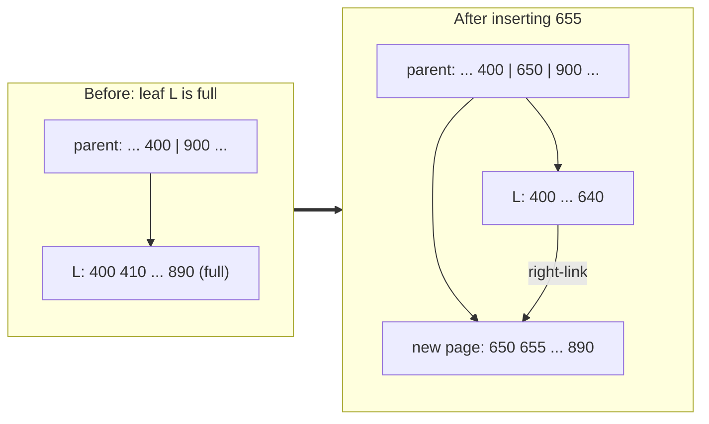
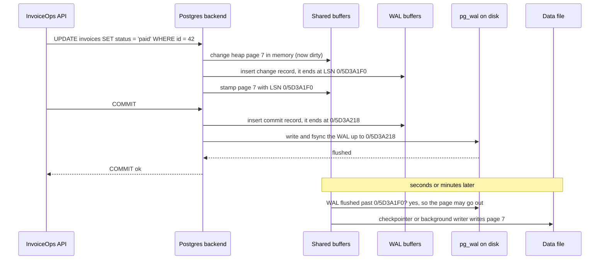
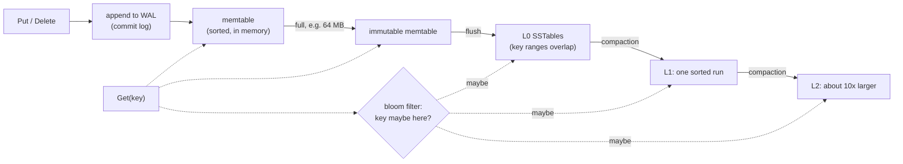

# Storage Engines - B-tree vs LSM and WAL

> [!summary] TL;DR
> A **storage engine** is the part of a database that lays rows out on disk and finds them again. **B-tree** engines (PostgreSQL, InnoDB) keep one sorted structure of fixed-size pages and edit pages in place. **LSM** engines (RocksDB, Cassandra) never edit a file: they write new sorted files and merge them in the background. Both survive crashes the same way: every change is first appended to a **write-ahead log (WAL)**, and a commit is acknowledged only after that log is flushed to disk with `fsync`.

## 1. Why it exists

InvoiceOps receives a payment webhook, marks invoice 42 as `paid` and answers `200 OK`. The power fails 5 ms later. Two things must still be true after the restart:

- **Durability:** the payment is there.
- **No corruption:** a page that was half-written when the power failed does not break the table.

Writing every changed 8 kB data page to disk at commit time would mean several random writes per commit. A power cut in the middle of one leaves a **torn page**: part old bytes, part new. So engines do something cheaper and safer: append a small record describing the change to a log, flush only the log, and write the data pages later. Many commits can share one flush.

**Measured on this laptop** (Apple M4, macOS 26.5, Go 1.24, the toy WAL from section 4; Go's `File.Sync` issues `F_FULLFSYNC` on macOS, a real flush to the SSD). `BenchmarkCommitFsyncEach` calls `Append(true, rec)` 100 times; `BenchmarkCommitGrouped` calls `Append(true, recs...)` once with the same 100 records:

| How 100 commits reach the disk     | Time for 100 commits (3 runs) | Commits per second |
| ---------------------------------- | ----------------------------- | ------------------ |
| One `fsync` per commit             | 373–384 ms                    | about 265          |
| One `fsync` for all 100 (grouped)  | 3.6–3.8 ms                    | about 27,000       |

The flush, not the write, is the expensive part. Every design in this note is shaped by that.

## 2. Mental model

- **Pages and a cache.** Data lives in fixed-size pages: 8 kB in PostgreSQL, 16 kB by default in InnoDB. The engine copies pages into an in-memory **buffer pool**, changes them there, and writes them back later.
- **The log is the truth; the data files catch up.** A change is durable once its log record is on disk. After a crash, the engine replays the log to bring the data files up to date.
- **Two ways to organise the data files:**
	- A **B+tree** keeps one sorted copy and rewrites pages in place.
	- An **LSM tree** (log-structured merge tree) only writes new sorted files, then merges them in the background.

Analogy: an accountant's **journal and ledger**. Every transaction is first written, in order, into the journal (the WAL). The ledger (the data files) is brought up to date later, in batches. When the books are balanced (a **checkpoint**), older journal pages are no longer needed. If the ledger is damaged, you replay the journal from the last balance.

## 3. How it works

### Pages and the buffer pool

A PostgreSQL page has a 24-byte header, an array of 4-byte line pointers growing forward, row versions (tuples) growing backward from the end, and free space in between. The header records the **LSN** (log sequence number, a byte position in the WAL) of the last WAL record that changed the page. Recovery uses it to skip changes the page already has.

| | PostgreSQL 17 | MySQL 8.0 InnoDB |
| --- | --- | --- |
| Page size | 8 kB (compile-time) | 16 kB default (`innodb_page_size`) |
| Table layout | **Heap**: rows in no particular order; every index, including the primary key, points to `(page, slot)` | **Clustered index**: the table *is* the primary-key B+tree; secondary indexes store the primary key |
| Buffer pool | `shared_buffers` (default 128 MB; the docs suggest 25% of RAM as a start on a dedicated server), plus the OS page cache | `innodb_buffer_pool_size`, often most of RAM on a dedicated server |
| Eviction | Clock sweep with a usage count per buffer | LRU with midpoint insertion: new pages enter 3/8 from the tail, so one big scan cannot flush the hot set |

### B+tree: in-place updates and page splits

Internal pages hold separator keys and child pointers; leaf pages hold the entries and link to their right neighbour. [[Indexing Fundamentals]] covers lookups and fan-out. What matters to the storage engine is what happens on a write:

1. Descend to the leaf that should hold the key and insert it if the page has room. One dirty page, one WAL record.
2. If the leaf is full, **split** it: allocate a new page, move about half the entries over, and insert a separator for the new page into the parent. That is three dirty pages, and the split can cascade up; a root split adds a level.



- **Key order decides page fill.** Ever-increasing keys (identity columns, UUIDv7) always land on the rightmost leaf. PostgreSQL then splits so the left page stays at the fillfactor (90% for B-tree indexes), and InnoDB leaves pages about 15/16 full. Random keys (UUIDv4) split pages everywhere; InnoDB documents random-order pages as 1/2 to 15/16 full. That means more pages, more cache misses and more writes; see [[Unique ID Generation]].
- **Splits run concurrently.** PostgreSQL's B-tree is a Lehman–Yao **B-link tree**: every page has a right-link and a "high key", so a reader that lands on a page that was just split simply moves right instead of waiting for a lock on the parent.
- **Space is not given back eagerly.** Deleting entries leaves half-empty pages. PostgreSQL's VACUUM recycles a B-tree page only once it is completely empty.

### Write-ahead logging

Two rules make the log trustworthy:

1. **Log before data.** A dirty page may be written to its data file only after the WAL up to that page's LSN is on disk.
2. **Log before acknowledging.** `COMMIT` returns only after the commit record is flushed.



- **PostgreSQL:** the WAL lives in 16 MB segment files in `pg_wal`. One flush covers every record written so far, so commits that arrive together share it (**group commit**). The same WAL stream feeds [[Replication]] and point-in-time recovery ([[Backup, PITR and Disaster Recovery]]).
	- `synchronous_commit = off` acknowledges before the flush. A crash can lose the last commits (at most about three times `wal_writer_delay`, 600 ms by default) but never corrupts data. It can be set per transaction, for example for analytics events but not payments.
	- `commit_delay` (default 0) makes the flushing backend wait briefly so more commits join the flush.
- **InnoDB** keeps two logs. The **redo log** (sized by `innodb_redo_log_capacity` since MySQL 8.0.30) is the WAL. The **undo log** keeps old row versions for rollback and MVCC, see [[Isolation Levels and MVCC]].
	- `innodb_flush_log_at_trx_commit`: `1` (default) writes and flushes at every commit; `2` writes at commit and flushes once a second (an OS crash can lose about a second); `0` writes and flushes once a second (even a `mysqld` crash can lose about a second).
	- The binary log has its own flush, `sync_binlog` (default 1).

### Checkpoints and torn pages

A **checkpoint** writes every dirty page to the data files, then writes a checkpoint record to the WAL. Recovery starts from the last checkpoint's REDO point, so WAL before it can be recycled.

- PostgreSQL starts one every `checkpoint_timeout` (default 5 min), or earlier when the WAL would otherwise grow past `max_wal_size` (default 1 GB). `checkpoint_completion_target = 0.9` spreads the writes over 90% of the interval to avoid an I/O spike.
- **Torn pages.** The OS and disk only promise atomic writes of smaller units (often 4 kB), so an 8 kB page can be half-written by a crash. Replaying a small change record onto a torn page cannot repair it.
	- PostgreSQL (`full_page_writes = on`) logs the **entire page** the first time it changes after each checkpoint; recovery restores that image first.
	- InnoDB uses a **doublewrite buffer**: every page is first written to a doublewrite area (separate files since MySQL 8.0.20), then to its real place. After a crash, a torn page is replaced by its intact copy.

### Crash recovery in PostgreSQL

1. Read `pg_control` to find the last checkpoint and its REDO point.
2. Replay WAL records in order from there. A full-page image overwrites the page. A normal record is applied only if the page's LSN is older than the record's, which makes replay idempotent.
3. Stop at the first record with a bad CRC or a missing next segment: that is the end of the WAL.
4. There is **no undo pass**. A transaction without a commit record counts as aborted; its row versions stay invisible and VACUUM removes them later. InnoDB, which updates rows in place, must also roll back unfinished transactions from the undo log, which it does in the background after startup.

This is ARIES-style "redo history, then undo the losers", minus the undo step that PostgreSQL's multi-version heap does not need.

### LSM trees

An LSM engine turns every write into a sequential append:



- **Write.** Append to the WAL, insert into the **memtable** (a skiplist in LevelDB and RocksDB, see [[Union-Find and Skip Lists]]), acknowledge. When the memtable fills (RocksDB `write_buffer_size`, default 64 MB) it becomes immutable, a fresh one takes writes, and a background thread **flushes** it as an **SSTable** (sorted string table): sorted data blocks (4 KB by default in RocksDB), an index block, a bloom filter and a footer. Once flushed, that memtable's WAL can be deleted.
- **Read.** Check the memtable, then immutable memtables, then every L0 file newest first (their key ranges overlap), then at most one file per lower level (their ranges do not overlap). The first version found wins.
- **Bloom filters.** Each SSTable carries a [[Bloom Filters and Probabilistic Data Structures|bloom filter]]. About 10 bits per key gives roughly a 1% false-positive rate, so a lookup for an absent key touches almost no data blocks. Range scans cannot use them: they must merge an iterator from every level.
- **Delete.** Write a **tombstone**. The old value is only physically removed when compaction carries the tombstone past every older version.
- **Compaction** merges SSTables, drops overwritten versions and expired tombstones, and keeps reads bounded. **Leveled** compaction (RocksDB default, LevelDB, Cassandra LCS) keeps one sorted run per level, each about 10 times larger than the last (RocksDB L1 target 256 MB). **Size-tiered** (Cassandra STCS, RocksDB "universal") merges files of similar size.

### Read, write and space amplification

- **Write amplification:** bytes written to storage ÷ bytes the application wrote.
- **Read amplification:** pages or files touched per logical read.
- **Space amplification:** bytes on disk ÷ bytes of live data.

The **RUM conjecture** (Athanassoulis et al., 2016) says an access method can minimise at most two of read overhead, update overhead and memory/space overhead. Engines pick their two:

| | B+tree (PostgreSQL, InnoDB) | LSM, leveled | LSM, size-tiered |
| --- | --- | --- | --- |
| Write amp | Page-granular: changing a 100-byte row dirties an 8 kB page, about 80× if nothing else on the page changed before it is written, plus a full-page WAL image after each checkpoint (estimate by arithmetic) | Each byte is rewritten about once per level, merging with up to about 10× as much data from the next level (estimate from the model) | Each byte is rewritten about once per tier: lowest of the three |
| Read amp | Root-to-leaf path, upper levels nearly always cached | Memtable + L0 files + one file per level; bloom filters cut point misses | Many overlapping runs per key range |
| Space amp | Free space in pages, plus bloat from dead rows (PostgreSQL) | About 1.11× with a 10× fan-out, since about 90% of data sits in the last level (Dong et al., 2017) | A full merge may temporarily need as much free space again as the data being merged |

## 4. Worked example

A toy WAL and a toy LSM tree in Go. Both compile and pass `go vet` and `go test -race` on Go 1.24.

**The WAL.** Each record carries a CRC-32C and a length, so recovery can tell a complete record from a torn one and stop there, as PostgreSQL does at the end of its WAL.

```go
package kv

import (
	"bufio"
	"encoding/binary"
	"hash/crc32"
	"io"
	"os"
)

var crcTable = crc32.MakeTable(crc32.Castagnoli)

// Record is one logged change.
type Record struct{ Key, Value string }

// WAL is an append-only log. Each record is framed as
// crc32c(payload) | len(payload) | payload, so a torn write is detectable.
type WAL struct{ f *os.File }

func encode(r Record) []byte {
	p := binary.AppendUvarint(nil, uint64(len(r.Key)))
	p = append(append(p, r.Key...), r.Value...)
	frame := binary.LittleEndian.AppendUint32(nil, crc32.Checksum(p, crcTable))
	frame = binary.LittleEndian.AppendUint32(frame, uint32(len(p)))
	return append(frame, p...)
}

// OpenWAL replays every intact record through apply, in order, then cuts off
// a torn or corrupt tail left by a crash so new appends start on a clean edge.
func OpenWAL(path string, apply func(Record)) (*WAL, error) {
	f, err := os.OpenFile(path, os.O_RDWR|os.O_CREATE, 0o644)
	if err != nil {
		return nil, err
	}
	r := bufio.NewReader(f)
	var good int64 // offset just past the last intact record
	for {
		var hdr [8]byte
		if _, err := io.ReadFull(r, hdr[:]); err != nil {
			break // clean end of the log, or a torn header
		}
		n := binary.LittleEndian.Uint32(hdr[4:])
		if n > 1<<20 {
			break // a length this large can only be garbage
		}
		p := make([]byte, n)
		if _, err := io.ReadFull(r, p); err != nil {
			break // torn payload
		}
		if crc32.Checksum(p, crcTable) != binary.LittleEndian.Uint32(hdr[:4]) {
			break // corrupt: nothing after this point can be trusted
		}
		klen, w := binary.Uvarint(p)
		if w <= 0 || klen > uint64(len(p)-w) {
			break
		}
		k := w + int(klen)
		apply(Record{Key: string(p[w:k]), Value: string(p[k:])})
		good += 8 + int64(n)
	}
	if _, err = f.Seek(good, io.SeekStart); err == nil {
		err = f.Truncate(good)
	}
	if err != nil {
		f.Close()
		return nil, err
	}
	return &WAL{f: f}, nil
}

// Append writes the records with one write call. With sync it also fsyncs,
// so one Append of many records is one durable "group commit".
func (w *WAL) Append(sync bool, recs ...Record) error {
	var buf []byte
	for _, r := range recs {
		buf = append(buf, encode(r)...)
	}
	if _, err := w.f.Write(buf); err != nil {
		return err
	}
	if sync {
		return w.f.Sync()
	}
	return nil
}

func (w *WAL) Close() error { return w.f.Close() }
```

The test simulates a crash halfway through writing the fourth record:

```go
func replay(t *testing.T, path string) (*WAL, []Record) {
	t.Helper()
	var got []Record
	w, err := OpenWAL(path, func(r Record) { got = append(got, r) })
	if err != nil {
		t.Fatal(err)
	}
	return w, got
}

func TestWALDropsTornTailAndKeepsCommittedRecords(t *testing.T) {
	path := filepath.Join(t.TempDir(), "wal")
	w, _ := replay(t, path)
	for i := range 3 {
		if err := w.Append(true, Record{Key: "inv:" + strconv.Itoa(i), Value: "paid"}); err != nil {
			t.Fatal(err)
		}
	}
	w.Close()

	// Simulate a crash in the middle of writing a 4th record.
	torn := encode(Record{Key: "inv:3", Value: "paid"})
	f, _ := os.OpenFile(path, os.O_WRONLY|os.O_APPEND, 0)
	f.Write(torn[:len(torn)/2])
	f.Close()

	w, got := replay(t, path)
	if len(got) != 3 || got[2].Key != "inv:2" {
		t.Fatalf("recovered %v, want the 3 complete records", got)
	}
	// The torn bytes are gone, so the next append starts on a clean edge.
	if err := w.Append(true, Record{Key: "inv:4", Value: "sent"}); err != nil {
		t.Fatal(err)
	}
	w.Close()
	_, got = replay(t, path)
	if len(got) != 4 || got[3].Key != "inv:4" {
		t.Fatalf("after re-append got %v", got)
	}
}
```

**The LSM tree.** Runs are in-memory sorted slices standing in for SSTable files, and the WAL is left out to keep it short. The one compaction policy is "merge everything into one run once there are more than `maxRuns` runs", which is enough to show the trade-off.

```go
package kv

import (
	"maps"
	"slices"
	"strings"
)

type entry struct {
	key, value string
	tombstone  bool
}

func byKey(a, b entry) int { return strings.Compare(a.key, b.key) }

// Tree is a toy LSM tree. Each run stands in for one immutable SSTable file.
type Tree struct {
	mem       map[string]entry // memtable (real engines use a skiplist)
	memLimit  int              // flush when the memtable holds this many keys
	runs      [][]entry        // sorted runs, newest first
	maxRuns   int              // merge all runs into one when there are more
	UserBytes int              // bytes the application wrote
	DiskBytes int              // bytes written to runs by flushes and compactions
	Probes    int              // runs searched by Get (read amplification)
}

func NewTree(memLimit, maxRuns int) *Tree {
	return &Tree{mem: map[string]entry{}, memLimit: memLimit, maxRuns: maxRuns}
}

func (t *Tree) Put(k, v string) { t.write(entry{key: k, value: v}) }
func (t *Tree) Delete(k string) { t.write(entry{key: k, tombstone: true}) }

func (t *Tree) write(e entry) {
	t.UserBytes += len(e.key) + len(e.value)
	t.mem[e.key] = e // a real engine appends to its WAL first
	if len(t.mem) >= t.memLimit {
		t.flush()
	}
}

// flush writes the memtable out as a new sorted run.
func (t *Tree) flush() {
	run := slices.SortedFunc(maps.Values(t.mem), byKey)
	t.runs = append([][]entry{run}, t.runs...)
	t.DiskBytes += size(run)
	t.mem = map[string]entry{}
	if len(t.runs) > t.maxRuns {
		t.compact()
	}
}

// compact merges every run into one, keeping only the newest version of each
// key. Tombstones are dropped because no older run is left for them to hide.
func (t *Tree) compact() {
	newest := map[string]entry{}
	for i := len(t.runs) - 1; i >= 0; i-- { // oldest first; newer runs overwrite
		for _, e := range t.runs[i] {
			newest[e.key] = e
		}
	}
	merged := slices.DeleteFunc(slices.Collect(maps.Values(newest)),
		func(e entry) bool { return e.tombstone })
	slices.SortFunc(merged, byKey)
	t.runs = [][]entry{merged}
	t.DiskBytes += size(merged)
}

// Get checks the memtable, then each run from newest to oldest.
// The first version found wins, even if it is a tombstone.
func (t *Tree) Get(k string) (string, bool) {
	if e, ok := t.mem[k]; ok {
		return e.value, !e.tombstone
	}
	for _, run := range t.runs {
		t.Probes++
		i, found := slices.BinarySearchFunc(run, k,
			func(e entry, k string) int { return strings.Compare(e.key, k) })
		if found {
			return run[i].value, !run[i].tombstone
		}
	}
	return "", false
}

func size(run []entry) (n int) {
	for _, e := range run {
		n += len(e.key) + len(e.value)
	}
	return n
}
```

The measuring test writes 100,000 invoice keys with a 1,000-key memtable and looks up one absent key every 100 writes (no bloom filters, so every run is searched):

```go
// Fewer runs means fewer probes per read but more rewriting.
func TestCompactionTradeoff(t *testing.T) {
	prevWA, prevProbes := 1e9, -1.0
	for _, maxRuns := range []int{1, 4, 16} {
		tr := NewTree(1_000, maxRuns)
		for i := range 100_000 {
			tr.Put(fmt.Sprintf("inv:%07d", i), "status=sent;total=125000")
			if i%100 == 99 { // an absent key: every run must be searched
				tr.Get(fmt.Sprintf("missing:%d", i))
			}
		}
		wa := float64(tr.DiskBytes) / float64(tr.UserBytes)
		probes := float64(tr.Probes) / 1_000
		t.Logf("maxRuns=%-2d write amp=%5.1f  runs probed per miss=%4.1f", maxRuns, wa, probes)
		if wa >= prevWA || probes <= prevProbes {
			t.Fatalf("expected write amp to fall and probes to rise as maxRuns grows")
		}
		prevWA, prevProbes = wa, probes
	}
}
```

**Measured** (`go test -race -v`, Go 1.24, 2026-11-02):

| `maxRuns` | Write amplification | Runs probed per absent key | Behaves like |
| --- | --- | --- | --- |
| 1 | 51.5× | 1.0 | Always fully merged: cheapest reads, most rewriting |
| 4 | 13.2× | 2.5 | In between |
| 16 | 4.4× | 8.2 | Tiered: cheapest writes, most read work |

Two lessons. Merging everything into one run rewrites the whole dataset again and again, so its write amplification grows with the data; that is why real engines merge level by level or tier by tier. And there is no free setting: every write saved is paid back in read work, and in real engines in space as well.

## 5. Variants and comparison

| Design | How it writes | Use when | Cost | Examples |
| --- | --- | --- | --- | --- |
| B+tree, in place + WAL | Change pages in the buffer pool, log the change, write pages at checkpoints | Read-heavy OLTP, range scans, predictable latency | Random page writes, page-level write amp, fragmentation | PostgreSQL, InnoDB, SQL Server, Oracle, SQLite |
| Copy-on-write B+tree | Write new copies of every page on the path to the root, then switch the root pointer | Embedded stores that want crash safety without a WAL and lock-free readers | Whole-path rewrite per commit, one writer at a time | LMDB, bbolt (used by etcd) |
| LSM, leveled | Memtable → SSTables → one sorted run per level | Write-heavy with point reads, tight disk budget | 10s of × write amp, compaction CPU and I/O | RocksDB default, LevelDB, Pebble (CockroachDB), Cassandra LCS |
| LSM, size-tiered | Merge runs of similar size | Ingest-heavy, few reads, spare disk | More runs per read, temporary 2× space | Cassandra STCS (its long-time default), RocksDB universal |
| LSM, time-window | Compact only within time buckets; drop whole expired files | Append-only time series with TTLs | Bad for updates to old data | Cassandra TWCS; see [[Time-Series and Columnar Storage]] |
| Log + in-memory hash index | Append to a log; keep `key → offset` in RAM | Small key sets with a high write rate | Every key must fit in RAM; no range scans | Bitcask (Riak) |

Who uses what:
- **PostgreSQL:** heap tables plus B-tree (and other) indexes, redo-only WAL, old row versions kept in the heap and cleaned by VACUUM.
- **MySQL InnoDB:** clustered primary-key B+tree, redo log, undo log, doublewrite buffer.
- **RocksDB:** leveled LSM by default. It is the engine under MyRocks, TiKV (TiDB), Kafka Streams state stores and YugabyteDB's DocDB (a modified fork).
- **CockroachDB:** Pebble, a Go LSM engine inspired by RocksDB, the default since v20.2.
- **Cassandra and ScyllaDB:** LSM with a commit log; Cassandra 5.0 adds the Unified Compaction Strategy. See [[Wide-Column Stores and Cassandra]].
- **MongoDB WiredTiger:** B-tree with a journal (its WAL) and periodic checkpoints.

## 6. Trade-offs and when not to use

- **Pick a B+tree engine** (in practice: PostgreSQL or MySQL) for general OLTP. Reads touch a bounded number of pages, range scans are cheap, and the tooling is mature. Most InvoiceOps-sized systems never need anything else.
- **Pick an LSM engine** when sustained write volume is the bottleneck (event ingestion, time series, large key-value workloads) or when storage efficiency matters: no half-empty pages, and SSTables compress well.
- **LSM costs:**
	- Compaction competes with foreground traffic, and falling behind causes write stalls.
	- Tombstones slow reads until compaction purges them.
	- Range scans merge many sources.
	- Latency is less predictable than a B-tree's.
- **B-tree costs:**
	- Random writes and splits.
	- Page-granular write amplification.
	- In PostgreSQL, dead row versions that VACUUM must clean ([[Isolation Levels and MVCC]]).
- **Do not weaken durability by accident.** `synchronous_commit = off`, `innodb_flush_log_at_trx_commit = 2`, RocksDB writes without `sync` and Cassandra's default periodic commit log all trade the last moments of commits for speed. That is fine for clickstream events and wrong for payments.

## 7. In production

- **Real systems:** see the list in section 5. Defaults differ in ways that matter:
	- Cassandra's default `commitlog_sync: periodic` (every 10 s) acknowledges writes before they are fsynced, relying on replicas for durability.
	- RocksDB's `WriteOptions.sync` is false by default: a process crash loses nothing (the WAL is in the OS page cache), but a machine crash can.
- **Failure modes → fixes:**
	- *Checkpoint I/O spikes and WAL bursts* (every page's first change after a checkpoint writes a full image) → raise `max_wal_size` so checkpoints are triggered by time, keep `checkpoint_completion_target` at 0.9, and consider `wal_compression` (`lz4` or `zstd` since PostgreSQL 15).
	- *Slow crash recovery* after a huge `max_wal_size` → recovery replays everything since the last checkpoint; size it against your recovery-time objective.
	- *Torn pages after disabling `full_page_writes`* → only disable it on storage that guarantees atomic 8 kB writes (for example ZFS), never "for speed".
	- *LSM write stalls* (RocksDB slows writes at 20 L0 files and stops them at 36, or at 64 GB / 256 GB of pending compaction bytes) → more compaction threads, faster disks, rate-limit ingestion, or split the data.
	- *Tombstone storms* (Cassandra warns at 1,000 tombstones read by one query and fails it at 100,000) → avoid queue-like delete patterns, use TTLs with TWCS, and remember `gc_grace_seconds` (default 10 days) delays purging.
	- *Random primary keys* → page splits and a cold buffer pool, worst in InnoDB where the table itself is ordered by the key. Use sequential IDs or UUIDv7.
- **What to monitor:**
	- **PostgreSQL:** `pg_stat_checkpointer` (new in 17: `num_timed` vs `num_requested`); `pg_stat_wal` (`wal_bytes`, `wal_fpi`, `wal_buffers_full`); `pg_stat_io` (since 16); buffer hit ratio from `pg_statio_user_tables`. `log_checkpoints` is on by default since 15.
	- **InnoDB:** buffer pool reads vs read requests, redo log fill (checkpoint age), history list length.
	- **RocksDB:** per-level compaction stats, L0 file count, pending compaction bytes, stall counters.
	- **Cassandra:** SSTables per read, tombstones per read, pending compactions (`nodetool tablestats`, `nodetool compactionstats`).

## 8. Deep dive

- **"fsyncgate" (2018).** PostgreSQL used to retry a failed `fsync`, assuming the dirty pages were still in the page cache. On Linux a failed writeback can drop those pages, so the retry "succeeds" although the data never reached disk. PostgreSQL now PANICs on an `fsync` failure and recovers from the WAL instead (the `data_sync_retry` setting, off by default, added in the February 2019 minor releases). Lesson: the WAL, not the page cache, is the only copy you can trust.
- **Why PostgreSQL needs no undo log.** An `UPDATE` writes a new row version and leaves the old one in place, so an aborted transaction's versions are simply invisible. The bill arrives later as VACUUM work and table bloat. InnoDB updates rows in place and moves old versions to undo, so its bill is purge work and a growing history list. Both are covered in [[Isolation Levels and MVCC]].
- **HOT updates.** If no indexed column changes and the new version fits on the same heap page, PostgreSQL skips every index update (a heap-only tuple). A lower table `fillfactor` (for example 90) leaves room for this on hot, frequently updated tables.
- **Large values in LSMs.** Every compaction rewrites values along with keys. WiscKey (FAST 2016) and RocksDB's BlobDB store large values in a separate log and keep only pointers in the tree, cutting write amplification at the cost of an extra read and value-log garbage collection.
- **Group commit is free throughput.** One flush makes every record written before it durable. Under concurrency, a PostgreSQL backend's WAL flush also covers other sessions' commit records, which is the effect the benchmark in section 1 measures from a single thread.
- **Copy-on-write instead of a WAL.** LMDB and bbolt never overwrite a live page, so a crash leaves either the old root or the new one. The price is rewriting the whole root-to-leaf path on every commit and allowing one writer at a time.
- **Checksums.** WAL records always carry CRCs. Data-page checksums are an `initdb` option (`--data-checksums`) and become the default in PostgreSQL 18; they detect corruption on read but cannot repair it, which is what backups are for.

## 9. Interview questions

> [!question]- Why write a log at all instead of writing the changed pages at commit?
> A log append is sequential and small, and one `fsync` can cover many commits (group commit). Writing pages at commit means random writes of whole pages, and a crash mid-write can tear a page. With a WAL, pages are written lazily and recovery replays the log.

> [!question]- Trap: after COMMIT returns, is the row in the table's data file on disk?
> Usually not yet. Only the WAL is guaranteed flushed. The changed page may sit dirty in the buffer pool until the next checkpoint. If the machine crashes, recovery replays the WAL from the last checkpoint and rebuilds the page.

> [!question]- Walk through PostgreSQL crash recovery.
> Read `pg_control`, find the last checkpoint's REDO point, and replay WAL forward. Full-page images restore torn pages; other records apply only where the page LSN is older. Stop at the first invalid record. Transactions without a commit record count as aborted, so there is no undo pass.

> [!question]- B-tree or LSM for a new system: how do you decide?
> Look at the workload. Read-heavy, range scans, need for predictable latency → B-tree. Sustained high write volume, point lookups, compressed storage → LSM. Then name the costs: B-trees pay page-level write amplification and random I/O; LSMs pay compaction, write stalls and read amplification for range scans.

> [!question]- What do bloom filters do in an LSM tree, and when do they not help?
> Each SSTable has a filter that answers "definitely not here" or "maybe here", so a point lookup skips most files; about 10 bits per key gives roughly 1% false positives. They do nothing for range scans, which must merge an iterator from every level.

> [!question]- Trap: you deleted 80% of a Cassandra table; why did disk usage not drop?
> Deletes write tombstones, which take space of their own. Deleted data disappears only when compaction merges it with its tombstone, and with size-tiered compaction the old data may sit in a large SSTable that is rarely compacted. The tombstones themselves are kept at least `gc_grace_seconds` (10 days by default) so that repair can spread the delete to every replica.

> [!question]- What is a torn page and how do PostgreSQL and InnoDB handle it?
> A page that was half-written when the power failed, because the OS and disk only guarantee smaller atomic writes. PostgreSQL logs a full page image on the first change after each checkpoint. InnoDB writes every page to a doublewrite area before writing it in place, and restores the intact copy after a crash.

## 10. Cheat sheet

- WAL rule: log before data, flush the log before acknowledging the commit.
- The cost is the `fsync`: about 3.8 ms each on this laptop (measured); group commit shares one flush across many commits.
- Checkpoint = write dirty pages + mark a REDO point; recovery replays the WAL from it. Full-page writes or doublewrite protect against torn pages.
- B+tree: in-place pages, splits, sequential keys fill pages, random keys fragment them.
- LSM: WAL + memtable → SSTables → compaction; bloom filters for point misses; tombstones for deletes.
- Leveled = low space amp and high write amp; tiered = the reverse; you cannot minimise read, write and space at once (RUM).
- PostgreSQL: heap + redo-only WAL + VACUUM. InnoDB: clustered PK + redo + undo + doublewrite. RocksDB, Cassandra, Pebble: LSM.

## Links

- **Before this:** [[Indexing Fundamentals]], [[Transactions and ACID]], [[Page Cache, File Systems and fsync]]
- **Next:** [[Isolation Levels and MVCC]], [[Replication]], [[Backup, PITR and Disaster Recovery]]
- **Compare with:** [[Wide-Column Stores and Cassandra]] (an LSM engine in a distributed database), [[Time-Series and Columnar Storage]] (column layouts for analytics), [[Case Study - Key-Value Store]]
