# Time-Series and Columnar Storage - Go

> [!summary] TL;DR
> Go implementations of the three column encodings a time-series store relies on (delta-of-delta timestamps, Gorilla XOR floats, run-length encoding), plus the ClickHouse, PostgreSQL and TimescaleDB SQL for the InvoiceOps analytics design. It is the runnable companion of [[Time-Series and Columnar Storage]].
>
> Each piece of code is introduced by the idea it implements and followed by a numbered walkthrough, and the tests explain what every size check proves.

## Before the code

- **Slices of numbers** (`[]int64`, `[]float64`): one slice per column is the whole idea of a column store in memory.
- **Varints** (`binary.AppendVarint`, `binary.Uvarint`): store small numbers in fewer bytes; zigzag makes small negative numbers small too.
- **Bit tricks** (`math.Float64bits`, XOR, shifts): view a float as its 64 raw bits so Gorilla encoding can store only the bits that changed.
- **A small bit writer/reader type**: methods on a struct that append or read single bits, because the encodings are not byte-aligned.
- **Sentinel errors** (`errors.New`): one `errCorrupt` value returned when encoded input is malformed.
- **What to run**: concatenate the Go blocks into `colenc.go` and `colenc_test.go`, then `go vet ./... && go test -race -v ./...`.

## What this code shows

| Code | Theory concept | Where the theory explains it |
| --- | --- | --- |
| `EventRow`, `EventColumns`, `paidTotal` | Row layout versus column layout: an aggregate reads only the columns it needs | [[Time-Series and Columnar Storage#Row layout vs column layout]] |
| `EncodeTimestamps` / `DecodeTimestamps` | Delta-of-delta: regular scrapes cost about one byte | [[Time-Series and Columnar Storage#Delta-of-delta on timestamps]] |
| `EncodeFloats` / `DecodeFloats` | Gorilla XOR: slowly changing gauges cost a few bits | [[Time-Series and Columnar Storage#Gorilla XOR on float values]] |
| `EncodeRLE` / `DecodeRLE` | Run-length encoding on a sorted or clustered column | [[Time-Series and Columnar Storage#Run-length encoding and the sort key]] |
| ClickHouse DDL and materialized view | MergeTree, sparse index, insert-trigger rollups | [[Time-Series and Columnar Storage#4.1 InvoiceOps analytics store in ClickHouse]] |
| PostgreSQL partitions and BRIN | The modest-volume alternative | [[Time-Series and Columnar Storage#4.2 The same idea at modest volume: PostgreSQL partitioning and BRIN]] |
| TimescaleDB hypertable SQL | Chunks, compression, continuous aggregates, retention | [[Time-Series and Columnar Storage#TimescaleDB]] |

The three encoders are independent. Each takes one column and returns a smaller byte or run representation, and each has a decoder that must restore the original exactly.

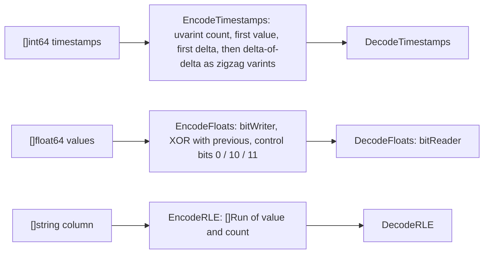

How the Go pieces depend on each other:

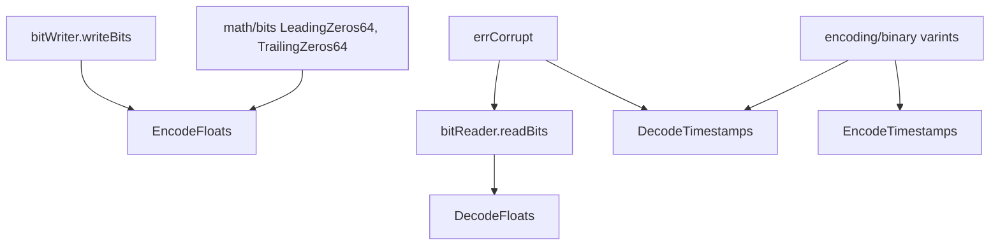

## Setup

- Module layout: one package `colenc` with `colenc.go` and `colenc_test.go`.
- Go 1.24 (uses the built-in `min`, `for range n` and `slices`), standard library only.
- The Go blocks in the Code section are consecutive pieces of one package. Concatenate them in order (a comment marks each place where a function continues in the next block) to get the source files.
- The SQL blocks need ClickHouse, PostgreSQL 17 and TimescaleDB; they are not executed by the Go tests.
- Run the Go part with:

```bash
mkdir colenc && cd colenc
go mod init colenc
# put colenc.go and colenc_test.go here
go vet ./... && go test -race -v ./...
```

## Code

The code implements delta-of-delta timestamps (with zigzag varints, a simpler cousin of Gorilla's bit-bucket scheme), Gorilla XOR floats, and run-length encoding. The size checks in the Tests section measure how well each one compresses.

### Step 1: row store versus column store

**Concept.** The first idea in [[Time-Series and Columnar Storage#Row layout vs column layout]] is that the physical layout decides how much data a query reads. A row store keeps each event together, so summing one field still drags every other field through memory. A column store keeps each field together, so the same sum reads only the slices it names.

The alternative of keeping everything as rows is the right choice for point lookups by primary key, which is why the OLTP database stays a row store.

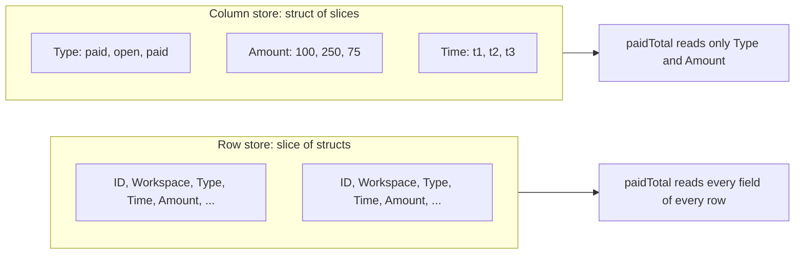

First the row layout.

```go
// Row store: each event is stored together.
type EventRow struct {
	ID, WorkspaceID int64
	Type            string
	OccurredAt      int64
	AmountMinor     int64
	// ...15 more fields read by every scan
}
```

1. `EventRow` is one event with all of its fields side by side, the way a row-oriented table stores them.
2. The trailing comment stands for the many other fields a real event has. A scan over rows must step over all of them.

Then the column layout and an aggregate over it.

```go
// Column store: each field is stored together.
type EventColumns struct {
	Type        []string // dictionary + RLE
	OccurredAt  []int64  // delta-of-delta
	AmountMinor []int64  // integer codec + ZSTD
}

func paidTotal(c EventColumns) (sum int64) {
	for i, t := range c.Type { // touches 2 of 20 columns
		if t == "paid" {
			sum += c.AmountMinor[i]
		}
	}
	return sum
}
```

1. `EventColumns` is a struct of slices: all `Type` values together, all `AmountMinor` values together. The comments name the codec each column would use on disk.
2. `paidTotal` loops over one slice and indexes the other with the same position `i`. Element `i` of every slice belongs to the same event, which is the invariant a column store maintains.
3. The function touches 2 of the 20 columns, so it reads roughly a tenth of the data a row scan would.

### Step 2: delta-of-delta timestamps

**Concept.** Timestamps in a metric series are almost evenly spaced, as in [[Time-Series and Columnar Storage#Delta-of-delta on timestamps]]. The first difference (delta) between neighbours is nearly constant, so the difference of deltas (delta-of-delta) is mostly zero, and zero is the cheapest number to encode. The code stores the first timestamp, the first delta, then only delta-of-delta values as signed varints.

Facebook's Gorilla paper packs these into variable-width bit buckets, which is smaller still; zigzag varints were chosen here because they need no bit-level code and still reach about one byte per sample.

Worked trace for five scrapes in milliseconds:

| Timestamp | Delta | Delta-of-delta | Stored | Bytes |
| --- | --- | --- | --- | --- |
| 1000 | n/a | n/a | first value 1000 | 2 |
| 16000 | 15000 | n/a | first delta 15000 | 3 |
| 31000 | 15000 | 0 | 0 | 1 |
| 46000 | 15000 | 0 | 0 | 1 |
| 62000 | 16000 | 1000 | 1000 | 2 |

The block below starts with the package header and the imports.

```go
// Package colenc shows three column encodings used by columnar and
// time-series stores: delta-of-delta for timestamps, Gorilla XOR for
// float values, and run-length encoding for low-cardinality strings.
package colenc

import (
	"encoding/binary"
	"errors"
	"math"
	"math/bits"
)
```

1. The package comment names the three encodings, and the file's Go imports tell the story: `encoding/binary` for varints, `math` and `math/bits` for float bit patterns, `errors` for the corruption error.

Next comes the encoder.

```go
// ---------- Delta-of-delta timestamps (zigzag varints) ----------

// EncodeTimestamps stores the first timestamp, the first delta, then only
// the change in delta. Regular scrapes give a delta-of-delta of 0 = 1 byte.
func EncodeTimestamps(ts []int64) []byte {
	out := binary.AppendUvarint(nil, uint64(len(ts)))
	var prev, prevDelta int64
	for i, t := range ts {
		switch i {
		case 0:
			out = binary.AppendVarint(out, t)
		case 1:
			prevDelta = t - prev
			out = binary.AppendVarint(out, prevDelta)
		default:
			d := t - prev
			out = binary.AppendVarint(out, d-prevDelta)
			prevDelta = d
		}
		prev = t
	}
	return out
}
```

1. `binary.AppendUvarint` writes the count first, so the decoder knows how many values to read.
2. `prev` is the previous timestamp and `prevDelta` the previous delta. Both start at zero.
3. Case `0` writes the first timestamp as a signed varint. Timestamps are large (a 2026 value in milliseconds is about 1.7 trillion), so this costs several bytes once per column.
4. Case `1` computes the first delta `t - prev` and writes it. Nothing can be predicted yet, so this is stored as is.
5. The default case writes `d - prevDelta`. A perfectly regular series writes 0 every time, and a signed varint of 0 is one byte.
6. `AppendVarint` uses zigzag encoding, so small negative numbers (a late sample) also stay small instead of taking ten bytes.

The decoder needs a shared error value.

```go
var errCorrupt = errors.New("colenc: corrupt input")
```

1. A single sentinel error lets callers test for corruption with `errors.Is`. Both the timestamp decoder and the bit reader return it.

Now the first half of the decoder.

```go
// DecodeTimestamps reverses EncodeTimestamps.
func DecodeTimestamps(b []byte) ([]int64, error) {
	n, k := binary.Uvarint(b)
	if k <= 0 {
		return nil, errCorrupt
	}
	b = b[k:]
	ts := make([]int64, 0, n)
	var prev, delta int64
	for i := uint64(0); i < n; i++ {
		v, k := binary.Varint(b)
		if k <= 0 {
			return nil, errCorrupt
		}
		b = b[k:]
```

1. `binary.Uvarint` returns the value and the number of bytes consumed; a count `k <= 0` means the input was empty or malformed, so the function returns `errCorrupt` instead of panicking.
2. `make([]int64, 0, n)` pre-sizes the result using the stored count.
3. Inside the loop each `binary.Varint` call is checked the same way, and `b = b[k:]` moves to the next value. Truncated input therefore surfaces as an error.

The second half rebuilds each timestamp.

```go
		// DecodeTimestamps, continued: rebuild each timestamp from its delta.
		switch i {
		case 0:
			prev = v
		case 1:
			delta = v
			prev += delta
		default:
			delta += v
			prev += delta
		}
		ts = append(ts, prev)
	}
	return ts, nil
}
```

1. Case `0` takes the value as the first timestamp.
2. Case `1` takes the value as the first delta and adds it to `prev`.
3. The default case adds the stored delta-of-delta to `delta` first, then adds `delta` to `prev`. This mirrors the encoder exactly.
4. Each rebuilt timestamp is appended; after the loop the slice is returned with a nil error.

### Step 3: a bit writer and reader

**Concept.** Gorilla's output is not byte aligned: a single repeated value costs one bit, so the encoder needs to write one bit, then five, then 64. Go's standard library has no bit-level writer, so the code defines two small helpers.

See [[Time-Series and Columnar Storage#Gorilla XOR on float values]] for why the format needs them. The alternative is a `bytes.Buffer` per field, which would waste up to seven bits per value and destroy the compression.

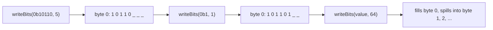

The writer appends bits to the last byte and starts a new byte when needed.

```go
// ---------- Gorilla XOR floats ----------

type bitWriter struct {
	buf   []byte
	nbits uint // bits used in the last byte (0 = need a new byte)
}

func (w *bitWriter) writeBits(v uint64, n uint) {
	for n > 0 {
		if w.nbits == 0 {
			w.buf = append(w.buf, 0)
			w.nbits = 8
		}
		take := min(n, w.nbits)
		// top `take` bits of the remaining n bits of v
		chunk := byte((v >> (n - take)) & (1<<take - 1))
		w.buf[len(w.buf)-1] |= chunk << (w.nbits - take)
		w.nbits -= take
		n -= take
	}
}
```

1. `nbits` counts the free bits left in the last byte. Zero means the next write needs a fresh byte.
2. `take := min(n, w.nbits)` is the number of bits that fit in the current byte (built-in `min`, Go 1.21+).
3. `chunk` takes the top `take` bits of the remaining `n` bits of `v`, so values are written most significant bit first.
4. The chunk is shifted into the free space with `<< (w.nbits - take)` and OR-ed into the last byte.
5. The loop continues until all `n` bits are written; a 64-bit write spans nine bytes at worst.

The reader does the inverse, one bit at a time.

```go
type bitReader struct {
	buf []byte
	pos uint // absolute bit position
}

func (r *bitReader) readBits(n uint) (uint64, error) {
	var v uint64
	for i := uint(0); i < n; i++ {
		byteIdx := r.pos / 8
		if int(byteIdx) >= len(r.buf) {
			return 0, errCorrupt
		}
		bit := (r.buf[byteIdx] >> (7 - r.pos%8)) & 1
		v = v<<1 | uint64(bit)
		r.pos++
	}
	return v, nil
}
```

1. `pos` is an absolute bit position from the start of the buffer.
2. Each iteration finds the byte with `pos / 8` and returns `errCorrupt` if the buffer ended, so truncated data never panics.
3. `(r.buf[byteIdx] >> (7 - r.pos%8)) & 1` extracts one bit, counting from the most significant bit of the byte.
4. `v = v<<1 | uint64(bit)` appends the bit to the result, so the first bit read becomes the highest bit of `v`.

### Step 4: Gorilla XOR floats

**Concept.** Gauge values such as CPU or temperature change slowly, so neighbouring values share most of their 64 bits. XOR of two equal values is zero; XOR of two close values has long runs of leading and trailing zero bits, and only the middle "meaningful" bits differ.

[[Time-Series and Columnar Storage#Gorilla XOR on float values]] describes the three cases, and the code implements them: control bit `0` for identical values, `10` to reuse the previous window of meaningful bits, `11` to open a new window.

The alternative is a general-purpose compressor such as ZSTD on raw floats, which cannot exploit the bit-level similarity as cheaply and is slower to decode value by value.

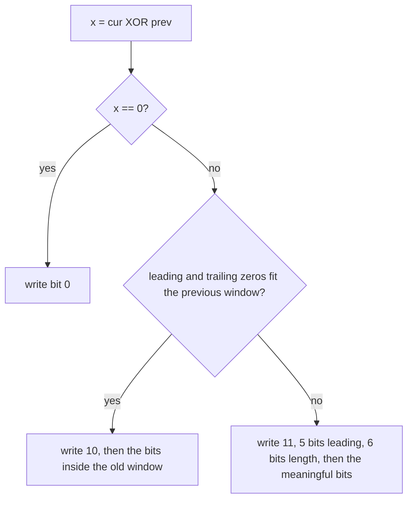

A worked case: encoding `0.25, 0.25, 0.5`. The bit patterns are `0x3FD0000000000000` and `0x3FE0000000000000`, so the second value costs 1 bit (`0`), and the third has `x = 0x0030000000000000` with 10 leading zeros, 52 trailing zeros and 2 meaningful bits.

It is written as `11`, then lead 10 (5 bits), length 2 (6 bits) and the two bits `11`: 15 bits.

The same example, record by record:

| Step | Value | XOR with previous | Case | Bits written |
| --- | --- | --- | --- | --- |
| header | n = 3 | n/a | count | 32 |
| 1 | `0.25` | n/a | raw first value | 64 |
| 2 | `0.25` | 0 | identical | 1 (`0`) |
| 3 | `0.5` | `0x0030000000000000` | new window: 10 leading, 52 trailing, 2 meaningful | 2 + 5 + 6 + 2 = 15 |

The total is 32 + 64 + 1 + 15 = 112 bits, which is 14 bytes. The three possible outcomes for each value compare like this:

| Outcome | Control bits | Extra bits | Total cost | When it happens |
| --- | --- | --- | --- | --- |
| same value | `0` | none | 1 bit | a flat gauge, a constant counter |
| reuse window | `10` | length of the old window | 2 + window bits | the value wobbles in the same bit range |
| new window | `11` | 5 + 6 + meaningful bits | 13 + meaningful bits | the changing bits move, for example after a big jump |

First the start of the encoder and the cases that need no new window.

```go
// EncodeFloats implements the value half of Facebook's Gorilla encoding.
// Each value is XORed with the previous one; identical values cost 1 bit.
func EncodeFloats(vals []float64) []byte {
	w := &bitWriter{}
	w.writeBits(uint64(len(vals)), 32)
	if len(vals) == 0 {
		return w.buf
	}
	prev := math.Float64bits(vals[0])
	w.writeBits(prev, 64)
	prevLead, prevTrail := uint(65), uint(0) // 65 = no window yet
	for _, f := range vals[1:] {
		cur := math.Float64bits(f)
		x := cur ^ prev
		prev = cur
		if x == 0 {
			w.writeBits(0, 1) // '0': same value
			continue
		}
```

1. The value count is written as 32 bits and the first value as its raw 64-bit pattern (`math.Float64bits`), so decoding can start from a known `prev`.
2. `prevLead, prevTrail := uint(65), uint(0)` uses 65 as a sentinel meaning "no window yet", since real leading counts never exceed 64.
3. Each following value is converted to bits and XORed with the previous bits, which then become `prev`.
4. When `x == 0` the encoder writes a single `0` bit and moves on. This is why a constant series costs one bit per value.

Then the two remaining cases.

```go
		// EncodeFloats, continued: values that differ from the previous one.
		lead := uint(bits.LeadingZeros64(x))
		trail := uint(bits.TrailingZeros64(x))
		if lead > 31 {
			lead = 31 // the leading count has only 5 bits
		}
		if prevLead != 65 && lead >= prevLead && trail >= prevTrail {
			// '10': reuse the previous window of meaningful bits
			w.writeBits(0b10, 2)
			w.writeBits(x>>prevTrail, 64-prevLead-prevTrail)
			continue
		}
		// '11': new window = 5 bits leading, 6 bits length, then the bits
		sig := 64 - lead - trail
		w.writeBits(0b11, 2)
		w.writeBits(uint64(lead), 5)
		w.writeBits(uint64(sig&63), 6) // 64 is stored as 0
		w.writeBits(x>>trail, sig)
		prevLead, prevTrail = lead, trail
	}
	return w.buf
}
```

1. `LeadingZeros64` and `TrailingZeros64` find where the meaningful bits begin and end. The leading count is capped at 31 because it is stored in only 5 bits; a few extra zero bits are stored instead.
2. If a window exists and the new meaningful bits fit inside it (`lead >= prevLead && trail >= prevTrail`), the encoder writes `10` followed by the bits of the old window only. This is the cheap case for a gauge that wobbles in the same bit range.
3. Otherwise it opens a new window: `11`, 5 bits of leading zeros, 6 bits of length, then the meaningful bits. A length of 64 does not fit in 6 bits, so `sig&63` stores it as 0.
4. `prevLead` and `prevTrail` are updated so the following values can reuse the window.

Decoding starts with the header and the first value.

```go
// DecodeFloats reverses EncodeFloats.
func DecodeFloats(b []byte) ([]float64, error) {
	r := &bitReader{buf: b}
	n, err := r.readBits(32)
	if err != nil {
		return nil, err
	}
	out := make([]float64, 0, n)
	if n == 0 {
		return out, nil
	}
	prev, err := r.readBits(64)
	if err != nil {
		return nil, err
	}
	out = append(out, math.Float64frombits(prev))
	var lead, trail uint
```

1. The reader mirrors the writer: 32 bits for the count, 64 bits for the first value.
2. Every `readBits` result is checked, because any of them can fail on truncated input.
3. `lead` and `trail` hold the current window; they start at zero and are set by the first `11` record.

The decoder is a small state machine. Its only memory is the previous value and the current window, which is why a decoder can start from any block that begins with a raw first value.

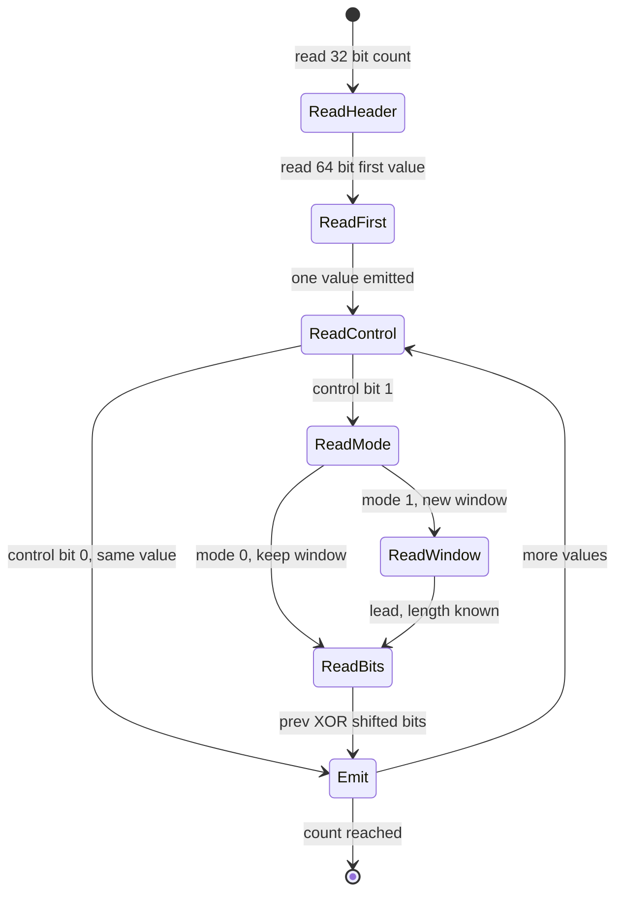

Then the loop starts reading control bits.

```go
		// DecodeFloats, continued: one control record per value.
	for i := uint64(1); i < n; i++ {
		ctrl, err := r.readBits(1)
		if err != nil {
			return nil, err
		}
		if ctrl == 1 {
			newWin, err := r.readBits(1)
			if err != nil {
				return nil, err
			}
			if newWin == 1 {
				l, err := r.readBits(5)
				if err != nil {
					return nil, err
				}
				s, err := r.readBits(6)
				if err != nil {
					return nil, err
				}
				if s == 0 {
					s = 64
				}
				lead, trail = uint(l), 64-uint(l)-uint(s)
			}
```

1. One bit `0` means the value equals the previous one, so the loop jumps straight to the append.
2. A leading `1` is followed by a second bit: `0` means reuse the window, `1` means read a new one.
3. For a new window the decoder reads 5 bits of leading zeros and 6 bits of length, and maps a stored length of 0 back to 64, the inverse of `sig&63`.
4. `trail = 64 - lead - length` recovers the trailing zero count that the encoder dropped.

The tail reads the meaningful bits and applies them.

```go
			// DecodeFloats, continued: apply the XOR delta.
			m, err := r.readBits(64 - lead - trail)
			if err != nil {
				return nil, err
			}
			prev ^= m << trail
		}
		out = append(out, math.Float64frombits(prev))
	}
	return out, nil
}
```

1. `readBits(64 - lead - trail)` reads exactly the meaningful bits.
2. `prev ^= m << trail` moves them back into position and XORs them into the previous value, which restores the current value. XOR is its own inverse.
3. The restored bits become a `float64` with `math.Float64frombits` and are appended, so `NaN` payloads and `-0.0` round-trip exactly.

### Step 5: run-length encoding

**Concept.** A column of low-cardinality strings such as invoice status stores the same value many times in a row once the table is sorted by it, as in [[Time-Series and Columnar Storage#Run-length encoding and the sort key]]. RLE replaces each stretch of equal values with one (value, count) pair.

The design choice is that RLE only pays off for adjacent equal values, so the table's sort key decides the compression ratio. The alternative, a dictionary that maps each string to a small integer, works without sorting but still stores one integer per row; real engines combine the two.

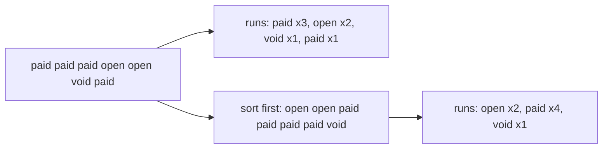

The run type and the encoder.

```go
// ---------- Run-length encoding ----------

// Run is one value repeated Count times.
type Run struct {
	Value string
	Count int
}

// EncodeRLE collapses consecutive equal values. It works best on a column
// that is sorted or clustered, which is why the sort key matters.
func EncodeRLE(col []string) []Run {
	var runs []Run
	for _, v := range col {
		if n := len(runs); n > 0 && runs[n-1].Value == v {
			runs[n-1].Count++
			continue
		}
		runs = append(runs, Run{Value: v, Count: 1})
	}
	return runs
}
```

1. `Run` is one value together with how many times it repeats.
2. `EncodeRLE` walks the column once. If the last run has the same value, it increments that run's count and continues.
3. Otherwise it appends a new run with count 1. The `n := len(runs); n > 0 &&` check guards the empty-slice case.

The decoder expands each run.

```go
// DecodeRLE expands runs back into a column.
func DecodeRLE(runs []Run) []string {
	var col []string
	for _, r := range runs {
		for range r.Count {
			col = append(col, r.Value)
		}
	}
	return col
}
```

1. For every run it appends the value `Count` times. `for range r.Count` is the Go 1.22 range-over-integer form.
2. The result equals the original column in the same order, which `TestRLE` checks.

### Step 6: ClickHouse tables and the rollup

**Concept.** The design in [[Time-Series and Columnar Storage#4.1 InvoiceOps analytics store in ClickHouse]] keeps PostgreSQL as the OLTP database and feeds ClickHouse through CDC and Kafka. The `ORDER BY` of a MergeTree table is its sort key and its sparse index at once, so it decides both RLE-style compression and which reads can skip data.

A `ReplacingMergeTree` removes duplicate events by sort key on merge, which makes the at-least-once pipeline safe. The alternative of one wide denormalized table with no sort key would scan everything for every query.

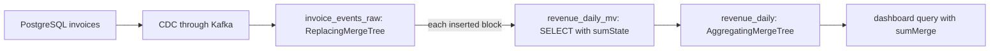

The raw table is sorted so that one workspace's events in time order sit together.

```sql
-- ClickHouse SQL
CREATE TABLE invoice_events_raw
(
    workspace_id  UInt64,
    invoice_id    UInt64,
    event_type    LowCardinality(String),      -- dictionary encoded
    currency      LowCardinality(String),
    amount_minor  Int64,
    occurred_at   DateTime64(3) CODEC(DoubleDelta, ZSTD),
    event_id      UUID                          -- for deduplication
)
ENGINE = ReplacingMergeTree
PARTITION BY toYYYYMM(occurred_at)
ORDER BY (workspace_id, occurred_at, event_id)
TTL toDateTime(occurred_at) + INTERVAL 15 DAY DELETE;
```

1. `LowCardinality(String)` is a dictionary encoding: each distinct status or currency is stored once and rows hold small integer codes.
2. `CODEC(DoubleDelta, ZSTD)` applies delta-of-delta to the timestamp column and then a general compressor, the SQL counterpart of `EncodeTimestamps`.
3. `ReplacingMergeTree` keeps one row per sort key after merges, and `event_id` makes duplicates from the pipeline collapse.
4. `PARTITION BY toYYYYMM(occurred_at)` makes each month a unit that can be dropped or skipped as a whole.
5. `ORDER BY (workspace_id, occurred_at, event_id)` is the sort key and the sparse index: one tenant's events in time order are adjacent.
6. The `TTL` clause deletes rows older than 15 days during merges.

The rollup is fed by a materialized view. In ClickHouse a materialized view is an insert trigger: each block inserted into the source table is run through the view's `SELECT`, and the result is inserted into the target table. It never re-reads old data. First the target table.

```sql
-- ClickHouse SQL
CREATE TABLE revenue_daily
(
    workspace_id UInt64,
    day          Date,
    currency     LowCardinality(String),
    paid_minor   AggregateFunction(sum, Int64),
    invoices     AggregateFunction(uniq, UInt64)
)
ENGINE = AggregatingMergeTree
ORDER BY (workspace_id, day, currency);
```

1. `AggregateFunction(sum, Int64)` and `AggregateFunction(uniq, UInt64)` columns hold partial aggregate states, not final numbers.
2. `AggregatingMergeTree` merges the states of rows with the same sort key.

Then the view and the read query.

```sql
CREATE MATERIALIZED VIEW revenue_daily_mv TO revenue_daily AS
SELECT workspace_id,
       toDate(occurred_at)    AS day,
       currency,
       sumState(amount_minor) AS paid_minor,
       uniqState(invoice_id)  AS invoices
FROM invoice_events_raw
WHERE event_type = 'paid'
GROUP BY workspace_id, day, currency;

-- Reading merges the partial states:
SELECT day, currency, sumMerge(paid_minor) AS paid_minor, uniqMerge(invoices) AS invoices
FROM revenue_daily
WHERE workspace_id = 7 AND day >= today() - 90
GROUP BY day, currency
ORDER BY day;
```

1. `sumState` and `uniqState` produce the partial states, and `TO revenue_daily` sends the view's output to the target table.
2. The `WHERE event_type = 'paid'` filter means only paid events reach the rollup.
3. The read query uses `sumMerge` and `uniqMerge` to combine the stored states into final values.

The `-State` functions store partial aggregates; the `-Merge` functions combine them at read time. Two inserts for the same day produce two partial rows until a background merge combines them, so reads must always `GROUP BY` again.

### Step 7: PostgreSQL partitioning and BRIN

**Concept.** At tens of millions of rows a separate store is often not worth running, as [[Time-Series and Columnar Storage#4.2 The same idea at modest volume: PostgreSQL partitioning and BRIN]] explains. PostgreSQL 17 handles time-ordered data well with declarative partitioning and a BRIN index (block range index: a tiny index that stores min and max per range of heap pages).

Because rows arrive in time order, each block range covers a narrow time window, so BRIN is effective and tiny. The alternative, a B-tree on the timestamp, indexes every row and costs hundreds of megabytes.

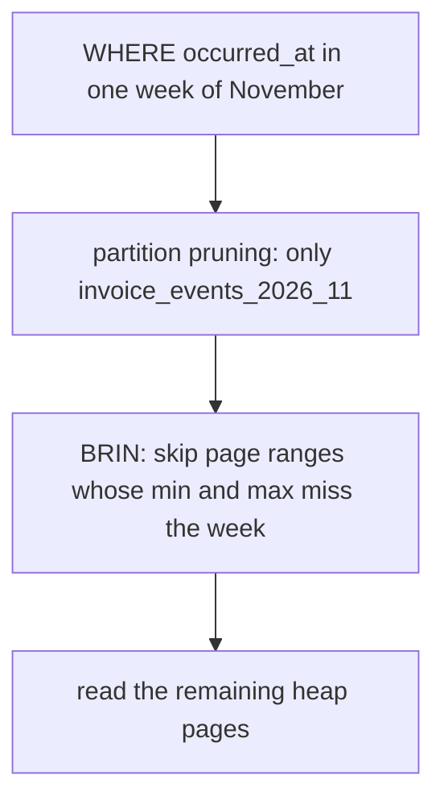

First the partitioned table and its partitions.

```sql
CREATE TABLE invoice_events (
    id            bigint GENERATED ALWAYS AS IDENTITY,
    workspace_id  bigint      NOT NULL,
    invoice_id    bigint      NOT NULL,
    event_type    text        NOT NULL,
    amount_minor  bigint      NOT NULL,
    occurred_at   timestamptz NOT NULL,
    PRIMARY KEY (id, occurred_at)            -- must include the partition key
) PARTITION BY RANGE (occurred_at);

CREATE TABLE invoice_events_2026_10 PARTITION OF invoice_events
    FOR VALUES FROM ('2026-10-01') TO ('2026-11-01');
CREATE TABLE invoice_events_2026_11 PARTITION OF invoice_events
    FOR VALUES FROM ('2026-11-01') TO ('2026-12-01');
```

1. `PARTITION BY RANGE (occurred_at)` makes the parent a routing layer; rows live in the monthly children.
2. The primary key must include the partition key, which is why it is `(id, occurred_at)`.
3. Each child declares its `FOR VALUES FROM ... TO ...` range, and the upper bound is exclusive.

Then indexes and retention.

```sql
-- A few dozen KB per partition instead of a B-tree of hundreds of MB.
CREATE INDEX ON invoice_events USING brin (occurred_at);
-- Per-workspace lookups still need a B-tree.
CREATE INDEX ON invoice_events (workspace_id, occurred_at);

-- Retention without row-by-row deletes:
ALTER TABLE invoice_events DETACH PARTITION invoice_events_2026_10 CONCURRENTLY;
DROP TABLE invoice_events_2026_10;
```

1. The BRIN index stores min and max per range of pages, a few dozen KB per partition.
2. Per-workspace lookups still need a B-tree on `(workspace_id, occurred_at)`.
3. `DETACH PARTITION ... CONCURRENTLY` followed by `DROP TABLE` removes a month without row-by-row deletes or table-wide locks.

Finally the rollup table that a job refreshes.

```sql
-- Rollup refreshed by a job every 5 minutes:
CREATE TABLE daily_revenue_by_workspace (
    workspace_id bigint NOT NULL,
    day          date   NOT NULL,
    paid_minor   bigint NOT NULL,
    PRIMARY KEY (workspace_id, day)
);
```

1. A plain table with `(workspace_id, day)` as its primary key holds the daily totals.
2. A scheduled job recomputes recent days into it every 5 minutes, which plays the role ClickHouse's materialized view played above.

A query on one week of November reads only the November partition (partition pruning) and only the BRIN-matching page ranges inside it. Details of BRIN are in [[Index Types and Index Design]], and the trade-offs of partition keys in [[Partitioning and Sharding]].

### Step 8: TimescaleDB

**Concept.** TimescaleDB, described in [[Time-Series and Columnar Storage#TimescaleDB]], keeps PostgreSQL and automates the pattern from step 7. A hypertable looks like one table but is split into chunks, each an ordinary PostgreSQL table covering one time interval.

Old chunks are compressed into a columnar layout, and continuous aggregates are incrementally refreshed rollups. The trade-off against ClickHouse is lower peak scan speed for full SQL, transactions and one operational system.

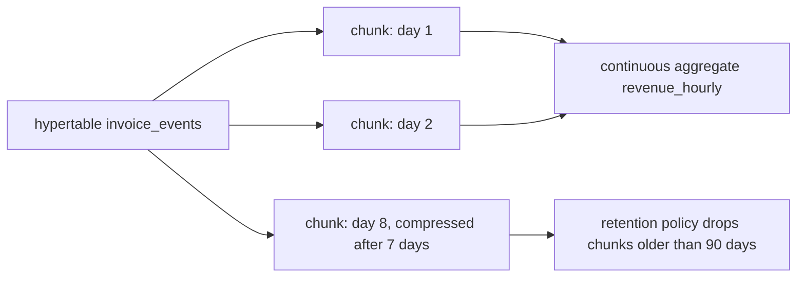

Hypertable and compression:

```sql
-- PostgreSQL 17 with the TimescaleDB extension (by_range() needs TimescaleDB 2.13 or later)
SELECT create_hypertable('invoice_events', by_range('occurred_at', INTERVAL '1 day'));

ALTER TABLE invoice_events SET (
    timescaledb.compress,
    timescaledb.compress_segmentby = 'workspace_id',
    timescaledb.compress_orderby   = 'occurred_at DESC'
);
SELECT add_compression_policy('invoice_events', INTERVAL '7 days');
```

1. `create_hypertable` with `by_range('occurred_at', INTERVAL '1 day')` creates one chunk per day.
2. `compress_segmentby = 'workspace_id'` keeps each tenant's rows together inside compressed batches, and `compress_orderby` sorts inside a segment so deltas are small.
3. The compression policy converts chunks older than 7 days.

Continuous aggregate and retention:

```sql
CREATE MATERIALIZED VIEW revenue_hourly
WITH (timescaledb.continuous) AS
SELECT workspace_id, time_bucket(INTERVAL '1 hour', occurred_at) AS bucket,
       sum(amount_minor) AS paid_minor
FROM invoice_events
WHERE event_type = 'paid'
GROUP BY workspace_id, bucket;

SELECT add_continuous_aggregate_policy('revenue_hourly',
    start_offset => INTERVAL '3 days', end_offset => INTERVAL '1 hour',
    schedule_interval => INTERVAL '15 minutes');
SELECT add_retention_policy('invoice_events', INTERVAL '90 days');
```

1. The `timescaledb.continuous` view is a materialized rollup by hour, using `time_bucket`.
2. The policy refreshes the window from 3 days ago to 1 hour ago every 15 minutes, so late data inside the window is corrected.
3. The retention policy drops whole chunks older than 90 days, a metadata operation rather than a delete.

## How the pieces fit

The encoders trade CPU for size in different ways, and each assumes something about the data. Knowing the assumption tells you when the technique stops working.

| Encoder | Assumes | Works well on | Degrades on |
| --- | --- | --- | --- |
| Delta-of-delta varints | Evenly spaced values | Scrape or heartbeat timestamps | Random, bursty event times |
| Gorilla XOR | Neighbouring values share high bits | Slowly moving gauges, constants | Random floats, high-entropy values |
| RLE | Equal values are adjacent | Sorted or clustered low-cardinality columns | Unsorted columns, high cardinality |
| ClickHouse `ORDER BY` | Queries filter by a key prefix | Per-tenant time ranges | Queries that skip the first key column |
| PostgreSQL BRIN | Physical order follows the column | Append-only time columns | Updated or randomly inserted rows |

In a real columnar file each column chunk is encoded separately, and a general-purpose compressor such as ZSTD runs on top of the specialized encoding. The specialized step makes the data more regular, and the general step squeezes what is left.

## Design decisions

| Decision | Alternative | Trade-off |
| --- | --- | --- |
| Zigzag varints for delta-of-delta | Gorilla bit buckets | Byte aligned and simple, about 1 byte per sample instead of about 1 bit |
| Signed varints (`AppendVarint`) | Unsigned with manual sign handling | Late samples (negative deltas) stay small without extra code |
| XOR against the previous value | Compare to a fixed base value | Slowly changing series produce long zero runs, and a lone change costs only its window |
| Reusable window (`10`) before a new window (`11`) | Always write a new window | Saves 11 bits per value when the changing bits stay in the same range |
| Leading zero count capped at 31 | Wider length field | Fits 5 bits, at the cost of a few stored zero bits |
| Length 64 stored as 0 | 7-bit length field | Saves one bit per new window, but the decoder must remember the mapping |
| Own `bitWriter` and `bitReader` | `bytes.Buffer` per field | Needed for non-aligned fields; costs a little code |
| Sentinel `errCorrupt` | `panic` on bad input | Corrupt data becomes an error callers can handle |
| RLE of strings with a `Run` struct | Dictionary-only encoding | Tiny for sorted columns, larger than raw for unsorted ones |
| `ORDER BY (workspace_id, occurred_at, event_id)` | Time first | Per-tenant reads are contiguous; cross-tenant time scans read more |
| `ReplacingMergeTree` with `event_id` | Dedup in the consumer | Safe at-least-once pipeline, but duplicates exist until a merge |
| `-State` and `-Merge` rollup | Store final sums | Correct under repeated inserts and merges, but reads must `GROUP BY` |
| BRIN plus partitions in PostgreSQL | B-tree on time | Tiny index and fast retention, but only works on time-correlated data |

## Tests

The tests check round trips and sizes: timestamps compress more than 6x, a constant float series costs exactly one bit per value (137 bytes for 1,001 values), special float values survive, and sorting a column before RLE reduces the number of runs. A round trip proves correctness; a size check proves the compression claim of the theory note.

First the imports and a fixture of regular timestamps.

```go
package colenc

import (
	"math"
	"math/rand/v2"
	"slices"
	"testing"
)

// 1,000 samples scraped every 15 s, with an occasional 1 s jitter.
func sampleTimestamps() []int64 {
	ts := make([]int64, 1000)
	t := int64(1_767_225_600_000) // 2026-01-01T00:00:00Z in ms
	for i := range ts {
		ts[i] = t
		t += 15_000
		if i%100 == 99 {
			t += 1_000
		}
	}
	return ts
}
```

The fixture is 1,000 samples, 15 seconds apart, with 1 second of extra delay after every 100th sample. That mimics a Prometheus scrape with occasional jitter.

### TestTimestampsRoundTripAndSize

Property: decoding the encoded timestamps returns exactly the input, and the encoding is smaller than one sixth of the raw 8 bytes per value. This matters because a lossy or barely smaller encoding would make the whole technique pointless.

| Input | Expected |
| --- | --- |
| 1,000 timestamps, 15 s apart, 1 s jitter every 100 | Decoded slice equals input; encoded size at most 1,333 B (raw 8,000 B divided by 6) |

```go
func TestTimestampsRoundTripAndSize(t *testing.T) {
	ts := sampleTimestamps()
	enc := EncodeTimestamps(ts)
	got, err := DecodeTimestamps(enc)
	if err != nil || !slices.Equal(got, ts) {
		t.Fatalf("round trip failed: err=%v", err)
	}
	raw := len(ts) * 8
	t.Logf("timestamps: raw %d B, delta-of-delta %d B (%.2f B/sample)",
		raw, len(enc), float64(len(enc))/float64(len(ts)))
	if len(enc) > raw/6 {
		t.Fatalf("expected > 6x compression, got %d B", len(enc))
	}
}
```

A failure of the round trip means encoder and decoder disagree about the format, so data would be silently corrupted. A failure of the size check means the deltas are not collapsing to zero, for example because the delta bookkeeping was broken.

### TestFloatsRoundTrip

Property: every kind of float series survives encoding bit for bit, including empty, single-element, constant, counter-like, noisy and special values. Bit equality is used because `NaN != NaN` and `0 == -0.0` would hide bugs under `==`.

| Case | Input | Expected |
| --- | --- | --- |
| empty | no values | empty output |
| single | `42.5` | one value back |
| constant | 500 times `0.25` | identical bits |
| counter | `1000, 1003, 1006, ...` | identical bits |
| noisy | 500 values in [20, 21) | identical bits |
| specials | `0`, `-0.0`, `+Inf`, `-Inf`, `MaxFloat64`, `SmallestNonzeroFloat64`, `1` | identical bits |

The table of cases:

```go
func TestFloatsRoundTrip(t *testing.T) {
	r := rand.New(rand.NewPCG(1, 2))
	cases := map[string][]float64{
		"empty":    {},
		"single":   {42.5},
		"constant": slices.Repeat([]float64{0.25}, 500),
		"counter":  counter(500),
		"noisy":    noisy(r, 500),
		"specials": {0, -0.0, math.Inf(1), math.Inf(-1), math.MaxFloat64, math.SmallestNonzeroFloat64, 1},
	}
```

The check loop, which also logs the compression ratio of each case:

```go
	// TestFloatsRoundTrip, continued: compare every value bit for bit.
	for name, vals := range cases {
		enc := EncodeFloats(vals)
		got, err := DecodeFloats(enc)
		if err != nil {
			t.Fatalf("%s: %v", name, err)
		}
		if len(got) != len(vals) {
			t.Fatalf("%s: len %d want %d", name, len(got), len(vals))
		}
		for i := range vals {
			if math.Float64bits(got[i]) != math.Float64bits(vals[i]) {
				t.Fatalf("%s[%d]: got %v want %v", name, i, got[i], vals[i])
			}
		}
		if len(vals) > 1 {
			t.Logf("floats %-8s raw %5d B, gorilla %5d B (%.2f bits/value)",
				name, len(vals)*8, len(enc), float64(len(enc)*8)/float64(len(vals)))
		}
	}
}
```

A failure names the case and index. A wrong `-0.0` or `Inf` points at a bit-width bug in the window logic; a wrong length points at the count header.

### TestConstantSeriesCostsOneBitPerValue

Property: a constant series costs exactly one bit per value after the header, which is the lower bound the theory promises.

| Input | Expected size |
| --- | --- |
| 1,001 copies of `0.25` | 32 + 64 + 1,000 bits = 1,096 bits = 137 bytes |

```go
func TestConstantSeriesCostsOneBitPerValue(t *testing.T) {
	enc := EncodeFloats(slices.Repeat([]float64{0.25}, 1001))
	// 32-bit count + 64-bit first value + 1,000 one-bit entries = 1,096 bits = 137 bytes.
	if len(enc) != 137 {
		t.Fatalf("got %d bytes, want 137", len(enc))
	}
}
```

A failure means the encoder writes more than the `0` control bit for repeated values, so the fast path is not taken.

### TestRLE

Property: runs collapse equal neighbours, decoding restores the column, and sorting first reduces the number of runs. This is the code form of "the sort key decides the compression".

| Input | Expected |
| --- | --- |
| `paid paid paid open open void paid` | runs `paid x3, open x2, void x1, paid x1` |
| the same column sorted | 3 runs |

```go
func TestRLE(t *testing.T) {
	col := []string{"paid", "paid", "paid", "open", "open", "void", "paid"}
	runs := EncodeRLE(col)
	want := []Run{{"paid", 3}, {"open", 2}, {"void", 1}, {"paid", 1}}
	if !slices.Equal(runs, want) {
		t.Fatalf("runs = %v", runs)
	}
	if !slices.Equal(DecodeRLE(runs), col) {
		t.Fatal("decode mismatch")
	}
	// Sorting the column first turns 4 runs into 3.
	sorted := slices.Clone(col)
	slices.Sort(sorted)
	if n := len(EncodeRLE(sorted)); n != 3 {
		t.Fatalf("sorted runs = %d, want 3", n)
	}
}
```

A failure of the first check means runs merge incorrectly (for example `paid` at the end joined to the first `paid`). A failure of the last check would mean RLE does not benefit from sorting, contradicting the theory.

### Helper series

The two helpers generate the counter and noisy series used by `TestFloatsRoundTrip`. The random source is seeded (`rand.NewPCG(1, 2)`) so the measured sizes are reproducible.

```go
func counter(n int) []float64 {
	v := make([]float64, n)
	for i := range v {
		v[i] = float64(1000 + i*3)
	}
	return v
}

func noisy(r *rand.Rand, n int) []float64 {
	v := make([]float64, n)
	for i := range v {
		v[i] = 20 + r.Float64()
	}
	return v
}
```

### Running it

Measured with `go vet ./...` and `go test -race -v ./...` (Go 1.24, darwin/arm64):

```text
=== RUN   TestTimestampsRoundTripAndSize
    colenc_test.go:32: timestamps: raw 8000 B, delta-of-delta 1027 B (1.03 B/sample)
--- PASS: TestTimestampsRoundTripAndSize (0.00s)
=== RUN   TestFloatsRoundTrip
    colenc_test.go:66: floats constant raw  4000 B, gorilla    75 B (1.20 bits/value)
    colenc_test.go:66: floats counter  raw  4000 B, gorilla   704 B (11.26 bits/value)
    colenc_test.go:66: floats noisy    raw  4000 B, gorilla  3133 B (50.13 bits/value)
    colenc_test.go:66: floats specials raw    56 B, gorilla    43 B (49.14 bits/value)
--- PASS: TestFloatsRoundTrip (0.00s)
=== RUN   TestConstantSeriesCostsOneBitPerValue
--- PASS: TestConstantSeriesCostsOneBitPerValue (0.00s)
=== RUN   TestRLE
--- PASS: TestRLE (0.00s)
PASS
ok  	colenc	(cached)
```

Reading the output line by line:

1. `=== RUN` and `--- PASS` lines bracket each test; the time in parentheses is the test duration, which rounds to `0.00s` because the data is tiny.
2. The `timestamps:` line is the `t.Logf` from `TestTimestampsRoundTripAndSize`: 8,000 raw bytes became 1,027 bytes, about 1.03 bytes per sample, so the ratio is nearly 7.8 to 1 and well inside the required 6 to 1.
3. The four `floats` lines come from `TestFloatsRoundTrip`. `constant` costs 1.20 bits per value (the one-bit entries plus the 96-bit header spread over 500 values) and `counter` costs 11.26 bits, because each step changes a few low bits. `noisy` costs 50.13 bits, close to the raw 64, because random low mantissa bits cannot be predicted.
4. The `specials` line has only 7 values, so the 96-bit header dominates and the bits-per-value figure (49.14) says little about compression.
5. `TestConstantSeriesCostsOneBitPerValue` and `TestRLE` log nothing, since they assert exact sizes and run counts instead of printing them.
6. `PASS` and `ok  colenc` are the package summary. With `-race` enabled, an `ok` also means no data race was detected; the elapsed time varies per run.

How the timestamp size adds up. The count `1000` takes 2 bytes, the first timestamp (about 1.77 trillion) takes about 7 bytes, and the first delta `15000` takes 3 bytes. Of the 998 remaining delta-of-delta values, most are `0` and cost 1 byte each. Each of the 9 jitters at samples 99, 199 and so on produces two non-zero values, `+1000` and `-1000`, which cost 2 bytes each.

That is roughly 12 + 980 + 18 * 2 = 1,028 bytes, which matches the measured 1,027 B to within a byte of rounding in the estimate.

The test flow for a round trip is the same for every encoder:

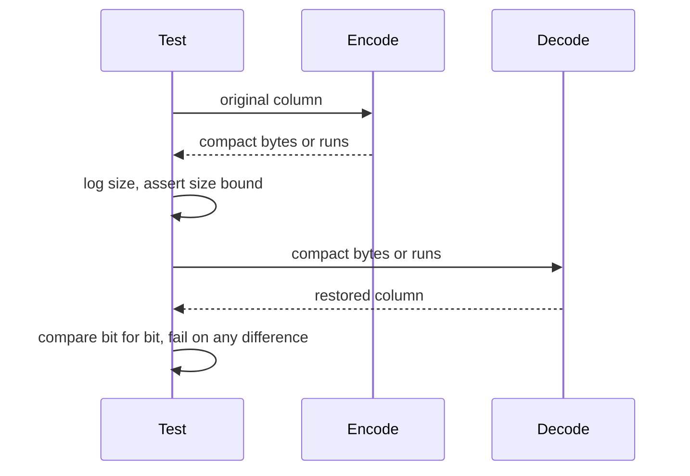

Measured on the test data above:

| Column | Raw | Encoded | Per value |
| --- | --- | --- | --- |
| 1,000 timestamps, 15 s apart, 1 s jitter every 100 | 8,000 B | 1,027 B | 1.03 bytes |
| 500 constant floats | 4,000 B | 75 B | 1.20 bits |
| 500 floats counting up by 3 | 4,000 B | 704 B | 11.26 bits |
| 500 random floats in [20, 21) | 4,000 B | 3,133 B | 50.13 bits |

The last row is the lesson: Gorilla works because real gauges change slowly. Random noise in the low mantissa bits leaves almost nothing to remove. The Gorilla paper reports an average of 1.37 bytes per (timestamp, value) pair on Facebook's production data, which is documented, not measured here.

## Pitfalls in the code

- Varints are signed zigzag values: a negative delta-of-delta (a late sample) is legal but may take 2 bytes, so jitter costs more than the ideal 1 byte.
- `EncodeFloats` caps the leading-zero count at 31 because the field has 5 bits; a value with more leading zeros simply stores a few extra zero bits.
- A significant-bit count of 64 is stored as 0 in 6 bits, and the decoder must map 0 back to 64. Forgetting this breaks values that change in every bit.
- Gorilla compares float bit patterns, so `0` and `-0.0` differ and `NaN` payloads round-trip exactly. Do not compare decoded floats with `==` in tests.
- `DecodeTimestamps` and `DecodeFloats` trust the stored count only after checking each read; corrupt input returns an error instead of panicking.
- RLE only wins when equal values are adjacent. On an unsorted column it can be larger than the raw data.
- The SQL blocks are not executed here. Their syntax follows ClickHouse, PostgreSQL 17 and TimescaleDB 2.13 or later.

## Exercises

1. Change the jitter in `sampleTimestamps` from every 100 samples to every 10 samples and predict whether the encoded size doubles, stays near 1,027 B, or grows by more than 2x. Run the test to check.
2. Replace `counter(500)` with a counter that increases by exactly `1.0` and predict whether bits per value goes up or down compared with 11.26. Explain it with the XOR window.
3. Run `EncodeRLE` on a column of 1,000 alternating `paid` and `open` values and predict the number of runs, then sort the column first and predict again.

Hints. For exercise 1, ten times as many jitters means ten times as many non-zero delta-of-delta entries, each taking 2 bytes instead of 1, so the size grows by roughly 180 B, not 2x. For exercise 2, a counter that steps by exactly `1.0` changes only the same few mantissa bits each time, so the `10` window is reused and the cost per value falls.

For exercise 3, alternating values never repeat next to each other, so there are 1,000 runs and no saving at all; after sorting there are 2.

## Links

- **Theory:** [[Time-Series and Columnar Storage]]
- **Before this:** [[Storage Engines - B-tree vs LSM and WAL]], [[Partitioning and Sharding]], [[Index Types and Index Design]]
- **Next:** [[Materialized Views and Denormalization]], [[Transactional Outbox and CDC]]
