# Time-Series and Columnar Storage

> [!summary] TL;DR
> Analytics queries read a few columns from millions of rows, so analytics databases store each **column** together on disk instead of each **row**. Same-type values sitting side by side compress 5–20× (an estimate that depends on the data) and can be summed in tight loops.
>
> Time-series stores add one more trick: data arrives in time order, so they partition by time, compress timestamps as tiny deltas, and drop old data by deleting whole files.

> [!abstract] Core idea
> - A row store keeps a whole row together, which is fast for "fetch invoice 42". A column store keeps a whole column together, which is fast for "sum `total_minor` over a year".
> - Reading 3 of 20 columns means reading about 3/20 of the bytes (column pruning), and those bytes compress far better.
> - Time-series data is append-only and time-ordered, so stores partition it by time and delete old partitions instead of rows.
> - Raw data is expensive to keep forever: keep raw for days, rollups for years, and the full archive in cheap object storage.
> - Analytics belongs off the primary OLTP database: a replica for small loads, a separate column store for big ones.

## Start here: the basics 🟢

> [!info] How to read this note (pick your level)
> - 🟢 **New to this?** Read "From zero" below, then sections 1, 2 and the cheat sheet (10). Stop there, that is a full first pass.
> - 🟡 **Know the basics?** Add section 3 (how it works), 4 (worked examples), 5 and 6.
> - 🔴 **Interview / SDE-3 prep?** Add 7 and the deep dives in 8 and 9. Headings are tagged 🟢🟡🔴 so you always know where you are.

**From zero, in 60 seconds** 🟢

Picture a filing cabinet of invoices, one full form per invoice. Finding one invoice is easy. But "add up the amount on every invoice this year" means pulling out every single form, even though you only care about one box on each.

A normal database (a **row store**) works like that cabinet: it keeps all of a row's fields together. An analytics database (a **column store**) flips the layout: it keeps all the values of one field together, like one long strip per spreadsheet column. Now "add up the amounts" reads just one strip and skips everything else.

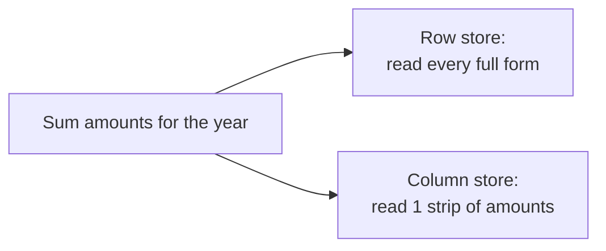

There is a bonus: values of the same type sitting together squeeze down very well, often 5 to 20 times smaller.

Time-stamped data (CPU readings, events) gets one more trick. It always arrives in time order, so the store cuts it into one box per day, and deleting old data just means throwing away the oldest box.

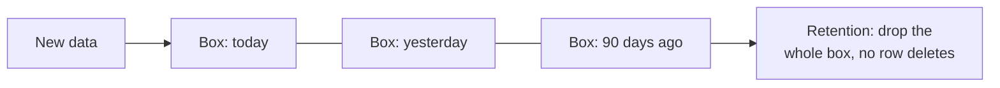

The rest of this note is just these 4 questions:
1. Why do big summary queries hurt a normal row database?
2. How does storing by column make them cheap (pruning, compression, skipping)?
3. How do time-series stores ingest, roll up and expire data?
4. Which tool do you pick at which size, and what does each cost?

**The problem in one story.**
Your app stores every invoice as one row: id, customer, total, date and 16 other fields.
Finance asks, "what was the total revenue each month last year?"
To answer, the database reads every whole row, even though it only needs two fields.
Storing data column by column, and by time, makes that question hundreds of times cheaper.

**Words you need first**

| Word | Plain meaning | Tiny example |
| --- | --- | --- |
| OLTP | Many small reads and writes for the live app | "Fetch invoice 42", "insert one payment" |
| OLAP / analytics | Few big queries that scan and summarise lots of data | "Sum revenue per month for 2025" |
| Row store | Keeps all fields of one row next to each other on disk | PostgreSQL, MySQL |
| Column store | Keeps all values of one column next to each other | ClickHouse, Parquet files |
| Time-series data | Measurements stamped with a time, mostly appended | CPU usage every 10 seconds |
| Compression | Storing the same data in fewer bytes | 1000 copies of "paid" stored as "paid ×1000" |
| Partition | A slice of a table, often one per day or month | `invoices_2025_03` |
| Rollup | A pre-summarised copy of raw data | Hourly totals instead of every event |

**Picture it**

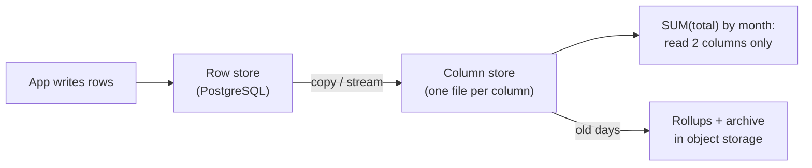

**Analogy.** A row store is a stack of filled-in forms; a column store is a spreadsheet where you can grab just the "amount" column.
Adding up one column of a spreadsheet is much faster than flipping every form.
Where it breaks: changing one person's details is easy on a form but touches many separate column files in a column store.

**How the rest of this note builds up**

- First, why analytics on the primary database hurts (section 1) and the row-vs-column mental model (section 2).
- Then how column layout, compression, vectorized execution, data skipping and retention work (section 3).
- Then worked examples in ClickHouse and PostgreSQL, plus compression traced by hand (section 4).
- Then variants, trade-offs and production setups (sections 5-7).
- Finally the SDE-3 deep dive on MergeTree, TimescaleDB, Prometheus TSDB, lakehouse files and late data.

> [!tip] Remember
> Rows for "fetch one thing", columns for "summarise many things"; partition time-series by time and drop old partitions whole.

## 1. Why it exists

InvoiceOps records every invoice event (`created`, `sent`, `viewed`, `paid`, `voided`) in an `invoice_events` table. After three years it holds **1 billion rows** with 20 columns, about **120 bytes per row** on disk (an estimate: 20 mixed columns plus the 24-byte PostgreSQL tuple header). That is roughly **120 GB**.

The finance dashboard asks one question:

```sql
SELECT date_trunc('day', occurred_at) AS day, sum(amount_minor)
FROM invoice_events
WHERE event_type = 'paid' AND occurred_at >= now() - interval '365 days'
GROUP BY 1 ORDER BY 1;
```

The query needs **3 columns** (`occurred_at`, `event_type`, `amount_minor`). In PostgreSQL, a heap table is a row store: every 8 KB page holds whole rows, so scanning one year (about a third of the table, 40 GB) reads all 20 columns of every row.

At 500 MB/s of effective sequential read, that is about **80 seconds** (an estimate), and it evicts hot OLTP pages from the cache while it runs.

A column store reads only the 3 columns it needs. Those columns are about 20 bytes of the 120 per row before compression, and a time-sorted timestamp, a 5-value enum and an integer amount compress very well.

A realistic result is a few hundred MB to 2 GB read instead of 40 GB (an estimate), and the scan runs on separate hardware from the payment path.

Two more pressures make it worse over time:

- **Volume.** Metrics and events grow with traffic, not with customers. One service scraped every 15 s with 10,000 series produces 57.6 million samples a day.
- **Retention.** Deleting "everything older than 90 days" row by row in a row store creates dead tuples, WAL and vacuum work equal to the data being deleted.

## 2. Mental model

Think of a spreadsheet of invoice events printed on paper.

- A **row store** files each row on its own index card. To find invoice 42 you pull one card. To total the `amount` column you must pull every card.
- A **column store** keeps one long strip of paper per column. To total `amount` you unroll one strip. To rebuild invoice 42 you must find position 42 on every strip.

A **time-series store** is a column store for data that only ever arrives at the end of the strip. It cuts the strips into one roll per day or two hours, so a query for "last week" only unrolls seven rolls, and retention means throwing away the oldest roll.

Some terms used throughout:

- **OLTP** (online transaction processing): many small reads and writes of single rows, such as "mark invoice 42 paid".
- **OLAP** (online analytical processing): few large queries that scan and aggregate many rows, such as "revenue per month".
- **Column pruning**: reading only the columns a query names.
- **Predicate pushdown**: applying the `WHERE` filter inside the storage layer so whole blocks can be skipped.
- **Cardinality**: the number of distinct values. `event_type` has 5; `invoice_id` has hundreds of millions.
- **Series** (time-series stores): one unique combination of metric name and labels, such as `http_requests_total{route="/invoices",status="200"}`.

## 3. How it works

### Row layout vs column layout

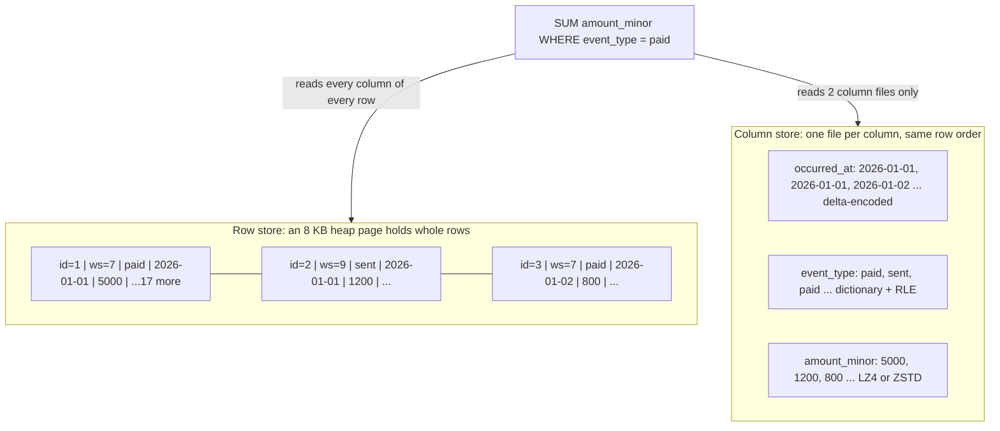

The row number is the glue: value 42 in `amount_minor` belongs to the same row as value 42 in `event_type`. Rebuilding a full row costs one read per column, which is why column stores are poor at "fetch one invoice".

Example with numbers: a heap page of 8 KB holds about 68 rows of 120 bytes. Summing `amount_minor` over those 68 rows touches the whole page. In a column file the same 68 amounts are 68 × 8 bytes = 544 bytes, and after compression often far less, so one 8 KB block holds the amounts of thousands of rows.

### Why columns compress well

All values in a column share a type and usually a narrow range, and if the table is sorted, neighbours are often equal or close. Each column picks an encoding that fits its shape:

| Encoding | How it works | Fits |
| --- | --- | --- |
| Dictionary | Replace each string with a small integer code plus one lookup table | Low-cardinality strings: `event_type`, `country`, `currency` |
| Run-length (RLE) | Store `(value, count)` for each run of repeats | Sorted or clustered columns: `workspace_id` when it leads the sort key |
| Delta | Store the difference from the previous value | Increasing integers: ids, timestamps |
| Delta-of-delta | Store the change in the difference | Regular timestamps: a 15 s scrape gives deltas of 15,000 ms and a delta-of-delta of 0 |
| Gorilla XOR | XOR each float with the previous one and store only the changed bits | Slowly changing gauges such as CPU or queue depth |
| General codec (LZ4, ZSTD) | Byte-level compression on top of the above | Everything, as a last pass |

ClickHouse exposes these directly as column codecs (`Delta`, `DoubleDelta`, `Gorilla`, `T64`, `LZ4`, `ZSTD`) and as the `LowCardinality(String)` type, which is dictionary encoding.

#### Delta-of-delta on timestamps

A scrape every 15 seconds produces timestamps that grow by the same amount every time. Storing the difference of the differences turns them into zeros.

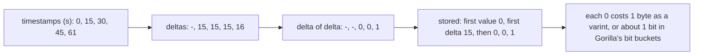

Example with numbers: 1,000 raw 8-byte timestamps take 8,000 bytes. With a 15 s cadence and one 1 s jitter every 100 samples, the delta-of-delta form takes about 1,027 bytes (measured in the Go note), roughly 1 byte per sample.

#### Gorilla XOR on float values

Gauges such as CPU load change slowly, so consecutive values share their sign, exponent and high mantissa bits. XOR of two such values has long runs of zeros at both ends, and only the middle bits need storing.

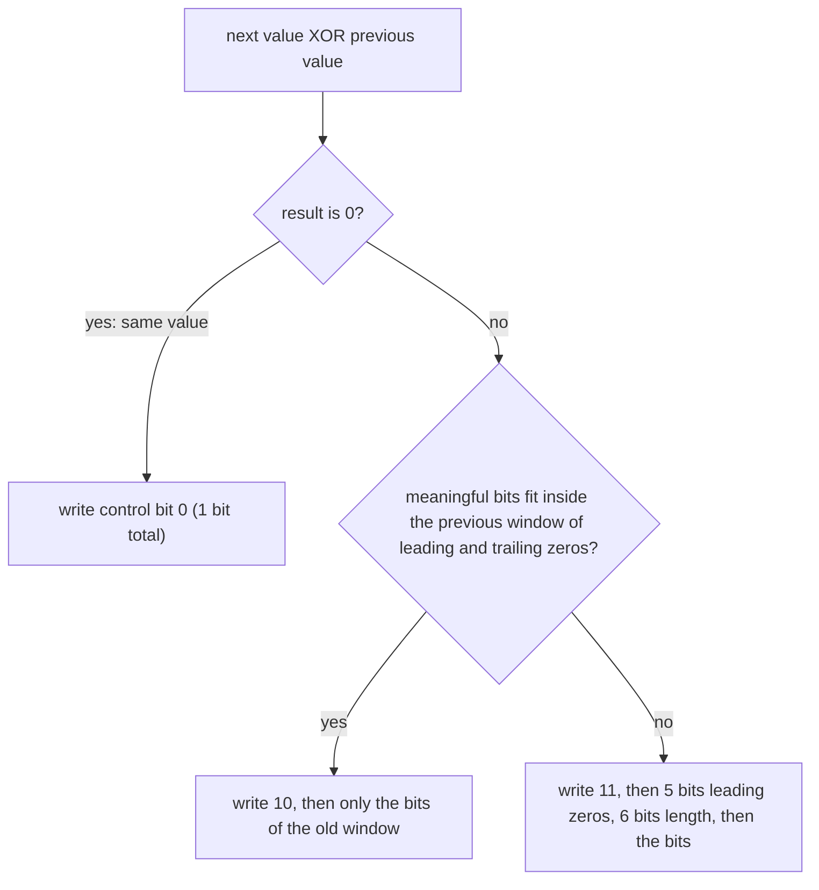

| Series | Raw | Gorilla | Why |
| --- | --- | --- | --- |
| 500 constant floats | 4,000 B | 75 B | Every XOR is 0, so each value costs 1 bit |
| 500 floats counting up by 3 | 4,000 B | 704 B | Few mantissa bits change each step |
| 500 random floats in [20, 21) | 4,000 B | 3,133 B | Noise fills the low mantissa bits, so almost nothing can be removed |

These sizes are measured with the Go implementation in the Go note.

#### Run-length encoding and the sort key

RLE stores each run of equal values once with a count. It only helps when equal values are adjacent, so the sort key decides how well it works.

| Column order | Content | Runs |
| --- | --- | --- |
| As inserted | paid, paid, paid, open, open, void, paid | 4 runs |
| Sorted | open, open, paid, paid, paid, paid, void | 3 runs |

In a table sorted by `(workspace_id, occurred_at)`, the `workspace_id` column becomes long runs and compresses to almost nothing, while the unsorted `invoice_id` does not.

### Vectorized execution

A row-at-a-time engine (PostgreSQL's executor, for example) calls a function per row per operator. A **vectorized** engine runs each operator over a batch of thousands of values from one column at once. The inner loop is a plain array walk the CPU can pipeline and turn into SIMD (single instruction, multiple data) instructions, and the per-row overhead of function calls and branching disappears.

ClickHouse, DuckDB, Snowflake and BigQuery all execute this way.

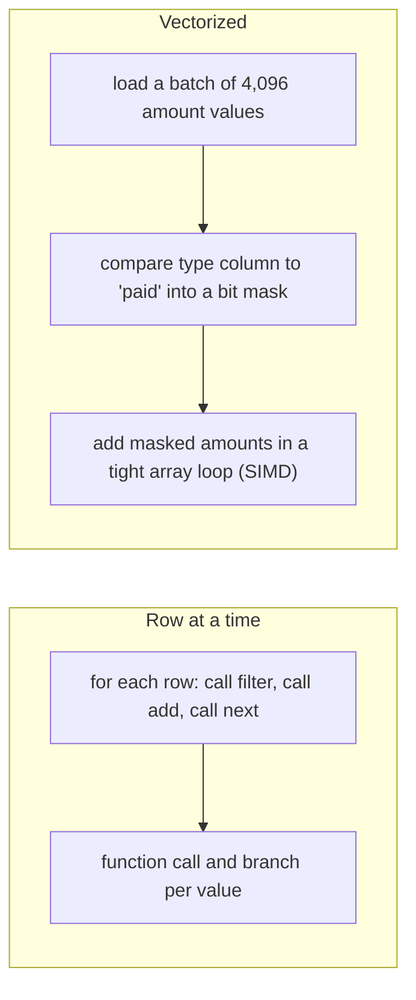

### Skipping data: sparse indexes, min/max and partitions

Column stores rarely use B-tree indexes on every row. They keep small summaries per block and skip blocks whose summary cannot match:

- **Partition pruning.** The table is split by month or day; a query for last week never opens older partitions.
- **Sparse primary index.** ClickHouse sorts each data part by the `ORDER BY` key and stores the key of only the first row of every **granule** of 8,192 rows (the default `index_granularity`). A lookup binary-searches these marks and reads only the matching granules.
- **Min/max (zone map) statistics.** Parquet stores min and max per column chunk and page; PostgreSQL's BRIN index stores min and max per range of 128 heap pages by default. Both work only when the column is correlated with physical order, which time columns usually are.

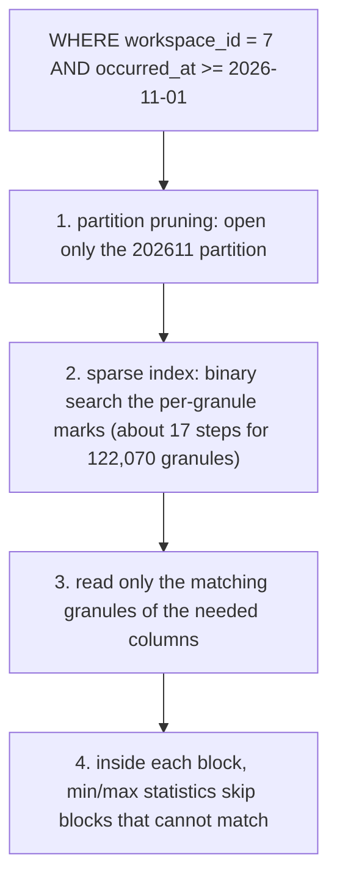

Example with numbers: 1 billion rows with `index_granularity = 8192` give about 122,070 marks (1,000,000,000 / 8,192). The sparse index holds one key per mark, which is small enough to stay in memory, and a lookup reads only the granules whose range can contain workspace 7.

### Time-series ingestion and retention

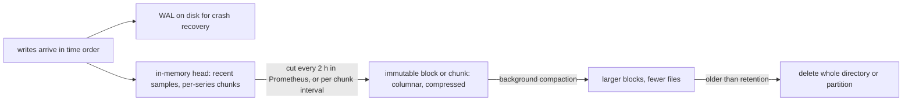

The shape is the same across Prometheus, TimescaleDB and ClickHouse: write to a log and a memory buffer, flush immutable compressed blocks per time window, merge small blocks into big ones in the background, and expire data by dropping whole blocks. This is the LSM idea from [[Storage Engines - B-tree vs LSM and WAL]], specialised for time order.

Retention is where this design pays off. Deleting 90-day-old rows from a row store writes dead tuples, WAL and vacuum work proportional to the data. Dropping a block or partition removes a directory and costs a metadata change.

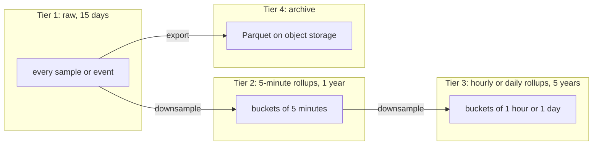

## 4. Worked example

### 4.1 InvoiceOps analytics store in ClickHouse

The OLTP database stays PostgreSQL. Invoice events flow through CDC (change data capture, reading the database's WAL as a stream of changes) into Kafka and on into ClickHouse:

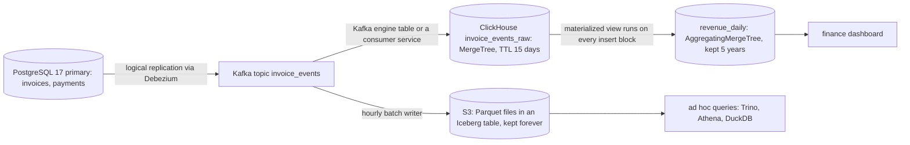

The raw table is sorted so that one workspace's events in time order sit together. The parts of its definition that matter:

```sql
-- ClickHouse SQL (excerpt)
event_type    LowCardinality(String),                 -- dictionary encoded
occurred_at   DateTime64(3) CODEC(DoubleDelta, ZSTD),
event_id      UUID                                    -- for deduplication
ENGINE = ReplacingMergeTree
PARTITION BY toYYYYMM(occurred_at)
ORDER BY (workspace_id, occurred_at, event_id)
TTL toDateTime(occurred_at) + INTERVAL 15 DAY DELETE;
```

- `ORDER BY` is the sort key and the sparse primary index. A query with `workspace_id = 7` binary-searches the granule marks and reads only that workspace's granules.
- `PARTITION BY` month means TTL and manual drops remove whole partitions or parts.
- `ReplacingMergeTree` keeps one row per sort key when parts merge, which absorbs Kafka's at-least-once redelivery. Duplicates survive until a merge happens, so exact queries use `FINAL` or `argMax`.

The rollup, fed by a materialized view. In ClickHouse a materialized view is an **insert trigger**: each block inserted into the source table is run through the view's `SELECT`, and the result is inserted into the target table. It never re-reads old data.

```sql
-- ClickHouse SQL (excerpt of the view)
SELECT workspace_id, toDate(occurred_at) AS day, currency,
       sumState(amount_minor) AS paid_minor,
       uniqState(invoice_id)  AS invoices
FROM invoice_events_raw
WHERE event_type = 'paid'
GROUP BY workspace_id, day, currency;
```

The `-State` functions store partial aggregates; the `-Merge` functions combine them at read time. Two inserts for the same day produce two partial rows until a background merge combines them, so reads must always `GROUP BY` again.

Sizes for this design, as **estimates** for 1 billion events a year (2.7 million a day):

| Store | What it keeps | Rows | Rough size |
| --- | --- | --- | --- |
| `invoice_events_raw` | 15 days of raw events | 41 million | 0.5–1 GB compressed |
| `revenue_daily` | 5 years of daily rollups | workspaces × days × currencies | small: tens of MB for 10,000 workspaces |
| Iceberg on S3 | everything, forever | 1 billion a year | 10–20 GB a year in Parquet with ZSTD |

The dashboard query now reads a few thousand rollup rows instead of scanning a year of events.

The full `CREATE TABLE`, rollup table, materialized view and read query are in the Go note.

### 4.2 The same idea at modest volume: PostgreSQL partitioning and BRIN

At tens of millions of rows a separate store is often not worth running. PostgreSQL 17 handles time-ordered data well with declarative partitioning and a BRIN index (block range index: a tiny index that stores min and max per range of heap pages):

```sql
CREATE TABLE invoice_events_2026_11 PARTITION OF invoice_events
    FOR VALUES FROM ('2026-11-01') TO ('2026-12-01');
CREATE INDEX ON invoice_events USING brin (occurred_at);
-- Retention without row-by-row deletes:
ALTER TABLE invoice_events DETACH PARTITION invoice_events_2026_10 CONCURRENTLY;
DROP TABLE invoice_events_2026_10;
```

The parent table is `PARTITION BY RANGE (occurred_at)`, and its primary key must include the partition key. A BRIN index costs a few dozen KB per partition instead of a B-tree of hundreds of MB. Per-workspace lookups still need a B-tree on `(workspace_id, occurred_at)`, and a small rollup table maintained by a job serves the dashboard.

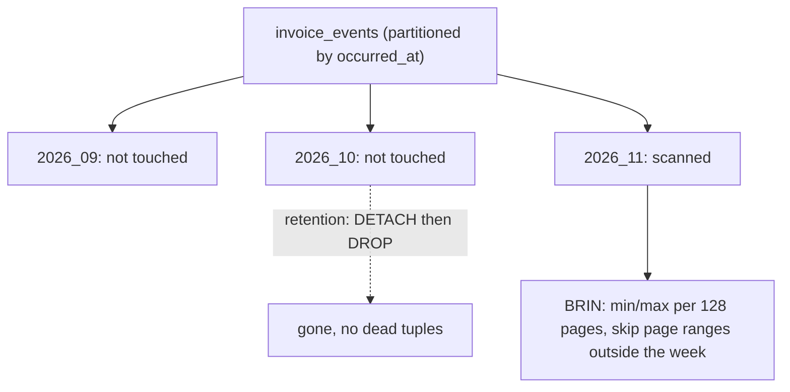

A query on one week of November reads only the November partition (partition pruning) and only the BRIN-matching page ranges inside it. Details of BRIN are in [[Index Types and Index Design]], and the trade-offs of partition keys in [[Partitioning and Sharding]].

### 4.3 Compression traced by hand

For a feel of the numbers, here is one small column of each kind, encoded by the three encodings described above.

| Column | Raw values | Encoded form | Result |
| --- | --- | --- | --- |
| Timestamps (s) | 0, 15, 30, 45, 61 | 0, 15, then 0, 0, 1 | Four small integers after the first value |
| Floats | 0.25, 0.25, 0.25, 0.25 | first value, then bits 0, 0, 0 | 3 bits after the first 64-bit value |
| `event_type` | paid, paid, paid, open, open, void, paid | (paid, 3), (open, 2), (void, 1), (paid, 1) | 4 runs for 7 values |

Measured with the Go implementation (`go test -race -v`, Go 1.24.4, darwin/arm64):

| Column | Raw | Encoded | Per value |
| --- | --- | --- | --- |
| 1,000 timestamps, 15 s apart, 1 s jitter every 100 | 8,000 B | 1,027 B | 1.03 bytes |
| 500 constant floats | 4,000 B | 75 B | 1.20 bits |
| 500 floats counting up by 3 | 4,000 B | 704 B | 11.26 bits |
| 500 random floats in [20, 21) | 4,000 B | 3,133 B | 50.13 bits |

The last row is the lesson: Gorilla works because real gauges change slowly. Random noise in the low mantissa bits leaves almost nothing to remove. The Gorilla paper reports an average of 1.37 bytes per (timestamp, value) pair on Facebook's production data, which is documented, not measured here.

Runnable Go version: [[Time-Series and Columnar Storage - Go]]

## 5. Variants and comparison

| Option | How it works | Use when | Cost |
| --- | --- | --- | --- |
| PostgreSQL with partitions, BRIN and rollup tables | Row store; time partitions, rollups maintained by jobs | Up to roughly hundreds of millions of rows (an estimate), and you want one database | Scans read whole rows; heavy queries compete with OLTP unless on a replica |
| TimescaleDB | PostgreSQL extension: hypertables auto-partitioned into time chunks (7 days by default), continuous aggregates, columnar compression of old chunks | Time-series that must join with relational data, a team that knows Postgres | Compressed chunks are costly to update; still one Postgres node per hypertable unless you shard yourself |
| ClickHouse | Columnar MergeTree: sorted immutable parts, sparse index, background merges, insert-trigger MVs | Event analytics and logs at billions of rows, sub-second dashboards | No real transactions; updates and deletes are heavy mutations; dedup is eventual |
| BigQuery, Snowflake, Redshift | Managed columnar warehouses; storage separated from compute | Company-wide BI, star schemas, many analysts | Billed by bytes scanned or compute time; latency of seconds, not milliseconds |
| Prometheus | In-memory head + WAL, 2-hour compressed blocks, one series per label set | Operational metrics and alerting | Not for events or per-user data; high-cardinality labels break it; local retention 15 days by default |
| Lakehouse: Parquet + Iceberg or Delta Lake on S3 | Columnar files in object storage plus a table format that adds snapshots and schema evolution | Cheap raw retention, many engines over one copy | Query latency depends on the engine; small files need compaction |

## 6. Trade-offs and when not to use

- **Point lookups and updates are slow.** Fetching one row touches every column file; updating one row in ClickHouse rewrites whole parts (a mutation). Invoices and payments stay in the OLTP database.
- **No multi-row transactions.** Column stores are fed by pipelines that may deliver twice. Design for idempotent inserts (an `event_id`, ReplacingMergeTree, or upserts in the warehouse).
- **The sort key is a one-way door.** It decides compression and which filters are fast. A ClickHouse table sorted by `(workspace_id, occurred_at)` is slow for "all events of invoice 42" across workspaces unless you add a projection or a second table.
- **Small inserts hurt.** Each insert creates a part. Thousands of single-row inserts per second create thousands of parts and "too many parts" errors. Batch to thousands of rows per insert, or use async inserts.
- **Another system to run.** A pipeline, schema changes in two places and lag between OLTP and analytics. When the data fits in PostgreSQL with partitions and a replica, that is the simpler answer.
- **Staleness.** The dashboard is seconds to minutes behind the source. Decide the staleness budget with the product owner ("the revenue chart may lag 5 minutes").

## 7. In production

**Keeping analytics off the primary.** Grow in steps:

1. Rollup tables in the same database, refreshed by a job ([[Materialized Views and Denormalization]]).
2. A read replica for reporting ([[Replication]]). Long queries on a hot standby can be cancelled by replay conflicts, or, with `hot_standby_feedback = on`, hold back vacuum on the primary.
3. A separate column store fed by CDC ([[Transactional Outbox and CDC]], [[Kafka and Event Streaming]]).

**Warehouse modeling: the star schema.** Warehouses model a business process as one **fact table** (one row per event, with numeric measures) surrounded by **dimension tables** (descriptive attributes to filter and group by). Facts are long and narrow; dimensions are short and wide.

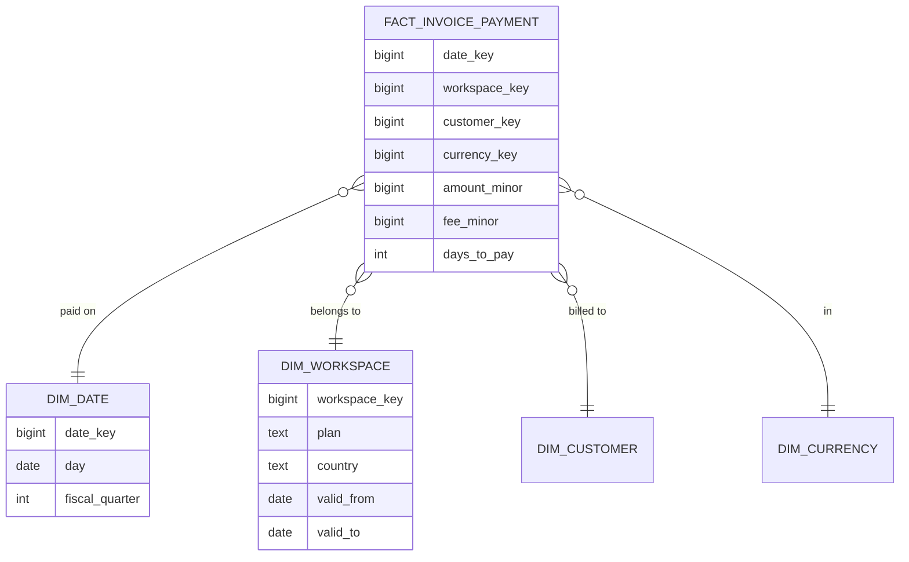

`valid_from` and `valid_to` make `DIM_WORKSPACE` a slowly changing dimension (type 2): when a workspace changes plan, a new row is added so old facts still report under the old plan.

**ELT.** Modern pipelines **extract and load** raw data into the warehouse first, then **transform** it inside the warehouse with SQL (often with dbt). Raw data stays available to re-transform when a bug is found.

**Downsampling and tiered retention.** An example policy for InvoiceOps metrics and events:

| Tier | Resolution | Kept | Where |
| --- | --- | --- | --- |
| Raw | every sample or event | 15 days | Prometheus local TSDB, ClickHouse raw table |
| Rollup | 5-minute buckets | 1 year | Thanos or Mimir for metrics; `AggregatingMergeTree` for events |
| Rollup | 1-hour or 1-day buckets | 5 years | ClickHouse, warehouse |
| Archive | raw | as long as compliance requires | Parquet on S3 |

Audit logs follow compliance rules, not this table; keep them as required and never downsample them.

**Metrics vs events vs logs.** Keep each in the system built for it:

| Type | Example | Query | Store |
| --- | --- | --- | --- |
| Metric | `http_requests_total{route="/invoices"}` | rate over time, alerting | Prometheus |
| Event | `invoice_paid` with amount and workspace | business analytics | ClickHouse, warehouse |
| Log | error message with request id | debugging one failure | log store (Loki, Elasticsearch) |

**Where the data should live:**

| Data | Better storage | Reason |
| --- | --- | --- |
| Current invoices and payments | PostgreSQL | transactions and constraints |
| Request latency metrics | Prometheus | time-series metrics and alerting |
| Audit events shown in the product | PostgreSQL partitioned table | simple query by workspace and time |
| Large product analytics | ClickHouse or a warehouse | fast aggregation over huge history |
| Raw event archive | object storage | cheap retention |

**Failure modes and fixes:**

- *Cardinality explosion in Prometheus.* Someone adds `invoice_id` or `user_id` as a label; every value becomes a new series, the head block's memory grows with the series count, and the server runs out of memory. Fix: labels only for bounded sets (route, status, region); per-request detail goes to logs and traces; set `sample_limit` and `label_limit` per scrape job.
- *Too many parts in ClickHouse.* Caused by tiny, frequent inserts. Fix: batch inserts, async inserts, or a buffer in the consumer.
- *Duplicate rows after a consumer replay.* Fix: an `event_id` in the sort key of a ReplacingMergeTree, and `FINAL` or `argMax` where exact numbers matter.
- *Rollup drift.* A materialized view created after data already arrived does not see the old rows. Fix: backfill with an `INSERT … SELECT` over the old range, then compare totals.
- *Dashboard load on the primary.* Fix: move it to a replica or the analytics store, and set `statement_timeout` for the reporting role.

**What to monitor:** pipeline lag (Kafka consumer lag, CDC replication slot lag), parts per partition and merge backlog in ClickHouse, active series and head memory in Prometheus (`prometheus_tsdb_head_series`), bytes scanned per query in the warehouse, and the difference between OLTP totals and analytics totals for one sample day.

### Whiteboard version

The whole idea in a few lines of Go: a row store keeps each event together, a column store keeps each field together, and an aggregate touches only the slices it needs. The full row and column types, the encoders and the benchmarks are in [[Time-Series and Columnar Storage - Go]].

```go
type EventColumns struct {
	Type        []string
	AmountMinor []int64
}
func paidTotal(c EventColumns) (sum int64) {
	for i, t := range c.Type { // 2 of 20 columns
		if t == "paid" { sum += c.AmountMinor[i] }
	}
	return sum
}
```

## 8. Deep dive

### ClickHouse MergeTree internals

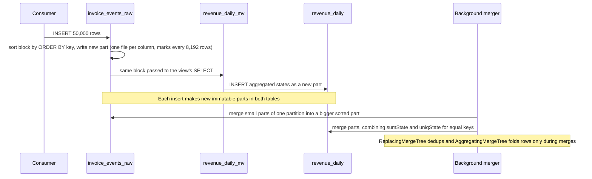

- A **part** is an immutable directory: one compressed file per column (or one combined file for small parts), a `primary.idx` with one key per granule, and **mark** files that map each granule to an offset in each column file.
- Merges only combine parts within one partition, so a `PARTITION BY` that is too fine (per day per workspace) creates too many small parts that never merge.
- Because merges are eventual, anything that relies on them (deduplication, collapsing, summing) is eventual too.
- **Projections** store a second copy of a part sorted by a different key, so the optimizer can answer "by invoice" queries without a second table.

### TimescaleDB

A **hypertable** looks like one table but is split into **chunks**, each an ordinary PostgreSQL table covering one time interval (7 days by default; tune so recent chunks and their indexes fit in memory).

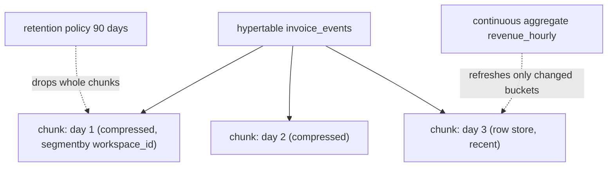

```sql
-- PostgreSQL 17 with TimescaleDB (by_range() needs 2.13 or later)
SELECT create_hypertable('invoice_events', by_range('occurred_at', INTERVAL '1 day'));
ALTER TABLE invoice_events SET (timescaledb.compress,
    timescaledb.compress_segmentby = 'workspace_id',
    timescaledb.compress_orderby   = 'occurred_at DESC');
SELECT add_compression_policy('invoice_events', INTERVAL '7 days');
SELECT add_retention_policy('invoice_events', INTERVAL '90 days');
```

The continuous aggregate definition and its refresh policy are in the Go note.

- **Compression** rewrites a chunk into columnar form: rows are grouped by the `segmentby` column, and each group stores each column as one compressed array of up to 1,000 values. Filters on `workspace_id` stay cheap.
- A **continuous aggregate** is a materialized view that refreshes only the time buckets that changed, within the window the policy names.
- The retention policy drops whole chunks, which is a metadata operation, not a delete.

### Prometheus TSDB

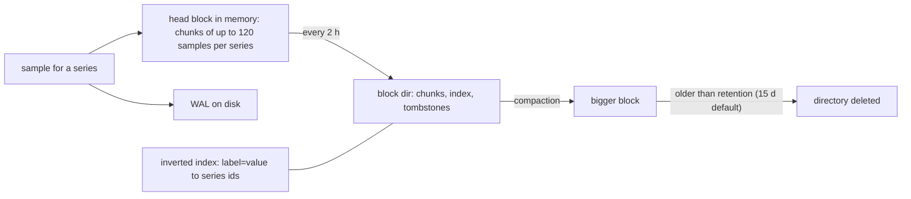

- Each **series** is identified by its metric name and full label set. An inverted index maps each `label=value` pair to the list of series ids, so `{route="/invoices"}` is a postings-list intersection.
- New samples go to the **head block** in memory, with a write-ahead log on disk for crash recovery. Each series' samples are packed into chunks of up to 120 samples using delta-of-delta timestamps and XOR values, the Gorilla scheme above.
- Every 2 hours the head's oldest data is written as an immutable **block** directory (chunks, index, tombstones). Compaction merges blocks into larger ones, up to 10% of the retention time or 31 days, whichever is smaller.
- Retention removes whole blocks; the default is 15 days. Long-term storage is delegated to Thanos, Cortex or Mimir via remote write or block upload.
- Memory grows with the number of **active series**, not with the number of samples, which is why cardinality, not volume, is what breaks Prometheus.

### Lakehouse files

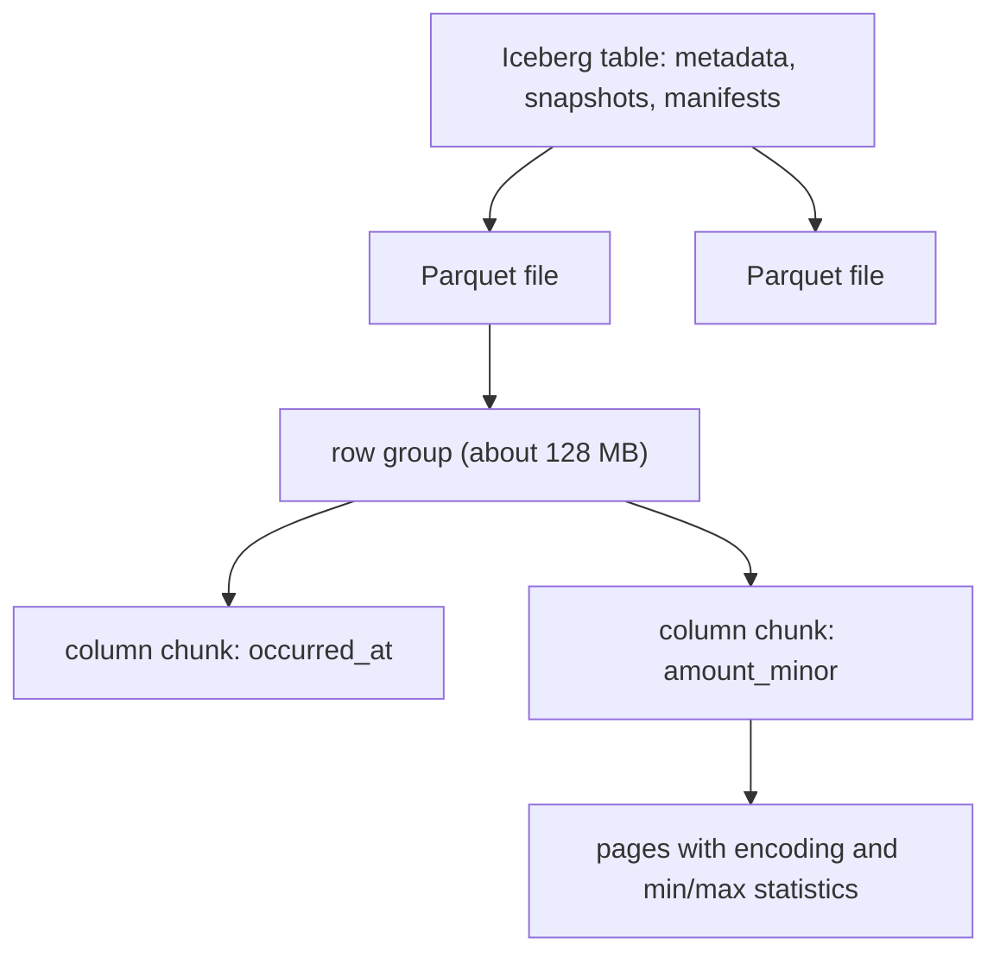

**Parquet** stores a file as **row groups** (often 128 MB), each holding one **column chunk** per column, split into **pages** with their own encodings and min/max statistics. Engines prune by row group statistics. A **table format** such as Apache Iceberg or Delta Lake adds a metadata layer over many Parquet files: snapshots for time travel, atomic commits, schema evolution and hidden partitioning.

Many engines (Spark, Trino, Athena, Snowflake, DuckDB) can read the same table, so raw history is stored once at object-storage prices.

### Late and out-of-order data

Time partitioning assumes data arrives roughly on time. A mobile client that syncs a day late writes into an old partition: Prometheus rejects samples older than the head window unless out-of-order ingestion is enabled (experimental since v2.39, enabled with `out_of_order_time_window`); ClickHouse accepts them but creates small parts in old partitions; TimescaleDB may have to decompress a compressed chunk.

Decide how late is acceptable and route anything later to a correction path.

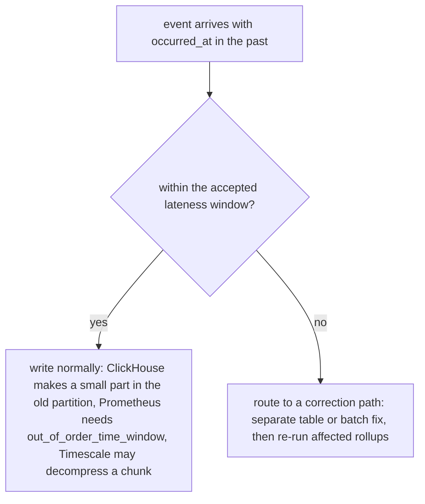

## 9. Interview questions

> [!question]- Why is a column store faster for `SUM(amount)` over a year but slower for "get invoice 42"?
> The sum reads one or two column files out of twenty and those compress 5–20×, so it reads a small fraction of the bytes and runs a tight vectorized loop. Fetching one row means opening every column file and finding the same row position in each, where a row store reads one page.

> [!question]- How do time-series databases compress timestamps and values so well?
> Timestamps arrive at near-regular intervals, so the delta-of-delta is usually 0 and costs about one bit or byte. Values are XORed with the previous value (Gorilla), and slowly changing gauges share sign, exponent and high mantissa bits, so only a few middle bits are stored. Random noise does not compress this way.

> [!question]- What is a sparse primary index in ClickHouse and how does it differ from a PostgreSQL B-tree?
> Each part is sorted by the `ORDER BY` key, and the index stores only the key of the first row of each 8,192-row granule. A query binary-searches those marks and reads whole granules.
>
> A B-tree has one entry per row and finds single rows; the sparse index is tiny, fits in memory, and is built for range scans, not point lookups.

> [!question]- Why not run dashboards on the primary database?
> Dashboards scan and aggregate lots of history. On the primary they compete for CPU, I/O and buffer cache with the payment path and can slow user-facing writes. Move them to rollup tables, a read replica, or a separate column store, depending on scale.

> [!question]- What is the high-cardinality problem in metrics systems?
> Each unique label combination is a separate series, and Prometheus's memory scales with active series. A label like `user_id` or `request_id` multiplies series by millions and exhausts memory. Use bounded labels (route, status, region) and put per-request detail in logs and traces.

> [!question]- Trap: "ClickHouse has ReplacingMergeTree, so my table never has duplicates." True?
> No. Deduplication happens only when parts merge, and merges are background and eventual; parts in different partitions never merge. Until then queries see duplicates. Use `FINAL` or `argMax(..., version)` for exact results, or deduplicate before inserting.

> [!question]- When is PostgreSQL enough for time-series data?
> When volume is modest (tens to a few hundred million rows, an estimate), queries are per tenant and time range, and you need joins with relational data. Range-partition by time, use BRIN on the time column, drop partitions for retention, and keep rollup tables. Add TimescaleDB or a column store when scans or retention outgrow that.

> [!question]- How would you design the analytics pipeline for InvoiceOps?
> CDC from PostgreSQL into Kafka, a consumer that batches into a ClickHouse raw table with an `event_id` for dedup, insert-trigger materialized views into AggregatingMergeTree rollups for dashboards, raw TTL of 15 days, and an hourly Parquet export to an Iceberg table on S3 for full history. Monitor consumer lag and reconcile daily totals against OLTP.

## 10. Cheat sheet

- Row store: fast single-row reads and writes (OLTP). Column store: fast scans of few columns (OLAP).
- Column pruning + compression + vectorized execution + block skipping = why OLAP is fast.
- Encodings: dictionary, RLE, delta, delta-of-delta (timestamps), Gorilla XOR (floats), then LZ4 or ZSTD.
- ClickHouse: sorted immutable parts, sparse index every 8,192 rows, background merges; MVs are insert triggers; dedup and aggregation are eventual.
- TimescaleDB: hypertables of time chunks, columnar compression of old chunks, continuous aggregates, drop-chunk retention.
- Prometheus: head + WAL, 2-hour blocks, 15-day default retention; cardinality kills it.
- Retention by dropping partitions, never by row deletes; raw short, rollups long, archive in Parquet on S3.
- Keep analytics off the primary: rollups, then a replica, then CDC into a column store.

## Links

- **Before this:** [[Storage Engines - B-tree vs LSM and WAL]], [[Partitioning and Sharding]], [[Index Types and Index Design]]
- **Implementation:** [[Time-Series and Columnar Storage - Go]]
- **Next:** [[Distributed SQL]], [[Materialized Views and Denormalization]], [[Transactional Outbox and CDC]]
- **Compare with:** [[Wide-Column Stores and Cassandra]] (wide rows, not columnar files), [[Metrics and Prometheus]] (the metrics side in depth), [[Case Study - Metrics and Logging Platform]]

### Watch on YouTube

- [An intro to column-based storage](https://www.youtube.com/watch?v=a7rmLeGK1v8) · ClickHouse · official explainer on column pruning and compression, matching the note's core idea
- [What is ClickHouse Database in 2026? The Fastest Open-Source OLAP Explained!](https://www.youtube.com/watch?v=Tk3Xmayopy8) · Brendan Metcalfe · concrete example of a columnar OLAP engine applying these ideas
