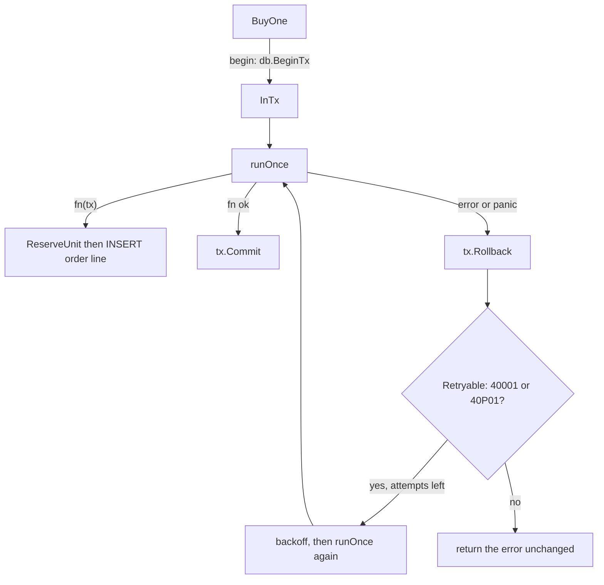
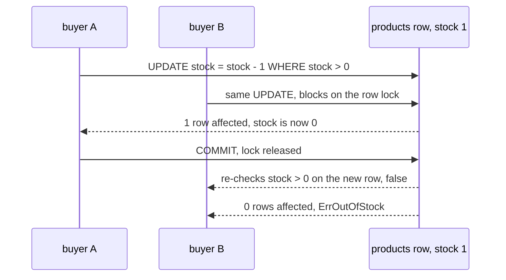
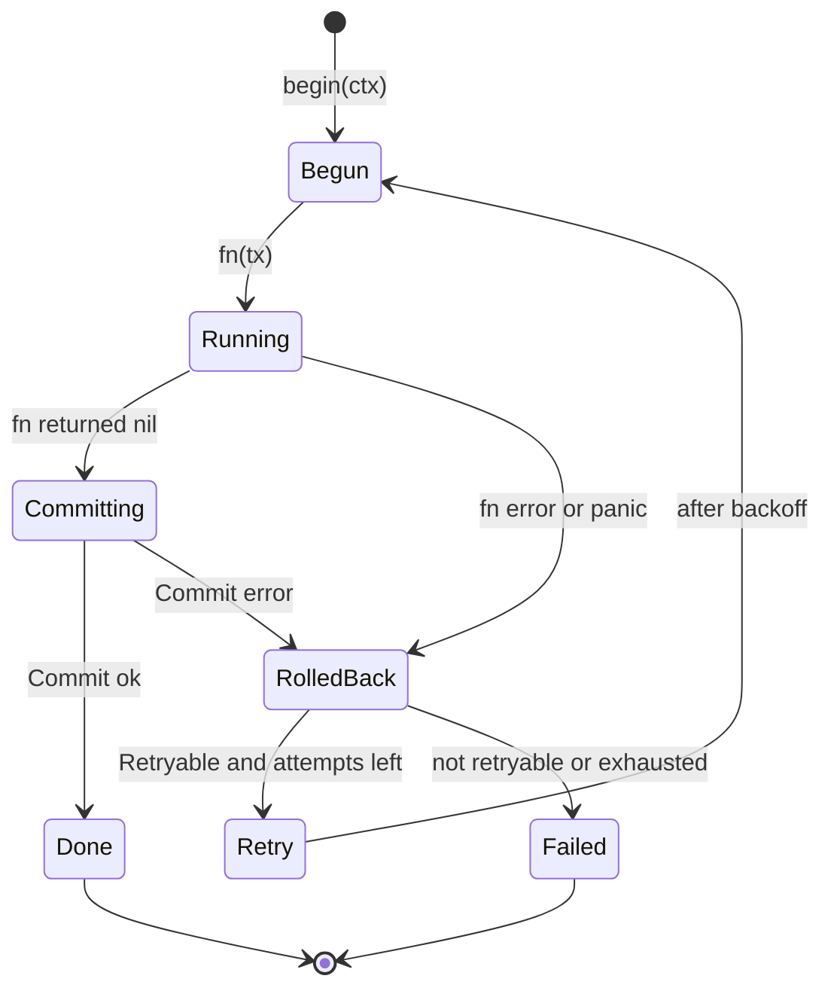

# Transactions and ACID - Go

> [!summary] TL;DR
> Runnable Go for the ideas in [[Transactions and ACID]]: a conditional `UPDATE` that sells the last unit of stock exactly once, a generic `InTx` helper that commits, rolls back on error or panic, and retries the whole transaction on serialization failures and deadlocks, and a `BuyOne` function that wires them to `database/sql`. The retry and rollback logic is tested against a fake transaction, so no database is needed.

## What this code shows

| Code | Theory concept | Where it is explained |
| --- | --- | --- |
| `ReserveUnit` | The conditional `UPDATE` re-checks `WHERE stock > 0` on the latest committed row, so two buyers of the last unit cannot both win | [[Transactions and ACID#Why the naive version oversells]] |
| `Retryable` | SQLSTATE `40001` and `40P01` mean "nothing was saved, run it again" | [[Transactions and ACID#Retrying: what to do on 40001 and 40P01]] |
| `InTx` and `runOnce` | Atomicity at the application level: one `BEGIN`, then `COMMIT` or `ROLLBACK` on every exit path | [[Transactions and ACID#The lifecycle of one transaction]] |
| `BuyOne` | One transaction pins one pooled connection; every statement goes through the same `*sql.Tx` | [[Transactions and ACID#Autocommit]] |
| `fakeTx` tests | Rollback on error and panic, retry of the whole function, give-up after N attempts | [[Transactions and ACID]] |



Read the diagram from the top: `BuyOne` supplies a `begin` function and a callback, `InTx` owns the retry loop, and `runOnce` owns one transaction from `BEGIN` to `COMMIT` or `ROLLBACK`. Only the retry loop knows about SQLSTATE codes; the callback knows only business rules.

## Setup

- Module layout: one package `txn` with four files: `reserve.go`, `intx.go`, `buy.go` and `intx_test.go`.
- Go 1.24 and the standard library only. `database/sql` needs a driver at run time (for example `github.com/jackc/pgx/v5/stdlib`), but nothing here imports one, so the package compiles and the tests run without a database.
- Run it:

```bash
go vet ./...
go test -race ./...
```

- The SQL the code expects:

```sql
CREATE TABLE products (
    id          bigint PRIMARY KEY,
    name        text   NOT NULL,
    price_minor bigint NOT NULL CHECK (price_minor >= 0),
    stock       int    NOT NULL CHECK (stock >= 0)   -- safety net: never negative
);
INSERT INTO products VALUES (1, 'Cheque book (50 leaves)', 25000, 1);
```

## Code

### Step 1: reserve one unit with a conditional UPDATE

**Concept.** The naive way to sell stock is "read the stock, check it is positive, write stock minus one", which lets two buyers both read `1` and both succeed ([[Transactions and ACID#Why the naive version oversells]]). The fix is to push the check into the `UPDATE` itself: `WHERE stock > 0` is evaluated by the database on the latest committed version of the row, after any concurrent writer has finished with it ([[Transactions and ACID#Why the conditional UPDATE is safe]]). The function therefore needs no explicit lock and no isolation level above READ COMMITTED. Alternatives are `SELECT ... FOR UPDATE` followed by an update (two statements, a held lock) or a version column ([[Locking - Optimistic vs Pessimistic - Go]]). The conditional update was chosen because it is one statement, and the row count tells the caller whether it won.

```go
package txn

import (
	"context"
	"database/sql"
	"errors"
)

var ErrOutOfStock = errors.New("out of stock")

// ReserveUnit takes one unit of stock with a conditional UPDATE.
// The WHERE clause re-checks stock > 0 on the latest committed row,
// so two buyers of the last unit cannot both succeed.
func ReserveUnit(ctx context.Context, tx *sql.Tx, productID int64) error {
	res, err := tx.ExecContext(ctx,
		`UPDATE products SET stock = stock - 1 WHERE id = $1 AND stock > 0`, productID)
	if err != nil {
		return err
	}
	n, err := res.RowsAffected()
	if err != nil {
		return err
	}
	if n == 0 {
		return ErrOutOfStock
	}
	return nil
}
```

**How it works.**

1. `tx *sql.Tx` is a parameter, not `*sql.DB`: the statement must join the caller's transaction so that the order-line insert that follows commits or rolls back together with it.
2. `ExecContext` sends the `UPDATE` with `$1` as a bound parameter. The `stock - 1` arithmetic happens inside the database, so no stale value from the application is ever written back.
3. `RowsAffected()` is the verdict. One row means this call decremented the stock; zero rows means the `stock > 0` condition failed (or the product does not exist).
4. Zero rows becomes the sentinel `ErrOutOfStock`. Callers compare with `errors.Is`, and `InTx` will not retry it because it carries no SQLSTATE.



### Step 2: a reusable transaction helper

**Concept.** Every write path needs the same envelope: `BEGIN`, run the work, `COMMIT`, and `ROLLBACK` on every other exit, including panics ([[Transactions and ACID#The lifecycle of one transaction]]). Serialization failures and deadlocks add a second rule: the database has already rolled the transaction back, and the correct reaction is to run the whole function again ([[Transactions and ACID#Retrying: what to do on 40001 and 40P01]]). Copy-pasting this into each repository method invites a missing rollback on one early `return`. The helper is generic over a two-method `Tx` interface so it works with `*sql.Tx`, with an adapted `pgx.Tx`, and with the fake used in the tests. The plain alternative is `defer tx.Rollback()` in each function, which handles rollback but not retry.

The helper is built from four small pieces. First, a `Tx` interface with only the two methods the helper needs, and a one-method interface for reading the SQLSTATE from a driver error:

```go
package txn

import (
	"context"
	"errors"
	"fmt"
	"time"
)

// Tx is the part of *sql.Tx (or pgx.Tx adapted) that the helper needs.
type Tx interface {
	Commit() error
	Rollback() error
}

// sqlStater is implemented by *pgconn.PgError (pgx) and lets us read the SQLSTATE.
type sqlStater interface{ SQLState() string }
```

**How it works.**

1. `Tx` lists only `Commit` and `Rollback`. A smaller interface is easier to fake and keeps the helper independent of any driver.
2. `sqlStater` is satisfied structurally by `*pgconn.PgError`, so this package imports no driver at all. A MySQL adapter could implement the same method.

`Retryable` walks the error chain with `errors.As`, so a wrapped `*pgconn.PgError` is still recognised. Only `40001` and `40P01` count; a unique violation or a business error does not:

```go
// Retryable reports whether the whole transaction may be retried safely:
// 40001 = serialization_failure, 40P01 = deadlock_detected.
func Retryable(err error) bool {
	var s sqlStater
	if errors.As(err, &s) {
		switch s.SQLState() {
		case "40001", "40P01":
			return true
		}
	}
	return false
}
```

**How it works.**

1. `var s sqlStater` declares an interface variable; `errors.As` unwraps `err` link by link until some link implements it.
2. The `switch` is an allow-list: a new SQLSTATE is not retried until someone adds it deliberately.
3. A plain `errors.New("boom")` never matches `sqlStater`, so the function returns `false` and the error surfaces immediately.

`InTx` is the retry loop. It runs one attempt, returns at once on success or on a non-retryable error, and otherwise waits with doubling backoff (and respects `ctx`) before the next attempt:

```go
// InTx begins a transaction, runs fn, and commits. Any error or panic rolls back.
// Retryable failures re-run the WHOLE transaction up to attempts times with backoff.
func InTx[T Tx](ctx context.Context, attempts int, begin func(context.Context) (T, error), fn func(T) error) error {
	var err error
	backoff := 10 * time.Millisecond
	for i := 0; i < attempts; i++ {
		if err = runOnce(ctx, begin, fn); err == nil || !Retryable(err) {
			return err
		}
		select {
		case <-ctx.Done():
			return ctx.Err()
		case <-time.After(backoff):
		}
		backoff *= 2
	}
	return fmt.Errorf("transaction failed after %d attempts: %w", attempts, err)
}
```

**How it works.**

1. The type parameter `T Tx` lets the caller keep its concrete transaction type, so `fn` receives a real `*sql.Tx` rather than a bare interface.
2. The `if` returns immediately when the attempt succeeded (`err == nil`) or failed for a reason retrying cannot fix.
3. The `select` waits `backoff` but wakes early if the context is cancelled, so a shutdown does not sit in a sleep.
4. `backoff *= 2` gives waits of 10 ms, 20 ms, 40 ms. With 3 attempts the test that fails twice sleeps 10 + 20 = 30 ms, which matches the measured `0.03s` below.
5. After the last attempt `%w` wraps the final error, so `errors.As` and `Retryable` still work on what the caller receives.

`runOnce` is one attempt: begin, run `fn`, commit. A deferred function rolls back on error and on panic, and re-panics so the bug is not hidden:

```go
func runOnce[T Tx](ctx context.Context, begin func(context.Context) (T, error), fn func(T) error) (err error) {
	tx, err := begin(ctx)
	if err != nil {
		return err
	}
	// Rollback after a successful Commit is a no-op that returns an error we ignore.
	defer func() {
		if p := recover(); p != nil {
			_ = tx.Rollback()
			panic(p)
		}
		if err != nil {
			_ = tx.Rollback()
		}
	}()
	if err = fn(tx); err != nil {
		return err
	}
	return tx.Commit()
}
```

**How it works.**

1. The named result `err` is what lets the deferred closure see the final error, including one returned by `Commit`.
2. `begin(ctx)` failing returns before the `defer` is registered, because there is no transaction to roll back.
3. On a panic, `recover()` returns the value; the closure rolls back and then calls `panic(p)` again so the stack unwinds and the bug is visible.
4. On a normal error path (`err != nil`), including a failed `Commit`, the closure rolls back. `_ =` discards the rollback error because the original error is the one the caller needs.
5. On success `err` is `nil`, so the closure does nothing.



### Step 3: call it with database/sql

**Concept.** The helper is useful only when the repository code sits on top of it. `BuyOne` is the smallest realistic use: two statements that must both happen or neither ([[Transactions and ACID#Autocommit]] explains why each statement alone would commit separately). `db.BeginTx` takes one connection from the pool and holds it until commit or rollback, so every statement must go through the returned `*sql.Tx`. The isolation level is named explicitly so the code documents what it depends on. READ COMMITTED is enough here because the conditional update carries its own safety.

```go
package txn

import (
	"context"
	"database/sql"
)

// BuyOne reserves one unit and records the order line in a single transaction.
func BuyOne(ctx context.Context, db *sql.DB, orderID, productID, priceMinor int64) error {
	begin := func(ctx context.Context) (*sql.Tx, error) {
		return db.BeginTx(ctx, &sql.TxOptions{Isolation: sql.LevelReadCommitted})
	}
	return InTx(ctx, 3, begin, func(tx *sql.Tx) error {
		if err := ReserveUnit(ctx, tx, productID); err != nil {
			return err // ErrOutOfStock: not retryable, rolled back, returned as is
		}
		_, err := tx.ExecContext(ctx,
			`INSERT INTO order_lines (order_id, product_id, unit_price_minor) VALUES ($1, $2, $3)`,
			orderID, productID, priceMinor)
		return err
	})
}
```

**How it works.**

1. `begin` is a closure over `db`. `InTx` calls it once per attempt, so each retry gets a fresh transaction on a (possibly different) pooled connection.
2. `InTx` is instantiated with `T = *sql.Tx`, because `*sql.Tx` has `Commit() error` and `Rollback() error`.
3. Inside the callback, `ReserveUnit` and the `INSERT` both use `tx`. If the insert fails, the stock decrement is rolled back with it.
4. Returning `ErrOutOfStock` triggers rollback and a non-retryable result, so the caller sees the business error unchanged.
5. `3` is the attempt budget: enough to ride out a brief deadlock, small enough to give up when something is persistently wrong.

### Step 4: the payment-webhook transaction in SQL

**Concept.** The boundary rule is one transaction per business fact that must be all-or-nothing, and nothing slow inside it ([[Transactions and ACID#Choosing the boundary: the payment webhook]]). A payment webhook touches four tables: a dedupe row, the payment, the invoice and an audit row. Here it is as plain SQL, because the Go version is simply `InTx` around four `ExecContext` calls on one `tx`. The email is not sent here; an outbox row would be inserted in this transaction instead ([[Transactional Outbox and CDC]]), so that a slow mail server never holds the locks.

```sql
BEGIN;
-- 1. dedupe: a redelivered webhook hits the unique key and inserts nothing
INSERT INTO webhook_events (provider, provider_event_id, received_at)
VALUES ('razorpay', 'evt_9KQ2', now())
ON CONFLICT (provider, provider_event_id) DO NOTHING;
-- app: if 0 rows inserted, ROLLBACK and return 200 (already processed)

-- 2. record the payment
INSERT INTO payments (invoice_id, workspace_id, amount_minor, provider_ref)
VALUES (501, 7, 50000, 'pay_77A');
```

```sql
-- 3. update the invoice; the CHECK (paid_minor <= total_minor) guards overpayment
UPDATE invoices
SET paid_minor = paid_minor + 50000,
    status = CASE WHEN paid_minor + 50000 = total_minor THEN 'paid' ELSE status END
WHERE id = 501 AND workspace_id = 7;

-- 4. audit
INSERT INTO audit_log (workspace_id, entity, entity_id, action) VALUES (7, 'invoice', 501, 'payment_applied');
COMMIT;
```

**How it works.**

1. The first insert is the idempotency guard. A second delivery of event `evt_9KQ2` conflicts on the unique key, inserts zero rows, and the application rolls back and answers 200.
2. The payment insert and the invoice update must agree. If the `CHECK (paid_minor <= total_minor)` rejects the update, the whole transaction aborts and no payment row remains.
3. The `UPDATE` adds to `paid_minor` in SQL rather than writing an application-computed total, and its `WHERE` includes `workspace_id` so one tenant cannot touch another's invoice.
4. The audit row and `COMMIT` come last, so the audit trail contains only payments that really happened.

Three Go rules this code follows:

- **`defer` rollback.** Every exit path (early `return`, error, panic) ends the transaction. The plain idiom without a helper is `tx, err := db.BeginTx(ctx, nil)`, then `defer tx.Rollback()`, then `return tx.Commit()`; after a successful commit the deferred `Rollback` returns `sql.ErrTxDone`, which is harmless.
- **Pass `tx`, not `db`.** Every statement that belongs to the unit must go through the same `*sql.Tx`. A repository method that quietly uses `db` runs outside the transaction. How to structure this across repositories is the subject of [[Transactions and the Repository Pattern]].
- **The context controls the transaction.** If `ctx` is cancelled before commit, `database/sql` rolls the transaction back.

## Design decisions

| Decision | Alternative | Trade-off |
| --- | --- | --- |
| Conditional `UPDATE ... WHERE stock > 0` and check `RowsAffected` | `SELECT` then `UPDATE`, or `SELECT ... FOR UPDATE` | One statement and no held lock; works at READ COMMITTED. Only fits a single-row rule, not multi-row invariants |
| Generic `InTx[T Tx]` over a two-method interface | Take `*sql.DB` and return `*sql.Tx` directly | Testable with a fake and reusable with pgx; slightly more type machinery |
| Retry the whole transaction, never one statement | Retry only the failed statement | After `40001` or `40P01` the transaction is already aborted, so only a full re-run is correct |
| Allow-list of SQLSTATEs (`40001`, `40P01`) | Retry every error | Business errors and constraint violations fail fast instead of looping |
| `sqlStater` interface instead of importing `pgconn` | Type-assert `*pgconn.PgError` | No driver dependency in the helper; any driver exposing `SQLState()` works |
| Doubling backoff without jitter | Full jitter | Simple and deterministic for tests; workers that fail together retry together (see Pitfalls) |
| Deferred rollback that re-panics | `recover` and convert the panic to an error | The bug stays visible and the stack trace is kept; the transaction is still cleaned up |
| Ignore the `Rollback` error | Log or join it with the original error | The original error is the useful one; a failed rollback usually means the connection is already dead |

## Tests

The tests run against a fake transaction, so they need no database. Together they prove the helper's contract: exactly one of commit or rollback per attempt, retries only for the right errors, and the whole function re-runs.

First the two fakes. `pgErr` implements `SQLState()` like a pgx error, and `fakeTx` just records whether `Commit` or `Rollback` was called:

```go
package txn

import (
	"context"
	"errors"
	"fmt"
	"testing"
)

type pgErr struct{ code string }

func (e *pgErr) Error() string    { return "pg error " + e.code }
func (e *pgErr) SQLState() string { return e.code }

type fakeTx struct{ committed, rolledBack bool }

func (f *fakeTx) Commit() error   { f.committed = true; return nil }
func (f *fakeTx) Rollback() error { f.rolledBack = true; return nil }
```

### TestRetryable

**Property.** Only `40001` and `40P01` are retryable, even when wrapped. This matters because retrying a unique violation or a business error would loop pointlessly.

| Input error | Expected `Retryable` |
| --- | --- |
| `pgErr{"40001"}` | true |
| `fmt.Errorf("wrapped: %w", pgErr{"40P01"})` | true |
| `pgErr{"23505"}` (unique violation) | false |
| `errors.New("boom")` | false |

```go
func TestRetryable(t *testing.T) {
	cases := map[string]struct {
		err  error
		want bool
	}{
		"serialization": {&pgErr{"40001"}, true},
		"deadlock":      {fmt.Errorf("wrapped: %w", &pgErr{"40P01"}), true},
		"unique":        {&pgErr{"23505"}, false},
		"plain":         {errors.New("boom"), false},
	}
	for name, c := range cases {
		if got := Retryable(c.err); got != c.want {
			t.Errorf("%s: got %v want %v", name, got, c.want)
		}
	}
}
```

A failure in the `deadlock` case means the classifier stopped unwrapping errors (for example someone replaced `errors.As` with a type assertion), so wrapped driver errors would stop being retried. A failure in `unique` means a permanent error would be retried.

### TestInTxCommitsOnSuccess

**Property.** A callback that returns `nil` commits and never rolls back. Without this, every successful write could be silently undone.

| Callback result | Expected |
| --- | --- |
| `nil` | `committed == true`, `rolledBack == false`, `InTx` returns `nil` |

```go
func TestInTxCommitsOnSuccess(t *testing.T) {
	var tx *fakeTx
	begin := func(context.Context) (*fakeTx, error) { tx = &fakeTx{}; return tx, nil }
	if err := InTx(context.Background(), 3, begin, func(*fakeTx) error { return nil }); err != nil {
		t.Fatal(err)
	}
	if !tx.committed || tx.rolledBack {
		t.Fatalf("want commit only, got %+v", tx)
	}
}
```

A failure means the happy path is broken: either `Commit` is not called (data lost) or the deferred cleanup rolls back after commit.

### TestInTxRollsBackOnError

**Property.** A callback error rolls back, does not commit, and reaches the caller unchanged. This is atomicity at the application level: a failed unit leaves nothing behind.

| Callback result | Expected |
| --- | --- |
| `errors.New("out of stock")` | `rolledBack == true`, `committed == false`, `errors.Is(err, want)` |

```go
func TestInTxRollsBackOnError(t *testing.T) {
	var tx *fakeTx
	begin := func(context.Context) (*fakeTx, error) { tx = &fakeTx{}; return tx, nil }
	want := errors.New("out of stock")
	err := InTx(context.Background(), 3, begin, func(*fakeTx) error { return want })
	if !errors.Is(err, want) || tx.committed || !tx.rolledBack {
		t.Fatalf("err=%v tx=%+v", err, tx)
	}
}
```

A failure with `committed == true` would be the worst case: partial work saved after an error. A failure on `errors.Is` means the helper rewrapped or replaced the business error.

### TestInTxRetriesWholeTransaction

**Property.** A retryable error causes the entire function to run again in a new transaction. This is what makes `40001` survivable.

| Attempt | `begins` at the check | Callback returns |
| --- | --- | --- |
| 1 | 1 | `40001` |
| 2 | 2 | `40001` |
| 3 | 3 | `nil` |

Expected: `err == nil` and `begins == 3`.

```go
func TestInTxRetriesWholeTransaction(t *testing.T) {
	var begins int
	begin := func(context.Context) (*fakeTx, error) { begins++; return &fakeTx{}, nil }
	err := InTx(context.Background(), 3, begin, func(*fakeTx) error {
		if begins < 3 {
			return &pgErr{"40001"}
		}
		return nil
	})
	if err != nil || begins != 3 {
		t.Fatalf("err=%v begins=%d", err, begins)
	}
}
```

If `begins` is 1 the helper retried only the callback inside the same aborted transaction. If it is greater than 3 the attempt budget is not respected.

### TestInTxGivesUp

**Property.** After `attempts` retryable failures the helper stops and reports failure, and the returned error still carries the original SQLSTATE. Without a limit, a persistent deadlock would loop forever.

| `attempts` | Callback result | Expected |
| --- | --- | --- |
| 2 | `40P01` every time | non-nil error, `Retryable(err)` is true (wrapped with `%w`) |

```go
func TestInTxGivesUp(t *testing.T) {
	begin := func(context.Context) (*fakeTx, error) { return &fakeTx{}, nil }
	err := InTx(context.Background(), 2, begin, func(*fakeTx) error { return &pgErr{"40P01"} })
	if !Retryable(err) {
		t.Fatalf("want wrapped retryable error, got %v", err)
	}
}
```

A failure means either the loop returned `nil` after exhaustion (a silent loss) or the final error was wrapped with `%v` instead of `%w`, hiding the code from callers.

### TestInTxRollsBackOnPanic

**Property.** A panic in the callback still rolls back and is re-raised. If the helper swallowed the panic the bug would vanish; if it did not roll back, the connection would return to the pool mid-transaction.

| Callback | Expected |
| --- | --- |
| `panic("bug")` | `recover()` in the test is non-nil and `tx.rolledBack == true` |

```go
func TestInTxRollsBackOnPanic(t *testing.T) {
	tx := &fakeTx{}
	begin := func(context.Context) (*fakeTx, error) { return tx, nil }
	defer func() {
		if recover() == nil || !tx.rolledBack {
			t.Fatalf("want panic re-raised after rollback, tx=%+v", tx)
		}
	}()
	_ = InTx(context.Background(), 1, begin, func(*fakeTx) error { panic("bug") })
}
```

The assertion lives in a `defer` because the panic unwinds through the test function; code after `InTx` would never run. A failure means the panic was swallowed (`recover()` returned nil) or the rollback was skipped.

### Running it

All six tests pass under `go test -race` with Go 1.24.4 (measured in a scratch module):

```text
=== RUN   TestRetryable
--- PASS: TestRetryable (0.00s)
=== RUN   TestInTxCommitsOnSuccess
--- PASS: TestInTxCommitsOnSuccess (0.00s)
=== RUN   TestInTxRollsBackOnError
--- PASS: TestInTxRollsBackOnError (0.00s)
=== RUN   TestInTxRetriesWholeTransaction
--- PASS: TestInTxRetriesWholeTransaction (0.03s)
=== RUN   TestInTxGivesUp
--- PASS: TestInTxGivesUp (0.03s)
=== RUN   TestInTxRollsBackOnPanic
--- PASS: TestInTxRollsBackOnPanic (0.00s)
PASS
ok  	example.com/acid
```

**Reading the output.**

1. Each `=== RUN` / `--- PASS` pair is one test; `(0.00s)` is its wall time.
2. The two `0.03s` lines are the retry tests. They are not slow code: `InTx` sleeps 10 ms after the first failure and 20 ms after the second, which adds up to 30 ms. `TestInTxGivesUp` with 2 attempts sleeps 10 ms and 20 ms as well, because it also sleeps after the last failed attempt before the loop ends.
3. The other four finish in under 10 ms because they never enter the backoff.
4. `PASS` and `ok example.com/acid` mean every test passed with the race detector on; no data race was reported.

The pgx v5 driver also ships `pgx.BeginFunc`, which handles commit and rollback the same way but does not retry. `ReserveUnit` and `BuyOne` need a real PostgreSQL to run; they were compiled and vetted here but not executed against a database.

## Pitfalls in the code

- **`runOnce` ignores the `Rollback` error on purpose.** After a failed `Commit` or a dead connection the rollback may fail too; the original error is the one the caller needs.
- **Retried callbacks must be idempotent outside the database.** `InTx` may call `fn` up to `attempts` times. An HTTP call or email inside `fn` repeats on every retry.
- **`ErrOutOfStock` must not be retryable.** It is a business outcome. Retrying it would loop until `attempts` runs out and then report a misleading "failed after N attempts".
- **`InTx` returns the wrapped error after giving up.** The `%w` keeps `Retryable(err)` true, which the `TestInTxGivesUp` test checks; a caller that wants to treat exhaustion differently should compare with `errors.Is` on the underlying code.
- **The backoff here has no jitter.** Two workers that fail together retry together. Real services add jitter, as in [[Timeouts, Retries and Backoff]].
- **Isolation level.** `BuyOne` asks for `LevelReadCommitted`; at that level the conditional `UPDATE` is safe. At REPEATABLE READ a concurrent change to the same row would raise `40001` and `InTx` would retry it.

## Exercises

1. Change `InTx` so the first backoff is 1 ms instead of 10 ms. Predict how the elapsed times of `TestInTxRetriesWholeTransaction` and `TestInTxGivesUp` change, then run them with `-v`.
2. Remove `40P01` from `Retryable`. Which test fails, and what does `TestInTxGivesUp` report?
3. In `TestInTxRollsBackOnPanic`, change `InTx` so it no longer re-panics after the rollback. Predict which assertion fails and why the test is written with a `recover` in a `defer`.

## Links

- Theory: [[Transactions and ACID]]
- **Before this:** [[SQL Essentials]]
- **Next:** [[Isolation Levels and MVCC - Go]], [[Locking - Optimistic vs Pessimistic - Go]], [[Transactions and the Repository Pattern]]
