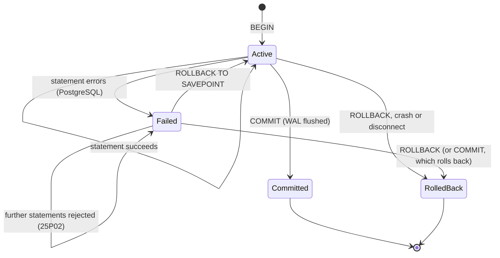
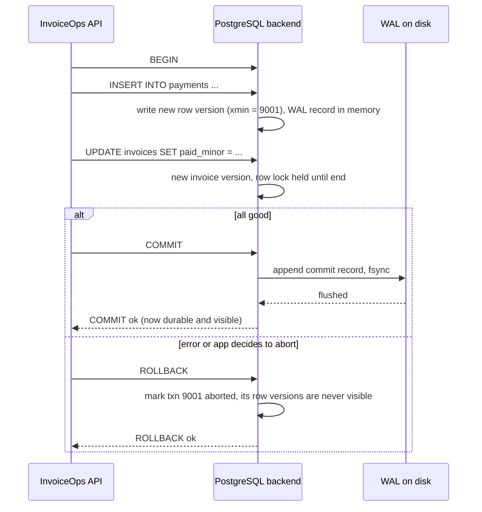
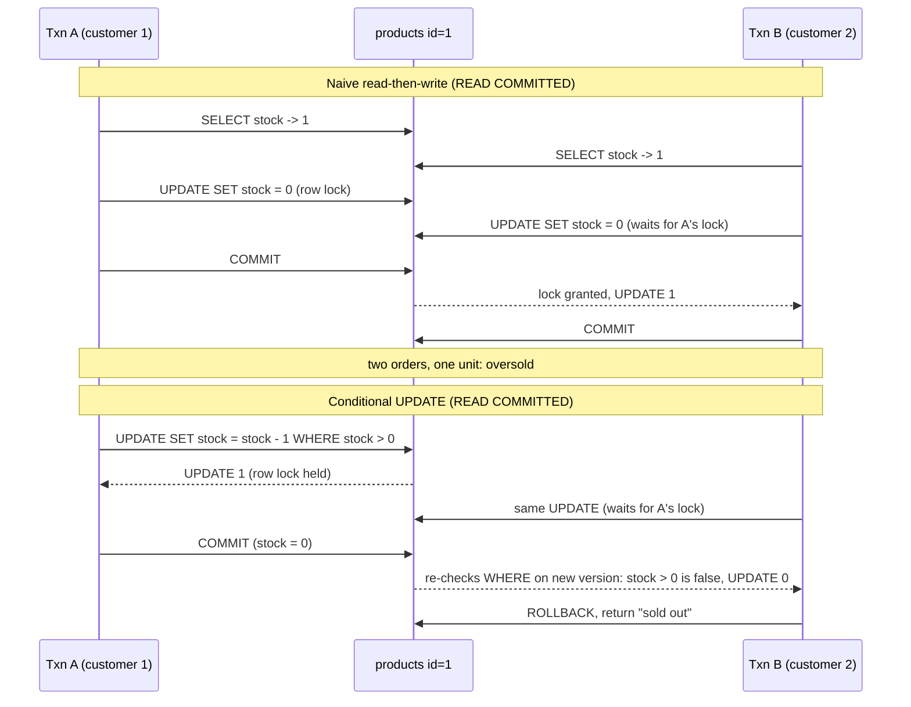

# Transactions and ACID

> [!summary] TL;DR
> A **transaction** is a group of SQL statements that the database treats as one unit: either all of them take effect (**commit**) or none of them do (**rollback**). **ACID** names the four promises a transaction makes: Atomicity (all or nothing), Consistency (rules such as "stock is never negative" still hold afterwards), Isolation (transactions running at the same time do not corrupt each other's work) and Durability (a committed change survives a crash).

> [!abstract] Core idea
> - Wrap every multi-step change in `BEGIN … COMMIT`, so a crash or error halfway leaves no half-done work.
> - Durability comes from the write-ahead log (WAL): commit returns only after the log record is flushed to disk.
> - Consistency is mostly your job: constraints (`CHECK`, `UNIQUE`, foreign keys) plus correct transaction boundaries.
> - Isolation is level-dependent. At the default READ COMMITTED level, "read stock, then write stock" still oversells; use a conditional `UPDATE`, `SELECT … FOR UPDATE` or a constraint.
> - In Go: `BeginTx`, `defer tx.Rollback()`, `Commit()`, keep the transaction short, and never make HTTP calls inside it.

## 1. Why it exists

InvoiceOps (the running example in these notes: a multi-tenant invoicing SaaS) receives a payment webhook from its payment provider. Handling it takes four writes:

1. Record the webhook event so a redelivery is ignored.
2. Insert a row into `payments` with `amount_minor = 50000` (₹500.00, stored as **minor units**: an integer count of paise, so there are no floating-point rounding errors).
3. Update the invoice: `paid_minor = paid_minor + 50000`, `status = 'paid'`.
4. Write an audit log row.

Without a transaction, each statement is saved on its own. If the process crashes after step 2, the payment exists but the invoice still says `open`, so the customer receives an overdue reminder for an invoice they already paid. If the provider retries the webhook, step 1 may now say "already seen" and the invoice is never fixed.

With a transaction, the four writes become one unit. A crash at any point before `COMMIT` leaves the database exactly as it was before step 1, and the retry simply runs the whole thing again.

The second reason is concurrency. If two customers try to buy the last unit of a product at the same moment, two transactions run side by side. Section 4 shows that a transaction alone does **not** stop both of them from succeeding; you also need the right SQL.

## 2. Mental model

Think of a transaction as a **shopping basket at a checkout**. You put items in one by one (statements), but nothing is yours until you pay (`COMMIT`). If your card is declined or you walk away (`ROLLBACK`, error, crash), every item goes back on the shelf. Nobody ever leaves with half a basket.

The four letters, in plain words:

| Letter | Plain meaning | Who provides it | Mechanism (PostgreSQL 17) |
| --- | --- | --- | --- |
| **A**tomicity | All statements take effect, or none do | Database | Each row version is stamped with its transaction ID; if that transaction aborts, its versions are simply never visible, and the commit log (`pg_xact`) records the outcome |
| **C**onsistency | Data still obeys your rules after the transaction | **You**, helped by the database | `NOT NULL`, `CHECK`, `UNIQUE`, foreign keys, plus transaction boundaries that keep related writes together |
| **I**solation | Concurrent transactions do not see or break each other's half-done work | Database, to the degree of the **isolation level** | MVCC snapshots and row locks; see [[Isolation Levels and MVCC]] |
| **D**urability | Once `COMMIT` returns, the change survives a crash or power loss | Database plus honest hardware | The WAL record is flushed to disk (`fsync`) before `COMMIT` returns |

Two warnings about the letters:

- **C in ACID is not the C in CAP.** ACID consistency means "your invariants hold". CAP consistency means linearizability, a distributed-systems property. Same word, different ideas.
- **The database cannot know your business rules unless you write them down.** "An invoice's `paid_minor` never exceeds `total_minor`" is only enforced if you add `CHECK (paid_minor <= total_minor)` or always check it in the same transaction.

## 3. How it works

### The lifecycle of one transaction



- **Active.** Statements run. Their changes are visible to this transaction only.
- **Failed** (PostgreSQL behaviour). After any error, PostgreSQL rejects every further statement with `current transaction is aborted, commands ignored until end of transaction block` (SQLSTATE `25P02`). Sending `COMMIT` in this state performs a rollback. MySQL InnoDB differs: most errors roll back only the failing statement, and the transaction stays usable.
- **Committed.** All changes become visible to others at once and are durable.
- **Rolled back.** All changes are discarded.

### Commit and rollback, step by step



What each letter relies on:

- **Durability: the write-ahead log.** The **WAL** (write-ahead log) is an append-only file of change records. The rule is "log first, data pages later": before `COMMIT` returns, PostgreSQL flushes the WAL up to the commit record with `fsync` (a system call that forces data out of the OS cache onto the disk). The changed data pages can stay in memory; after a crash, PostgreSQL replays the WAL to rebuild them. Details live in [[Storage Engines - B-tree vs LSM and WAL]].
- **Atomicity: invisible until committed.** PostgreSQL writes each new row version as a new tuple in the table (the old version stays until VACUUM) and stamps them with the creating transaction ID (`xmin`). Readers check that ID against the commit log. An aborted transaction's versions are skipped and later cleaned up by VACUUM, so rollback is nearly free. InnoDB instead writes old values to an **undo log** and copies them back on rollback, so rolling back a large transaction in MySQL does real work and can take a long time.
- **Consistency: constraints checked inside the transaction.** A `CHECK`, `UNIQUE` or foreign-key violation raises an error and the transaction cannot commit. Constraints declared `DEFERRABLE INITIALLY DEFERRED` are checked at `COMMIT` instead of per statement.
- **Isolation: snapshots and locks.** Each statement (READ COMMITTED) or each transaction (REPEATABLE READ and SERIALIZABLE) reads from a snapshot; writers take row locks. Which anomalies remain possible depends on the level: see [[Isolation Levels and MVCC]] and [[Locking - Optimistic vs Pessimistic]].

### Autocommit

If you send a statement without `BEGIN`, PostgreSQL wraps it in its own one-statement transaction and commits it immediately. This is **autocommit**. It is why a single `UPDATE` is always atomic, and also why two separate statements are **not** atomic together.

In Go, every call on `*sql.DB` (`db.ExecContext`, `db.QueryContext`) is autocommit, and the pool may send consecutive calls on **different connections**. So `db.Exec("BEGIN")` followed by `db.Exec("UPDATE …")` is a bug: the `BEGIN` may stay open on one connection while the `UPDATE` autocommits on another. Always use `db.BeginTx`, which pins one connection until `Commit` or `Rollback`.

### Savepoints

A **savepoint** is a named point inside a transaction you can roll back to without abandoning the whole transaction.

```sql
BEGIN;
INSERT INTO invoices (id, workspace_id, total_minor, status) VALUES (501, 7, 120000, 'draft');
SAVEPOINT try_coupon;
UPDATE coupons SET used = used + 1 WHERE code = 'LAUNCH10' AND used < max_uses;
-- suppose the coupon row violates a CHECK; undo only the coupon step:
ROLLBACK TO SAVEPOINT try_coupon;
RELEASE SAVEPOINT try_coupon;  -- forget the savepoint, keep the work before it
COMMIT;                         -- invoice 501 is saved without the coupon
```

In PostgreSQL, rolling back to a savepoint is the only way to recover from an error without losing the whole transaction. Some drivers and ORMs use savepoints to implement "nested transactions". Each savepoint creates a subtransaction, and thousands of them in one transaction can slow PostgreSQL down (see section 8).

## 4. Worked example

The task: InvoiceOps sells add-on products (for example, 100 printed cheque books) with a limited `stock`. Two customers try to buy the **last unit** at the same moment. Exactly one must succeed.

```sql
CREATE TABLE products (
    id          bigint PRIMARY KEY,
    name        text   NOT NULL,
    price_minor bigint NOT NULL CHECK (price_minor >= 0),
    stock       int    NOT NULL CHECK (stock >= 0)   -- safety net: never negative
);
INSERT INTO products VALUES (1, 'Cheque book (50 leaves)', 25000, 1);
```

### Whiteboard version

The bare idea. The wrong way reads, decides in the app, then writes. The right way puts the check inside the write:

```sql
-- WRONG at READ COMMITTED: both transactions read stock = 1, both "decide" to sell
BEGIN;
SELECT stock FROM products WHERE id = 1;          -- both see 1
UPDATE products SET stock = 0 WHERE id = 1;       -- both write 0: two sales, one unit
COMMIT;

-- RIGHT: the condition is evaluated on the latest committed row, under a row lock
BEGIN;
UPDATE products SET stock = stock - 1
WHERE id = 1 AND stock > 0;                       -- winner: UPDATE 1, loser: UPDATE 0
-- app: if rows affected = 0 then ROLLBACK and answer "sold out"
INSERT INTO order_lines (order_id, product_id, unit_price_minor) VALUES (88, 1, 25000);
COMMIT;
```

### Why the naive version oversells

Being inside a transaction does not help here. At **READ COMMITTED** (the PostgreSQL default), each statement sees all data committed before that statement started, and plain `SELECT` takes no lock. Both transactions read `stock = 1` before either commits.



The key PostgreSQL behaviour: at READ COMMITTED, when an `UPDATE` waits for another transaction's row lock and that transaction commits, PostgreSQL re-evaluates the `WHERE` clause against the **newly committed** row version before updating it. That re-check is what makes the conditional `UPDATE` safe.

The `CHECK (stock >= 0)` constraint is a second safety net. Even if some code path runs `SET stock = stock - 1` without the condition, the second buyer's update would fail with `23514 check_violation` instead of storing `-1`.

### Four correct ways to sell the last unit

| Technique | SQL shape | Loser sees | Use when |
| --- | --- | --- | --- |
| Conditional `UPDATE` | `UPDATE … SET stock = stock - 1 WHERE id = $1 AND stock > 0` | 0 rows affected | Counter-style resources; simplest and fastest |
| Pessimistic lock | `SELECT stock FROM products WHERE id = $1 FOR UPDATE`, then decide in Go, then `UPDATE` | Waits, then reads `stock = 0` | The decision needs several reads or app logic between read and write |
| Unique constraint | `UNIQUE (event_id, seat_no)` on a `tickets` table, then `INSERT` | `23505 unique_violation` | Each unit has an identity (seat 14B, invoice number) |
| SERIALIZABLE + retry | Naive read-then-write, run at `ISOLATION LEVEL SERIALIZABLE` | `40001 serialization_failure`; retry, then reads 0 | Complex invariants across many rows that are hard to express as one statement |

Locks and the choice between waiting and retrying are covered in [[Locking - Optimistic vs Pessimistic]].

### The same thing in Go

The repository function. It must run inside a transaction because the order line insert that follows belongs to the same unit:

```go
package txn

import (
	"context"
	"database/sql"
	"errors"
)

var ErrOutOfStock = errors.New("out of stock")

// ReserveUnit takes one unit of stock with a conditional UPDATE.
// The WHERE clause re-checks stock > 0 on the latest committed row,
// so two buyers of the last unit cannot both succeed.
func ReserveUnit(ctx context.Context, tx *sql.Tx, productID int64) error {
	res, err := tx.ExecContext(ctx,
		`UPDATE products SET stock = stock - 1 WHERE id = $1 AND stock > 0`, productID)
	if err != nil {
		return err
	}
	n, err := res.RowsAffected()
	if err != nil {
		return err
	}
	if n == 0 {
		return ErrOutOfStock
	}
	return nil
}
```

A reusable transaction helper. It begins, runs your function, commits, rolls back on any error or panic, and retries the **whole** transaction on serialization failures (`40001`) and deadlocks (`40P01`), because those errors mean "nothing was saved, try again":

```go
package txn

import (
	"context"
	"errors"
	"fmt"
	"time"
)

// Tx is the part of *sql.Tx (or pgx.Tx adapted) that the helper needs.
type Tx interface {
	Commit() error
	Rollback() error
}

// sqlStater is implemented by *pgconn.PgError (pgx) and lets us read the SQLSTATE.
type sqlStater interface{ SQLState() string }

// Retryable reports whether the whole transaction may be retried safely:
// 40001 = serialization_failure, 40P01 = deadlock_detected.
func Retryable(err error) bool {
	var s sqlStater
	if errors.As(err, &s) {
		switch s.SQLState() {
		case "40001", "40P01":
			return true
		}
	}
	return false
}

// InTx begins a transaction, runs fn, and commits. Any error or panic rolls back.
// Retryable failures re-run the WHOLE transaction up to attempts times with backoff.
func InTx[T Tx](ctx context.Context, attempts int, begin func(context.Context) (T, error), fn func(T) error) error {
	var err error
	backoff := 10 * time.Millisecond
	for i := 0; i < attempts; i++ {
		if err = runOnce(ctx, begin, fn); err == nil || !Retryable(err) {
			return err
		}
		select {
		case <-ctx.Done():
			return ctx.Err()
		case <-time.After(backoff):
		}
		backoff *= 2
	}
	return fmt.Errorf("transaction failed after %d attempts: %w", attempts, err)
}

func runOnce[T Tx](ctx context.Context, begin func(context.Context) (T, error), fn func(T) error) (err error) {
	tx, err := begin(ctx)
	if err != nil {
		return err
	}
	// Rollback after a successful Commit is a no-op that returns an error we ignore.
	defer func() {
		if p := recover(); p != nil {
			_ = tx.Rollback()
			panic(p)
		}
		if err != nil {
			_ = tx.Rollback()
		}
	}()
	if err = fn(tx); err != nil {
		return err
	}
	return tx.Commit()
}
```

Calling it with `database/sql`. The `begin` function pins one pooled connection for the whole transaction:

```go
package txn

import (
	"context"
	"database/sql"
)

// BuyOne reserves one unit and records the order line in a single transaction.
func BuyOne(ctx context.Context, db *sql.DB, orderID, productID, priceMinor int64) error {
	begin := func(ctx context.Context) (*sql.Tx, error) {
		return db.BeginTx(ctx, &sql.TxOptions{Isolation: sql.LevelReadCommitted})
	}
	return InTx(ctx, 3, begin, func(tx *sql.Tx) error {
		if err := ReserveUnit(ctx, tx, productID); err != nil {
			return err // ErrOutOfStock: not retryable, rolled back, returned as is
		}
		_, err := tx.ExecContext(ctx,
			`INSERT INTO order_lines (order_id, product_id, unit_price_minor) VALUES ($1, $2, $3)`,
			orderID, productID, priceMinor)
		return err
	})
}
```

Three Go rules this code follows:

- **`defer` rollback.** Every exit path (early `return`, error, panic) ends the transaction. The plain idiom without a helper is `tx, err := db.BeginTx(ctx, nil)`, then `defer tx.Rollback()`, then `return tx.Commit()`; after a successful commit the deferred `Rollback` returns `sql.ErrTxDone`, which is harmless.
- **Pass `tx`, not `db`.** Every statement that belongs to the unit must go through the same `*sql.Tx`. A repository method that quietly uses `db` runs outside the transaction. How to structure this across repositories is the subject of [[Transactions and the Repository Pattern]].
- **The context controls the transaction.** If `ctx` is cancelled before commit, `database/sql` rolls the transaction back.

The tests run against a fake transaction, so they need no database:

```go
package txn

import (
	"context"
	"errors"
	"fmt"
	"testing"
)

type pgErr struct{ code string }

func (e *pgErr) Error() string    { return "pg error " + e.code }
func (e *pgErr) SQLState() string { return e.code }

type fakeTx struct{ committed, rolledBack bool }

func (f *fakeTx) Commit() error   { f.committed = true; return nil }
func (f *fakeTx) Rollback() error { f.rolledBack = true; return nil }

func TestRetryable(t *testing.T) {
	cases := map[string]struct {
		err  error
		want bool
	}{
		"serialization": {&pgErr{"40001"}, true},
		"deadlock":      {fmt.Errorf("wrapped: %w", &pgErr{"40P01"}), true},
		"unique":        {&pgErr{"23505"}, false},
		"plain":         {errors.New("boom"), false},
	}
	for name, c := range cases {
		if got := Retryable(c.err); got != c.want {
			t.Errorf("%s: got %v want %v", name, got, c.want)
		}
	}
}

func TestInTxCommitsOnSuccess(t *testing.T) {
	var tx *fakeTx
	begin := func(context.Context) (*fakeTx, error) { tx = &fakeTx{}; return tx, nil }
	if err := InTx(context.Background(), 3, begin, func(*fakeTx) error { return nil }); err != nil {
		t.Fatal(err)
	}
	if !tx.committed || tx.rolledBack {
		t.Fatalf("want commit only, got %+v", tx)
	}
}

func TestInTxRollsBackOnError(t *testing.T) {
	var tx *fakeTx
	begin := func(context.Context) (*fakeTx, error) { tx = &fakeTx{}; return tx, nil }
	want := errors.New("out of stock")
	err := InTx(context.Background(), 3, begin, func(*fakeTx) error { return want })
	if !errors.Is(err, want) || tx.committed || !tx.rolledBack {
		t.Fatalf("err=%v tx=%+v", err, tx)
	}
}

func TestInTxRetriesWholeTransaction(t *testing.T) {
	var begins int
	begin := func(context.Context) (*fakeTx, error) { begins++; return &fakeTx{}, nil }
	err := InTx(context.Background(), 3, begin, func(*fakeTx) error {
		if begins < 3 {
			return &pgErr{"40001"}
		}
		return nil
	})
	if err != nil || begins != 3 {
		t.Fatalf("err=%v begins=%d", err, begins)
	}
}

func TestInTxGivesUp(t *testing.T) {
	begin := func(context.Context) (*fakeTx, error) { return &fakeTx{}, nil }
	err := InTx(context.Background(), 2, begin, func(*fakeTx) error { return &pgErr{"40P01"} })
	if !Retryable(err) {
		t.Fatalf("want wrapped retryable error, got %v", err)
	}
}

func TestInTxRollsBackOnPanic(t *testing.T) {
	tx := &fakeTx{}
	begin := func(context.Context) (*fakeTx, error) { return tx, nil }
	defer func() {
		if recover() == nil || !tx.rolledBack {
			t.Fatalf("want panic re-raised after rollback, tx=%+v", tx)
		}
	}()
	_ = InTx(context.Background(), 1, begin, func(*fakeTx) error { panic("bug") })
}
```

All six tests pass under `go test -race` with Go 1.24.4 (measured in a scratch module). The pgx v5 driver also ships `pgx.BeginFunc`, which handles commit and rollback the same way but does not retry.

### Choosing the boundary: the payment webhook

The rule: **one transaction per business fact that must be all-or-nothing, and nothing slow inside it.**

```sql
BEGIN;
-- 1. dedupe: a redelivered webhook hits the unique key and inserts nothing
INSERT INTO webhook_events (provider, provider_event_id, received_at)
VALUES ('razorpay', 'evt_9KQ2', now())
ON CONFLICT (provider, provider_event_id) DO NOTHING;
-- app: if 0 rows inserted, ROLLBACK and return 200 (already processed)

-- 2. record the payment
INSERT INTO payments (invoice_id, workspace_id, amount_minor, provider_ref)
VALUES (501, 7, 50000, 'pay_77A');

-- 3. update the invoice; the CHECK (paid_minor <= total_minor) guards overpayment
UPDATE invoices
SET paid_minor = paid_minor + 50000,
    status = CASE WHEN paid_minor + 50000 = total_minor THEN 'paid' ELSE status END
WHERE id = 501 AND workspace_id = 7;

-- 4. audit
INSERT INTO audit_log (workspace_id, entity, entity_id, action) VALUES (7, 'invoice', 501, 'payment_applied');
COMMIT;
```

Sending the "payment received" email is **not** inside this transaction. An SMTP call can take seconds, the transaction would hold the invoice row lock and a pooled connection the whole time, and if the commit then failed the email would already be sent. Instead, insert an outbox row in the same transaction and let a worker send the email: see [[Transactional Outbox and CDC]]. Why the dedupe step matters is covered in [[Idempotency and Idempotency Keys]].

## 5. Variants and comparison

| Option | What you get | Use when | Cost |
| --- | --- | --- | --- |
| Autocommit (single statement) | The one statement is atomic | One write, or reads that need no shared snapshot | None extra |
| Explicit `BEGIN … COMMIT` at READ COMMITTED | Atomic group; each statement sees fresh committed data | Default for multi-statement writes | Row locks held until commit |
| REPEATABLE READ | One snapshot for the whole transaction; concurrent update of the same row fails with `40001` | Consistent multi-query reads (reports, exports) | Must retry on `40001` |
| SERIALIZABLE | Result equals some one-at-a-time order | Invariants across many rows | More `40001` retries; predicate-lock memory |
| Savepoints | Partial rollback inside a transaction | Optional steps, recovering from an expected error | Subtransaction overhead in PostgreSQL |
| Saga or outbox (no ACID across services) | Eventual consistency with compensations | Work spans services or databases | Compensation logic, visible intermediate states |

Isolation levels are explained in full in [[Isolation Levels and MVCC]]. Cross-database atomicity is covered in [[Two-Phase Commit]] and [[Saga Pattern]].

## 6. Trade-offs and when not to use

- **Long transactions are expensive.** A transaction holds its row locks until it ends, keeps one pooled connection busy, and in PostgreSQL keeps an old snapshot alive so VACUUM cannot remove dead row versions anywhere in the database. Keep them to milliseconds.
- **No network calls inside.** HTTP, gRPC, email or queue publishes inside a transaction stretch lock time to the remote call's latency, and the remote side effect cannot be rolled back. Do them before (and pass the result in) or after (through an outbox).
- **A single statement does not need `BEGIN`.** Autocommit already makes it atomic, and an explicit transaction adds two round trips.
- **Large batch jobs should commit in chunks.** Updating 50 million rows in one transaction holds locks for the whole run, bloats the table, and a failure at 99% loses everything. Commit every few thousand rows and make the job resumable.
- **Transactions do not span services.** A `*sql.Tx` covers one connection to one database. Two services, or PostgreSQL plus Kafka, need the outbox pattern or a saga.
- **Higher isolation is not free.** SERIALIZABLE avoids whole classes of bugs but turns contention into retries. Use it where the invariant is hard to express in one statement, not everywhere.

## 7. In production

- **Real systems:** PostgreSQL, MySQL InnoDB, SQL Server and Oracle all provide ACID transactions on a single node. MongoDB has supported multi-document transactions since 4.0 (replica sets) and 4.2 (sharded clusters). Distributed SQL databases (CockroachDB, Spanner, YugabyteDB) provide them across nodes; CockroachDB and Spanner default to SERIALIZABLE, while YugabyteDB defaults to snapshot isolation (REPEATABLE READ): see [[Distributed SQL]].
- **Failure modes and fixes:**
	- *Idle in transaction:* code begins a transaction, then waits on an HTTP call or forgets to commit. Locks pile up behind it. Fix: no I/O inside transactions; set `idle_in_transaction_session_timeout` (default 0, meaning disabled) to something like `30s` so PostgreSQL kills such sessions.
	- *Using `db` instead of `tx`:* one statement silently runs outside the transaction. Fix: repositories accept a small interface satisfied by both `*sql.DB` and `*sql.Tx`, and the service layer decides which to pass.
	- *Retrying only the failed statement after `40001`:* the transaction is already aborted. Fix: retry the whole function, as `InTx` does.
	- *Pool exhaustion:* every open transaction holds a connection; slow transactions starve the pool. See [[Connection Pooling]].
	- *Deadlocks (`40P01`):* two transactions lock the same rows in opposite order. Fix: lock rows in a consistent order (for example, by `id`), and retry.
- **What to monitor:**
	- `pg_stat_activity` rows with `state = 'idle in transaction'` and old `xact_start`.
	- The age of the oldest open transaction (`now() - min(xact_start)`).
	- `pg_stat_database.xact_rollback` relative to `xact_commit`, and `deadlocks`.
	- Application metrics for `40001` and `40P01` retries.

## 8. Deep dive

- **Commit latency is an `fsync`.** With the default `synchronous_commit = on`, each commit waits for its WAL flush. On local NVMe with power-loss protection that is typically well under a millisecond; on network-attached cloud volumes it is often around 1–5 ms (estimates; measure your disk with `pg_test_fsync`). PostgreSQL batches concurrent commits into one flush (**group commit**); `commit_delay` can widen that window.
- **`synchronous_commit = off`.** Commit returns before the flush. A crash can lose the last commits (up to about three times `wal_writer_delay`, which defaults to 200 ms), but cannot corrupt the database. It can be set per transaction: `SET LOCAL synchronous_commit = off` is reasonable for analytics events, never for payments.
- **Replicated durability.** With synchronous replication, `synchronous_commit = remote_apply` (or `on`, or `remote_write`) also waits for a standby. That trades latency for surviving the loss of a whole machine: see [[Replication]].
- **DDL is transactional in PostgreSQL.** `CREATE TABLE`, `ALTER TABLE` and most other DDL can be rolled back. Exceptions include `CREATE INDEX CONCURRENTLY` and `VACUUM`, which refuse to run inside a transaction block. In MySQL, DDL causes an implicit commit, so a migration that mixes DDL and DML is not atomic.
- **Subtransactions.** Each `SAVEPOINT` (and each PL/pgSQL `EXCEPTION` block) creates a subtransaction. PostgreSQL caches up to 64 subtransaction IDs per backend; beyond that, visibility checks must consult `pg_subtrans` and throughput can collapse under concurrency. Avoid loops that create a savepoint per row.
- **Transaction ID wraparound.** PostgreSQL transaction IDs are 32-bit. VACUUM must "freeze" old rows before IDs wrap around; a transaction left open for days blocks this. See [[Isolation Levels and MVCC]].
- **Read-only transactions still matter.** `BEGIN READ ONLY` (Go: `TxOptions{ReadOnly: true}`) documents intent, lets a REPEATABLE READ export see one snapshot across many queries, and with `SERIALIZABLE READ ONLY DEFERRABLE` runs without any risk of serialization failure.

## 9. Interview questions

> [!question]- What does each letter of ACID guarantee, and how does PostgreSQL provide it?
> Atomicity: all or nothing; row versions of an aborted transaction are never visible. Consistency: constraints and your invariants hold after commit; mostly the application's job, enforced with `CHECK`, `UNIQUE` and foreign keys. Isolation: concurrent transactions do not interfere, to the degree of the isolation level (MVCC snapshots plus row locks). Durability: commit returns only after the WAL record is flushed to disk.

> [!question]- Trap: two users buy the last ticket inside transactions. Does the transaction stop overselling?
> Not by itself. At READ COMMITTED (the PostgreSQL default), both can `SELECT stock` and see 1, then both write. Put the check inside the write (`UPDATE … WHERE stock > 0` and check rows affected), lock the row with `SELECT … FOR UPDATE`, use a unique constraint per seat, or run SERIALIZABLE and retry on `40001`. A `CHECK (stock >= 0)` constraint is a good safety net.

> [!question]- Why must you not call `db.Exec("BEGIN")` in Go?
> `*sql.DB` is a pool. Each call may use a different connection, so the `BEGIN` and the following statements can land on different sessions, leaving an open transaction on one connection and autocommitting on another. `db.BeginTx` pins one connection to the returned `*sql.Tx` until `Commit` or `Rollback`.

> [!question]- What do you do when a transaction fails with SQLSTATE 40001 or 40P01?
> Retry the whole transaction from `BEGIN`, re-reading all data, with a small capped backoff. Retrying only the failing statement is useless because PostgreSQL has already aborted the transaction. Side effects outside the database must not happen inside the retried function, or they repeat.

> [!question]- Why should a transaction never wrap an HTTP call?
> It holds row locks and a pooled connection for the duration of the remote call, so other requests queue behind it; it keeps an old snapshot open, which blocks VACUUM; and the remote side effect cannot be rolled back if the commit later fails. Call before the transaction, or after it through an outbox.

> [!question]- How is durability actually achieved, and what does `synchronous_commit = off` trade away?
> The commit record is written to the WAL and flushed with `fsync` before `COMMIT` returns; data pages are rebuilt from the WAL after a crash. With `synchronous_commit = off`, commit returns before the flush, so a crash can lose roughly the last 600 ms of commits (3 × the default `wal_writer_delay`), but never corrupts data.

> [!question]- Can you have a transaction across two microservices?
> Not an ACID one in practice. Two-phase commit exists but blocks when the coordinator fails and is rarely available across HTTP services. Use a local transaction plus an outbox to publish the event reliably, and a saga with compensating actions for multi-step business flows.

> [!question]- What happens in PostgreSQL after one statement in a transaction fails?
> The transaction enters the aborted state; every further statement returns `25P02` until you `ROLLBACK` (or `ROLLBACK TO SAVEPOINT`). Even `COMMIT` performs a rollback. MySQL InnoDB usually rolls back only the failing statement, which surprises people moving between the two.

## 10. Cheat sheet

- Transaction = all-or-nothing unit; `BEGIN`, then `COMMIT` or `ROLLBACK`.
- A: aborted versions are invisible. C: constraints plus your invariants. I: depends on level. D: WAL `fsync` before commit returns.
- Single statements autocommit; multi-statement changes need an explicit transaction.
- Go: `tx, err := db.BeginTx(ctx, opts)`, `defer tx.Rollback()`, pass `tx` everywhere, `return tx.Commit()`.
- Oversell fix: `UPDATE … WHERE stock > 0` and check rows affected, or `FOR UPDATE`, or `UNIQUE`, or SERIALIZABLE + retry.
- Retry the whole transaction on `40001` and `40P01`; never just the statement.
- Keep transactions short; no network calls inside; set `idle_in_transaction_session_timeout`.
- Across services: outbox and sagas, not distributed transactions.

## Links

- **Before this:** [[SQL Essentials]], [[Relational Schema Design]]
- **Next:** [[Isolation Levels and MVCC]], [[Locking - Optimistic vs Pessimistic]], [[Transactions and the Repository Pattern]], [[Storage Engines - B-tree vs LSM and WAL]]
- **Compare with:** [[Transactional Outbox and CDC]] and [[Saga Pattern]] (consistency across services without ACID), [[Two-Phase Commit]] (atomic commit across databases)
