# Transactions and ACID

> [!summary] TL;DR
> A **transaction** is a group of SQL statements that the database treats as one unit: either all of them take effect (**commit**) or none of them do (**rollback**). **ACID** names the four promises a transaction makes: Atomicity (all or nothing), Consistency (rules such as "stock is never negative" still hold afterwards), Isolation (transactions running at the same time do not corrupt each other's work) and Durability (a committed change survives a crash).

> [!abstract] Core idea
> - Wrap every multi-step change in `BEGIN … COMMIT`, so a crash or error halfway leaves no half-done work.
> - Durability comes from the write-ahead log (WAL): commit returns only after the log record is flushed to disk.
> - Consistency is mostly your job: constraints (`CHECK`, `UNIQUE`, foreign keys) plus correct transaction boundaries.
> - Isolation is level-dependent. At the default READ COMMITTED level, "read stock, then write stock" still oversells; use a conditional `UPDATE`, `SELECT … FOR UPDATE` or a constraint.
> - In Go: `BeginTx`, `defer tx.Rollback()`, `Commit()`, keep the transaction short, and never make HTTP calls inside it.

## Start here: the basics 🟢

> [!info] How to read this note (pick your level)
> - 🟢 **New to this?** Read "From zero" below, then sections 1, 2 and the cheat sheet (10). Stop there, that is a full first pass.
> - 🟡 **Know the basics?** Add section 3 (how it works), 4 (the worked example) and 5-6 (variants and trade-offs).
> - 🔴 **Interview / SDE-3 prep?** Add 7, 8 and 9. Headings are tagged 🟢🟡🔴 so you always know where you are.

> [!note] Before this note
> - [[SQL Essentials]]: you can read a table with `SELECT` and change it with `INSERT` and `UPDATE`. That is all you need.

**From zero, in 60 seconds** 🟢

You send money to a friend. The app must do two things: take money out of your account, and put it into theirs.

If the computer dies after step 1 but before step 2, your money just vanished.


A **transaction** fixes this. It is a way of telling the database: "these steps are one package — do all of them, or none of them."

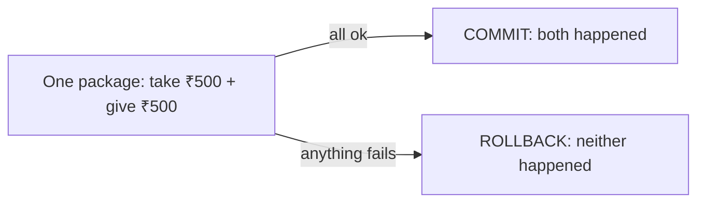

**Commit** means "save the whole package for good". **Rollback** means "throw the whole package away, like it never ran".

That is the core idea. The rest of this note is just four questions:
1. What exactly do the four ACID letters promise? (sections 1-2)
2. How does the database keep those promises under the hood? (section 3)
3. How do you stop two people buying the same last ticket? (section 4)
4. What goes wrong in real systems, and in interviews? (sections 5-9)

**The problem in one story.**
You pay for concert tickets: money leaves your account, then the ticket is reserved.
If the server crashes between those two steps, you have paid for nothing.
If two people buy the last ticket at the same moment, both might "win".
A transaction makes a group of steps all happen or none happen, and keeps parallel buyers from tripping over each other.

**Words you need first**

| Word | Plain meaning | Tiny example |
| --- | --- | --- |
| Transaction | A group of database statements treated as one unit | `BEGIN; debit; credit; COMMIT;` |
| Commit | Make all the changes in the group permanent and visible | `COMMIT` |
| Rollback | Throw away every change in the group | `ROLLBACK` after an error |
| Constraint | A rule the database enforces on data | `CHECK (stock >= 0)` |
| Concurrency | Several requests running at the same time | Two users clicking "buy" together |
| Lock | A marker that makes others wait before touching a row | `SELECT … FOR UPDATE` |
| WAL (write-ahead log) | A file where changes are recorded before the tables | Replayed after a crash |
| Isolation level | How much one transaction can see of others' unfinished work | READ COMMITTED (PostgreSQL default) |
| Invariant | A business rule that must always be true | "amount paid never exceeds the invoice total" |
| Row version | A copy of a row; PostgreSQL adds a new copy on each update instead of overwriting | invoice 501 before and after a payment |
| Snapshot | A frozen view of saved data as of one moment | a report sees all totals as of 10:00 |
| SQLSTATE | A five-character error code the database sends back | `23505` means "duplicate value" |
| Deadlock | Two transactions each wait for a row the other holds, so neither can move | A holds row 1 and wants row 2; B holds row 2 and wants row 1 |
| fsync | A system call that forces data out of memory onto the disk | done before `COMMIT` says "ok" |

**Picture it**

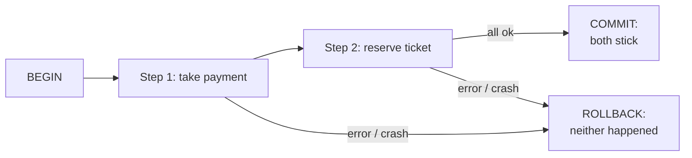

**Analogy.** A transaction is a shopping cart at checkout: either everything in the cart is bought, or you walk away with nothing.
Where it breaks: two shoppers can both see "1 left" on the shelf at once; a cart alone does not stop that, which is why isolation and locks matter.

**How the rest of this note builds up**

- First, the two problems transactions solve: crashes halfway and concurrency (section 1), and what A, C, I, D mean in plain words (section 2).
- Then the lifecycle of a transaction, WAL durability, constraints, autocommit, savepoints and retries (section 3).
- Then the "last unit of stock" worked example with four correct fixes (section 4).
- Then variants, trade-offs and production habits in Go (sections 5-7).
- Finally the SDE-3 deep dive and interview traps.

> [!tip] Remember
> All or nothing, durable after COMMIT; but "read then write" can still race, so use a conditional `UPDATE`, a row lock or a constraint.

## 1. Why it exists 🟢

InvoiceOps (the running example in these notes: a **multi-tenant** invoicing SaaS, meaning many customer companies share one app and one database) receives a payment **webhook** (an HTTP call the payment provider makes to our server to say "this payment happened") from its payment provider. Handling it takes four writes:

1. Record the webhook event so a redelivery is ignored.
2. Insert a row into `payments` with `amount_minor = 50000` (₹500.00, stored as **minor units**: an integer count of paise, so there are no floating-point rounding errors).
3. Update the invoice: `paid_minor = paid_minor + 50000`, `status = 'paid'`.
4. Write an **audit log** row (a history table that records who changed what, and when).

### Problem 1: a crash halfway

Without a transaction, each statement is saved on its own. If the process crashes after step 2, the payment exists but the invoice still says `open`, so the customer receives an overdue reminder for an invoice they already paid. If the provider retries the webhook, step 1 may now say "already seen" and the invoice is never fixed.

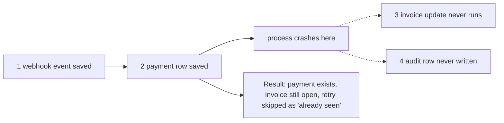

With a transaction, the four writes become one unit. A crash at any point before `COMMIT` leaves the database exactly as it was before step 1, and the retry simply runs the whole thing again.

| Crash point | Without a transaction | With a transaction |
| --- | --- | --- |
| After step 1 | Event recorded, nothing else: the retry is skipped | Nothing saved, retry runs all four steps |
| After step 2 | Payment recorded, invoice still `open`: wrong reminder email | Nothing saved, retry runs all four steps |
| After step 3 | Audit row missing | Nothing saved, retry runs all four steps |
| After `COMMIT` | Not applicable | All four saved, retry is deduplicated by step 1 |

### Problem 2: concurrency

If two customers try to buy the last unit of a product at the same moment, two transactions run side by side. Section 4 shows that a transaction alone does **not** stop both of them from succeeding; you also need the right SQL.

### Real-life example: booking two seats 🟢

Think of booking seats D7 and D8 for a movie on a ticket app like BookMyShow.
Roughly, the booking step must save one booking row and mark both seats as taken.
Say someone else grabbed D8 a moment earlier, so the D8 write breaks a "one booking per seat" rule.
Because everything is one transaction, the D7 part is thrown away too, so you never hold only one of the two seats you wanted.
The bank or UPI payment runs in a different system, so it cannot sit inside this database transaction; that part needs retries and status checks instead (see [[Saga Pattern]]).

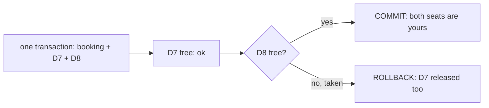

## 2. Mental model 🟢

Think of a transaction as a **shopping basket at a checkout**. You put items in one by one (statements), but nothing is yours until you pay (`COMMIT`). If your card is declined or you walk away (`ROLLBACK`, error, crash), every item goes back on the shelf. Nobody ever leaves with half a basket.

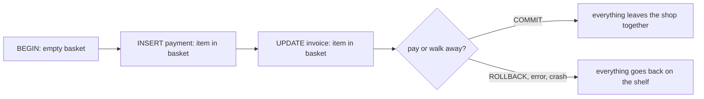

### The four letters, in plain words

**In plain words:** ACID is just four promises — everything or nothing, your rules still hold, people working at the same time don't trample each other, and once saved it stays saved even if the power goes out.

🟢 **Plain version:** The "Mechanism" column below is full of PostgreSQL internals, and you can skip it on a first read. The short story is one trick per letter. For A, PostgreSQL hides the changes of a failed transaction instead of erasing them. For C, the database checks the rules you wrote (like `stock >= 0`) and refuses anything that breaks them. For I, each reader sees a frozen picture of saved data while writers queue up for the rows they change. For D, the database writes a note to disk before it says "saved", and re-reads those notes after a crash.

| Letter | Plain meaning | Who provides it | Mechanism (PostgreSQL 17) |
| --- | --- | --- | --- |
| **A**tomicity | All statements take effect, or none do | Database | Each row version is stamped with its transaction ID; if that transaction aborts, its versions are simply never visible, and the commit log (`pg_xact`) records the outcome |
| **C**onsistency | Data still obeys your rules after the transaction | **You**, helped by the database | `NOT NULL`, `CHECK`, `UNIQUE`, foreign keys (a column must point to a real row in another table), plus transaction boundaries that keep related writes together |
| **I**solation | Concurrent transactions do not see or break each other's half-done work | Database, to the degree of the **isolation level** | MVCC (multi-version concurrency control: keep several versions of each row so readers never wait for writers) snapshots and row locks; see [[Isolation Levels and MVCC]] |
| **D**urability | Once `COMMIT` returns, the change survives a crash or power loss | Database plus honest hardware | The WAL record is flushed to disk (`fsync`) before `COMMIT` returns |

### Two warnings about the letters

- **C in ACID is not the C in CAP.** ACID consistency means "your invariants hold". CAP consistency means linearizability (every reader, on any copy of the data, sees the latest finished write, as if there were only one copy), a distributed-systems property. Same word, different ideas.
- **The database cannot know your business rules unless you write them down.** "An invoice's `paid_minor` never exceeds `total_minor`" is only enforced if you add `CHECK (paid_minor <= total_minor)` or always check it in the same transaction.

## Common beginner mistakes 🟢

- **Running two related writes without `BEGIN`** → each one is saved on its own, so a crash between them leaves half the work (payment saved, invoice still `open`) → wrap them in one transaction.
- **Thinking a transaction alone stops double-selling** → at the default level both buyers can read "1 left" and both write → put the check inside the write (`UPDATE … WHERE stock > 0`) and look at how many rows changed.
- **Calling an outside service (email, payment API) inside the transaction** → the row stays locked while you wait, and a sent email cannot be "un-sent" if the commit fails → do it after `COMMIT`, through an outbox row.
- **Retrying only the statement that failed** → in PostgreSQL the whole transaction is already dead (every later statement gets `25P02`) → `ROLLBACK` and run the whole thing again from `BEGIN`.
- **Keeping rules only in app code** → another code path or a manual fix can skip them → also write them as constraints, such as `CHECK (stock >= 0)`.

## 3. How it works 🟡

> 🟢 → 🟡 **You now know** what a transaction is and what the four ACID promises mean. **Next we open the box** and see how PostgreSQL actually keeps each promise: row versions for A, the WAL for D, constraints for C, snapshots and locks for I. Every subsection starts with a plain step-by-step walk; the full detail follows it.

### The lifecycle of one transaction

One idea: a transaction is always in exactly one of a few states, and only `COMMIT` from the active state makes work permanent.

**Step by step:**
1. `BEGIN` opens the transaction. It is now **Active**.
2. Each statement that works keeps it Active. Its changes are seen only inside this transaction.
3. One statement fails, say a duplicate payment (error `23505`). PostgreSQL marks the whole transaction **Failed** and ignores every later statement.
4. From Failed you can only `ROLLBACK` (all gone) or `ROLLBACK TO SAVEPOINT` (back to a bookmark you set earlier).
5. From Active, `COMMIT` makes everything permanent and visible to everyone at once.

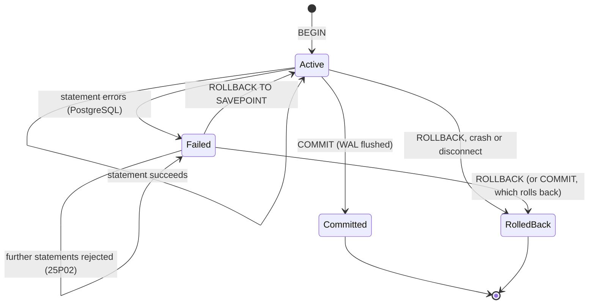

- **Active.** Statements run. Their changes are visible to this transaction only.
- **Failed** (PostgreSQL behaviour). After any error, PostgreSQL rejects every further statement with `current transaction is aborted, commands ignored until end of transaction block` (SQLSTATE `25P02`). Sending `COMMIT` in this state performs a rollback. MySQL InnoDB differs: most errors roll back only the failing statement, and the transaction stays usable.
- **Committed.** All changes become visible to others at once and are durable.
- **Rolled back.** All changes are discarded.

Example: in InvoiceOps the webhook transaction runs `INSERT INTO payments`, which fails with `23505 unique_violation` because the payment already exists. The transaction moves to Failed; the following `UPDATE invoices` returns `25P02` without running. Only `ROLLBACK` clears it.

### Commit and rollback, step by step

One idea: before `COMMIT` the changes exist only as uncommitted row versions, so a rollback is a bookkeeping change, not an undo of data.

**Step by step:**
1. The app sends `BEGIN`. PostgreSQL gives the transaction a number, say 9001.
2. The app inserts a ₹500 payment. PostgreSQL writes a new row stamped "made by 9001". Nobody else can see it yet.
3. The app updates invoice 501. PostgreSQL writes a new version of that row and locks it until the end.
4. On `COMMIT`, PostgreSQL writes "9001 committed" to the WAL on disk, then replies "ok". Now everyone sees both changes.
5. On `ROLLBACK` instead, PostgreSQL just notes "9001 aborted". The new rows stay on disk for now but are never shown.

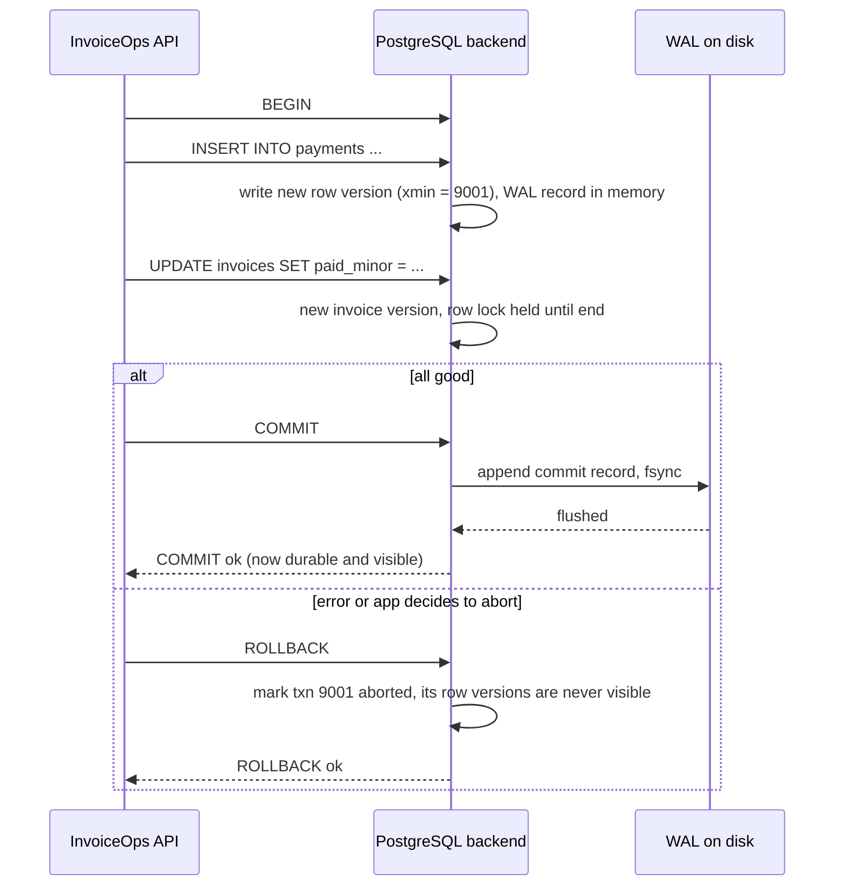

### Atomicity: invisible until committed

**In plain words:** PostgreSQL never "un-does" your changes on rollback. It writes new drafts next to the old ones, and simply never shows a draft whose transaction failed — like a notebook where crossed-out pages are just skipped, not torn out.

**Step by step:**
1. Invoice 501 has `paid_minor = 0`. Call this version A.
2. Transaction 9001 sets it to 50000. PostgreSQL adds version B next to A; it does not overwrite A.
3. Another session reads invoice 501. It asks "has 9001 committed?" Not yet, so it gets version A.
4. If 9001 commits, later readers get B. If 9001 aborts, B is simply ignored and cleaned away later.

PostgreSQL writes each new row version as a new **tuple** (PostgreSQL's word for one stored row version) in the table (the old version stays until **VACUUM**, a background clean-up job that deletes row versions nobody can see any more) and stamps it with the creating transaction ID (`xmin`). Readers check that ID against the commit log. An aborted transaction's versions are skipped and later cleaned up by VACUUM, so rollback is nearly free.

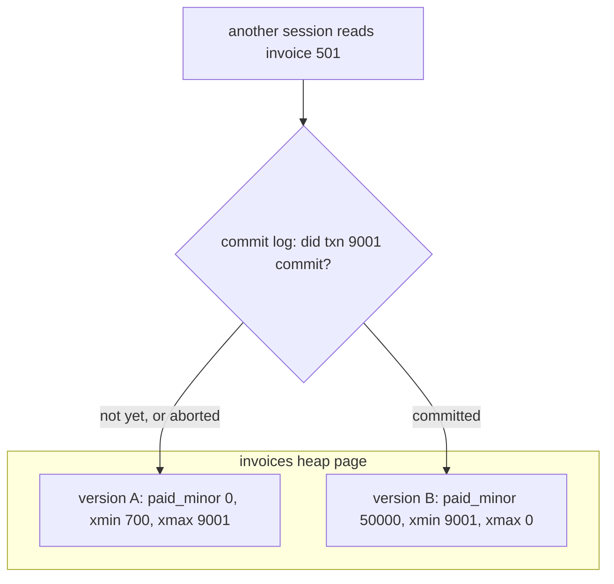

In the picture, the **heap** is the table's main storage file, split into pages of 8 KB. `xmin` is the transaction that created a version; `xmax` is the transaction that replaced or deleted it (0 means nobody has yet).

Example numbers: transaction 9001 updates invoice 501 from `paid_minor = 0` to `50000`. While 9001 is open, every other session reads version A. If 9001 rolls back, version B is dead and version A is still the answer; nothing was copied back.

InnoDB works the other way: it writes old values to an **undo log** and copies them back on rollback, so rolling back a large transaction in MySQL does real work and can take a long time.

### Durability: the write-ahead log

**In plain words:** before saying "saved", the database scribbles the change into a diary on disk. If it crashes, it re-reads the diary and redoes anything that was promised — like writing a receipt before handing over the goods.

**Step by step:**
1. You send `COMMIT` for transaction 9001.
2. PostgreSQL adds the change records and a "9001 committed" line to the end of the WAL file.
3. It forces that line onto the disk (`fsync`), and only then replies "COMMIT ok".
4. The table page holding the new invoice value may still be only in memory. That is fine.
5. The power goes out. On restart, PostgreSQL re-reads the WAL, sees "9001 committed", and rebuilds the invoice page. Nothing it promised is lost.

The **WAL** (write-ahead log) is an append-only file of change records. The rule is "log first, data pages later": before `COMMIT` returns, PostgreSQL flushes the WAL up to the commit record with `fsync` (a system call that forces data out of the OS cache onto the disk).

The changed data pages (the table's 8 KB blocks) can stay in memory; after a crash, PostgreSQL replays the WAL to rebuild them. Details live in [[Storage Engines - B-tree vs LSM and WAL]].

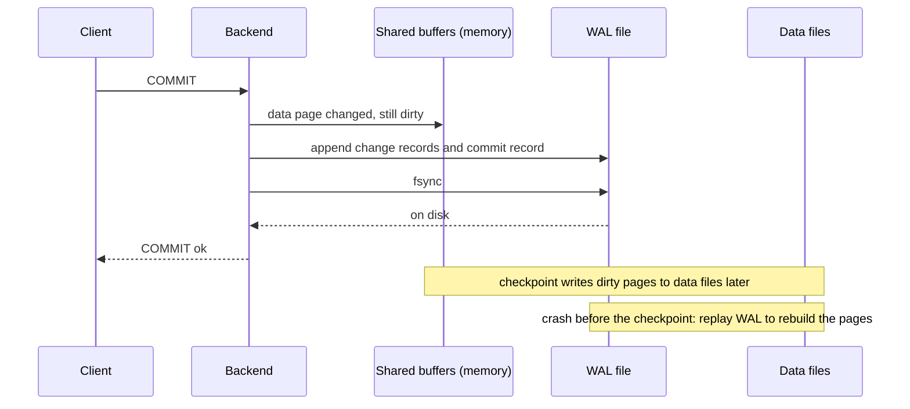

Two words from the picture: a **dirty** page is one changed in memory but not yet written to the data file, and a **checkpoint** is a regular moment when PostgreSQL writes all dirty pages to the data files, so older WAL is no longer needed for recovery.

Example: the commit record for transaction 9001 is flushed at 10:00:00.001. The server loses power at 10:00:00.050 before the dirty invoice page reached the data file. On restart PostgreSQL replays the WAL, finds 9001's commit record, and reconstructs `paid_minor = 50000`. The client had already received `COMMIT ok`, so the promise holds.

### Consistency: constraints inside the transaction

**In plain words:** constraints are rules you write down once ("stock never goes below zero") and the database then refuses any transaction that would break them.

**Step by step:**
1. You declare a rule once on the table: `CHECK (stock >= 0)` on `products`.
2. Product 1 has `stock = 0`. A transaction runs `UPDATE products SET stock = stock - 1 WHERE id = 1`.
3. The new value would be -1, so PostgreSQL raises error `23514` and refuses the change.
4. The transaction is now Failed and can only roll back. Stock stays 0.
5. A constraint marked `DEFERRABLE INITIALLY DEFERRED` (allowed for `UNIQUE` and foreign keys, not for `CHECK`) waits until `COMMIT` to do step 3.

A `CHECK`, `UNIQUE` or foreign-key violation raises an error and the transaction cannot commit. Constraints declared `DEFERRABLE INITIALLY DEFERRED` are checked at `COMMIT` instead of per statement.

| Constraint | Example rule | Violation | SQLSTATE |
| --- | --- | --- | --- |
| `CHECK` | `stock >= 0` | `UPDATE … SET stock = stock - 1` when stock is 0 | `23514` |
| `UNIQUE` | `(provider, provider_event_id)` | the same webhook inserted twice | `23505` |
| Foreign key | `payments.invoice_id` references `invoices.id` | payment for invoice 99999 | `23503` |

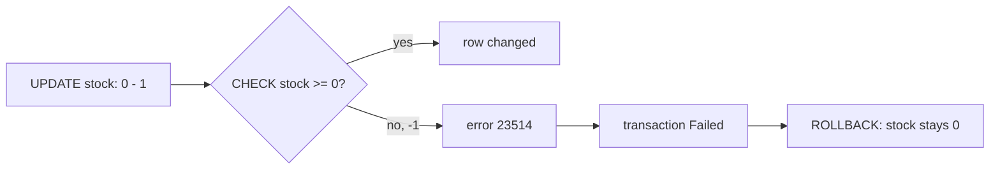

### Isolation: snapshots and locks

**In plain words:** every reader gets a frozen photo of the data, and writers queue up on the rows they change — so nobody reads half-finished work.

**Step by step:**
1. Alice's transaction sets invoice 501 to `paid` but has not committed yet. She holds the row lock.
2. Bob reads invoice 501 at the same moment. His snapshot shows only saved data, so he sees `open`. He does not wait.
3. Carol tries to update invoice 501 too. Alice holds the lock, so Carol waits.
4. Alice commits. Carol's update now runs on Alice's new version, and Bob's next statement (at READ COMMITTED) sees `paid`.

Each statement (READ COMMITTED) or each transaction (REPEATABLE READ and SERIALIZABLE, the two stricter levels) reads from a snapshot; writers take row locks. Which **anomalies** (kinds of wrong result caused by overlapping transactions, such as two buyers both seeing "1 left") remain possible depends on the level: see [[Isolation Levels and MVCC]] and [[Locking - Optimistic vs Pessimistic]].

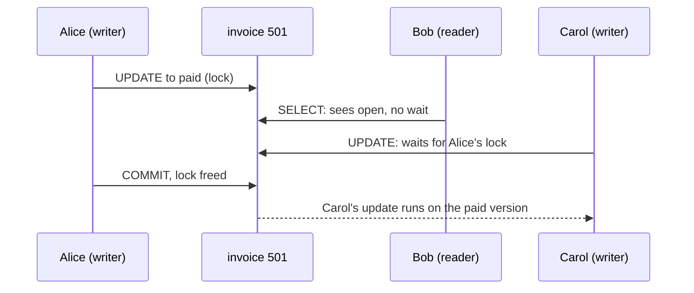

### Autocommit

**In plain words:** if you don't open a transaction yourself, the database wraps each statement in its own tiny one — handy for one write, dangerous when two writes must stick together.

**Step by step:**
1. You run one `UPDATE` with no `BEGIN`. PostgreSQL quietly wraps it: begin, run, commit.
2. You run a second `UPDATE` right after. It gets its own separate wrap.
3. The app crashes between them. The first change is saved, the second is not; they were never one unit.
4. In Go, even `db.Exec("BEGIN")` does not help, because the next `db.Exec` may go to a different connection. Use `db.BeginTx`.

If you send a statement without `BEGIN`, PostgreSQL wraps it in its own one-statement transaction and commits it immediately. This is **autocommit**. It is why a single `UPDATE` is always atomic, and also why two separate statements are **not** atomic together.

In Go, every call on `*sql.DB` (`db.ExecContext`, `db.QueryContext`) is autocommit, and the **pool** (a set of open database connections the app keeps and reuses) may send consecutive calls on **different connections**. So `db.Exec("BEGIN")` followed by `db.Exec("UPDATE …")` is a bug: the `BEGIN` may stay open on one connection while the `UPDATE` autocommits on another. Always use `db.BeginTx`, which pins one connection until `Commit` or `Rollback`.

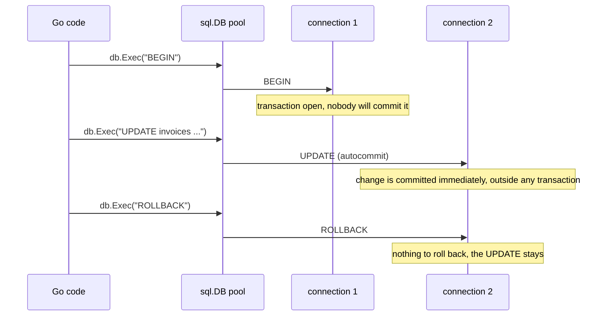

Example: with a pool of 10 connections, three `db.Exec` calls in a row can land on three different connections. The `ROLLBACK` in the diagram does nothing, while connection 1 keeps holding its open transaction and its locks until the pool closes it.

### Savepoints

**In plain words:** a savepoint is a bookmark inside a transaction — if a later step fails, you can rewind to the bookmark instead of throwing the whole thing away.

**Step by step:**
1. `BEGIN`, then insert invoice 501.
2. `SAVEPOINT try_coupon` drops a bookmark.
3. Try to apply coupon `LAUNCH10`. Suppose it breaks a `CHECK` rule.
4. `ROLLBACK TO SAVEPOINT try_coupon` rewinds to the bookmark: the coupon change is gone, invoice 501 is still there, and the transaction works again.
5. `COMMIT` saves invoice 501 without the coupon.

A **savepoint** is a named point inside a transaction you can roll back to without abandoning the whole transaction.

```sql
BEGIN;
INSERT INTO invoices (id, workspace_id, total_minor, status) VALUES (501, 7, 120000, 'draft');
SAVEPOINT try_coupon;
UPDATE coupons SET used = used + 1 WHERE code = 'LAUNCH10' AND used < max_uses;
-- suppose the coupon row violates a CHECK; undo only the coupon step:
ROLLBACK TO SAVEPOINT try_coupon;
RELEASE SAVEPOINT try_coupon;  -- forget the savepoint, keep the work before it
COMMIT;                         -- invoice 501 is saved without the coupon
```

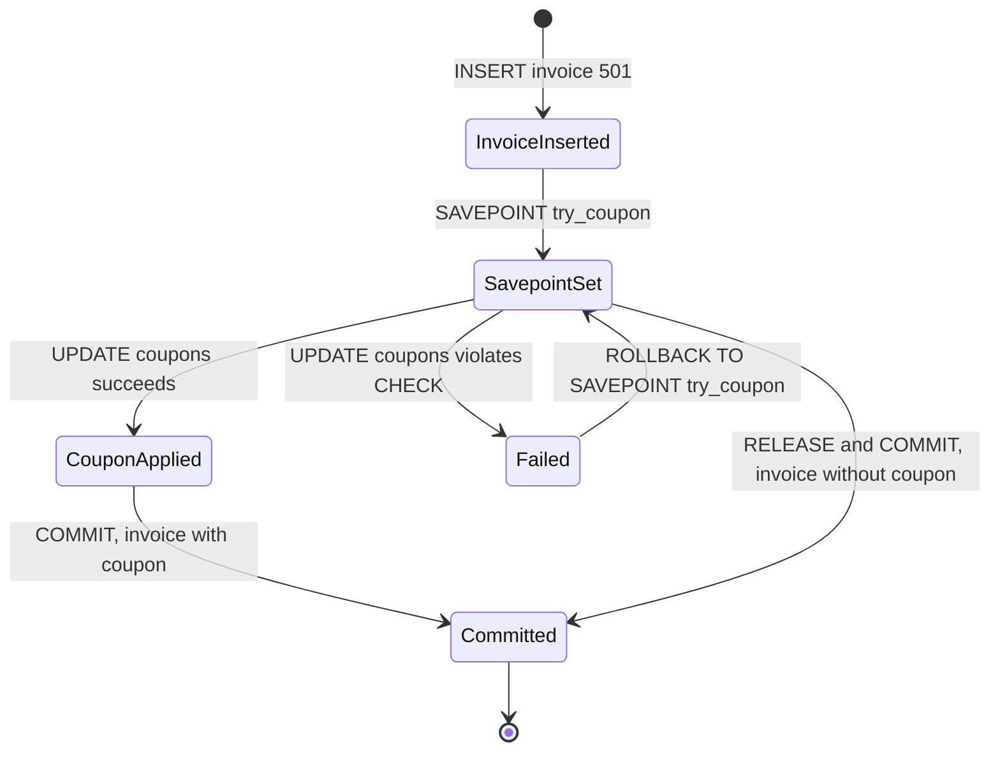

In PostgreSQL, rolling back to a savepoint is the only way to recover from an error without losing the whole transaction. Some drivers and **ORMs** (libraries that map tables to code objects, such as GORM) use savepoints to implement "nested transactions". Each savepoint creates a **subtransaction** (a small transaction inside the transaction that PostgreSQL uses to track that bookmark), and thousands of them in one transaction can slow PostgreSQL down (see section 8).

### Retrying: what to do on 40001 and 40P01

**In plain words:** these two error codes mean "nothing was saved, just run the whole thing again" — like redialling a dropped call instead of shouting the last sentence into a dead phone.

**Step by step:**
1. Run the whole transaction function: `BEGIN`, reads, writes, `COMMIT`.
2. It fails with `40001` or `40P01`. PostgreSQL has already thrown all of it away.
3. Wait a moment (say 10 ms), then run the whole function again from `BEGIN`, reading fresh data.
4. Fails again? Wait a bit longer (20 ms) and retry, up to a small limit such as 3 tries.
5. Any other error, like "out of stock", is returned at once, because a retry would give the same answer.

Two SQLSTATE codes mean "nothing was saved, try again": `40001` (`serialization_failure`: the database saw that two overlapping transactions could produce a wrong result, so it cancelled one; raised by REPEATABLE READ and SERIALIZABLE) and `40P01` (`deadlock_detected`). The transaction is already aborted, so retrying only the failing statement is useless. The fix is to run the **whole** function again from `BEGIN`, with a small capped **backoff** (wait a little longer after each failed try, up to a limit).

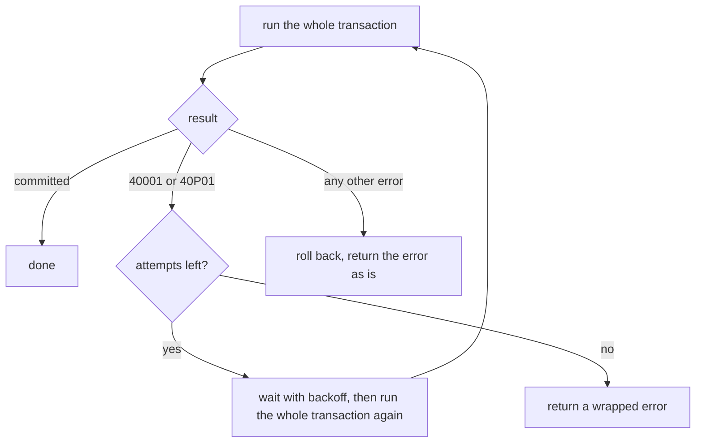

Example: attempt 1 hits `40001`, waits 10 ms, attempt 2 hits `40001`, waits 20 ms, attempt 3 commits. A business error such as "out of stock" is returned at once, because running it again gives the same answer. The helper that does this is in [[Transactions and ACID - Go]].

## 4. Worked example: the last unit of stock 🟡

The task: InvoiceOps sells add-on products (for example, 100 printed cheque books) with a limited `stock`. Two customers try to buy the **last unit** at the same moment. Exactly one must succeed.

The table has `stock int NOT NULL CHECK (stock >= 0)` as a safety net so stock can never go negative, and product 1 has `stock = 1` and `price_minor = 25000`.

### The bare idea in SQL

The wrong way reads, decides in the app, then writes. The right way puts the check inside the write:

```sql
-- WRONG at READ COMMITTED: both transactions read stock = 1, both "decide" to sell
SELECT stock FROM products WHERE id = 1;          -- both see 1
UPDATE products SET stock = 0 WHERE id = 1;       -- both write 0: two sales, one unit
```

```sql
-- RIGHT: the condition is evaluated on the latest committed row, under a row lock
UPDATE products SET stock = stock - 1 WHERE id = 1 AND stock > 0;
-- winner: UPDATE 1, loser: UPDATE 0, so ROLLBACK and answer "sold out"
```

### Why the naive version oversells

**In plain words:** both buyers look at the shelf at the same moment, both see "1 left", and both walk to the till — looking does not reserve anything.

Being inside a transaction does not help here. At **READ COMMITTED** (the PostgreSQL default), each statement sees all data committed before that statement started, and plain `SELECT` takes no lock. Both transactions read `stock = 1` before either commits.

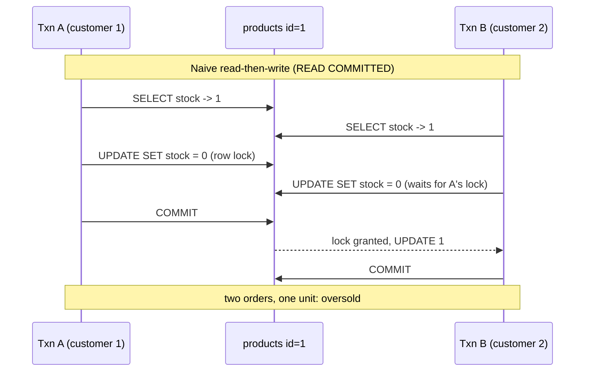

### Why the conditional UPDATE is safe

**In plain words:** putting the check inside the write is like the till itself checking the shelf at the moment of sale — the second buyer is told "sold out" right at the till, not after paying.

The key PostgreSQL behaviour: at READ COMMITTED, when an `UPDATE` waits for another transaction's row lock and that transaction commits, PostgreSQL re-evaluates the `WHERE` clause against the **newly committed** row version before updating it. That re-check is what makes the conditional `UPDATE` safe.

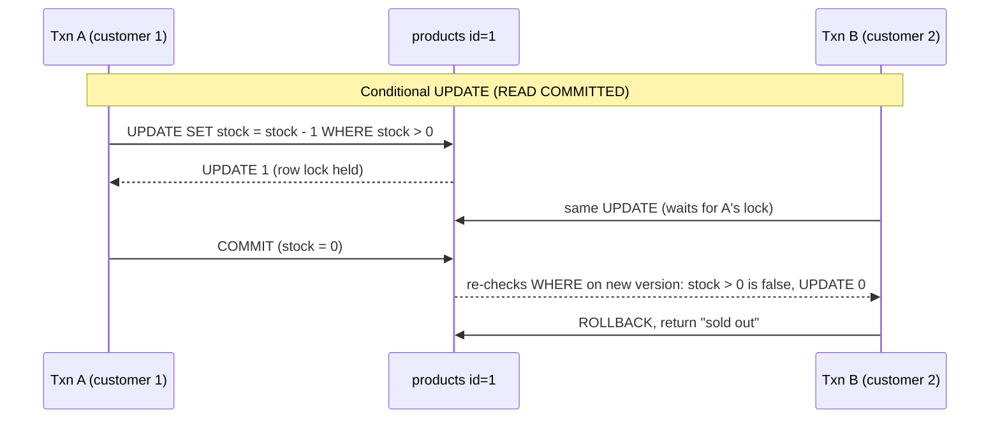

The `CHECK (stock >= 0)` constraint is a second safety net. Even if some code path runs `SET stock = stock - 1` without the condition, the second buyer's update would fail with `23514 check_violation` instead of storing `-1`.

### Four correct ways to sell the last unit

**In plain words:** there are four honest ways to make sure only one buyer wins; pick by how complicated your rule is.

| Technique | SQL shape | Loser sees | Use when |
| --- | --- | --- | --- |
| Conditional `UPDATE` | `UPDATE … SET stock = stock - 1 WHERE id = $1 AND stock > 0` | 0 rows affected | Counter-style resources; simplest and fastest |
| Pessimistic lock (lock the row first, then decide) | `SELECT stock FROM products WHERE id = $1 FOR UPDATE`, then decide in Go, then `UPDATE` | Waits, then reads `stock = 0` | The decision needs several reads or app logic between read and write |
| Unique constraint | `UNIQUE (event_id, seat_no)` on a `tickets` table, then `INSERT` | `23505 unique_violation` | Each unit has an identity (seat 14B, invoice number) |
| SERIALIZABLE + retry | Naive read-then-write, run at `ISOLATION LEVEL SERIALIZABLE` | `40001 serialization_failure`; retry, then reads 0 | Complex invariants across many rows that are hard to express as one statement |

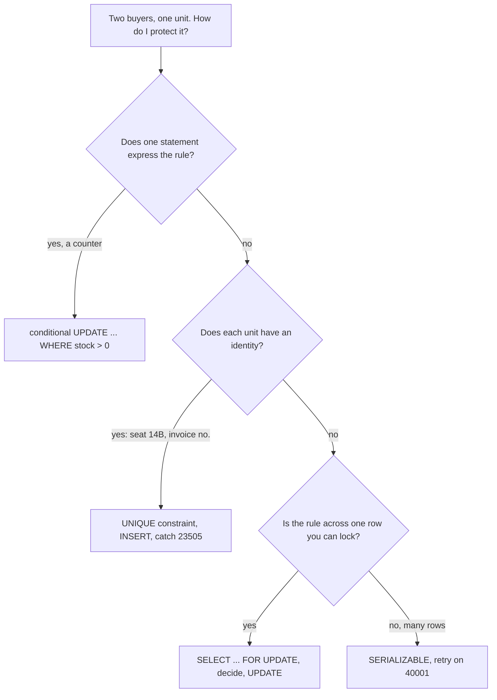

Locks and the choice between waiting and retrying are covered in [[Locking - Optimistic vs Pessimistic]].

Runnable Go version: [[Transactions and ACID - Go]]

### Choosing the boundary: the payment webhook

The rule: **one transaction per business fact that must be all-or-nothing, and nothing slow inside it.** The webhook transaction does four things, in this order:

| Step | Statement | Why it is inside the transaction |
| --- | --- | --- |
| 1. Dedupe | `INSERT INTO webhook_events … ON CONFLICT (provider, provider_event_id) DO NOTHING`; if 0 rows inserted, `ROLLBACK` and return 200 | A redelivered webhook hits the unique key and inserts nothing |
| 2. Record the payment | `INSERT INTO payments (invoice_id, workspace_id, amount_minor, provider_ref)` with 50000 | Must exist exactly when step 3 happened |
| 3. Update the invoice | `UPDATE invoices SET paid_minor = paid_minor + 50000, status = CASE … END` | `CHECK (paid_minor <= total_minor)` guards overpayment |
| 4. Audit | `INSERT INTO audit_log …` | The audit row must exist exactly when the payment does |

The full SQL is in [[Transactions and ACID - Go]].

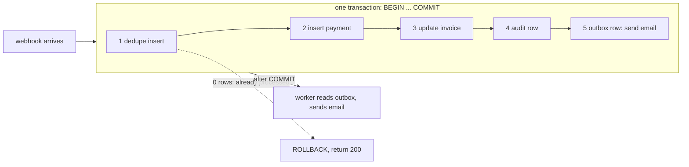

Sending the "payment received" email is **not** inside this transaction. An SMTP call (SMTP is the protocol used to send email) can take seconds, the transaction would hold the invoice row lock and a pooled connection the whole time, and if the commit then failed the email would already be sent.

Instead, insert an **outbox** row (a "to do: send this email" row in a small table of its own, in the same database as the payment) in the same transaction and let a worker send the email: see [[Transactional Outbox and CDC]]. Why the dedupe step matters is covered in [[Idempotency and Idempotency Keys]].

## 5. Variants and comparison 🟡

| Option | What you get | Use when | Cost |
| --- | --- | --- | --- |
| Autocommit (single statement) | The one statement is atomic | One write, or reads that need no shared snapshot | None extra |
| Explicit `BEGIN … COMMIT` at READ COMMITTED | Atomic group; each statement sees fresh committed data | Default for multi-statement writes | Row locks held until commit |
| REPEATABLE READ | One snapshot for the whole transaction; concurrent update of the same row fails with `40001` | Consistent multi-query reads (reports, exports) | Must retry on `40001` |
| SERIALIZABLE | Result equals some one-at-a-time order | Invariants across many rows | More `40001` retries; memory for predicate locks (locks on a search condition, not just on rows) |
| Savepoints | Partial rollback inside a transaction | Optional steps, recovering from an expected error | Subtransaction overhead in PostgreSQL |
| Saga (a chain of local transactions, each with an undo step called a compensation) or outbox (no ACID across services) | Eventual consistency (all parts agree after a short delay) with compensations | Work spans services or databases | Compensation logic, visible intermediate states |

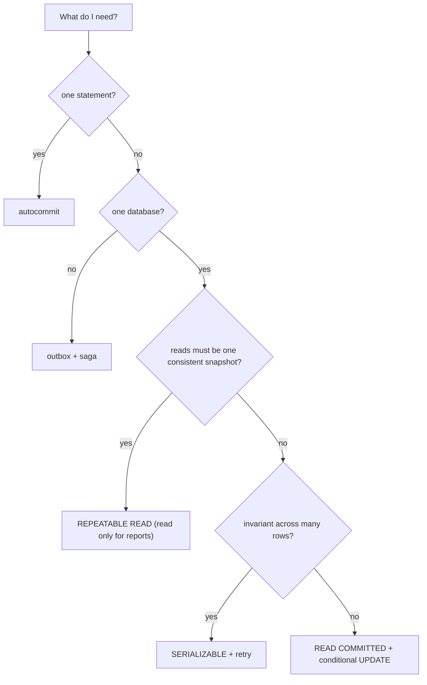

Isolation levels are explained in full in [[Isolation Levels and MVCC]]. Cross-database atomicity is covered in [[Two-Phase Commit]] and [[Saga Pattern]].

### Things people confuse with an ACID transaction 🟡

| Thing | What it really is | How it differs from a transaction |
| --- | --- | --- |
| CAP "consistency" | Every copy of the data shows the latest write | ACID "C" only means your rules still hold; same word, different promise |
| Lock (`FOR UPDATE`) | Makes others wait for one row | A tool used inside a transaction, not the all-or-nothing unit itself |
| Saga | Several local transactions with undo steps | Not isolated: others can see the half-done middle, and undo is your code |
| Two-phase commit | One commit across two or more databases | All-or-nothing across databases, but everyone waits if the coordinator dies |

## 6. Trade-offs and when not to use 🟡

- **Long transactions are expensive.** A transaction holds its row locks until it ends, keeps one pooled connection busy, and in PostgreSQL keeps an old snapshot alive so VACUUM cannot remove dead row versions anywhere in the database. Keep them to milliseconds.
- **No network calls inside.** HTTP, gRPC (a fast service-to-service call protocol), email or queue publishes inside a transaction stretch lock time to the remote call's latency, and the remote side effect cannot be rolled back. Do them before (and pass the result in) or after (through an outbox).
- **A single statement does not need `BEGIN`.** Autocommit already makes it atomic, and an explicit transaction adds two round trips.
- **Large batch jobs should commit in chunks.** Updating 50 million rows in one transaction holds locks for the whole run, bloats the table (fills it with dead row versions, so it grows and slows down), and a failure at 99% loses everything. Commit every few thousand rows and make the job resumable.
- **Transactions do not span services.** A `*sql.Tx` covers one connection to one database. Two services, or PostgreSQL plus Kafka, need the outbox pattern or a saga.
- **Higher isolation is not free.** SERIALIZABLE avoids whole classes of bugs but turns contention into retries. Use it where the invariant is hard to express in one statement, not everywhere.

```mermaid
flowchart LR
    subgraph short["short transaction: 5 ms"]
        S1["lock row"] --> S2["write"] --> S3["commit, lock freed"]
    end
    subgraph long["transaction wrapping an HTTP call: 3 s"]
        L1["lock row"] --> L2["wait for remote service"] --> L3["commit, lock freed"]
    end
    short --> T1["about 200 requests per second can use this row"]
    long --> T2["about 0.3 requests per second can use this row"]
```

The throughput figures are arithmetic (1 / lock time), not benchmarks: a row locked for 5 ms allows at most about 200 writers per second, a row locked for 3 s allows about one every 3 s.

## 7. In production 🔴

> 🟡 → 🔴 **You now know** how PostgreSQL keeps each ACID promise and four safe ways to sell the last unit. **Next is the advanced part**: what breaks when thousands of requests run these transactions in a real system, what to watch on a dashboard, and the deeper engine details (commit cost, replication, ID wraparound) that interviewers ask about.

- **Real systems:** PostgreSQL, MySQL InnoDB, SQL Server and Oracle all provide ACID transactions on a single node. MongoDB has supported multi-document transactions since 4.0 (replica sets: one primary plus copies) and 4.2 (sharded clusters: data split across many servers). Distributed SQL databases (CockroachDB, Spanner, YugabyteDB) provide them across nodes; CockroachDB and Spanner default to SERIALIZABLE, while YugabyteDB defaults to snapshot isolation (REPEATABLE READ): see [[Distributed SQL]].
- **Failure modes and fixes:**
	- *Idle in transaction:* code begins a transaction, then waits on an HTTP call or forgets to commit. Locks pile up behind it. Fix: no I/O inside transactions; set `idle_in_transaction_session_timeout` (default 0, meaning disabled) to something like `30s` so PostgreSQL kills such sessions.
	- *Using `db` instead of `tx`:* one statement silently runs outside the transaction. Fix: repositories accept a small interface satisfied by both `*sql.DB` and `*sql.Tx`, and the service layer decides which to pass.
	- *Retrying only the failed statement after `40001`:* the transaction is already aborted. Fix: retry the whole function, as `InTx` does.
	- *Pool exhaustion:* every open transaction holds a connection; slow transactions starve the pool. See [[Connection Pooling]].
	- *Deadlocks (`40P01`):* two transactions lock the same rows in opposite order. Fix: lock rows in a consistent order (for example, by `id`), and retry.
- **What to monitor:**
	- `pg_stat_activity` (a built-in view listing every open session and what it is doing) rows with `state = 'idle in transaction'` and old `xact_start`.
	- The age of the oldest open transaction (`now() - min(xact_start)`).
	- `pg_stat_database.xact_rollback` relative to `xact_commit`, and `deadlocks`.
	- Application metrics for `40001` and `40P01` retries.

```mermaid
flowchart TD
    M["alert: idle in transaction older than 30 s"] --> Q["SELECT pid, now() - xact_start, query FROM pg_stat_activity WHERE state = 'idle in transaction'"]
    Q --> C{"who holds it?"}
    C -- "app bug: HTTP call or missing commit" --> F1["fix the code path, add idle_in_transaction_session_timeout"]
    C -- "crashed client, connection still open" --> F2["pg_terminate_backend(pid), then fix timeouts"]
```

## Whiteboard version 🟢

🟢 **Plain version:** A transaction starts, runs a few statements, and then either commits (everything is kept and shown) or rolls back (nothing is). Each ACID letter has one trick behind it: hide failed work, check your written rules, give readers a frozen picture, and write to disk before saying "saved". The last line is the fix for two buyers and one item: make the sale itself check that stock is above zero, then see whether a row actually changed.

If you have two minutes at a whiteboard, draw this:

```text
BEGIN --> stmt --> stmt --> COMMIT   (all visible, durable)
                      \--> ROLLBACK  (none visible)
A: aborted row versions are invisible    D: WAL fsync before COMMIT returns
C: constraints + your invariants         I: snapshot + row locks, level-dependent
Oversell fix: UPDATE ... WHERE stock > 0, check rows affected
```

## 8. Deep dive 🔴

- **Commit latency is an `fsync`.** With the default `synchronous_commit = on`, each commit waits for its WAL flush. On local NVMe (fast SSD attached directly to the machine) with power-loss protection that is typically well under a millisecond; on network-attached cloud volumes it is often around 1–5 ms (estimates; measure your disk with `pg_test_fsync`). PostgreSQL batches concurrent commits into one flush (**group commit**); `commit_delay` can widen that window.
- **`synchronous_commit = off`.** Commit returns before the flush. A crash can lose the last commits (up to about three times `wal_writer_delay`, which defaults to 200 ms), but cannot corrupt the database. It can be set per transaction: `SET LOCAL synchronous_commit = off` is reasonable for analytics events, never for payments.
- **Replicated durability.** With synchronous replication, `synchronous_commit = remote_apply` (or `on`, or `remote_write`) also waits for a **standby** (a copy server that replays the primary's WAL). That trades latency for surviving the loss of a whole machine: see [[Replication]].
- **DDL (statements that change table structure, like `CREATE` and `ALTER`) is transactional in PostgreSQL.** `CREATE TABLE`, `ALTER TABLE` and most other DDL can be rolled back. Exceptions include `CREATE INDEX CONCURRENTLY` and `VACUUM`, which refuse to run inside a transaction block. In MySQL, DDL causes an implicit commit, so a migration that mixes DDL and DML (statements that change data: `INSERT`, `UPDATE`, `DELETE`) is not atomic.
- **Subtransactions.** Each `SAVEPOINT` (and each PL/pgSQL, PostgreSQL's built-in procedure language, `EXCEPTION` block) creates a subtransaction. PostgreSQL caches up to 64 subtransaction IDs per backend; beyond that, visibility checks must consult `pg_subtrans` and throughput can collapse under concurrency. Avoid loops that create a savepoint per row.
- **Transaction ID wraparound.** PostgreSQL transaction IDs are 32-bit (about 4 billion values, so the counter eventually loops back). VACUUM must "freeze" old rows before IDs wrap around; a transaction left open for days blocks this. See [[Isolation Levels and MVCC]].
- **Read-only transactions still matter.** `BEGIN READ ONLY` (Go: `TxOptions{ReadOnly: true}`) documents intent, lets a REPEATABLE READ export see one snapshot across many queries, and with `SERIALIZABLE READ ONLY DEFERRABLE` runs without any risk of serialization failure.

```mermaid
flowchart LR
    subgraph fast["synchronous_commit = on"]
        F1["commit record written"] --> F2["fsync 1-5 ms (estimate)"] --> F3["ack to client"]
    end
    subgraph async["synchronous_commit = off"]
        A1["commit record written"] --> A2["ack to client at once"]
        A1 -.-> A3["WAL writer flushes within about 600 ms"]
    end
    A3 -.-> L["crash before the flush: last commits lost, database not corrupted"]
```

## 9. Interview questions 🔴

> [!question]- What does each letter of ACID guarantee, and how does PostgreSQL provide it?
> Atomicity: all or nothing; row versions of an aborted transaction are never visible. Consistency: constraints and your invariants hold after commit; mostly the application's job, enforced with `CHECK`, `UNIQUE` and foreign keys.
>
> Isolation: concurrent transactions do not interfere, to the degree of the isolation level (MVCC snapshots plus row locks). Durability: commit returns only after the WAL record is flushed to disk.

> [!question]- Trap: two users buy the last ticket inside transactions. Does the transaction stop overselling?
> Not by itself. At READ COMMITTED (the PostgreSQL default), both can `SELECT stock` and see 1, then both write. Put the check inside the write (`UPDATE … WHERE stock > 0` and check rows affected), lock the row with `SELECT … FOR UPDATE`, use a unique constraint per seat, or run SERIALIZABLE and retry on `40001`.
>
> A `CHECK (stock >= 0)` constraint is a good safety net.

> [!question]- Why must you not call `db.Exec("BEGIN")` in Go?
> `*sql.DB` is a pool. Each call may use a different connection, so the `BEGIN` and the following statements can land on different sessions, leaving an open transaction on one connection and autocommitting on another. `db.BeginTx` pins one connection to the returned `*sql.Tx` until `Commit` or `Rollback`.

> [!question]- What do you do when a transaction fails with SQLSTATE 40001 or 40P01?
> Retry the whole transaction from `BEGIN`, re-reading all data, with a small capped backoff. Retrying only the failing statement is useless because PostgreSQL has already aborted the transaction. Side effects outside the database must not happen inside the retried function, or they repeat.

> [!question]- Why should a transaction never wrap an HTTP call?
> It holds row locks and a pooled connection for the duration of the remote call, so other requests queue behind it; it keeps an old snapshot open, which blocks VACUUM; and the remote side effect cannot be rolled back if the commit later fails. Call before the transaction, or after it through an outbox.

> [!question]- How is durability actually achieved, and what does `synchronous_commit = off` trade away?
> The commit record is written to the WAL and flushed with `fsync` before `COMMIT` returns; data pages are rebuilt from the WAL after a crash. With `synchronous_commit = off`, commit returns before the flush, so a crash can lose roughly the last 600 ms of commits (3 × the default `wal_writer_delay`), but never corrupts data.

> [!question]- Can you have a transaction across two microservices?
> Not an ACID one in practice. Two-phase commit exists but blocks when the coordinator fails and is rarely available across HTTP services. Use a local transaction plus an outbox to publish the event reliably, and a saga with compensating actions for multi-step business flows.

> [!question]- What happens in PostgreSQL after one statement in a transaction fails?
> The transaction enters the aborted state; every further statement returns `25P02` until you `ROLLBACK` (or `ROLLBACK TO SAVEPOINT`). Even `COMMIT` performs a rollback. MySQL InnoDB usually rolls back only the failing statement, which surprises people moving between the two.

## 10. Cheat sheet 🟢

🟢 **Plain version:** Put steps that must happen together into one transaction. Keep it short, and never wait on another service inside it. If two people might grab the same last item, put the "is any left?" check inside the write itself. If the database says "try again" (codes `40001` or `40P01`), redo the whole transaction, not just one line. Anything that spans two services needs a different tool (outbox or saga).

- Transaction = all-or-nothing unit; `BEGIN`, then `COMMIT` or `ROLLBACK`.
- A: aborted versions are invisible. C: constraints plus your invariants. I: depends on level. D: WAL `fsync` before commit returns.
- Single statements autocommit; multi-statement changes need an explicit transaction.
- Go: `tx, err := db.BeginTx(ctx, opts)`, `defer tx.Rollback()`, pass `tx` everywhere, `return tx.Commit()`.
- Oversell fix: `UPDATE … WHERE stock > 0` and check rows affected, or `FOR UPDATE`, or `UNIQUE`, or SERIALIZABLE + retry.
- Retry the whole transaction on `40001` and `40P01`; never just the statement.
- Keep transactions short; no network calls inside; set `idle_in_transaction_session_timeout`.
- Across services: outbox and sagas, not distributed transactions.

## Self-check 🟢🟡

🟢 Easy

> [!question]- What does `ROLLBACK` do?
> It throws away every change made since `BEGIN`, as if the transaction never ran.

> [!question]- Which ACID letter is mostly your job, not the database's?
> Consistency: you must write your rules as constraints and keep related writes in one transaction.

> [!question]- Does a single `UPDATE` need `BEGIN … COMMIT`?
> No. Autocommit already makes one statement all-or-nothing.

🟡 Medium

> [!question]- Two buyers, one unit left, both inside transactions at READ COMMITTED doing "SELECT, then UPDATE". Why can both win?
> A plain `SELECT` takes no lock, so both read `stock = 1` before either commits, and then both write.

> [!question]- `COMMIT` returned ok, then the power failed before the invoice page reached the data file. Is the payment lost?
> No. The commit record was already forced to the WAL on disk, and PostgreSQL replays the WAL on restart to rebuild the page.

> [!question]- Why is rollback nearly free in PostgreSQL but can be slow in MySQL InnoDB?
> PostgreSQL only marks the transaction aborted, so its new row versions are never shown; InnoDB must copy old values back from its undo log.

## Links

- **Implementation:** [[Transactions and ACID - Go]]
- **Before this:** [[SQL Essentials]], [[Relational Schema Design]]
- **Next:** [[Isolation Levels and MVCC]], [[Locking - Optimistic vs Pessimistic]], [[Transactions and the Repository Pattern]], [[Storage Engines - B-tree vs LSM and WAL]]
- **Compare with:** [[Transactional Outbox and CDC]] and [[Saga Pattern]] (consistency across services without ACID), [[Two-Phase Commit]] (atomic commit across databases)

### Watch on YouTube

- [Relational Database ACID Transactions (Explained by Example)](https://www.youtube.com/watch?v=pomxJOFVcQs) · Hussein Nasser · reputable channel, example-driven walkthrough of atomicity/consistency/isolation/durability
- [ACID Properties Explained: Database Transaction Fundamentals for Beginners](https://www.youtube.com/watch?v=RSPfC-KKZAQ) · CodeLucky · beginner-friendly intro covering all four ACID properties
