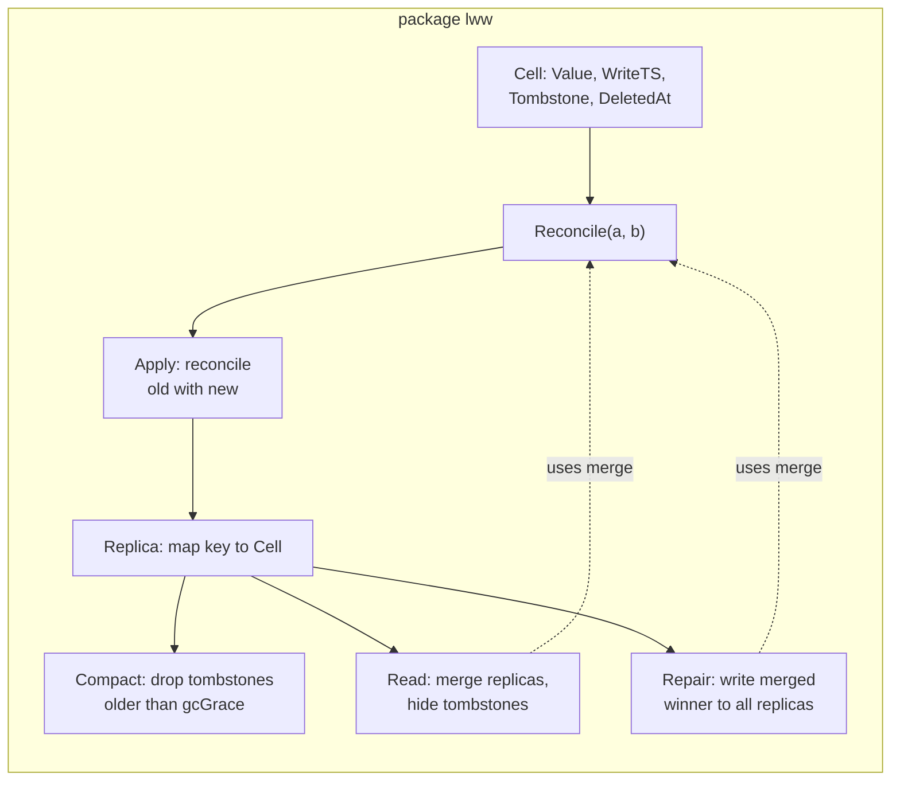
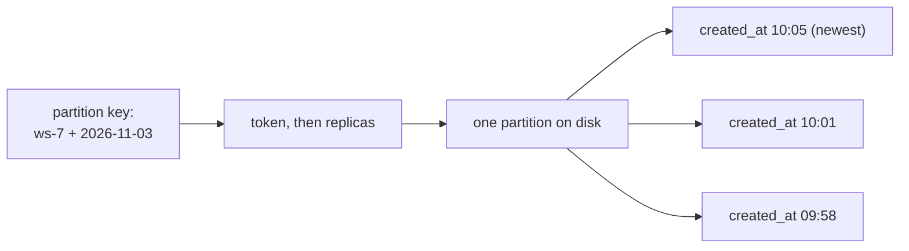
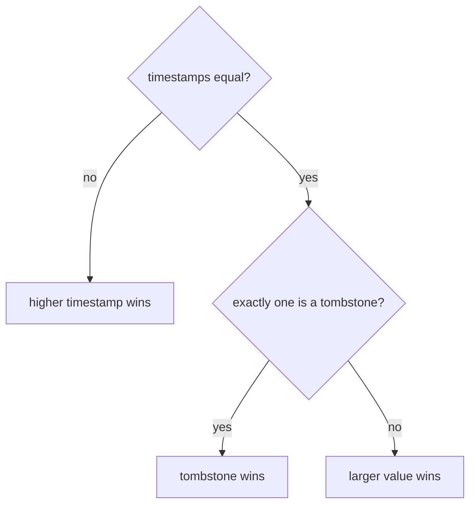
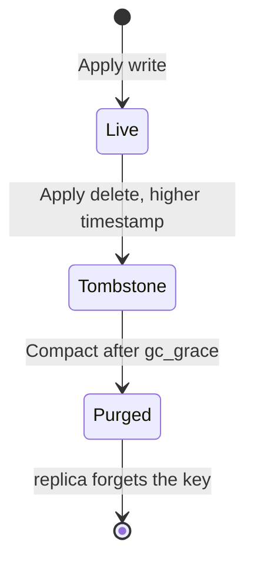
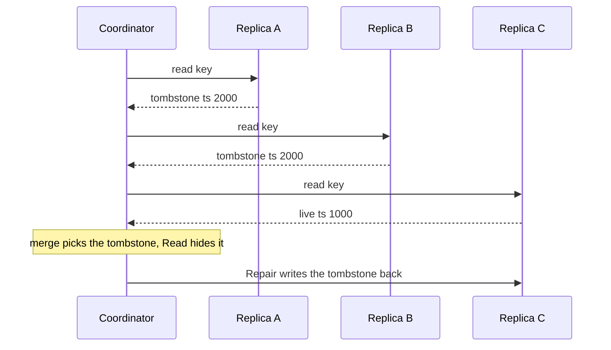
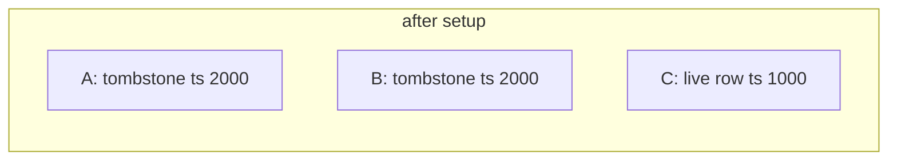

# Wide-Column Stores and Cassandra - Go

> [!summary] TL;DR
> This note holds the code behind [[Wide-Column Stores and Cassandra]]: the CQL schema for the InvoiceOps audit events, and a Go model of last-write-wins reconciliation, tombstones, `gc_grace_seconds` and repair, with tests that show a deleted row coming back and the repair that prevents it.

## What this code shows

| Code | Theory concept in [[Wide-Column Stores and Cassandra]] |
| --- | --- |
| CQL `events_by_workspace_day` | primary key `((partition), clustering)` written for one query |
| CQL keyspace, `audit_events_by_workspace_day`, TWCS and TTL | query-first modelling, bounded partitions, time-window compaction |
| `Cell`, `Reconcile` | last write wins per cell by timestamp, tombstone wins a tie |
| `Replica.Apply`, `Replica.Compact` | a replica keeps the winner; compaction purges tombstones after `gc_grace_seconds` |
| `Read`, `Repair`, `merge` | the coordinator merging replica answers; anti-entropy repair writing the winner back |
| tests | zombie data without repair, and its prevention by repair inside `gc_grace_seconds` |



## Setup

- Go 1.24, standard library only. A scratch module `lww` with `lww.go` and `lww_test.go`.
- Run: `go vet ./... && go test -race ./...`.
- The CQL runs on Cassandra 5.0 (`cqlsh`); it was not executed in this vault, so it is shown as reference DDL.

## Code

The note has two parts. Steps 1 and 2 are CQL: they show how the primary key is written for one query. Steps 3 to 7 are Go: a small model of what replicas do with writes, deletes, compaction and repair, which explains why a deleted row can come back.

### Step 1: the whiteboard table

**Concept.** [[Wide-Column Stores and Cassandra#Designing InvoiceOps audit events query-first]] starts from the query, not from the entity. The primary key `((workspace_id, bucket_day), created_at, event_id)` has two parts: the inner parentheses are the partition key (which node stores the rows) and the rest are clustering columns (the order of rows inside the partition). The alternative, a table keyed by event id alone, could not answer "newest events of this workspace today" without scanning every node.

```sql
-- Query: newest events of one workspace on one day
CREATE TABLE events_by_workspace_day (
  workspace_id text,
  bucket_day   date,
  created_at   timestamp,
  event_id     uuid,
  action       text,
  PRIMARY KEY ((workspace_id, bucket_day), created_at, event_id)
) WITH CLUSTERING ORDER BY (created_at DESC, event_id ASC);

SELECT * FROM events_by_workspace_day
WHERE workspace_id = 'ws-7' AND bucket_day = '2026-11-03' LIMIT 50;
```

**How it works.**

1. `(workspace_id, bucket_day)` is hashed to a token that chooses the replicas, so all of one workspace-day lives together.
2. `bucket_day` caps partition size: one workspace gets a new partition each day instead of one that grows forever.
3. `created_at DESC` stores the newest row first, so `LIMIT 50` reads the first 50 rows on disk.
4. `event_id` breaks ties between events created at the same instant.
5. The `SELECT` gives the full partition key, which is what makes it a single-partition read.



### Step 2: the production schema

**Concept.** The production table adds the choices from [[Wide-Column Stores and Cassandra#5. Variants and comparison]] and the replica placement from [[Wide-Column Stores and Cassandra#3.1 Placement: tokens and replicas]]. `NetworkTopologyStrategy` puts 3 replicas in each data centre. Time-window compaction groups data written on the same day into the same SSTable files, so when the 365-day TTL expires, a whole file can be dropped instead of rewriting it. Size-tiered or leveled compaction would mix old and new rows and keep rewriting them.

```sql
-- CQL (Cassandra 5.0)
CREATE KEYSPACE invoiceops
  WITH replication = {'class': 'NetworkTopologyStrategy', 'mumbai': 3, 'frankfurt': 3};

CREATE TABLE invoiceops.audit_events_by_workspace_day (
    workspace_id text,
    bucket_day   date,
    created_at   timestamp,
    event_id     text,
    actor_id     text,
    action       text,
    payload      text,
    PRIMARY KEY ((workspace_id, bucket_day), created_at, event_id)
) WITH CLUSTERING ORDER BY (created_at DESC, event_id DESC)
  AND compaction = {'class': 'TimeWindowCompactionStrategy',
                    'compaction_window_unit': 'DAYS', 'compaction_window_size': 1}
  AND default_time_to_live = 31536000;   -- 365 days, then whole SSTables expire
```

**How it works.**

1. The keyspace places 3 replicas in `mumbai` and 3 in `frankfurt`, so 6 copies exist in total.
2. The table has the same key shape as Step 1, now with `actor_id` and `payload` columns.
3. `TimeWindowCompactionStrategy` with a 1-day window seals one SSTable group per day.
4. `default_time_to_live = 31536000` is 365 x 24 x 3600 seconds; every written cell expires on its own.
5. The window size matches the bucket size (one day), so a day's data ends up in one window and expires together.

The queries that go with this table:

```sql
-- Q1: one partition, already sorted newest first
SELECT created_at, actor_id, action
FROM invoiceops.audit_events_by_workspace_day
WHERE workspace_id = 'ws-7' AND bucket_day = '2026-11-02'
LIMIT 50;

-- Anti-pattern: no partition key, so every node scans every partition
SELECT * FROM invoiceops.audit_events_by_workspace_day
WHERE actor_id = 'u-19' ALLOW FILTERING;
```

**How it works.** Q1 supplies both partition-key columns, so the coordinator asks one replica set and reads one partition. The anti-pattern filters on `actor_id`, which is not in the key; `ALLOW FILTERING` forces every node to scan every partition, which works on a small table and collapses on a large one. If "events by actor" is a real query, it needs its own table with `actor_id` in the partition key.

| Query | Partition key given | Cost |
| --- | --- | --- |
| Q1 | yes, both columns | one partition read |
| `WHERE actor_id = ...` | no | cluster-wide scan |

### Step 3: the cell and the reconcile rule

**Concept.** [[Wide-Column Stores and Cassandra#3.5 Repair, hints and tombstones]] explains that each cell carries a write timestamp and that replicas settle disagreements by taking the higher timestamp (last write wins). A delete is not an erase; it is a write of a marker called a tombstone, so it can be replicated and reconciled like any value. `Reconcile` encodes the tie rules: on equal timestamps a tombstone beats a live value, and between two live values the larger value wins. The tie rule has to be deterministic so that every replica picks the same winner regardless of the order it saw the writes.

```go
// Package lww models how Cassandra reconciles replicas: last write wins per
// cell, a delete is a tombstone, and compaction purges tombstones older than
// gc_grace_seconds.
package lww

// Cell is one column value on one replica.
type Cell struct {
	Value     string
	WriteTS   int64 // write timestamp in microseconds, from the client or coordinator
	Tombstone bool
	DeletedAt int64 // local deletion time in seconds, compared with gc_grace
}
```

**How it works.**

1. `Value` is the data, empty for a tombstone.
2. `WriteTS` is the write timestamp in microseconds; it decides who wins.
3. `Tombstone` marks the cell as a delete marker.
4. `DeletedAt` is the local time (in seconds) when the tombstone was created, used only to decide when it may be purged.

```go
// Reconcile returns the winning version. The higher timestamp wins. On a tie
// a tombstone beats a live value, and between live values the larger wins.
func Reconcile(a, b Cell) Cell {
	switch {
	case a.WriteTS != b.WriteTS:
		if a.WriteTS > b.WriteTS {
			return a
		}
		return b
	case a.Tombstone != b.Tombstone:
		if a.Tombstone {
			return a
		}
		return b
	case a.Value >= b.Value:
		return a
	default:
		return b
	}
}
```

**How it works.**

1. The first case handles different timestamps: the larger `WriteTS` wins.
2. The second case is a timestamp tie where exactly one side is a tombstone; the tombstone wins.
3. The third case is a tie between two live values; the larger string wins, which is arbitrary but identical on every replica.
4. The `default` returns `b` when `a.Value < b.Value`.
5. Because every branch depends only on the cell contents, `Reconcile(a, b)` equals `Reconcile(b, a)`, so the order in which replicas exchange data does not matter.

| a | b | Winner |
| --- | --- | --- |
| live, ts 1000 | tombstone, ts 2000 | tombstone (higher ts) |
| live "x", ts 5000 | tombstone, ts 5000 | tombstone (tie rule) |
| live "a", ts 7 | live "b", ts 7 | "b" (larger value) |



### Step 4: the replica, Apply and Compact

**Concept.** A `Replica` is a map from key to its one winning cell, as if compaction had already merged all versions. `Apply` is what a replica does with an incoming write: reconcile it with what it already has. `Compact` models purging: once a tombstone is older than `gc_grace_seconds` (default 10 days), the replica forgets the delete entirely. That is safe only if every other replica has seen the tombstone, which is why [[Wide-Column Stores and Cassandra#How deleted rows come back]] ties repair to the grace period.

```go
// Replica keeps the winning cell per key (as if fully compacted).
type Replica map[string]Cell

func (r Replica) Apply(key string, c Cell) {
	if old, ok := r[key]; ok {
		c = Reconcile(old, c)
	}
	r[key] = c
}

// Compact purges tombstones whose gc_grace has passed. After this the
// replica has no memory that the key was ever deleted.
func (r Replica) Compact(now, gcGrace int64) {
	for k, c := range r {
		if c.Tombstone && c.DeletedAt+gcGrace <= now {
			delete(r, k)
		}
	}
}
```

**How it works.**

1. `Replica` is a named map type, so methods can be attached to it and no pointer receiver is needed (a map is already a reference).
2. `Apply` looks up the old cell; if there is one, the winner of `Reconcile(old, c)` replaces `c`; then it stores the result.
3. A write with an older timestamp therefore changes nothing: the stored winner is written back.
4. `Compact` ranges over the map and deletes entries that are tombstones whose `DeletedAt + gcGrace` is not after `now`. Deleting during a `range` is allowed in Go.
5. Live cells are never touched by `Compact`.



### Step 5: Read, Repair and merge

**Concept.** A coordinator that reads from several replicas must merge their answers, and anti-entropy repair is the same merge followed by writing the winner back to every replica ([[Wide-Column Stores and Cassandra#3.5 Repair, hints and tombstones]]). Both use the private `merge` helper, so the rule for "what is the truth" lives in one place. The alternative of reading only one replica would be faster but would return stale data whenever that replica missed a write.

```go
// Read merges the replicas' answers the way a coordinator does.
func Read(key string, replicas ...Replica) (string, bool) {
	c, ok := merge(key, replicas)
	if !ok || c.Tombstone {
		return "", false
	}
	return c.Value, true
}

// Repair writes the merged winner back to every replica (anti-entropy).
func Repair(key string, replicas ...Replica) {
	c, ok := merge(key, replicas)
	if !ok {
		return
	}
	for _, r := range replicas {
		r.Apply(key, c)
	}
}
```

**How it works.**

1. `Read` takes the merged cell. If no replica has the key, or the winner is a tombstone, it reports "not found".
2. Otherwise it returns the live value. A tombstone is therefore hidden from the caller but still takes part in the merge.
3. `Repair` merges the same way, then calls `Apply` on every replica, so a replica that missed the tombstone now holds it.
4. `Repair` copies the winner as is; it does not purge anything.
5. The variadic `replicas ...Replica` lets tests pass any number of replicas.

```go
func merge(key string, replicas []Replica) (Cell, bool) {
	var out Cell
	found := false
	for _, r := range replicas {
		c, ok := r[key]
		switch {
		case !ok:
		case !found:
			out, found = c, true
		default:
			out = Reconcile(out, c)
		}
	}
	return out, found
}
```

**How it works.**

1. `out` is the best cell so far and `found` records whether any replica had the key.
2. A replica without the key (`!ok`) is skipped; this is the case that matters after a purge.
3. The first replica that has the key seeds `out`.
4. Every later replica is folded in with `Reconcile`, so the result is the global winner.



The model keeps one cell per key, as if compaction had already merged everything. Real compaction may drop a tombstone only when no older SSTable outside the compaction could still hold the data it shadows.

## Design decisions

| Choice in the code | Alternative | Trade-off |
| --- | --- | --- |
| One winning cell per key per replica | a list of versions per key (like SSTables) | simple and focused on reconciliation; cannot show read amplification |
| Tombstone beats live on a tie | live beats tombstone | deletes are not undone by an equal-timestamp write; a same-microsecond rewrite loses |
| Larger value wins a live tie | keep the first seen | same answer on every replica regardless of arrival order |
| `Compact(now, gcGrace)` takes time as arguments | read the system clock | tests control time exactly and need no sleeping |
| `Repair` as `merge` plus `Apply` | separate repair algorithm | one source of truth for the winner; no Merkle trees in the model |
| Day-sized buckets with TWCS in CQL | one partition per workspace with size-tiered compaction | bounded partitions and cheap expiry; queries must supply the day |

## Tests

The tests replay the failure and its fix. Three replicas A, B and C hold a row; the delete reaches A and B while C is down longer than the hint window, so C never receives the tombstone. All tests share these constants and the `setup` helper.

```go
package lww

import "testing"

const (
	day     = 24 * 3600
	gcGrace = 10 * day // Cassandra's default gc_grace_seconds: 864000
	key     = "audit:ws-7:evt-42"
)

// Three replicas hold a row. The delete reaches A and B while C is down
// longer than the hint window.
func setup() (a, b, c Replica) {
	a, b, c = Replica{}, Replica{}, Replica{}
	for _, r := range []Replica{a, b, c} {
		r.Apply(key, Cell{Value: "invoice.sent", WriteTS: 1_000})
	}
	del := Cell{WriteTS: 2_000, Tombstone: true, DeletedAt: 0}
	a.Apply(key, del)
	b.Apply(key, del)
	return a, b, c
}
```

**How `setup` works.** All three replicas first receive the live value at timestamp 1,000. Then the tombstone (timestamp 2,000, created at second 0) is applied to A and B only. State after setup: A and B hold the tombstone; C still holds the live row. `gcGrace` is 10 days in seconds, 864,000.



### TestDeleteResurrectsWithoutRepair

**Property.** Without repair inside the grace period, a purged tombstone lets the stale live copy win. This is the "zombie data" failure that makes repair mandatory.

| Step | Time | Read result |
| --- | --- | --- |
| after `setup` | day 0 | not found (tombstone wins) |
| compact A and B, no repair | day 11 | `invoice.sent` (zombie row) |

```go
func TestDeleteResurrectsWithoutRepair(t *testing.T) {
	a, b, c := setup()
	if _, ok := Read(key, a, b, c); ok {
		t.Fatal("while the tombstone exists the row must read as deleted")
	}
	a.Compact(11*day, gcGrace) // day 11: no repair ran, tombstones purged
	b.Compact(11*day, gcGrace)
	if v, ok := Read(key, a, b, c); !ok || v != "invoice.sent" {
		t.Fatalf("want the zombie row back, got %q %v", v, ok)
	}
}
```

**If it fails.** If the first check fails, `Read` is not honouring the tombstone, so deletes would never work. If the second check fails, `Compact` is not purging, or the model is not showing the very hazard the note teaches.

### TestRepairWithinGCGraceKeepsDelete

**Property.** Repair before the grace period ends copies the tombstone to C, so purging it everywhere later is safe and the delete stays deleted.

| Step | Time | Read result |
| --- | --- | --- |
| `Repair` on A, B, C | day 5 | C now holds the tombstone |
| compact all three | day 11 | not found (all purged consistently) |

```go
func TestRepairWithinGCGraceKeepsDelete(t *testing.T) {
	a, b, c := setup()
	Repair(key, a, b, c) // day 5: C receives the tombstone
	for _, r := range []Replica{a, b, c} {
		r.Compact(11*day, gcGrace)
	}
	if v, ok := Read(key, a, b, c); ok {
		t.Fatalf("deleted row came back: %q", v)
	}
}
```

**If it fails.** A returned value means repair did not spread the tombstone (the merge or `Apply` is wrong), which is exactly the production bug of a repair that did not finish within `gc_grace_seconds`.

### TestLastWriteWins

**Property.** The reconcile rule is deterministic (a tombstone wins a tie in either argument order), and the winner is chosen by timestamp, not by arrival order. The second half shows the danger: clock skew silently discards a later write.

| Input | Expected |
| --- | --- |
| live ts 5000 vs tombstone ts 5000 | tombstone, in both argument orders |
| A writes ts 10,000, then B (real time 2 ms later) writes ts 8,000 | `Read` returns `from-A` |

```go
func TestLastWriteWins(t *testing.T) {
	live := Cell{Value: "x", WriteTS: 5_000}
	tomb := Cell{WriteTS: 5_000, Tombstone: true}
	if got := Reconcile(live, tomb); !got.Tombstone {
		t.Fatal("a tombstone must win a timestamp tie")
	}
	if got := Reconcile(tomb, live); !got.Tombstone {
		t.Fatal("tie-break must not depend on argument order")
	}

	// Node A wrote at real time T and stamped 10_000. Node B wrote 2 ms
	// later in real time, but its clock is behind, so it stamped 8_000.
	r := Replica{}
	r.Apply("k", Cell{Value: "from-A", WriteTS: 10_000})
	r.Apply("k", Cell{Value: "from-B-later", WriteTS: 8_000})
	if v, _ := Read("k", r); v != "from-A" {
		t.Fatalf("got %q: the later write with the lower timestamp must be discarded", v)
	}
}
```

**If it fails.** A failure in the first two checks means replicas could disagree on a tie depending on message order, so they would never converge. A failure in the last check means the model orders by arrival instead of timestamp, which would hide the clock-skew lesson from [[Wide-Column Stores and Cassandra#3.4 Tunable consistency]].

## Running it

```bash
go vet ./... && go test -race -v ./...
```

Measured output (Go 1.24):

```text
=== RUN   TestDeleteResurrectsWithoutRepair
--- PASS: TestDeleteResurrectsWithoutRepair (0.00s)
=== RUN   TestRepairWithinGCGraceKeepsDelete
--- PASS: TestRepairWithinGCGraceKeepsDelete (0.00s)
=== RUN   TestLastWriteWins
--- PASS: TestLastWriteWins (0.00s)
PASS
ok  	lww	1.460s
```

Reading the output line by line:

1. Each `=== RUN` and `--- PASS` pair is one test; the three tests appear in source order.
2. Passing `TestDeleteResurrectsWithoutRepair` means the zombie row did reappear, so the hazard is demonstrated, not avoided.
3. Passing `TestRepairWithinGCGraceKeepsDelete` means repair prevented it.
4. `PASS` is the package summary, and `ok  lww  1.460s` is the package result with total time; `-race` adds start-up cost but found no data race.

## Pitfalls in the code

- **One cell per key.** `Replica` stores only the winner, so it cannot show read amplification across SSTables or tombstone shadowing of older SSTables.
- **Timestamps are given, not generated.** A real client or coordinator stamps microseconds from a clock; the tests choose the numbers to stage a clock-skew case.
- **`Compact` takes `now` in seconds but `WriteTS` is in microseconds.** The two fields use different units on purpose, as in Cassandra: `DeletedAt` is the local deletion time in seconds, compared with `gcGrace` in seconds.
- **`Repair` does not purge.** It copies the winner (including a tombstone) to every replica; purging still needs `Compact`.
- **The CQL is not tested here.** `uuid` in the whiteboard table and `text` in the production table are different on purpose; do not mix them in one schema.

## Exercises

1. In `TestDeleteResurrectsWithoutRepair`, compact at `9*day` instead of `11*day`. Predict whether the row still resurrects and why.
2. In `setup`, change the tombstone `WriteTS` from 2,000 to 500. Predict what `Read` returns before any compaction.
3. Call `Repair` after compacting A and B (at day 11) instead of before. Predict whether the delete survives and which replica "wins".

## Links

- **Theory:** [[Wide-Column Stores and Cassandra]]
- **Related code:** [[NoSQL Data Modeling - Go]]
- **Before this:** [[NoSQL Data Modeling]], [[Storage Engines - B-tree vs LSM and WAL]]
