# Wide-Column Stores and Cassandra

> [!summary] TL;DR
> A wide-column store such as Apache Cassandra groups rows into **partitions** and spreads them over a cluster by hashing a **partition key**; inside a partition, rows are kept sorted by **clustering columns**. You design one table per query, writes are cheap appends, and every request chooses how many replicas must answer: its **consistency level**.

> [!abstract] Core idea
> - The partition key decides which nodes hold the data; clustering columns decide the sort order inside the partition.
> - Design one table per query, and accept duplicated data, because there are no joins.
> - Each request picks a consistency level; `R + W > RF` makes a read see the latest acknowledged write.
> - Classic mistakes: unbounded partitions (bucket by day), and deleting heavily without understanding tombstones (delete markers that must reach every replica before `gc_grace_seconds` ends).

## Start here: the basics 🟢

> [!info] How to read this note (pick your level)
> - 🟢 **New to this?** Read "From zero" below, then sections 1, 2 and the cheat sheet (10). Stop there, that is a full first pass.
> - 🟡 **Know the basics?** Add section 3 (how it works), 4 (the worked example) and 5-6 (variants and trade-offs).
> - 🔴 **Interview / SDE-3 prep?** Add 7, 8 and 9. Headings are tagged 🟢🟡🔴 so you always know where you are.

**From zero, in 60 seconds** 🟢

Imagine one database server trying to swallow millions of writes a second. It can't. So Cassandra uses many ordinary servers and splits the data between them.

How does it decide which server gets which row? Every row has a **partition key** — a field like "customer id". Cassandra turns that key into a number and the number picks the servers. Each row is also copied to a few servers, so losing one machine loses nothing.

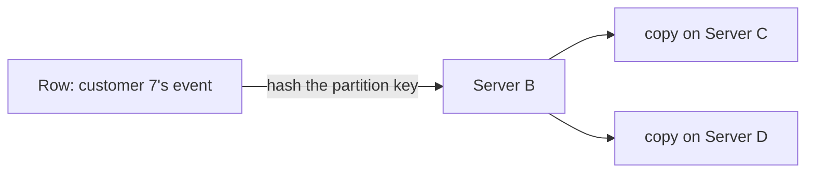

The catch: Cassandra only finds rows fast by that key. There are no joins and no "search by anything" — so you build **one table per question** you plan to ask, storing the same data more than once.


That is the whole trade: huge write volume and no downtime, in exchange for planning your questions up front. The rest of this note is just four questions:
1. Where exactly does a row live, and how do reads and writes travel? (sections 1-3)
2. How do you design the tables for a real feature? (section 4)
3. What are the famous footguns — giant partitions and deleted rows coming back? (sections 4-6)
4. What do you tune and watch in production and interviews? (sections 7-9)

**The problem in one story.**
Your app writes millions of audit events a day, from many regions, and must never stop accepting writes.
One PostgreSQL server cannot take that write load, and you cannot afford downtime when a machine dies.
Cassandra spreads data across many machines and copies each piece to several of them.
The price: you must design tables around the exact questions you will ask.

**Words you need first**

| Word | Plain meaning | Tiny example |
| --- | --- | --- |
| Node | One server in the cluster | 6 nodes across 2 data centres |
| Partition key | The field that decides which nodes store a row | `(tenant_id, day)` |
| Clustering column | The field that sorts rows inside one partition | `event_time DESC` |
| Replica / RF | A copy of the data; replication factor = number of copies | RF = 3 means 3 copies |
| Consistency level | How many replicas must answer a read or write | `QUORUM` = 2 of 3 |
| Tombstone | A "this was deleted" marker instead of an instant delete | Deleting a row writes a tombstone |
| Denormalise | Store the same data in several tables to avoid joins | Events by tenant and events by user |

**Picture it**

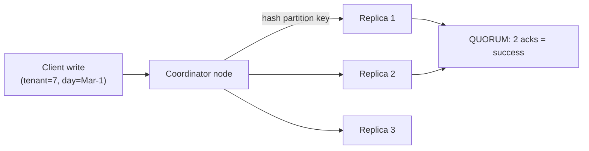

**Analogy.** A library with many branches: the first letter of the book title (partition key) decides which branches keep a copy, and on the shelf books sit in date order (clustering column).
Where it breaks: a library lets you search by author too; Cassandra only finds rows fast by the partition key you designed for.

**How the rest of this note builds up**

- First, why wide-column stores exist (section 1) and the partition/clustering mental model (section 2).
- Then placement with tokens, the write and read paths, tunable consistency, repair, tombstones and lightweight transactions (section 3).
- Then a query-first design for InvoiceOps audit events and how deleted rows come back (section 4).
- Then compaction strategies, other systems and when to choose Cassandra (sections 5-7).
- Finally the SDE-3 deep dive and interview questions.

> [!tip] Remember
> One table per query, partition key picks the nodes, keep partitions bounded, and `R + W > RF` for read-your-writes.

## 1. Why it exists 🟢

InvoiceOps adds an activity feed: every view, edit, send, payment and reminder becomes an audit event. The estimate for the scenario:

- 20,000 events per second on average, from India and Europe, about 1.7 billion a day.
- Kept for a year at about 300 bytes each: roughly 190 TB before replication.
- Both regions must keep accepting writes when the other region, or the link between them, is down.

A single PostgreSQL primary cannot absorb that write rate, and it accepts writes in only one region. Sharding PostgreSQL by hand is possible (see [[Partitioning and Sharding]]), but Cassandra gives you this shape out of the box:

- Any node accepts writes, and capacity grows by adding nodes.
- Each region writes locally and replicates to the other in the background.
- There is no primary, so there is no failover step.

What it gives up: joins, ad-hoc queries, multi-partition transactions, and strong consistency unless you ask for it.

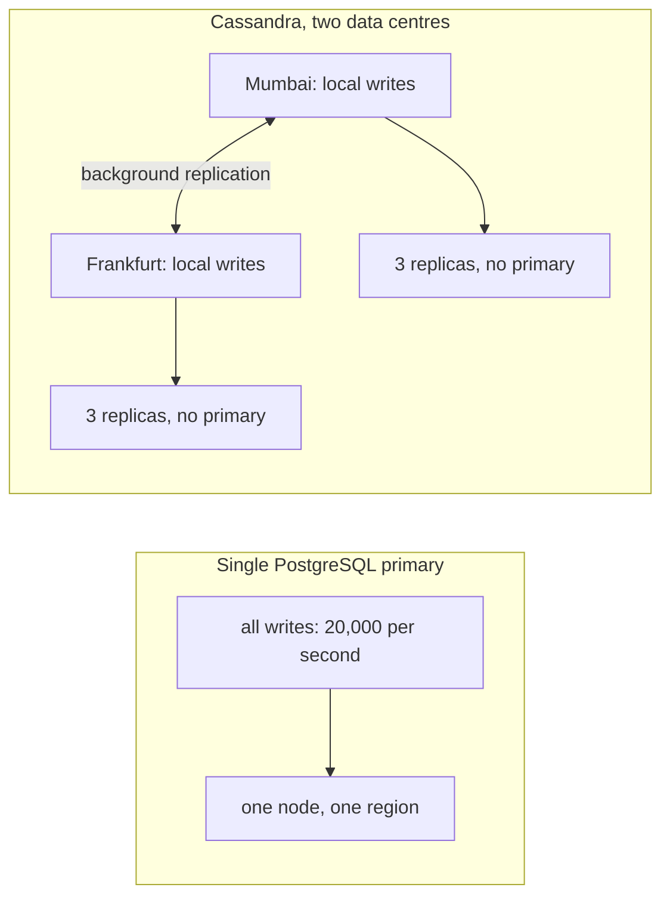

The arithmetic: 1.7 billion events a day × 300 bytes is about 510 GB a day, and a year of it is the roughly 190 TB quoted above, before replication multiplies it by 3 in each data centre.

## 2. Mental model 🟢

Think of a distributed, sorted **map of maps**: `partition key → (clustering key → row)`. Hashing the partition key decides which nodes hold the partition. Inside a partition, rows sit on disk in clustering order, so "the newest 50 events of workspace 7 on 2 November" is one sequential read from one partition.

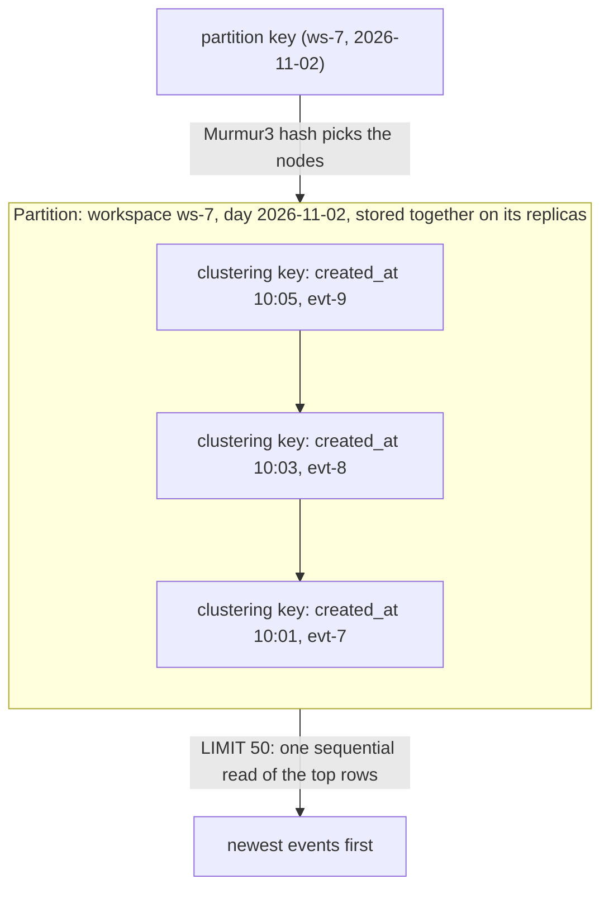

Analogy: a library spread over many buildings. Each book (partition) is shelved by a hash of its title, and inside a book the pages (rows) are in order. You can ask "pages 10 to 60 of book B" instantly. You cannot ask "every page that mentions refunds" without reading every book in every building.

Terms:

- **Keyspace:** a namespace plus replication settings (replicas per data centre).
- **Primary key:** `((partition key columns), clustering columns…)`. The first part places the data; the rest sorts it.
- **Replication factor (RF):** copies per data centre.
- **Coordinator:** the node that receives a request and talks to the replicas. Any node can coordinate.
- **Consistency level (CL):** how many replicas must acknowledge a write, or answer a read.

> [!warning] "Wide-column" is not "column store"
> Cassandra stores each row's cells together inside a partition: it is row-oriented on disk. Analytics column stores such as ClickHouse store each column separately. See [[Time-Series and Columnar Storage]].

## 3. How it works 🟡

### 3.1 Placement: tokens and replicas

**In plain words:** the cluster is a circle of servers; each row's key is hashed to a spot on the circle, and that spot plus the next couple of servers hold the copies.

The default partitioner hashes the partition key with Murmur3 into a 64-bit **token**. Each node owns several token ranges (virtual nodes: `num_tokens` is 16 by default since Cassandra 4.0, 256 before), and replicas go to the next nodes clockwise on the ring, as described in [[Consistent Hashing]].

`NetworkTopologyStrategy` places RF replicas in each data centre, on different racks where it can. Nodes learn about each other by gossip (see [[Failure Detection, Gossip and Membership]]).

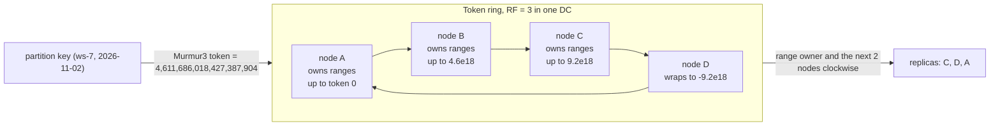

Example with numbers: with 6 nodes and `num_tokens` 16, the ring holds 96 token ranges, so each node owns 16 small slices. Adding a seventh node takes a few slices from every existing node instead of splitting one big range in half, so the load moves evenly. (The token value in the diagram is illustrative.)

### 3.2 Write path

**In plain words:** a write is just appended to a log and dropped into memory — no reading, no checking — which is why Cassandra can swallow writes so fast.

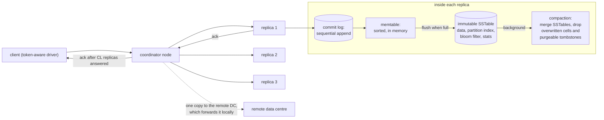

1. The coordinator sends the mutation to **all** replicas of the partition, and waits only for as many acknowledgements as the consistency level asks for.
2. Each replica appends the mutation to its **commit log** and inserts it into the **memtable**, then acknowledges. No read happens first: `INSERT` and `UPDATE` are both blind upserts.
3. A full memtable is flushed to a new, immutable **SSTable** on disk. A row's cells may now be spread across several SSTables.
4. **Compaction** merges SSTables in the background, keeping the newest version of each cell.

That is why writes are cheap: a sequential append and a memory insert. The cost moves to reads and to compaction (see [[Storage Engines - B-tree vs LSM and WAL]]).

Example with numbers: 20,000 events per second, each written to 3 tables with 3 replicas in the local data centre, is 180,000 replica mutations per second. Spread over 30 nodes (an estimate), that is about 6,000 per node, and each one is a commit-log append of about 300 bytes plus a memtable insert, with no disk read.

### 3.3 Read path

**In plain words:** a read has to gather the pieces of a row from memory and several files, keep the newest piece of each cell, and double-check with other copies — so reads do the work that writes skipped.

Inside a replica, for each SSTable that might hold the partition:

1. Check the **bloom filter**. "Definitely not here" skips the SSTable without touching disk (see [[Bloom Filters and Probabilistic Data Structures]]).
2. Look up the partition's position in the **partition index**, then seek to it in the data file and read the requested slice of clustering keys.
3. Merge the slices from the memtable and every SSTable **by timestamp**: the newest cell wins, and tombstones hide older data.

The more SSTables hold pieces of one partition, the more seeks one read costs. That is **read amplification**, and the compaction strategy (§5) controls it.

Across replicas, the coordinator asks the fastest replica for the data and the others for a **digest** (a hash). If the digests disagree, it fetches full data, reconciles by timestamp, writes the winner back to the stale replicas (**read repair**), and only then answers.

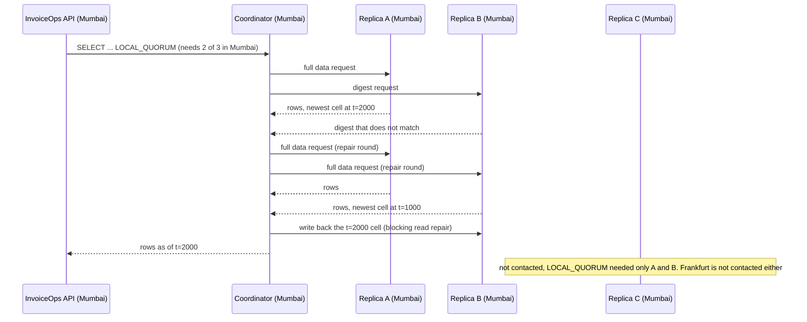

### 3.4 Tunable consistency

**In plain words:** every single request chooses how many copies must agree before it counts. Ask few copies and you are fast but may read stale data; ask enough so readers and writers always overlap, and you read your own writes.

| Level | Replicas that must answer (RF = 3 in Mumbai and 3 in Frankfurt) | Use |
| --- | --- | --- |
| `ONE` / `LOCAL_ONE` | 1 (in any DC / in the local DC) | Fastest; may read stale data |
| `QUORUM` | `floor(6 / 2) + 1 = 4`, so always crosses regions | Strong across DCs, pays the inter-region round trip |
| `LOCAL_QUORUM` | 2 of the 3 local replicas | The usual choice for multi-DC: strong inside a region, fast |
| `EACH_QUORUM` (writes) | 2 in **every** DC | A write must be durable in both regions |
| `ALL` | All 6 | Strongest, and any one node down fails the request |
| `ANY` (writes only) | 1, and a stored hint counts | Maximum write availability, weakest durability |
| `SERIAL` / `LOCAL_SERIAL` | A Paxos quorum | The Paxos phase of lightweight transactions (§3.6) |

If the write CL plus the read CL is greater than RF (for example `LOCAL_QUORUM` + `LOCAL_QUORUM` = 2 + 2 > 3), every read overlaps at least one replica that took the latest acknowledged write in that DC.

That is overlap, not linearizability: concurrent writes, writes that failed half way, and last-write-wins with skewed clocks can still surprise you. See [[Quorums and Leaderless Replication]].

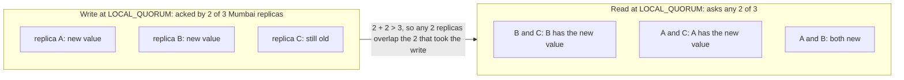

Example with numbers: RF = 3 and both sides use 2. The write reached A and B. Any 2 of {A, B, C} include at least one of A or B, so the read always meets a replica holding the new cell, and the newest timestamp wins.

### 3.5 Repair, hints and tombstones

**In plain words:** a delete is not an erase — it is a sticky note saying "this is gone". If one copy never gets the note before the others throw theirs away, the deleted data comes back from the dead.

- **Hinted handoff:** when a replica is down, the coordinator stores the write as a hint and replays it later, for up to `max_hint_window` (3 hours by default). A node down for longer misses writes until **repair**.
- **Anti-entropy repair** (`nodetool repair`) compares replicas with Merkle trees per token range and streams the differences. Every table must be fully repaired at least once every `gc_grace_seconds`.
- **Tombstones:** a delete, or an expired TTL, writes a marker that hides older data. Compaction may drop a tombstone only after `gc_grace_seconds`, which defaults to 864,000 s (10 days).
- **Zombie data:** a replica that missed the delete still holds the old value. If repair has not copied the tombstone to it before the other replicas purge theirs, the next read or repair brings the deleted row back (worked in §4).

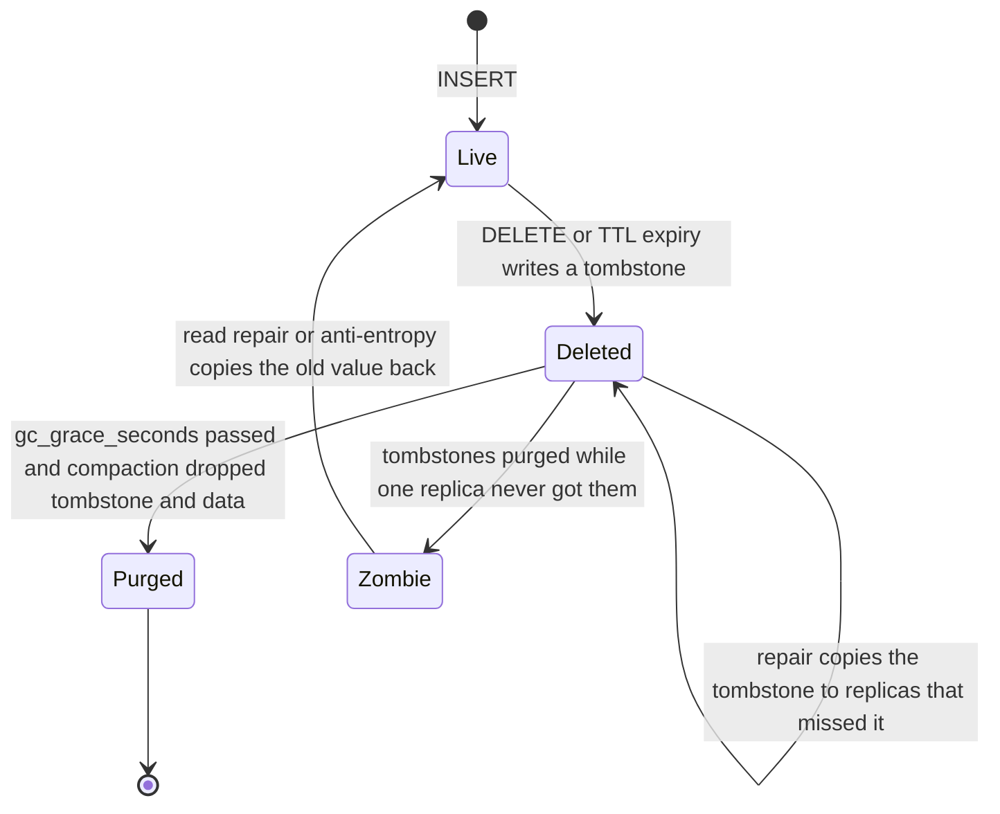

### 3.6 Lightweight transactions

**In plain words:** when a write must be "only if nobody else did it first", Cassandra makes the replicas vote on it. It works, but it costs several round trips, so keep it rare.

```sql
-- CQL: claim invoice number 1042 for workspace ws-7 exactly once
INSERT INTO invoice_numbers (workspace_id, number, invoice_id)
VALUES ('ws-7', 1042, 'inv-01JC9V')
IF NOT EXISTS;
```

`IF NOT EXISTS` and `UPDATE … IF col = value` run Paxos among the partition's replicas. The classic implementation (Paxos v1) needs 4 round trips for a write and 3 for a read. Cassandra 4.1 added Paxos v2 (`paxos_variant: v2`, opt-in), which needs 2 round trips for a write and 1 or 2 for a read.

Use LWTs only for compare-and-set (unique claims, state transitions), keep them off hot partitions, and do not mix LWT and plain writes on the same cells: plain writes bypass Paxos and break its guarantees.

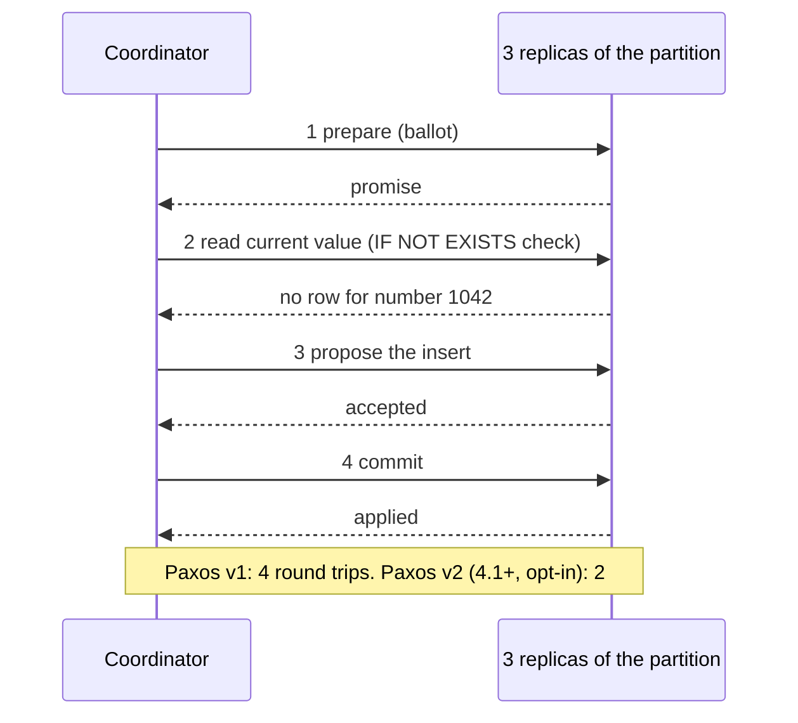

Example with numbers: at 1 ms between nodes in one data centre, a plain `LOCAL_QUORUM` write costs about 1 round trip, while a Paxos v1 write costs about 4 (an estimate), which is why LWTs stay off hot paths.

## 4. Worked example 🟡

### Whiteboard version

The bare idea: the primary key is written for one query.

```sql
-- Query: newest events of one workspace on one day
CREATE TABLE events_by_workspace_day (
  workspace_id text, bucket_day date, created_at timestamp,
  event_id uuid, action text,
  PRIMARY KEY ((workspace_id, bucket_day), created_at, event_id)
) WITH CLUSTERING ORDER BY (created_at DESC, event_id ASC);
-- SELECT ... WHERE workspace_id = 'ws-7' AND bucket_day = '2026-11-03' LIMIT 50;
```

The full version below adds production concerns: one table per query, bounded partitions, and what happens to deleted rows.

### Designing InvoiceOps audit events query-first

**In plain words:** write down the questions the app will ask, then build one table shaped for each question — even though that means storing the same event three times.

List the queries first, then build one table per query and accept duplicated data:

| Query | Table | Primary key |
| --- | --- | --- |
| Q1: newest events of workspace X on day D | `audit_events_by_workspace_day` | `((workspace_id, bucket_day), created_at, event_id)` |
| Q2: what did user U do on day D (security review) | `audit_events_by_actor_day` | `((actor_id, bucket_day), created_at, event_id)` |
| Q3: full timeline of one invoice | `audit_events_by_invoice` | `((workspace_id, invoice_id), created_at, event_id)` |

The full DDL (a keyspace with 3 replicas in each of two data centres, a day-bucketed table, time-window compaction and a 365-day TTL) is in [[Wide-Column Stores and Cassandra - Go]]. Q1 reads one partition that is already sorted newest first, `WHERE workspace_id = 'ws-7' AND bucket_day = '2026-11-02' LIMIT 50`.

The anti-pattern is a query with no partition key, such as `WHERE actor_id = 'u-19' ALLOW FILTERING`, where every node scans every partition.

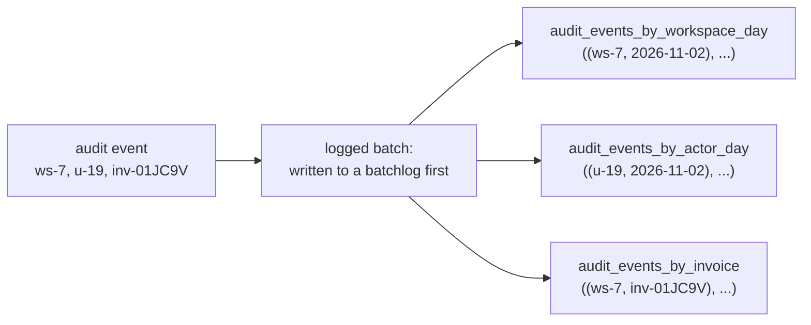

The event goes into all three tables in one **logged batch**. The batch is first written to a batchlog on other nodes, so either all three tables eventually get the event or none does. It is not isolated: a reader can see the event in one table before another.

**Sizing the partition** (estimates for the scenario):

- Without `bucket_day`, a workspace's partition grows forever. A common rule of thumb is to keep partitions under about 100 MB and about 100,000 rows; Cassandra 4.x logs a warning when compaction meets a partition above 100 MiB.
- A typical workspace writes 2,000 events a day × 300 bytes = 0.6 MB per day-partition: fine.
- The largest workspace writes 400,000 a day × 300 bytes = 120 MB: too big. Give big tenants a sub-bucket, `((workspace_id, bucket_day, sub), …)` with `sub = hash(event_id) % 4`. That is about 30 MB each, and Q1 reads the 4 partitions in parallel and merges them.

Discord's message store, the best-known Cassandra case, used the same idea: `PRIMARY KEY ((channel_id, bucket), message_id)` with about 10 days per bucket, chosen to keep partitions under 100 MB.

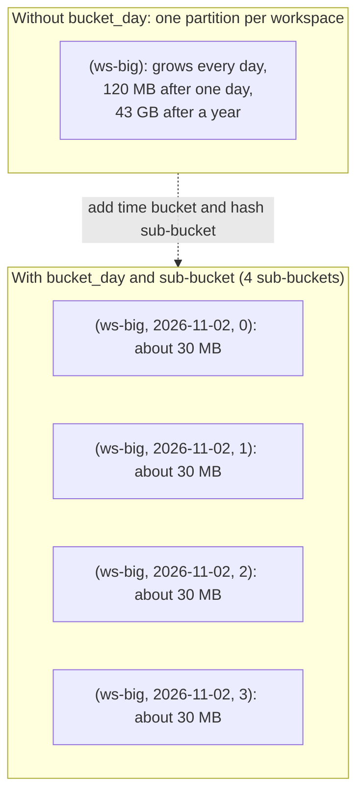

### How deleted rows come back

**In plain words:** three copies, one misses the delete note, the others throw their notes away after 10 days — now the forgetful copy is the only one with the row, so it "wins" and the deleted row returns.

A model of replica reconciliation: last write wins per cell, deletes are tombstones, and compaction purges tombstones after `gc_grace_seconds`. Three replicas A, B and C hold the row `invoice.sent` written at timestamp 1,000. The delete (a tombstone stamped 2,000) reaches A and B while C is down longer than the hint window.

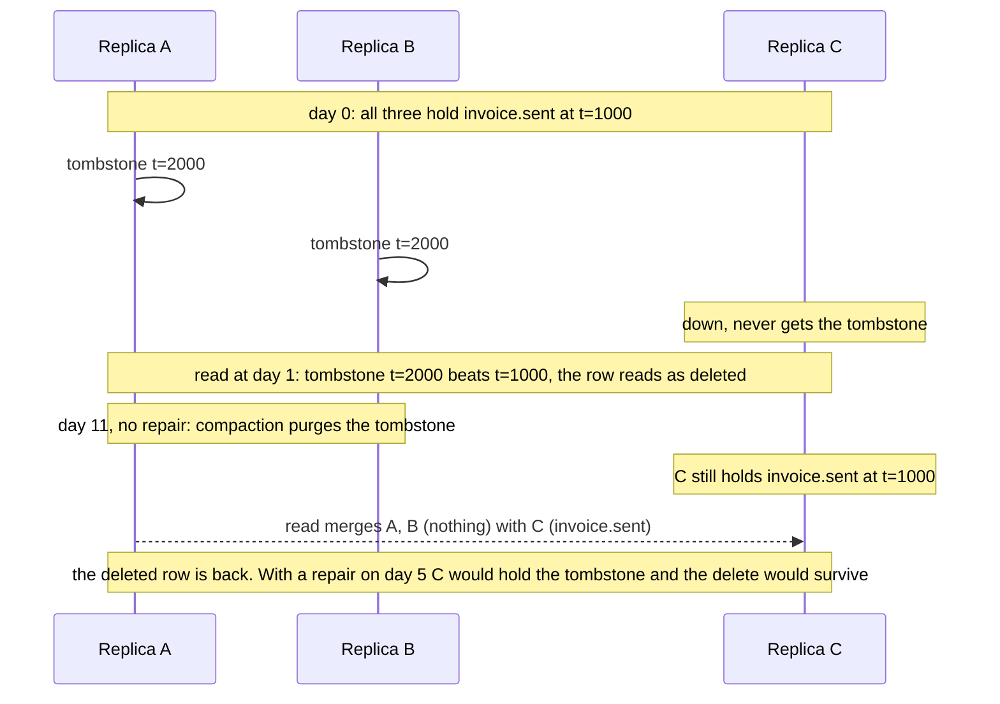

Reading the trace with numbers: before day 10 the tombstone (2,000) beats the live cell (1,000) on every read. At day 10 the tombstone is eligible for purging (`gc_grace_seconds` = 864,000 s), and on day 11 compaction drops it on A and B.

Only C remembers the row, so it is the only version left and it wins. If `nodetool repair` had run on day 5, C would have received the tombstone and all three would have purged it together.

The model also shows the clock-skew trap. If node A stamps a write 10,000 and node B writes 2 ms *later in real time* but its clock is behind and it stamps 8,000, B's write is silently discarded because 8,000 is lower. On an exact timestamp tie, a tombstone beats a live value.

The model keeps one cell per key, as if compaction had already merged everything; real compaction may drop a tombstone only when no older SSTable outside the compaction could still hold the data it shadows.

The model (`Cell`, `Reconcile`, `Replica`, `Compact`, `Read`, `Repair`) and its three tests (`TestDeleteResurrectsWithoutRepair`, `TestRepairWithinGCGraceKeepsDelete`, `TestLastWriteWins`) are in Go. Runnable Go version: [[Wide-Column Stores and Cassandra - Go]]

## 5. Variants and comparison 🟡

### Compaction strategies

**In plain words:** compaction is the background tidying that merges data files. The three flavours are just different tidying schedules: cheap and messy, expensive and neat, or binned by time.

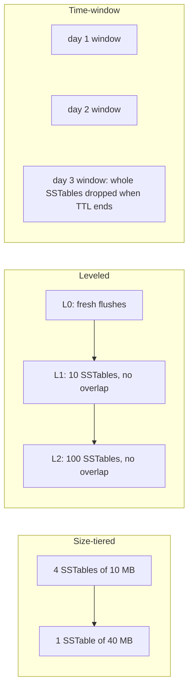

| Strategy | How it works | Use when | Cost |
| --- | --- | --- | --- |
| Size-tiered (STCS) | Merges SSTables of similar size | Write-heavy tables, rarely updated | Many SSTables per read; needs free disk about the size of what it compacts |
| Leveled (LCS) | Levels of non-overlapping SSTables, each about 10x the previous | Read-heavy tables with updates | Much more compaction I/O (write amplification) |
| Time-window (TWCS) | One SSTable group per time window; old windows are never merged again | Time series with TTL: whole SSTables expire and are dropped | Out-of-order writes and deletes defeat it |
| Unified (UCS, Cassandra 5.0) | One tunable strategy that can behave like tiered or leveled | New clusters on 5.0 | Newer, fewer operators know it |

### Wide-column and similar systems

**In plain words:** several databases share this "big sorted map spread over servers" shape; they differ mainly in who leads the copies and how strict reads are.

| System | Partitioning | Replication and consistency | Notes |
| --- | --- | --- | --- |
| Apache Cassandra | Hash of the partition key, vnodes | Leaderless, consistency level per request, last write wins | Multi-DC built in |
| ScyllaDB | Same data model and CQL | Same tunable model | C++ rewrite, one shard per CPU core. Discord moved from 177 Cassandra nodes to 72 ScyllaDB nodes; historical-message p99 went from 40–125 ms to 15 ms |
| HBase | Ranges of sorted row keys (regions) | One region server per region: strongly consistent per row | Data on HDFS; range scans by row key |
| Google Bigtable | Ranges of sorted row keys (tablets) | Strong within one cluster; replication between clusters is eventual | The 2006 paper that defined "wide-column" |
| Amazon DynamoDB | Hash of partition key, sorted by sort key | Leader per partition; eventually or strongly consistent reads | Managed, not Dynamo-style leaderless |

### Choosing a store

| Need | Best fit |
| --- | --- |
| ACID transaction across an invoice and its payments | PostgreSQL |
| Flexible nested document per entity | A document store such as MongoDB |
| Huge append-only events read by a known key and time | Cassandra or ScyllaDB |
| Full-text relevance search | [[Search Engines and Inverted Indexes]] |
| Aggregations over billions of rows | [[Time-Series and Columnar Storage]] |

| Topic | PostgreSQL | Cassandra |
| --- | --- | --- |
| Modelling | Normalized tables, joins at query time | One denormalized table per query |
| Transactions | Multi-row ACID | Atomic within one partition; LWT compare-and-set; logged batches without isolation |
| Scaling | Vertical, replicas, partitioning; sharding by hand | Horizontal by design: add nodes |
| Best for | Relational consistency and ad-hoc queries | Very high write volume, multi-region availability, known queries |
| Avoid for | Massive multi-region append-only write volume | Joins, ad-hoc queries, multi-row transactions |

## 6. Trade-offs and when not to use 🟡

- **Not for InvoiceOps' core data.** Recording a payment updates the payment and the invoice's status together, needs constraints, and support staff run ad-hoc queries. That is PostgreSQL's job. Cassandra fits the audit and activity events, notification delivery logs, and click tracking.
- **Denormalization moves work to writes.** One event becomes three writes, and correcting data means finding every copy. Bugs show up as tables that disagree.
- **Consistency is per request and easy to get wrong.** `ONE` everywhere is fast and returns stale rows; `QUORUM` in a multi-DC cluster quietly adds an inter-region round trip to every request.
- **Operations are real work:** repairs on a schedule, compaction tuning, tombstone hygiene, JVM heap and GC, and disk headroom for compaction.
- **A simpler option often wins.** Up to a few TB in one region, a PostgreSQL table partitioned by month (see [[Partitioning and Sharding]]) gives you SQL, transactions and cheap retention.

## 7. In production 🔴

- **Real systems:**
	- Discord started on a single MongoDB replica set, moved messages to Cassandra (2017 post), bucketed by channel and time, and in 2022 moved them to ScyllaDB (their 2023 post has the numbers above).
	- Netflix and Apple are long-time large Cassandra users.
	- A common example is tracking delivery-driver locations every few seconds in a table keyed by `((driver_id, day), ts)`. It answers "where was driver X today" well, and random ad-hoc analytics badly.
- **Failure modes → fixes:**
	- Hot partition from a low-cardinality or celebrity key → add a bucket or sub-bucket to the partition key (see [[Hot Keys and Hot Partitions]]).
	- Unbounded partition growth → time-bucket the partition key.
	- Tombstone build-up from queue-like tables, where rows are inserted then deleted once processed → do not use Cassandra as a queue, use TWCS with TTLs, and leave values unset instead of writing nulls. Reads that scan more than 1,000 tombstones log a warning; at 100,000 the query fails.
	- Repairs that never finish inside `gc_grace_seconds` → zombie rows. Schedule incremental repairs (for example with Cassandra Reaper) and alert on time since the last successful repair.
	- Stale reads → `LOCAL_QUORUM` on both reads and writes.
	- Copies of denormalized data disagree → logged batches, idempotent writes and a periodic reconciliation job.
	- High-cardinality secondary-index queries → a query table, or SAI combined with the partition key.
- **What to monitor:**
	- p99 read and write latency per node, and dropped mutations.
	- Pending compactions, and SSTables touched per read (`nodetool tablehistograms`).
	- The largest partition sizes, and tombstones scanned per read.
	- Hints pending, and time since the last successful repair compared with `gc_grace_seconds`.
	- Disk usage and JVM GC pauses.

## 8. Deep dive 🔴

- **Last write wins uses timestamps, not arrival order.** Each cell carries a microsecond timestamp set by the client or the coordinator. If a node's clock runs 50 ms behind, its update to a cell that another node wrote less than 50 ms earlier gets the lower timestamp and is silently discarded. Keep clocks synchronised, avoid read-modify-write on a cell, and model updates as new rows (an event log) when order matters.
- **The commit log is not fsynced on every write by default.** `commitlog_sync: periodic` with a 10 s period acknowledges writes before they reach disk; replication across nodes provides the durability. Switch to `batch` or `group` mode if every acknowledged write must survive a power cut of the whole cluster.
- **Secondary indexes are local.** A classic secondary index lives on each node and indexes only that node's data, so a query without the partition key asks every token range. Storage-Attached Indexes (SAI, Cassandra 5.0) are cheaper and can combine predicates, but are still per node. Materialized views are disabled by default since 4.0. The dependable answer is a table per query.
- **What `ALLOW FILTERING` means.** It tells Cassandra to read rows and filter them afterwards. With a partition key in the `WHERE` clause and a small partition that is fine; without one it is a scan of the whole cluster that gets slower as data grows.
- **Batches are not a speed-up.** An unlogged batch that touches many partitions just moves the fan-out work to one coordinator. Send independent writes concurrently instead, and keep logged batches for keeping denormalized tables in step.
- **Counters cannot be retried safely.** A timed-out counter increment may or may not have been applied, and retrying can double-count. Use them only where approximate is acceptable.
- **Read repair changed in 4.0.** The probabilistic background read repair (`read_repair_chance`) was removed. Reads at a consistency level above `ONE` still repair the replicas they compare, so repair coverage comes from scheduled anti-entropy repair.
- **Paxos is per partition.** An LWT gives linearizable compare-and-set on one partition only. Cassandra 5.0 still has no general multi-partition ACID transactions.

## 9. Interview questions 🔴

> [!question]- Why does Cassandra modelling start from the queries?
> Reads are only efficient by partition key (plus a clustering range), and there are no joins. So you list the queries first, then create one table per query, partitioned by what the query filters on and clustered by what it sorts on, and accept duplicated data. Writing the same event to three tables is normal.

> [!question]- How do you choose a partition key?
> It must match the query's equality filters, spread traffic over many nodes, and keep each partition bounded: well under about 100 MB. If one key can grow forever, add a time bucket (day, week) or a sub-bucket for big tenants. Discord used `((channel_id, bucket), message_id)` with roughly 10-day buckets.

> [!question]- RF is 3 in each of two data centres. What do QUORUM and LOCAL_QUORUM mean, and what does R + W > RF give you?
> `QUORUM` needs 4 of all 6 replicas, so every request crosses regions. `LOCAL_QUORUM` needs 2 of the 3 local replicas. Writing and reading at `LOCAL_QUORUM` (2 + 2 > 3) means a read overlaps a replica that has the latest acknowledged write in that DC. It does not give linearizability: concurrent writes and skewed clocks still resolve by last-write-wins.

> [!question]- You deleted rows, and a month later some of them came back. Why?
> A replica missed the delete: it was down longer than the hint window, and no repair ran. After `gc_grace_seconds` (10 days by default) the other replicas purged their tombstones in compaction, so the stale replica's old value won the next read repair or anti-entropy repair.
>
> Fix: complete a repair of every table within `gc_grace_seconds`, and never bring a node back after it has been down longer than that without rebuilding it.

> [!question]- Why are Cassandra writes cheap and reads more expensive?
> A write is a sequential commit-log append plus an in-memory insert, with no read before it. A read may have to check the memtable and several SSTables (filtered by bloom filters), merge cells by timestamp, and compare replicas. Compaction strategy and partition design decide how many SSTables a read touches.

> [!question]- Cassandra is a "column" database, so it is great for analytics, right?
> No. "Wide-column" means a partition can hold many rows with many columns; on disk, each row's cells are stored together. Aggregating one column over billions of rows means reading whole rows on every node. Use a columnar engine such as ClickHouse, or a warehouse, for analytics.

> [!question]- What does a lightweight transaction cost, and when do you use one?
> It runs Paxos among the partition's replicas: 4 round trips for a write with Paxos v1, about 2 with Paxos v2 (4.1+, opt-in), plus contention retries on busy partitions. Use it only for compare-and-set, such as claiming a unique invoice number once, never on hot paths, and never mixed with plain writes on the same data.

> [!question]- When would you not use Cassandra?
> When the workload needs joins, constraints, ad-hoc queries or multi-row transactions, such as InvoiceOps invoices and payments. Also when the data fits comfortably in one PostgreSQL cluster: Cassandra's operational cost only pays off at large write volume or multi-region write availability.

## 10. Cheat sheet 🟢

- Primary key `((partition key), clustering…)`: the partition key picks the nodes, clustering columns sort rows inside the partition.
- Model query-first: one table per query, duplicated data, logged batches to keep tables in step.
- Keep partitions bounded (well under about 100 MB) with time buckets and sub-buckets.
- Write: commit log + memtable → SSTable → compaction. Read: bloom filter → partition index → merge by timestamp.
- `LOCAL_QUORUM` on reads and writes is the multi-DC default; `QUORUM` crosses regions.
- Tombstones live for `gc_grace_seconds` (10 days): repair within it or deleted data returns.
- LWT = Paxos per partition, several round trips: compare-and-set only.
- Avoid `ALLOW FILTERING`, secondary indexes on hot paths, queue patterns and huge partitions.

## Links

- **Runnable code:** [[Wide-Column Stores and Cassandra - Go]]
- **Before this:** [[NoSQL Data Modeling]], [[Storage Engines - B-tree vs LSM and WAL]], [[Consistent Hashing]]
- **Next:** [[Quorums and Leaderless Replication]], [[Failure Detection, Gossip and Membership]], [[Hot Keys and Hot Partitions]]
- **Compare with:** [[Partitioning and Sharding]] (sharding a relational database by hand), [[Time-Series and Columnar Storage]] (true column stores for analytics), [[Replication]] (single-leader replication)

### Watch on YouTube

- [Foundations of Cassandra Data Modeling - Session 1](https://www.youtube.com/watch?v=CivjlnV7lNc) · DataStax · deep dive on partition/clustering key data modeling from Cassandra's own vendor
- [Cassandra in 100 Seconds](https://www.youtube.com/watch?v=ziq7FUKpCS8) · Fireship · super short visual intro to what Cassandra is
- [Intro to NO SQL - Cassandra / Tutorial / Why the name Cassandra (Part 5) / Great Learning](https://www.youtube.com/watch?v=DtxXeCPcqNI) · Great Learning · broader NoSQL/wide-column-store context before diving into Cassandra specifics
