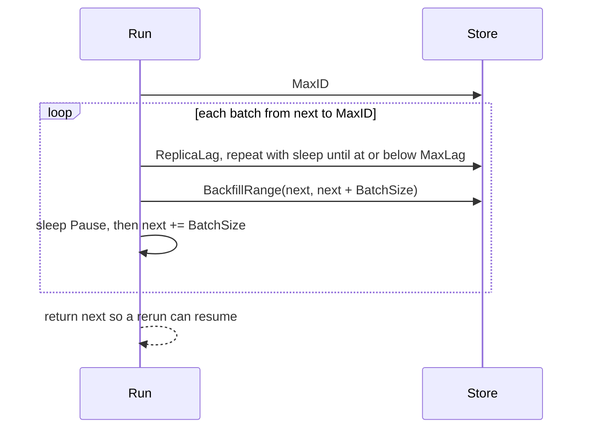
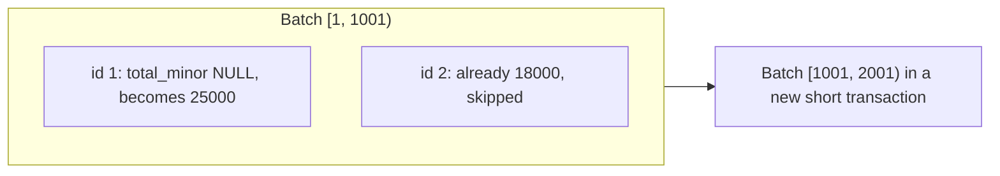
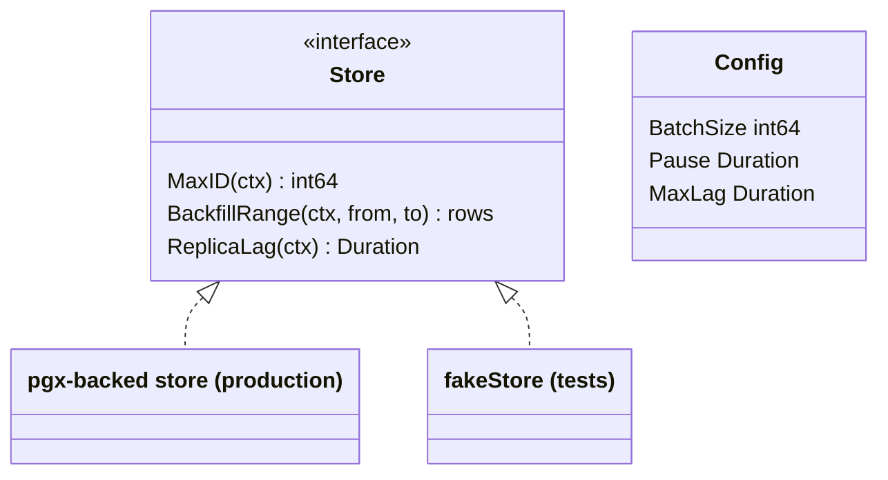
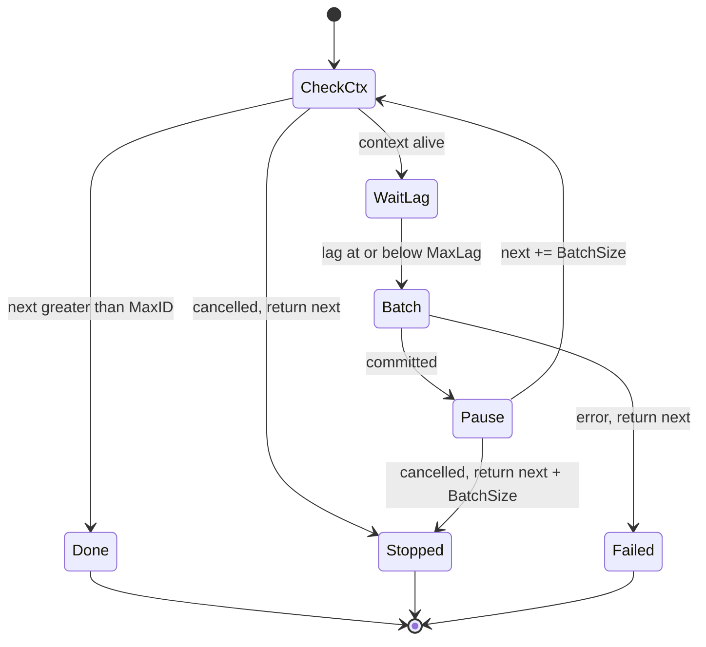
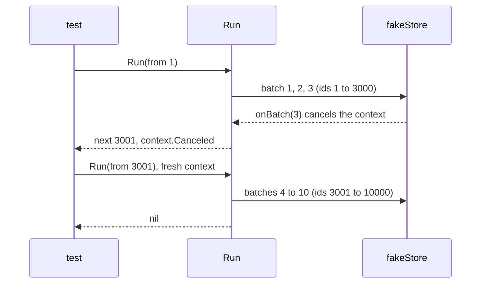

# Zero-Downtime Schema Migrations - Go

> [!summary] TL;DR
> A throttled, resumable backfill job in Go for the data-migration step of expand, migrate, contract: it fills `invoices.total_minor` in short batches, waits while replicas lag, and can be interrupted and resumed without rewriting rows. The theory is in [[Zero-Downtime Schema Migrations]]. The store is an in-memory fake, so the tests need no PostgreSQL.

## Before the code

- **Interfaces** (`Store`): the backfill loop talks to an interface, so tests use an in-memory fake and production uses pgx.
- **`context.Context`**: lets an operator cancel a long backfill; the loop stops cleanly and returns where to resume.
- **`time.Duration` and `time.NewTimer`**: express batch pauses and replica-lag limits, and build a sleep that can be cancelled.
- **`select`**: waits on whichever happens first, the timer firing or the context being cancelled.
- **`errors.Is(err, context.Canceled)`**: tells "someone stopped us" apart from a real failure.
- **What to run**: `go mod init example.com/backfill`, then `go vet ./... && go test -race ./...`.

## What this code shows

Schema changes that avoid long locks are mostly SQL, but the one step that needs a program is the data migration: copying 20 million old values into a new column without hurting production. That step is a loop with three safety properties, and this package implements exactly those: each batch is small, the loop slows down when replicas fall behind, and a stop at any moment can be resumed without redoing work.

| Code | Concept in [[Zero-Downtime Schema Migrations]] |
| --- | --- |
| `Store.BackfillRange` | One batch is one short transaction: `UPDATE ... WHERE id >= $1 AND id < $2 AND total_minor IS NULL` ([[Zero-Downtime Schema Migrations#4. Worked example]]) |
| `Store.ReplicaLag` | Throttling on `pg_stat_replication.replay_lag` so reads on replicas do not go stale ([[Zero-Downtime Schema Migrations#7. In production]]) |
| `Run` and the returned `next` | A resumable job: a checkpoint id lets a rerun continue where it stopped |
| `waitForReplicas`, `Pause` | Pausing between batches so vacuum and replicas keep up |
| `fakeStore` in the tests | An in-memory table that counts writes per id to prove each row is written once |



## Setup

- Go 1.24, standard library only. The real `Store` would wrap `pgx` and run the SQL from the theory note; here an in-memory fake stands in for it, so the tests are labelled as fake-store tests.
- Module layout: package `backfill` with `backfill.go` and `backfill_test.go`.
- Run it:

```text
go mod init example.com/backfill
go vet ./...
go test -race ./...
```

## Code

### Step 1: the SQL behind the interface

**Concept.** This is the "migrate" step of expand, migrate, contract ([[Zero-Downtime Schema Migrations#4. Worked example]]). Updating 20 million rows in one statement would hold row locks for the whole run, produce a huge burst of WAL, and make replicas lag. Instead each statement touches a small id range.

The `total_minor IS NULL` condition makes the statement idempotent: a rerun skips rows that are already filled, which is what makes the job safe to interrupt. The alternative is a single `UPDATE` in one transaction, which is simpler but is the classic way to cause an outage.

```sql
UPDATE invoices
SET    total_minor = round(total * 100)::bigint
WHERE  id >= $1 AND id < $2
  AND  total_minor IS NULL;      -- reruns skip finished rows

-- on the primary: how far behind are the replicas?
SELECT coalesce(max(replay_lag), interval '0') FROM pg_stat_replication;
```

**How it works.**

1. `id >= $1 AND id < $2` is a half-open primary-key range. It uses the primary key index, so each batch is a quick range scan, not a table scan.
2. `round(total * 100)::bigint` converts the old decimal amount into integer minor units (paise or cents).
3. `AND total_minor IS NULL` skips rows already migrated. Rows written by new application pods already carry `total_minor`, so they are skipped too.
4. The lag query asks the primary for the worst `replay_lag` among its replicas. `replay_lag` is NULL when a replica has caught up and the primary is idle, so `coalesce(..., interval '0')` turns that into zero instead of an error.



### Step 2: the store interface and the config

**Concept.** `Store` is the seam between the loop and the database. The loop knows nothing about SQL, and the database code knows nothing about throttling, so the loop can be tested with an in-memory fake. `Config` holds the three tuning knobs the theory note describes: batch size, pause, and the maximum acceptable lag.

They are plain fields instead of constants because the right values depend on row width, hardware and traffic, and come from rehearsing on a production-size copy.

```go
package backfill

import (
	"context"
	"fmt"
	"time"
)

// Store runs the SQL. Each BackfillRange call is its own short transaction.
type Store interface {
	MaxID(ctx context.Context) (int64, error)
	BackfillRange(ctx context.Context, from, to int64) (rows int64, err error) // ids in [from, to)
	ReplicaLag(ctx context.Context) (time.Duration, error)
}

type Config struct {
	BatchSize int64         // ids per batch, e.g. 5_000
	Pause     time.Duration // sleep after each batch so vacuum and replicas keep up
	MaxLag    time.Duration // wait while any replica's replay lag is above this
}
```

**How it works.**

1. Every `Store` method takes a `context.Context`, so a cancelled deploy aborts a query that is in flight instead of waiting for it.
2. `MaxID` is read once at the start. Rows inserted afterwards come from new pods that already write `total_minor`, so the job does not need to chase new ids.
3. `BackfillRange` returns the number of rows it changed. A real implementation would return it from the command tag of the `UPDATE`.
4. `ReplicaLag` returns a `time.Duration`, which compares directly with `Config.MaxLag`.
5. Each `BackfillRange` call being its own transaction is a contract of the interface, not something the loop can enforce.



### Step 3: the resumable loop

**Concept.** `Run` is the loop of the worked example in [[Zero-Downtime Schema Migrations#4. Worked example]]: check lag, run one batch, pause, repeat. It returns the id where a rerun should resume, which is the checkpoint. Checking the context between batches, never inside one, means a stop leaves every batch either fully committed or never started.

The alternative is to persist a checkpoint row in the database after each batch; returning `next` keeps the loop free of extra state and leaves the choice of where to store it to the caller.

```go
// Run backfills ids from `from` up to MaxID and returns where to resume.
// Rerunning a batch is harmless: the UPDATE skips rows already filled.
func Run(ctx context.Context, s Store, cfg Config, from int64) (next int64, err error) {
	maxID, err := s.MaxID(ctx)
	if err != nil {
		return from, err
	}
	for next = from; next <= maxID; next += cfg.BatchSize {
		if err := ctx.Err(); err != nil {
			return next, err // stopped between batches: nothing is half done
		}
		if err := waitForReplicas(ctx, s, cfg); err != nil {
			return next, err
		}
		if _, err := s.BackfillRange(ctx, next, next+cfg.BatchSize); err != nil {
			return next, fmt.Errorf("batch [%d, %d): %w", next, next+cfg.BatchSize, err)
		}
		if err := sleep(ctx, cfg.Pause); err != nil {
			return next + cfg.BatchSize, err // this batch is committed
		}
	}
	return next, nil
}
```

**How it works.**

1. The named results `(next int64, err error)` let the loop variable `next` be returned directly when the loop ends, so a finished run returns the first id past `MaxID`.
2. `next <= maxID` with `next += cfg.BatchSize` walks the ranges `[1, 1001)`, `[1001, 2001)` and so on, covering every id exactly once.
3. `ctx.Err()` at the top of each iteration is the stop point between batches. It returns `next`, the start of the batch that did not run.
4. `waitForReplicas` blocks the next batch while lag is high. Any error, including cancellation, returns `next` unchanged.
5. A batch error is wrapped with `%w`, so callers can still use `errors.Is` on the cause, and the message names the failed range.
6. If the pause is cancelled, the batch just before it has already committed, so `next + cfg.BatchSize` is returned. Returning `next` would only redo finished work.



### Step 4: waiting for replicas

**Concept.** Every updated row is a new row version, so a backfill produces a lot of WAL, and replicas that cannot replay it fast enough serve stale reads ([[Zero-Downtime Schema Migrations#7. In production]]). The loop therefore reads the lag before each batch and sleeps until it is acceptable.

This is feedback control: the job runs as fast as the slowest replica allows. A fixed sleep alone would either be too slow when the system is idle or too fast when it is busy. The lag check costs one cheap query per batch.

```go
func waitForReplicas(ctx context.Context, s Store, cfg Config) error {
	for {
		lag, err := s.ReplicaLag(ctx)
		if err != nil {
			return err
		}
		if lag <= cfg.MaxLag {
			return nil
		}
		if err := sleep(ctx, cfg.Pause); err != nil {
			return err
		}
	}
}
```

**How it works.**

1. The `for` loop has no counter: it exits only when lag is acceptable or something fails. Cancelling the context is the escape hatch.
2. The lag is read fresh on each pass, so a replica that catches up releases the job at the next check.
3. `lag <= cfg.MaxLag` is an inclusive test, so a lag exactly equal to the limit is allowed.
4. Waiting reuses `cfg.Pause`, so the same knob controls both the pause between batches and the lag poll interval.

### Step 5: a cancellable sleep

**Concept.** `time.Sleep` cannot be interrupted, so a deploy that cancels the job would wait out the pause. Waiting on a timer and on `ctx.Done()` in a `select` makes the sleep return the moment the context ends.

The up-front context check is deliberate: with a zero pause both channels can be ready at once and `select` picks randomly, so without it a cancelled job could run one more batch.

```go
// sleep waits for d or until ctx is done, whichever comes first.
func sleep(ctx context.Context, d time.Duration) error {
	if err := ctx.Err(); err != nil {
		return err
	}
	t := time.NewTimer(d)
	defer t.Stop()
	select {
	case <-t.C:
		return nil
	case <-ctx.Done():
		return ctx.Err()
	}
}
```

**How it works.**

1. `ctx.Err()` first: an already-cancelled context returns immediately and deterministically.
2. `time.NewTimer` plus `defer t.Stop()` releases the timer when the context wins, instead of leaving it to fire later.
3. `select` returns `nil` when the timer fires (a normal pause) and `ctx.Err()` when the context ends, which is `context.Canceled` or `context.DeadlineExceeded`.

## Design decisions

| Choice | Alternative | Trade-off |
| --- | --- | --- |
| Return `next` as the checkpoint | Store a checkpoint row after every batch | No extra writes or table, but the caller must save the value itself |
| Idempotent `WHERE total_minor IS NULL` | Track done ranges separately | Reruns are harmless and need no state, but the column must start NULL |
| Context checked between batches only | Cancel mid-statement | No half-done batches in the loop; the in-flight statement still ends through its context |
| Throttle on `replay_lag` | Fixed sleep only | Adapts to load, but adds one query per batch and only sees replicas on the primary |
| `Store` interface | Call `pgx` directly | Testable without a database, but the real SQL path is not covered by these tests |
| One transaction per batch | One transaction for the whole job | Short locks and vacuum can proceed; the whole job is not atomic, which the expand step makes acceptable |
| Cancellable `select` sleep | `time.Sleep` | A stop is immediate, at the cost of a few lines |

## Tests

The fake store keeps a `filled` map (has `total_minor` been written for this id?) and a `writes` counter per id, and records the order of `lag` and `batch` calls in `events`. Two tests then prove the two main safety properties.

### The fake store

**Concept.** The fake models exactly the behaviour the loop depends on. `BackfillRange` honours the `IS NULL` rule by skipping ids that are already filled, which is what makes reruns harmless. It counts writes per id so a test can assert "written exactly once".

The `onBatch` hook runs after a batch commits, which lets a test cancel the context at a precise moment, and `lags` replays a scripted series of lag readings.

```go
package backfill

import (
	"context"
	"errors"
	"testing"
	"time"
)

// fakeStore is an in-memory stand-in for the invoices table: filled[id] says
// whether total_minor has been written, writes[id] counts how often.
type fakeStore struct {
	maxID   int64
	filled  map[int64]bool
	writes  map[int64]int
	batches int
	onBatch func(n int)
	lags    []time.Duration // successive ReplicaLag readings; the last repeats
	lagCall int
	events  []string
}

func newFakeStore(maxID int64) *fakeStore {
	return &fakeStore{maxID: maxID, filled: map[int64]bool{}, writes: map[int64]int{}}
}

func (s *fakeStore) MaxID(context.Context) (int64, error) { return s.maxID, nil }
```

```go
func (s *fakeStore) BackfillRange(_ context.Context, from, to int64) (int64, error) {
	s.batches++
	s.events = append(s.events, "batch")
	var rows int64
	for id := from; id < to && id <= s.maxID; id++ {
		if s.filled[id] { // WHERE total_minor IS NULL skips finished rows
			continue
		}
		s.filled[id] = true
		s.writes[id]++
		rows++
	}
	if s.onBatch != nil {
		s.onBatch(s.batches)
	}
	return rows, nil
}
```

```go
func (s *fakeStore) ReplicaLag(context.Context) (time.Duration, error) {
	s.events = append(s.events, "lag")
	if len(s.lags) == 0 {
		return 0, nil
	}
	i := min(s.lagCall, len(s.lags)-1)
	s.lagCall++
	return s.lags[i], nil
}

var cfg = Config{BatchSize: 1000, Pause: time.Millisecond, MaxLag: time.Second}
```

**How it works.**

1. `fakeStore` has no mutex because the loop calls it from a single goroutine. `go test -race` would flag a data race if that ever changed.
2. In `BackfillRange`, `id <= s.maxID` stops the last range from filling ids that do not exist, because the final batch `[9001, 10001)` is wider than the table.
3. `filled[id]` plus `continue` is the in-memory version of `WHERE total_minor IS NULL`. Removing it would make `writes[id]` reach 2 on a rerun.
4. `s.onBatch(s.batches)` runs after the work, matching a real cancel that arrives after a commit.
5. `min(s.lagCall, len(s.lags)-1)` uses Go's built-in `min` (Go 1.21+) so the last reading repeats, which models a stable replica once it has caught up.
6. `cfg` uses a 1 ms pause so the tests run fast.

### Test 1: interrupt, resume, and write every row once

**Property.** Interrupting the job and resuming from the returned id must leave every row filled, and filled exactly once. This is the guarantee that lets a deploy kill the job at any moment.



| Input | Expected |
| --- | --- |
| 10,000 ids, batch 1,000, cancel after batch 3 | first run returns `next = 3001` and `context.Canceled` |
| resume from 3001 with a live context | no error; 10,000 rows filled, each with `writes == 1` |

```go
func TestBackfillResumesWithoutRewritingRows(t *testing.T) {
	s := newFakeStore(10_000)
	ctx, cancel := context.WithCancel(context.Background())
	s.onBatch = func(n int) {
		if n == 3 {
			cancel() // the deploy is interrupted after 3 batches
		}
	}
	next, err := Run(ctx, s, cfg, 1)
	if !errors.Is(err, context.Canceled) || next != 3001 {
		t.Fatalf("first run: next=%d err=%v, want 3001 and context.Canceled", next, err)
	}
```

The second half of the same test resumes from `next` with a live context and then checks every row.

```go

	s.onBatch = nil
	if _, err := Run(context.Background(), s, cfg, next); err != nil {
		t.Fatal(err)
	}
	if len(s.filled) != 10_000 {
		t.Fatalf("filled %d rows, want 10000", len(s.filled))
	}
	for id, done := range s.filled {
		if !done || s.writes[id] != 1 {
			t.Fatalf("id %d: filled=%v writes=%d, want filled once", id, done, s.writes[id])
		}
	}
}
```

**What a failure means.** A first-run `next` of 2001 or 4001 means the checkpoint is off by one batch: 2001 would redo work, 4001 would skip a batch and leave a hole. A `writes[id]` of 2 means a rerun rewrote finished rows, so the `IS NULL` guard is missing.

A `filled` count below 10,000 means rows were skipped, which in production leaves NULLs that later break `SET NOT NULL`.

### Test 2: wait for replicas before the first batch

**Property.** While replicas are lagging more than `MaxLag`, no batch may run. The fake feeds readings of 5 s, 3 s and 0 s against a limit of 1 s.

| Lag reading | Compared with `MaxLag` = 1 s | Action |
| --- | --- | --- |
| 5 s | above | sleep and read again |
| 3 s | above | sleep and read again |
| 0 s | at or below | run the first batch |

Expected event prefix: `lag, lag, lag, batch`.

```go
func TestBackfillWaitsForReplicaLag(t *testing.T) {
	s := newFakeStore(1000)
	s.lags = []time.Duration{5 * time.Second, 3 * time.Second, 0}
	if _, err := Run(context.Background(), s, cfg, 1); err != nil {
		t.Fatal(err)
	}
	// Three lag readings (5 s, 3 s, 0 s) must come before the first batch.
	want := []string{"lag", "lag", "lag", "batch"}
	for i, e := range want {
		if s.events[i] != e {
			t.Fatalf("events=%v, want prefix %v", s.events, want)
		}
	}
}
```

**What a failure means.** If `batch` appears before the third `lag`, the loop ignores lag and would push replicas further behind during a real backfill, serving stale invoices to readers on the replicas. If fewer than three `lag` events appear, the comparison is wrong (for example using `<` against the wrong side).

## Running it

Measured: `go vet` is clean and both tests pass under `go test -race` (Go 1.24.4, darwin/arm64).

```text
--- PASS: TestBackfillResumesWithoutRewritingRows (0.01s)
--- PASS: TestBackfillWaitsForReplicaLag (0.00s)
PASS
ok  	example.com/backfill	1.228s
```

Reading the output line by line:

1. The first `--- PASS` takes 0.01 s: ten batches of 1,000 map writes plus ten 1 ms pauses.
2. The second takes 0.00 s: three lag polls with 1 ms sleeps, then one batch.
3. `PASS` is the overall result for the package.
4. `ok  example.com/backfill  1.228s` is the package summary. Most of that time is building with the race detector enabled, which found no data race.

## Pitfalls in the code

- Start the job only after every pod runs the dual-write version, or old pods will keep creating rows with `total_minor` NULL after `MaxID` was read.
- `BackfillRange` must be idempotent. A rerun of a batch has to be harmless, or the resume guarantee is lost.
- When the context is cancelled during the pause after a batch, `Run` returns `next + BatchSize`, because that batch is already committed. Returning `next` would only redo finished work, which is safe but wasteful.
- `sleep` checks the context first. Without that, a zero pause and a cancelled context race in the `select`, and the job may run one more batch.
- Each `BackfillRange` call must be its own transaction. One transaction around the whole loop would hold row locks and block vacuum for the full 13 minutes.
- `ReplicaLag` returns zero when the replica has caught up (the SQL uses `coalesce`). A NULL read as an error would stall the job on an idle system.

## Exercises

1. In `TestBackfillResumesWithoutRewritingRows`, cancel after batch 5 instead of batch 3. Predict the `next` value returned by the first run.
2. In `TestBackfillWaitsForReplicaLag`, change the readings to `{0, 5s, 0}`. Predict the sequence of `events` before the first `batch`.
3. Set `cfg.BatchSize` to 3,000 with `maxID` 10,000. Predict how many batches run in total and what `Run` returns for `next`.

> [!example]- Full file: backfill.go
> ```go
> package backfill
>
> import (
> 	"context"
> 	"fmt"
> 	"time"
> )
>
> // Store runs the SQL. Each BackfillRange call is its own short transaction.
> type Store interface {
> 	MaxID(ctx context.Context) (int64, error)
> 	BackfillRange(ctx context.Context, from, to int64) (rows int64, err error) // ids in [from, to)
> 	ReplicaLag(ctx context.Context) (time.Duration, error)
> }
>
> type Config struct {
> 	BatchSize int64         // ids per batch, e.g. 5_000
> 	Pause     time.Duration // sleep after each batch so vacuum and replicas keep up
> 	MaxLag    time.Duration // wait while any replica's replay lag is above this
> }
>
> // Run backfills ids from `from` up to MaxID and returns where to resume.
> // Rerunning a batch is harmless: the UPDATE skips rows already filled.
> func Run(ctx context.Context, s Store, cfg Config, from int64) (next int64, err error) {
> 	maxID, err := s.MaxID(ctx)
> 	if err != nil {
> 		return from, err
> 	}
> 	for next = from; next <= maxID; next += cfg.BatchSize {
> 		if err := ctx.Err(); err != nil {
> 			return next, err // stopped between batches: nothing is half done
> 		}
> 		if err := waitForReplicas(ctx, s, cfg); err != nil {
> 			return next, err
> 		}
> 		if _, err := s.BackfillRange(ctx, next, next+cfg.BatchSize); err != nil {
> 			return next, fmt.Errorf("batch [%d, %d): %w", next, next+cfg.BatchSize, err)
> 		}
> 		if err := sleep(ctx, cfg.Pause); err != nil {
> 			return next + cfg.BatchSize, err // this batch is committed
> 		}
> 	}
> 	return next, nil
> }
>
> func waitForReplicas(ctx context.Context, s Store, cfg Config) error {
> 	for {
> 		lag, err := s.ReplicaLag(ctx)
> 		if err != nil {
> 			return err
> 		}
> 		if lag <= cfg.MaxLag {
> 			return nil
> 		}
> 		if err := sleep(ctx, cfg.Pause); err != nil {
> 			return err
> 		}
> 	}
> }
>
> // sleep waits for d or until ctx is done, whichever comes first.
> func sleep(ctx context.Context, d time.Duration) error {
> 	if err := ctx.Err(); err != nil {
> 		return err
> 	}
> 	t := time.NewTimer(d)
> 	defer t.Stop()
> 	select {
> 	case <-t.C:
> 		return nil
> 	case <-ctx.Done():
> 		return ctx.Err()
> 	}
> }
> ```

## Links

- Theory: [[Zero-Downtime Schema Migrations]]
- **Before this:** [[Relational Schema Design]], [[Locking - Optimistic vs Pessimistic]]
- **Next:** [[Schema Migrations in Go Services]], [[Rollback and Safe Migrations]]
