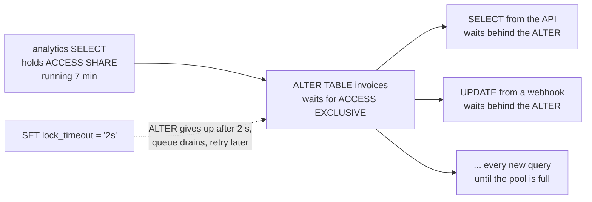
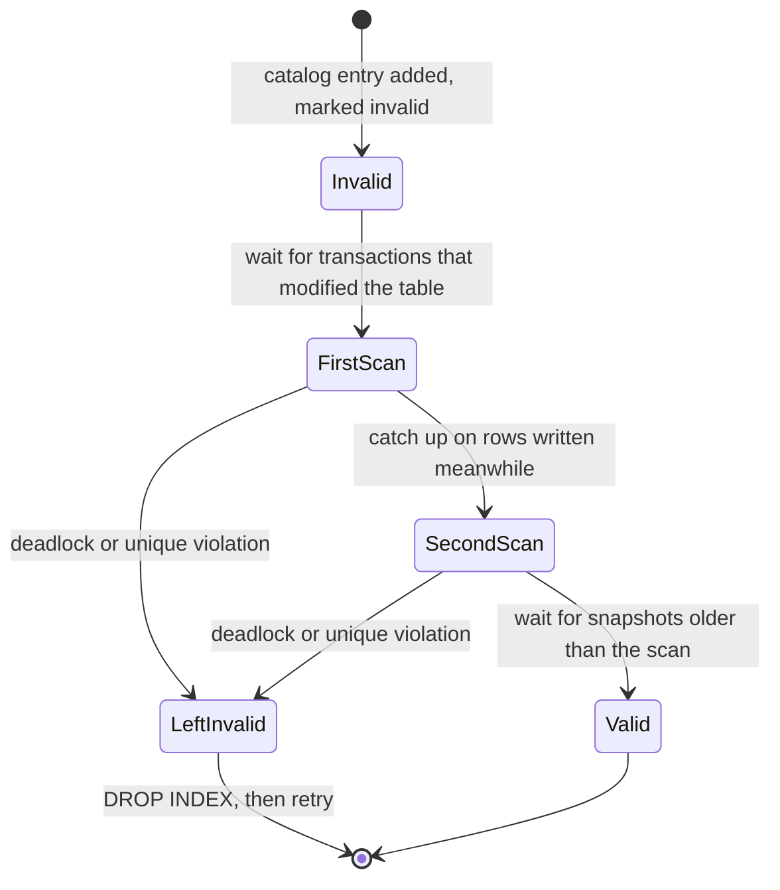
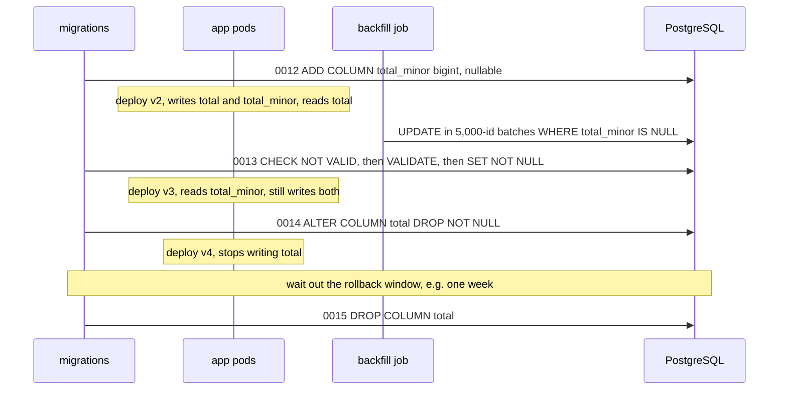

# Zero-Downtime Schema Migrations

> [!summary] TL;DR
> A schema migration changes tables while the app keeps serving traffic. Two things cause outages: DDL that takes a strong lock and makes every query on the table wait, and schema changes that break the app version still running. The fix is **expand → migrate → contract**: add the new shape, move code and data to it over several deploys, and remove the old shape last. Use DDL that only holds its lock for a moment.

> [!abstract] Core idea
> - Two things cause outages: a lock that queues every query on the table, and a schema the still-running old app version cannot handle.
> - The rule: expand, migrate, contract. Add the new shape, move code and data over several deploys, remove the old shape last.
> - Every DDL statement runs with a short `lock_timeout`, so it gives up instead of blocking traffic.
> - Classic mistake: renaming or dropping a column in one deploy while old app pods still read it.

## 1. Why it exists

InvoiceOps runs 6 pods behind a rolling deploy, and `invoices` has 20 million rows. A developer ships:

```sql
ALTER TABLE invoices ADD COLUMN total_minor bigint;
```

On PostgreSQL 17 this is a catalog-only change that finishes in milliseconds. It still took the API down for 7 minutes:

1. A 7-minute analytics `SELECT` on `invoices` was running. It holds an `ACCESS SHARE` lock.
2. `ALTER TABLE` needs `ACCESS EXCLUSIVE`, which conflicts with every other lock, so it **waits**.
3. Every new query on `invoices` (plain `SELECT`s too) conflicts with the *waiting* `ACCESS EXCLUSIVE` request, so it queues **behind the ALTER**.
4. All pool connections fill with stuck queries, health checks fail, and the API is down until the analytics query ends.

The second outage class is code: renaming `total` to `total_minor` in one step breaks the old pods, which still `SELECT total`, for the whole length of the rolling deploy.

## 2. Mental model

Treat the schema like a public API with two clients at once: the app version that is running, and the one being rolled out. Every step must work for both.

Changing a busy table is like repainting a road lane while traffic keeps moving. You open the new lane first, move the cars over, and only then close the old lane. And you never park a roller across all lanes, even for a second, at rush hour without a plan to back off.

## 3. How it works

**The lock queue.** PostgreSQL grants locks in queue order. A waiting strong lock blocks the weaker requests behind it:



`lock_timeout` turns a possible outage into a failed migration that can retry. The error is SQLSTATE `55P03` (`lock_not_available`).

**Lock levels of common DDL** (PostgreSQL 17, `ALTER TABLE` takes `ACCESS EXCLUSIVE` unless noted):

| Change | Lock | Table work | Safe pattern |
| --- | --- | --- | --- |
| `ADD COLUMN` nullable, no default | ACCESS EXCLUSIVE, brief | none | `lock_timeout` + retry |
| `ADD COLUMN … DEFAULT 0` (non-volatile; since PG 11) | ACCESS EXCLUSIVE, brief | none: the default is stored in the catalog | `lock_timeout` + retry |
| `ADD COLUMN … DEFAULT gen_random_uuid()` (volatile) | ACCESS EXCLUSIVE | rewrites table and indexes | add nullable, backfill, then set the default |
| `ALTER COLUMN TYPE` `integer` → `bigint` | ACCESS EXCLUSIVE | rewrite + index rebuild | new column, backfill, swap |
| `varchar(50)` → `varchar(100)` or `text` | ACCESS EXCLUSIVE, brief | none (binary coercible) | `lock_timeout` + retry |
| `SET NOT NULL` | ACCESS EXCLUSIVE | full scan, skipped if a valid `CHECK` proves it (PG 12+) | `CHECK … NOT VALID` → `VALIDATE` → `SET NOT NULL` |
| `ADD CHECK` | ACCESS EXCLUSIVE | full scan | `NOT VALID`, then `VALIDATE CONSTRAINT` |
| `ADD FOREIGN KEY` | SHARE ROW EXCLUSIVE on **both** tables (blocks writes) | full scan | `NOT VALID`, then `VALIDATE CONSTRAINT` |
| `VALIDATE CONSTRAINT` | SHARE UPDATE EXCLUSIVE (reads and writes continue) | full scan | fine during traffic |
| `CREATE INDEX` | SHARE (blocks writes) | full build | `CREATE INDEX CONCURRENTLY` |
| `CREATE INDEX CONCURRENTLY` | SHARE UPDATE EXCLUSIVE | two scans + waits for old transactions | never inside a transaction |
| `ADD UNIQUE` / `PRIMARY KEY` | ACCESS EXCLUSIVE | builds an index | unique index `CONCURRENTLY`, then `ADD CONSTRAINT … USING INDEX` |
| `DROP COLUMN` | ACCESS EXCLUSIVE, brief | none (space comes back as rows are rewritten) | only after no deployed code uses it |
| `RENAME COLUMN` / `RENAME TO` | ACCESS EXCLUSIVE, brief | none | breaks running code: expand/contract instead |

Only `ACCESS EXCLUSIVE` blocks plain `SELECT`s. `SHARE` and `SHARE ROW EXCLUSIVE` block writes, which on an invoicing API is an outage too.

**`CREATE INDEX CONCURRENTLY`** builds while reads and writes continue, but it has its own lifecycle:



A failed build leaves an `INVALID` index. Queries ignore it, but it still costs write overhead (and a unique one still enforces uniqueness). Drop it and retry, or `REINDEX INDEX CONCURRENTLY` it. Only one concurrent build can run per table at a time.

## 4. Worked example

### Whiteboard version

The bare idea for a column rename, one step per deploy:

```sql
-- Deploy 1 (expand): add the new column; the app writes both columns
SET lock_timeout = '2s';
ALTER TABLE clients ADD COLUMN display_name text;

-- Background job (migrate): copy old rows in small batches
UPDATE clients SET display_name = name
WHERE id BETWEEN 1 AND 10000 AND display_name IS NULL;

-- Deploy 2: the app reads display_name only

-- Deploy 3 (contract): remove the old column once no code uses it
SET lock_timeout = '2s';
ALTER TABLE clients DROP COLUMN name;
```

The full version below adds production concerns: a type change on a 20-million-row table, dual writes, batched backfill, and adding `NOT NULL` without a long lock.


**Goal:** move InvoiceOps money from `invoices.total numeric(12,2)` to `invoices.total_minor bigint NOT NULL` (integer paise), across 20 million rows, with no downtime.



**Expand** (migration 0012). Use a short lock wait, and retry on `55P03`:

```sql
SET lock_timeout = '2s';
ALTER TABLE invoices ADD COLUMN total_minor bigint;
```

**Deploy v2.** It writes both columns and still reads `total`. Start the backfill only after every pod runs v2, because v1 pods would keep writing rows with `total_minor` NULL.

**Migrate data.** One batch is one short transaction:

```sql
UPDATE invoices
SET    total_minor = round(total * 100)::bigint
WHERE  id >= $1 AND id < $2
  AND  total_minor IS NULL;      -- reruns skip finished rows

-- on the primary: how far behind are the replicas?
SELECT coalesce(max(replay_lag), interval '0') FROM pg_stat_replication;
```

`replay_lag` turns NULL when a replica has caught up and the primary is idle, hence the `coalesce`. The job around it is throttled and resumable (Go 1.24; `go vet` and `go test -race` pass):

```go
// Store runs the SQL. Each BackfillRange call is its own short transaction.
type Store interface {
	MaxID(ctx context.Context) (int64, error)
	BackfillRange(ctx context.Context, from, to int64) (rows int64, err error) // ids in [from, to)
	ReplicaLag(ctx context.Context) (time.Duration, error)
}

type Config struct {
	BatchSize int64         // ids per batch, e.g. 5_000
	Pause     time.Duration // sleep after each batch so vacuum and replicas keep up
	MaxLag    time.Duration // wait while any replica's replay lag is above this
}

// Run backfills ids from `from` up to MaxID and returns where to resume.
// Rerunning a batch is harmless: the UPDATE skips rows already filled.
func Run(ctx context.Context, s Store, cfg Config, from int64) (next int64, err error) {
	maxID, err := s.MaxID(ctx)
	if err != nil {
		return from, err
	}
	for next = from; next <= maxID; next += cfg.BatchSize {
		if err := ctx.Err(); err != nil {
			return next, err // stopped between batches: nothing is half done
		}
		if err := waitForReplicas(ctx, s, cfg); err != nil {
			return next, err
		}
		if _, err := s.BackfillRange(ctx, next, next+cfg.BatchSize); err != nil {
			return next, fmt.Errorf("batch [%d, %d): %w", next, next+cfg.BatchSize, err)
		}
		if err := sleep(ctx, cfg.Pause); err != nil {
			return next + cfg.BatchSize, err // this batch is committed
		}
	}
	return next, nil
}

func waitForReplicas(ctx context.Context, s Store, cfg Config) error {
	for {
		lag, err := s.ReplicaLag(ctx)
		if err != nil {
			return err
		}
		if lag <= cfg.MaxLag {
			return nil
		}
		if err := sleep(ctx, cfg.Pause); err != nil {
			return err
		}
	}
}
```

Rows inserted after `MaxID` was read come from v2 pods, which already write `total_minor`. The test interrupts the job, resumes it, and proves that every row was written exactly once:

```go
func TestBackfillResumesWithoutRewritingRows(t *testing.T) {
	s := newFakeStore(10_000)
	ctx, cancel := context.WithCancel(context.Background())
	s.onBatch = func(n int) {
		if n == 3 {
			cancel() // the deploy is interrupted after 3 batches
		}
	}
	next, err := Run(ctx, s, cfg, 1)
	if !errors.Is(err, context.Canceled) || next != 3001 {
		t.Fatalf("first run: next=%d err=%v, want 3001 and context.Canceled", next, err)
	}

	s.onBatch = nil
	if _, err := Run(context.Background(), s, cfg, next); err != nil {
		t.Fatal(err)
	}
	for id, done := range s.filled {
		if !done || s.writes[id] != 1 {
			t.Fatalf("id %d: filled=%v writes=%d, want filled once", id, done, s.writes[id])
		}
	}
}
```

A second test feeds replica lag readings of 5 s, 3 s and 0 s and checks that no batch runs until the lag drops below `MaxLag`. Time budget: 20 million rows at 5,000 per batch is 4,000 batches. At roughly 150 ms per batch plus a 50 ms pause, that is about 13 minutes (an estimate; measure on a production-size copy).

**Add NOT NULL without a long lock** (migration 0013). Run each statement in **its own transaction**: separate migration files, or a tool mode that runs statements one at a time. Inside one transaction, the `ACCESS EXCLUSIVE` lock from the first statement would be held through the whole validation scan:

```sql
SET lock_timeout = '2s';
ALTER TABLE invoices ADD CONSTRAINT invoices_total_minor_nn
  CHECK (total_minor IS NOT NULL) NOT VALID;                        -- brief, no scan
ALTER TABLE invoices VALIDATE CONSTRAINT invoices_total_minor_nn;  -- scans; reads and writes continue
ALTER TABLE invoices ALTER COLUMN total_minor SET NOT NULL;         -- brief: the valid CHECK proves it
ALTER TABLE invoices DROP CONSTRAINT invoices_total_minor_nn;
```

**Contract.** v3 reads the new column and still writes both, so rolling back to v2 stays safe. Migration 0014 drops `NOT NULL` from `total` so that v4 can stop writing it. Migration 0015 drops `total` once nobody will roll back to v3.

## 5. Variants and comparison

| Tool or technique | How it works | Use when | Cost |
| --- | --- | --- | --- |
| golang-migrate | Numbered `up`/`down` SQL files; a `schema_migrations` row with a `dirty` flag; a session advisory lock stops two runners | Plain SQL, Go services | A failed file leaves the version dirty: fix, then `migrate force` |
| goose | SQL or Go migrations; `-- +goose NO TRANSACTION` for statements such as `CREATE INDEX CONCURRENTLY` | You need Go code in some migrations | Locking is opt-in in its Provider API |
| Atlas | Declarative desired schema; generates versioned migrations and lints them for destructive or locking changes | Many teams or schemas, CI review | Another tool and format to learn |
| Flyway | Versioned `V2__name.sql` files, JVM-based | JVM shops | Not Go-native |
| App dual write | The new app version writes old and new columns | Most renames and type changes | Code in two places until the contract step |
| Sync trigger | A `BEFORE INSERT OR UPDATE` trigger fills the new column | Many writers you cannot redeploy at once | Must be dropped before writers stop filling the old column |
| pgroll (Postgres) | Serves old and new schema versions at once through views, with automatic backfill | You want expand/contract automated | Views and triggers in the hot path |
| gh-ost / pt-online-schema-change (MySQL) | Copy into a shadow table, follow changes (binlog or triggers), then swap | MySQL tables that need a rebuild | Hours of copying, double disk |

Up/down versus forward-only: down files help in development. In production a down that drops a filled column destroys data, so most teams **roll forward** with a new migration.

## 6. Trade-offs and when not to use

- **Expand/contract costs deploys.** One rename becomes 4 or 5 releases and a week of dual code. For a table with 1,000 rows and a maintenance window, a single locked `ALTER` is fine.
- **Dual writes can drift.** A code path that writes only the old column leaves NULLs or stale values. Backfill `WHERE new IS NULL`, and reconcile before switching reads.
- **Backfills cost I/O and WAL.** Every updated row is a new row version: more WAL, replica lag, and dead tuples for VACUUM. Batch, pause, and watch lag.
- **`NOT VALID` constraints are enforced only for new writes.** The planner cannot rely on them until `VALIDATE CONSTRAINT` finishes.
- **`CREATE INDEX CONCURRENTLY` is slower** than a plain build (two scans plus waits), and can stall behind one long transaction.
- **Rollback is not symmetric.** You can roll the *app* back while the schema stays expanded. Rolling the *schema* back after data has moved usually loses data. Plan forward fixes, and keep a point-in-time backup for real mistakes ([[Backup, PITR and Disaster Recovery]]).

## 7. In production

- **Real systems:**
	- GitHub built gh-ost for online MySQL changes.
	- GitLab's migration guides split migrations into regular ones, post-deployment ones (contract steps after the deploy) and batched background migrations.
	- Rails apps use the strong_migrations gem; Postgres teams use the Squawk linter. Both flag unsafe DDL in review.
- **Run migrations as a deploy step,** a CI job or a Kubernetes Job, not in every pod's `main()`. If pods must run them, the tool's advisory lock serializes them. Point the migration tool at the database directly: a transaction-mode pooler breaks its session lock ([[Connection Pooling]]).
- **One `CREATE INDEX CONCURRENTLY` per file.** A multi-statement string sent as one simple query runs as a single implicit transaction, and `CONCURRENTLY` refuses to run inside one.
- **See the queue** during a stuck migration:

```sql
SELECT pid, pg_blocking_pids(pid) AS blocked_by,
       wait_event_type || ':' || wait_event AS waiting_on,
       now() - query_start AS running_for, left(query, 40) AS query
FROM pg_stat_activity
WHERE backend_type = 'client backend' AND state <> 'idle'
ORDER BY query_start;
```

Representative output (PostgreSQL 17):

```text
  pid  | blocked_by |  waiting_on   |   running_for   |                  query
-------+------------+---------------+-----------------+------------------------------------------
 41207 | {}         |               | 00:07:12.403118 | SELECT workspace_id, sum(total) FROM inv
 41388 | {41207}    | Lock:relation | 00:00:09.118342 | ALTER TABLE invoices ADD COLUMN total_mi
 41391 | {41388}    | Lock:relation | 00:00:08.902117 | SELECT id, status, total FROM invoices W
 41395 | {41388}    | Lock:relation | 00:00:08.771045 | UPDATE invoices SET status = 'paid' WHER
```

The API queries are blocked by the **ALTER** (41388), not by the analytics query. That is the lock queue. Cancel the ALTER (`pg_cancel_backend(41388)`) and traffic flows again.

- **Failure modes → fixes:**
	- Lock-queue outage → `lock_timeout` on every DDL, plus retries; run long reports on a replica.
	- `CREATE INDEX CONCURRENTLY` failed → find `pg_index.indisvalid = false` and drop or reindex.
	- Backfill makes replicas lag and reads go stale → throttle on `replay_lag`, smaller batches.
	- `cached plan must not change result type` after a column change → avoid `SELECT *`; with pgx's default statement cache, a changed result shape fails the first execution after the change.
	- golang-migrate stopped halfway and marked the version dirty → fix the schema by hand, then `migrate force <version>`.
- **What to monitor:** lock waits (`wait_event_type = 'Lock'`), replica `replay_lag`, migration duration against the rehearsal, `pg_stat_progress_create_index` for long index builds, and API error rate during each deploy.

## 8. Deep dive

- **Why `ADD COLUMN … DEFAULT` is instant since PostgreSQL 11.** The non-volatile default is evaluated once and stored in the column's catalog entry (`pg_attribute.attmissingval`). Old rows that lack the column read the stored value; new and rewritten rows store it for real. A volatile default (`gen_random_uuid()`, `clock_timestamp()`) must differ per row, so it still rewrites the table. `now()` is only *stable*, so `DEFAULT now()` is instant, and every old row gets the timestamp of the `ALTER`.
- **Why `SET NOT NULL` can skip the scan.** Since PostgreSQL 12, a **validated** `CHECK (col IS NOT NULL)` already proves there are no NULLs. Validation runs under `SHARE UPDATE EXCLUSIVE`, so the long part never blocks traffic.
- **Foreign keys on partitioned tables** cannot be added `NOT VALID` in PostgreSQL 17, so the validating scan runs while writes are blocked. Schedule it for a quiet window, or add the key while the table is still small.
- **Replicas feel DDL too.** An `ACCESS EXCLUSIVE` lock is written to WAL and replayed on hot standbys. There it conflicts with long replica queries, which get cancelled once `max_standby_streaming_delay` passes. Logical replication does not replicate DDL at all, so apply the expand step on subscribers **first**.
- **HOT updates make backfills cheaper.** When no indexed column changes and the page has free space, PostgreSQL writes a heap-only tuple and skips index updates. Backfilling an unindexed `total_minor` benefits; add its index afterwards, `CONCURRENTLY`.
- **Swapping a primary key from `integer` to `bigint`** is the same dance with more steps. Add `id_new bigint` and fill it for new rows with a trigger (`NEW.id_new := NEW.id`). Backfill it, make it `NOT NULL` with the CHECK trick, and build a unique index concurrently. Then, in one short transaction, drop the old key, add `PRIMARY KEY USING INDEX`, and rename the columns. Foreign keys that point at it have to move too.
- **Rehearse.** Restore last night's snapshot to a scratch instance, run the migration and the backfill, and time every lock and batch. Numbers from a 1,000-row dev database say nothing about 20 million rows.

## 9. Interview questions

> [!question]- How can a 5 ms `ALTER TABLE ADD COLUMN` take the site down?
> It needs `ACCESS EXCLUSIVE`. If any transaction holds even an `ACCESS SHARE` lock (a long `SELECT`), the `ALTER` waits, and every later query on that table queues behind the waiting `ALTER`. Set `lock_timeout` (for example 2 s) so the `ALTER` gives up and retries, and keep long queries off the primary.

> [!question]- Add a NOT NULL column with a default to a 500-million-row table. How?
> On PostgreSQL 11+, `ADD COLUMN … DEFAULT <constant> NOT NULL` is catalog-only, so run it with `lock_timeout`. If the value must be computed per row: add the column nullable, backfill in batches, add `CHECK (col IS NOT NULL) NOT VALID`, `VALIDATE` it, then `SET NOT NULL` (no scan since PG 12) and drop the check.

> [!question]- How do you rename a column with zero downtime?
> Never in one step. Add the new column, deploy code that writes both, backfill, switch reads to the new column, stop writing the old one, then drop it in a later deploy. Each schema state must work for the app version running and the one being rolled out.

> [!question]- What are the catches with `CREATE INDEX CONCURRENTLY`?
> It cannot run inside a transaction block, including the implicit one around a multi-statement string. It scans twice and waits for older transactions, so a long transaction stalls it. If it fails it leaves an `INVALID` index that still slows writes. Only one concurrent build can run per table.

> [!question]- Trap: "Wrap the whole migration in one transaction so it is atomic." Good?
> Not for big tables. Locks are held until commit, so the `ACCESS EXCLUSIVE` from a quick first statement stays held through every later step, including long scans. `CREATE INDEX CONCURRENTLY` is not even allowed. Keep each risky DDL in its own short transaction with `lock_timeout`.

> [!question]- Trap: "If the deploy goes wrong, we run the down migration." Will that save you?
> Rarely. Down migrations that drop filled columns destroy data, and converted data (rounding, merges) often cannot be reversed. Roll the app back while the schema stays expanded (that is why expand comes first), fix forward with a new migration, and keep point-in-time recovery for genuine corruption.

> [!question]- How do you backfill 200 million rows without hurting production?
> Batches by primary-key range, each its own short transaction, with `WHERE new_col IS NULL` so reruns are safe. Pause between batches, throttle on replica lag, and checkpoint the last ID to resume. Leave the column unindexed during the backfill so updates can be HOT, and let autovacuum keep up.

## 10. Cheat sheet

- Outages come from **locks** (the queue behind a waiting `ACCESS EXCLUSIVE`) and from **code** (old pods reading a renamed or dropped column).
- `SET lock_timeout = '2s'` on every DDL, plus retries.
- Instant: nullable `ADD COLUMN`, non-volatile default (PG 11+), widening `varchar`, `DROP COLUMN`.
- Rewrites: volatile default, real type changes (`int` → `bigint`).
- `NOT VALID` + `VALIDATE CONSTRAINT` for CHECK and FK; CHECK proves `SET NOT NULL` (PG 12+).
- `CREATE INDEX CONCURRENTLY`: alone in its file, no transaction, check `indisvalid`.
- Expand → dual write → backfill → switch reads → stop old writes → contract.
- Roll forward; keep PITR for real mistakes.

## Links

- **Before this:** [[Relational Schema Design]], [[Transactions and ACID]], [[Locking - Optimistic vs Pessimistic]]
- **Next:** [[Schema Migrations in Go Services]] (tool setup, embedding, CI), [[Rollback and Safe Migrations]] (deploy-side rollback), [[Index Types and Index Design]]
- **Compare with:** [[API Versioning and Backward Compatibility]] (expand/contract for APIs), [[Event Schemas and Schema Registry]] (evolving event schemas), [[Deployment Strategies - Rolling, Blue-Green, Canary]]
