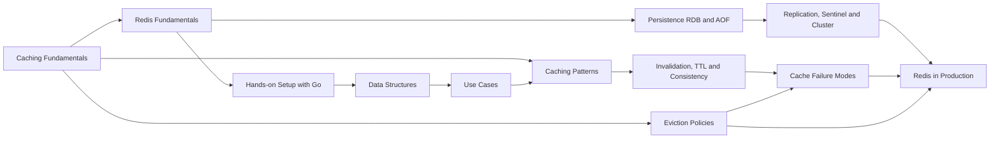

# 08 Caching & Redis MOC

> [!summary] What this folder covers
> After this folder you can decide what to cache and where, pick a caching pattern, keep a cache fresh and safe under load, and run Redis as a cache and data-structure server: its data types, persistence, high availability and production operations.

## Before and after

- **Before this:** [[07 Databases MOC]]
- **After this:** [[10 Distributed Systems & Resilience MOC]]

## Learning path

### Caching, independent of the store

1. [[Caching Fundamentals]] · basic. Why caches work, hit-ratio maths, and where a cache can live.
2. [[Caching Patterns]] · intermediate. Cache-aside, read-through, write-through, write-behind and refresh-ahead, with Go code.
3. [[Cache Invalidation, TTL and Consistency]] · intermediate. How stale a cache may be, TTL choice with jitter, and the stale-set race.
4. [[Cache Eviction Policies - LRU, LFU, TTL]] · intermediate. What gets thrown out when memory is full, and how LRU and LFU are built in O(1).

### Redis

5. [[Redis Fundamentals]] · basic. The single-threaded event loop, keys and expiry, and the three tools for atomicity.
6. [[Redis Hands-on Setup with Go]] · basic. Run Redis locally, use redis-cli, and build a small OTP service with go-redis.
7. [[Redis Data Structures and When to Use Each]] · intermediate. Pick a type by the question you need answered, and know its memory cost.
8. [[Redis Use Cases]] · intermediate. Leaderboards, locks, idempotency keys, sessions and counters, mapped to structures and key patterns.

### Running caches and Redis at scale

9. [[Cache Failure Modes - Stampede, Avalanche, Penetration, Hot and Big Keys]] · advanced. The five ways a cache hurts the database behind it, and the fix for each.
10. [[Redis Persistence - RDB and AOF]] · intermediate. Snapshots versus an append-only log, and how much data each can lose.
11. [[Redis Replication, Sentinel and Cluster]] · advanced. Replicas, automatic failover, and hash-slot sharding with redirects.
12. [[Redis in Production - Memory, Latency, Security]] · advanced. Memory limits, commands that block the main thread, and ACLs with TLS.

## Concept map

## Interview focus

- What is the difference between cache-aside, write-through and write-behind, and when would you use each? See [[Caching Patterns]].
- How do you keep a cache consistent with the database, and why should you delete rather than update the cache on writes? See [[Cache Invalidation, TTL and Consistency]].
- How would you implement an LRU cache, and when is LFU better? See [[Cache Eviction Policies - LRU, LFU, TTL]].
- What is a cache stampede, and how do you prevent it? What about avalanche and penetration? See [[Cache Failure Modes - Stampede, Avalanche, Penetration, Hot and Big Keys]].
- Why is Redis fast even though it is single-threaded? See [[Redis Fundamentals]].
- Which Redis data structure would you use for a leaderboard, a unique-visitor count or a session? See [[Redis Data Structures and When to Use Each]].
- How do you build a lock in Redis, and why is it unsafe without fencing tokens? See [[Redis Use Cases]].
- What is the difference between RDB and AOF, and how much data can you lose with each? See [[Redis Persistence - RDB and AOF]].
- How does Redis Cluster shard keys, and what are hash tags for? See [[Redis Replication, Sentinel and Cluster]].
- What happens when Redis runs out of memory, and which commands should never run in production? See [[Redis in Production - Memory, Latency, Security]].

## Sources worth reading

- Redis documentation, especially the pages on data types, persistence, replication, cluster specification and eviction: https://redis.io/docs/
- Nishtala et al., "Scaling Memcache at Facebook" (NSDI 2013), for leases, stale sets and thundering herds.
- Martin Kleppmann, "How to do distributed locking" (2016), on Redlock and fencing tokens.
- AWS whitepaper "Database Caching Strategies Using Redis".
- Vattani et al., "Optimal Probabilistic Cache Stampede Prevention" (VLDB 2015).
