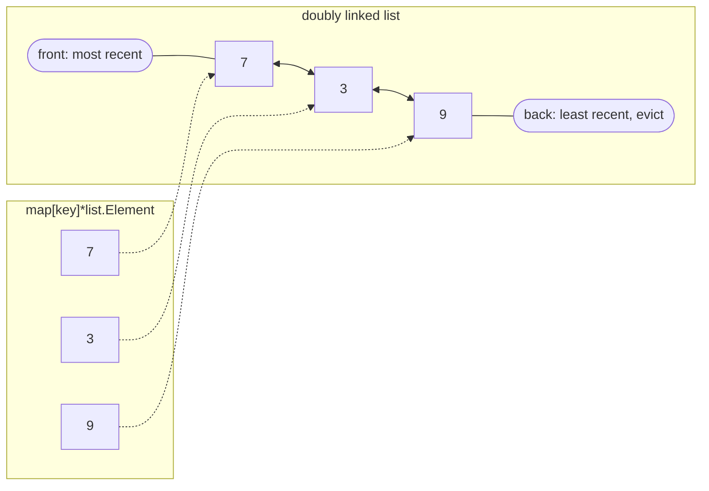
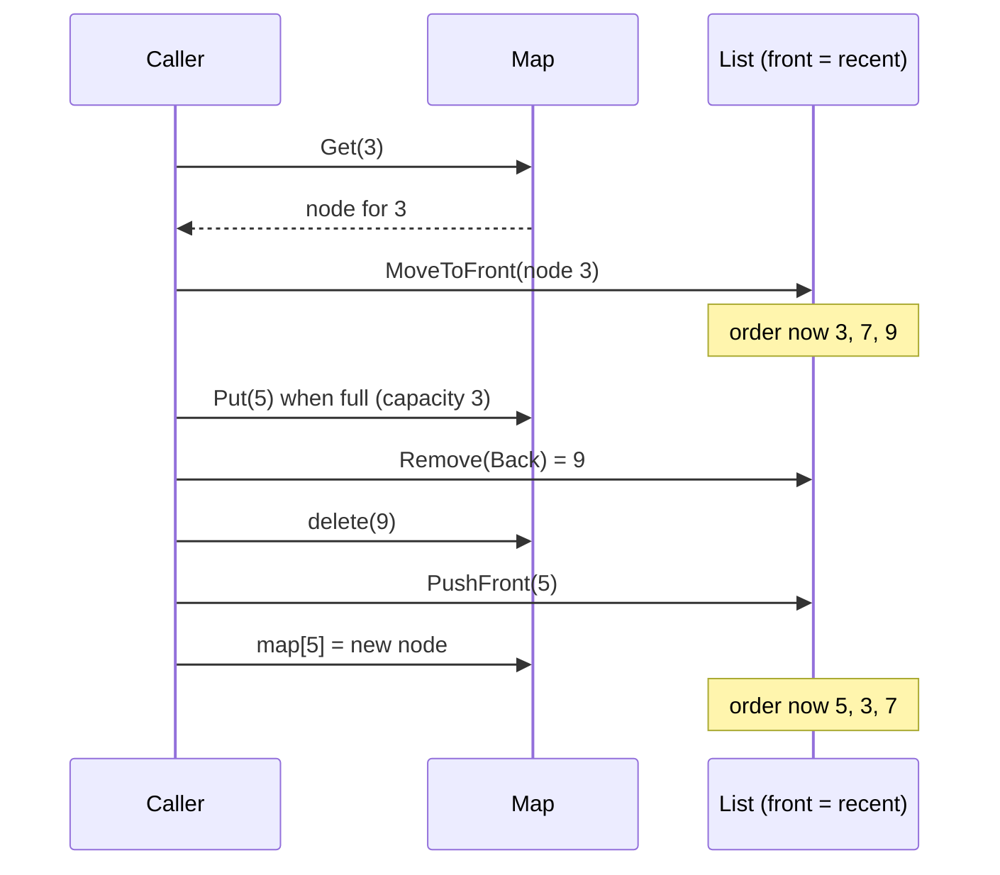

# Cache Eviction Policies - LRU, LFU, TTL

> [!summary] TL;DR
> When a cache is full and a new item arrives, an **eviction policy** chooses which item to throw out. **LRU** drops the item unused for the longest time, **LFU** drops the item used least often, and **TTL** expiry removes items whose time is up whether or not memory is full.

> [!abstract] Core idea
> - Eviction happens because **memory is full**; invalidation happens because **data changed**. They are different jobs.
> - LRU = hash map + doubly linked list, `O(1)` get and put. It is good for recency, and one big scan can flush it.
> - LFU keeps frequently used items through scans, but needs ageing so yesterday's hot items do not stay forever.
> - Redis does not run exact LRU or LFU. It samples a few keys and evicts the best candidate, and its default policy is `noeviction`, which makes writes fail when memory is full.
> - Modern libraries (Caffeine, Ristretto) use TinyLFU admission to get better hit ratios than LRU.

## 1. Why it exists

A Redis node with 4 GB for cache data, holding product objects of about 590 bytes each (see the measurement in [[Caching Fundamentals]]), fits roughly 7 million of them. The catalogue has 40 million products. Something has to decide which 7 million stay.

- Keep the wrong ones, and the hit ratio drops from, say, 95% to 70%. The database then sees six times as many reads.
- Keep nothing new (Redis's default when memory is full), and every `SET` fails with an `OOM` error. Measured on Redis 8.2 with `maxmemory 2mb` and the default `noeviction`: the first seven 100 KB `SET`s succeeded and every following one returned `OOM command not allowed when used memory > 'maxmemory'`.

## 2. Mental model

Your phone's home screen has room for 20 apps.

- **FIFO:** remove the app you installed first, even if you open it every hour.
- **LRU:** remove the app you have not opened for the longest time. Good, until one day you scroll through 30 apps once and push out your daily ones.
- **LFU:** remove the app you open least often. Survives that scroll, but an app you used heavily last year keeps its place unless old counts fade.
- **TTL:** every app uninstalls itself after 30 days, full screen or not.

## 3. How it works

### LRU: a hash map plus a doubly linked list



- The **map** finds a key's list node in `O(1)`.
- The **list** keeps recency order. Moving a node to the front, and removing the back node, are `O(1)` because each node knows its neighbours.



A full LRU with per-entry TTLs and concurrency is solved step by step in the practice problem [[LRU Cache with TTL]]; this note compares it with the other policies.

### LFU in O(1)

Keep one list per access count (a **frequency bucket**) and remember the smallest non-empty count, `minFreq`.

- **Get:** move the entry from bucket `f` to bucket `f+1`. If bucket `f` became empty and `f == minFreq`, increment `minFreq`.
- **Put of a new key when full:** evict from the back of bucket `minFreq` (least frequent, and among those the least recent), then insert the new key into bucket 1 and set `minFreq = 1`.

Every step touches a fixed number of nodes, so both operations are `O(1)`. The textbook alternative, a min-heap keyed by count, costs `O(log n)`.

**Plain LFU never forgets.** An item with 1 million hits last week outlives everything new. Real LFU caches age counts: halve all counters periodically (TinyLFU's reset), or decay them with time (Redis).

### Other policies

| Policy | Evicts | Strength | Weakness |
| --- | --- | --- | --- |
| FIFO | Oldest insert | Trivial, reads need no bookkeeping | Ignores popularity |
| Random | A random key | No metadata, no lock contention | Unpredictable; fine when access is uniform |
| LRU | Least recently used | Recency-heavy workloads, simple | One sequential scan flushes it |
| LFU | Least frequently used | Stable popularity, scan-resistant | Needs ageing; new items are fragile |
| 2Q | Items seen once wait in a FIFO probation queue; a second hit promotes them to the main LRU | Scan-resistant with LRU simplicity | Queue sizes to tune |
| ARC | Balances a recency list and a frequency list, adapting their sizes from "ghost" lists of recently evicted keys | Self-tuning between recency and frequency | More metadata; was covered by an IBM patent |
| W-TinyLFU | A small LRU window, then an **admission filter**: a new item enters the main cache only if its approximate frequency (from a compact count-min sketch) beats the eviction victim's | Near-optimal hit ratios in published traces; used by Caffeine (Java) and, in a variant, Ristretto (Go) | More complex; approximate counts |
| TTL | Items whose time is up | Bounds staleness, frees memory from dead keys | Not a capacity policy on its own |

### TTL expiry vs eviction

TTL expiry and eviction are separate mechanisms that both free memory:

- **Expiry** removes a key because its TTL passed, even if memory is nearly empty. Redis does it lazily on access and actively in a background cycle (details and a measurement in [[Cache Invalidation, TTL and Consistency]]).
- **Eviction** removes a key because `used_memory` is above `maxmemory`, even if the key's TTL is far away.

A cache with long TTLs and too little memory evicts constantly; a cache with short TTLs and lots of memory may never evict.

### How Redis evicts

Redis checks memory before running a command that may add data. If `used_memory` is above `maxmemory`, it frees memory according to `maxmemory-policy` until it is under the limit, or rejects the command.

| `maxmemory-policy` | Candidates | Picks |
| --- | --- | --- |
| `noeviction` (default) | none | Rejects writes with `OOM`; reads and deletes still work |
| `allkeys-lru` | all keys | Approximately least recently used |
| `allkeys-lfu` | all keys | Approximately least frequently used |
| `allkeys-random` | all keys | Random |
| `volatile-lru` | keys with a TTL | Approximately least recently used |
| `volatile-lfu` | keys with a TTL | Approximately least frequently used |
| `volatile-random` | keys with a TTL | Random |
| `volatile-ttl` | keys with a TTL | Shortest remaining TTL |

Defaults measured on Redis 8.2 with `CONFIG GET`: `maxmemory 0` (no limit on 64-bit builds), `maxmemory-policy noeviction`, `maxmemory-samples 5`, `lfu-log-factor 10`, `lfu-decay-time 1`.

- **Approximate LRU.** Redis keeps a 24-bit "last access" clock in each key, not a linked list. To evict, it samples `maxmemory-samples` keys (5 by default), adds the best candidates to a small pool (16 entries), and evicts the oldest in the pool. Raising the sample count to 10 gets closer to true LRU at more CPU per eviction.
- **Approximate LFU.** The same 24 bits hold a 16-bit last-decrement time and an 8-bit **logarithmic counter** (maximum 255). A hit increments the counter only with probability `1 / ((counter − 5) × lfu-log-factor + 1)`, so it grows roughly with the logarithm of the hit count. New keys start at 5 so they are not evicted immediately. The counter is decremented by one for each `lfu-decay-time` minutes the key goes unaccessed; the decay is applied lazily, when the key is next accessed or sampled for eviction, not by a background sweep.
- **The `volatile-*` trap.** With a `volatile-*` policy, keys without a TTL are never evicted. If none of the keys have a TTL, Redis behaves like `noeviction`. Measured on Redis 8.2: with `volatile-lru` and no TTL keys, a `SET` over the limit returned `OOM`.

## 4. Worked example

### Whiteboard version

```go
type LRU struct {
	cap   int
	order *list.List            // front = most recently used
	items map[int]*list.Element // key -> node
}

func (c *LRU) Get(k int) (int, bool) {
	e, ok := c.items[k]
	if !ok {
		return 0, false
	}
	c.order.MoveToFront(e)
	return e.Value.(*kv).v, true
}

func (c *LRU) Put(k, v int) {
	if e, ok := c.items[k]; ok {
		e.Value.(*kv).v = v
		c.order.MoveToFront(e)
		return
	}
	if c.order.Len() == c.cap {
		tail := c.order.Remove(c.order.Back()).(*kv)
		delete(c.items, tail.k)
	}
	c.items[k] = c.order.PushFront(&kv{k, v})
}
```

### Full code: FIFO, LRU and O(1) LFU behind one interface (Go 1.24)

```go
// Package eviction implements FIFO, LRU and O(1) LFU caches with a common
// interface so their hit ratios can be compared on the same trace.
// None of these types is safe for concurrent use; wrap them in a mutex.
package eviction

import "container/list"

type Cache interface {
	Get(k int) (int, bool)
	Put(k, v int)
}

// ---------- FIFO: evict the oldest insert, reads change nothing ----------

type FIFO struct {
	cap   int
	order *list.List // front = oldest
	items map[int]*list.Element
}

type kv struct{ k, v int }

func NewFIFO(capacity int) *FIFO {
	return &FIFO{cap: capacity, order: list.New(), items: map[int]*list.Element{}}
}

func (c *FIFO) Get(k int) (int, bool) {
	if e, ok := c.items[k]; ok {
		return e.Value.(*kv).v, true
	}
	return 0, false
}

func (c *FIFO) Put(k, v int) {
	if e, ok := c.items[k]; ok {
		e.Value.(*kv).v = v
		return
	}
	if c.order.Len() == c.cap {
		old := c.order.Remove(c.order.Front()).(*kv)
		delete(c.items, old.k)
	}
	c.items[k] = c.order.PushBack(&kv{k, v})
}

// ---------- LRU: hash map + doubly linked list, most recent at front ----------

type LRU struct {
	cap   int
	order *list.List // front = most recently used
	items map[int]*list.Element
}

func NewLRU(capacity int) *LRU {
	return &LRU{cap: capacity, order: list.New(), items: map[int]*list.Element{}}
}

func (c *LRU) Get(k int) (int, bool) {
	e, ok := c.items[k]
	if !ok {
		return 0, false
	}
	c.order.MoveToFront(e)
	return e.Value.(*kv).v, true
}

func (c *LRU) Put(k, v int) {
	if e, ok := c.items[k]; ok {
		e.Value.(*kv).v = v
		c.order.MoveToFront(e)
		return
	}
	if c.order.Len() == c.cap {
		tail := c.order.Remove(c.order.Back()).(*kv)
		delete(c.items, tail.k)
	}
	c.items[k] = c.order.PushFront(&kv{k, v})
}

// ---------- LFU: O(1) with one list per frequency and a minFreq pointer ----------

type lfuEntry struct{ k, v, freq int }

type LFU struct {
	cap     int
	items   map[int]*list.Element
	buckets map[int]*list.List // freq -> entries, front = most recent at that freq
	minFreq int
}

func NewLFU(capacity int) *LFU {
	return &LFU{cap: capacity, items: map[int]*list.Element{}, buckets: map[int]*list.List{}}
}

func (c *LFU) bucket(f int) *list.List {
	b, ok := c.buckets[f]
	if !ok {
		b = list.New()
		c.buckets[f] = b
	}
	return b
}

// touch moves an entry from bucket f to bucket f+1.
func (c *LFU) touch(e *list.Element) *list.Element {
	en := e.Value.(*lfuEntry)
	old := c.buckets[en.freq]
	old.Remove(e)
	if old.Len() == 0 {
		delete(c.buckets, en.freq)
		if c.minFreq == en.freq {
			c.minFreq++
		}
	}
	en.freq++
	return c.bucket(en.freq).PushFront(en)
}

func (c *LFU) Get(k int) (int, bool) {
	e, ok := c.items[k]
	if !ok {
		return 0, false
	}
	c.items[k] = c.touch(e)
	return c.items[k].Value.(*lfuEntry).v, true
}

func (c *LFU) Put(k, v int) {
	if c.cap == 0 {
		return
	}
	if e, ok := c.items[k]; ok {
		e.Value.(*lfuEntry).v = v
		c.items[k] = c.touch(e)
		return
	}
	if len(c.items) == c.cap {
		b := c.buckets[c.minFreq]
		victim := b.Remove(b.Back()).(*lfuEntry) // least recent among least frequent
		if b.Len() == 0 {
			delete(c.buckets, c.minFreq)
		}
		delete(c.items, victim.k)
	}
	c.minFreq = 1
	c.items[k] = c.bucket(1).PushFront(&lfuEntry{k: k, v: v, freq: 1})
}

// HitRatio replays a trace through c as a read-through cache.
func HitRatio(c Cache, trace []int) float64 {
	hits := 0
	for _, k := range trace {
		if _, ok := c.Get(k); ok {
			hits++
		} else {
			c.Put(k, k)
		}
	}
	return float64(hits) / float64(len(trace))
}
```

### Tests and a measured comparison (pass `go vet` and `go test -race`)

```go
package eviction

import (
	"math/rand/v2"
	"testing"
)

func TestLRUEvictsLeastRecentlyUsed(t *testing.T) {
	c := NewLRU(2)
	c.Put(1, 1)
	c.Put(2, 2)
	c.Get(1)    // 1 is now most recent
	c.Put(3, 3) // evicts 2
	if _, ok := c.Get(2); ok {
		t.Fatal("2 should be evicted")
	}
	for _, k := range []int{1, 3} {
		if _, ok := c.Get(k); !ok {
			t.Fatalf("%d should be present", k)
		}
	}
}

func TestFIFOIgnoresReads(t *testing.T) {
	c := NewFIFO(2)
	c.Put(1, 1)
	c.Put(2, 2)
	c.Get(1)    // does not matter to FIFO
	c.Put(3, 3) // evicts 1, the oldest insert
	if _, ok := c.Get(1); ok {
		t.Fatal("1 should be evicted")
	}
}

func TestLFUEvictsLeastFrequentThenLeastRecent(t *testing.T) {
	c := NewLFU(2)
	c.Put(1, 1)
	c.Put(2, 2)
	c.Get(1)
	c.Get(1)    // freq(1)=3, freq(2)=1
	c.Put(3, 3) // evicts 2
	if _, ok := c.Get(2); ok {
		t.Fatal("2 should be evicted")
	}
	c.Get(3)    // freq(3)=2
	c.Put(4, 4) // evicts 3 (freq 2 < 3)
	if _, ok := c.Get(3); ok {
		t.Fatal("3 should be evicted")
	}
	if v, ok := c.Get(1); !ok || v != 1 {
		t.Fatal("1 should survive")
	}
}

func TestLFUTieBreakIsLRU(t *testing.T) {
	c := NewLFU(2)
	c.Put(1, 1)
	c.Put(2, 2)
	c.Put(3, 3) // both freq 1; 1 is older, so it goes
	if _, ok := c.Get(1); ok {
		t.Fatal("1 should be evicted on a frequency tie")
	}
}

// zipfTrace draws n keys from a Zipf distribution over [0, keys).
func zipfTrace(n, keys int, seed uint64) []int {
	r := rand.New(rand.NewPCG(seed, seed))
	z := rand.NewZipf(r, 1.1, 1, uint64(keys-1))
	out := make([]int, n)
	for i := range out {
		out[i] = int(z.Uint64())
	}
	return out
}

func TestHitRatioComparison(t *testing.T) {
	const capacity = 1000
	zipf := zipfTrace(200_000, 100_000, 42)

	// Same Zipf trace, but a one-off scan of 5,000 cold keys every 20,000 reads.
	var scanned []int
	next := 1_000_000
	for i, k := range zipf {
		scanned = append(scanned, k)
		if i%20_000 == 0 {
			for j := range 5000 {
				scanned = append(scanned, next+j)
			}
			next += 5000
		}
	}

	for _, tc := range []struct {
		name  string
		trace []int
	}{{"zipf", zipf}, {"zipf+scan", scanned}} {
		fifo := HitRatio(NewFIFO(capacity), tc.trace)
		lru := HitRatio(NewLRU(capacity), tc.trace)
		lfu := HitRatio(NewLFU(capacity), tc.trace)
		t.Logf("%-9s FIFO %.3f  LRU %.3f  LFU %.3f", tc.name, fifo, lru, lfu)
		if lru < fifo {
			t.Errorf("%s: LRU (%.3f) should beat FIFO (%.3f) on skewed reads", tc.name, lru, fifo)
		}
		if tc.name == "zipf+scan" && lfu <= lru {
			t.Errorf("LFU (%.3f) should resist the scan better than LRU (%.3f)", lfu, lru)
		}
	}
}
```

Measured output of `go test -race -v` (Go 1.24.4, Apple M-series), with a 1,000-entry cache over 100,000 keys:

| Trace | FIFO | LRU | LFU |
| --- | --- | --- | --- |
| 200,000 Zipf reads (s = 1.1) | 0.626 | 0.665 | 0.724 |
| Same, plus a 5,000-key cold scan every 20,000 reads | 0.497 | 0.526 | 0.579 |

How to read it:

- On a skewed workload, recency (LRU) beats insertion order (FIFO), and frequency (LFU) beats both, because Zipf popularity is stable over time.
- The scans are 50,000 guaranteed misses, so every policy drops. Under LRU each scan also flushes the hot set, so after it the hot keys must be reloaded; under this LFU, scan keys enter at frequency 1 and evict only each other, so the hot keys survive.
- With popularity that **shifts** over time (today's news), un-aged LFU would lose to LRU. That is why production LFUs decay counts.

### Approximate LRU in Redis, measured

Measured on Redis 8.2 with `maxmemory 2mb` and `allkeys-lru`: 40 keys of 100 KB written in order `big:1` … `big:40`, none read. `INFO stats` showed `evicted_keys:31`, and the 9 survivors were:

```text
big:29 big:32 big:33 big:35 big:36 big:37 big:38 big:39 big:40
```

Exact LRU would have kept exactly `big:32` … `big:40`. Redis kept `big:29` and evicted the newer `big:30`, `big:31` and `big:34`, because it evicts the best of a **sample**, not the global oldest. For a cache this is close enough, at a fraction of the memory a linked list would cost.

The LFU counter, measured with `OBJECT FREQ` under `allkeys-lfu` (default `lfu-log-factor 10`):

| Accesses to the key | `OBJECT FREQ` |
| --- | --- |
| 0 (just created) | 5 |
| about 1,000 | 18 |
| about 101,000 | 141 |

The counter is logarithmic and probabilistic, so it distinguishes "hot" from "very hot" within one byte. `OBJECT IDLETIME` returns an error under an LFU policy, because the same bits store the counter instead of the access time.

## 5. Variants and comparison

| Choice | Use when | Avoid when | Cost |
| --- | --- | --- | --- |
| `allkeys-lru` | General-purpose cache; recent items are likely to be read again | Large periodic scans share the cache | 24 bits per key; sampling CPU |
| `allkeys-lfu` | Stable hot set (product pages, configs) with occasional scans | Popularity shifts quickly | Same memory; tune `lfu-decay-time` |
| `volatile-lru` / `volatile-lfu` | One Redis holds both cache keys (with TTL) and keys that must not be evicted (without TTL) | You forget TTLs on cache keys → `OOM` | Mixing roles; prefer separate instances |
| `volatile-ttl` | Keys' TTLs reflect their value (short TTL = least valuable) | TTLs are set uniformly | — |
| `allkeys-random` | Access is uniform, so any key is as good as another | Skewed access | Cheapest |
| `noeviction` | Redis is a primary store, queue or lock service, and losing keys is worse than failing writes | Redis is a cache | Writes fail at the limit |
| In-process LRU (`container/list`) | Small Go cache, simple workload | Very high concurrency on one lock | One mutex; GC scanning of pointers |
| Ristretto / TinyLFU | High-throughput Go cache needing the best hit ratio | You need exact, predictable eviction | Approximate; admission may reject a new item |

## 6. Trade-offs and when not to use

- **No eviction policy fixes a cache that is too small.** If the working set is ten times the cache, every policy hits poorly. Grow the cache, shrink values, or cache less.
- **Exact LRU costs memory and locks.** Two pointers per entry plus a global list that every read must update (a write on every read). That is why Redis approximates it and why high-throughput libraries buffer reads.
- **LFU punishes new items.** A new product launched today starts with a low count and may be evicted before it gets popular; Redis mitigates this with the initial counter of 5, TinyLFU with its LRU window.
- **Mixed roles in one Redis break eviction.** Sessions, locks, queues and cache in one instance with `allkeys-lru` will eventually evict a lock or a queue. Separate instances, or `volatile-*` with TTLs only on cache keys.
- **Memoization is not a cache policy.** Memoization caches a pure function's results for given inputs (often for one computation, unbounded); a cache serves shared, mutable data with a size limit, TTLs and invalidation. A memo table that lives forever needs an eviction policy too.

## 7. In production

- **Real systems:** Redis (sampled LRU/LFU), Memcached (a segmented LRU per slab class: hot, warm and cold queues), Caffeine (W-TinyLFU, the Java default), Ristretto (TinyLFU admission with sampled LFU eviction, built by Dgraph for Go), and PostgreSQL's buffer pool (a clock-sweep approximation of LRU with usage counts).
- **Failure modes → fixes:**
	- Writes fail with `OOM` → the policy is `noeviction`, or `volatile-*` with no TTL keys. Set `allkeys-lru`/`allkeys-lfu` on cache instances.
	- Evictions spike and hit ratio drops → working set grew past `maxmemory`; add memory or shard. Check for big keys taking space ([[Cache Failure Modes - Stampede, Avalanche, Penetration, Hot and Big Keys]]).
	- Locks or queue entries disappear → they share an instance with an `allkeys-*` policy; separate them.
	- `maxmemory` set equal to the machine's RAM → replication buffers, fragmentation and fork copy-on-write push the process over and the OS kills it. Leave headroom ([[Redis in Production - Memory, Latency, Security]]).
- **What to monitor:** `evicted_keys` rate, `expired_keys` rate, `used_memory` vs `maxmemory`, hit ratio (`keyspace_hits / (keyspace_hits + keyspace_misses)`), and, under LFU, a sample of `OBJECT FREQ` values on hot keys.

## 8. Deep dive

- **Concurrency in Go.** A single mutex around an LRU serialises every read, because `Get` mutates the list. Options: **shard** the cache into N independent LRUs by key hash (each with its own lock, 16–256 shards); **buffer** recency updates and apply them in batches (Ristretto and Caffeine do this, accepting slightly stale recency); or accept approximate LRU with per-entry timestamps updated atomically and evict by sampling, as Redis does.
- **Where `sync.Map` fits.** The Go docs recommend it for keys written once and read many times, or for goroutines working on disjoint key sets. It has no size limit and no eviction, so it is a fit for an append-mostly lookup table, not for a bounded cache.
- **GC cost of big Go caches.** A map of pointers to millions of list nodes makes the garbage collector scan all of them. Caches with millions of entries in Go often store values in large byte slices and keep maps of integer offsets (the approach of `bigcache` and `freecache`) to keep pointers out of the heap.
- **Belady's optimum.** The best possible policy evicts the item whose next use is furthest in the future. It needs the future, so it cannot be built, but replaying a trace with it gives the ceiling for your workload; if LRU is close to it, a fancier policy will not help.
- **Admission vs eviction.** Eviction chooses a victim; admission decides whether the new item deserves a place at all. TinyLFU rejects a one-hit-wonder rather than evicting a proven item for it, which is why it resists scans without frequency buckets per entry.
- **Redis eviction under load.** Eviction runs inside command processing. If writes arrive faster than eviction frees memory, `maxmemory-eviction-tenacity` (default 10) controls how long each command spends evicting before Redis defers the rest to a background loop; memory can overshoot `maxmemory` briefly.

## 9. Interview questions

> [!question]- Implement an LRU cache with O(1) get and put. Which data structures?
> A hash map from key to a node in a doubly linked list ordered by recency. `Get` finds the node and moves it to the front; `Put` inserts at the front and, when full, removes the back node and its map entry. In Go, `container/list` plus `map[K]*list.Element`.

> [!question]- Trap: Redis is configured with `allkeys-lru`. Does it evict the least recently used key?
> Not exactly. It samples `maxmemory-samples` keys (5 by default), keeps the best candidates in a 16-entry pool and evicts the oldest of those. It is an approximation that saves the memory of a linked list; raising the sample count makes it closer to true LRU.

> [!question]- What happens when Redis reaches `maxmemory` with the default policy?
> The default is `noeviction`: commands that would add data fail with an `OOM` error, while reads and deletes still work. For a cache instance, set `allkeys-lru` or `allkeys-lfu`.

> [!question]- When does LFU beat LRU, and when does it lose?
> LFU wins when popularity is stable and the workload has scans or one-off reads, because frequent items survive them. It loses when popularity shifts (news, trends) unless counts decay, because yesterday's hot items keep their place. Redis decays its LFU counter every `lfu-decay-time` minutes.

> [!question]- Your Redis holds both cache entries and distributed locks. Which eviction policy?
> Better: separate instances. If you must share, use `volatile-lru` or `volatile-lfu` and put TTLs only on cache keys, so lock keys without TTLs are never evicted; but locks usually have TTLs too, so separation is the real fix.

> [!question]- What is the difference between TTL expiry and eviction?
> Expiry removes a key because its time ran out, regardless of memory. Eviction removes a key because memory is full, regardless of its TTL. Expiry bounds staleness; eviction bounds memory.

> [!question]- How would you make an in-process LRU fast under 64 concurrent goroutines?
> Shard it by key hash into independent LRUs with their own locks, or use a library that buffers access records and applies them in batches (Ristretto). A single mutex serialises every `Get`, because each read moves a list node.

## 10. Cheat sheet

- Eviction = memory is full; invalidation = data changed; expiry = TTL passed.
- LRU = map + doubly linked list, `O(1)`; flushed by scans.
- LFU = frequency buckets + `minFreq`, `O(1)`; needs ageing.
- Measured (1,000-entry cache, Zipf): FIFO 0.626, LRU 0.665, LFU 0.724.
- Redis default is `noeviction`; cache instances want `allkeys-lru` or `allkeys-lfu`.
- Redis LRU/LFU are sampled (`maxmemory-samples 5`); LFU uses an 8-bit log counter starting at 5.
- `volatile-*` with no TTL keys behaves like `noeviction`.
- W-TinyLFU (Caffeine, Ristretto) adds admission and resists scans.

## Links

- **Before this:** [[Caching Fundamentals]], [[Hash Tables and Go Maps]]
- **Next:** [[LRU Cache with TTL]] (practice), [[Redis in Production - Memory, Latency, Security]], [[Cache Failure Modes - Stampede, Avalanche, Penetration, Hot and Big Keys]]
- **Compare with:** [[Cache Invalidation, TTL and Consistency]], [[Memory Hierarchy and CPU Caches]] (hardware eviction), [[Page Cache, File Systems and fsync]]
