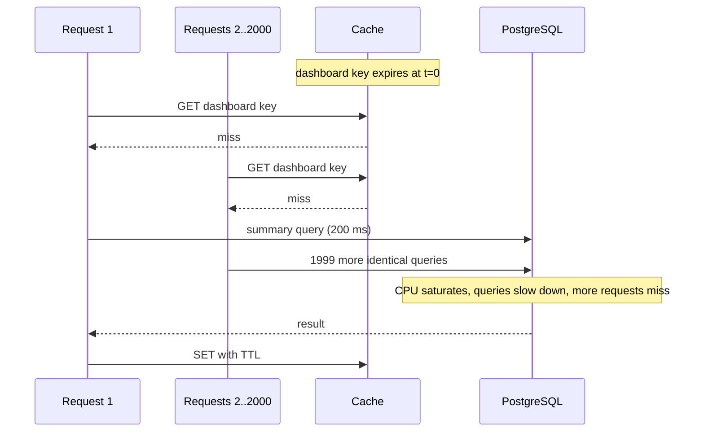
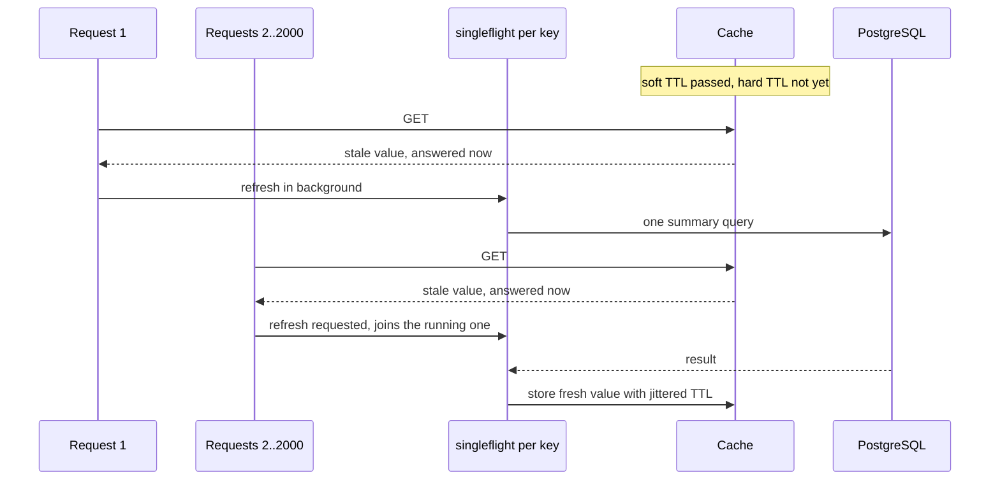
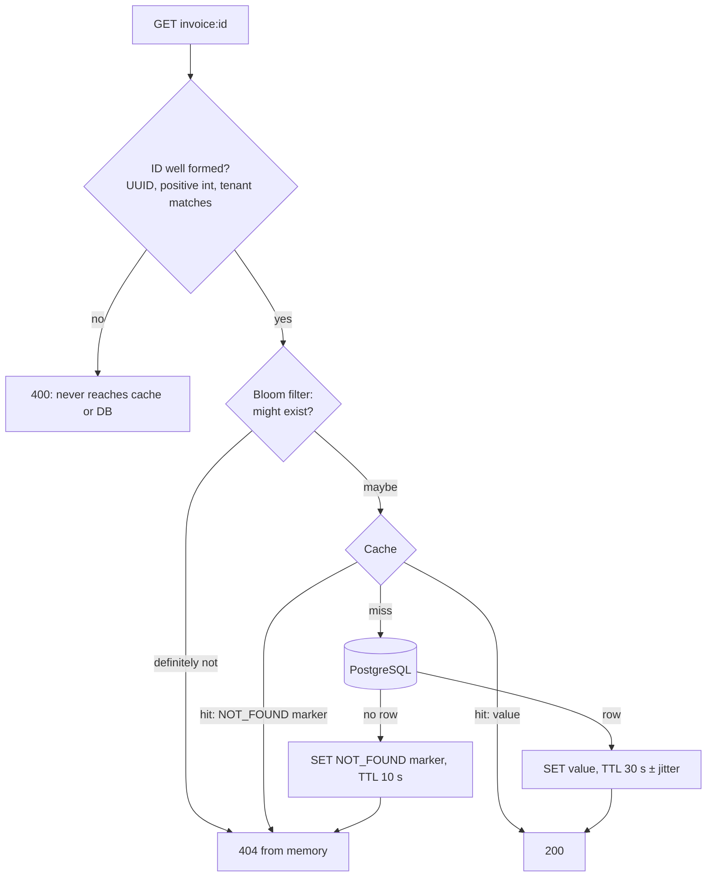
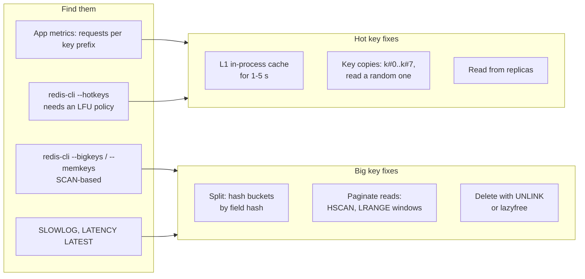

# Cache Failure Modes - Stampede, Avalanche, Penetration, Hot and Big Keys

> [!summary] TL;DR
> A cache protects the database only while it keeps answering. Five patterns break that: one popular key expires and everyone rebuilds it (**stampede**), many keys expire or the cache dies at once (**avalanche**), requests ask for keys that never exist (**penetration**), one key gets more traffic than one node can serve (**hot key**), and one key is so large that touching it stalls Redis (**big key**). Each has a specific fix.

> [!abstract] Core idea
> - A cache miss is not free: it sends traffic to the database, which is sized for the hit ratio, not for zero hits.
> - Stampede: coalesce rebuilds (one loader per key) and serve stale data while one caller refreshes.
> - Avalanche: spread expiry with TTL jitter, keep the cache tier highly available, and shield the database with rate limits.
> - Penetration: cache "not found" briefly and reject impossible IDs before they reach the database.
> - Hot and big keys: find them by measuring, then split, replicate or cache them locally; delete big keys with `UNLINK`.

## 1. Why it exists

InvoiceOps (a Go + PostgreSQL invoicing service, the running example of this folder) caches each workspace's dashboard under `dashboard:{workspace_id}:summary:v2` with a 30-second TTL. The summary query takes about 200 ms. The database is sized for a 99% hit ratio.

At 10,000 requests per second on one big workspace's dashboard, the key expires. Every request that arrives during the 200 ms rebuild also misses: `10,000 × 0.2 s = 2,000` identical queries hit PostgreSQL at once. Each takes longer under the load, so the window grows and more requests pile in. This is a **cache stampede**.

The same arithmetic applies on a larger scale when a whole cache node restarts empty (every key misses) or when a bot asks for `invoice:<random-uuid>` (every request misses, forever). The database was never sized for that traffic.

## 2. Mental model

Think of the cache as a dam and the database as the town below it. Normal misses are a controlled spillway. The failure modes are different ways the dam leaks:

| Mode | What goes wrong | Shape of the extra load |
| --- | --- | --- |
| **Stampede** (also called thundering herd or dogpile; some sources call single-hot-key expiry "cache breakdown") | One popular key expires; many callers rebuild it at once | A spike of identical queries for one key |
| **Avalanche** | Many keys expire together, or the cache tier is down or cold | A flood of different queries |
| **Penetration** | Requests for keys that do not exist in the database, so they are never cached | A steady stream of misses that never turn into hits |
| **Hot key** | One key gets more requests than the node that owns it can serve | One cache node at 100% CPU while the rest idle |
| **Big key** | One value is megabytes or has millions of elements | Slow commands, network spikes, a blocked event loop |

Terms used below:
- **TTL** (time to live): how long a cache entry lives before it expires.
- **Soft TTL**: after this time the entry is stale but still usable. **Hard TTL**: after this time it must not be served.
- **Singleflight** (request coalescing): when several callers ask for the same key at the same time, only one runs the loader and the others wait for its result.
- **Negative caching**: caching the answer "this key does not exist" for a short time.

## 3. How it works

### Stampede and its fixes



With coalescing and a soft TTL, the same moment looks like this:



The tools, from local to global:
1. **In-process singleflight.** One rebuild per key per process. With 20 pods the database sees at most 20 queries instead of 2,000.
2. **Distributed rebuild lock.** `SET lock:dashboard:{ws} <token> NX PX 5000` lets one pod in the fleet rebuild. The others serve the stale copy or wait briefly and re-read. Release with a compare-and-delete Lua script so you never delete another holder's lock (see [[Distributed Locks and Fencing Tokens]]). The lock is an optimisation, not a correctness guarantee: if it expires mid-rebuild, two pods rebuild, which is acceptable here.
3. **Soft TTL / stale-while-revalidate.** Store the value with a soft expiry inside the payload and a longer Redis TTL (the hard expiry). After the soft expiry, one caller refreshes and everyone else keeps getting the old value. HTTP has the same idea in RFC 5861.
4. **Refresh-ahead.** A background job re-computes known hot keys before they expire, so they never expire under load.
5. **Probabilistic early expiration (XFetch).** Each reader refreshes early with a probability that rises as expiry approaches: refresh when `now − delta × beta × ln(rand()) ≥ expiry`, where `delta` is the rebuild time and `beta` is usually 1. No lock and no coordination, and in expectation only a few readers refresh.
6. **Leases** (Facebook memcache). On a miss the cache hands out a lease token to one client; only that client may fill the key, and others are told to wait or use a stale value. Leases also fix the stale-set race described in [[Cache Invalidation, TTL and Consistency]].

### Avalanche

Two causes need two kinds of fix:
- **Synchronised expiry.** A deploy or a nightly batch warms 500,000 keys with the same 1-hour TTL, so they all expire within the same second an hour later. Fix: add jitter (`TTL × (1 ± 10%)`), stagger warm-up, and use soft TTLs so expiry does not equal a miss.
- **The cache tier is down or cold.** A Redis primary fails over, a cluster is flushed, or a new region starts empty. Jitter does nothing here. Fix: make the cache highly available ([[Redis Replication, Sentinel and Cluster]]), keep a small in-process L1 cache for the hottest keys, warm the cache before taking traffic, and protect the database with a concurrency limit, a [[Circuit Breaker]] and [[Load Shedding and Graceful Degradation]] so that during recovery some requests fail fast instead of all requests timing out.

### Penetration



- **Validate first.** Reject IDs that cannot exist (wrong format, wrong tenant) at the edge.
- **Negative caching.** Store an explicit "not found" marker with a short TTL (seconds, not minutes), so a record created a moment later appears quickly. Caching `nil` by accident with the normal TTL is a bug: a newly created invoice stays invisible for the whole TTL.
- **Bloom filter.** A bit array that answers "definitely not present" or "maybe present". It has false positives but no false negatives, so a "no" can skip the database safely. Standard Bloom filters cannot delete items: rebuild them periodically, or use a cuckoo filter that supports deletes. Redis exposes them as `BF.RESERVE` / `BF.ADD` / `BF.EXISTS` through the RedisBloom module, which ships inside the Redis 8 distribution. The Homebrew build used for the measurements below did not include it (`ERR unknown command 'BF.MADD'`, measured on Redis 8.2), so check `MODULE LIST` on yours. Internals live in [[Bloom Filters and Probabilistic Data Structures]].
- **Rate-limit the source.** Random-ID scanning is often an attack; per-client limits ([[Rate Limiting - Algorithms and Distributed Design]]) cut it off.

### Hot keys and big keys



- A **hot key** lives in one hash slot on one node, so adding nodes does not help ([[Consistent Hashing]] balances keys, not traffic). The cache-side fixes are a short in-process L1 cache (even 1 second absorbs most reads), several copies of the value under keys with different hash tags (`dashboard:{ws#3}:summary:v2` for copy 3, written together, read at random) so they land on different slots (a suffix outside the braces, as in `dashboard:{ws}:summary:v2#3`, keeps every copy in the same slot), and replica reads. The system-wide view, including hot database partitions, is in [[Hot Keys and Hot Partitions]].
- A **big key** is a single value with millions of elements or many megabytes. Redis executes commands on one thread, so `DEL`, `HGETALL`, `SMEMBERS` or a migration of that key blocks every other client. Split it, read it in pages, and free it in the background with `UNLINK`.

## 4. Worked example

### Whiteboard version

The core of a stampede-safe read in Go, before stale data, errors and negative caching:

```go
var group singleflight.Group

func GetSummary(ctx context.Context, rdb *redis.Client, ws string,
	loadFromDB func(context.Context, string) ([]byte, error)) ([]byte, error) {
	key := "dashboard:{" + ws + "}:summary:v2"
	if v, err := rdb.Get(ctx, key).Bytes(); err == nil {
		return v, nil // hit
	}
	v, err, _ := group.Do(key, func() (any, error) { // one loader per key per process
		b, err := loadFromDB(ctx, ws)
		if err != nil {
			return nil, err
		}
		ttl := time.Duration(float64(30*time.Second) * (0.9 + 0.2*rand.Float64())) // ±10% jitter
		rdb.Set(ctx, key, b, ttl)
		return b, nil
	})
	if err != nil {
		return nil, err
	}
	return v.([]byte), nil
}
```

The full version below keeps the same idea but adds a soft TTL with background refresh, stale-if-error, negative caching and XFetch, behind an in-process store so the behaviour is testable. In production the `items` map is Redis or an L1 cache in front of Redis.

```go
// Package failmodes is an in-process read-through cache that defends
// against stampedes (singleflight), serves stale data while one caller
// refreshes (soft TTL), survives loader errors (stale-if-error), caches
// "not found" briefly (penetration), and jitters TTLs (avalanche).
package failmodes

import (
	"context"
	"errors"
	"math"
	"math/rand/v2"
	"sync"
	"time"

	"golang.org/x/sync/singleflight"
)

// ErrNotFound is returned when the source of truth has no such key.
var ErrNotFound = errors.New("not found")

// Loader reads one key from the source of truth (the database).
// It returns ErrNotFound when the key does not exist.
type Loader func(ctx context.Context, key string) ([]byte, error)

type entry struct {
	value    []byte
	notFound bool      // negative-cache entry
	softExp  time.Time // after this: serve stale, refresh in background
	hardExp  time.Time // after this: the entry is unusable
}

type Config struct {
	SoftTTL  time.Duration // freshness window
	HardTTL  time.Duration // how long stale data may still be served (>= SoftTTL)
	NegTTL   time.Duration // lifetime of a "not found" entry
	Jitter   float64       // 0.1 means each TTL is randomised by ±10%
	Now      func() time.Time
	Rand     func() float64 // uniform in [0,1)
	LoadTime time.Duration  // timeout for background refreshes
}

type Cache struct {
	cfg   Config
	load  Loader
	group singleflight.Group

	mu    sync.Mutex
	items map[string]entry
}

func New(load Loader, cfg Config) *Cache {
	if cfg.Now == nil {
		cfg.Now = time.Now
	}
	if cfg.Rand == nil {
		cfg.Rand = rand.Float64
	}
	if cfg.LoadTime == 0 {
		cfg.LoadTime = 2 * time.Second
	}
	return &Cache{cfg: cfg, load: load, items: make(map[string]entry)}
}

// Jittered scales d by a random factor in [1-j, 1+j).
func Jittered(d time.Duration, j float64, rnd func() float64) time.Duration {
	return time.Duration(float64(d) * (1 + j*(2*rnd()-1)))
}

// Get returns the value for key, loading it at most once per key at a time.
func (c *Cache) Get(ctx context.Context, key string) ([]byte, error) {
	now := c.cfg.Now()
	c.mu.Lock()
	e, ok := c.items[key]
	c.mu.Unlock()

	switch {
	case ok && now.Before(e.softExp): // fresh hit
		return e.result()
	case ok && now.Before(e.hardExp): // stale hit: answer now, refresh once in background
		go func() {
			bg, cancel := context.WithTimeout(context.WithoutCancel(ctx), c.cfg.LoadTime)
			defer cancel()
			_, _, _ = c.group.Do(key, func() (any, error) {
				c.mu.Lock()
				cur := c.items[key]
				c.mu.Unlock()
				if c.cfg.Now().Before(cur.softExp) {
					return cur, nil // another caller already refreshed it
				}
				return c.fill(bg, key)
			})
		}()
		return e.result()
	}

	// Miss or hard-expired: every concurrent caller shares one load.
	v, err, _ := c.group.Do(key, func() (any, error) { return c.fill(ctx, key) })
	if err != nil {
		return nil, err
	}
	return v.(entry).result()
}

// fill calls the loader and stores the outcome. On a loader error it keeps
// any existing entry (stale-if-error) instead of failing the caller.
func (c *Cache) fill(ctx context.Context, key string) (any, error) {
	v, err := c.load(ctx, key)
	now := c.cfg.Now()
	var e entry
	switch {
	case errors.Is(err, ErrNotFound):
		e = entry{notFound: true, softExp: now.Add(c.cfg.NegTTL), hardExp: now.Add(c.cfg.NegTTL)}
	case err != nil:
		c.mu.Lock()
		old, ok := c.items[key]
		c.mu.Unlock()
		if ok && now.Before(old.hardExp) {
			return old, nil // serve stale rather than fail
		}
		return nil, err
	default:
		soft := Jittered(c.cfg.SoftTTL, c.cfg.Jitter, c.cfg.Rand)
		e = entry{value: v, softExp: now.Add(soft), hardExp: now.Add(soft + c.cfg.HardTTL - c.cfg.SoftTTL)}
	}
	c.mu.Lock()
	c.items[key] = e
	c.mu.Unlock()
	return e, nil
}

func (e entry) result() ([]byte, error) {
	if e.notFound {
		return nil, ErrNotFound
	}
	return e.value, nil
}

// XFetchShouldRefresh implements probabilistic early expiration
// (Vattani et al., VLDB 2015). delta is how long a rebuild takes, beta
// is usually 1. The closer now is to expiry, the likelier a refresh.
func XFetchShouldRefresh(now, expiry time.Time, delta time.Duration, beta, r float64) bool {
	if r <= 0 {
		r = math.SmallestNonzeroFloat64
	}
	early := time.Duration(-float64(delta) * beta * math.Log(r))
	return !now.Add(early).Before(expiry)
}
```

The tests prove each defence. The stampede test is also the measurement: 1,000 goroutines miss the same key while the loader takes 50 ms.

```go
package failmodes

import (
	"context"
	"errors"
	"sync"
	"sync/atomic"
	"testing"
	"time"
)

type clock struct {
	mu sync.Mutex
	t  time.Time
}

func (c *clock) Now() time.Time { c.mu.Lock(); defer c.mu.Unlock(); return c.t }
func (c *clock) Add(d time.Duration) { c.mu.Lock(); c.t = c.t.Add(d); c.mu.Unlock() }

func half() float64 { return 0.5 } // makes Jittered return d exactly

// naiveGet is plain cache-aside with no coalescing, for comparison.
func naiveGet(ctx context.Context, m *sync.Map, load Loader, key string) ([]byte, error) {
	if v, ok := m.Load(key); ok {
		return v.([]byte), nil
	}
	v, err := load(ctx, key)
	if err == nil {
		m.Store(key, v)
	}
	return v, err
}

func slowLoader(calls *atomic.Int64) Loader {
	return func(ctx context.Context, key string) ([]byte, error) {
		calls.Add(1)
		time.Sleep(50 * time.Millisecond) // a 50 ms rebuild query
		return []byte("summary"), nil
	}
}

func stampede(n int, get func() error) {
	var start, done sync.WaitGroup
	start.Add(1)
	for i := 0; i < n; i++ {
		done.Add(1)
		go func() {
			defer done.Done()
			start.Wait()
			_ = get()
		}()
	}
	start.Done()
	done.Wait()
}

func TestStampedeNaiveVsSingleflight(t *testing.T) {
	ctx := context.Background()
	const n = 1000

	var naive atomic.Int64
	var m sync.Map
	stampede(n, func() error { _, err := naiveGet(ctx, &m, slowLoader(&naive), "k"); return err })

	var coalesced atomic.Int64
	c := New(slowLoader(&coalesced), Config{SoftTTL: time.Minute, HardTTL: time.Minute})
	stampede(n, func() error { _, err := c.Get(ctx, "k"); return err })

	t.Logf("%d concurrent misses: naive loads=%d, singleflight loads=%d", n, naive.Load(), coalesced.Load())
	if coalesced.Load() != 1 {
		t.Fatalf("singleflight loads = %d, want 1", coalesced.Load())
	}
	if naive.Load() < 100 {
		t.Fatalf("naive loads = %d, expected a stampede", naive.Load())
	}
}

func TestServesStaleWhileOneCallerRefreshes(t *testing.T) {
	clk := &clock{t: time.Unix(0, 0)}
	var calls atomic.Int64
	load := func(ctx context.Context, key string) ([]byte, error) {
		if calls.Add(1) >= 2 {
			return []byte("v2"), nil
		}
		return []byte("v1"), nil
	}
	c := New(load, Config{SoftTTL: 30 * time.Second, HardTTL: 5 * time.Minute, Now: clk.Now, Rand: half})
	ctx := context.Background()

	if v, _ := c.Get(ctx, "k"); string(v) != "v1" {
		t.Fatalf("first get = %q", v)
	}
	clk.Add(31 * time.Second) // past soft TTL, inside hard TTL
	for i := 0; i < 50; i++ {
		if v, _ := c.Get(ctx, "k"); string(v) != "v1" && string(v) != "v2" {
			t.Fatalf("stale get = %q", v)
		}
	}
	deadline := time.Now().Add(time.Second) // wait for the background refresh to store v2
	for v, _ := c.Get(ctx, "k"); string(v) != "v2"; v, _ = c.Get(ctx, "k") {
		if time.Now().After(deadline) {
			t.Fatalf("after refresh = %q, want v2", v)
		}
		time.Sleep(time.Millisecond)
	}
	if got := calls.Load(); got != 2 {
		t.Fatalf("loader calls = %d, want 2 (one fill, one refresh)", got)
	}
}

func TestStaleIfErrorWhenDatabaseFails(t *testing.T) {
	clk := &clock{t: time.Unix(0, 0)}
	fail := atomic.Bool{}
	load := func(ctx context.Context, key string) ([]byte, error) {
		if fail.Load() {
			return nil, errors.New("db down")
		}
		return []byte("v1"), nil
	}
	c := New(load, Config{SoftTTL: 30 * time.Second, HardTTL: 5 * time.Minute, Now: clk.Now, Rand: half})
	ctx := context.Background()
	_, _ = c.Get(ctx, "k")

	fail.Store(true)
	clk.Add(2 * time.Minute)
	if v, err := c.Get(ctx, "k"); err != nil || string(v) != "v1" {
		t.Fatalf("got %q, %v; want stale v1", v, err)
	}
	clk.Add(10 * time.Minute) // past hard TTL: the error must surface
	if _, err := c.Get(ctx, "k"); err == nil {
		t.Fatal("want error after hard TTL")
	}
}

func TestNegativeCachingStopsPenetration(t *testing.T) {
	clk := &clock{t: time.Unix(0, 0)}
	var calls atomic.Int64
	load := func(ctx context.Context, key string) ([]byte, error) {
		calls.Add(1)
		return nil, ErrNotFound
	}
	c := New(load, Config{SoftTTL: time.Minute, HardTTL: time.Minute, NegTTL: 10 * time.Second, Now: clk.Now})
	ctx := context.Background()
	for i := 0; i < 100; i++ {
		if _, err := c.Get(ctx, "invoice:does-not-exist"); !errors.Is(err, ErrNotFound) {
			t.Fatalf("err = %v", err)
		}
	}
	if calls.Load() != 1 {
		t.Fatalf("db calls = %d, want 1", calls.Load())
	}
	clk.Add(11 * time.Second)
	_, _ = c.Get(ctx, "invoice:does-not-exist")
	if calls.Load() != 2 {
		t.Fatalf("db calls after NegTTL = %d, want 2", calls.Load())
	}
}

func TestJitterSpreadsExpiry(t *testing.T) {
	lo, hi := time.Hour, time.Duration(0)
	for i := 0; i < 10_000; i++ {
		d := Jittered(30*time.Second, 0.1, nil2rand(i))
		lo, hi = min(lo, d), max(hi, d)
	}
	if lo < 27*time.Second || hi >= 33*time.Second || hi-lo < 5*time.Second {
		t.Fatalf("jitter range [%v, %v], want spread inside [27s, 33s)", lo, hi)
	}
}

// nil2rand gives a deterministic value in [0,1) for test i.
func nil2rand(i int) func() float64 {
	return func() float64 { return float64(i%1000) / 1000 }
}

func TestXFetch(t *testing.T) {
	exp := time.Unix(100, 0)
	delta := 200 * time.Millisecond
	// Far from expiry: no refresh unless r is tiny.
	if XFetchShouldRefresh(exp.Add(-10*time.Second), exp, delta, 1, 0.5) {
		t.Fatal("refreshed 10s early with r=0.5")
	}
	// 100 ms before expiry, r=0.5: early = 200ms*ln2 = 139ms >= 100ms.
	if !XFetchShouldRefresh(exp.Add(-100*time.Millisecond), exp, delta, 1, 0.5) {
		t.Fatal("did not refresh 100ms before expiry")
	}
	// At or after expiry always refresh.
	if !XFetchShouldRefresh(exp, exp, delta, 1, 0.999) {
		t.Fatal("did not refresh at expiry")
	}
}
```

Measured with Go 1.24.4 on an Apple M4 (`go test -race -run Stampede -v`):

```text
cache_test.go:69: 1000 concurrent misses: naive loads=1000, singleflight loads=1
```

All six tests pass under `go test -race -count=5`.

### Big key, measured

Two hashes of 2,000,000 fields each (`field:N` → `value:N`), measured on Redis 8.2 (Homebrew build, Apple M4, `SLOWLOG GET`):

| Operation | Server-side time | Effect on other clients |
| --- | --- | --- |
| `MEMORY USAGE big1 SAMPLES 0` | n/a | 128,777,288 bytes for one key |
| `DEL big1` | 348,648 µs | every other client waits about 0.35 s |
| `UNLINK big2` | 4 µs | memory is freed by a background thread |

Encoding jumps also matter. A hash with 512 small fields uses the compact listpack encoding at 6,160 bytes; the 513th field converts it to a real hash table at 36,992 bytes, measured on Redis 8.2 with the default `hash-max-listpack-entries 512`.

### Hot key, measured

With `maxmemory-policy allkeys-lfu`, Redis keeps a logarithmic access counter per key. After 50,000 `GET item:42` calls from `redis-benchmark`, `OBJECT FREQ item:42` returned 112, while an untouched key returned 5 (the starting value), measured on Redis 8.2. `redis-cli --hotkeys` reads the same counter for every key with `SCAN`, so it only works under an LFU policy.

## 5. Variants and comparison

| Defence | Fixes | How it works | Cost |
| --- | --- | --- | --- |
| In-process singleflight | Stampede (per pod) | Concurrent callers share one load | Free; does not coordinate across pods |
| Distributed rebuild lock (`SET NX PX`) | Stampede (fleet-wide) | One pod rebuilds; others serve stale or wait | Extra round trip; lock expiry tuning |
| Soft TTL / stale-while-revalidate | Stampede, slow DB | Serve old value while one caller refreshes | Data may be stale up to the hard TTL |
| Stale-if-error | DB outage | Serve old value when the loader fails | Same staleness; needs a hard TTL bound |
| XFetch (probabilistic early refresh) | Stampede without locks | Random early refresh, likelier near expiry | A few extra rebuilds; needs `delta` estimate |
| Refresh-ahead job | Stampede on known hot keys | Background job rewrites keys before expiry | Wasted work for keys nobody reads |
| TTL jitter | Avalanche from synchronised expiry | Randomise TTL by ±10-20% | Slightly less predictable freshness |
| Cache HA + warm-up + DB shields | Avalanche from cache failure | Replicas, pre-warming, rate limits, breakers | Infrastructure and complexity |
| Negative caching | Penetration | Cache "not found" for seconds | New records appear only after the short TTL |
| Bloom filter | Penetration at scale | Skip DB when the filter says "absent" | Memory, false positives, rebuild for deletes |
| L1 cache / key copies / replica reads | Hot key | Spread reads across memory, slots or replicas | Staleness and more invalidation work |
| Split + `UNLINK` | Big key | Smaller values; background free | Application changes to key layout |

## 6. Trade-offs and when not to use

- **Stale data is a product decision.** Serving a 5-minute-old dashboard during a refresh is fine; serving a stale account balance or permission set is not. Use soft TTLs only where [[Cache Invalidation, TTL and Consistency]] says bounded staleness is acceptable.
- **Locks add latency and a new failure mode.** A rebuild lock held by a pod that died blocks rebuilds until it expires. Prefer singleflight plus stale serving; add a fleet-wide lock only when the per-pod count (pods × hot keys) still overloads the database.
- **Negative caching can hide new data.** Keep its TTL short and delete the marker when the record is created.
- **Bloom filters must be kept in sync.** A filter built at 02:00 says "absent" for an invoice created at 09:00 unless every insert also adds to the filter. For small, slow-changing key sets, negative caching alone is simpler.
- **Do not add all of these at once.** At 100 requests per second with a 20 ms query, a stampede is 2 queries. Measure miss cost × concurrency first.

## 7. In production

- **Real systems:**
	- Facebook's memcache paper describes leases to stop stampedes and stale sets, and a "gutter" pool that absorbs load when a cache server fails.
	- Go's `groupcache` and `singleflight` were written for this problem inside Google (singleflight is now `golang.org/x/sync/singleflight`).
	- HTTP caches and CDNs implement `stale-while-revalidate` and `stale-if-error` (RFC 5861); see [[CDN and Edge]].
- **Failure modes → fixes:**
	- Rebuild query slows down under load and the stampede feeds itself → coalesce, serve stale, and cap DB concurrency with a semaphore.
	- Redis failover leaves an empty replica as the new primary → treat it as an avalanche: L1 cache, DB rate limit, staged warm-up.
	- `DEL` on a big key causes a latency spike for all clients → use `UNLINK`, or set `lazyfree-lazy-user-del yes` (default `no`, measured on Redis 8.2) so `DEL` behaves like `UNLINK`.
	- A big key blocks a cluster reshard (moving a slot copies whole keys) → split before resharding.
	- A cached `nil` makes new records invisible → use an explicit marker with its own short TTL.
- **What to monitor:**
	- Hit ratio and miss rate per key prefix, and DB queries caused by misses.
	- Rebuild latency and the number of concurrent rebuilds or lock waits.
	- Stale responses served (count), and how old they were.
	- Redis `SLOWLOG`, `LATENCY LATEST`, per-node CPU and network (one hot node stands out), and the size of the largest keys from a periodic SCAN (see [[Redis in Production - Memory, Latency, Security]]).

## 8. Deep dive

- **Why the stampede grows.** Requests that miss = arrival rate × rebuild time. If the rebuild time itself grows with DB load, the window and the load feed each other, and the system can stay overloaded after the key is rebuilt because every queued request still runs. This is why shedding load (failing fast) recovers faster than queuing.
- **singleflight details.** `Do` shares one result, including an error, among callers who joined while it ran. A slow or stuck loader holds every waiter, so give the loader its own timeout and let callers use `DoChan` with their context. The first caller's context controls the load; in the code above a background refresh uses `context.WithoutCancel` so a cancelled request does not abort a refresh others depend on. `Forget(key)` lets the next caller start a new load.
- **XFetch maths.** `−ln(rand())` is an exponential random variable with mean 1. A reader refreshes early by `delta × beta × Exp(1)`. With `delta = 200 ms` and `beta = 1`, a reader 100 ms before expiry refreshes when `rand() < e^(−0.5) ≈ 0.61`. Most readers far from expiry never refresh, so the expected number of early rebuilds stays small.
- **Jitter maths.** With TTLs uniform in `[27 s, 33 s]`, 500,000 keys warmed at once expire over 6 seconds instead of one instant: about 83,000 per second instead of 500,000, before soft TTLs reduce misses further.
- **Hot keys in Redis Cluster.** A key's slot is fixed by `CRC16(hash tag or key) mod 16384`, so the copies of a hot key must use different hash tags to land on different nodes. Copies under the same tag land on the same node and fix nothing.
- **Client-side caching.** Redis 6+ supports server-assisted client-side caching (`CLIENT TRACKING`): the server sends invalidation messages for keys a client has read, which makes an L1 cache for hot keys safer than a blind 1-second TTL.

## 9. Interview questions

> [!question]- A key gets 10,000 requests per second and its rebuild takes 200 ms. What happens when it expires, and what do you do?
> About 2,000 requests miss during the rebuild and all query the database. Fix: singleflight per pod so each pod runs one query, a soft TTL so callers get the stale value while one refreshes, and jittered TTLs. Add a fleet-wide `SET NX PX` rebuild lock only if pods × hot keys still overloads the DB.

> [!question]- Trap: "Adding TTL jitter prevents cache avalanches." True?
> Only one kind. Jitter spreads synchronised expiries. It does nothing when the cache node fails, restarts empty, or a new region starts cold. For that you need cache HA, warm-up, an L1 cache, and DB protection (rate limits, circuit breaker, load shedding).

> [!question]- How do you stop cache penetration from random IDs?
> Validate the ID format and tenant first, cache an explicit "not found" marker for a few seconds, and for large key spaces put a Bloom filter in front: a "definitely absent" answer skips the database. Rate-limit clients that generate many misses.

> [!question]- Why can't a Bloom filter cause a missing record to be returned as existing, and what is its weakness?
> It has no false negatives: if a key was added, all its bits are set. It has false positives, which only cost a DB lookup. Its weaknesses: no deletes in the standard form, and it must be updated on every insert or it will wrongly say "absent".

> [!question]- Your Redis p99 jumps to 400 ms every night at 02:00. What do you suspect?
> A big-key operation: a cleanup job running `DEL` on a key with millions of elements, an `HGETALL` or `SMEMBERS` of a huge collection, or a `KEYS` scan. Check `SLOWLOG GET`, use `UNLINK`, page reads with `HSCAN`, and split the key. Also check for an RDB/AOF fork at that time.

> [!question]- One Redis node in a 6-node cluster is at 100% CPU, the others at 15%. Adding nodes doesn't help. Why?
> A hot key: one key's slot lives on one node, and adding nodes only moves slots. Find it with application metrics or `--hotkeys` (LFU policy), then cache it in-process for a second, store copies under different hash tags, or read from replicas.

> [!question]- What does singleflight not protect you from?
> Coordination across processes (each pod still runs one load), a stuck loader that makes all waiters hang (needs a timeout), and errors being shared with every waiter. It also does nothing for avalanche from a cold cache.

## 10. Cheat sheet

- Stampede load ≈ request rate × rebuild time (10k RPS × 0.2 s = 2,000 queries).
- Stampede: singleflight per pod → soft TTL + background refresh → optional `SET NX PX` lock; XFetch or refresh-ahead for known hot keys.
- Avalanche: jitter TTLs ±10-20%; for a dead or cold cache, HA + warm-up + DB rate limit/circuit breaker.
- Penetration: validate IDs, negative-cache for seconds, Bloom filter (no false negatives, no deletes).
- Hot key: L1 cache, copies under different hash tags, replica reads; find with LFU + `--hotkeys`.
- Big key: split and page; `UNLINK` (4 µs) instead of `DEL` (349 ms for 2M fields, measured).
- Stale is a product decision: bound it with a hard TTL.

## Links

- **Before this:** [[Caching Fundamentals]], [[Caching Patterns]], [[Cache Invalidation, TTL and Consistency]], [[Cache Eviction Policies - LRU, LFU, TTL]]
- **Next:** [[Redis Replication, Sentinel and Cluster]], [[Redis in Production - Memory, Latency, Security]], [[Hot Keys and Hot Partitions]]
- **Compare with:** [[Bloom Filters and Probabilistic Data Structures]], [[Circuit Breaker]], [[Load Shedding and Graceful Degradation]], [[Distributed Locks and Fencing Tokens]], [[Redis in Go]]
