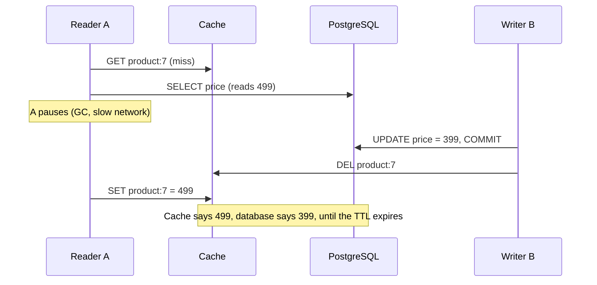
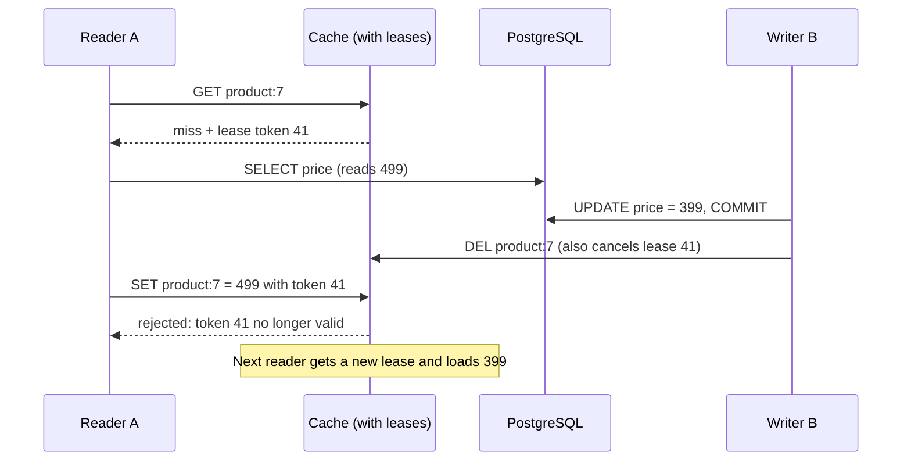
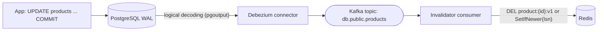

# Cache Invalidation, TTL and Consistency

> [!summary] TL;DR
> **Invalidation** removes or replaces a cached value because the source data changed; a **TTL** (time to live) makes a value expire on its own after a set time. Together they decide how **stale** (out of date) a cached read can be, and a few well-known races can leave a stale value in the cache even when every step looks correct.

> [!abstract] Core idea
> - First decide the freshness each feature needs: **strong** (must see the latest write), **bounded** (stale for at most N seconds) or **eventual** (catches up later).
> - A TTL bounds staleness on its own; explicit invalidation makes most changes visible sooner. Use both: the TTL is the safety net.
> - The order is: commit to the database, **then** delete the cache key. Even then a slow reader can put the old value back (the **stale-set race**).
> - Fixes for the race: leases, versioned values, versioned keys, or invalidation driven by the database's change log.
> - Add **jitter** to TTLs so keys written together do not expire together.

## 1. Why it exists

InvoiceOps caches each workspace's dashboard summary for 30 seconds. A customer records a ₹50,000 payment, refreshes the dashboard, and still sees the invoice as unpaid, because the cached summary is up to 30 seconds old. They record the payment again.

Two separate problems hide in that story:

- **Policy:** was 30 seconds of staleness acceptable for *this* screen right after *this* user's write? (Probably not for the user who just paid; fine for everyone else.)
- **Mechanism:** even if the payment handler deletes the cache key, can the old summary come back? Yes, through the race in section 3.

## 2. Mental model

A cached value is a **photograph** of the database. The TTL is the **date stamp** after which you throw the photo away. Invalidation is **someone shouting "that photo is old"** when the scene changes.

- If you only use date stamps, every photo is wrong for up to the TTL after a change.
- If you only shout, a missed shout (a crashed process, a lost message) leaves a wrong photo up forever.
- The stale-set race is a photographer who took a picture **just before** the change, walks back slowly, and pins it up **just after** the shout.

## 3. How it works

### Pick a freshness model per feature

| Model | Meaning | InvoiceOps example | How to get it |
| --- | --- | --- | --- |
| Strong | Every read sees the latest committed write | Payment confirmation, invoice balance before a refund | Do not cache, or validate by version against the database |
| Read-your-writes | The writer sees their own write at once; others may lag | The user who just recorded a payment | Skip the cache for that user for a few seconds, or read by version |
| Bounded staleness | At most N seconds old | Dashboard summary (30 s), client list (60 s) | TTL of N plus invalidation on write |
| Eventual | Converges at some point, no bound promised | Analytics roll-ups, recommendation lists | Long TTL or periodic rebuild |

State the model before choosing a mechanism. The general theory is in [[Consistency Models]].

### TTLs in Redis (measured on Redis 8.2)

```text
127.0.0.1:6391> SET a 1 EX 100
OK
127.0.0.1:6391> TTL a
(integer) 100
127.0.0.1:6391> SET a 2            # a plain SET replaces the value AND clears the TTL
OK
127.0.0.1:6391> TTL a
(integer) -1                       # -1: exists, no expiry
127.0.0.1:6391> SET b 1 EX 100
OK
127.0.0.1:6391> SET b 3 KEEPTTL    # KEEPTTL (Redis 6.0+) keeps the old expiry
OK
127.0.0.1:6391> TTL b
(integer) 100
127.0.0.1:6391> TTL nokey
(integer) -2                       # -2: key does not exist
```

The first trap is real: code that refreshes a value with a plain `SET` turns a cache entry into a permanent key. Always pass `EX`/`PX` (or `KEEPTTL`) on every write to a cache key.

**How Redis expires keys.** It combines two mechanisms:

- **Lazy (passive) expiry:** a key is checked when it is accessed; if it has expired, it is deleted and the read sees a miss.
- **Active expiry:** a background cycle, run `hz` times per second (default 10), samples keys that have a TTL and deletes expired ones, repeating while many sampled keys turn out to be expired.

Measured on Redis 8.2: 100,000 keys written with `PX 500`. One second later, without any reads, `DBSIZE` was 0 and `INFO stats` showed `expired_keys:100000`. Active expiry had removed them all. Expired keys are never returned to readers either way; the mechanisms only differ in when the memory is freed.

### Choosing a TTL and adding jitter

- Start from the freshness model: the TTL is the **maximum** staleness if every invalidation is lost.
- Shorter TTLs cost more misses. With 300 reads per second on one key and a 30 s TTL, there is one rebuild per 30 s (9,000 reads per rebuild). With a 1 s TTL there are 30 rebuilds in the same time.
- **Jitter:** keys written together by a deploy, warm-up script or batch job also expire together, and the database sees a burst of misses. Add a random ±10% to each TTL. With 30 s ± 3 s, a batch of keys written in the same second expires spread over 6 seconds instead of in one. Mass-expiry bursts are covered in [[Cache Failure Modes - Stampede, Avalanche, Penetration, Hot and Big Keys]].

### Invalidation strategies

| Strategy | How | Staleness bound | Cost |
| --- | --- | --- | --- |
| TTL only | Let entries expire | The TTL | Simple; every change is invisible for up to TTL |
| Delete on write | Writer deletes the key after commit | Usually milliseconds; TTL if the delete fails | Every writer must know every key it affects |
| Update on write | Writer sets the new value | Same, but concurrent writers can leave the older value | Needs a single writer or versions |
| Versioned keys | Key contains a version: `catalog:v{n}:product:7`; bump `n` to invalidate a whole group | Instant for the group | Old keys linger until TTL or eviction |
| Event / CDC driven | A consumer of the database change log deletes keys | Seconds (log lag) | Extra pipeline, but no write path can forget |
| Tag-based | Keep a set of keys per tag (`tag:ws_123` → keys) and delete all on change | Instant | Tag sets must be maintained and expire too |

### The stale-set race

Delete-on-write (as in [[Caching Patterns]]) still has a window:



The window needs a miss, then a write, then the slow fill, in that order, so it is rare per key. At millions of reads per second it happens every day. Facebook reported exactly this problem in its memcache deployment and fixed it with **leases**.

### The lease fix



A lease token is issued on a miss; a set is accepted only with the current token; a delete cancels the token. A lease must also expire on its own (a short timeout), or a filler that crashes after taking the lease blocks every later fill of that key; the teaching code below omits this timeout for brevity. Facebook's leases also rate-limit tokens per key (one every 10 seconds in the paper), which doubles as stampede protection: other readers wait briefly or take a slightly stale value instead of all querying the database.

## 4. Worked example

### Whiteboard version

```go
// Miss hands out a token; Del cancels it; Set needs the live token.
func (c *LeaseCache) Get(k string) (val string, hit bool, token uint64) {
	if v, ok := c.m[k]; ok {
		return v, true, 0
	}
	if _, held := c.leases[k]; held {
		return "", false, 0 // someone else is filling: wait or retry
	}
	c.next++
	c.leases[k] = c.next
	return "", false, c.next
}

func (c *LeaseCache) Set(k, v string, token uint64) bool {
	if token == 0 || c.leases[k] != token {
		return false // stale fill after a Del
	}
	delete(c.leases, k)
	c.m[k] = v
	return true
}
```

### Full code (Go 1.24, go-redis v9.7.0)

The package contains the unprotected cache (to reproduce the race), the lease cache (to fix it in memory), a Redis version guard (to fix it in Redis), and TTL jitter.

```go
// Package invalidation shows the stale-set race, the lease fix,
// a version-guarded set for Redis, and TTL jitter.
package invalidation

import (
	"context"
	"math/rand/v2"
	"sync"
	"time"

	"github.com/redis/go-redis/v9"
)

// PlainCache is a cache with no protection: any Set wins.
type PlainCache struct {
	mu sync.Mutex
	m  map[string]string
}

func NewPlain() *PlainCache { return &PlainCache{m: map[string]string{}} }

func (c *PlainCache) Get(k string) (string, bool) {
	c.mu.Lock()
	defer c.mu.Unlock()
	v, ok := c.m[k]
	return v, ok
}
func (c *PlainCache) Set(k, v string) { c.mu.Lock(); c.m[k] = v; c.mu.Unlock() }
func (c *PlainCache) Del(k string)    { c.mu.Lock(); delete(c.m, k); c.mu.Unlock() }

// LeaseCache follows the memcache lease idea: a miss hands out a token,
// a Set is accepted only with the current token, and Del cancels the token.
type LeaseCache struct {
	mu     sync.Mutex
	m      map[string]string
	leases map[string]uint64
	next   uint64
}

func NewLease() *LeaseCache {
	return &LeaseCache{m: map[string]string{}, leases: map[string]uint64{}}
}

// Get returns the value on a hit. On a miss it returns a lease token
// (0 means someone else already holds the lease: wait or retry).
func (c *LeaseCache) Get(k string) (val string, hit bool, token uint64) {
	c.mu.Lock()
	defer c.mu.Unlock()
	if v, ok := c.m[k]; ok {
		return v, true, 0
	}
	if _, held := c.leases[k]; held {
		return "", false, 0
	}
	c.next++
	c.leases[k] = c.next
	return "", false, c.next
}

// Set stores v only if token is still the live lease for k.
func (c *LeaseCache) Set(k, v string, token uint64) bool {
	c.mu.Lock()
	defer c.mu.Unlock()
	if token == 0 || c.leases[k] != token {
		return false
	}
	delete(c.leases, k)
	c.m[k] = v
	return true
}

// Del invalidates the value and any outstanding lease.
func (c *LeaseCache) Del(k string) {
	c.mu.Lock()
	defer c.mu.Unlock()
	delete(c.m, k)
	delete(c.leases, k)
}

// setIfNewer stores value only if version is greater than the stored one.
// KEYS[1]=key ARGV[1]=version ARGV[2]=value ARGV[3]=ttl ms
var setIfNewer = redis.NewScript(`
local cur = redis.call('HGET', KEYS[1], 'ver')
if cur and tonumber(cur) >= tonumber(ARGV[1]) then
  return 0
end
redis.call('HSET', KEYS[1], 'ver', ARGV[1], 'val', ARGV[2])
redis.call('PEXPIRE', KEYS[1], ARGV[3])
return 1
`)

// SetIfNewer writes (version, value) atomically unless the cache already
// holds the same or a newer version. Returns true if it wrote.
func SetIfNewer(ctx context.Context, c *redis.Client, key string, version int64, value string, ttl time.Duration) (bool, error) {
	n, err := setIfNewer.Run(ctx, c, []string{key}, version, value, ttl.Milliseconds()).Int()
	return n == 1, err
}

// Jitter returns ttl plus or minus up to frac*ttl, so keys written together
// do not all expire together.
func Jitter(ttl time.Duration, frac float64, r *rand.Rand) time.Duration {
	spread := float64(ttl) * frac
	return ttl + time.Duration((r.Float64()*2-1)*spread)
}
```

Why the version guard works: the version comes from the database row (for example, an `updated_version bigint` column incremented by every `UPDATE`, or the commit LSN from the change stream). A slow reader carries the version it read. Redis runs a Lua script atomically, so the compare and the write cannot interleave with another client's write. A late fill of version 4 cannot overwrite version 5. The guard needs the newer value to be **written** (update-on-write or CDC), not just deleted: after a plain `DEL` there is nothing left to compare against.

Measured on Redis 8.2 with the same script through `redis-cli EVAL`: writing version 5 returned `1`, a later write of version 4 returned `0`, and `HGETALL product:7` still showed `ver 5, val price=399`.

### Tests (pass `go vet` and `go test -race`; the Redis test ran against Redis 8.2)

```go
package invalidation

import (
	"context"
	"math/rand/v2"
	"testing"
	"time"

	"github.com/redis/go-redis/v9"
)

// The stale-set race, step by step, against a plain cache.
func TestStaleSetRaceWithoutLease(t *testing.T) {
	db := "price=499"
	c := NewPlain()

	// Reader A misses and reads the DB (old value).
	if _, ok := c.Get("p:7"); ok {
		t.Fatal("expected miss")
	}
	readByA := db

	// Writer B updates the DB and deletes the cache key.
	db = "price=399"
	c.Del("p:7")

	// A, delayed, now fills the cache with what it read.
	c.Set("p:7", readByA)

	if v, _ := c.Get("p:7"); v != "price=499" {
		t.Fatalf("expected the race to leave stale data, got %q", v)
	}
	_ = db
}

func TestLeaseRejectsStaleSet(t *testing.T) {
	db := "price=499"
	c := NewLease()

	_, hit, tokA := c.Get("p:7")
	if hit || tokA == 0 {
		t.Fatal("A should miss and get a lease")
	}
	readByA := db

	db = "price=399"
	c.Del("p:7") // cancels A's lease

	if c.Set("p:7", readByA, tokA) {
		t.Fatal("stale set must be rejected after Del")
	}

	// The next reader gets a fresh lease and fills the new value.
	_, _, tokC := c.Get("p:7")
	if !c.Set("p:7", db, tokC) {
		t.Fatal("fresh lease should be accepted")
	}
	if v, _, _ := c.Get("p:7"); v != "price=399" {
		t.Fatalf("got %q", v)
	}
}

func TestLeaseOnlyOneFiller(t *testing.T) {
	c := NewLease()
	_, _, t1 := c.Get("k")
	_, _, t2 := c.Get("k")
	if t1 == 0 || t2 != 0 {
		t.Fatalf("first miss gets a lease, second must wait: %d %d", t1, t2)
	}
}

func TestJitterBounds(t *testing.T) {
	r := rand.New(rand.NewPCG(1, 2))
	ttl := 30 * time.Second
	minSeen, maxSeen := ttl, ttl
	for range 10000 {
		j := Jitter(ttl, 0.1, r)
		if j < 27*time.Second || j > 33*time.Second {
			t.Fatalf("jitter %v outside ±10%%", j)
		}
		minSeen, maxSeen = min(minSeen, j), max(maxSeen, j)
	}
	if maxSeen-minSeen < 5*time.Second {
		t.Fatalf("jitter not spreading: %v..%v", minSeen, maxSeen)
	}
}

func TestSetIfNewerRedis(t *testing.T) {
	c := redis.NewClient(&redis.Options{Addr: "localhost:6391"})
	defer c.Close()
	ctx := context.Background()
	if err := c.Ping(ctx).Err(); err != nil {
		t.Skip("no Redis on :6391")
	}
	c.Del(ctx, "product:7")
	steps := []struct {
		ver  int64
		val  string
		want bool
	}{
		{5, "price=399", true},  // newest write lands first
		{4, "price=499", false}, // delayed stale fill is rejected
		{5, "price=399", false}, // same version: no-op
		{6, "price=349", true},
	}
	for _, s := range steps {
		ok, err := SetIfNewer(ctx, c, "product:7", s.ver, s.val, time.Minute)
		if err != nil || ok != s.want {
			t.Fatalf("ver %d: wrote=%v err=%v, want %v", s.ver, ok, err, s.want)
		}
	}
	if v := c.HGet(ctx, "product:7", "val").Val(); v != "price=349" {
		t.Fatalf("final value %q", v)
	}
}
```

### Versioned keys for group invalidation

When a change affects many keys (a catalogue re-import, a tenant's price list), deleting each key is slow and easy to get wrong. Keep a **namespace version** and put it in every key:

```text
127.0.0.1:6391> SET ns:catalog 1
OK
# readers build keys as  catalog:v1:product:7, catalog:v1:list:page:3 ...
127.0.0.1:6391> INCR ns:catalog
(integer) 2
# readers now build      catalog:v2:...  -> all misses; v1 keys age out by TTL or eviction
```

Measured on Redis 8.2. The cost is one extra read of `ns:catalog` per request (cache it in-process for a second) and a brief burst of misses after each bump.

### CDC-driven invalidation



The database's write-ahead log already records every committed change in commit order. A connector such as Debezium reads it through PostgreSQL logical decoding and publishes change events; a consumer deletes or version-sets the affected keys. No application code path can forget to invalidate, rollbacks never reach the cache (only commits are in the log), and the commit position (LSN) is a natural version. The cost is a pipeline to run and a lag of typically well under a second to a few seconds (an estimate; measure your connector's lag). See [[Transactional Outbox and CDC]].

## 5. Variants and comparison

| Fix for stale data | Prevents the stale-set race? | Needs | Use when |
| --- | --- | --- | --- |
| Short TTL only | No, but bounds it | Nothing | Bounded staleness is acceptable |
| Delete after commit | No (narrow window remains) | Writers know their keys | Default, together with a TTL |
| Delayed double delete | Mostly (second delete after ~1 s catches late fills) | A delayed job | Cheap improvement when leases are unavailable |
| Leases | Yes | Cache support (memcache-style) or a wrapper | Very high read rates, Facebook-style |
| Version-guarded set | Yes, if writes store the new version instead of only deleting | A monotonic version per row; Lua or `WATCH`/`MULTI` | Rows carry a version or you consume CDC |
| Versioned keys | Yes for the bumped group | A namespace counter | Bulk changes, schema changes |
| CDC-driven invalidation | Removes "forgot to invalidate"; combine with versions for the race | Debezium or similar, a consumer | Many writers, many services sharing a cache |

## 6. Trade-offs and when not to use

- Every invalidation mechanism is an extra moving part. If the feature can live with a 30 s TTL, a TTL alone is often the right answer.
- Delete-on-write requires every writer, including batch jobs, admin scripts and other services, to know every derived key. Aggregates (a dashboard summary derived from 10 tables) make that fragile; CDC or a short TTL scales better.
- Leases and version guards add latency and code to the read path. Use them where the race actually hurts (prices, stock, permissions), not on every key.
- Versioned keys leave garbage behind. Without TTLs, old versions sit in memory until evicted.
- **Do not** try to make a cache strongly consistent with distributed transactions. If a read must be exactly current, read the database.

## 7. In production

- **Real systems:** Facebook's memcache leases and its use of MySQL's commit log to broadcast deletes across regions (the "mcsqueal" daemons in the NSDI 2013 paper) are the reference design. Debezium-to-Kafka invalidators are a common open-source version of the same idea.
- **Failure modes → fixes:**
	- Plain `SET` drops the TTL and the key lives forever → always write with `EX`/`PX` or `KEEPTTL`; alert on keys without TTL in a cache keyspace (`INFO keyspace` shows `keys` vs `expires`).
	- Delete fails after commit (Redis timeout) → retry with backoff; rely on the TTL; or move invalidation to CDC.
	- Invalidation consumer lags or stops → alert on consumer lag; the TTL still bounds staleness.
	- Read replica lag refills the cache with old data (cache miss reads a replica that has not applied the write yet) → fill the cache from the primary right after writes, or use version guards. See [[Replication]].
	- Mass expiry after a warm-up job → jitter TTLs.
- **What to monitor:** keys without TTL; `expired_keys` rate; invalidation errors and retries; CDC lag; a sampled **staleness check** (read a key from the cache and the database, compare versions, export the mismatch rate).

## 8. Deep dive

- **Delayed double delete.** Delete, then delete again about a second later (longer than a typical read-to-fill). Late fills that land in between are removed by the second delete. It shrinks the window but cannot close it: a fill delayed longer than the gap still wins.
- **Why a version guard needs the newer value written.** After `DEL`, a late fill with version 4 finds no stored version and succeeds. Pair the guard with update-on-write (set version 5 after commit) or with CDC that sets the new version, or keep a short-lived "tombstone with version" instead of deleting.
- **`WATCH`/`MULTI` vs Lua.** Both give atomic check-and-set in Redis. `WATCH` is optimistic: the `EXEC` fails if the key changed, and the client retries. Lua runs the whole script atomically on the server in one round trip. In Redis Cluster both work only on keys in the same hash slot.
- **Invalidation across regions.** Each region usually has its own cache. Deletes must reach every region; driving them from each region's replicated commit log means a region invalidates only after its own database replica has the change, which avoids refilling from a lagging replica.
- **Leases and stampedes are the same problem from two sides.** Both are "who is allowed to fill this key". The lease answers it for correctness (no stale fill); with a token rate limit it also answers it for load (one filler). Load-side techniques are in [[Cache Failure Modes - Stampede, Avalanche, Penetration, Hot and Big Keys]].
- **Eviction is not invalidation.** Eviction removes a key because memory is full ([[Cache Eviction Policies - LRU, LFU, TTL]]); invalidation removes it because it is wrong. A system that relies on eviction to clear stale data has no staleness bound.

## 9. Interview questions

> [!question]- Walk through the stale-set race in cache-aside with delete-on-write.
> Reader A misses and reads the old row. Writer B commits a new value and deletes the key. A, delayed, sets the old value. The cache now disagrees with the database until the TTL. Fixes: leases, version-guarded sets, delayed double delete, or a short TTL.

> [!question]- Trap: should you delete the cache key before or after the database write?
> After the commit. Deleting first lets a concurrent reader refill the old value before your write commits, and that stale value then lives for a full TTL. Deleting after commit leaves only the narrower stale-set race.

> [!question]- How do you choose a TTL?
> From the freshness the feature can tolerate if every invalidation is lost: that is the upper bound. Then weigh miss cost against staleness, and add about ±10% jitter so keys written together expire apart. Hot, expensive keys may also need refresh-ahead.

> [!question]- How would you invalidate thousands of keys after a catalogue import?
> Bump a namespace version (`INCR ns:catalog`) that is part of every key, so all readers move to new keys at once; old keys expire by TTL. Avoid `KEYS pattern` + `DEL`, which blocks Redis, and avoid deleting one by one from the import job.

> [!question]- Why invalidate from CDC instead of from application code?
> The commit log sees every committed change from every writer, in order, including scripts and other services, and never sees rolled-back changes. Its position (LSN) is a ready-made version for guarded sets. The costs are an extra pipeline and seconds of lag.

> [!question]- A user updates their profile and immediately sees the old one. What do you do?
> That is a read-your-writes violation. Delete the key after commit and, for that user's next reads, bypass the cache for a few seconds or read by version. Also check that cache fills after a miss do not come from a lagging read replica.

## 10. Cheat sheet

- Decide the freshness model per feature: strong, read-your-writes, bounded, eventual.
- TTL = maximum staleness if invalidation fails; add ±10% jitter.
- Redis: a plain `SET` clears the TTL; `TTL` returns -1 (no expiry) or -2 (missing).
- Redis expires keys lazily on access and actively in a background cycle (`hz` 10 by default).
- Commit first, then delete. The stale-set race still exists.
- Race fixes: leases, version-guarded set (Lua), versioned keys, CDC-driven invalidation.
- Eviction is not invalidation.

## Links

- **Before this:** [[Caching Fundamentals]], [[Caching Patterns]]
- **Next:** [[Cache Eviction Policies - LRU, LFU, TTL]], [[Cache Failure Modes - Stampede, Avalanche, Penetration, Hot and Big Keys]]
- **Compare with:** [[Consistency Models]], [[Transactional Outbox and CDC]], [[HTTP Caching - Cache-Control, ETag, Conditional Requests]] (validation with ETags instead of invalidation)
